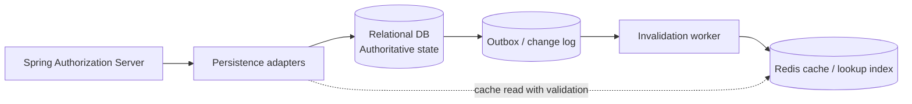
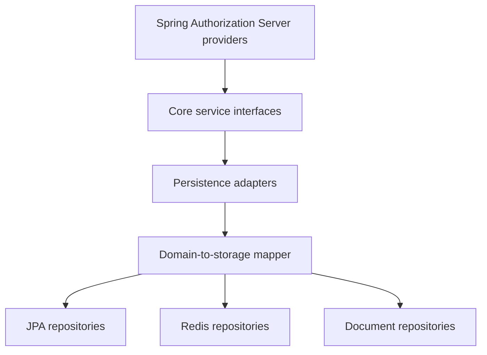
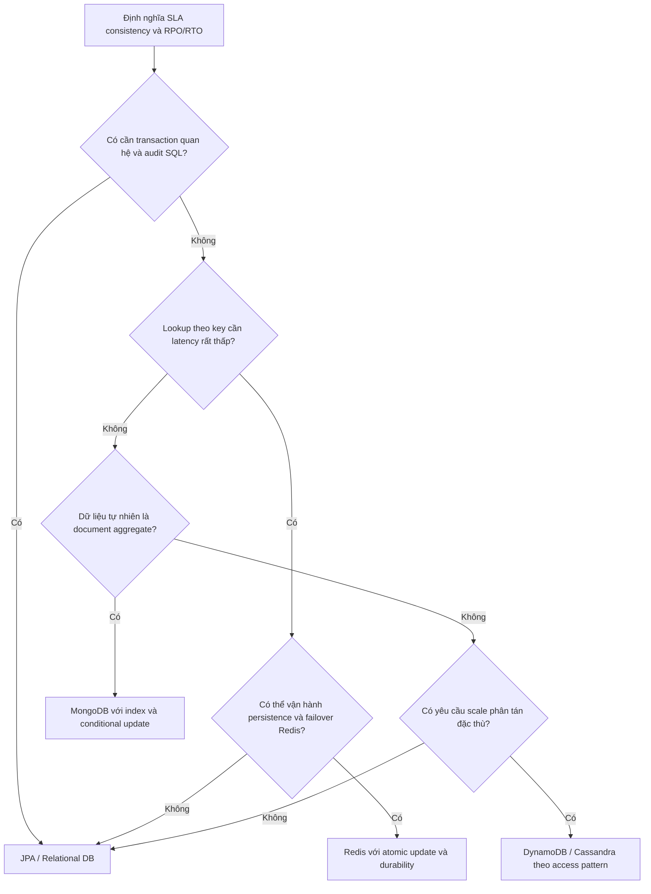

# Lựa chọn JPA, Redis hoặc kho dữ liệu khác theo yêu cầu nhất quán

Persistence của Spring Authorization Server không chỉ là chọn nơi ghi object. Mỗi authorization có thể chứa authorization code, access token, refresh token, ID Token, device code, trạng thái invalidation, scope và metadata. Khi token được refresh hoặc revoke, các instance phải nhìn thấy trạng thái mới đúng thời điểm. Một kho dữ liệu nhanh nhưng để một node đọc trạng thái cũ có thể làm token đã bị thu hồi tiếp tục được chấp nhận; một kho dữ liệu bền vững nhưng không tra cứu được token theo các khóa mà protocol cần cũng không đáp ứng được contract của Authorization Server.

Spring Authorization Server định nghĩa ba core persistence services: `RegisteredClientRepository`, `OAuth2AuthorizationService` và `OAuth2AuthorizationConsentService`. Framework cung cấp JDBC implementations; các hướng dẫn chính thức cũng trình bày cách tự triển khai các service này với JPA và Redis. Các hướng dẫn JPA/Redis là điểm khởi đầu để xây dựng adapter, không phải một lựa chọn database mặc định phù hợp mọi tải và mọi yêu cầu nhất quán. <https://docs.spring.io/spring-authorization-server/reference/guides/how-to-jpa.html> <https://docs.spring.io/spring-authorization-server/reference/guides/how-to-redis.html>

Bài thuộc chương **Lưu trữ tùy chỉnh** của mô-đun **SPRING_SECURITY_OIDC_AUTHORIZATION_SERVER**. Mục tiêu là chọn JPA, Redis hoặc một kho dữ liệu khác dựa trên consistency, durability, latency, khả năng mở rộng và yêu cầu vận hành; sau đó thiết kế adapter sao cho mọi implementation đều giữ nguyên semantics của OAuth 2.0/OpenID Connect.

**Phạm vi ví dụ:** API minh họa dựa trên Spring Authorization Server 1.5.8 và Spring Security tương thích. Hãy đối chiếu dependency thực tế của dự án trước khi sao chép code vì package, API cấu hình và model có thể thay đổi giữa các phiên bản.

## 1. Bắt đầu từ contract của Spring Authorization Server

### 1.1. Ba service có ba trách nhiệm khác nhau

| Service | Trách nhiệm | Các thao tác cốt lõi |
|---|---|---|
| `RegisteredClientRepository` | Quản lý metadata và cấu hình client đã đăng ký | `save`, `findById`, `findByClientId` |
| `OAuth2AuthorizationService` | Lưu và tra cứu trạng thái của authorization cùng token | `save`, `remove`, `findById`, `findByToken` |
| `OAuth2AuthorizationConsentService` | Lưu quyết định consent của resource owner cho client | `save`, `remove`, `findById` |

`RegisteredClientRepository` là thành phần bắt buộc. Hai service còn lại có thể mặc định dùng in-memory implementation nếu ứng dụng không cung cấp bean thay thế. Trong production, cần quyết định rõ cả ba service được lưu ở đâu và service nào là nguồn dữ liệu có thẩm quyền. <https://docs.spring.io/spring-authorization-server/reference/core-model-components.html>

### 1.2. Contract của RegisteredClientRepository

`RegisteredClient` chứa các thông tin có ảnh hưởng trực tiếp tới bảo mật:

- Internal ID và public `clientId`;
- Client secret đã được encode và thời điểm hết hạn;
- Authentication methods;
- Grant types;
- Redirect URI và post-logout redirect URI;
- Scopes;
- Client settings, ví dụ yêu cầu PKCE hoặc consent;
- Token settings, ví dụ TTL, access-token format và refresh-token reuse.

Implementation phải hỗ trợ lookup theo cả internal ID và client ID. Internal ID được authorization tham chiếu tới; public client ID được dùng trong protocol và client authentication. Không tự tạo internal ID mới khi update registration đang được authorization cũ sử dụng.

### 1.3. Contract của OAuth2AuthorizationService

`OAuth2Authorization` là aggregate trạng thái của một lần cấp quyền. Tùy grant type, nó có thể chứa:

- Registered client ID, principal name, grant type và authorized scopes;
- Authorization request attributes và state;
- Authorization code;
- Access token và token type;
- Refresh token;
- OIDC ID Token và claims;
- Device code, user code;
- Metadata cho từng token, gồm issued-at, expires-at, claims và trạng thái invalidated.

Các phương thức cần giữ đúng semantics:

- `save(authorization)` ghi trạng thái mới hoặc cập nhật authorization hiện có;
- `remove(authorization)` xóa authorization theo chính sách của hệ thống;
- `findById(id)` khôi phục authorization;
- `findByToken(token, tokenType)` tìm authorization chứa credential hoặc state tương ứng.

`findByToken` là đường truy cập quan trọng. Khi `tokenType` được chỉ định, implementation cần tra đúng loại token. Các loại có thể gồm state, authorization code, access token, refresh token, ID Token, user code và device code. Khi `tokenType` là null, cần hỗ trợ lookup theo tập token/state mà contract của phiên bản đang dùng yêu cầu.

Không triển khai lookup chỉ theo access token rồi bỏ qua refresh token, code hoặc device code nếu ứng dụng bật các grant tương ứng. Việc thiếu một nhánh lookup có thể làm introspection, revocation, token exchange hoặc device authorization thất bại.

### 1.4. Contract của OAuth2AuthorizationConsentService

Consent được định danh bởi cặp `(registeredClientId, principalName)`. Service phải lưu và đọc lại tập authorities đã được người dùng chấp thuận, đồng thời xóa consent khi người dùng thu hồi hoặc ứng dụng yêu cầu xóa theo policy.

Consent là trạng thái bảo mật. Nếu một node xử lý authorization request ngay sau khi người dùng thu hồi consent nhưng lại đọc bản sao cũ, node đó có thể tiếp tục hành xử như consent vẫn còn hiệu lực.

### 1.5. Mọi implementation phải khôi phục cùng một domain object

Database entity, Redis hash hoặc document chỉ là representation lưu trữ. Khi service đọc dữ liệu, nó phải khôi phục được object framework cần với đầy đủ token, metadata, scopes, attributes và invalidation state.

Không trả một `OAuth2Authorization` chỉ có access token value trong khi bỏ refresh token hoặc token metadata. Một object thiếu dữ liệu có thể vượt qua test lookup đơn giản nhưng lỗi ở refresh, introspection, revocation hoặc OIDC.

## 2. Định nghĩa consistency trước khi chọn công nghệ

### 2.1. Các mức nhất quán cần xem xét

| Yêu cầu | Ý nghĩa đối với Authorization Server | Câu hỏi kiểm chứng |
|---|---|---|
| Read-after-write | Node đọc được trạng thái vừa ghi | Sau khi phát token, request kế tiếp có tìm thấy authorization không? |
| Atomic update | Một thay đổi trạng thái được nhìn như một đơn vị | Token cũ và token mới có thể cùng được đánh dấu active không? |
| Strong/linearizable read | Đọc phản ánh write đã hoàn tất theo thứ tự được bảo đảm | Sau revoke thành công, introspection có thể trả active không? |
| Eventual consistency | Bản sao có thể hội tụ sau một khoảng trễ | Hệ thống có chấp nhận một cửa sổ ngắn mà node khác thấy trạng thái cũ không? |
| Durability | Write đã xác nhận tồn tại sau crash/failover trong giới hạn đã cam kết | Mất điện hoặc chuyển primary có làm mất authorization vừa phát không? |
| Isolation/concurrency control | Các request đồng thời không làm hỏng trạng thái | Hai refresh request cùng dùng một token có thể cùng thành công không? |

Không phải mọi thao tác đều cần cùng một mức consistency. Ví dụ, màn hình thống kê client có thể chấp nhận dữ liệu trễ vài giây. Token revocation, refresh-token rotation và client authentication thường cần hành vi chặt chẽ hơn.

### 2.2. Các bất biến bảo mật

Trước khi thiết kế schema, ghi rõ những bất biến mà hệ thống phải giữ:

1. Một client ID chỉ ánh xạ tới registration hợp lệ và duy nhất.
2. Authorization luôn tham chiếu đúng internal ID của RegisteredClient.
3. Token có trạng thái invalidated/revoked không được trả là active.
4. Refresh token đã rotate không được dùng thành công lần nữa nếu policy cấm reuse.
5. Consent đã thu hồi phải được các node áp dụng theo SLA đã công bố.
6. Một token lookup phải xác định đúng loại token và đúng authorization.
7. Authorization code, device code và user code phải được xử lý theo trạng thái và thời hạn của chính chúng.
8. Các claims, attributes và metadata phải được khôi phục mà không thay đổi ý nghĩa.

Các bất biến này là tiêu chí đánh giá JPA, Redis hoặc document store. Nếu một giải pháp không giữ được chúng dưới concurrency hoặc failover, latency thấp không đủ để bù đắp.

### 2.3. Xác định consistency theo thao tác

| Thao tác | Mức khuyến nghị | Lý do |
|---|---|---|
| Đọc RegisteredClient trong client authentication | Đọc nhất quán; cache có invalidation rõ | Redirect URI, grant và authentication method là cấu hình bảo mật |
| Cập nhật client registration | Ghi bền vững và có hiệu lực có kiểm soát | Không để node khác tiếp tục tin cấu hình cũ vô thời hạn |
| Lưu authorization mới | Atomic write và read-after-write | Token response chỉ nên được phát khi trạng thái cần thiết đã lưu thành công |
| Tra cứu authorization code | Đọc nhất quán và kiểm soát consume một lần | Tránh code replay hoặc hai request đổi code cùng thành công |
| Refresh token rotation | Atomic compare-and-update | Không để hai request đồng thời cùng rotate một refresh token |
| Revocation | Ghi bền vững, trạng thái mới lan truyền theo SLA chặt | Token đã revoke không nên tiếp tục được chấp nhận ngoài cửa sổ đã xác định |
| Introspection | Đọc trạng thái phù hợp với cam kết revocation | Resource Server cần nhận active/inactive đúng policy |
| Consent save/remove | Read-after-write theo principal/client | Request tiếp theo phải phản ánh quyết định người dùng |
| Dashboard/analytics | Có thể chấp nhận eventual consistency | Không quyết định việc chấp nhận token |

## 3. JPA và cơ sở dữ liệu quan hệ

### 3.1. Khi nào JPA là lựa chọn phù hợp?

JPA phù hợp khi hệ thống cần một nguồn dữ liệu có thẩm quyền với transaction, unique constraint, quan hệ dữ liệu và truy vấn quản trị. Đây thường là lựa chọn dễ kiểm soát khi Authorization Server cần bảo đảm các cập nhật liên quan đến authorization, token và consent được commit trong transaction của database quan hệ.

Các tình huống phù hợp:

- Đã vận hành PostgreSQL, MySQL hoặc database quan hệ có HA;
- Cần transaction và ràng buộc dữ liệu;
- Cần báo cáo, audit hoặc truy vấn theo client, principal và thời gian;
- Cần cập nhật nhiều bảng trong cùng transaction;
- Cần concurrency control qua optimistic/pessimistic locking;
- Có thể chấp nhận latency truy vấn của database và tối ưu bằng index/pool.

JPA không tự động làm cho service thread-safe hoặc atomic ở mức protocol. Transaction boundary, lock strategy và repository query vẫn cần được thiết kế.

### 3.2. Mô hình dữ liệu

Có thể ánh xạ ba domain object vào ba aggregate/entity chính:

| Entity | Khóa/lookup | Dữ liệu |
|---|---|---|
| Client | Primary key internal ID; unique index trên client ID | Authentication methods, grant types, URI, scopes, settings |
| Authorization | Primary key authorization ID; index theo token/state và loại token | Principal, client ID, grant, scopes, token values/metadata, attributes |
| Consent | Composite key client ID + principal name | Authorities được chấp thuận |

Authorization có thể được lưu theo hai hướng:

- **Flattened aggregate:** một row chứa các cột dành cho từng token và metadata. Lookup token có thể dùng index riêng, nhưng bảng rộng và có nhiều cột nullable.
- **Normalized aggregate:** một bảng authorization gốc cùng bảng token con. Mô hình dễ mở rộng loại token, nhưng cần transaction để ghi/xóa đồng bộ và truy vấn có thể phải join.

Hướng dẫn JPA chính thức của Spring Authorization Server minh họa mô hình đơn giản và flattened authorization entity. Tài liệu cũng cảnh báo chiều dài cột mặc định có thể không đủ cho token, metadata, settings hoặc claims; cần thử nghiệm và điều chỉnh trước production. <https://docs.spring.io/spring-authorization-server/reference/guides/how-to-jpa.html>

### 3.3. Index cho findByToken

Không chỉ index authorization ID. Hãy thiết kế truy vấn theo các loại token mà service hỗ trợ:

- Authorization code;
- Access token;
- Refresh token;
- OIDC ID Token;
- Device code;
- User code;
- State hoặc device state.

Nếu lưu token value trực tiếp, cần xem kích thước index và đặc điểm database. Với token dài hoặc dữ liệu nhạy cảm, có thể lưu encrypted value và một lookup digest có index. Khi đó service phải hash token đầu vào theo cùng cách, tìm đúng record và vẫn khôi phục đầy đủ domain object cần thiết.

Một lookup digest không thay thế token validation. Nó chỉ là khóa tra cứu; framework/provider vẫn phải kiểm tra thời hạn, trạng thái invalidated và các điều kiện protocol.

### 3.4. Transaction và khóa đồng thời

Một refresh flow có thể được xử lý đồng thời bởi hai request đến hai instance khác nhau. Nếu cả hai cùng đọc authorization trước khi một request cập nhật refresh token, cả hai có thể cùng nghĩ token cũ còn hợp lệ.

Với JPA, có thể dùng:

- `@Version` để phát hiện optimistic update conflict;
- Pessimistic lock trên authorization row khi cần serialize cập nhật;
- Unique constraint cho token index;
- Transaction bao quanh việc đọc trạng thái, xác minh và cập nhật authorization.

Ví dụ repository minh họa:

```java
import java.util.Optional;

import org.springframework.data.jpa.repository.JpaRepository;
import org.springframework.data.jpa.repository.Lock;
import org.springframework.data.jpa.repository.Query;
import org.springframework.data.repository.query.Param;

import jakarta.persistence.LockModeType;

public interface AuthorizationRepository
        extends JpaRepository<AuthorizationEntity, String> {

    Optional<AuthorizationEntity> findByRefreshTokenHash(String tokenHash);

    @Lock(LockModeType.PESSIMISTIC_WRITE)
    @Query("select a from AuthorizationEntity a where a.id = :id")
    Optional<AuthorizationEntity> findByIdForUpdate(@Param("id") String id);
}
```

Đây là ví dụ về điểm khóa dữ liệu; `AuthorizationEntity` là entity do ứng dụng định nghĩa. Hãy khai báo transaction phù hợp và kiểm tra SQL do JPA provider sinh ra. Nếu dùng optimistic locking, phải xử lý `OptimisticLockException`/concurrency conflict bằng policy rõ ràng, không retry mù quáng khiến refresh token cũ được chấp nhận lần nữa.

### 3.5. Giữ toàn bộ thay đổi trong transaction

Pseudocode cho refresh-token rotation:

```java
@Transactional
public OAuth2Authorization rotateRefreshToken(String rawRefreshToken) {
    AuthorizationEntity entity = repository
            .findByRefreshTokenHash(hash(rawRefreshToken))
            .orElseThrow(this::invalidGrant);

    assertNotExpired(entity);
    assertNotInvalidated(entity);

    OAuth2Authorization current = mapper.toDomain(entity);
    OAuth2Authorization updated = tokenIssuer.rotate(current);

    repository.save(mapper.toEntity(updated));
    return updated;
}
```

`hash`, `tokenIssuer`, `mapper` và `assert...` là thành phần minh họa của ứng dụng. Protocol provider vẫn cần điều phối đúng OAuth grant flow. Điểm chính là thao tác đọc-trạng thái, xác minh, đánh dấu token cũ và lưu token mới phải có concurrency control. Nếu transaction thất bại, không được phát token mới cho client.

### 3.6. Serialize settings và attributes an toàn

`RegisteredClient` có client/token settings dạng map. `OAuth2Authorization` có attributes và token metadata. Cần định nghĩa serialization ổn định:

- Dùng JSON mapper có các module Spring Security và Spring Authorization Server cần thiết;
- Không bật polymorphic typing quá rộng cho dữ liệu không tin cậy;
- Có schema/version cho payload khi domain object thay đổi;
- Giữ nguyên kiểu dữ liệu của Instant, Set, claims và các token-specific metadata;
- Có kiểm thử đọc lại dữ liệu được tạo bởi phiên bản ứng dụng trước.

Hướng dẫn JPA chính thức đăng ký `SecurityJackson2Modules` và `OAuth2AuthorizationServerJackson2Module` cho mapper. Đây là chi tiết quan trọng vì một ObjectMapper mặc định có thể không deserialize đúng các kiểu Spring Security. <https://docs.spring.io/spring-authorization-server/reference/guides/how-to-jpa.html>

### 3.7. Rủi ro của JPA

- Entity authorization có nhiều trường lớn; eager loading hoặc serialize không kiểm soát có thể làm tăng heap.
- Truy vấn token thiếu index có thể full scan.
- Pessimistic lock lâu có thể giảm throughput.
- Optimistic conflict tăng khi nhiều refresh request cùng cập nhật một record.
- Column length cố định có thể làm hỏng save khi claims/metadata tăng.
- Thay schema hoặc serialization mà không version hóa có thể khiến dữ liệu cũ không đọc được.

JPA phù hợp khi team có năng lực database và cần consistency rõ ràng. Nó vẫn cần load test với token payload thực tế và concurrency gần với production.

## 4. Redis và kho key-value

### 4.1. Khi nào Redis phù hợp?

Redis phù hợp khi latency thấp, lookup theo key và throughput cao là ưu tiên. Mô hình key-value/hash cũng hữu ích cho authorization có vòng đời ngắn, device code hoặc state cần expire tự động.

Các tình huống phù hợp:

- Token/state lookup là workload lớn và có key rõ ràng;
- Có thể thiết kế secondary index theo token type;
- Team đã vận hành Redis HA, backup và monitoring;
- Có thể cấu hình persistence theo mức mất dữ liệu chấp nhận được;
- Có chiến lược atomic update cho refresh/revocation;
- Có cách bảo đảm read-after-write giữa primary, replica và các node ứng dụng.

Redis không nên được chọn chỉ vì nó nhanh. Nếu dùng Redis như nguồn dữ liệu duy nhất, phải bật và kiểm chứng persistence, replication, failover, backup và recovery. Redis có thể chạy không persistence; khi đó restart có thể làm mất dữ liệu. <https://redis.io/docs/latest/operate/oss_and_stack/management/persistence/>

Với đường đọc quyết định token còn active hay không, hãy đọc từ primary hoặc từ topology có cam kết read-after-write tương ứng. Không đọc replica bất đồng bộ ngay sau revoke/refresh rồi mặc định dữ liệu đã hội tụ. Nếu hệ thống cho phép replica lag, hãy đo cửa sổ đó và đưa nó vào SLA của revocation.

### 4.2. Mô hình key

Một mô hình khái niệm có thể gồm:

| Key pattern | Nội dung |
|---|---|
| `client:{clientId}` | RegisteredClient đã serialize |
| `authorization:{authorizationId}` | Authorization aggregate |
| `token-index:{tokenType}:{tokenDigest}` | Trỏ tới authorization ID |
| `consent:{clientId}:{subjectKey}` | Consent của principal cho client |

Đây là naming convention minh họa. Khi dùng Redis Cluster, nhiều key cần cập nhật trong cùng Lua script/transaction phải được bố trí cùng hash slot. Nếu index và aggregate nằm ở các slot khác nhau, không thể mặc định thực hiện một multi-key atomic operation trên toàn bộ chúng.

Một lựa chọn khác là lưu authorization theo từng loại grant với các index cần thiết. Hướng dẫn Redis chính thức của Spring Authorization Server minh họa các entity riêng cho authorization code, client credentials, device code, OIDC authorization code và token exchange. Mô hình này làm rõ trường cần index cho từng flow nhưng tăng số converter và mapper cần duy trì. <https://docs.spring.io/spring-authorization-server/reference/guides/how-to-redis.html>

### 4.3. Secondary index là một phần của dữ liệu protocol

Nếu lưu authorization aggregate ở một key nhưng `findByToken` phải tra theo token, cần index từ token digest tới authorization ID. Khi save hoặc update authorization:

1. Tạo digest của token theo một thuật toán ổn định;
2. Ghi authorization aggregate;
3. Ghi index cho từng token/state còn được phép tra cứu;
4. Xóa index cũ khi token bị thay thế hoặc authorization bị remove;
5. Đảm bảo các thao tác liên quan được atomic hoặc có cơ chế phục hồi khi một phần ghi thất bại.

Nếu chỉ cập nhật aggregate mà quên index, token có thể tồn tại nhưng `findByToken` không tìm thấy. Nếu xóa index trước khi aggregate được cập nhật và thao tác sau đó lỗi, trạng thái có thể bị mất khả năng tra cứu.

### 4.4. Atomicity với Redis

Redis hỗ trợ `MULTI`, `EXEC`, `DISCARD` và Lua scripting. Spring Data Redis cung cấp `SessionCallback` để chạy các thao tác cần dùng cùng connection. Tuy nhiên, `RedisTemplate` không mặc định tham gia Spring-managed transaction; muốn tích hợp cần bật transaction support cho template. <https://docs.spring.io/spring-data/redis/reference/redis/transactions.html>

Một transaction Redis không phải transaction SQL tổng quát có rollback mọi side effect. Hãy thiết kế thao tác như một batch nguyên tử ở Redis và xử lý command error, timeout, retry, partial application theo semantics của Redis. Với refresh token rotation, Lua script hoặc một thao tác compare-and-set có thể kiểm tra trạng thái cũ và thay đổi sang trạng thái mới trong cùng lệnh thực thi.

Pseudocode mô tả ý tưởng compare-and-set:

```lua
-- Pseudocode: key layout và field names cần được thiết kế
-- phù hợp với Redis Cluster hash slots.
if redis.call("HGET", authorizationKey, "refreshTokenDigest") ~= oldDigest then
    return 0
end

if redis.call("HGET", authorizationKey, "refreshTokenInvalidated") == "true" then
    return 0
end

redis.call("HSET", authorizationKey,
    "refreshTokenDigest", newDigest,
    "refreshTokenInvalidated", "false")

return 1
```

Đây không phải script production dùng trực tiếp: cần xác định chính xác key, TTL, token metadata, index update, error handling và cluster slot. Mục tiêu là minh họa compare-and-set, giúp chỉ một request thắng khi nhiều refresh request cùng cạnh tranh trên trạng thái cũ.

### 4.5. TTL phải theo vòng đời của cả authorization

Một authorization có thể chứa access token ngắn hạn và refresh token dài hạn. Nếu đặt TTL của aggregate theo access token expiry, Redis có thể xóa cả refresh token còn hiệu lực. Nếu không đặt TTL, key hết hạn có thể tích lũy.

Một cách thiết kế là đặt TTL aggregate theo thời điểm hết hạn muộn nhất của các credential còn hiệu lực, cộng retention cần thiết cho cleanup/audit. Khi refresh token được rotate, phải tính lại TTL và cập nhật index. Consent và client registration thường không nên dùng cùng TTL với token.

Không xóa authorization chỉ vì một token con hết hạn nếu authorization còn token khác hoặc cần giữ trạng thái để revocation/introspection.

### 4.6. Durability và failover

Redis có các lựa chọn persistence:

- **RDB:** snapshot tại những thời điểm cấu hình; restore nhanh và file gọn, nhưng có thể mất các write kể từ snapshot gần nhất.
- **AOF:** ghi lại các lệnh thay đổi; mức fsync quyết định cửa sổ mất dữ liệu và chi phí hiệu năng.
- **RDB + AOF:** kết hợp snapshot và append-only log.

Theo tài liệu Redis, AOF với `appendfsync everysec` thường có thể mất khoảng một giây write trong sự cố; `appendfsync always` tăng durability nhưng có chi phí hiệu năng. Replication giúp tăng khả năng sẵn sàng nhưng không thay thế persistence và backup. Hãy kiểm tra cấu hình dịch vụ Redis đang dùng, vì managed Redis có thể cung cấp các lựa chọn khác nhau. <https://redis.io/docs/latest/operate/oss_and_stack/management/persistence/>

Đối với token revocation hoặc refresh rotation, hãy xác định rõ: nếu primary fail ngay sau khi xác nhận write nhưng trước khi replica nhận dữ liệu, hệ thống chấp nhận điều gì? Nếu không thể chấp nhận token đã revoke sống lại sau failover, cần cấu hình và kiến trúc đáp ứng durability/consistency đó, hoặc chọn relational database làm nguồn dữ liệu có thẩm quyền.

### 4.7. Redis không tự động chia sẻ Spring transaction với JPA

Nếu authorization nằm ở PostgreSQL nhưng token index/cache nằm ở Redis, `@Transactional` của JPA không làm hai hệ thống commit nguyên tử. Spring Data Redis có thể tham gia một số transaction configuration khi được bật, nhưng điều đó không biến hai datastore độc lập thành một distributed transaction an toàn.

Với mô hình hybrid, hãy dùng outbox, write-through có recovery hoặc quy trình invalidation có thể lặp lại. Tránh ghi database thành công nhưng Redis index thất bại mà không có cơ chế sửa; đồng thời tránh để cache cũ quyết định token còn active hay không.

## 5. Các lựa chọn khác ngoài JPA và Redis

### 5.1. MongoDB/document store

MongoDB phù hợp khi muốn lưu authorization như một document aggregate với cấu trúc linh hoạt. Một document có thể chứa client ID, principal, grant, scopes, token subdocuments, metadata và attributes.

Ưu điểm:

- Aggregate có thể được đọc/ghi trong một document;
- Schema linh hoạt khi token metadata mở rộng;
- Có thể tạo index cho token digest và principal/client;
- Một update trên một document có atomicity ở mức document.

Điểm cần thiết kế:

- Token lookup theo nhiều token type cần secondary indexes;
- Unique index phải ngăn duplicate client ID hoặc token digest;
- Nếu dữ liệu bị tách thành nhiều document/collection, cần transaction và cấu hình deployment hỗ trợ;
- Read preference, read concern và write concern phải phù hợp với revocation/refresh SLA;
- Document lớn có thể làm tăng chi phí đọc/ghi và cần giới hạn payload.

MongoDB không tự giải quyết concurrency của refresh. Hãy dùng conditional update/version field hoặc transaction để chỉ một request có thể thay trạng thái token cũ.

### 5.2. DynamoDB hoặc key-value cloud store

DynamoDB phù hợp khi workload có access pattern rõ, partition key ổn định và cần scale theo managed service. Thiết kế phải bắt đầu từ các truy vấn của service:

- Get client theo client ID;
- Get client theo internal ID;
- Get authorization theo ID;
- Lookup theo token type và token digest;
- Get/remove consent theo client ID và principal;
- Conditional update khi refresh hoặc revoke.

Dùng conditional writes hoặc transactional writes cho các thay đổi cần bảo đảm một lần. Lưu ý Global Secondary Index có thể eventual consistent; nếu `findByToken` cần read-after-write chặt, không nên dựa vào một GSI eventual-consistent mà không có cách đọc/định tuyến phù hợp. Cần kiểm tra khả năng strong read của đúng table/index và giới hạn transaction của dịch vụ.

### 5.3. Cassandra hoặc wide-column store

Cassandra phù hợp với workload phân tán lớn, cần partitioning rõ và có thể chấp nhận thiết kế dữ liệu theo query. Nhưng nó không phải relational database thay thế trực tiếp:

- Phải denormalize theo từng lookup;
- Partition key cần tránh hotspot và partition quá lớn;
- Consistency level read/write ảnh hưởng khả năng thấy write giữa node;
- Lightweight transactions (LWT) có thể dùng cho compare-and-set nhưng có chi phí latency;
- Không nên giả định một transaction ACID nhiều partition giống JPA.

Chỉ chọn Cassandra khi team đã hiểu data modeling, consistency levels, repair, compaction và vận hành cluster. Nếu chưa có lý do về scale hoặc topology, độ phức tạp có thể lớn hơn lợi ích.

### 5.4. So sánh tổng quát

| Tiêu chí | JPA / relational DB | Redis | MongoDB | DynamoDB / Cassandra |
|---|---|---|---|---|
| Mô hình | Quan hệ và transaction | Key/hash/set, secondary index tự thiết kế | Document aggregate | Partition/query-oriented |
| Lookup token | Index/SQL query | Key index nhanh | Index trên token fields | Partition key/GSI hoặc bảng denormalized |
| Atomic update | Transaction, lock, version | MULTI/EXEC hoặc Lua, có giới hạn topology | Atomic document update; multi-document transaction tùy cấu hình | Conditional/transaction write hoặc LWT |
| Durability | Phụ thuộc commit, replication và backup database | Phụ thuộc AOF/RDB, fsync, replication và backup | Write concern, journaling/replication và backup | Phụ thuộc consistency/write settings và dịch vụ |
| Schema evolution | Migration rõ ràng | Version hóa payload/key | Schema linh hoạt nhưng cần version | Thường phải thay đổi access pattern/index |
| Quản trị/audit | SQL dễ truy vấn | Cần export/index riêng | Query theo document/index | Cần thiết kế bảng/partition phục vụ audit |
| Phù hợp nhất | Nguồn dữ liệu có thẩm quyền, transaction | Low-latency key lookup với durability được cấu hình | Aggregate linh hoạt | Hệ phân tán lớn với access pattern đã biết |

Bảng này là hướng dẫn chọn kiến trúc, không phải benchmark. Hiệu năng và consistency thực tế phụ thuộc version, cấu hình, topology, driver, workload và cách triển khai adapter.

## 6. Chọn một nguồn dữ liệu có thẩm quyền

### 6.1. Mô hình đơn kho

Với nhiều hệ thống, cách dễ kiểm soát nhất là cả ba core services dùng một datastore có transaction hoặc semantics nhất quán rõ ràng. Ví dụ:

- Registered clients trong PostgreSQL;
- Authorizations trong cùng PostgreSQL;
- Consents trong cùng PostgreSQL.

Cách này đơn giản hóa consistency giữa client, authorization và consent. Nó cũng giúp các cập nhật cần thiết nằm trong một transaction manager.

### 6.2. Mô hình hybrid

Có thể dùng relational database làm source of truth và Redis làm cache/index:



Quy tắc quan trọng:

- Database quyết định token active/revoked;
- Redis cache không được trả active nếu dữ liệu authoritative đã invalidated;
- Cache miss phải đọc source of truth;
- Cache invalidation phải có retry và quan sát được;
- Khi Redis unavailable, có fallback phù hợp hoặc fail closed cho thao tác nhạy cảm;
- Không phát token mới nếu authorization write authoritative thất bại.

Nếu dùng Redis làm token lookup index, index phải được cập nhật nhất quán với record database. Một outbox event có thể giúp khôi phục index sau lỗi, nhưng cần xác định cửa sổ eventual consistency và cách protocol xử lý trong khoảng thời gian đó.

### 6.3. Không chia ba service tùy tiện sang ba database

Ví dụ lưu RegisteredClient ở PostgreSQL, Authorization ở Redis và Consent ở MongoDB có thể triển khai được, nhưng tăng đáng kể độ phức tạp:

- Không có transaction chung;
- Client registration có thể bị xóa trong khi authorization còn tham chiếu;
- Consent và authorization có thể lệch nhau;
- Một request có thể đọc các version khác nhau từ ba kho;
- Backup/restore phải phối hợp nhiều datastore;
- Incident response khó xác định nguồn trạng thái cuối cùng.

Chỉ tách khi có yêu cầu kiến trúc rõ ràng và có cơ chế consistency liên kho. Với đa số hệ thống, bắt đầu từ một source of truth rồi thêm cache có kiểm soát sẽ dễ vận hành hơn.

## 7. Thiết kế persistence adapter

### 7.1. Giữ domain contract tách khỏi công nghệ lưu trữ

Không để protocol provider phụ thuộc trực tiếp vào JPA entity, Redis hash hoặc Mongo document. Adapter chịu trách nhiệm chuyển đổi:



Có thể có nhiều adapter trong codebase, nhưng tại runtime phải chọn rõ implementation làm nguồn dữ liệu cho từng service. Tránh để hai bean cùng interface cạnh tranh hoặc một số endpoint dùng in-memory còn endpoint khác dùng persistent store.

### 7.2. RegisteredClientRepository adapter

Adapter cần:

- Map mọi field của RegisteredClient;
- Bảo toàn internal ID;
- Lưu client secret đã encode;
- Serialize client settings/token settings;
- Tìm theo ID và client ID;
- Enforce unique client ID;
- Có quy trình update/disable client có kiểm soát.

Không dùng cache client registration không có invalidation khi redirect URI, secret hoặc grant type thay đổi.

### 7.3. OAuth2AuthorizationService adapter

Adapter cần:

- Map toàn bộ authorization aggregate;
- Giữ token values hoặc representation đủ để khôi phục token;
- Giữ issued-at, expires-at, scopes, type, claims và metadata;
- Giữ invalidated state;
- Index state/code/access/refresh/ID/device/user tokens;
- Hỗ trợ `findById`, `findByToken`, `save` và `remove`;
- Xử lý update đồng thời và token rotation;
- Có cleanup theo vòng đời của mọi token trong aggregate.

Đừng chỉ tạo một bảng/key cho access token. Một authorization có thể giữ nhiều token và metadata gắn với cùng một grant.

### 7.4. OAuth2AuthorizationConsentService adapter

Adapter cần:

- Dùng composite key đúng theo client ID và principal name;
- Serialize authorities một cách ổn định;
- Save, find và remove;
- Đảm bảo consent removal được node khác nhìn thấy;
- Không biến requested scopes thành consent đã cấp.

### 7.5. Serialization và versioning

Đối với JPA, Redis hoặc document store, payload serialized phải có version. Khi đổi class hoặc module serialization:

1. Xác định version payload;
2. Viết mapper đọc version cũ;
3. Có thể ghi version mới sau khi đọc;
4. Kiểm thử dữ liệu trước/sau upgrade;
5. Có kế hoạch rollback hoặc forward migration.

Không deserialize object tùy ý từ nguồn dữ liệu có thể bị sửa. Dùng mapper và type allowlist phù hợp; không bật default typing không giới hạn chỉ để lưu principal/attributes.

## 8. Bảo vệ token và dữ liệu nhạy cảm

### 8.1. Token là bearer credential

Ai có được bearer token có thể sử dụng token theo quyền của nó. Bảng authorization hoặc Redis key chứa token cần được bảo vệ như kho credential:

- TLS giữa ứng dụng và datastore;
- Encryption at rest và backup encryption;
- Least privilege;
- Không log raw token hoặc bind parameter;
- Không đưa token vào metrics label;
- Mask dữ liệu khi export cho dev/test;
- Hạn chế quyền truy cập DBA/operator.

### 8.2. Lưu raw token hay digest?

Có hai cách thường gặp:

- **Lưu token value được bảo vệ:** dễ khôi phục object framework và hỗ trợ lookup trực tiếp; phải bảo vệ dữ liệu at rest.
- **Lưu digest để lookup:** giảm khả năng dùng trực tiếp dữ liệu bị đọc trộm, nhưng adapter cần một cách an toàn để khôi phục token representation và metadata mà domain object yêu cầu.

Một thiết kế có thể lưu encrypted token value cùng digest có index. Khi `findByToken` nhận token raw, adapter tính digest để tìm record rồi giải mã token value khi cần dựng domain object. Không lưu digest thay vào field token value trong `OAuth2Authorization` nếu việc đó làm thay đổi semantics của token.

Digest phải dùng thuật toán phù hợp và encoding nhất quán. Không dùng hash yếu hoặc salt ngẫu nhiên không có cách tra cứu tương ứng.

### 8.3. Client secret

Client secret cần được encode bằng PasswordEncoder trước khi lưu và không thể khôi phục plaintext từ hash. Việc rotate secret cần cập nhật registration và cache theo policy. Không nhầm client secret hash với access/refresh token; chúng có vòng đời và cách sử dụng khác nhau.

## 9. Kiểm thử consistency và failure mode

### 9.1. Test contract chung cho mọi adapter

Dùng cùng một bộ contract test cho JPA, Redis và document adapter:

| Test | Kỳ vọng |
|---|---|
| Save/find RegisteredClient | Mọi field và settings khôi phục chính xác |
| Lookup client theo ID/client ID | Đúng registration; client ID unique |
| Save/find authorization | Khôi phục đủ grant, scopes, tokens, metadata và attributes |
| FindByToken theo từng type | Tìm đúng authorization cho code/access/refresh/ID/device/user code/state |
| Remove authorization | Không còn lookup theo ID/token |
| Save/find/remove consent | Composite key và authorities chính xác |
| Serialization round-trip | Kiểu dữ liệu và claims không thay đổi |
| Schema/payload upgrade | Dữ liệu version cũ vẫn đọc được hoặc migration rõ |
| Concurrent refresh | Chỉ một request thành công theo reuse/rotation policy |
| Revoke rồi introspect | Trạng thái inactive được nhìn thấy trong SLA |
| Restart/failover | Dữ liệu đã commit được khôi phục theo durability contract |

### 9.2. Test nhiều instance

Chạy ít nhất hai Authorization Server instance cùng cấu hình persistence:

1. Instance A phát authorization và token.
2. Instance B tìm authorization bằng access token hoặc refresh token.
3. Instance B thực hiện revoke.
4. Instance A introspect hoặc tra cứu lại.
5. Xác minh không có node nào tiếp tục trả trạng thái active ngoài consistency window đã cam kết.
6. Thử failover datastore ngay sau khi write được xác nhận.
7. Kiểm tra dữ liệu sau khi primary/replica phục hồi.

Test này phát hiện lỗi mà unit test repository đơn lẻ không thể tìm ra, như cache cũ, replica lag, thiếu index hoặc failover làm mất write.

### 9.3. Test concurrent refresh và authorization code replay

Tạo hai request đồng thời sử dụng cùng refresh token. Kỳ vọng phải phù hợp token settings và policy reuse:

- Nếu refresh token rotation bật, chỉ một request được phép tiêu thụ token cũ;
- Request còn lại phải bị từ chối hoặc xử lý theo reuse detection policy;
- Token cũ phải được đánh dấu invalidated;
- Token mới và metadata phải được lưu cùng nhau;
- Không phát token mới nếu save/commit thất bại.

Lặp lại với authorization code để xác minh code chỉ được dùng một lần. Kiểm tra dưới tải và với hai instance khác nhau.

### 9.4. Test consistency khi revoke

Thực hiện revoke một token, sau đó gửi introspection hoặc request đến Resource Server qua nhiều node. Đo:

- Thời gian từ khi revoke trả thành công tới khi mọi node thấy inactive;
- Số request còn được chấp nhận trong khoảng đó;
- Hành vi khi cache chưa invalidate;
- Hành vi khi datastore primary fail;
- Hành vi khi replica lag hoặc network partition.

Đặt một SLA rõ ràng cho revocation propagation. Nếu yêu cầu tức thời, không dựa vào một read path eventual-consistent mà không có cơ chế kiểm tra authoritative.

### 9.5. Test durability

Sau khi service xác nhận save:

- Restart ứng dụng;
- Restart datastore;
- Thực hiện failover;
- Khôi phục từ backup;
- Đọc lại client, authorization và consent;
- Kiểm tra token invalidated trước sự cố không bị active trở lại.

Backup restore có thể đưa hệ thống về thời điểm trước một lần revoke. Vì vậy, disaster recovery phải phối hợp với revocation ledger hoặc policy xử lý token sau restore, không chỉ kiểm tra số lượng record.

## 10. Ma trận chọn công nghệ

### 10.1. Chọn theo yêu cầu

| Nhu cầu ưu tiên | Lựa chọn khởi đầu | Điều kiện bắt buộc |
|---|---|---|
| Transaction mạnh, consistency dễ giải thích, quản trị/audit SQL | JPA với relational DB | Index, lock/version, migration, HA và backup |
| Lookup key tốc độ cao, state có vòng đời ngắn | Redis | AOF/RDB, failover policy, atomic update, index và read path rõ |
| Authorization aggregate linh hoạt trong document | MongoDB | Unique/secondary index, conditional update, write/read concern |
| Scale phân tán theo access pattern cố định | DynamoDB/Cassandra | Partition design, consistency level, conditional write/LWT và vận hành chuyên sâu |
| Muốn giảm tải database mà giữ consistency | Relational DB + Redis cache | DB authoritative, outbox/invalidation, cache miss fallback |

### 10.2. Decision tree



Decision tree chỉ đưa ra lựa chọn ban đầu. Trước khi chốt, hãy chạy contract tests và load tests trên topology thật. Không chọn công nghệ dựa trên benchmark key-value đơn giản vì protocol workload còn có serialization, index, transaction, concurrency và failover.

## 11. Kiến trúc khuyến nghị theo từng bối cảnh

### 11.1. Authorization Server doanh nghiệp

Nếu tổ chức cần audit, quản trị client, consent, revocation và transaction rõ ràng, relational DB với JPA là lựa chọn dễ kiểm soát. Redis có thể được thêm làm cache hoặc index phụ nếu đo được bottleneck cụ thể.

### 11.2. Hệ thống cần latency thấp

Redis có thể làm source of truth nếu đội vận hành chấp nhận và cấu hình đúng durability. Cần test AOF/RDB, replica failover, read-after-write và concurrent token rotation. Nếu yêu cầu không mất revocation write đã xác nhận, cấu hình persistence và topology phải đáp ứng RPO đó.

### 11.3. Hệ thống đa vùng

Không giả định một cache phân tán hay replica đa vùng tự động có strong consistency. Xác định nơi ghi authoritative, cách đọc token tại từng vùng, thời gian replicate và cách xử lý partition. Nếu hai vùng có thể đồng thời rotate cùng refresh token, cần một cơ chế serialize/conditional update toàn cục hoặc thiết kế token/session ownership theo vùng.

### 11.4. Hệ thống hybrid

Bắt đầu từ database authoritative. Thêm Redis cho read cache hoặc lookup index chỉ khi:

- Có metric chứng minh cần;
- Có event/outbox hoặc cơ chế invalidation bền vững;
- Cache miss có thể fallback;
- Revocation không phụ thuộc bản cache cũ;
- Có dashboard cho lag và reconciliation;
- Có quy trình rebuild toàn bộ index từ source of truth.

## 12. Quy trình triển khai

1. Liệt kê tất cả grant type và token type đang bật.
2. Xác định SLA cho read-after-write, revocation, refresh rotation, consent và client update.
3. Đặt RPO/RTO cho crash, failover và backup restore.
4. Chọn datastore theo consistency và năng lực vận hành.
5. Thiết kế model cho RegisteredClient, OAuth2Authorization và OAuth2AuthorizationConsent.
6. Thiết kế lookup/index cho mọi nhánh `findByToken`.
7. Định nghĩa transaction/locking hoặc atomic compare-and-set.
8. Version hóa serialization và schema.
9. Bảo vệ token/secret, TLS, encryption at rest và access control.
10. Viết contract test chung cho adapter.
11. Chạy concurrent refresh, code replay, revoke và multi-instance tests.
12. Benchmark với kích thước token/claims và tải gần production.
13. Kiểm tra backup, restore, failover và cache/index rebuild.
14. Triển khai theo giai đoạn, quan sát consistency lag và lỗi protocol.
15. Chỉ chuyển traffic hoàn toàn sau khi xác nhận các bất biến bảo mật.

## 13. Bài tập thực hành

**Bối cảnh:** Một Authorization Server chạy ba instance. Hiện tại các core services đang dùng in-memory. Hệ thống cần hỗ trợ Authorization Code + PKCE, Refresh Token, OIDC, Device Authorization và Token Introspection. Đội phát triển đang cân nhắc PostgreSQL/JPA và Redis.

**Yêu cầu:**

1. Liệt kê các phương thức của ba core service và token types mà `findByToken` cần hỗ trợ.
2. Định nghĩa consistency SLA cho client registration, authorization write, refresh rotation, revocation và consent.
3. Vẽ data model JPA cho client, authorization và consent.
4. Đề xuất key/index model Redis cho client ID, authorization ID, token digest và consent.
5. Thiết kế compare-and-set cho hai refresh request đồng thời.
6. Xác định cách Redis lưu TTL khi authorization có access token và refresh token với expiry khác nhau.
7. Chọn AOF/RDB và replication policy theo RPO đã đặt.
8. Xác định trường hợp cần JPA làm source of truth và Redis làm cache/index.
9. Viết contract test chung cho JPA và Redis adapters.
10. Chạy test revoke trên instance A và introspect trên instance B.
11. Mô phỏng failover ngay sau khi write authorization/revocation được xác nhận.
12. Kiểm tra serialization khi nâng phiên bản Spring Authorization Server.

**Tiêu chí nghiệm thu:** Mọi adapter khôi phục đầy đủ domain object và hỗ trợ toàn bộ lookup cần thiết; refresh rotation/code consumption không bị race; revoke và consent removal có consistency SLA được kiểm chứng; dữ liệu đã commit được phục hồi theo RPO; cache/index không thể làm token đã revoke trở lại active.

## 14. Câu hỏi tự đánh giá

1. Ba core persistence services của Spring Authorization Server là gì?
2. Vì sao `RegisteredClient.id` khác với public `clientId`?
3. `OAuth2AuthorizationService.findByToken` cần hỗ trợ những loại token/state nào?
4. Vì sao không thể chỉ lưu access token value mà bỏ token metadata?
5. Read-after-write và eventual consistency khác nhau thế nào trong token issuance?
6. Vì sao revocation cần consistency chặt hơn dashboard?
7. JPA giải quyết transaction và concurrency bằng những cơ chế nào?
8. `@Version` và pessimistic lock phù hợp trong trường hợp nào?
9. Vì sao JPA authorization entity cần index theo token type?
10. Vì sao cần Spring Security Jackson modules khi serialize domain object?
11. Redis RDB và AOF khác nhau về durability ra sao?
12. Vì sao Redis replication không thay thế backup/persistence?
13. Vì sao `RedisTemplate` không mặc định tham gia Spring transaction?
14. Lua compare-and-set giúp ngăn refresh-token race như thế nào?
15. Vì sao TTL aggregate phải tính cả refresh token?
16. Redis Cluster ảnh hưởng ra sao tới multi-key atomic operation?
17. Khi nào MongoDB document aggregate phù hợp?
18. Vì sao GSI eventual consistency có thể gây vấn đề cho token lookup?
19. Tại sao không nên tách ba core services sang ba datastore mà không có consistency design?
20. Làm thế nào chứng minh adapter vẫn an toàn sau failover?

## 15. Tài liệu tham khảo chính thức

- [Spring Authorization Server — Core Model / Components](https://docs.spring.io/spring-authorization-server/reference/core-model-components.html): contract của RegisteredClientRepository, OAuth2AuthorizationService và OAuth2AuthorizationConsentService.
- [Spring Authorization Server — How-to: Implement core services with JPA](https://docs.spring.io/spring-authorization-server/reference/guides/how-to-jpa.html): data model, JPA entities, repositories, mapping và service implementations.
- [Spring Authorization Server — How-to: Implement core services with Redis](https://docs.spring.io/spring-authorization-server/reference/guides/how-to-redis.html): Redis entities, token indexes, converters và core service implementations.
- [Spring Data Redis — Redis Transactions](https://docs.spring.io/spring-data/redis/reference/redis/transactions.html): MULTI/EXEC, SessionCallback và tích hợp transaction.
- [Redis — Persistence](https://redis.io/docs/latest/operate/oss_and_stack/management/persistence/): RDB, AOF, fsync policy, backup và durability.
- [Spring Data JPA — Locking](https://docs.spring.io/spring-data/jpa/reference/jpa/locking.html): optimistic/pessimistic locking trong repository.
- [MongoDB — Transactions](https://www.mongodb.com/docs/manual/core/transactions/): transaction và deployment considerations.
- [Amazon DynamoDB — Read Consistency](https://docs.aws.amazon.com/amazondynamodb/latest/developerguide/HowItWorks.ReadConsistency.html): eventual/strong consistency và giới hạn trên secondary indexes.
- [Apache Cassandra — Tunable Consistency](https://cassandra.apache.org/doc/latest/cassandra/architecture/dynamo.html): consistency levels và mô hình phân tán.

**Ghi nhớ:** Chọn persistence theo các bất biến của protocol. JPA phù hợp khi cần transaction và consistency dễ kiểm soát; Redis phù hợp với key lookup nhanh khi durability, failover, index và atomic update được thiết kế rõ; MongoDB và các distributed key-value store phù hợp khi access pattern và topology có lý do cụ thể. Mọi adapter phải giữ nguyên contract của ba core services, khôi phục đầy đủ authorization/token metadata và xử lý race condition. Cache chỉ hỗ trợ source of truth; nó không được làm thay đổi kết quả revocation hoặc refresh-token rotation.
