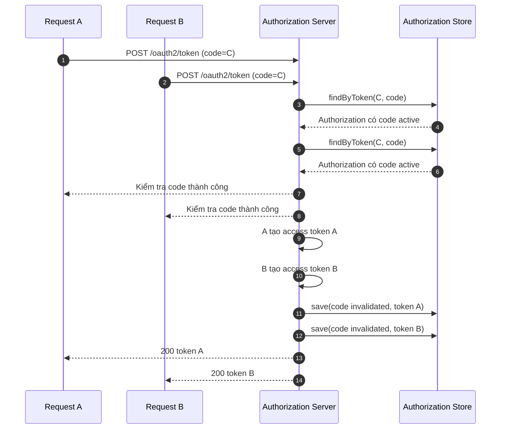
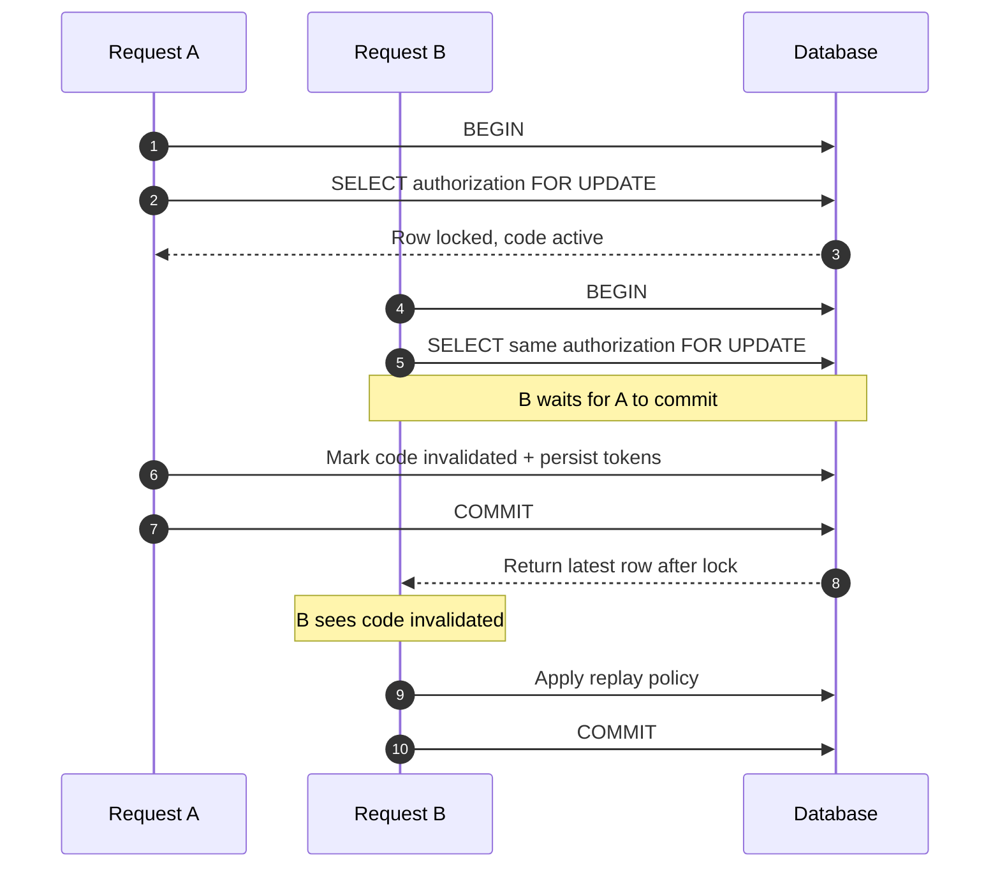

# Kiểm soát truy cập đồng thời khi đổi code hoặc refresh token

## 1. Bài toán: một token được gửi tới hai request cùng lúc

Authorization Server nhận một authorization code hợp lệ ở Token Endpoint. Do retry mạng, người dùng bấm hai lần, hai thread của client hoặc hai instance backend, cùng một code có thể được gửi gần như đồng thời. Cả hai request đều đọc trạng thái code là còn hiệu lực, cùng kiểm tra thành công và cùng tạo access token.

Tình huống tương tự xảy ra với refresh token. Hai request refresh cùng dùng một token cũ có thể chạy trên hai node khác nhau. Nếu mỗi request đọc trạng thái trước khi request còn lại ghi kết quả, cả hai có thể phát hành access token hoặc refresh token mới từ cùng một trạng thái ban đầu.

Đây là **race condition trong vòng đời OAuth token**. Kiểm tra token hợp lệ, kiểm tra chữ ký, PKCE, client authentication hay đặt thời hạn ngắn không tự giải quyết race condition. Authorization Server cần bảo đảm thao tác sử dụng token một lần hoặc xoay token được thực hiện nguyên tử trong storage dùng chung.

Bài này phân tích cách Spring Authorization Server (SAS) xử lý authorization code và refresh token, giới hạn của contract persistence mặc định, cách dùng transaction/row lock/optimistic locking và cách kiểm thử khi có nhiều request hoặc nhiều instance.

Bài thuộc chương **Lưu trữ tùy chỉnh** của module **SPRING_SECURITY_OAUTH2_OIDC_AUTHORIZATION_SERVER**. Mục tiêu tổng thể của module là **học cách thiết kế, cấu hình, bảo mật, kiểm thử và vận hành OAuth 2.0/OpenID Connect Authorization Server bằng Spring Security và Spring Authorization Server trong ứng dụng Spring Boot**.

### Mục tiêu học tập

Sau bài này, bạn có thể:

1. Giải thích vì sao kiểm tra rồi cập nhật token theo hai bước có thể chấp nhận cùng một token nhiều lần.
2. Phân biệt replay của authorization code với hai refresh request đồng thời.
3. Mô tả cách SAS lưu trạng thái token trong OAuth2Authorization và OAuth2AuthorizationService.
4. Hiểu ý nghĩa của token invalidation và TokenSettings.reuseRefreshTokens.
5. Thiết kế transaction bao trùm toàn bộ quá trình xác thực grant, phát hành token và lưu trạng thái.
6. Áp dụng SELECT FOR UPDATE, conditional update hoặc optimistic locking.
7. Phối hợp client-side single-flight với server-side concurrency control.
8. Thiết kế refresh token family và replay response theo RFC 9700 khi cần.
9. Kiểm thử cạnh tranh giữa các request trên cùng database và nhiều Authorization Server instance.

> **Phạm vi phiên bản:** Bài dùng Spring Authorization Server 1.5.8 và Spring Security 6.x. Các tên class/API trong ví dụ theo dòng 1.5.x. Hành vi storage và transaction phải được kiểm tra trên implementation thực tế của ứng dụng. SPECIAL_NOTE của bài được giao để trống.

## 2. Hai luồng có trạng thái dùng một lần

Authorization code và refresh token đều được lưu trong OAuth2Authorization, nhưng semantics của chúng khác nhau:

| Đặc điểm | Authorization code | Refresh token |
| --- | --- | --- |
| Mục đích | Đổi quyền đã được End-User cấp thành token | Xin access token mới sau khi access token cũ hết hạn |
| Vòng đời | Ngắn, dùng một lần | Dài hơn, có thể dùng lại hoặc xoay tùy policy |
| Ràng buộc | Client, redirect URI, PKCE verifier nếu áp dụng | Client đã được cấp token, scope và resource đã consent |
| Khi bị dùng lại | Replay của authorization grant; có thể phải thu hồi token đã phát hành từ code | Có thể là request đồng thời hợp lệ, retry hoặc refresh token bị đánh cắp |
| Kiểm soát chính | Atomic consume/invalidate | Atomic rotate hoặc kiểm soát reuse/sender constraint |

Một điểm quan trọng: **đổi authorization code phải là thao tác một lần**. Refresh token có thể được cấu hình tái sử dụng hoặc xoay sang token mới. Vì vậy, policy và kết quả kiểm thử của hai luồng không giống nhau.

## 3. Race condition xảy ra như thế nào?

Giả sử authorization code C đang active trong database. Hai request A và B cùng gọi Token Endpoint.



Sơ đồ mô tả trường hợp storage chỉ thực hiện read rồi write mà không khóa hoặc so sánh version. Cả hai request đọc cùng một trạng thái active trước khi bất kỳ request nào lưu trạng thái mới. Việc cả hai cùng ghi code invalidated sau đó không thể quay lại và làm mất token đã trả cho request trước.

### 3.1. Kiểm tra hợp lệ không đồng nghĩa consume nguyên tử

Một đoạn xử lý dạng:

```java
OAuth2Authorization authorization =
        authorizationService.findByToken(code, CODE);

if (authorization == null
        || !authorization.getToken(OAuth2AuthorizationCode.class).isActive()) {
    throw invalidGrant();
}

OAuth2Authorization updated = invalidateCodeAndIssueTokens(authorization);
authorizationService.save(updated);
```

chưa bảo đảm một request duy nhất thắng. Hai thread có thể cùng chạy qua điều kiện if trước khi một thread gọi save.

Đây là khác biệt giữa:

- **Check-then-act:** đọc trạng thái, kiểm tra, rồi ghi trạng thái.
- **Atomic consume:** kiểm tra và chuyển trạng thái trong một thao tác không thể bị request khác chen vào.

Để bảo đảm single-use, server phải làm cho việc consume token trở thành thao tác nguyên tử ở mức transaction/database hoặc distributed lock có fencing phù hợp.

## 4. Authorization code: yêu cầu single-use và replay response

RFC 6749 quy định authorization code phải có thời hạn ngắn và chỉ được sử dụng một lần. Nếu Authorization Server quan sát nhiều lần đổi cùng một code, server SHOULD cố gắng thu hồi tất cả access token đã cấp dựa trên code bị xâm phạm. Nếu client có thể được xác thực, server phải xác thực client và bảo đảm code được cấp cho đúng client.

### 4.1. Những kiểm tra SAS thực hiện

Trong Authorization Code Grant, OAuth2AuthorizationCodeAuthenticationProvider dùng OAuth2AuthorizationService để tìm authorization theo code, sau đó kiểm tra các điều kiện như:

- Authorization có tồn tại.
- Code còn active, chưa hết hạn và chưa bị invalidated.
- Client hiện tại trùng với client đã khởi tạo authorization request.
- redirect_uri trong token request khớp redirect URI đã lưu nếu request ban đầu có giá trị này.
- Client authentication và PKCE verifier được xử lý theo loại client/flow tương ứng.

Sau khi tạo access token, refresh token nếu được phép và ID Token nếu có scope openid, provider đánh dấu authorization code đã invalidated và gọi authorizationService.save(...).

Nếu một request sau đó nhìn thấy code đã invalidated, provider xử lý như replay và có thể invalidated access token/refresh token đã phát hành từ authorization đó, rồi trả lỗi invalid_grant. Đây là hành vi quan trọng để hạn chế hậu quả khi code bị dùng lại.

### 4.2. PKCE không thay thế atomic consume

PKCE ràng buộc authorization code với code_verifier của client. Nó làm giảm khả năng kẻ lấy cắp code đổi code thành token nếu không có verifier.

Nhưng PKCE không khóa authorization record và không ngăn hai request hợp lệ từ cùng client gửi cùng code_verifier gần như đồng thời. Server vẫn cần atomic consume.

### 4.3. Client binding và redirect URI cũng không phải khóa đồng thời

Client authentication, client binding, redirect URI exact match và PKCE là các kiểm tra protocol. Chúng xác định request có quyền đổi code hay không; chúng không quyết định request nào trong hai request cùng hợp lệ được phép thắng.

## 5. Refresh token: reuse và rotation

Spring Authorization Server cung cấp TokenSettings.reuseRefreshTokens(boolean):

- true: tái sử dụng refresh token hiện tại khi trả access token response.
- false: phát hành refresh token mới khi refresh thành công.

Giá trị mặc định của SAS 1.5.8 là **true**. Đây là cấu hình về vòng đời refresh token, không phải cơ chế khóa đồng thời.

Ví dụ:

```java
RegisteredClient client = RegisteredClient.withId(UUID.randomUUID().toString())
        .clientId("orders-web")
        .clientSecret(passwordEncoder.encode(rawSecret))
        .clientAuthenticationMethod(ClientAuthenticationMethod.CLIENT_SECRET_BASIC)
        .authorizationGrantType(AuthorizationGrantType.AUTHORIZATION_CODE)
        .authorizationGrantType(AuthorizationGrantType.REFRESH_TOKEN)
        .redirectUri("https://orders.example.com/login/oauth2/code/issuer")
        .scope("openid")
        .scope("orders.read")
        .tokenSettings(TokenSettings.builder()
                .reuseRefreshTokens(false)
                .build())
        .build();
```

Khi reuseRefreshTokens(false), token mới thay thế refresh token cũ trong authorization. Khi token cũ được gửi lại sau khi rotation đã commit, request không còn tìm thấy refresh token active và sẽ bị từ chối.

### 5.1. Reuse=true: hai request có thể cùng thành công

Nếu refresh token được giữ nguyên, hai request tuần tự hoặc đồng thời đều có thể dùng token đó khi nó vẫn active. Server có thể cấp hai access token khác nhau cho cùng authorization. Điều này phù hợp với cấu hình reuse, nhưng client không nên chủ động phát nhiều refresh request cho cùng một phiên.

### 5.2. Reuse=false: rotation vẫn cần atomicity

Giả sử R0 là refresh token hiện tại. Request A và B cùng đọc R0 là active. Cả hai tạo access token và refresh token mới:

- A tạo A1 và R1.
- B tạo A2 và R2.

Nếu hai lần save không được tuần tự hóa, kết quả có thể là cả hai response đều thành công trong khi chỉ một refresh token mới còn được lưu trong authorization. Client nhận token không còn là token hiện hành sẽ gặp invalid_grant ở lần refresh tiếp theo.

Khi có row lock hoặc compare-and-set:

1. A khóa authorization, xác minh R0 active, phát hành R1 và commit.
2. B chờ A hoàn tất.
3. B đọc trạng thái mới; R0 đã bị thay thế nên B nhận invalid_grant.

Chỉ một request đổi được refresh token cũ.

### 5.3. Public client và refresh token

Hướng dẫn chính thức SAS 1.5.8 nêu rõ Spring Authorization Server **không phát hành refresh token cho public client**. Với public client, ưu tiên Authorization Code + PKCE và cân nhắc Backend-for-Frontend nếu cần giữ refresh credential phía server.

RFC 9700 yêu cầu Authorization Server phải dùng sender-constrained refresh token hoặc refresh token rotation để phát hiện replay đối với public client nếu server quyết định cấp refresh token. Nếu dùng rotation, server cần giữ quan hệ giữa các token trong cùng một grant/family; khi token cũ bị sử dụng lại, server phải thu hồi refresh token còn hiệu lực trong family theo khuyến nghị của đặc tả.

Không đồng nhất việc đặt reuseRefreshTokens(false) với một hệ thống replay detection đầy đủ. Nếu yêu cầu của hệ thống là phát hiện predecessor token bị dùng lại và thu hồi toàn bộ token family, cần lưu token lineage/replay state riêng và kiểm thử hành vi đó.

## 6. Contract persistence của Spring Authorization Server

OAuth2AuthorizationService là nơi lưu authorization và tra cứu authorization hiện có. Interface cung cấp:

```java
public interface OAuth2AuthorizationService {

    void save(OAuth2Authorization authorization);

    void remove(OAuth2Authorization authorization);

    OAuth2Authorization findById(String id);

    OAuth2Authorization findByToken(String token, OAuth2TokenType tokenType);
}
```

Interface không có method consumeAuthorizationCodeAtomically, rotateRefreshTokenAtomically hoặc compareAndSet. Vì vậy, adapter lưu trữ phải thiết kế cơ chế nguyên tử riêng nếu ứng dụng cần đảm bảo đồng thời.

### 6.1. OAuth2Authorization chứa token và metadata

OAuth2Authorization giữ các token như authorization code, access token, refresh token, ID Token, device code và user code cùng metadata liên quan. Metadata của token có cờ invalidated để biểu diễn token đã bị vô hiệu hóa.

Builder có thể đánh dấu token invalidated:

```java
OAuth2Authorization updated = OAuth2Authorization.from(authorization)
        .invalidate(authorizationCode)
        .build();

authorizationService.save(updated);
```

Đoạn code này minh họa trạng thái domain. Nó **không tự bảo đảm atomicity** nếu việc đọc authorization và lưu authorization được thực hiện bởi các request đồng thời.

### 6.2. JdbcOAuth2AuthorizationService

SAS cung cấp JdbcOAuth2AuthorizationService dùng JdbcOperations và schema oauth2-authorization-schema.sql. Service có các mapper để chuyển OAuth2Authorization thành SQL parameters và đọc ResultSet trở lại domain object.

Tài liệu SAS mô tả đây là implementation JDBC đơn giản, có thể dùng trong production nhưng có giới hạn hiệu năng và có thể không phù hợp hệ thống throughput cao.

Quan trọng với bài toán đồng thời:

- OAuth2AuthorizationService contract không cung cấp thao tác compare-and-set.
- Không nên giả định một lần findByToken rồi save của nhiều request tự trở thành thao tác consume nguyên tử.
- Cần kiểm tra transaction boundary, isolation level và SQL lock của implementation đang chạy.
- Nếu yêu cầu bảo đảm nghiêm ngặt, bổ sung custom persistence/transaction strategy và test với database production.

### 6.3. @Transactional trên từng method là chưa đủ

Ví dụ sau không bảo đảm transaction bao trùm toàn bộ grant processing nếu hai method chạy trong hai transaction độc lập:

```java
@Transactional
public OAuth2Authorization findByToken(String token, OAuth2TokenType tokenType) {
    // query
}

@Transactional
public void save(OAuth2Authorization authorization) {
    // update
}
```

Nếu transaction của findByToken kết thúc ngay sau khi đọc, row lock được giải phóng trước khi provider xác minh code, tạo token và save. Request khác có thể đọc cùng trạng thái active trong khoảng thời gian đó.

Transaction phải bắt đầu trước khi provider gọi findByToken và giữ tới khi save hoàn tất.

## 7. Pessimistic locking: SELECT FOR UPDATE

Pessimistic locking khóa authorization row trong khi request kiểm tra và cập nhật trạng thái. Với JDBC, một truy vấn có thể dùng SELECT ... FOR UPDATE. Với JPA, có thể dùng @Lock(LockModeType.PESSIMISTIC_WRITE).

Luồng:



### 7.1. Tìm authorization theo token và khóa đúng row

Một custom OAuth2AuthorizationService có thể triển khai findByToken cho authorization code và refresh token bằng truy vấn có khóa:

```sql
SELECT *
FROM oauth2_authorization
WHERE authorization_code_value = :code
FOR UPDATE;
```

Hoặc với refresh token:

```sql
SELECT *
FROM oauth2_authorization
WHERE refresh_token_value = :refreshToken
FOR UPDATE;
```

SQL trên là minh họa. Cú pháp lock và hành vi khi request thứ hai chờ phụ thuộc database vendor và isolation level. Cần index trên token lookup column để giảm thời gian khóa.

Nếu token value được mã hóa trong database, có thể lưu thêm lookup digest/HMAC để tìm row. Khi đó cần giữ nguyên cách reconstruct token trong OAuth2Authorization và bảo vệ key dùng tạo digest.

### 7.2. Giữ lock trong cùng transaction

Custom service cần bảo đảm:

1. Transaction bắt đầu trước khi gọi findByToken.
2. Truy vấn lấy row lock.
3. Provider kiểm tra trạng thái token, client binding, redirect URI, scope và PKCE.
4. Provider phát hành token mới và gọi save.
5. Database commit trước khi Token Endpoint trả response.

Nếu lock được lấy trong một transaction ngắn chỉ quanh query, nó không bảo vệ bước phát hành và lưu token.

### 7.3. Khóa theo authorization thay vì khóa toàn bộ bảng

Khóa row theo authorization ID giúp các request của cùng grant được tuần tự hóa, trong khi các client/user khác vẫn có thể xử lý đồng thời.

Không dùng một global lock cho toàn bộ Token Endpoint. Nó biến một race condition cục bộ thành nút thắt throughput của toàn Authorization Server.

## 8. Bao transaction quanh provider xử lý grant

SAS cung cấp extension point OAuth2TokenEndpointConfigurer.authenticationProviders(...) để truy cập danh sách AuthenticationProvider mặc định. Một cách tích hợp là bọc provider mặc định bằng TransactionTemplate để transaction bao trùm lời gọi authenticate, bao gồm findByToken và save.

### 8.1. Wrapper transaction

Ví dụ skeleton:

```java
final class TransactionalAuthenticationProvider
        implements AuthenticationProvider {

    private final AuthenticationProvider delegate;
    private final TransactionTemplate transactionTemplate;

    TransactionalAuthenticationProvider(
            AuthenticationProvider delegate,
            TransactionTemplate transactionTemplate) {
        this.delegate = delegate;
        this.transactionTemplate = transactionTemplate;
    }

    @Override
    public Authentication authenticate(Authentication authentication) {
        return transactionTemplate.execute(status ->
                delegate.authenticate(authentication));
    }

    @Override
    public boolean supports(Class<?> authentication) {
        return delegate.supports(authentication);
    }
}
```

Đây là wrapper minh họa. TransactionTemplate phải dùng transaction manager quản lý cùng datasource với custom OAuth2AuthorizationService. Không mở transaction bằng một transaction manager khác với nơi lưu authorization.

### 8.2. Bọc hai provider cần kiểm soát

Có thể thay provider trong danh sách mặc định bằng wrapper:

```java
authorizationServer.tokenEndpoint(tokenEndpoint ->
    tokenEndpoint.authenticationProviders(providers -> {
        for (int i = 0; i < providers.size(); i++) {
            AuthenticationProvider provider = providers.get(i);
            boolean stateChangingGrant =
                    provider instanceof OAuth2AuthorizationCodeAuthenticationProvider
                    || provider instanceof OAuth2RefreshTokenAuthenticationProvider;

            if (stateChangingGrant) {
                providers.set(i,
                        new TransactionalAuthenticationProvider(
                                provider, transactionTemplate));
            }
        }
    })
);
```

Ví dụ này giữ nguyên provider mặc định để tận dụng các protocol validation của SAS, đồng thời thêm transaction boundary. Nó chỉ giải quyết phần transaction; custom OAuth2AuthorizationService vẫn phải thực hiện SELECT FOR UPDATE hoặc optimistic CAS.

Kiểm tra cấu hình sau khi build SecurityFilterChain để bảo đảm provider mặc định không còn được đăng ký song song bên cạnh wrapper. Không thêm một provider thứ hai cho cùng authentication type mà không xác định thứ tự và hành vi.

### 8.3. Vì sao transaction phải commit trước response?

Nếu Token Endpoint trả access token trước khi database commit, client có thể nhận một token mà authorization state chưa được lưu hoặc transaction sau đó rollback.

Wrapper trên chỉ trả Authentication result sau khi TransactionTemplate hoàn tất commit. Nếu commit thất bại, response token không được trả như một kết quả thành công.

## 9. Optimistic locking và compare-and-set

Pessimistic locking phù hợp khi cần tuần tự hóa request trên cùng authorization row. Với hệ thống có nhiều request nhưng ít xung đột, optimistic locking có thể giảm thời gian giữ lock.

Thêm cột version:

```sql
ALTER TABLE oauth2_authorization
    ADD COLUMN version bigint NOT NULL DEFAULT 0;
```

Đọc authorization cùng version v. Khi cập nhật, thực hiện:

```sql
UPDATE oauth2_authorization
SET authorization_code_metadata = :newMetadata,
    access_token_value = :accessToken,
    refresh_token_value = :refreshToken,
    version = version + 1
WHERE id = :authorizationId
  AND version = :expectedVersion;
```

Nếu số dòng được cập nhật là 0, một request khác đã thay đổi authorization. Request hiện tại phải được coi là thua race và không được trả token vừa tạo.

### 9.1. Version phải đi theo domain object

OAuth2Authorization không có field version chuẩn. Custom persistence có thể:

- Đưa version vào attribute riêng khi map từ database.
- Lưu version trong wrapper/context của persistence adapter.
- Dùng một entity aggregate riêng có version và mapper sang OAuth2Authorization.

Khi save, lấy đúng expectedVersion từ lần đọc ban đầu. Không query version mới ngay trước update rồi dùng version đó, vì thao tác này làm mất ý nghĩa compare-and-set.

### 9.2. Xử lý optimistic lock failure

Khi update ảnh hưởng 0 row:

- Không gửi access token/refresh token vừa được tạo.
- Rollback transaction nếu còn trong transaction.
- Trả lỗi grant phù hợp như invalid_grant cho request thua race.
- Ghi metric và audit event dạng token-replay/concurrency-conflict mà không log raw token.

Không retry mù việc phát hành token trong cùng request sau optimistic lock failure. Retry chỉ an toàn khi request được đọc lại trạng thái mới và toàn bộ protocol validation được thực hiện lại.

## 10. Atomic consume bằng token state riêng

Một mô hình khác là lưu trạng thái token dùng một lần trong bảng riêng:

```sql
CREATE TABLE oauth2_one_time_token (
    token_hash varchar(128) PRIMARY KEY,
    authorization_id varchar(100) NOT NULL,
    token_type varchar(40) NOT NULL,
    expires_at timestamp NOT NULL,
    consumed_at timestamp NULL,
    created_at timestamp NOT NULL
);
```

Consume bằng conditional update:

```sql
UPDATE oauth2_one_time_token
SET consumed_at = CURRENT_TIMESTAMP
WHERE token_hash = :tokenHash
  AND token_type = 'code'
  AND consumed_at IS NULL
  AND expires_at > CURRENT_TIMESTAMP;
```

Chỉ request nhận row count bằng 1 mới được tiếp tục. Request nhận 0 row phải dừng với invalid_grant.

### 10.1. Token consumption và token issuance phải cùng transaction

Thao tác consume code, lưu OAuth2Authorization đã invalidated và lưu token mới phải cùng một transaction. Nếu consume thành công nhưng lưu token thất bại, rollback phải phục hồi trạng thái consume. Nếu token đã bị consume ở transaction khác, request hiện tại không được phát hành token.

### 10.2. Không để token state riêng lệch OAuth2Authorization

Nếu ứng dụng vừa có bảng token state vừa có OAuth2Authorization, cần một transaction manager và một nguồn dữ liệu nhất quán. Không ghi token state vào Redis rồi ghi authorization vào SQL mà không có cơ chế atomic/distributed transaction hoặc outbox/reconciliation được thiết kế rõ.

Nếu dùng hai store khác nhau, phải có chiến lược xử lý trạng thái nửa hoàn tất và test crash giữa các bước.

## 11. Refresh token family và replay detection

Rotation tạo token mới và làm token cũ không còn dùng được. Để nhận diện việc một token cũ bị dùng lại sau rotation, server cần giữ lịch sử quan hệ giữa các token trong cùng grant.

Một record family có thể lưu:

| Field | Ý nghĩa |
| --- | --- |
| family_id | Định danh chuỗi refresh token thuộc một grant |
| authorization_id | OAuth2Authorization liên quan |
| token_hash | Digest của token |
| parent_token_hash | Token tiền nhiệm |
| issued_at | Thời điểm phát hành |
| replaced_at | Thời điểm token bị thay thế |
| revoked_at | Thời điểm family/token bị thu hồi |
| sender_key_thumbprint | Khóa ràng buộc nếu dùng sender-constrained token |

Luồng rotation:

1. Client gửi R0.
2. Server xác thực client và kiểm tra R0 thuộc authorization/family.
3. Server khóa family/authorization.
4. Server đánh dấu R0 đã thay thế, tạo R1 và lưu liên kết R0 → R1.
5. Server lưu access token mới và commit.
6. Server trả R1.
7. Nếu R0 xuất hiện lại sau đó, server nhận diện replay và thu hồi refresh token hiện hành của family theo policy.

### 11.1. Không thể luôn biết ai là kẻ tấn công

Nếu cả client hợp lệ và kẻ đánh cắp cùng có R0, server chỉ biết token cũ đã được dùng lại; server không thể luôn xác định request nào là attacker. Thu hồi token hiện hành của family có thể buộc client hợp lệ đăng nhập lại. Đây là trade-off bảo mật mà RFC 9700 mô tả.

### 11.2. Sender-constrained refresh token

Sender constraint ràng buộc refresh token với một client instance/key. Ví dụ DPoP hoặc mTLS có thể giúp server xác minh caller có proof tương ứng. Khi dùng sender constraint, cần kiểm tra proof và binding trong mọi lần refresh, không chỉ lần cấp đầu.

Rotation và sender constraint là hai cách chống replay khác nhau; chọn theo loại client, threat model và khả năng quản lý key.

## 12. Client-side single-flight

Server phải bảo vệ persistence, nhưng client cũng nên tránh tự tạo race condition.

Một client có thể gọi refresh đồng thời từ:

- Hai HTTP request cùng phát hiện access token hết hạn.
- Hai thread trong backend.
- Nhiều tab browser dùng chung session.
- Nhiều process/worker dùng chung refresh token.
- Retry logic tự động sau timeout.

Thiết kế single-flight:

1. Mỗi token family có một refresh mutex/lock.
2. Request đầu tiên nhận lock và thực hiện refresh.
3. Các request khác chờ kết quả thay vì gửi cùng refresh token.
4. Sau response, lưu access token và refresh token mới một cách nguyên tử.
5. Nhả lock; request tiếp theo đọc credential mới nhất.

### 12.1. Lock trong một process không đủ cho nhiều instance

Nếu nhiều backend node cùng giữ refresh token, synchronized block trong JVM chỉ khóa một node. Dùng shared session store, distributed lock có fencing hoặc thiết kế một token broker duy nhất để điều phối refresh.

Client-side lock không thay thế server-side atomicity: attacker có thể bỏ qua client implementation và gọi Token Endpoint trực tiếp.

### 12.2. Không retry refresh cũ một cách mù quáng

Nếu request refresh timeout, client không biết server đã commit rotation hay chưa. Khi rotation đã commit nhưng response bị mất, token cũ không còn hợp lệ và client không có token mới.

Client nên:

- Không gửi đồng thời nhiều retry với cùng token.
- Phân biệt timeout trước khi gửi với timeout sau khi server có thể đã xử lý.
- Dùng recovery/re-authentication flow nếu không còn refresh token hiện hành.
- Không log refresh token để debug.

## 13. Cấu hình refresh token rotation trong SAS

Ví dụ cấu hình client confidential:

```java
RegisteredClient registeredClient = RegisteredClient.withId(
                UUID.randomUUID().toString())
        .clientId("orders-backend")
        .clientSecret(passwordEncoder.encode(rawSecret))
        .clientAuthenticationMethod(
                ClientAuthenticationMethod.CLIENT_SECRET_BASIC)
        .authorizationGrantType(AuthorizationGrantType.AUTHORIZATION_CODE)
        .authorizationGrantType(AuthorizationGrantType.REFRESH_TOKEN)
        .redirectUri("https://orders.example.com/login/oauth2/code/issuer")
        .scope("openid")
        .scope("orders.read")
        .tokenSettings(TokenSettings.builder()
                .reuseRefreshTokens(false)
                .refreshTokenTimeToLive(Duration.ofDays(14))
                .build())
        .build();
```

Ví dụ chỉ minh họa policy. TTL cần dựa trên mức độ nhạy cảm, loại client, hoạt động người dùng và yêu cầu re-authentication. Đặt reuseRefreshTokens(false) không tự tạo lock hoặc token-family replay ledger.

### 13.1. Scope refresh không được mở rộng

Khi refresh, client không được xin scope vượt quá scope resource owner đã cấp. Nếu request không truyền scope, server dùng scope đã được authorize ban đầu. Giữ kiểm tra này khi custom provider hoặc persistence; không cho phép client tăng quyền chỉ bằng refresh request.

### 13.2. Ràng buộc refresh token với client

Refresh token phải gắn với client đã được cấp. Với confidential client, xác thực client ở Token Endpoint và kiểm tra registeredClientId của authorization. Không chỉ tìm refresh token rồi phát token cho bất kỳ client nào gửi nó.

## 14. Transaction wrapper cho Token Endpoint

Đoạn cấu hình dưới đây minh họa việc bọc hai provider mặc định để giữ transaction quanh authenticate:

```java
OAuth2AuthorizationServerConfigurer authorizationServer =
        OAuth2AuthorizationServerConfigurer.authorizationServer();

authorizationServer.tokenEndpoint(tokenEndpoint ->
    tokenEndpoint.authenticationProviders(providers -> {
        for (int i = 0; i < providers.size(); i++) {
            AuthenticationProvider provider = providers.get(i);
            boolean stateChangingGrant =
                    provider instanceof OAuth2AuthorizationCodeAuthenticationProvider
                    || provider instanceof OAuth2RefreshTokenAuthenticationProvider;

            if (stateChangingGrant) {
                providers.set(i,
                        new TransactionalAuthenticationProvider(
                                provider, transactionTemplate));
            }
        }
    })
);
```

Wrapper transaction không tự tạo row lock. Cần kết hợp với custom OAuth2AuthorizationService có SELECT FOR UPDATE hoặc optimistic CAS. Kiểm tra đúng provider list của phiên bản dependency đang chạy và xác nhận chỉ có một provider cho mỗi authentication type.

### 14.1. Không dùng transaction manager sai datasource

Nếu OAuth2AuthorizationService lưu authorization ở database A nhưng TransactionTemplate quản lý database B, transaction không bảo vệ thao tác lưu. Tất cả read/consume/save liên quan phải tham gia cùng transaction manager hoặc có một cơ chế distributed consistency được thiết kế riêng.

### 14.2. Giữ protocol validation của provider mặc định

Provider mặc định thực hiện nhiều kiểm tra như client binding, code active, redirect URI, scope và các bước tạo token. Nếu viết provider riêng, cần tái hiện đầy đủ các validation và xử lý lỗi theo OAuth/OIDC. Chỉ thay provider khi có lý do kỹ thuật rõ ràng và có test tương đương.

## 15. Tình huống lỗi và cách xử lý

| Tình huống | Hành vi mong đợi |
| --- | --- |
| Code đã hết hạn | invalid_grant |
| Code đã được consume trước đó | invalid_grant; áp dụng replay response |
| Hai request đổi code đồng thời | Một request thắng; request còn lại thấy trạng thái mới và bị từ chối |
| Code thuộc client khác | invalid_grant |
| redirect_uri không khớp | invalid_grant |
| PKCE verifier sai | Từ chối token request |
| Refresh token hết hạn/revoked | invalid_grant |
| Refresh token thuộc client khác | invalid_grant |
| Requested scope vượt authorized scope | invalid_scope |
| Hai request refresh với rotation cùng token | Một request thắng; request còn lại không được trả refresh token mồ côi |
| Hai request refresh với reuse=true | Có thể cả hai thành công tuần tự; client cần single-flight |
| Token family predecessor bị replay | Thu hồi token hiện hành của family theo policy |
| Database rollback | Không trả token thành công |
| Commit thất bại | Không trả token chưa được persist |
| Response bị mất sau commit | Client phải dùng token mới nếu nhận được; nếu mất refresh token mới thì recovery/re-authentication |

Không trả lỗi database chi tiết, SQL hoặc token value cho client. OAuth error response nên dùng mã chuẩn; log nội bộ dùng correlation ID và fingerprint đã được bảo vệ.

## 16. Ma trận kiểm thử concurrency

Các test phải chạy trên database thật hoặc Testcontainers cùng loại database production. H2 đơn lẻ không chứng minh được row lock, isolation level hoặc SQL concurrency của PostgreSQL/MySQL/Oracle.

| Ca kiểm thử | Cách thực hiện | Kết quả mong đợi |
| --- | --- | --- |
| Code single use tuần tự | Đổi code một lần rồi gửi lại | Lần đầu thành công; lần sau invalid_grant |
| Code concurrent | Hai thread cùng gửi một code, đồng bộ bằng barrier | Chỉ một lần consume thành công |
| Code concurrent đa node | Hai instance dùng chung database | Không có hai token response thành công từ cùng trạng thái code |
| Replay sau success | Đổi code thành công rồi replay | invalid_grant và áp dụng revoke policy cho token đã cấp |
| Client mismatch | Client B đổi code cấp cho A | invalid_grant |
| Redirect URI mismatch | Code đúng nhưng redirect URI sai | invalid_grant |
| PKCE mismatch | code_verifier sai | Token request bị từ chối |
| Code expired | Đổi code sau TTL | invalid_grant |
| Rollback khi token generator lỗi | Giả lập generator ném exception | Code không bị consume dở dang |
| Rollback khi DB update lỗi | Làm update authorization thất bại | Không trả token success |
| Rotation tuần tự | reuseRefreshTokens(false), refresh R0 rồi replay R0 | Lần đầu thành công; replay invalid_grant |
| Rotation concurrent | Hai thread refresh cùng R0 | Một request thắng; chỉ một refresh token mới active |
| Rotation đa node | Hai node cùng refresh R0 | Không có hai refresh token successor hợp lệ |
| Reuse=true | Hai request refresh cùng token | Kết quả phù hợp reuse policy; không ghi đè mất access state |
| Scope escalation | Refresh xin scope chưa authorized | invalid_scope |
| Client binding | Client khác dùng refresh token | invalid_grant |
| Family replay | Dùng lại predecessor token sau rotation | Family active token bị revoke theo policy |
| Sender constraint | Proof/key không khớp | Refresh bị từ chối |
| Client single-flight | Hai request ứng dụng cùng cần refresh | Chỉ một HTTP refresh request được gửi |
| Lock timeout | DB lock vượt timeout | Request thất bại có kiểm soát; không phát token |
| Deadlock | Tạo hai luồng lock theo thứ tự khác nhau | Retry/rollback theo policy; không phát hai kết quả |
| Lost response | Commit thành công nhưng response bị cắt | Client recovery không retry token cũ mù quáng |
| Node crash trước commit | Dừng process khi transaction chưa commit | Transaction rollback |
| Node crash sau commit | Dừng process sau commit trước response | Token state nhất quán; client recovery được kiểm thử |
| Replay audit | Gửi lại code/refresh predecessor | Có event, không log raw credential |

### 16.1. Ví dụ kiểm thử hai request cùng đổi code

Pseudocode:

```java
CountDownLatch ready = new CountDownLatch(2);
CountDownLatch start = new CountDownLatch(1);

Callable<TokenResponse> exchange = () -> {
    ready.countDown();
    start.await();
    return tokenClient.exchangeAuthorizationCode(code, verifier);
};

Future<TokenResponse> first = executor.submit(exchange);
Future<TokenResponse> second = executor.submit(exchange);

ready.await();
start.countDown();

// Assert one successful exchange and one invalid_grant outcome.
```

Đây là pseudocode. Test thật cần bắt cả OAuth error response và kiểm tra database: code đã invalidated, chỉ có một kết quả token issuance thắng, và replay response đã thực hiện đúng revoke policy.

### 16.2. Test rotation không chỉ kiểm tra HTTP status

Sau khi hai request refresh chạy đồng thời, truy vấn storage để xác minh:

- Chỉ có một refresh token hiện hành trong authorization nếu reuse=false.
- Token trả về cho request thua không được tồn tại như token active.
- Token cũ đã bị invalidated/removed theo mô hình lưu trữ.
- Family state phản ánh predecessor/successor đúng.
- Nếu predecessor bị replay, token family active bị thu hồi theo policy.

## 17. Quan sát vận hành

Nên đo các metric:

- Số lần invalid_grant theo grant type.
- Số lần code/refresh replay được phát hiện.
- Số optimistic-lock conflict.
- Số lần SELECT FOR UPDATE chờ lâu.
- Database lock wait/deadlock/transaction rollback.
- Số request refresh đồng thời trên cùng authorization.
- Số refresh token family bị revoke.
- Tỷ lệ refresh thất bại và yêu cầu re-authentication.

Không dùng token hoặc client secret làm label metric. Chỉ dùng client ID/issuer đã được phân loại an toàn, grant type, error code và các dimension có cardinality kiểm soát.

### 17.1. Audit mà không lộ credential

Có thể ghi:

- authorization ID nội bộ.
- client ID.
- grant type.
- issuer/tenant.
- kết quả consume/rotation.
- token fingerprint một chiều nếu cần đối chiếu.
- correlation ID và timestamp.

Không ghi raw authorization code, refresh token, access token, client secret hoặc PKCE verifier.

## 18. Troubleshooting

| Hiện tượng | Nguyên nhân có thể | Cách xử lý |
| --- | --- | --- |
| Hai request cùng đổi code đều nhận 200 | Chỉ có read-check-write, chưa có lock/CAS | Kiểm tra transaction boundary và atomic consume |
| Code bị invalidated nhưng token state chưa lưu | Transaction bị tách hoặc commit thất bại | Gộp consume và save trong cùng transaction |
| Refresh rotation trả hai token khác nhau | Hai request cùng đọc token cũ active | Dùng row lock/version CAS và test đa node |
| Client nhận refresh token không dùng được | Response của request thua race đã bị ghi đè | Không trả token nếu CAS thất bại |
| Refresh cũ replay không revoke family | Không lưu token lineage | Bổ sung refresh token family ledger |
| @Transactional không giữ lock | Proxy/transaction manager không bao trùm provider | Bọc authenticate hoặc thiết kế transaction boundary tại token endpoint |
| Một node khóa được, node khác vẫn thành công | Lock cục bộ trong JVM | Dùng DB/shared lock và source of truth chung |
| H2 pass nhưng PostgreSQL fail | Khác biệt lock/isolation/SQL | Test bằng Testcontainers production database |
| Token generator thành công nhưng save thất bại | Không có rollback/response boundary | Chỉ trả response sau commit |
| invalid_grant tăng đột biến | Client refresh song song hoặc token bị replay | Kiểm tra single-flight, retry và audit fingerprint |
| Deadlock khi refresh | Khóa nhiều record sai thứ tự | Chuẩn hóa lock order và rút ngắn transaction |
| Row lock kéo dài | Gọi remote service khi đang giữ lock | Không gọi mạng ngoài trong critical section |

Trình tự điều tra: **client retry/single-flight → provider authenticate → findByToken → transaction boundary → row lock/CAS → authorization save → commit → response handler → token family state**.

## 19. Checklist trước production

- [ ] Authorization code được xử lý theo semantics short-lived và single-use.
- [ ] Code consume/invalidation được lưu nguyên tử.
- [ ] Client binding, redirect URI và PKCE vẫn được xác minh.
- [ ] Replay code áp dụng policy thu hồi token đã cấp theo RFC 6749.
- [ ] Refresh token được bind với đúng client, scope và resource.
- [ ] Policy reuse/rotation được đặt rõ cho từng RegisteredClient.
- [ ] Public client không nhận refresh token theo cấu hình SAS mặc định; nếu custom cấp token phải đáp ứng sender constraint hoặc rotation.
- [ ] Transaction bao trùm find, validate, issue và save.
- [ ] Lock/CAS hoạt động trên storage dùng chung giữa mọi instance.
- [ ] CAS conflict không trả token vừa tạo.
- [ ] Refresh rotation không để lại token successor mồ côi.
- [ ] Có token family/replay ledger nếu cần revoke family khi predecessor bị dùng lại.
- [ ] Client-side refresh dùng single-flight và cập nhật credential nguyên tử.
- [ ] Database index hỗ trợ lookup theo token và authorization ID.
- [ ] Lock timeout, transaction timeout và deadlock policy được cấu hình.
- [ ] Có integration tests concurrent trên database production-compatible.
- [ ] Có test node crash trước/sau commit và lost response.
- [ ] Audit/metrics không chứa raw token hoặc secret.
- [ ] Có recovery path khi client mất response sau khi token đã được commit.

## 20. Tình huống tổng hợp: hai node cùng xử lý refresh token

Một ứng dụng backend có hai instance. Access token sắp hết hạn, hai request nghiệp vụ đồng thời gọi hàm refresh với cùng refresh token R0. Cả hai request đi tới hai node khác nhau.

**Nếu chỉ dùng client-side lock trong JVM:** mỗi node có một lock riêng, nên cả hai vẫn gửi R0 tới Authorization Server.

**Nếu Authorization Server chỉ đọc rồi ghi:** cả hai node có thể cùng thấy R0 active, phát hành hai cặp token mới và ghi đè trạng thái của nhau.

**Thiết kế có kiểm soát:**

1. Backend dùng shared single-flight hoặc token broker để hạn chế request trùng.
2. Token Endpoint wrapper mở transaction trước khi gọi refresh provider.
3. Custom OAuth2AuthorizationService khóa authorization row khi tìm R0.
4. Provider kiểm tra client, grant, token active và scope.
5. Provider phát access token và refresh token R1 theo reuse=false.
6. Authorization mới được lưu trong cùng transaction.
7. Transaction commit trước khi response được gửi.
8. Request còn lại lấy row lock sau commit, thấy R0 đã thay thế và nhận invalid_grant.
9. Nếu R0 xuất hiện lại sau đó, token-family ledger nhận diện predecessor replay và thu hồi R1 theo policy.

Client nhận token mới phải ghi R1 vào shared credential store trước khi cho request khác refresh. Nếu response bị mất sau commit, backend cần recovery/re-authentication vì R0 đã không còn là token hiện hành.

## 21. Tổng kết

Kiểm soát truy cập đồng thời khi đổi authorization code hoặc refresh token là vấn đề nhất quán trạng thái của OAuth authorization:

1. Authorization code phải short-lived và single-use; PKCE/client authentication không thay thế atomic consume.
2. SAS đánh dấu code invalidated và lưu OAuth2Authorization, nhưng OAuth2AuthorizationService contract không cung cấp atomic consume/CAS.
3. Hai request có thể cùng đọc trạng thái active nếu transaction/lock không bao trùm bước đọc, kiểm tra và lưu.
4. Dùng SELECT FOR UPDATE hoặc optimistic compare-and-set trong storage dùng chung.
5. Transaction phải bao trùm provider authenticate và commit trước khi Token Endpoint trả response.
6. reuseRefreshTokens(true) giữ token hiện tại; false phát hành token mới. Rotation cũng cần atomicity để tránh hai successor cạnh tranh.
7. Với public client, RFC 9700 yêu cầu sender-constrained refresh token hoặc rotation; nếu cần phát hiện predecessor replay và revoke family, phải giữ token lineage.
8. Client-side single-flight giảm request trùng nhưng server vẫn phải tự bảo vệ trước replay và nhiều instance.
9. Kiểm thử bằng database production-compatible, hai request đồng thời, nhiều node, rollback, crash và lost response.

Hãy xem việc đổi code/refresh token như một state transition cần tính nguyên tử. Khi token đã được consume hoặc rotate, chỉ một trạng thái mới được phép trở thành nguồn sự thật; mọi request thua race phải bị từ chối và không được trả credential không còn hiệu lực.

### Tài liệu tham khảo

- [RFC 6749 — The OAuth 2.0 Authorization Framework, Section 4.1.2 and 10.5](https://www.rfc-editor.org/rfc/rfc6749)
- [RFC 6749 — Refresh Token Grant, Section 6 and 10.4](https://www.rfc-editor.org/rfc/rfc6749)
- [RFC 9700 — Best Current Practice for OAuth 2.0 Security, Section 4.14](https://www.rfc-editor.org/rfc/rfc9700)
- [RFC 7636 — Proof Key for Code Exchange by OAuth Public Clients](https://www.rfc-editor.org/rfc/rfc7636)
- [Spring Authorization Server 1.5.8 — Core Model / Components](https://docs.spring.io/spring-authorization-server/reference/core-model-components.html)
- [Spring Authorization Server 1.5.8 — OAuth2AuthorizationService API](https://docs.spring.io/spring-authorization-server/reference/api/java/org/springframework/security/oauth2/server/authorization/OAuth2AuthorizationService.html)
- [Spring Authorization Server 1.5.8 — JdbcOAuth2AuthorizationService API](https://docs.spring.io/spring-authorization-server/reference/api/java/org/springframework/security/oauth2/server/authorization/JdbcOAuth2AuthorizationService.html)
- [Spring Authorization Server 1.5.8 — OAuth2AuthorizationCodeAuthenticationProvider API](https://docs.spring.io/spring-authorization-server/reference/api/java/org/springframework/security/oauth2/server/authorization/authentication/OAuth2AuthorizationCodeAuthenticationProvider.html)
- [Spring Authorization Server 1.5.8 — OAuth2RefreshTokenAuthenticationProvider API](https://docs.spring.io/spring-authorization-server/reference/api/java/org/springframework/security/oauth2/server/authorization/authentication/OAuth2RefreshTokenAuthenticationProvider.html)
- [Spring Authorization Server 1.5.8 — TokenSettings.Builder API](https://docs.spring.io/spring-authorization-server/reference/api/java/org/springframework/security/oauth2/server/authorization/settings/TokenSettings.Builder.html)
- [Spring Authorization Server 1.5.8 — How-to: Authenticate using a Single Page Application with PKCE](https://docs.spring.io/spring-authorization-server/reference/guides/how-to-pkce.html)
- [Spring Authorization Server source — OAuth2AuthorizationCodeAuthenticationProvider](https://github.com/spring-attic/spring-authorization-server/blob/main/oauth2-authorization-server/src/main/java/org/springframework/security/oauth2/server/authorization/authentication/OAuth2AuthorizationCodeAuthenticationProvider.java)
- [Spring Authorization Server source — OAuth2RefreshTokenAuthenticationProvider](https://github.com/spring-attic/spring-authorization-server/blob/main/oauth2-authorization-server/src/main/java/org/springframework/security/oauth2/server/authorization/authentication/OAuth2RefreshTokenAuthenticationProvider.java)
