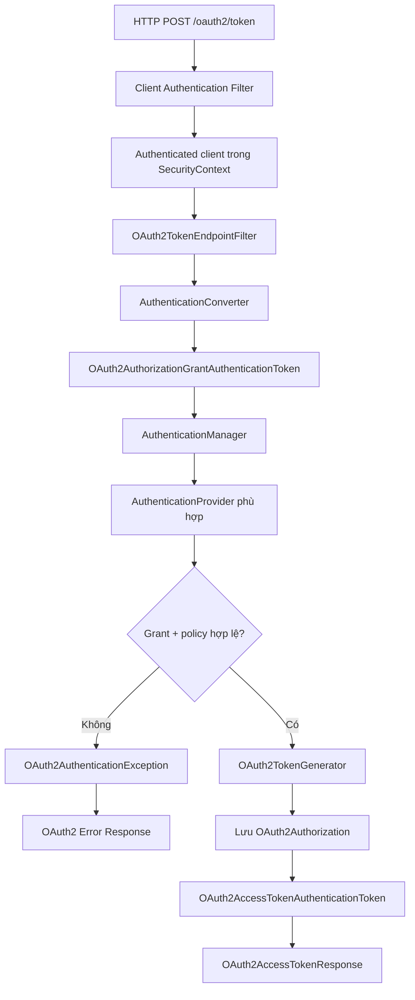

# Tạo AuthenticationProvider và kiểm tra điều kiện cấp quyền

## 1. Mở rộng xử lý xác thực và cấp quyền

Trong chương **Mở rộng giao thức** của module **SPRING_SECURITY_OAUTH2_OIDC_AUTHORIZATION_SERVER**, chúng ta học cách thiết kế, cấu hình, bảo mật, kiểm thử và vận hành OAuth 2.0/OpenID Connect Authorization Server bằng Spring Security và Spring Authorization Server trong ứng dụng Spring Boot.

Spring Authorization Server cung cấp các endpoint và AuthenticationProvider mặc định để xử lý authorization request, client authentication, token request, refresh token, device flow và các giao thức được hỗ trợ. Ứng dụng thực tế thường cần kiểm tra thêm điều kiện nghiệp vụ: client thuộc tenant nào, user có đang hoạt động không, grant có được bật cho client không, scope có được phép trên resource đích không, tài khoản có bị khóa không hoặc mã cấp quyền nội bộ đã hết hạn/chưa bị sử dụng hay chưa.

Có hai cách mở rộng thường gặp:

- **Bổ sung điều kiện vào provider mặc định** khi protocol flow đã có sẵn, ví dụ kiểm tra thêm quyền trước khi cấp Authorization Code hoặc Client Credentials Access Token.
- **Tạo grant type và AuthenticationProvider riêng** khi hệ thống cần một loại credential hoặc luồng cấp token mới.

Không phải mọi kiểm tra đều cần viết provider mới. Spring Authorization Server cung cấp extension point cho converter, provider, validator, success handler và error handler tại từng endpoint. Chọn đúng extension point giúp giữ nguyên xử lý protocol đã được kiểm thử của framework.

Sau bài này, bạn có thể phân biệt authentication/authorization, hiểu pipeline xử lý request, xác định điều kiện cấp quyền, mở rộng validator mặc định, tạo custom grant, phát hành và lưu token, ánh xạ OAuth2 error và kiểm thử các tình huống hợp lệ/không hợp lệ.

## 2. Authentication khác authorization như thế nào?

Tên `AuthenticationProvider` dễ khiến người mới nghĩ thành phần này chỉ kiểm tra username/password. Trong Spring Authorization Server, provider còn được dùng để xử lý protocol request sau khi request đã được chuyển thành một đối tượng `Authentication`.

**Authentication** trả lời câu hỏi: danh tính hoặc credential được trình bày có hợp lệ không?

- Client có xác thực thành công bằng `client_secret_basic`, `private_key_jwt` hoặc mTLS không?
- Resource owner đã đăng nhập và có một `Authentication` hợp lệ chưa?
- Authorization code, device code hoặc custom grant code có hợp lệ không?

**Authorization** trả lời câu hỏi: principal đã xác thực có được phép thực hiện hành động này không?

- Client có được phép dùng grant type đang yêu cầu không?
- Client có được yêu cầu scope `invoice.write` không?
- User có quyền truy cập tenant và resource tương ứng không?
- Consent đã bao phủ các scope cần thiết chưa?
- Chính sách rủi ro có yêu cầu MFA hoặc xác nhận bổ sung không?

**Token issuance** là bước tiếp theo: sau khi xác thực và kiểm tra quyền thành công, Authorization Server tạo token với đúng principal, scope, audience, thời hạn và claim đã được phê duyệt, sau đó lưu authorization state nếu flow yêu cầu.

| Câu hỏi | Ví dụ | Nơi xử lý điển hình |
| --- | --- | --- |
| Client là ai? | Xác thực client ID và credential. | Client Authentication Filter/Provider. |
| User là ai? | Đăng nhập bằng session hoặc cơ chế của ứng dụng. | Spring Security authentication chain. |
| Grant có hợp lệ? | Authorization code còn hạn, chưa dùng, gắn với client đúng. | Token Endpoint AuthenticationProvider. |
| Client có được dùng grant? | Client được cấu hình authorization_code hoặc custom grant. | Token Endpoint Provider. |
| User/client có được cấp scope? | User thuộc tenant, consent và policy cho phép. | Authorization validator/policy service. |
| Token có được phát? | Tạo và lưu token sau khi tất cả điều kiện đạt. | Token generator và authorization service. |

Một AuthenticationProvider có thể thực hiện cả xác thực grant lẫn kiểm tra authorization policy, nhưng nên giữ các bước tách bạch trong code để dễ kiểm thử và audit.

## 3. Pipeline xử lý tại protocol endpoint

Ở Token Endpoint, Spring Authorization Server thường xử lý request theo chuỗi:



| Thành phần | Trách nhiệm |
| --- | --- |
| Filter | Nhận HTTP request, gọi converter và AuthenticationManager. |
| AuthenticationConverter | Đọc, kiểm tra cấu trúc protocol parameter và tạo Authentication phù hợp. |
| Grant Authentication Token | Mang grant type, client principal và parameter đã parse tới provider. |
| AuthenticationManager | Tìm provider hỗ trợ loại Authentication được gửi vào. |
| AuthenticationProvider | Xác thực grant, kiểm tra quyền và xử lý nghiệp vụ cấp token. |
| OAuth2TokenGenerator | Tạo access token, ID Token hoặc token type được yêu cầu trong context. |
| OAuth2AuthorizationService | Lưu và tra cứu authorization/token state. |
| Success/Error Handler | Chuyển kết quả thành protocol response. |

Ở Authorization Endpoint, pipeline tương tự nhưng xử lý user principal, redirect URI, requested scope, consent và tạo authorization code. Ở Client Authentication Endpoint, provider xác minh credential của OAuth client và đặt OAuth2ClientAuthenticationToken vào SecurityContext.

## 4. Hợp đồng của AuthenticationProvider

AuthenticationProvider trong Spring Security có hai method quan trọng:

```java
public interface AuthenticationProvider {
    Authentication authenticate(Authentication authentication)
            throws AuthenticationException;

    boolean supports(Class<?> authentication);
}
```

### 4.1. supports()

`supports()` cho biết provider có xử lý loại Authentication được truyền vào hay không:

```java
@Override
public boolean supports(Class<?> authentication) {
    return CustomCodeGrantAuthenticationToken.class
            .isAssignableFrom(authentication);
}
```

Nên kiểm tra đúng class hoặc subtype mà provider sở hữu. Không trả true cho mọi Authentication.class, vì provider có thể nhận nhầm request do provider khác xử lý.

### 4.2. authenticate()

Provider thường có ba kết quả:

- Trả về một Authentication đã được xử lý thành công.
- Trả về null nếu provider không xử lý được loại Authentication đó và cho phép AuthenticationManager thử provider tiếp theo.
- Ném AuthenticationException nếu provider nhận đúng loại request nhưng credential hoặc điều kiện xác thực/cấp quyền không hợp lệ.

Không trả một token chưa xác thực như thể đã thành công. Không tự gọi setAuthenticated(true) trên request token đầu vào để bỏ qua quy trình xác thực. Đối tượng trả về phải thể hiện đúng trạng thái và principal đã được xác minh.

### 4.3. Không dùng supports() làm authorization

supports() chỉ chọn provider, không quyết định client có được cấp token hay không. Điều kiện cấp quyền phải được kiểm tra trong validator/provider sau khi có context đầy đủ.

Ví dụ, provider hỗ trợ custom grant không có nghĩa mọi client đều được dùng custom grant đó. Provider vẫn phải kiểm tra RegisteredClient.getAuthorizationGrantTypes() và policy bổ sung.

### 4.4. Phân biệt ba Authentication token

Trong một token request có thể có nhiều đối tượng Authentication khác nhau:

- OAuth2ClientAuthenticationToken: client đã được xác thực.
- CustomCodeGrantAuthenticationToken: request xin token theo custom grant, ban đầu chưa được xử lý.
- OAuth2AccessTokenAuthenticationToken: kết quả xác thực thành công, mang access token trả về cho client.

Không nhầm client principal với subject của access token. Với grant đại diện cho user, subject phải là user đã được xác minh từ grant. Với Client Credentials, principal thường là chính client.

## 5. Xác định điều kiện cấp quyền

Trước khi viết provider, hãy chuyển policy nghiệp vụ thành các điều kiện có thể kiểm tra rõ ràng:

| Nhóm điều kiện | Câu hỏi cần trả lời | Ví dụ từ chối |
| --- | --- | --- |
| Client | Client tồn tại, đang hoạt động và đã xác thực? | invalid_client. |
| Grant type | Client có được cấu hình dùng grant này? | unauthorized_client. |
| Grant credential | Code/assertion/device code hợp lệ, đúng client, còn hạn và chưa bị dùng? | invalid_grant. |
| Subject | User/service subject còn hoạt động và có danh tính đáng tin cậy? | access_denied hoặc invalid_grant theo protocol. |
| Tenant | Subject và client có quan hệ hợp lệ với tenant yêu cầu? | access_denied. |
| Scope | Scope được yêu cầu có nằm trong tập được phép không? | invalid_scope. |
| Resource/Audience | Client có được cấp token cho API/resource đích? | invalid_target khi profile hỗ trợ, hoặc lỗi policy phù hợp. |
| Consent | User đã chấp thuận các quyền cần thiết chưa? | Chuyển tới consent hoặc từ chối. |
| Authentication strength | Phiên đăng nhập đáp ứng MFA, acr, auth_time hoặc max-age? | access_denied hoặc yêu cầu xác thực lại. |
| Risk/context | Thiết bị, IP, thời gian hoặc trạng thái tài khoản có vượt policy? | Từ chối hoặc yêu cầu bước xác minh bổ sung. |

### 5.1. Phân biệt scope với quyền truy cập tài nguyên

Scope là một phần của quyền được token biểu đạt. Scope invoice.read không tự chứng minh user có quyền đọc mọi invoice. Resource Server vẫn phải kiểm tra quyền trên từng resource, ví dụ user chỉ được đọc invoice thuộc tenant của họ.

Authorization Server có thể kiểm tra quan hệ client/subject/tenant trước khi phát token và đưa scope/audience phù hợp vào token. Resource Server tiếp tục áp dụng authorization nghiệp vụ trên request thực tế.

### 5.2. Nguyên tắc subset

Một tập scope được cấp phải là tập con của mọi giới hạn áp dụng:

```text
grantedScopes ⊆ requestedScopes (nếu request có chỉ định)
grantedScopes ⊆ registeredClient.allowedScopes
grantedScopes ⊆ grant.allowedScopes
grantedScopes ⊆ subjectConsent.allowedScopes
grantedScopes ⊆ policy.allowedScopes
```

Nếu request không chỉ định scope, cách chọn default scope phải theo protocol và policy đã định nghĩa. Không tự cấp toàn bộ scope của client chỉ vì tham số scope bị bỏ trống.

### 5.3. Quyết định phải dựa trên dữ liệu đáng tin cậy

Không lấy tenant_id, subject, role, is_admin hoặc approved=true từ request rồi coi đó là sự thật. Những giá trị này phải được lấy từ authenticated principal, grant record đã xác minh, repository đáng tin cậy hoặc policy service.

Nếu client gửi thêm resource hoặc tenant parameter, hãy xem đó là **yêu cầu** cần kiểm tra với grant và policy. Không cho parameter do client kiểm soát thay đổi principal hoặc nâng quyền.

## 6. Chọn extension point phù hợp

| Nhu cầu | Extension point nên xem xét |
| --- | --- |
| Thêm điều kiện cho Authorization Code request | OAuth2AuthorizationCodeRequestAuthenticationProvider.setAuthenticationValidator(). |
| Thay đổi quy tắc yêu cầu consent | setAuthorizationConsentRequired() trên Authorization Code provider. |
| Thêm policy cho Client Credentials scope | OAuth2ClientCredentialsAuthenticationProvider.setAuthenticationValidator(). |
| Xác minh client bằng phương thức mới | Client Authentication Converter/Provider. |
| Thêm grant type mới tại Token Endpoint | Custom AuthenticationConverter, grant Authentication token và AuthenticationProvider. |
| Thay đổi cách phát token hoặc claim | OAuth2TokenGenerator hoặc OAuth2TokenCustomizer. |
| Thay đổi HTTP success/error response | Success/Error Handler của endpoint. |
| Kiểm tra quyền truy cập API sau khi token được phát | Authorization policy tại Resource Server. |

Ưu tiên validator khi chỉ cần thêm điều kiện cho flow có sẵn. Tạo provider riêng khi cần một loại Authentication/grant hoặc quy trình xác thực riêng. Không thay toàn bộ provider mặc định chỉ để thêm một điều kiện nhỏ.

## 7. Thêm điều kiện cho Authorization Code request

### 7.1. Provider mặc định đã kiểm tra gì?

OAuth2AuthorizationCodeRequestAuthenticationProvider xử lý authorization request của Authorization Code Grant. Validator mặc định OAuth2AuthorizationCodeRequestAuthenticationValidator kiểm tra redirect_uri và scope.

Spring Authorization Server cho phép thay validator bằng setAuthenticationValidator(Consumer<OAuth2AuthorizationCodeRequestAuthenticationContext>). Nếu validation thất bại, validator phải ném OAuth2AuthorizationCodeRequestAuthenticationException.

### 7.2. Giữ validation mặc định rồi nối policy mới

Ví dụ sau giữ kiểm tra redirect URI và scope mặc định, sau đó thêm điều kiện user phải có quyền sử dụng ứng dụng:

```java
import java.util.List;
import java.util.function.Consumer;

import org.springframework.security.authentication.AuthenticationProvider;
import org.springframework.security.core.Authentication;
import org.springframework.security.oauth2.core.OAuth2Error;
import org.springframework.security.oauth2.core.OAuth2ErrorCodes;
import org.springframework.security.oauth2.server.authorization.authentication.OAuth2AuthorizationCodeRequestAuthenticationContext;
import org.springframework.security.oauth2.server.authorization.authentication.OAuth2AuthorizationCodeRequestAuthenticationException;
import org.springframework.security.oauth2.server.authorization.authentication.OAuth2AuthorizationCodeRequestAuthenticationProvider;
import org.springframework.security.oauth2.server.authorization.authentication.OAuth2AuthorizationCodeRequestAuthenticationToken;
import org.springframework.security.oauth2.server.authorization.authentication.OAuth2AuthorizationCodeRequestAuthenticationValidator;

private Consumer<List<AuthenticationProvider>> authorizationPolicy(
        ClientAuthorizationPolicy policy) {

    return providers -> providers.forEach(provider -> {
        if (provider instanceof OAuth2AuthorizationCodeRequestAuthenticationProvider codeProvider) {
            Consumer<OAuth2AuthorizationCodeRequestAuthenticationContext> validator =
                    OAuth2AuthorizationCodeRequestAuthenticationValidator.DEFAULT_REDIRECT_URI_VALIDATOR
                            .andThen(OAuth2AuthorizationCodeRequestAuthenticationValidator.DEFAULT_SCOPE_VALIDATOR)
                            .andThen(context -> {
                                OAuth2AuthorizationCodeRequestAuthenticationToken request =
                                        context.getAuthentication();
                                Authentication resourceOwner =
                                        (Authentication) request.getPrincipal();

                                boolean allowed = policy.mayAuthorize(
                                        context.getRegisteredClient(),
                                        resourceOwner,
                                        request.getScopes());

                                if (!allowed) {
                                    OAuth2Error error =
                                            new OAuth2Error(OAuth2ErrorCodes.ACCESS_DENIED);
                                    throw new OAuth2AuthorizationCodeRequestAuthenticationException(
                                            error, null);
                                }
                            });

            codeProvider.setAuthenticationValidator(validator);
        }
    });
}
```

ClientAuthorizationPolicy là interface do ứng dụng định nghĩa. Nó có thể kiểm tra trạng thái client, subject, tenant, scope và policy version. Không đưa logic truy vấn database hoặc gọi remote service dài dòng vào lambda validator nếu có thể gom vào một service có kiểm thử riêng.

### 7.3. Gắn validator vào Authorization Endpoint

```java
@Bean
SecurityFilterChain authorizationServerSecurityFilterChain(
        HttpSecurity http,
        ClientAuthorizationPolicy policy) throws Exception {

    OAuth2AuthorizationServerConfigurer authorizationServerConfigurer =
            OAuth2AuthorizationServerConfigurer.authorizationServer();

    http
        .securityMatcher(authorizationServerConfigurer.getEndpointsMatcher())
        .with(authorizationServerConfigurer, authorizationServer ->
            authorizationServer
                .authorizationEndpoint(endpoint ->
                    endpoint.authenticationProviders(authorizationPolicy(policy))
                )
        );

    return http.build();
}
```

Đây là đoạn cấu hình phần authorization endpoint; ứng dụng vẫn cần các bean và filter chain khác của Authorization Server. Khi tùy biến provider list, chỉ thay provider cần cấu hình, không xóa các provider mặc định khác.

### 7.4. Redirect URI phải được kiểm tra chính xác

Redirect URI là ranh giới bảo mật quan trọng. Không nới lỏng so khớp bằng prefix, wildcard domain hoặc kiểm tra chuỗi con. Với URI đã đăng ký, dùng quy tắc so khớp đúng theo OAuth/OIDC profile và framework.

Không bỏ DEFAULT_REDIRECT_URI_VALIDATOR chỉ để thêm localhost hoặc một domain mới trong production. Nếu có ngoại lệ cho development, giới hạn theo profile/môi trường và không để cấu hình đó bật trên production.

## 8. Thêm điều kiện cho Client Credentials Grant

### 8.1. Dùng validator của provider mặc định

OAuth2ClientCredentialsAuthenticationProvider có setAuthenticationValidator(). Validator mặc định OAuth2ClientCredentialsAuthenticationValidator.DEFAULT_SCOPE_VALIDATOR kiểm tra scope trong Client Credentials request.

Có thể nối thêm policy kiểm tra service account, tenant, resource và giới hạn scope:

```java
import java.util.List;
import java.util.function.Consumer;

import org.springframework.security.authentication.AuthenticationProvider;
import org.springframework.security.oauth2.core.OAuth2AuthenticationException;
import org.springframework.security.oauth2.core.OAuth2Error;
import org.springframework.security.oauth2.core.OAuth2ErrorCodes;
import org.springframework.security.oauth2.server.authorization.authentication.OAuth2ClientCredentialsAuthenticationContext;
import org.springframework.security.oauth2.server.authorization.authentication.OAuth2ClientCredentialsAuthenticationProvider;
import org.springframework.security.oauth2.server.authorization.authentication.OAuth2ClientCredentialsAuthenticationValidator;

private Consumer<List<AuthenticationProvider>> clientCredentialsPolicy(
        ServiceAccountPolicy policy) {

    return providers -> providers.forEach(provider -> {
        if (provider instanceof OAuth2ClientCredentialsAuthenticationProvider clientCredentialsProvider) {
            Consumer<OAuth2ClientCredentialsAuthenticationContext> validator =
                    OAuth2ClientCredentialsAuthenticationValidator.DEFAULT_SCOPE_VALIDATOR
                            .andThen(context -> {
                                boolean allowed = policy.mayIssueToken(
                                        context.getRegisteredClient(),
                                        context.getAuthentication().getScopes());

                                if (!allowed) {
                                    throw new OAuth2AuthenticationException(
                                            new OAuth2Error(OAuth2ErrorCodes.INVALID_SCOPE));
                                }
                            });

            clientCredentialsProvider.setAuthenticationValidator(validator);
        }
    });
}
```

ServiceAccountPolicy là policy service của ứng dụng. Validator mặc định đã được nối trước policy mới nên các kiểm tra scope có sẵn vẫn chạy.

### 8.2. Gắn vào Token Endpoint

```java
http
    .securityMatcher(authorizationServerConfigurer.getEndpointsMatcher())
    .with(authorizationServerConfigurer, authorizationServer ->
        authorizationServer
            .tokenEndpoint(tokenEndpoint ->
                tokenEndpoint.authenticationProviders(
                        clientCredentialsPolicy(serviceAccountPolicy))
            )
    );
```

Nếu cần thêm converter hoặc provider cho một grant mới, dùng accessTokenRequestConverter() và authenticationProvider() như các phần tiếp theo.

### 8.3. Client Credentials không có resource owner

Client Credentials đại diện cho chính client/service account. Không tìm user đang đăng nhập trong SecurityContext rồi gán user đó làm subject nếu protocol flow không có user principal.

Policy có thể dựa trên client identity, tenant được cấp cho client, workload identity, resource/audience và scope được phép. Nếu cần quyền thay mặt user, hãy dùng grant/profile phù hợp có subject delegation rõ ràng.

## 9. Khi nào cần custom AuthenticationProvider?

Tạo custom provider khi hệ thống cần một grant type mới, ví dụ credential một lần do hệ thống đối tác phát hành, grant nội bộ được ràng buộc với tenant/workload, assertion đặc thù cần trust store riêng hoặc một loại authorization code ngoài các grant đã được Spring hỗ trợ.

Không tạo custom grant chỉ để đổi cách kiểm tra scope của client_credentials hoặc authorization_code; validator extension point đã đáp ứng trường hợp đó.

Một extension authorization grant cần tối thiểu:

1. Một grant_type định danh duy nhất, thường là absolute URI.
2. AuthenticationConverter đọc HTTP request và tạo custom grant Authentication token.
3. Custom grant Authentication token mang grant credential và authenticated client principal.
4. AuthenticationProvider xác minh grant, kiểm tra client/policy và tạo token.
5. Cấu hình provider/converter tại Token Endpoint.
6. RegisteredClient được cấu hình cho phép grant type mới.

## 10. Thiết kế custom grant token

Ví dụ dùng grant type:

```text
urn:ietf:params:oauth:grant-type:custom_code
```

Đây là URI định danh cho extension minh họa. Trong hệ thống thật, hãy chọn namespace do tổ chức kiểm soát hoặc một grant type được chuẩn hóa phù hợp. Không đặt tên grant gây hiểu nhầm rằng nó là grant chuẩn OAuth nếu chưa có đặc tả tương ứng.

Custom token kế thừa OAuth2AuthorizationGrantAuthenticationToken:

```java
import java.util.Map;

import org.springframework.security.core.Authentication;
import org.springframework.security.oauth2.core.AuthorizationGrantType;
import org.springframework.security.oauth2.server.authorization.authentication.OAuth2AuthorizationGrantAuthenticationToken;

public final class CustomCodeGrantAuthenticationToken
        extends OAuth2AuthorizationGrantAuthenticationToken {

    public static final AuthorizationGrantType GRANT_TYPE =
            new AuthorizationGrantType(
                    "urn:ietf:params:oauth:grant-type:custom_code");

    private final String code;

    public CustomCodeGrantAuthenticationToken(
            String code,
            Authentication clientPrincipal,
            Map<String, Object> additionalParameters) {
        super(GRANT_TYPE, clientPrincipal, additionalParameters);
        this.code = code;
    }

    public String getCode() {
        return this.code;
    }
}
```

Custom grant token chứa code cùng client principal đã được client authentication filter xác thực. Nó không tự xác minh code và không nên được đánh dấu authenticated trước khi provider xử lý.

## 11. Viết AuthenticationConverter cho custom grant

Converter chỉ nhận request có grant_type đúng với extension. Với grant type khác, trả null để converter mặc định tiếp tục xử lý.

Ví dụ dưới đây nhận code và scope, từ chối parameter bị lặp và không sao chép credential xác thực client vào additional parameters:

```java
import java.util.HashMap;
import java.util.Map;
import java.util.Set;

import jakarta.servlet.http.HttpServletRequest;

import org.springframework.lang.Nullable;
import org.springframework.security.core.Authentication;
import org.springframework.security.core.context.SecurityContextHolder;
import org.springframework.security.oauth2.core.OAuth2AuthenticationException;
import org.springframework.security.oauth2.core.OAuth2ErrorCodes;
import org.springframework.security.oauth2.core.endpoint.OAuth2ParameterNames;
import org.springframework.security.web.authentication.AuthenticationConverter;
import org.springframework.util.StringUtils;

public final class CustomCodeGrantAuthenticationConverter
        implements AuthenticationConverter {

    private static final Set<String> ALLOWED_PARAMETERS = Set.of(
            OAuth2ParameterNames.GRANT_TYPE,
            OAuth2ParameterNames.CLIENT_ID,
            "client_secret",
            "client_assertion",
            "client_assertion_type",
            "code",
            OAuth2ParameterNames.SCOPE,
            "resource");

    @Override
    @Nullable
    public Authentication convert(HttpServletRequest request) {
        String[] grantTypes =
                request.getParameterValues(OAuth2ParameterNames.GRANT_TYPE);

        if (grantTypes == null || grantTypes.length == 0 ||
                !CustomCodeGrantAuthenticationToken.GRANT_TYPE.getValue()
                        .equals(grantTypes[0])) {
            return null;
        }
        if (grantTypes.length != 1) {
            throw new OAuth2AuthenticationException(
                    OAuth2ErrorCodes.INVALID_REQUEST);
        }

        request.getParameterMap().keySet().forEach(name -> {
            if (!ALLOWED_PARAMETERS.contains(name)) {
                throw new OAuth2AuthenticationException(
                        OAuth2ErrorCodes.INVALID_REQUEST);
            }
        });

        String[] codes = request.getParameterValues("code");
        if (codes == null || codes.length != 1 || !StringUtils.hasText(codes[0])) {
            throw new OAuth2AuthenticationException(
                    OAuth2ErrorCodes.INVALID_REQUEST);
        }

        Map<String, Object> additionalParameters = new HashMap<>();
        addSingleParameter(request, OAuth2ParameterNames.SCOPE, additionalParameters);
        addSingleParameter(request, "resource", additionalParameters);

        Authentication clientPrincipal =
                SecurityContextHolder.getContext().getAuthentication();

        return new CustomCodeGrantAuthenticationToken(
                codes[0], clientPrincipal, additionalParameters);
    }

    private static void addSingleParameter(
            HttpServletRequest request,
            String name,
            Map<String, Object> additionalParameters) {

        String[] values = request.getParameterValues(name);
        if (values == null) {
            return;
        }
        if (values.length != 1 || !StringUtils.hasText(values[0])) {
            throw new OAuth2AuthenticationException(
                    OAuth2ErrorCodes.INVALID_REQUEST);
        }
        additionalParameters.put(name, values[0]);
    }
}
```

Trong extension thực tế, hãy định nghĩa allowlist parameter của grant và từ chối parameter không được hỗ trợ. Không copy client_secret, client_assertion hoặc credential khác vào additional parameters, và không log code. Ví dụ chỉ cho phép một resource; nếu cần nhiều resource, hãy định nghĩa và kiểm thử semantics riêng.

## 12. Viết AuthenticationProvider cho custom grant

Provider cần xác minh client đã được authenticate, grant type đã được client đăng ký, grant credential hợp lệ và các điều kiện cấp quyền đều đạt.

### 12.1. Các dependency minh họa

Ứng dụng có thể định nghĩa các abstraction:

```java
import java.util.Set;

import org.springframework.security.core.Authentication;
import org.springframework.security.oauth2.server.authorization.OAuth2Authorization;
import org.springframework.security.oauth2.server.authorization.client.RegisteredClient;

public record CustomGrantRecord(
        String id,
        String subjectName,
        Authentication subjectAuthentication,
        Set<String> allowedScopes) {
}

public interface CustomGrantStore {
    CustomGrantRecord findValid(String rawCode, String clientId);
}

public interface CustomGrantPolicy {
    boolean mayRedeem(
            RegisteredClient client,
            CustomGrantRecord grant,
            Set<String> requestedScopes,
            String requestedResource);
}

public interface CustomGrantRedemptionService {
    void consumeAndSaveAuthorization(
            String grantRecordId,
            String clientId,
            OAuth2Authorization authorization);
}
```

Đây là interface/model do ứng dụng định nghĩa, không phải API có sẵn trong Spring Authorization Server. CustomGrantRecord chứa dữ liệu đã được kiểm tra từ kho tin cậy, ví dụ record ID, subject đã xác minh và scope được phép. CustomGrantStore chỉ trả grant còn hiệu lực và gắn với client yêu cầu.

### 12.2. Provider kiểm tra điều kiện

```java
import java.util.Arrays;
import java.util.LinkedHashSet;
import java.util.Set;

import org.springframework.security.authentication.AuthenticationProvider;
import org.springframework.security.core.Authentication;
import org.springframework.security.core.AuthenticationException;
import org.springframework.security.oauth2.core.ClaimAccessor;
import org.springframework.security.oauth2.core.OAuth2AccessToken;
import org.springframework.security.oauth2.core.OAuth2AuthenticationException;
import org.springframework.security.oauth2.core.OAuth2Error;
import org.springframework.security.oauth2.core.OAuth2ErrorCodes;
import org.springframework.security.oauth2.core.OAuth2Token;
import org.springframework.security.oauth2.core.endpoint.OAuth2ParameterNames;
import org.springframework.security.oauth2.server.authorization.OAuth2Authorization;
import org.springframework.security.oauth2.server.authorization.OAuth2TokenType;
import org.springframework.security.oauth2.server.authorization.authentication.OAuth2AccessTokenAuthenticationToken;
import org.springframework.security.oauth2.server.authorization.authentication.OAuth2ClientAuthenticationToken;
import org.springframework.security.oauth2.server.authorization.client.RegisteredClient;
import org.springframework.security.oauth2.server.authorization.context.AuthorizationServerContextHolder;
import org.springframework.security.oauth2.server.authorization.token.DefaultOAuth2TokenContext;
import org.springframework.security.oauth2.server.authorization.token.OAuth2TokenContext;
import org.springframework.security.oauth2.server.authorization.token.OAuth2TokenGenerator;

public final class CustomCodeGrantAuthenticationProvider
        implements AuthenticationProvider {

    private final CustomGrantStore grantStore;
    private final CustomGrantPolicy grantPolicy;
    private final CustomGrantRedemptionService redemptionService;
    private final OAuth2TokenGenerator<? extends OAuth2Token> tokenGenerator;

    public CustomCodeGrantAuthenticationProvider(
            CustomGrantStore grantStore,
            CustomGrantPolicy grantPolicy,
            CustomGrantRedemptionService redemptionService,
            OAuth2TokenGenerator<? extends OAuth2Token> tokenGenerator) {
        this.grantStore = grantStore;
        this.grantPolicy = grantPolicy;
        this.redemptionService = redemptionService;
        this.tokenGenerator = tokenGenerator;
    }

    @Override
    public Authentication authenticate(Authentication authentication)
            throws AuthenticationException {
        if (!(authentication instanceof CustomCodeGrantAuthenticationToken grantRequest)) {
            return null;
        }

        OAuth2ClientAuthenticationToken clientPrincipal =
                requireAuthenticatedClient(grantRequest.getPrincipal());
        RegisteredClient registeredClient = clientPrincipal.getRegisteredClient();

        if (!registeredClient.getAuthorizationGrantTypes()
                .contains(CustomCodeGrantAuthenticationToken.GRANT_TYPE)) {
            throw new OAuth2AuthenticationException(
                    OAuth2ErrorCodes.UNAUTHORIZED_CLIENT);
        }

        CustomGrantRecord grant = grantStore.findValid(
                grantRequest.getCode(), registeredClient.getClientId());
        if (grant == null) {
            throw new OAuth2AuthenticationException(
                    OAuth2ErrorCodes.INVALID_GRANT);
        }

        Set<String> requestedScopes = parseScopes(
                grantRequest.getAdditionalParameters()
                        .get(OAuth2ParameterNames.SCOPE));
        String resource = (String) grantRequest.getAdditionalParameters()
                .get("resource");

        if (!grantPolicy.mayRedeem(
                registeredClient, grant, requestedScopes, resource)) {
            throw new OAuth2AuthenticationException(
                    OAuth2ErrorCodes.ACCESS_DENIED);
        }

        Set<String> approvedScopes = determineApprovedScopes(
                registeredClient, grant, requestedScopes);

        OAuth2TokenContext tokenContext = DefaultOAuth2TokenContext.builder()
                .registeredClient(registeredClient)
                .principal(grant.subjectAuthentication())
                .authorizationServerContext(
                        AuthorizationServerContextHolder.getContext())
                .authorizedScopes(approvedScopes)
                .tokenType(OAuth2TokenType.ACCESS_TOKEN)
                .authorizationGrantType(
                        CustomCodeGrantAuthenticationToken.GRANT_TYPE)
                .authorizationGrant(grantRequest)
                .build();

        OAuth2Token generatedToken = this.tokenGenerator.generate(tokenContext);
        if (generatedToken == null) {
            OAuth2Error error = new OAuth2Error(
                    OAuth2ErrorCodes.SERVER_ERROR,
                    "The token generator failed to generate the access token.",
                    null);
            throw new OAuth2AuthenticationException(error);
        }

        OAuth2AccessToken accessToken = new OAuth2AccessToken(
                OAuth2AccessToken.TokenType.BEARER,
                generatedToken.getTokenValue(),
                generatedToken.getIssuedAt(),
                generatedToken.getExpiresAt(),
                approvedScopes);

        OAuth2Authorization.Builder authorizationBuilder =
                OAuth2Authorization.withRegisteredClient(registeredClient)
                        .principalName(grant.subjectName())
                        .authorizationGrantType(
                                CustomCodeGrantAuthenticationToken.GRANT_TYPE);

        if (generatedToken instanceof ClaimAccessor claimAccessor) {
            authorizationBuilder.token(accessToken, metadata ->
                    metadata.put(
                            OAuth2Authorization.Token.CLAIMS_METADATA_NAME,
                            claimAccessor.getClaims()));
        } else {
            authorizationBuilder.accessToken(accessToken);
        }

        OAuth2Authorization authorization = authorizationBuilder.build();

        // Consume grant và lưu authorization trong cùng transaction nghiệp vụ.
        this.redemptionService.consumeAndSaveAuthorization(
                grant.id(), registeredClient.getClientId(), authorization);

        return new OAuth2AccessTokenAuthenticationToken(
                registeredClient, clientPrincipal, accessToken);
    }

    @Override
    public boolean supports(Class<?> authentication) {
        return CustomCodeGrantAuthenticationToken.class
                .isAssignableFrom(authentication);
    }

    private static OAuth2ClientAuthenticationToken requireAuthenticatedClient(
            Object principal) {
        if (principal instanceof OAuth2ClientAuthenticationToken client &&
                client.isAuthenticated() &&
                client.getRegisteredClient() != null) {
            return client;
        }
        throw new OAuth2AuthenticationException(
                OAuth2ErrorCodes.INVALID_CLIENT);
    }

    private static Set<String> parseScopes(Object scopeParameter) {
        if (scopeParameter == null) {
            return Set.of();
        }
        if (!(scopeParameter instanceof String scopeValue)) {
            throw new OAuth2AuthenticationException(
                    OAuth2ErrorCodes.INVALID_REQUEST);
        }
        if (!org.springframework.util.StringUtils.hasText(scopeValue)) {
            return Set.of();
        }
        return Set.copyOf(new LinkedHashSet<>(
                Arrays.asList(scopeValue.trim().split("\\s+"))));
    }

    private static Set<String> determineApprovedScopes(
            RegisteredClient client,
            CustomGrantRecord grant,
            Set<String> requestedScopes) {

        Set<String> approved = requestedScopes.isEmpty()
                ? grant.allowedScopes()
                : requestedScopes;

        if (!client.getScopes().containsAll(approved) ||
                !grant.allowedScopes().containsAll(approved)) {
            throw new OAuth2AuthenticationException(
                    OAuth2ErrorCodes.INVALID_SCOPE);
        }
        return Set.copyOf(approved);
    }
}
```

Các interface và record trong ví dụ cần được triển khai theo schema/policy thực tế. Đoạn code tập trung minh họa cấu trúc provider, token context và luồng persist.

### 12.3. Kiểm tra client principal

Client Authentication Filter xử lý client credential trước Token Endpoint và đặt OAuth2ClientAuthenticationToken đã xác thực vào context. Provider vẫn nên xác minh principal đúng kiểu, đã authenticated và có RegisteredClient.

Không tin client_id gửi trong custom parameter như bằng chứng client đã xác thực. Không lấy client principal từ request body; dùng principal được Spring Security thiết lập sau client authentication.

### 12.4. Kiểm tra grant type đã được đăng ký

Một custom provider có thể được gắn vào Token Endpoint, nhưng chỉ những client có AuthorizationGrantType tương ứng trong RegisteredClient mới được sử dụng. Nếu client chưa đăng ký grant, trả unauthorized_client.

Khi thêm grant type vào RegisteredClient, vẫn cần kiểm tra auth method, scope, token settings và policy client. Chỉ thêm grant type vào record không tự hoàn thiện toàn bộ bảo mật của flow.

## 13. Tiêu thụ grant một lần và lưu authorization an toàn

Custom code thường là credential bearer. Nếu cùng một code được gửi đồng thời hai lần, chỉ một request được thành công.

### 13.1. Không chỉ SELECT rồi UPDATE

Mẫu không an toàn:

```text
Request A: SELECT code -> ACTIVE
Request B: SELECT code -> ACTIVE
Request A: phát token
Request B: phát token
Request A: UPDATE code -> CONSUMED
Request B: UPDATE code -> CONSUMED
```

Cả hai request đã vượt qua kiểm tra trước khi trạng thái được cập nhật. Cần một thao tác atomic, ví dụ conditional update:

```sql
UPDATE custom_grant
SET status = 'CONSUMED',
    consumed_at = CURRENT_TIMESTAMP
WHERE id = ?
  AND client_id = ?
  AND status = 'ACTIVE'
  AND expires_at > CURRENT_TIMESTAMP;
```

Chỉ request nhận được update count bằng 1 mới được tiếp tục. Nếu là 0, grant không còn hợp lệ hoặc đã bị request khác tiêu thụ.

### 13.2. Consume và persist phải nhất quán

Nếu ứng dụng tiêu thụ grant thành công rồi OAuth2AuthorizationService.save() thất bại, client không có token nhưng grant đã mất. Ngược lại, nếu lưu token trước rồi consume grant thất bại, token có thể tồn tại dù grant bị replay.

Nếu grant store và authorization service dùng cùng database, đặt conditional consume và save authorization trong **cùng transaction**. Nếu chúng nằm ở các hệ thống khác nhau, cần thiết kế state machine/saga có bù trừ và idempotency; một @Transactional cục bộ không làm hai hệ thống atomic.

CustomGrantRedemptionService.consumeAndSaveAuthorization() trong ví dụ đại diện cho transaction boundary này. Nó nhận cả grant record ID và client ID để câu lệnh consume kiểm tra lại binding trong database. Trong implementation thực tế, nó cần:

1. Mở transaction.
2. Consume grant bằng conditional update.
3. Nếu update count khác 1, ném invalid_grant.
4. Lưu OAuth2Authorization.
5. Commit cả hai thay đổi.

Ví dụ skeleton cho implementation JDBC do ứng dụng sở hữu:

```java
import org.springframework.jdbc.core.JdbcTemplate;
import org.springframework.security.oauth2.core.OAuth2AuthenticationException;
import org.springframework.security.oauth2.core.OAuth2ErrorCodes;
import org.springframework.security.oauth2.server.authorization.OAuth2Authorization;
import org.springframework.security.oauth2.server.authorization.OAuth2AuthorizationService;
import org.springframework.stereotype.Service;
import org.springframework.transaction.annotation.Transactional;

@Service
public class JdbcCustomGrantRedemptionService
        implements CustomGrantRedemptionService {

    private final JdbcTemplate jdbcTemplate;
    private final OAuth2AuthorizationService authorizationService;

    public JdbcCustomGrantRedemptionService(
            JdbcTemplate jdbcTemplate,
            OAuth2AuthorizationService authorizationService) {
        this.jdbcTemplate = jdbcTemplate;
        this.authorizationService = authorizationService;
    }

    @Override
    @Transactional
    public void consumeAndSaveAuthorization(
            String grantRecordId,
            String clientId,
            OAuth2Authorization authorization) {

        int updated = jdbcTemplate.update("""
                UPDATE custom_grant
                SET status = 'CONSUMED',
                    consumed_at = CURRENT_TIMESTAMP
                WHERE id = ?
                  AND client_id = ?
                  AND status = 'ACTIVE'
                  AND expires_at > CURRENT_TIMESTAMP
                """, grantRecordId, clientId);

        if (updated != 1) {
            throw new OAuth2AuthenticationException(
                    OAuth2ErrorCodes.INVALID_GRANT);
        }

        this.authorizationService.save(authorization);
    }
}
```

Đây là skeleton, tên bảng/cột thuộc schema của ứng dụng. Để rollback đồng thời, JdbcTemplate và JdbcOAuth2AuthorizationService phải dùng cùng DataSource và transaction manager. Nếu authorization service ghi sang database khác, transaction JDBC này không tự bao phủ database đó.

### 13.3. Lưu token state

Provider phải dùng OAuth2AuthorizationService để lưu authorization theo cơ chế của Spring Authorization Server. Nếu token generator tạo JWT, lưu claims metadata cùng token theo mẫu framework để các thành phần khác có thể đọc authorization state khi cần.

Không tự lưu token trong một map static hoặc in-memory collection ở production. Mọi Authorization Server node phải tra cứu được cùng trạng thái.

## 14. Cấu hình custom converter và provider tại Token Endpoint

Đăng ký hai extension point với OAuth2TokenEndpointConfigurer:

```java
@Bean
SecurityFilterChain authorizationServerSecurityFilterChain(
        HttpSecurity http,
        CustomCodeGrantAuthenticationConverter converter,
        CustomCodeGrantAuthenticationProvider provider) throws Exception {

    OAuth2AuthorizationServerConfigurer authorizationServerConfigurer =
            OAuth2AuthorizationServerConfigurer.authorizationServer();

    http
        .securityMatcher(authorizationServerConfigurer.getEndpointsMatcher())
        .with(authorizationServerConfigurer, authorizationServer ->
            authorizationServer
                .tokenEndpoint(tokenEndpoint ->
                    tokenEndpoint
                        .accessTokenRequestConverter(converter)
                        .authenticationProvider(provider)
                )
        )
        .authorizeHttpRequests(authorize ->
            authorize.anyRequest().authenticated()
        );

    return http.build();
}
```

accessTokenRequestConverter() bổ sung converter vào danh sách converter của Token Endpoint. authenticationProvider() bổ sung provider xử lý grant token tương ứng. Converter custom trả null cho grant type khác để converter mặc định tiếp tục xử lý.

Không xóa các converter/provider mặc định của Authorization Code, Refresh Token, Client Credentials, Device Code hoặc Token Exchange nếu ứng dụng vẫn sử dụng chúng.

### 14.1. Đăng ký grant type cho client

Ví dụ:

```java
RegisteredClient client = RegisteredClient.withId(internalId)
        .clientId("integration-client")
        .clientSecret(encodedSecret)
        .clientAuthenticationMethod(
                ClientAuthenticationMethod.CLIENT_SECRET_BASIC)
        .authorizationGrantType(
                CustomCodeGrantAuthenticationToken.GRANT_TYPE)
        .scope("invoice.read")
        .scope("invoice.write")
        .build();
```

Đây là phần minh họa cấu hình grant cho một client. Secret phải được encode bằng PasswordEncoder; repository phải bền vững và có unique constraint phù hợp.

### 14.2. Request mẫu

```http
POST /oauth2/token HTTP/1.1
Host: auth.example.com
Authorization: Basic <base64(client-id:client-secret)>
Content-Type: application/x-www-form-urlencoded
Accept: application/json

grant_type=urn:ietf:params:oauth:grant-type:custom_code&
code=<one-time-grant-code>&
scope=invoice.read&
resource=https%3A%2F%2Finvoice-api.example.com
```

Đây là protocol minh họa cho custom grant. resource chỉ được hỗ trợ khi ứng dụng định nghĩa rõ cách xác minh resource/audience. Không coi parameter này là quyền truy cập tự động.

## 15. Xây policy service thay vì nhồi logic vào provider

Provider nên điều phối luồng xác thực và cấp token. Các quy tắc nghiệp vụ phức tạp nên được tách thành service có interface rõ ràng.

Ví dụ policy context:

```java
public record TokenAuthorizationContext(
        RegisteredClient client,
        Authentication subject,
        String tenantId,
        String resource,
        Set<String> requestedScopes,
        AuthorizationGrantType grantType) {
}

public interface TokenAuthorizationPolicy {
    AuthorizationDecision evaluate(TokenAuthorizationContext context);
}
```

AuthorizationDecision là model của ứng dụng, có thể chứa allowed/denied, approved scopes, approved audience, policy ID và reason code nội bộ. Không trả toàn bộ reason nhạy cảm cho client.

### 15.1. Thứ tự kiểm tra gợi ý

1. Client đã authenticate và đang hoạt động.
2. Client được phép dùng grant type.
3. Grant credential tồn tại, đúng client, đúng issuer/audience, chưa hết hạn và chưa bị thu hồi.
4. Subject đã được xác minh và còn hoạt động.
5. Subject có quan hệ với tenant/resource yêu cầu.
6. Requested scopes là subset của client, grant, consent và policy.
7. Authentication context đáp ứng MFA/max-age/ACR nếu policy yêu cầu.
8. Policy risk và thời hạn cấp token cho phép.
9. Tạo token với scope/audience/claims đã được phê duyệt.
10. Lưu authorization và consume grant theo transaction.

Thứ tự này giúp fail sớm trước khi tạo token và làm rõ điều kiện nào đã được kiểm tra. Với thông tin nhạy cảm, dùng cùng một lỗi bên ngoài cho nhiều trạng thái nội bộ để tránh tạo oracle cho attacker.

### 15.2. Không dùng scope làm role tùy tiện

Scope mô tả quyền client xin từ Authorization Server. Role là quan hệ nghiệp vụ của subject. Claim role trong JWT cần có nguồn đáng tin cậy, được giới hạn theo resource và có thời hạn phù hợp.

Không sao chép mọi authority từ user session vào Access Token mà không lọc. Token có thể được sử dụng ở nhiều Resource Server; chỉ đưa claim cần thiết cho resource đích.

## 16. Tạo token đúng context

OAuth2TokenGenerator nhận OAuth2TokenContext. Các thông tin quan trọng gồm RegisteredClient, principal đại diện resource owner hoặc client, AuthorizationServerContext, authorizedScopes, tokenType, authorizationGrantType và authorizationGrant.

Ví dụ custom grant dùng DefaultOAuth2TokenContext.builder():

```java
OAuth2TokenContext tokenContext = DefaultOAuth2TokenContext.builder()
        .registeredClient(registeredClient)
        .principal(subjectAuthentication)
        .authorizationServerContext(
                AuthorizationServerContextHolder.getContext())
        .authorizedScopes(approvedScopes)
        .tokenType(OAuth2TokenType.ACCESS_TOKEN)
        .authorizationGrantType(customGrantType)
        .authorizationGrant(customGrantAuthentication)
        .build();

OAuth2Token generatedToken = tokenGenerator.generate(tokenContext);
if (generatedToken == null) {
    throw new OAuth2AuthenticationException(
            new OAuth2Error(OAuth2ErrorCodes.SERVER_ERROR));
}
```

subjectAuthentication phải đến từ grant đã được xác minh hoặc identity store đáng tin cậy. Với Client Credentials, principal thường là client. Với grant đại diện cho user, principal phải là user subject đã được xác minh. Không lấy subject từ parameter request chưa được kiểm tra.

### 16.1. Access token và authorization record

Sau khi token được tạo, provider xây OAuth2AccessToken với thời điểm phát hành, hết hạn và scopes được duyệt. Sau đó lưu vào OAuth2Authorization gắn với RegisteredClient, principal name và grant type.

Nếu token là JWT (ClaimAccessor), lưu claims metadata theo API của OAuth2Authorization.Builder. Nếu token là opaque token, lưu token state phù hợp với cấu hình introspection/resource server.

### 16.2. Không phát refresh token mặc định cho mọi custom grant

Refresh token có vòng đời và semantics riêng. Chỉ phát refresh token nếu custom grant được thiết kế rõ về rotation, reuse detection, client binding, revocation và consent. Không thêm OAuth2RefreshTokenGenerator vào token response chỉ vì ứng dụng đã có bean generator.

### 16.3. Claim và audience

Claims phải phản ánh policy đã phê duyệt. Với JWT Access Token, iss phải là issuer của Authorization Server; sub phải là subject đã xác minh; aud phải chỉ resource server đích; scope/scp chỉ chứa scope được duyệt; exp/iat/nbf phải hợp lệ; claim tenant/role phải đến từ nguồn đáng tin cậy.

Nếu dùng OAuth2TokenCustomizer<JwtEncodingContext>, kiểm tra grant type và token type trước khi thêm claim. Không thêm claim đặc quyền vào mọi token chỉ dựa trên tên client hoặc request parameter.

Trong ví dụ custom grant, parameter resource mới chỉ được kiểm tra bởi policy; nó không tự động trở thành claim aud. Nếu cần token dành riêng cho một API, hãy để policy trả về resource/audience đã được duyệt và đưa giá trị đã xác minh đó vào token customizer hoặc token generator. Không sao chép thẳng resource từ request vào aud.

## 17. Ánh xạ lỗi sang OAuth2 error response

Không trả exception database, stack trace hoặc lý do nội bộ cho client. Hãy dùng OAuth2 error code phù hợp với giai đoạn và protocol.

| Tình huống | Error code thường dùng | Ý nghĩa |
| --- | --- | --- |
| Client credential không hợp lệ | invalid_client | Client authentication thất bại. |
| Client không được dùng grant | unauthorized_client | Grant type không được cấu hình cho client. |
| Code sai, hết hạn, đã dùng hoặc không thuộc client | invalid_grant | Authorization grant không hợp lệ. |
| Parameter thiếu, lặp hoặc sai cấu trúc | invalid_request | Request không hợp lệ. |
| Scope vượt quyền | invalid_scope | Scope không được phép hoặc không hợp lệ. |
| User/policy từ chối authorization | access_denied | Resource owner hoặc policy không cho phép. |
| Lỗi nội bộ khi tạo/lưu token | server_error | Server không thể hoàn tất xử lý. |

Ở Token Endpoint, provider thường ném OAuth2AuthenticationException. Với Authorization Code request validator, dùng OAuth2AuthorizationCodeRequestAuthenticationException để framework tạo authorization error response đúng flow.

Không trả invalid_client cho mọi lỗi policy vì sẽ làm lẫn authentication với authorization. Cũng không trả invalid_grant kèm thông tin code tồn tại nhưng đã dùng vì có thể tạo oracle dò credential.

## 18. Bảo mật AuthenticationProvider

### 18.1. Giới hạn input

- Kiểm tra parameter bắt buộc, số lần xuất hiện và kích thước tối đa.
- Từ chối parameter lạ nếu custom grant không hỗ trợ.
- Không parse JSON hoặc URL tùy ý khi không cần thiết.
- Không tin client ID hoặc subject lặp lại trong body sau khi client đã authenticate.
- Không cho client tự chọn algorithm, issuer hoặc key ID của token.

### 18.2. Bảo vệ grant credential

- Sinh code bằng CSPRNG với entropy đủ cao.
- Lưu hash của code nếu chỉ cần so sánh.
- Ràng buộc code với client, subject, audience/resource và scope.
- Đặt expiry ngắn theo use case.
- Dùng atomic consume để chống replay.
- Không ghi raw code vào log, metric label hoặc trace.

### 18.3. Không gọi hệ thống ngoài tùy tiện

Nếu policy cần kiểm tra entitlement ở service khác, xác thực endpoint, TLS, timeout, circuit breaker và cache policy rõ ràng. Không coi timeout của policy service là cho phép mặc định. Khi không xác định được quyền, xử lý theo fail-closed cho quyền nhạy cảm.

Tránh gọi HTTP đồng bộ trong transaction đang giữ JDBC connection. Nếu cần nhiều nguồn dữ liệu, xác định thứ tự kiểm tra và thời điểm commit/consume để tránh grant đã bị tiêu thụ nhưng authorization chưa lưu.

### 18.4. Bảo vệ log và audit

Có thể ghi correlation ID và client ID, grant type, policy ID/version, kết quả allow/deny, scope/audience đã được duyệt ở dạng phù hợp và error code protocol.

Không ghi client secret, authorization code/custom grant code, access token/refresh token, client assertion/private key, Authorization header hoặc toàn bộ request parameter map chưa lọc.

## 19. Kiểm thử AuthenticationProvider và điều kiện cấp quyền

Kiểm thử provider ở nhiều tầng: unit test policy, provider test, endpoint integration test và concurrency test.

| Nhóm | Kịch bản | Kỳ vọng |
| --- | --- | --- |
| Provider selection | supports() nhận custom grant token. | Provider custom được chọn. |
| Provider selection | Token loại khác. | Provider trả null hoặc không được gọi. |
| Client authentication | Không có client principal hoặc principal chưa authenticated. | invalid_client. |
| Client policy | Client không tồn tại/disabled. | Từ chối trước khi phát token. |
| Grant type | Client chưa đăng ký custom grant. | unauthorized_client. |
| Grant code | Code không tồn tại/sai. | invalid_grant. |
| Grant expiry | Code hết hạn. | invalid_grant. |
| Client binding | Code thuộc client khác. | invalid_grant. |
| Replay | Code đã bị consume. | invalid_grant. |
| Concurrency | Hai request cùng consume một code. | Chỉ một request thành công. |
| Scope | Scope ngoài client/grant/consent policy. | invalid_scope hoặc lỗi policy đã định nghĩa. |
| Subject | User bị khóa hoặc không thuộc tenant. | Không phát token. |
| Resource | Resource/audience không được phép. | Không phát token cho resource đó. |
| Token generation | Generator trả null. | server_error, không lưu authorization. |
| Persistence | Save authorization thất bại. | Không trả success response. |
| Rollback | Consume grant thành công nhưng save authorization lỗi trong cùng DB transaction. | Cả hai thao tác rollback. |
| Authorization Code validator | Redirect URI không hợp lệ. | Request bị từ chối. |
| Authorization Code validator | Scope sai hoặc policy user deny. | Request bị từ chối. |
| Default validation | Custom policy được thêm. | Redirect URI/scope validator mặc định vẫn chạy. |
| Client Credentials | Client xin scope ngoài policy. | Không cấp scope vượt quyền. |
| Error mapping | Domain exception xảy ra. | Chỉ trả OAuth error đã kiểm soát. |
| Token claims | Subject, audience, scope và expiry. | Claims khớp policy đã duyệt. |
| Logging | Gửi code/secret giả. | Không có credential trong log. |

### 19.1. Unit test cho policy

Tạo test độc lập cho CustomGrantPolicy với các tổ hợp client active/inactive, subject active/locked, tenant đúng/sai, scope subset/vượt quyền, resource đúng/sai, consent đủ/thiếu và authentication strength đạt/không đạt.

Unit test giúp policy dễ đọc và giảm số điều kiện nằm trong AuthenticationProvider.

### 19.2. Integration test qua Token Endpoint

Gửi request HTTP thật tới /oauth2/token với client authentication hợp lệ. Kiểm tra converter chỉ nhận custom grant_type, tạo đúng custom grant token, provider được chọn, client được kiểm tra, grant được xác minh và consume, token generator tạo token, authorization được lưu và response JSON chứa token đúng.

Sau đó gửi lại cùng code và xác nhận request thứ hai bị từ chối.

### 19.3. Test trên database thật

Với one-time grant, transaction và concurrency, hãy chạy integration test trên database engine tương thích production. In-memory repository có thể che lỗi transaction, unique constraint hoặc race condition.

## 20. Quan sát và vận hành

Theo dõi các chỉ số không chứa credential:

- Số request theo grant type và kết quả.
- Tỉ lệ invalid_client, unauthorized_client, invalid_grant, invalid_scope, access_denied.
- Latency của policy service và grant store.
- Tỉ lệ grant code hết hạn hoặc replay.
- Token generation failure.
- Authorization persistence failure.
- Số lần từ chối theo policy ID/version.

Không dùng raw code, token, subject email hoặc secret làm metric label vì có thể làm lộ dữ liệu và tạo cardinality lớn.

Khi policy thay đổi, ghi version hoặc ID để điều tra vì sao một request bị cho phép/từ chối. Nếu cần audit chi tiết, ghi sự kiện có correlation ID và principal/client ID đã được kiểm soát.

## 21. Lỗi thường gặp khi mở rộng provider

| Triệu chứng | Nguyên nhân | Cách xử lý |
| --- | --- | --- |
| Custom grant không được xử lý | Converter không được đăng ký hoặc grant type không khớp. | Kiểm tra converter, giá trị tuyệt đối của grant_type và endpoint config. |
| Provider không được gọi | supports() trả false hoặc token class không đúng. | Kiểm tra kiểu Authentication converter tạo ra. |
| Grant mặc định bị hỏng | Thay danh sách converter/provider và xóa thành phần mặc định. | Dùng API bổ sung hoặc chỉnh đúng provider cần thiết. |
| Policy mới không chạy | Cấu hình nhầm endpoint hoặc provider instance. | Kiểm tra authorizationEndpoint và tokenEndpoint riêng biệt. |
| Redirect URI yếu đi sau custom validator | Thay validator mặc định mà không nối lại kiểm tra redirect. | Dùng default redirect/scope validators trước policy mới. |
| Scope vượt quyền | Chỉ kiểm tra scope do request gửi, không kiểm tra client/grant/consent. | Dùng subset intersection qua mọi giới hạn. |
| Token có sai subject | Dùng client principal cho grant đại diện user hoặc tin subject request. | Lấy subject từ grant đã xác minh. |
| Code bị dùng hai lần | SELECT rồi UPDATE không atomic. | Conditional update/locking trong transaction. |
| Code bị consume nhưng không có token | Consume và authorization save ở hai transaction/hệ thống không atomic. | Dùng cùng transaction hoặc saga có idempotency. |
| Token generator trả null | Token context thiếu field hoặc generator không hỗ trợ token type. | Kiểm tra context, generator chain và thuật toán. |
| Claims không được lưu | Không lưu claims metadata khi token là JWT. | Dùng builder token metadata với ClaimAccessor. |
| Lộ credential trong log | Log toàn request hoặc Authentication object. | Redact code/secret/token và giảm log payload. |

## 22. Bài tập thực hành và checklist

### Bài tập 1 — Thêm điều kiện cho Authorization Code

Mở rộng OAuth2AuthorizationCodeRequestAuthenticationProvider để kiểm tra user thuộc tenant được client đăng ký. Giữ nguyên redirect URI và scope validators mặc định. Viết test cho tenant hợp lệ và không hợp lệ.

### Bài tập 2 — Giới hạn Client Credentials

Thêm validator cho Client Credentials để chỉ cho phép service account yêu cầu invoice.read trên resource được cấu hình. Kiểm tra scope vượt quyền và client bị disable.

### Bài tập 3 — Tạo custom grant

Tạo CustomCodeGrantAuthenticationToken, converter và provider. Đăng ký grant type trên một client, gửi request tới Token Endpoint và nhận Access Token.

### Bài tập 4 — Chống replay

Lưu custom grant code trong database với expiry, client binding và trạng thái. Dùng conditional update để bảo đảm hai request đồng thời chỉ có một request consume thành công.

### Bài tập 5 — Kiểm tra token context

Xác minh principal, authorized scopes, audience/resource, issuer và thời hạn của Access Token phản ánh đúng policy. Kiểm tra client không thể tự gửi subject khác.

### Bài tập 6 — Error mapping

Tạo các trường hợp invalid_client, unauthorized_client, invalid_grant, invalid_scope, access_denied và server_error. Xác nhận response không tiết lộ chi tiết nội bộ.

### Checklist hoàn thành

- [ ] Phân biệt authentication, authorization và token issuance.
- [ ] Hiểu AuthenticationConverter, grant Authentication token, AuthenticationManager và AuthenticationProvider.
- [ ] supports() chỉ nhận đúng loại Authentication.
- [ ] Provider kiểm tra client principal đã authenticated.
- [ ] Kiểm tra client có được phép dùng grant type.
- [ ] Xác minh subject, tenant, resource, scope và consent từ nguồn tin cậy.
- [ ] Nối default validators thay vì vô tình bỏ validation mặc định.
- [ ] Custom grant có URI định danh và parameter allowlist.
- [ ] Grant code có expiry, client binding và one-time atomic consume.
- [ ] Token context chứa principal, grant type, authorized scopes và token type chính xác.
- [ ] Lưu OAuth2Authorization trước khi trả token response thành công.
- [ ] Consume grant và persist authorization có transaction/idempotency rõ ràng.
- [ ] Map exception sang OAuth2 error code phù hợp.
- [ ] Không log code, client secret, access token hoặc refresh token.
- [ ] Kiểm thử policy, endpoint, concurrency, rollback và token claims.

## 23. Tài liệu tham khảo

- [Spring Authorization Server 1.5.8 — Protocol Endpoints](https://docs.spring.io/spring-authorization-server/reference/protocol-endpoints.html) — converter, provider, validator, authorization endpoint và token endpoint.
- [Spring Authorization Server 1.5.8 — How-to: Implement an Extension Authorization Grant Type](https://docs.spring.io/spring-authorization-server/reference/guides/how-to-ext-grant-type.html) — custom grant token, converter, provider, token context và cấu hình Token Endpoint.
- [Spring Authorization Server 1.5.8 — OAuth2AuthorizationCodeRequestAuthenticationProvider API](https://docs.spring.io/spring-authorization-server/reference/api/java/org/springframework/security/oauth2/server/authorization/authentication/OAuth2AuthorizationCodeRequestAuthenticationProvider.html) — authorization request validator và consent predicate.
- [Spring Authorization Server 1.5.8 — OAuth2ClientCredentialsAuthenticationProvider API](https://docs.spring.io/spring-authorization-server/reference/api/java/org/springframework/security/oauth2/server/authorization/authentication/OAuth2ClientCredentialsAuthenticationProvider.html) — validator cho Client Credentials Grant.
- [Spring Authorization Server 1.5.8 — Core Model Components](https://docs.spring.io/spring-authorization-server/reference/core-model-components.html) — RegisteredClient, OAuth2AuthorizationService, OAuth2TokenGenerator và OAuth2TokenContext.
- [Spring Security — Authentication Architecture](https://docs.spring.io/spring-security/reference/servlet/authentication/architecture.html) — AuthenticationManager, AuthenticationProvider và Authentication.
- [RFC 6749 — The OAuth 2.0 Authorization Framework](https://www.rfc-editor.org/rfc/rfc6749) — authorization grant, token request và OAuth error response.
- [RFC 9700 — Best Current Practice for OAuth 2.0 Security](https://www.rfc-editor.org/rfc/rfc9700) — thực hành bảo mật OAuth hiện hành.
- [RFC 8707 — Resource Indicators for OAuth 2.0](https://www.rfc-editor.org/rfc/rfc8707) — chỉ định resource/audience cho Access Token.
- [RFC 9449 — OAuth 2.0 Demonstrating Proof of Possession](https://www.rfc-editor.org/rfc/rfc9449) — ràng buộc Access Token với khóa client bằng DPoP.

**Kết luận:** AuthenticationProvider là nơi xử lý một đối tượng Authentication cụ thể; với Authorization Server, provider có thể xác minh grant, kiểm tra client và áp dụng điều kiện cấp quyền trước khi phát token. Hãy dùng validator của provider mặc định khi chỉ cần bổ sung policy cho flow hiện có. Khi tạo grant mới, triển khai converter, grant token và provider riêng, xác minh client/subject/scope/resource, consume credential một lần theo cách atomic, tạo token bằng OAuth2TokenGenerator và lưu OAuth2Authorization trước khi trả thành công.
