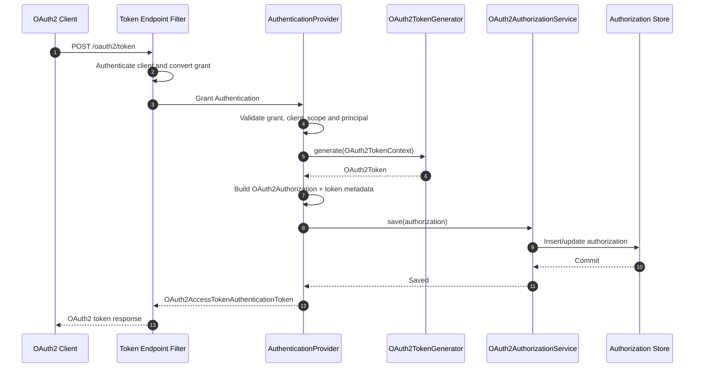
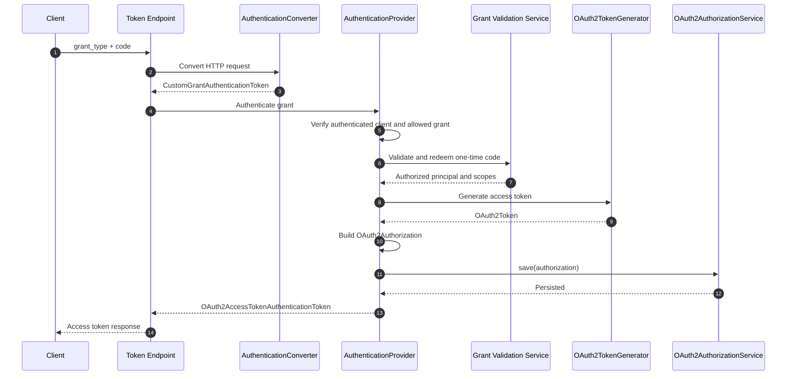
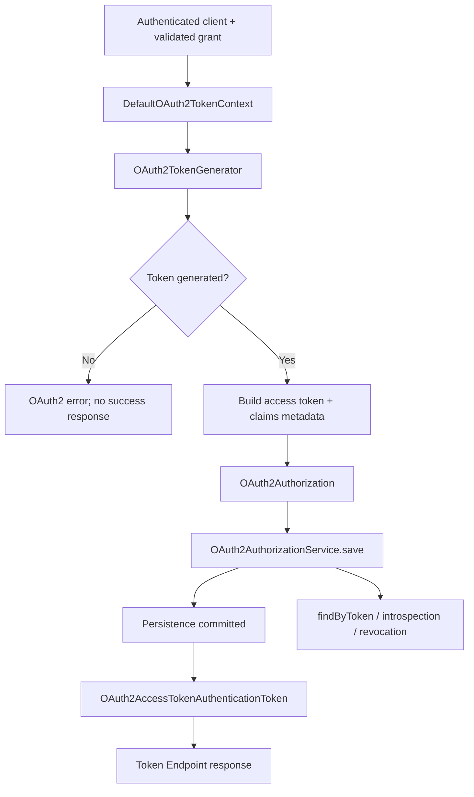

# Tạo, lưu token bằng OAuth2TokenGenerator và OAuth2AuthorizationService

## 1. Mục tiêu và bối cảnh

Trong chương **Mở rộng giao thức** của module **SPRING_SECURITY_OAUTH2_OIDC_AUTHORIZATION_SERVER**, Authorization Server phải tạo token theo đúng ngữ cảnh của authorization grant, sau đó lưu trạng thái đủ đầy để các endpoint và grant flow có thể xác minh, tra cứu, refresh hoặc thu hồi token.

Spring Authorization Server (SAS) tách hai trách nhiệm này thành hai thành phần:

- `OAuth2TokenGenerator` tạo một `OAuth2Token` dựa trên `OAuth2TokenContext`.
- `OAuth2AuthorizationService` lưu và truy vấn `OAuth2Authorization`, object chứa token cùng metadata, principal, client, grant type, scopes và attributes liên quan.

Việc tạo token và lưu authorization là hai bước liên kết nhưng không đồng nhất. Token generator không tự ghi token vào database. Authorization service cũng không tự phát hành token. Khi mở rộng grant type, ứng dụng phải phối hợp hai thành phần trong `AuthenticationProvider` của mình.

Bài học tập trung vào cách tạo token bằng generator, xây dựng authorization record, lưu bằng service và tích hợp các bước đó vào Token Endpoint. Sau bài học, bạn có thể:

- Giải thích trách nhiệm của `OAuth2TokenGenerator`, `OAuth2TokenContext`, `OAuth2TokenCustomizer` và `OAuth2AuthorizationService`.
- Phân biệt access token dạng JWT/self-contained và opaque/reference.
- Cấu hình `DelegatingOAuth2TokenGenerator` cho nhiều loại token.
- Tùy chỉnh claims cho JWT và opaque access token.
- Tạo token trong một extension authorization grant.
- Lưu token cùng claims, invalidation metadata và grant context vào `OAuth2Authorization`.
- Wire generator và authorization service vào `OAuth2AuthorizationServerConfigurer`.
- Hiểu cách custom grant dùng `AuthenticationConverter` và `AuthenticationProvider` tại Token Endpoint.
- Thiết kế transaction, token lifecycle, revocation, refresh, concurrency và persistence an toàn.
- Kiểm thử token generation, persistence, lookup và response end-to-end.

**Phạm vi phiên bản:** Ví dụ hướng tới **Spring Authorization Server 1.5.8**, **Spring Security 6.x** và **Spring Boot 3.x**. API có thể thay đổi giữa các phiên bản; các ví dụ custom grant được xây dựng từ hướng dẫn extension grant chính thức của SAS 1.5.8. Interface nghiệp vụ như `CustomGrantCodeService` trong bài là thành phần do ứng dụng định nghĩa.

## 2. Hai trách nhiệm: tạo token và lưu authorization

Một authorization grant flow thường đi qua chuỗi bước:

1. Xác thực client.
2. Xác thực authorization grant và kiểm tra client có được phép dùng grant đó không.
3. Xác định principal, scopes và authorization context.
4. Tạo token bằng `OAuth2TokenGenerator`.
5. Đưa token vào `OAuth2Authorization` cùng metadata.
6. Lưu authorization qua `OAuth2AuthorizationService`.
7. Trả token response cho client.



Thứ tự này quan trọng. Nếu response token được gửi trước khi authorization state được lưu thành công, client có thể nhận credential mà Authorization Server không thể tra cứu để introspect hoặc revoke. Trong custom provider, hãy lưu authorization trước khi trả kết quả xác thực thành công.

### 2.1. Vai trò của từng thành phần

| Thành phần | Trách nhiệm | Không chịu trách nhiệm |
| --- | --- | --- |
| `OAuth2TokenContext` | Cung cấp client, principal, grant, scopes, token type và authorization context | Không tự tạo token |
| `OAuth2TokenGenerator` | Tạo token từ context | Không tự persist authorization |
| `OAuth2TokenCustomizer` | Thêm/sửa claims hoặc JOSE headers trước khi token được tạo | Không xác thực grant thay provider |
| `OAuth2Authorization` | Gom trạng thái grant, principal, client, token và metadata | Không tự ghi database |
| `OAuth2AuthorizationService` | Lưu, cập nhật, xóa và tra cứu authorization | Không tự sinh credential |
| `AuthenticationProvider` | Xác thực grant, gọi generator, xây authorization và lưu | Không nên bỏ qua validation của grant |

### 2.2. OAuth2Authorization là bản ghi của một grant

Một `OAuth2Authorization` liên kết với `RegisteredClient` và principal, ghi lại grant type, authorized scopes, token objects và các attributes theo flow. Một authorization code flow có thể chứa authorization code, access token, refresh token và ID Token. Client Credentials thường chỉ cần access token. Device flow có device code/user code trước khi cấp access token.

Mỗi token được giữ trong `OAuth2Authorization.Token<T>`, bao gồm token object và metadata như claims hoặc trạng thái invalidated. Vì vậy, việc chỉ lưu raw token string sẽ không đủ để phục hồi đầy đủ authorization semantics.

## 3. OAuth2TokenContext: dữ liệu đầu vào cho generator

`OAuth2TokenContext` là context object được generator và customizer sử dụng. Những thông tin quan trọng gồm:

| Accessor | Ý nghĩa |
| --- | --- |
| `getRegisteredClient()` | Client đã đăng ký và được xác thực |
| `getPrincipal()` | Authentication đại diện resource owner hoặc client |
| `getAuthorizationServerContext()` | Issuer và runtime context của AS |
| `getAuthorization()` | Authorization hiện có nếu flow đang cập nhật một record |
| `getAuthorizedScopes()` | Các scope đã được cấp cho token |
| `getTokenType()` | Loại token đang được tạo |
| `getAuthorizationGrantType()` | Grant type đang xử lý |
| `getAuthorizationGrant()` | Authentication object của grant hiện tại |

Token type phổ biến trong core model:

- `code`: authorization code.
- `access_token`: access token.
- `refresh_token`: refresh token.
- `id_token`: OpenID Connect ID Token.

Không nhầm `tokenType` với `authorizationGrantType`. Ví dụ, trong Authorization Code Grant, grant type là `authorization_code` nhưng provider có thể lần lượt tạo access token, refresh token và ID Token.

### 3.1. Dựng DefaultOAuth2TokenContext

Trong custom grant provider, context thường được dựng từ thông tin đã xác thực:

```java
OAuth2TokenContext tokenContext =
        DefaultOAuth2TokenContext.builder()
                .registeredClient(registeredClient)
                .principal(principal)
                .authorizationServerContext(
                        AuthorizationServerContextHolder.getContext())
                .authorizedScopes(authorizedScopes)
                .tokenType(OAuth2TokenType.ACCESS_TOKEN)
                .authorizationGrantType(customGrant.getGrantType())
                .authorizationGrant(customGrant)
                .build();
```

Nếu đang phát hành token mới cho một authorization đã có, có thể cung cấp `authorization(existingAuthorization)` khi flow và generator cần context đó. Không tự đặt principal hoặc scope từ input không tin cậy; các giá trị phải đến từ bước xác thực và authorization decision trước đó.

### 3.2. Authorized scopes phải là tập đã được cấp

Client có thể yêu cầu scopes trong token request, nhưng provider phải tính tập scopes được phép dựa trên:

- Scope được đăng ký cho client.
- Scope có trong grant/consent hợp lệ.
- Chính sách resource/audience và tenant.
- Giới hạn của custom grant.

Không đưa nguyên chuỗi scope do client gửi vào token claims. `authorizedScopes` phải là kết quả đã xác minh.

## 4. OAuth2TokenGenerator hoạt động như thế nào?

`OAuth2TokenGenerator<T extends OAuth2Token>` có method:

```java
@Nullable
T generate(OAuth2TokenContext context);
```

Generator tạo token từ context hoặc trả `null` nếu không hỗ trợ `context.getTokenType()`. Đây là hợp đồng quan trọng của generator chain: generator không xử lý token type của mình phải trả null để generator tiếp theo có cơ hội xử lý.

### 4.1. Các implementation có sẵn

| Implementation | Token được tạo | Đặc điểm |
| --- | --- | --- |
| `JwtGenerator` | JWT cho access token hoặc ID Token | Dùng `JwtEncoder` và cấu hình signing |
| `OAuth2AccessTokenGenerator` | Opaque/reference access token | Claims có thể được tùy chỉnh qua `OAuth2TokenClaimsContext` |
| `OAuth2RefreshTokenGenerator` | Refresh token | Token reference ngẫu nhiên |
| `DelegatingOAuth2TokenGenerator` | Không tự định dạng token | Gọi lần lượt các generator con và lấy kết quả non-null đầu tiên |

SAS mô tả `OAuth2TokenGenerator` là optional component. Mặc định, SAS cấu hình `DelegatingOAuth2TokenGenerator` gồm opaque access token generator và refresh token generator. Nếu có `JwtEncoder` hoặc `JWKSource<SecurityContext>` bean, `JwtGenerator` cũng được ghép vào chain mặc định.

### 4.2. Token format phụ thuộc RegisteredClient

Với access token, `RegisteredClient.getTokenSettings().getAccessTokenFormat()` quyết định format:

| Format | Kết quả | Cách Resource Server thường xác minh |
| --- | --- | --- |
| `OAuth2TokenFormat.SELF_CONTAINED` | JWT đã ký | Xác minh chữ ký, issuer, audience, expiry và claims |
| `OAuth2TokenFormat.REFERENCE` | Opaque/reference token | Gọi introspection hoặc tra cứu trạng thái theo cơ chế được cấu hình |

JWT chứa claims có thể được Resource Server xác minh offline. Opaque token không công khai claims trong bản thân token; AS giữ state để introspection trả kết quả.

### 4.3. DelegatingOAuth2TokenGenerator

`DelegatingOAuth2TokenGenerator` nhận nhiều generator. Mỗi generator được gọi theo thứ tự; kết quả non-null đầu tiên được trả về.

```java
OAuth2TokenGenerator<?> tokenGenerator =
        new DelegatingOAuth2TokenGenerator(
                customTokenGenerator,
                jwtGenerator,
                accessTokenGenerator,
                refreshTokenGenerator);
```

Nếu `customTokenGenerator` xử lý access token cho một loại client/grant đặc biệt, nó phải trả null cho context không thuộc phạm vi của nó. Đặt generator custom trước generator mặc định chỉ khi có chủ đích để nó được ưu tiên. Một generator trả về token cho mọi context sẽ chặn các generator phía sau.

### 4.4. Generator không tự lưu token

Sau khi `generate` trả token, caller vẫn phải:

1. Kiểm tra kết quả không null.
2. Chuyển token về loại response phù hợp nếu cần.
3. Đưa token vào `OAuth2Authorization.Builder`.
4. Gắn claims/metadata cần thiết.
5. Build authorization.
6. Gọi `OAuth2AuthorizationService.save`.

Đây là điểm dễ sai khi viết custom grant: tạo token thành công chưa có nghĩa flow đã hoàn tất.

## 5. Cấu hình token generator cho JWT và opaque token

Ví dụ generator chain SAS 1.5.x:

```java
@Bean
OAuth2TokenGenerator<?> tokenGenerator(
        JWKSource<SecurityContext> jwkSource) {

    JwtGenerator jwtGenerator =
            new JwtGenerator(new NimbusJwtEncoder(jwkSource));

    OAuth2AccessTokenGenerator accessTokenGenerator =
            new OAuth2AccessTokenGenerator();

    OAuth2RefreshTokenGenerator refreshTokenGenerator =
            new OAuth2RefreshTokenGenerator();

    return new DelegatingOAuth2TokenGenerator(
            jwtGenerator,
            accessTokenGenerator,
            refreshTokenGenerator);
}
```

Ví dụ này cung cấp JWT generator, opaque access token generator và refresh token generator. Việc chọn JWT hay opaque access token còn phụ thuộc TokenSettings của RegisteredClient và logic của generator tương ứng.

### 5.1. Cấu hình trong AuthorizationServerConfigurer

Có thể wire generator qua `OAuth2AuthorizationServerConfigurer`:

```java
@Bean
@Order(1)
SecurityFilterChain authorizationServerSecurityFilterChain(
        HttpSecurity http,
        OAuth2TokenGenerator<?> tokenGenerator,
        OAuth2AuthorizationService authorizationService)
        throws Exception {

    OAuth2AuthorizationServerConfigurer authorizationServer =
            OAuth2AuthorizationServerConfigurer.authorizationServer();

    http
        .securityMatcher(authorizationServer.getEndpointsMatcher())
        .with(authorizationServer, server -> server
                .tokenGenerator(tokenGenerator)
                .authorizationService(authorizationService))
        .authorizeHttpRequests(authorize ->
                authorize.anyRequest().authenticated());

    return http.build();
}
```

Đây là phần wiring cốt lõi. Ứng dụng còn cần RegisteredClientRepository, AuthorizationServerSettings, JWK source/encoder và các thành phần xác thực client, user theo deployment.

### 5.2. Lưu ý khi tự khai báo generator bean

Khi ứng dụng tự cung cấp `OAuth2TokenGenerator`, không nên mặc định các `OAuth2TokenCustomizer` bean sẽ được tự động gắn vào generator custom. Hãy kết nối customizer vào đúng generator bằng `setJwtCustomizer` hoặc `setAccessTokenCustomizer`. Nếu dùng cấu hình generator mặc định do SAS tự tạo, cơ chế auto-configuration có thể tự kết nối customizer bean theo loại context.

## 6. Tùy chỉnh claims cho JWT và opaque token

SAS có hai context customizer chính:

| Customizer | Token | API chỉnh sửa |
| --- | --- | --- |
| `OAuth2TokenCustomizer<JwtEncodingContext>` | JWT access token hoặc ID Token | JWS header và JWT claims |
| `OAuth2TokenCustomizer<OAuth2TokenClaimsContext>` | Opaque access token | Claims builder của opaque access token generator |

Không dùng nhầm customizer JWT cho opaque access token hoặc ngược lại.

### 6.1. JWT customizer

`JwtEncodingContext` cung cấp `getJwsHeader()` và `getClaims()`. Ví dụ thêm client identifier và tenant claim đã được xác minh:

```java
@Bean
OAuth2TokenCustomizer<JwtEncodingContext> jwtCustomizer(
        ClientTenantService tenantService) {

    return context -> {
        if (OAuth2TokenType.ACCESS_TOKEN.equals(
                context.getTokenType())) {

            String clientId =
                    context.getRegisteredClient().getClientId();

            String tenantId =
                    tenantService.resolveTrustedTenant(clientId);

            context.getClaims()
                    .claim("client_id", clientId)
                    .claim("tenant_id", tenantId);
        }
    };
}
```

Tenant phải được resolve từ nguồn tin cậy và gắn với registration/client. Không đưa tenant ID do request tự khai vào JWT mà chưa kiểm tra. Tránh nhồi PII hoặc toàn bộ user profile vào access token.

### 6.2. Opaque access token customizer

Với opaque token, dùng `OAuth2TokenClaimsContext`:

```java
@Bean
OAuth2TokenCustomizer<OAuth2TokenClaimsContext>
        opaqueAccessTokenCustomizer(
                ClientTenantService tenantService) {

    return context -> {
        String clientId =
                context.getRegisteredClient().getClientId();

        context.getClaims()
                .claim("client_id", clientId)
                .claim(
                        "tenant_id",
                        tenantService.resolveTrustedTenant(clientId));
    };
}
```

Claims này không được mã hóa bên trong opaque token để client tự đọc. Claims context cung cấp builder để generator tùy chỉnh claim set; nếu custom provider cần các claim đó xuất hiện trong introspection, provider và token representation phải bảo đảm chúng được liên kết với authorization metadata. Không giả định một `OAuth2AccessToken` wrapper thông thường tự giữ claim set chỉ vì customizer đã chạy.

### 6.3. Kết nối customizer vào generator

```java
@Bean
OAuth2TokenGenerator<?> tokenGenerator(
        JWKSource<SecurityContext> jwkSource,
        OAuth2TokenCustomizer<JwtEncodingContext> jwtCustomizer,
        OAuth2TokenCustomizer<OAuth2TokenClaimsContext>
                opaqueAccessTokenCustomizer) {

    JwtGenerator jwtGenerator =
            new JwtGenerator(new NimbusJwtEncoder(jwkSource));
    jwtGenerator.setJwtCustomizer(jwtCustomizer);

    OAuth2AccessTokenGenerator accessTokenGenerator =
            new OAuth2AccessTokenGenerator();
    accessTokenGenerator.setAccessTokenCustomizer(
            opaqueAccessTokenCustomizer);

    OAuth2RefreshTokenGenerator refreshTokenGenerator =
            new OAuth2RefreshTokenGenerator();

    return new DelegatingOAuth2TokenGenerator(
            jwtGenerator,
            accessTokenGenerator,
            refreshTokenGenerator);
}
```

Nếu chỉ thêm JWT customizer, opaque access token sẽ không nhận các claim đó. Nếu chỉ thêm opaque customizer, JWT claims cũng không thay đổi.

### 6.4. Phân biệt claims và token metadata

- JWT claims được ký và nằm trong JWT payload.
- Opaque token claims nằm trong authorization metadata do AS quản lý.
- Token metadata trong `OAuth2Authorization.Token` còn có trạng thái invalidation, claims và các thuộc tính framework khác.
- Claims được lưu trong authorization không tự động trở thành claims của token nếu custom provider không gắn đúng metadata.

## 7. Extension grant: nơi ứng dụng phối hợp generator và service

Một extension authorization grant cho phép AS hỗ trợ grant type riêng. SAS yêu cầu tối thiểu:

1. `AuthenticationConverter` chuyển HTTP token request thành grant authentication object.
2. `AuthenticationProvider` xác thực grant và phát token.
3. Đăng ký converter/provider vào OAuth2 Token Endpoint.
4. Client registration phải cho phép grant type mở rộng.

Ví dụ grant URI:

```text
urn:ietf:params:oauth:grant-type:custom_code
```

Đây chỉ là tên grant minh họa. Nếu xây dựng extension dùng chung cho nhiều tổ chức, cần xác định namespace URI ổn định, tài liệu hóa request parameters và error semantics.

### 7.1. Flow tổng thể



Không nên xem custom grant như một endpoint tự phát token. Nó vẫn phải giữ các kiểm tra client authentication, grant authorization, scope, expiry, replay protection và token persistence.

## 8. Định nghĩa custom grant authentication token

Custom grant token có thể kế thừa `OAuth2AuthorizationGrantAuthenticationToken`. Ví dụ:

```java
public final class CustomCodeGrantAuthenticationToken
        extends OAuth2AuthorizationGrantAuthenticationToken {

    public static final AuthorizationGrantType GRANT_TYPE =
            new AuthorizationGrantType(
                    "urn:ietf:params:oauth:grant-type:custom_code");

    private final String code;

    public CustomCodeGrantAuthenticationToken(
            String code,
            Authentication clientPrincipal,
            Map<String, Object> additionalParameters) {

        super(GRANT_TYPE, clientPrincipal, additionalParameters);
        this.code = code;
    }

    public String getCode() {
        return this.code;
    }
}
```

Đối tượng này mang grant code và authenticated client principal. Không đánh dấu authentication object là authenticated trước khi provider xác minh grant.

### 8.1. Converter đọc request

Converter chỉ xử lý grant type của mình; grant khác phải được để converter mặc định tiếp tục xử lý:

```java
public final class CustomCodeGrantAuthenticationConverter
        implements AuthenticationConverter {

    @Override
    public Authentication convert(HttpServletRequest request) {
        String grantType =
                request.getParameter(OAuth2ParameterNames.GRANT_TYPE);

        if (!CustomCodeGrantAuthenticationToken.GRANT_TYPE
                .getValue().equals(grantType)) {
            return null;
        }

        String[] codes = request.getParameterValues("code");
        if (codes == null || codes.length != 1
                || !StringUtils.hasText(codes[0])) {
            throw new OAuth2AuthenticationException(
                    OAuth2ErrorCodes.INVALID_REQUEST);
        }

        Authentication clientPrincipal =
                SecurityContextHolder.getContext().getAuthentication();

        return new CustomCodeGrantAuthenticationToken(
                codes[0], clientPrincipal, Collections.emptyMap());
    }
}
```

Trong production, converter cần xử lý duplicate parameters cho mọi field nhạy cảm, giới hạn kích thước request, từ chối encoding bất thường và không ghi grant code vào log. Token Endpoint filter đã xử lý client authentication trước khi grant provider chạy; provider vẫn phải xác minh client principal hợp lệ.

## 9. Xác thực grant trước khi sinh token

Ví dụ custom grant dùng một code do hệ thống provisioning phát hành. Code service là interface nghiệp vụ của ứng dụng:

```java
public interface CustomGrantCodeService {

    RedeemedCustomGrant redeem(
            String code,
            String registeredClientId);
}

public record RedeemedCustomGrant(
        Set<String> authorizedScopes) {
}
```

Implementation của `redeem` phải thực hiện atomic consume:

- Code tồn tại và chưa hết hạn.
- Code được cấp cho đúng client registration.
- Code chưa từng được sử dụng.
- Code không bị revoke.
- Scopes trong grant được phép cho client.
- Mọi binding về audience, tenant hoặc resource đều hợp lệ.
- Chỉ một request đồng thời có thể redeem thành công.

Nếu code nằm ở hệ thống khác với authorization database, cần thiết kế consistency rõ ràng. Ví dụ dùng một transaction trong cùng database, một redemption service có compare-and-set, hoặc workflow idempotent có trạng thái. Không chỉ đọc code rồi đánh dấu used bằng hai lệnh không nguyên tử.

### 9.1. Kiểm tra client đã xác thực

Provider phải lấy `OAuth2ClientAuthenticationToken` từ grant authentication và yêu cầu token đã authenticated. Không tin client ID trong request body để quyết định client registration.

### 9.2. Kiểm tra grant type được đăng ký

`RegisteredClient` phải chứa đúng custom grant type trong `getAuthorizationGrantTypes()`. Nếu không, trả lỗi `unauthorized_client`. Đăng ký custom grant trong code không tự động cho phép mọi client sử dụng grant đó.

### 9.3. Kiểm tra scopes

Sau khi redeem, kiểm tra scopes được cấp là tập con của scopes client đã đăng ký:

```java
if (!registeredClient.getScopes()
        .containsAll(redeemedGrant.authorizedScopes())) {
    throw new OAuth2AuthenticationException(
            new OAuth2Error(OAuth2ErrorCodes.INVALID_SCOPE));
}
```

Không cho custom grant code tự nâng quyền bằng cách yêu cầu scope ngoài allowlist. Nếu code được cấp từ một hệ thống khác, scope phải được kiểm tra ở cả lúc phát hành và lúc redeem.

## 10. AuthenticationProvider: sinh token và lưu authorization

Provider là nơi kết nối ba phần: grant validation, token generation và authorization persistence. Ví dụ khung theo SAS 1.5.8:

```java
public final class CustomCodeGrantAuthenticationProvider
        implements AuthenticationProvider {

    private final OAuth2AuthorizationService authorizationService;
    private final OAuth2TokenGenerator<? extends OAuth2Token> tokenGenerator;
    private final CustomGrantCodeService codeService;

    public CustomCodeGrantAuthenticationProvider(
            OAuth2AuthorizationService authorizationService,
            OAuth2TokenGenerator<? extends OAuth2Token> tokenGenerator,
            CustomGrantCodeService codeService) {

        Assert.notNull(authorizationService,
                "authorizationService cannot be null");
        Assert.notNull(tokenGenerator,
                "tokenGenerator cannot be null");
        Assert.notNull(codeService, "codeService cannot be null");

        this.authorizationService = authorizationService;
        this.tokenGenerator = tokenGenerator;
        this.codeService = codeService;
    }

    @Override
    public Authentication authenticate(Authentication authentication) {
        CustomCodeGrantAuthenticationToken grant =
                (CustomCodeGrantAuthenticationToken) authentication;

        OAuth2ClientAuthenticationToken clientPrincipal =
                getAuthenticatedClientElseThrowInvalidClient(grant);

        RegisteredClient registeredClient =
                clientPrincipal.getRegisteredClient();

        if (!registeredClient.getAuthorizationGrantTypes()
                .contains(grant.getGrantType())) {
            throw new OAuth2AuthenticationException(
                    OAuth2ErrorCodes.UNAUTHORIZED_CLIENT);
        }

        RedeemedCustomGrant redeemedGrant =
                codeService.redeem(
                        grant.getCode(), registeredClient.getId());

        Set<String> authorizedScopes =
                redeemedGrant.authorizedScopes();

        if (!registeredClient.getScopes().containsAll(authorizedScopes)) {
            throw new OAuth2AuthenticationException(
                    new OAuth2Error(OAuth2ErrorCodes.INVALID_SCOPE));
        }

        OAuth2TokenContext tokenContext =
                DefaultOAuth2TokenContext.builder()
                        .registeredClient(registeredClient)
                        .principal(clientPrincipal)
                        .authorizationServerContext(
                                AuthorizationServerContextHolder.getContext())
                        .authorizedScopes(authorizedScopes)
                        .tokenType(OAuth2TokenType.ACCESS_TOKEN)
                        .authorizationGrantType(grant.getGrantType())
                        .authorizationGrant(grant)
                        .build();

        OAuth2Token generatedToken =
                tokenGenerator.generate(tokenContext);

        if (generatedToken == null) {
            throw new OAuth2AuthenticationException(
                    new OAuth2Error(
                            OAuth2ErrorCodes.SERVER_ERROR,
                            "Token generation failed.",
                            null));
        }

        OAuth2AccessToken accessToken =
                generatedToken instanceof OAuth2AccessToken existing
                        ? existing
                        : new OAuth2AccessToken(
                                OAuth2AccessToken.TokenType.BEARER,
                                generatedToken.getTokenValue(),
                                generatedToken.getIssuedAt(),
                                generatedToken.getExpiresAt(),
                                authorizedScopes);

        OAuth2Authorization.Builder authorizationBuilder =
                OAuth2Authorization.withRegisteredClient(registeredClient)
                        .principalName(clientPrincipal.getName())
                        .authorizationGrantType(grant.getGrantType())
                        .authorizedScopes(authorizedScopes);

        if (generatedToken instanceof ClaimAccessor claimAccessor) {
            authorizationBuilder.token(accessToken, metadata ->
                    metadata.put(
                            OAuth2Authorization.Token.CLAIMS_METADATA_NAME,
                            claimAccessor.getClaims()));
        } else {
            authorizationBuilder.accessToken(accessToken);
        }

        OAuth2Authorization authorization =
                authorizationBuilder.build();

        authorizationService.save(authorization);

        return new OAuth2AccessTokenAuthenticationToken(
                registeredClient, clientPrincipal, accessToken);
    }

    @Override
    public boolean supports(Class<?> authentication) {
        return CustomCodeGrantAuthenticationToken.class
                .isAssignableFrom(authentication);
    }

    private static OAuth2ClientAuthenticationToken
            getAuthenticatedClientElseThrowInvalidClient(
                    Authentication authentication) {

        Object principal = authentication.getPrincipal();

        if (principal instanceof OAuth2ClientAuthenticationToken client
                && client.isAuthenticated()) {
            return client;
        }

        throw new OAuth2AuthenticationException(
                OAuth2ErrorCodes.INVALID_CLIENT);
    }
}
```

Đây là khung minh họa cho custom grant dạng client-bound. Ứng dụng thực tế cần bổ sung error mapping, grant-specific validation, transaction boundary và cách xác định principal theo nghiệp vụ. Nếu grant đại diện một resource owner, hãy resolve đúng resource owner principal từ grant đã xác minh thay vì luôn dùng client principal làm principal name.

### 10.1. Vì sao phải bọc generated token thành OAuth2AccessToken?

`OAuth2TokenGenerator` trả `OAuth2Token` tổng quát. `JwtGenerator` có thể trả `Jwt`, còn `OAuth2AccessTokenGenerator` trả `OAuth2AccessToken`. Token Endpoint success handler cần `OAuth2AccessTokenAuthenticationToken` chứa access token chuẩn.

Vì vậy, nếu generator trả về một `Jwt`, provider có thể tạo `OAuth2AccessToken` wrapper dùng cùng token value, issued-at, expires-at và authorized scopes. JWT claims cần được giữ trong authorization metadata như ví dụ ở trên.

### 10.2. Vì sao phải lưu claims metadata?

`Jwt` triển khai `ClaimAccessor`. Khi provider bọc JWT thành `OAuth2AccessToken`, object wrapper không tự giữ toàn bộ JWT claims. Lưu claims vào `OAuth2Authorization.Token.CLAIMS_METADATA_NAME` giúp authorization record giữ lại claims để introspection hoặc các thành phần khác có thể truy xuất.

Nếu bỏ metadata này, JWT có thể vẫn được Resource Server xác minh offline, nhưng introspection response hoặc code phía AS có thể thiếu claims mà ứng dụng mong đợi. Với opaque token, `OAuth2TokenClaimsContext` cho phép generator tùy chỉnh claim set, nhưng custom provider cần bảo đảm claim set được lưu cùng token metadata nếu muốn đọc lại sau này. Ví dụ provider ở mục này minh họa việc lưu claims khi token được sinh ra triển khai `ClaimAccessor`; với opaque token wrapper thông thường, hãy bổ sung metadata mapping phù hợp hoặc dùng token representation có thể cung cấp claims.

### 10.3. Vì sao save trước khi trả response?

`authorizationService.save(authorization)` phải hoàn tất trước khi provider trả `OAuth2AccessTokenAuthenticationToken`. Nếu lưu thất bại, provider phải báo lỗi và không trả access token thành công. Điều này giữ tính nhất quán giữa credential đã phát hành và trạng thái mà AS dùng để introspect/revoke.

## 11. Wire converter và provider vào Token Endpoint

SAS cung cấp extension point cho converter và provider:

```java
@Bean
@Order(1)
SecurityFilterChain authorizationServerSecurityFilterChain(
        HttpSecurity http,
        OAuth2AuthorizationService authorizationService,
        OAuth2TokenGenerator<?> tokenGenerator,
        CustomGrantCodeService codeService)
        throws Exception {

    OAuth2AuthorizationServerConfigurer authorizationServer =
            OAuth2AuthorizationServerConfigurer.authorizationServer();

    http
        .securityMatcher(authorizationServer.getEndpointsMatcher())
        .with(authorizationServer, server ->
                server.tokenEndpoint(tokenEndpoint ->
                        tokenEndpoint
                                .accessTokenRequestConverter(
                                        new CustomCodeGrantAuthenticationConverter())
                                .authenticationProvider(
                                        new CustomCodeGrantAuthenticationProvider(
                                                authorizationService,
                                                tokenGenerator,
                                                codeService))))
        .authorizeHttpRequests(authorize ->
                authorize.anyRequest().authenticated());

    return http.build();
}
```

Converter và provider custom được thêm vào pipeline Token Endpoint. Nếu converter không nhận grant type của nó, nó trả null để converter khác tiếp tục xử lý. Nếu converter nhận grant nhưng request sai, nó phải trả OAuth2 error phù hợp thay vì im lặng chuyển request sang một grant khác.

### 11.1. Đăng ký grant type cho client

Client phải được cấu hình cho phép custom grant:

```java
RegisteredClient client = RegisteredClient.withId(UUID.randomUUID().toString())
        .clientId("custom-grant-client")
        .clientSecret(passwordEncoder.encode(clientSecret))
        .clientAuthenticationMethod(
                ClientAuthenticationMethod.CLIENT_SECRET_BASIC)
        .authorizationGrantType(
                CustomCodeGrantAuthenticationToken.GRANT_TYPE)
        .scope("message.read")
        .scope("message.write")
        .build();
```

Trong production, dùng secret ngẫu nhiên, PasswordEncoder phù hợp và persistent RegisteredClientRepository. Ví dụ trên chỉ đăng ký grant type và scope; client vẫn phải được xác thực ở Token Endpoint.

### 11.2. Request minh họa

```http
POST /oauth2/token HTTP/1.1
Host: auth.example.com
Authorization: Basic <BASE64_CLIENT_CREDENTIALS>
Content-Type: application/x-www-form-urlencoded

grant_type=urn:ietf:params:oauth:grant-type:custom_code&code=<REDACTED_ONE_TIME_CODE>
```

Response thành công theo OAuth2 Token Endpoint có dạng:

```json
{
  "access_token": "<REDACTED_ACCESS_TOKEN>",
  "token_type": "Bearer",
  "expires_in": 300,
  "scope": "message.read message.write"
}
```

Không đưa grant code hoặc access token thật vào ví dụ, logs, shell history hoặc issue tracker.

## 12. Lưu authorization qua OAuth2AuthorizationService

`OAuth2AuthorizationService` là persistence boundary cho authorization records. Contract có bốn thao tác:

| Method | Mục đích |
| --- | --- |
| `save(authorization)` | Lưu authorization mới hoặc trạng thái cập nhật |
| `remove(authorization)` | Xóa authorization record |
| `findById(id)` | Tra cứu theo authorization ID |
| `findByToken(token, tokenType)` | Tra cứu authorization chứa token |

SAS có `InMemoryOAuth2AuthorizationService` cho development/testing và `JdbcOAuth2AuthorizationService` để lưu qua JDBC. Nếu không cấu hình service riêng, SAS có thể mặc định dùng in-memory service. Production phải wire persistent implementation rõ ràng.

### 12.1. Cấu hình JDBC authorization service

```java
@Bean
OAuth2AuthorizationService authorizationService(
        JdbcOperations jdbcOperations,
        RegisteredClientRepository registeredClientRepository) {

    return new JdbcOAuth2AuthorizationService(
            jdbcOperations, registeredClientRepository);
}
```

Cần triển khai schema SQL đi kèm đúng version SAS và điều chỉnh theo database dialect. Với production, đánh giá index token lookup, kích thước LOB, transaction, connection pool và hiệu năng trước khi chọn implementation mặc định.

### 12.2. Wire authorization service

Bean JDBC phải được gắn vào configurer:

```java
authorizationServer.authorizationService(authorizationService);
```

Chỉ khai báo bean trong Spring context mà không kiểm tra configurer đang dùng service nào có thể khiến hệ thống vẫn lưu authorization trong memory. Kiểm thử qua restart và nhiều instance để xác nhận persistence thực sự hoạt động.

### 12.3. Authorization record cần giữ những gì?

Một record tối thiểu cần có:

- Authorization ID duy nhất.
- Registered client ID nội bộ.
- Principal name.
- Authorization grant type.
- Authorized scopes.
- Token objects và issued/expiry timestamps.
- Token metadata, claims và invalidation flags.
- Attributes cần thiết cho grant flow.

Đừng lưu mỗi access token value. Khi refresh, revoke hoặc introspect, SAS cần biết token thuộc client/principal nào và trạng thái authorization ra sao.

## 13. Token lifecycle: cập nhật, refresh và revoke

### 13.1. Refresh token flow

Khi refresh token được dùng, provider tìm authorization hiện có, xác minh refresh token còn active và client phù hợp, rồi tạo access token mới. Nếu refresh token rotation được bật, refresh token cũ có thể bị invalidated và token mới được gắn vào authorization.

Khi cập nhật authorization, giữ lại token và metadata còn hiệu lực:

```java
OAuth2Authorization updatedAuthorization =
        OAuth2Authorization.from(existingAuthorization)
                .invalidate(oldRefreshToken)
                .token(newAccessToken)
                .token(newRefreshToken)
                .build();

authorizationService.save(updatedAuthorization);
```

Đây là ví dụ khái niệm. Cần áp dụng đúng policy reuse/rotation của RegisteredClient TokenSettings và bảo đảm cập nhật được thực hiện nguyên tử.

### 13.2. Token revocation

Revocation thường không nhất thiết xóa toàn bộ authorization. Service có thể lưu trạng thái token đã invalidated để các lookup tiếp theo nhận ra token không còn active.

`OAuth2Authorization.Token.isActive()` phản ánh expiry và invalidation metadata. Không chỉ xóa token khỏi database nếu caller cần phân biệt token chưa từng tồn tại với token đã bị revoke.

### 13.3. Introspection

Với opaque token, Resource Server thường gọi introspection. AS tìm authorization theo token value, kiểm tra trạng thái active và trả thông tin cần thiết theo policy. Claims tùy chỉnh phải được lưu đúng trong authorization metadata nếu muốn introspection truy xuất được.

### 13.4. JWT offline validation

JWT có thể được Resource Server xác minh chữ ký mà không truy vấn AS mỗi request. Tuy vậy, authorization persistence vẫn cần cho refresh, revocation, introspection, custom grant state, audit và các flow khác. Nếu cần revoke JWT ngay lập tức, phải có cơ chế trạng thái như introspection, denylist hoặc event-based invalidation; nếu không, JWT có thể được chấp nhận đến khi hết hạn.

## 14. Token code và các token khác

`OAuth2TokenGenerator` được dùng trong grant processing, nhưng không nên giả định mọi credential trong mọi flow đều đi qua cùng một generator bean.

| Token | Thành phần tạo thường gặp | Persistence |
| --- | --- | --- |
| Authorization code | Authorization Code request provider và code generator được cấu hình cho provider | Trong OAuth2Authorization |
| Access token | OAuth2TokenGenerator chain | Trong OAuth2Authorization |
| Refresh token | OAuth2RefreshTokenGenerator trong token generator chain | Trong OAuth2Authorization |
| ID Token | JwtGenerator trong OIDC flow | Trong OAuth2Authorization cùng claims |
| Device code/user code | Device Authorization flow provider/generator | Trong OAuth2Authorization |

Authorization Code provider có extension point riêng `setAuthorizationCodeGenerator`. Token generator bean dùng để tạo access/refresh/ID token không nên bị hiểu nhầm là tự động thay mọi generator của các provider khác.

## 15. Custom token format và custom generator

Có hai cách mở rộng thường bị nhầm:

1. **Custom format cho access token/refresh token:** token vẫn giữ semantics OAuth2 chuẩn, nhưng encoding hoặc storage format thay đổi.
2. **Custom authorization grant:** thêm một cách xác thực grant mới, thường cần converter và provider riêng.

Một custom grant có thể dùng generator chuẩn. Ngược lại, custom token generator không tự tạo ra một grant type mới.

### 15.1. Custom generator chỉ xử lý context của nó

Ví dụ khung generator ưu tiên format riêng cho một client/grant cụ thể, còn context khác trả null:

```java
public final class PartnerAccessTokenGenerator
        implements OAuth2TokenGenerator<OAuth2AccessToken> {

    private final OAuth2TokenGenerator<OAuth2AccessToken> delegate;

    public PartnerAccessTokenGenerator(
            OAuth2TokenGenerator<OAuth2AccessToken> delegate) {
        this.delegate = delegate;
    }

    @Override
    public OAuth2AccessToken generate(OAuth2TokenContext context) {
        if (!OAuth2TokenType.ACCESS_TOKEN.equals(context.getTokenType())) {
            return null;
        }

        if (!"partner-client".equals(
                context.getRegisteredClient().getClientId())) {
            return null;
        }

        // Delegate có thể là generator opaque/JWT đã được cấu hình.
        return this.delegate.generate(context);
    }
}
```

Ví dụ chỉ minh họa dispatch theo context. Nếu thực sự tạo format riêng, implementation phải đảm bảo token có thể được Resource Server xác minh/introspect, có issued/expiry time rõ ràng và có cách revoke. Không tạo một chuỗi tùy ý rồi xem đó là OAuth access token mà không có resource-server contract tương ứng.

### 15.2. Delegating generator và thứ tự

`DelegatingOAuth2TokenGenerator` lấy token từ generator đầu tiên trả về non-null. Nếu custom generator được đặt trước generator mặc định, nó có thể override kết quả mặc định. Nếu nó không hỗ trợ context, phải trả null.

Không ném exception chỉ vì token type không thuộc phạm vi generator. Exception chỉ dành cho trường hợp context thuộc phạm vi hỗ trợ nhưng generation thực sự thất bại.

### 15.3. Token type mở rộng

Core `OAuth2TokenContext` có các token types chuẩn như code, access token, refresh token và ID Token. Một token type riêng cần được xử lý bởi extension code có hiểu biết về token đó; chỉ tạo một `OAuth2TokenType` mới không tự làm Token Endpoint, introspection, revocation hoặc Resource Server hiểu credential mới.

Trước khi thêm token type riêng, hãy định nghĩa rõ:

- Grant/endpoint nào phát hành nó.
- Nó có phải bearer credential hay không.
- Resource Server xác minh thế nào.
- Token được lưu và tra cứu theo khóa nào.
- Expiry, revocation và replay semantics.
- Cách biểu diễn trong response và discovery metadata nếu protocol yêu cầu.

## 16. Transaction và tính nhất quán

Token generation thường tạo giá trị mới; persistence ghi trạng thái tương ứng. Hai thao tác cần có thứ tự và transaction policy rõ ràng.

### 16.1. Save trước khi trả response

Provider chỉ trả success sau khi authorization record được lưu thành công. Nếu database lỗi, trả server error theo contract và không trả access token như thể đã phát hành thành công.

### 16.2. Atomic code redemption

Custom one-time grant code phải được consume theo thao tác nguyên tử. Nếu code service và authorization store ở cùng database, có thể dùng cùng transaction manager. Nếu khác hệ thống, dùng idempotency key, compare-and-set, outbox hoặc redemption state machine phù hợp.

### 16.3. Refresh rotation

Khi rotate refresh token, trạng thái token cũ và token mới phải được ghi cùng transaction. Nếu chỉ lưu token mới mà không đánh dấu token cũ invalidated, token cũ có thể tiếp tục được dùng ngoài policy. Nếu đánh dấu token cũ trước rồi lỗi khi lưu token mới, authorization có thể mất khả năng refresh.

### 16.4. Concurrent requests

Hai request đồng thời có thể redeem cùng grant code hoặc refresh token. Cần:

- Unique constraint hoặc optimistic locking.
- Atomic consume cho one-time code.
- Phát hiện replay.
- Không cho hai request cùng thành công nếu grant chỉ dùng một lần.
- Xử lý duplicate request theo policy và audit.

## 17. Bảo mật token và authorization store

Token là bearer credential trong nhiều flow; ai có được token có thể sử dụng nó trong phạm vi quyền cho đến khi hết hạn hoặc bị revoke.

### 17.1. Token entropy và lifetime

- Dùng generator chuẩn hoặc CSPRNG phù hợp.
- Đặt access token TTL ngắn theo rủi ro và use case.
- Refresh token có TTL, rotation/reuse policy rõ.
- Authorization code và custom grant code phải ngắn hạn, one-time và gắn client.
- Không dùng token value tuần tự hoặc có thể đoán.

### 17.2. Signing key

Với JWT, bảo vệ private signing key trong KMS/HSM hoặc secret storage phù hợp. Có key rotation và công bố public keys qua JWKS. Không hard-code private key trong source hoặc commit.

### 17.3. Bảo vệ persistence

- Dùng TLS tới database.
- Giới hạn quyền đọc authorization/token tables.
- Cân nhắc encryption at rest/envelope encryption cho token values và attributes.
- Không ghi raw token, authorization code, refresh token hoặc ID Token vào logs.
- Bảo vệ backup, snapshot và môi trường restore.
- Giữ token metadata/invalidation khi serialize và deserialize.

### 17.4. Không phát claims quá mức

JWT/opaque token chỉ nên chứa claims cần cho resource server và mục đích authorization. Không đưa toàn bộ user profile, email, phone, address hoặc dữ liệu nhạy cảm vào access token nếu không cần thiết. Claims trong token thường được sao chép qua log, cache, tracing hoặc nhiều resource servers.

## 18. Kiểm thử token generation và persistence

### 18.1. Unit test generator

Kiểm thử:

- Context có token type được hỗ trợ trả token.
- Context không hỗ trợ trả null.
- JWT có issuer, subject, audience, expiry và signature đúng.
- Opaque token có claims metadata đúng.
- Generator chain trả kết quả từ generator đầu tiên non-null.
- Custom generator không chặn token type khác.
- Token lifetime tuân theo TokenSettings.

### 18.2. Unit test authorization mapping

- Authorization record có đúng registered client ID và principal name.
- Grant type và authorized scopes được giữ.
- Access token lưu đúng token value và issued/expiry time.
- Claims được lưu khi generated token triển khai ClaimAccessor.
- Metadata invalidation được giữ khi cập nhật.
- `findByToken` tra cứu được token sau khi save.
- `remove` xóa record theo đúng authorization ID.

### 18.3. Integration test custom grant

Test nên thực hiện flow đầy đủ:

1. Đăng ký client có custom grant type.
2. Lấy client credentials hợp lệ.
3. Gửi token request với grant type và code.
4. Kiểm tra converter chỉ nhận đúng grant.
5. Kiểm tra provider reject code hết hạn, sai client hoặc đã redeem.
6. Kiểm tra scope ngoài allowlist bị từ chối.
7. Kiểm tra token generator trả null được ánh xạ thành lỗi server.
8. Kiểm tra authorization được lưu trước response.
9. Dùng token gọi resource server hoặc introspection.
10. Dùng lại code để xác minh replay protection.

### 18.4. Integration test với JDBC

Dùng database cùng dialect production hoặc Testcontainers để kiểm tra schema, LOB, transaction và token lookup. H2 phù hợp test nhanh nhưng không thay thế kiểm thử PostgreSQL/MySQL/SQL Server khi production dùng các database đó.

### 18.5. Ví dụ kiểm tra persisted token

```java
@Test
void generatedTokenIsPersistedWithAuthorization() {
    Authentication result =
            customGrantAuthenticationManager.authenticate(grantRequest);

    assertThat(result)
            .isInstanceOf(OAuth2AccessTokenAuthenticationToken.class);

    OAuth2AccessTokenAuthenticationToken tokenResult =
            (OAuth2AccessTokenAuthenticationToken) result;

    OAuth2Authorization authorization =
            authorizationService.findByToken(
                    tokenResult.getAccessToken().getTokenValue(),
                    OAuth2TokenType.ACCESS_TOKEN);

    assertThat(authorization).isNotNull();
    assertThat(authorization.getAccessToken()).isNotNull();
    assertThat(authorization.getAccessToken().isActive()).isTrue();
}
```

Đây là skeleton; test cần client, grant fixture, generator, authorization service và database được cấu hình đầy đủ. Không chỉ kiểm tra token response HTTP 200; cần chứng minh token có thể được tra cứu lại từ persistence layer.

## 19. Observability và vận hành

### 19.1. Metrics

Theo dõi:

- Token generation success/failure theo grant type và token format.
- Authorization save latency và error rate.
- Token lookup latency/hit/miss theo token type.
- Introspection/revocation/refresh request rate.
- Refresh rotation failures và replay attempts.
- Authorization records đang active/expired theo thống kê an toàn.
- Database connection pool, lock wait và transaction duration.
- JWT signing/verification errors và key rotation events.

Không dùng raw token, principal name hoặc PII làm metric labels vì nguy cơ rò rỉ và cardinality cao.

### 19.2. Audit

Audit có thể ghi client ID, grant type, authorization ID, scopes được cấp, token type, policy decision, correlation ID và thời điểm. Không ghi token value hoặc secret. Với grant code, chỉ ghi reference/digest đã được bảo vệ nếu cần điều tra replay.

### 19.3. Cleanup và retention

Authorization có thể chứa access token, refresh token và grant state với expiry khác nhau. Không xóa record chỉ vì access token hết hạn nếu refresh token còn hiệu lực. Cleanup cần:

- Xét tất cả token trong authorization.
- Giữ dữ liệu đủ cho revocation/replay detection theo policy.
- Xóa token index phụ đồng bộ với authorization.
- Chạy theo batch có giới hạn.
- Có retention và audit phù hợp.
- Kiểm thử cleanup không xóa authorization còn refresh token active.

## 20. Troubleshooting

| Triệu chứng | Nguyên nhân có thể | Hướng xử lý |
| --- | --- | --- |
| Token generator trả null | Không có generator hỗ trợ token type/context | Kiểm tra token type và generator chain |
| JWT không được ký | Thiếu JwtEncoder/JWKSource hoặc generator không được wire | Kiểm tra JWK source và JwtGenerator |
| Client yêu cầu JWT nhưng nhận opaque | TokenSettings hoặc thứ tự generator không đúng | Kiểm tra accessTokenFormat và chain |
| Opaque introspection thiếu custom claims | Chưa gắn OAuth2TokenClaimsContext customizer hoặc claims metadata | Kiểm tra generator và authorization metadata |
| JWT thiếu claim tùy chỉnh | JwtCustomizer chưa được gắn vào JwtGenerator | Kiểm tra token generator bean |
| Custom grant trả unsupported_grant_type | RegisteredClient không cho phép grant hoặc converter không nhận request | Kiểm tra grant registration và converter |
| Custom grant trả unauthorized_client | Client chưa được xác thực hoặc không có grant type | Kiểm tra client auth và RegisteredClient |
| Token response thành công nhưng introspection inactive | Authorization chưa được lưu hoặc lookup không tìm thấy | Kiểm tra authorizationService wiring và save |
| Token mất sau restart | Vẫn dùng InMemoryOAuth2AuthorizationService | Dùng persistent service |
| JWT hoạt động nhưng revoke không có hiệu lực ngay | Resource Server xác minh offline | Dùng introspection/denylist hoặc TTL phù hợp |
| Refresh token cũ vẫn dùng được | Invalidation/rotation không được lưu nguyên tử | Kiểm tra metadata và transaction |
| Token response có scopes sai | Provider lấy scope trực tiếp từ request | Tính authorizedScopes từ grant và client policy |
| Claims metadata bị mất sau save/read | Mapper JDBC/JPA không round-trip claims | Kiểm tra row/parameter mapper |
| Custom generator chặn generator mặc định | Trả token thay vì null cho context không hỗ trợ | Sửa dispatch và thứ tự chain |
| Code custom dùng lại được | Redemption không atomic hoặc không đánh dấu used | Compare-and-set/unique constraint |
| Nhiều instance không thấy authorization | Local/in-memory store hoặc replica lag | Shared persistence và read-after-write consistency |
| Token raw xuất hiện trong logs | HTTP/JDBC body logging hoặc exception log | Redact token và secret |
| Database lỗi sau khi generate token | Save thất bại nhưng provider vẫn trả response | Chỉ trả success sau khi save commit |

## 21. Anti-pattern cần tránh

| Anti-pattern | Hậu quả | Cách làm phù hợp |
| --- | --- | --- |
| Nghĩ generator tự lưu token | Không có authorization record để introspect/revoke | Gọi authorizationService.save |
| Trả response trước khi save | Client nhận token không tra cứu được | Save trước khi trả success |
| Không kiểm tra generator trả null | Null pointer hoặc response sai | Xử lý lỗi generation rõ ràng |
| Custom generator luôn trả token | Chặn generator mặc định | Trả null khi không hỗ trợ context |
| Dùng grant type làm token type | Generator nhận context sai | Tách authorizationGrantType và tokenType |
| Bọc JWT nhưng bỏ claims metadata | Introspection thiếu claims | Lưu ClaimAccessor claims vào token metadata |
| Chỉ lưu raw token string | Mất client/principal/grant/expiry/invalidation | Lưu đầy đủ OAuth2Authorization |
| Tin scope từ request | Privilege escalation | Dùng authorized scopes đã xác minh |
| Redeem code bằng read-then-update | Replay race | Atomic one-time consume |
| Dùng JWT để bỏ qua revocation design | Token cũ vẫn active offline đến expiry | Introspection/denylist/event hoặc TTL |
| Ghi token vào logs | Bearer credential bị lộ | Redaction và audit metadata an toàn |
| Chỉ test HTTP 200 | Không phát hiện authorization không persist | Test findByToken sau save |
| Dùng InMemory trong production cluster | Mất state qua restart/instance | JDBC hoặc persistent custom service |

## 22. Checklist nghiệm thu production

- [ ] `OAuth2TokenContext` có đúng client, principal, grant, scopes và token type.
- [ ] Grant được xác minh trước khi gọi generator.
- [ ] Client đã được xác thực và đăng ký grant type tương ứng.
- [ ] Authorized scopes là tập quyền đã được cấp.
- [ ] `OAuth2TokenGenerator` có generator phù hợp token format.
- [ ] Generator không hỗ trợ context trả null.
- [ ] Delegating generator có thứ tự được chủ đích.
- [ ] JWT customizer và opaque customizer được gắn đúng generator.
- [ ] JWT dùng signing key được quản lý và có rotation.
- [ ] Claims không chứa PII hoặc quyền vượt mục đích.
- [ ] Token được bọc về loại response phù hợp.
- [ ] ClaimAccessor claims được lưu vào authorization metadata.
- [ ] `OAuth2Authorization` có ID, client, principal, grant và scopes đúng.
- [ ] `OAuth2AuthorizationService` là persistent service trong production.
- [ ] Authorization được save thành công trước khi trả token response.
- [ ] Refresh/revoke cập nhật metadata và transaction đúng.
- [ ] Custom grant code có expiry, client binding và one-time redemption.
- [ ] Token values/credentials không xuất hiện trong logs.
- [ ] Database schema, index, backup và cleanup được kiểm tra.
- [ ] Nhiều AS instances dùng shared store và read-after-write consistency.
- [ ] Integration test chứng minh token response có thể lookup lại.
- [ ] Có kiểm thử introspection, revocation, refresh, replay và database outage.
- [ ] Có metrics, audit và runbook cho token generation/persistence failures.

## 23. Bản đồ ghi nhớ



**`OAuth2TokenGenerator` tạo token từ context; `OAuth2AuthorizationService` lưu trạng thái của authorization chứa token.** Trong grant flow tùy chỉnh, `AuthenticationProvider` xác thực client và grant, tạo `OAuth2TokenContext`, gọi generator, gắn token cùng claims metadata vào `OAuth2Authorization`, rồi lưu qua service trước khi trả response. Khi phân biệt đúng token format, grant semantics, metadata, persistence và transaction, token được phát hành có thể được tra cứu, introspect, refresh và revoke nhất quán trong suốt vòng đời OAuth 2.0/OpenID Connect.

## 24. Tài liệu tham khảo

- [Spring Authorization Server 1.5.8 — Core Model / Components](https://docs.spring.io/spring-authorization-server/reference/core-model-components.html)
- [OAuth2TokenGenerator — API 1.5.8](https://docs.spring.io/spring-authorization-server/reference/api/java/org/springframework/security/oauth2/server/authorization/token/OAuth2TokenGenerator.html)
- [OAuth2TokenContext — API 1.5.8](https://docs.spring.io/spring-authorization-server/reference/api/java/org/springframework/security/oauth2/server/authorization/token/OAuth2TokenContext.html)
- [DelegatingOAuth2TokenGenerator — API 1.5.8](https://docs.spring.io/spring-authorization-server/reference/api/java/org/springframework/security/oauth2/server/authorization/token/DelegatingOAuth2TokenGenerator.html)
- [OAuth2Authorization.Builder — API 1.5.8](https://docs.spring.io/spring-authorization-server/reference/api/java/org/springframework/security/oauth2/server/authorization/OAuth2Authorization.Builder.html)
- [OAuth2AuthorizationService — API 1.5.8](https://docs.spring.io/spring-authorization-server/reference/api/java/org/springframework/security/oauth2/server/authorization/OAuth2AuthorizationService.html)
- [How-to: Implement an Extension Authorization Grant Type](https://docs.spring.io/spring-authorization-server/reference/guides/how-to-ext-grant-type.html)
- [Configuration Model — OAuth2AuthorizationServerConfigurer](https://docs.spring.io/spring-authorization-server/reference/configuration-model.html)
- [Protocol Endpoints — Token Endpoint](https://docs.spring.io/spring-authorization-server/reference/protocol-endpoints.html)
