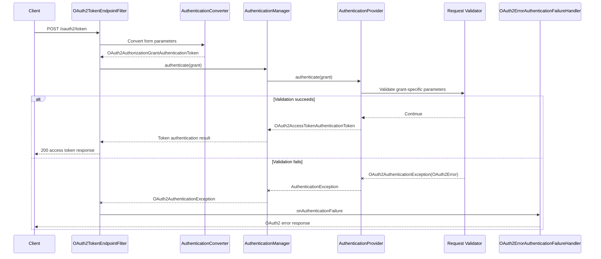

# Chuẩn hóa OAuth2Error cho lỗi validation và lỗi cấp token

## 1. Vì sao cần chuẩn hóa lỗi OAuth 2.0?

Trong một hệ thống **OAuth 2.0/OpenID Connect Authorization Server** sử dụng **Spring Security, Spring Authorization Server và Spring Boot**, nhiều thành phần có thể từ chối một yêu cầu: kiểm tra tham số, xác thực client, kiểm tra authorization grant, xác minh consent, đánh giá scope, tạo access token hoặc lưu authorization.

Nếu mỗi thành phần tự tạo response theo cách riêng, client sẽ gặp các lỗi khó đoán:

- Cùng một tình huống nhưng endpoint trả về error code khác nhau.
- Validation ném exception chung nên Token Endpoint trả HTTP 500 thay vì OAuth error.
- `error_description` lộ stack trace, SQL, secret hoặc thông tin nội bộ.
- Lỗi validation bị biến thành `invalid_grant` hoặc `invalid_client` không đúng ngữ nghĩa.
- Custom handler ghi đè response mặc định và làm mất `Cache-Control: no-store`, `Pragma: no-cache` hoặc header `WWW-Authenticate`.
- Resource Server, Authorization Endpoint và Token Endpoint trả JSON lỗi không nhất quán.

OAuth 2.0 đã định nghĩa cấu trúc error response và các error code tiêu chuẩn. Spring Security biểu diễn lỗi bằng `OAuth2Error` và `OAuth2AuthenticationException`; Spring Authorization Server sử dụng các kiểu này để chuyển lỗi từ provider sang response ở protocol endpoint.

Trong module **SPRING_SECURITY_OAUTH2_OIDC_AUTHORIZATION_SERVER**, mục tiêu là học cách thiết kế, cấu hình, bảo mật, kiểm thử và vận hành OAuth 2.0/OpenID Connect Authorization Server bằng Spring Security và Spring Authorization Server. Bài thuộc chương **Mở rộng giao thức**, tập trung chuẩn hóa lỗi validation và lỗi phát sinh trong quá trình cấp token.

### Kết quả học tập

Sau bài học, bạn có thể:

1. Giải thích cấu trúc `OAuth2Error`, `OAuth2ErrorCodes` và `OAuth2AuthenticationException`.
2. Chọn error code theo ngữ nghĩa RFC 6749 cho authorization request và token request.
3. Phân biệt lỗi client authentication, lỗi grant, lỗi scope, lỗi policy và lỗi hệ thống.
4. Ném OAuth exception đúng cách từ custom validator và custom `AuthenticationProvider`.
5. Tùy chỉnh `OAuth2TokenEndpointConfigurer.errorResponseHandler(...)` mà vẫn giữ protocol response.
6. Phân biệt error response ở Authorization Endpoint, Token Endpoint và Resource Server.
7. Thiết kế `error_description`, `error_uri`, HTTP status và logging không làm lộ thông tin nhạy cảm.
8. Viết unit/integration test để xác nhận error code và wire response.

**Phạm vi ví dụ:** Spring Boot 3.x, Spring Security 6.x và Spring Authorization Server 1.5.x trên Servlet stack. Các tên API và extension point được đối chiếu với tài liệu Spring Authorization Server 1.5.8.

## 2. Mô hình lỗi của OAuth 2.0 và Spring

### 2.1. Error response là một phần của protocol

OAuth 2.0 không quy định rằng mọi lỗi đều là một trang HTML hoặc một JSON tùy ý. RFC 6749 định nghĩa response riêng cho từng endpoint:

| Endpoint | Cách trả lỗi | Ví dụ |
| --- | --- | --- |
| Authorization Endpoint | Redirect về client redirect URI đã được xác thực, kèm `error`, `error_description`, `state` khi phù hợp | `access_denied`, `invalid_request`, `unauthorized_client` |
| Token Endpoint | HTTP error response với JSON body dạng `application/json` | `invalid_client`, `invalid_grant`, `invalid_scope`, `unsupported_grant_type` |
| Resource Server | Bearer Token error theo RFC 6750, thường dùng `WWW-Authenticate` | `invalid_token`, `insufficient_scope` |
| Discovery/JWKS/metadata | HTTP status phù hợp với lỗi HTTP của tài nguyên | `404`, `500`, `503` tùy endpoint |

Không chuyển nguyên một `OAuth2Error` từ endpoint này sang endpoint khác mà bỏ qua quy tắc protocol. Ví dụ `access_denied` ở Authorization Endpoint có ý nghĩa resource owner hoặc OP từ chối authorization; ở Token Endpoint, client không được dùng tùy tiện code đó để mô tả refresh token hết hạn.

### 2.2. Ba lớp dữ liệu trong Spring

| Kiểu | Vai trò |
| --- | --- |
| `OAuth2Error` | Đối tượng dữ liệu gồm `errorCode`, `description`, `uri` |
| `OAuth2AuthenticationException` | Exception mang một `OAuth2Error`; dùng để báo lỗi OAuth trong authentication/authorization processing |
| `OAuth2ErrorCodes` | Hằng số các error code chuẩn để tránh viết sai chuỗi |

`OAuth2AuthenticationException` kế thừa Spring Security `AuthenticationException`. Constructor có thể nhận `OAuth2Error` hoặc error code. Khi cần chuẩn hóa description/URI, nên tạo `OAuth2Error` trước rồi truyền vào exception.

Ví dụ:

```java
import org.springframework.security.oauth2.core.OAuth2AuthenticationException;
import org.springframework.security.oauth2.core.OAuth2Error;
import org.springframework.security.oauth2.core.OAuth2ErrorCodes;

OAuth2Error error = new OAuth2Error(
        OAuth2ErrorCodes.INVALID_SCOPE,
        "The requested scope is not permitted",
        "https://auth.example.com/docs/errors/invalid-scope");

throw new OAuth2AuthenticationException(error);
```

### 2.3. Cấu trúc OAuth2Error

`OAuth2Error` có ba thành phần:

| Thuộc tính | Ý nghĩa | Quy tắc |
| --- | --- | --- |
| `errorCode` | Mã lỗi machine-readable | Phải phù hợp với protocol và endpoint |
| `description` | Thông tin con người có thể đọc | Ngắn, an toàn, không chứa secret/stack trace/PII |
| `uri` | URI tài liệu giải thích lỗi | Nên trỏ tới tài liệu công khai, ổn định và không chứa dữ liệu riêng |

Wire response ở Token Endpoint dùng các tên JSON `error`, `error_description` và `error_uri`. Tên field trong Java object không giống hoàn toàn tên JSON:

```json
{
  "error": "invalid_scope",
  "error_description": "The requested scope is not permitted",
  "error_uri": "https://auth.example.com/docs/errors/invalid-scope"
}
```

Không đưa exception message thô từ database, HTTP client, JWK parser hoặc thư viện mã hóa vào `error_description`. Client không cần biết SQL table, host nội bộ, file path hoặc key identifier riêng của hệ thống để xử lý OAuth error.

### 2.4. OAuth2ErrorCodes và error code mở rộng

Spring Security cung cấp hằng số cho các error code OAuth phổ biến như:

- `INVALID_REQUEST`
- `INVALID_CLIENT`
- `INVALID_GRANT`
- `UNAUTHORIZED_CLIENT`
- `UNSUPPORTED_GRANT_TYPE`
- `INVALID_SCOPE`
- `ACCESS_DENIED`
- `UNSUPPORTED_RESPONSE_TYPE`
- `SERVER_ERROR`
- `TEMPORARILY_UNAVAILABLE`
- `INSUFFICIENT_SCOPE`
- `INVALID_TOKEN`

Các protocol extension có thể định nghĩa error code riêng. Chỉ dùng custom code khi specification của extension hoặc contract của hệ thống cho phép; không tạo mã mới cho tình huống đã có mã chuẩn.

Error code phải là token ASCII theo giới hạn ký tự của RFC 6749. Tránh khoảng trắng, dấu nháy, newline hoặc nội dung do user nhập. `error_description` và `error_uri` cũng cần serialize an toàn theo form/JSON encoder mà Spring cung cấp.

## 3. Chọn error code đúng theo RFC 6749

### 3.1. Các lỗi thường gặp ở Token Endpoint

| Error code | Khi dùng | Ví dụ |
| --- | --- | --- |
| `invalid_request` | Request thiếu/thừa/sai cấu trúc hoặc parameter không hợp lệ | Thiếu `grant_type`, lặp `scope`, gửi nhiều cơ chế client authentication |
| `invalid_client` | Client authentication thất bại | Client ID không tồn tại, secret sai, authentication method không được hỗ trợ |
| `invalid_grant` | Authorization grant hoặc refresh token không hợp lệ | Code hết hạn/đã dùng, redirect URI không khớp, refresh token bị revoke hoặc thuộc client khác |
| `unauthorized_client` | Client đã xác thực nhưng không được phép dùng grant type đó | Client không được phép dùng `client_credentials` |
| `unsupported_grant_type` | AS không hỗ trợ grant type trong request | Gửi grant type extension mà AS không triển khai |
| `invalid_scope` | Scope request sai, không biết hoặc không được phép trong ngữ cảnh token request | Scope không tồn tại hoặc vượt scope client được cấp |

Không dùng `invalid_grant` cho mọi lỗi xảy ra trong provider. Ví dụ client đã xác thực nhưng bị policy chặn dùng grant type là `unauthorized_client`; authorization code hết hạn là `invalid_grant`.

RFC 6749 §5.2 liệt kê sáu error code cốt lõi ở trên cho Token Endpoint; `server_error` và `temporarily_unavailable` được định nghĩa trong error response của Authorization Endpoint tại §4.1.2.1. Spring Authorization Server hướng dẫn custom grant provider dùng `server_error` nếu token generator không tạo được token. Khi áp dụng mapping này ở Token Endpoint, hãy ghi rõ contract và kiểm tra khả năng tương thích của client library đang dùng.

### 3.2. invalid_client và HTTP 401

RFC 6749 cho phép trả HTTP 401 cho `invalid_client` để thông báo authentication scheme. Nếu client đã dùng `Authorization` request header để xác thực, AS **MUST** trả HTTP 401 và `WWW-Authenticate` header tương ứng.

Đây là lý do không nên thay toàn bộ failure handler của Token Endpoint bằng một handler luôn trả HTTP 400. Handler tùy chỉnh phải giữ quy tắc status/header mà framework và RFC yêu cầu.

### 3.3. invalid_scope và unauthorized_client không giống nhau

- `invalid_scope`: giá trị scope không hợp lệ, không biết hoặc không được chấp nhận trong request.
- `unauthorized_client`: client đã xác thực nhưng không được quyền sử dụng grant type hoặc phương thức đang yêu cầu.

Ví dụ client có thể yêu cầu scope `payments.write` hợp lệ về mặt cú pháp nhưng policy không cho client đó sử dụng. Tùy contract và vị trí kiểm tra, đây có thể được mô tả là `invalid_scope`. Nếu client không được phép dùng `client_credentials`, đó là `unauthorized_client`.

### 3.4. Authorization Endpoint có quy tắc riêng

Authorization Endpoint dùng các error code như `invalid_request`, `unauthorized_client`, `access_denied`, `unsupported_response_type`, `invalid_scope`, `server_error` và `temporarily_unavailable`.

Nếu redirect URI hợp lệ đã được xác định, response lỗi được gửi qua redirect về client và phải giữ `state` nếu request có state. Nếu redirect URI không hợp lệ hoặc không thể tin cậy, AS không được redirect lỗi tới URI đó; cần hiển thị lỗi tại AS.

### 3.5. Resource Server dùng Bearer Token error

Resource Server bảo vệ API bằng Bearer Token theo RFC 6750:

| Error | Ý nghĩa |
| --- | --- |
| `invalid_request` | Bearer request sai cấu trúc |
| `invalid_token` | Access token thiếu, hết hạn, bị revoke, sai chữ ký hoặc không hợp lệ |
| `insufficient_scope` | Token hợp lệ nhưng không có quyền đủ để truy cập tài nguyên |

Ví dụ:

```http
HTTP/1.1 401 Unauthorized
WWW-Authenticate: Bearer error="invalid_token", error_description="The access token is invalid"
```

Không dùng `invalid_grant` ở Resource Server để mô tả access token hết hạn. `invalid_grant` thuộc ngữ cảnh authorization grant/token endpoint; Resource Server dùng `invalid_token`.

## 4. Lỗi đi qua Spring Authorization Server như thế nào?

### 4.1. Luồng xử lý ở Token Endpoint

Token Endpoint mặc định thường xử lý request theo chuỗi:

1. `OAuth2TokenEndpointFilter` nhận HTTP POST tới Token Endpoint.
2. Một hoặc nhiều `AuthenticationConverter` đọc form parameters và tạo `OAuth2AuthorizationGrantAuthenticationToken` phù hợp với grant type.
3. `AuthenticationManager` chọn `AuthenticationProvider` hỗ trợ token đó.
4. Provider xác minh client context, authorization grant, redirect URI, scope, consent/authorization state và điều kiện cấp token.
5. Provider trả `OAuth2AccessTokenAuthenticationToken` nếu thành công.
6. Nếu có lỗi OAuth, provider hoặc validator ném `OAuth2AuthenticationException` chứa `OAuth2Error`.
7. Filter chuyển exception tới `AuthenticationFailureHandler`; mặc định là `OAuth2ErrorAuthenticationFailureHandler`.

`OAuth2TokenEndpointConfigurer` cho phép thay converter, provider, success handler và error response handler. Khi chỉ cần đổi nội dung lỗi hoặc audit, không cần thay toàn bộ provider.



### 4.2. Converter, validator và provider chịu trách nhiệm khác nhau

| Thành phần | Nhiệm vụ | Ví dụ lỗi |
| --- | --- | --- |
| Converter | Parse request, phát hiện parameter thiếu/lặp/sai định dạng | `invalid_request` |
| Client authentication filter/provider | Xác minh client ID, secret, assertion, certificate hoặc public client policy | `invalid_client` |
| Grant provider | Kiểm tra code, refresh token, device code, grant permission | `invalid_grant`, `unauthorized_client` |
| Request validator | Kiểm tra scope hoặc tham số theo grant | `invalid_scope`, `invalid_request` |
| Token generator | Tạo access token, refresh token, ID Token hoặc token extension | Lỗi phát sinh phải được phân loại theo nguyên nhân |
| Error response handler | Chuyển `OAuth2AuthenticationException` thành protocol response | Giữ error code/description/URI và quy tắc HTTP |

Không đặt tất cả validation vào controller hoặc servlet filter riêng. Giữ validation ở extension point phù hợp để endpoint mặc định vẫn áp dụng đúng protocol behavior.

### 4.3. Client authentication xảy ra trước token grant processing

Client authentication tại Token Endpoint thường được xử lý bởi `OAuth2ClientAuthenticationFilter` trước khi grant provider chạy. Vì vậy, lỗi secret sai hoặc client không tồn tại có thể được trả bởi failure handler của **client authentication filter**, không phải `OAuth2TokenEndpointConfigurer.errorResponseHandler(...)`.

Điều này giải thích vì sao thay Token Endpoint error handler không nhất thiết thay đổi mọi lỗi `invalid_client`. Nếu cần audit hoặc customize lỗi xác thực client, phải xem extension point `clientAuthentication(...)` tương ứng trong Authorization Server configurer.

### 4.4. Authorization Endpoint dùng exception chuyên biệt

Authorization Endpoint có `OAuth2AuthorizationCodeRequestAuthenticationException`, một subclass của `OAuth2AuthenticationException`. Spring Authorization Server dùng exception này để giữ thêm ngữ cảnh authorization request/redirect khi xử lý lỗi. Custom authorization request validator nên ném đúng exception chuyên biệt theo API của endpoint, thay vì ném `OAuth2AuthenticationException` chung cho mọi trường hợp.

Token Endpoint và các endpoint xử lý grant dùng `OAuth2AuthenticationException`. Không dùng exception chuyên biệt của Authorization Endpoint trong Token Endpoint.

## 5. Chuẩn hóa lỗi trong custom validator

### 5.1. Quy tắc khi validation thất bại

Validator của Spring Authorization Server thường có kiểu `Consumer<...>`. Khi phát hiện request không đạt policy, validator phải ném `OAuth2AuthenticationException` chứa `OAuth2Error`. Không trả `false`, `null`, chuỗi lỗi hoặc `ResponseEntity` từ validator.

Ví dụ kiểm tra scope của Client Credentials Grant:

```java
import java.util.Set;
import java.util.function.Consumer;

import org.springframework.security.oauth2.core.OAuth2AuthenticationException;
import org.springframework.security.oauth2.core.OAuth2Error;
import org.springframework.security.oauth2.core.OAuth2ErrorCodes;
import org.springframework.security.oauth2.server.authorization.authentication.OAuth2ClientCredentialsAuthenticationContext;
import org.springframework.security.oauth2.server.authorization.authentication.OAuth2ClientCredentialsAuthenticationToken;
import org.springframework.security.oauth2.server.authorization.authentication.OAuth2ClientCredentialsAuthenticationValidator;
import org.springframework.security.oauth2.server.authorization.client.RegisteredClient;

private Consumer<OAuth2ClientCredentialsAuthenticationContext> scopeValidator(
        ClientScopePolicy clientScopePolicy) {
    return OAuth2ClientCredentialsAuthenticationValidator.DEFAULT_SCOPE_VALIDATOR
        .andThen(context -> {
            OAuth2ClientCredentialsAuthenticationToken request =
                    context.getAuthentication();

            if (!clientScopePolicy.isAllowed(
                    context.getRegisteredClient(), request.getScopes())) {
                OAuth2Error error = new OAuth2Error(
                        OAuth2ErrorCodes.INVALID_SCOPE,
                        "One or more requested scopes are not permitted",
                        "https://auth.example.com/docs/errors/invalid-scope");
                throw new OAuth2AuthenticationException(error);
            }
        });
}

@FunctionalInterface
interface ClientScopePolicy {
    boolean isAllowed(RegisteredClient client, Set<String> requestedScopes);
}
```

Đoạn mã giữ validator mặc định trước khi chạy policy bổ sung. Trong thực tế, `RegisteredClient.getScopes()` thường đã giới hạn scope client được phép dùng; ví dụ minh họa cách gắn error code, description và URI cho một policy tùy chỉnh.

### 5.2. Gắn validator vào provider có sẵn

Có thể cấu hình `OAuth2ClientCredentialsAuthenticationProvider` thông qua `authenticationProviders(...)`:

```java
import java.util.List;
import java.util.function.Consumer;

import org.springframework.security.authentication.AuthenticationProvider;
import org.springframework.security.oauth2.server.authorization.authentication.OAuth2ClientCredentialsAuthenticationProvider;

private Consumer<List<AuthenticationProvider>> configureClientCredentialsErrors(
        ClientScopePolicy clientScopePolicy) {
    return providers -> providers.forEach(provider -> {
        if (provider instanceof OAuth2ClientCredentialsAuthenticationProvider clientCredentials) {
            clientCredentials.setAuthenticationValidator(
                    scopeValidator(clientScopePolicy));
        }
    });
}
```

Sau đó nối vào Token Endpoint đang có:

```java
http
    .securityMatcher(authorizationServerConfigurer.getEndpointsMatcher())
    .with(authorizationServerConfigurer, authorizationServer ->
        authorizationServer.tokenEndpoint(tokenEndpoint ->
            tokenEndpoint.authenticationProviders(
                    configureClientCredentialsErrors(clientScopePolicy))
        )
    );
```

Đây là phần cấu hình bổ sung cho Authorization Server `SecurityFilterChain` hiện có. Không tạo một filter chain thứ hai cùng endpoint matcher chỉ để thay validator.

Trong ví dụ, `clientScopePolicy` là policy service do ứng dụng cung cấp và được inject vào configuration method. Nó thể hiện các điều kiện bổ sung theo tenant/product; validator mặc định của Spring vẫn kiểm tra scope có thuộc tập scope của client hay không.

### 5.3. Chọn error theo ngữ cảnh, không theo tên method

| Điều kiện trong custom validator/provider | Error phù hợp |
| --- | --- |
| `scope` thiếu format hoặc parameter bị lặp | `invalid_request` |
| Scope không tồn tại hoặc ngoài quyền client | `invalid_scope` |
| Client đã xác thực nhưng không được phép dùng grant này | `unauthorized_client` |
| Authorization code hết hạn, đã dùng hoặc không thuộc client | `invalid_grant` |
| Client secret hoặc assertion không hợp lệ | `invalid_client` |
| Grant type không được AS hỗ trợ | `unsupported_grant_type` |
| Signing service hoặc database gặp lỗi bất ngờ | Lỗi hệ thống; không giả mạo thành lỗi grant |

Nếu một scope bị policy từ chối, không dùng `access_denied` chỉ vì nội dung mô tả có từ “denied”. `access_denied` là lỗi authorization response gắn với việc resource owner hoặc authorization server từ chối authorization; Token Endpoint nên dùng `invalid_scope` khi giá trị scope là vấn đề.

### 5.4. Custom grant provider

Với extension grant, provider tự chịu trách nhiệm phân loại lỗi. Ví dụ khi assertion/grant được gửi lên không còn hợp lệ:

```java
private void validateCustomGrant(CustomGrantAuthenticationToken request) {
    if (!grantStore.isUsable(request.getGrantHandle())) {
        OAuth2Error error = new OAuth2Error(
                OAuth2ErrorCodes.INVALID_GRANT,
                "The authorization grant is invalid or expired",
                "https://auth.example.com/docs/errors/invalid-grant");
        throw new OAuth2AuthenticationException(error);
    }
}
```

`CustomGrantAuthenticationToken` và `grantStore` trong ví dụ là kiểu/bean do ứng dụng tự xây dựng. Quy tắc quan trọng là provider phát sinh lỗi theo contract OAuth và để Token Endpoint filter cùng error handler tạo response.

Không bắt mọi `Exception` rồi đổi thành `invalid_grant`. Lỗi do code bug, lỗi database hoặc token signing infrastructure không làm grant của client trở nên invalid. Chỉ chuyển một exception kỹ thuật sang protocol error khi đã phân loại rõ tình huống và có mapping phù hợp; nếu không, để error handling cấp hệ thống xử lý và ghi nhận incident.

### 5.5. Lỗi khi token generator không tạo được token

Trong custom grant provider, nếu `OAuth2TokenGenerator.generate(...)` trả `null` cho token type mà provider đang cần, Spring Authorization Server hướng dẫn trả `server_error`:

```java
OAuth2Token generatedAccessToken = tokenGenerator.generate(tokenContext);
if (generatedAccessToken == null) {
    OAuth2Error error = new OAuth2Error(
            OAuth2ErrorCodes.SERVER_ERROR,
            "The token generator failed to generate the access token.",
            null);
    throw new OAuth2AuthenticationException(error);
}
```

Đây là lỗi phía Authorization Server trong quá trình cấp token. Không trả `invalid_grant` vì grant có thể hoàn toàn hợp lệ; lỗi nằm ở khả năng tạo token của server.

## 6. Chuẩn hóa response ở Token Endpoint

### 6.1. Dùng error handler mặc định khi không có nhu cầu thay đổi

Spring Authorization Server 1.5.8 cấu hình `OAuth2ErrorAuthenticationFailureHandler` làm failure handler mặc định của Token Endpoint. Handler nhận `OAuth2AuthenticationException`, lấy `OAuth2Error` và chuyển thành OAuth 2.0 Error Response.

Với phần lớn ứng dụng, chỉ cần ném đúng `OAuth2AuthenticationException` từ provider/validator. Không cần tự viết JSON response hoặc tự đặt HTTP status.

### 6.2. Tùy chỉnh để ghi audit nhưng giữ response protocol

Nếu cần log lỗi để theo dõi, có thể bọc handler mặc định và gọi delegate sau khi ghi audit:

```java
import org.springframework.security.oauth2.core.OAuth2AuthenticationException;
import org.springframework.security.oauth2.core.OAuth2Error;
import org.springframework.security.oauth2.server.authorization.web.authentication.OAuth2ErrorAuthenticationFailureHandler;
import org.springframework.security.web.authentication.AuthenticationFailureHandler;

private AuthenticationFailureHandler tokenEndpointFailureHandler() {
    OAuth2ErrorAuthenticationFailureHandler protocolHandler =
            new OAuth2ErrorAuthenticationFailureHandler();

    return (request, response, exception) -> {
        if (exception instanceof OAuth2AuthenticationException oauth2Exception) {
            OAuth2Error error = oauth2Exception.getError();
            String traceId = (String) request.getAttribute("traceId");

            // Chỉ ghi error code và correlation ID; không ghi token/secret/body.
            log.warn("oauth_token_endpoint_error error_code={} trace_id={}",
                    error.getErrorCode(), traceId);
        }

        protocolHandler.onAuthenticationFailure(request, response, exception);
    };
}
```

Gắn handler vào Token Endpoint:

```java
http
    .securityMatcher(authorizationServerConfigurer.getEndpointsMatcher())
    .with(authorizationServerConfigurer, authorizationServer ->
        authorizationServer.tokenEndpoint(tokenEndpoint ->
            tokenEndpoint.errorResponseHandler(tokenEndpointFailureHandler())
        )
    );
```

Đoạn ví dụ giả định ứng dụng đã có logger và middleware tracing đặt request attribute `traceId`. Nếu exception không phải `OAuth2AuthenticationException`, handler vẫn chuyển tiếp tới delegate để không nuốt lỗi. Thực tế Token Endpoint configurer mô tả handler này dùng cho OAuth authentication exception; lỗi lập trình hoặc lỗi hệ thống không dự kiến cần được quan sát ở tầng exception handling chung.

### 6.3. Không tự viết lại status code hoặc header

RFC 6749 quy định Token Endpoint error response mặc định dùng HTTP 400, trừ trường hợp được quy định khác. Với `invalid_client`, nếu client đã gửi thông tin xác thực qua HTTP `Authorization` header, AS **MUST** trả HTTP 401 và `WWW-Authenticate` phù hợp. Vì vậy:

- Không tạo handler luôn trả HTTP 200 với JSON lỗi.
- Không ép mọi lỗi về HTTP 400, vì có trường hợp `invalid_client` phải là 401.
- Không xóa `WWW-Authenticate` header do client authentication layer thiết lập.
- Không trả stack trace hoặc exception message nội bộ trong response.
- Không bỏ `Cache-Control: no-store` và `Pragma: no-cache` trên error response.

Ví dụ error response:

```http
HTTP/1.1 400 Bad Request
Content-Type: application/json;charset=UTF-8
Cache-Control: no-store
Pragma: no-cache

{
  "error": "invalid_scope",
  "error_description": "One or more requested scopes are not permitted",
  "error_uri": "https://auth.example.com/docs/errors/invalid-scope"
}
```

Token Endpoint error response dùng JSON object với các field `error`, `error_description`, `error_uri`. Theo RFC 6749, `error` bắt buộc; hai field còn lại tùy chọn. Các response có thông tin nhạy cảm phải được bảo vệ khỏi cache.

### 6.4. Nếu cần thay wire converter

`OAuth2ErrorAuthenticationFailureHandler` có phương thức `setErrorResponseConverter(...)` để thay `HttpMessageConverter<OAuth2Error>` dùng serialize error response. Chỉ dùng extension point này nếu có yêu cầu định dạng rõ ràng và đã xác nhận vẫn giữ:

- Tên field protocol `error`, `error_description`, `error_uri`.
- JSON media type và encoding theo RFC.
- HTTP status và `WWW-Authenticate` phù hợp.
- `Cache-Control: no-store` và `Pragma: no-cache`.
- Không thêm dữ liệu nội bộ hoặc token vào body.

Không thêm field tùy ý như `stackTrace`, `exceptionClass`, `sqlState`, `serverHost` vào OAuth error response. Nếu cần correlation ID, cân nhắc response header riêng có policy công khai và log mapping ở server.

### 6.5. Chuẩn hóa error description

Một error description tốt:

- Giúp developer hiểu cách sửa request.
- Không lặp lại raw input nếu input có thể chứa dữ liệu nhạy cảm.
- Không tiết lộ client secret, authorization code, refresh token, assertion, signing key, database detail hoặc host nội bộ.
- Không phụ thuộc ngôn ngữ giao diện của End-User; OAuth error thường dành cho client developer.
- Ổn định để test và tài liệu hóa.

Ví dụ nên dùng:

| Không nên | Nên dùng |
| --- | --- |
| `SQL constraint violation at oauth_authorization table` | `The authorization grant could not be processed` |
| `Refresh token abc123 has been revoked for client portal` | `The refresh token is invalid or expired` |
| `Scope payroll.admin denied by policy rule 83` | `One or more requested scopes are not permitted` |
| `NullPointerException at JwtGenerator.java:217` | `The authorization server could not issue a token` |

Không trả chi tiết nội bộ để phân biệt quá rõ client tồn tại hay không trong những luồng mà việc tiết lộ đó hỗ trợ enumeration. Dùng error code chuẩn nhưng giữ description tổng quát khi threat model yêu cầu.

## 7. Error URI, extension error và quy ước nội bộ

### 7.1. error_uri trỏ tới tài liệu dành cho developer

`error_uri` nên là URL HTTPS ổn định, không yêu cầu đăng nhập và không chứa thông tin của request cụ thể. Trang tài liệu có thể mô tả:

- Ý nghĩa error code.
- Nguyên nhân thường gặp.
- Cách sửa request hoặc cấu hình client.
- Cách thu thập correlation ID và liên hệ support.
- Phiên bản protocol/Spring tương ứng nếu có khác biệt.

Không đưa URL có token, authorization code, client secret hoặc PII vào `error_uri`.

### 7.2. Khi nào được định nghĩa error code riêng?

RFC 6749 §8.5 dành OAuth Extensions Error Registry cho error code mở rộng. Chỉ tạo error code riêng khi extension protocol hoặc interoperability contract thực sự cần. Error code tùy ý như `bad_scope_for_this_customer` hoặc `database_down_17` làm client khó xử lý và có thể tiết lộ implementation.

Nếu cần error code extension:

1. Xác định specification/contract sở hữu mã lỗi.
2. Đảm bảo tên tuân thủ syntax của RFC.
3. Định nghĩa rõ endpoint và điều kiện sử dụng.
4. Công bố tài liệu cho client developer.
5. Kiểm tra client không phụ thuộc vào danh sách code mở rộng ngoài contract.

### 7.3. Không nhầm OAuth error với business error

OAuth error trả lời câu hỏi về request/authorization/token protocol. Nó không phải nơi truyền mọi lỗi nghiệp vụ của API.

Ví dụ:

- Client gửi refresh token bị revoke: `invalid_grant`.
- Client đã có token hợp lệ nhưng gọi API đặt hàng với mã đơn không tồn tại: business API có thể trả `404` hoặc lỗi domain riêng.
- Token hợp lệ nhưng thiếu scope để truy cập resource: Resource Server trả `insufficient_scope` theo RFC 6750.
- Người dùng không chấp nhận consent: Authorization Endpoint có thể trả `access_denied`.

Không biến mọi lỗi domain thành `access_denied`, `invalid_scope` hoặc `invalid_grant`. Giữ ranh giới giữa OAuth protocol và API business contract.

## 8. Kiểm thử lỗi validation và cấp token

### 8.1. Kiểm thử unit cho error mapping

Với helper/policy do ứng dụng tự viết, kiểm tra cả exception type và error code:

```java
import static org.assertj.core.api.Assertions.assertThat;
import static org.assertj.core.api.Assertions.assertThatThrownBy;

import org.junit.jupiter.api.Test;
import org.springframework.security.oauth2.core.OAuth2AuthenticationException;
import org.springframework.security.oauth2.core.OAuth2ErrorCodes;

class TokenErrorMappingTest {

    @Test
    void invalidScopeUsesInvalidScopeCode() {
        assertThatThrownBy(() -> scopePolicy.validate("payments.admin"))
                .isInstanceOfSatisfying(
                        OAuth2AuthenticationException.class,
                        exception -> assertThat(exception.getError().getErrorCode())
                                .isEqualTo(OAuth2ErrorCodes.INVALID_SCOPE));
    }

    @Test
    void expiredCustomGrantUsesInvalidGrantCode() {
        assertThatThrownBy(() -> customGrantPolicy.validate("expired-handle"))
                .isInstanceOfSatisfying(
                        OAuth2AuthenticationException.class,
                        exception -> assertThat(exception.getError().getErrorCode())
                                .isEqualTo(OAuth2ErrorCodes.INVALID_GRANT));
    }
}
```

`scopePolicy` và `customGrantPolicy` là policy object của ứng dụng. Unit test xác minh mapping ở lớp nghiệp vụ; integration test vẫn phải chứng minh endpoint chuyển exception thành wire response đúng.

### 8.2. Ma trận kiểm thử protocol response

| ID | Request/kịch bản | Kết quả mong đợi |
| --- | --- | --- |
| E01 | Token request thiếu `grant_type` | `invalid_request`, HTTP 400 |
| E02 | Token request lặp parameter không được phép | `invalid_request`, HTTP 400 |
| E03 | Client secret sai qua Basic Authorization header | `invalid_client`, HTTP 401 và `WWW-Authenticate` phù hợp |
| E04 | Client authentication thất bại qua phương thức không dùng Authorization header | `invalid_client`, status/header theo RFC và cấu hình phương thức |
| E05 | Authorization code hết hạn | `invalid_grant` |
| E06 | Authorization code đã dùng | `invalid_grant` |
| E07 | Authorization code thuộc client khác | `invalid_grant` |
| E08 | Refresh token đã revoke/hết hạn | `invalid_grant` |
| E09 | Client đã xác thực nhưng không được phép dùng grant type | `unauthorized_client` |
| E10 | Grant type không được AS hỗ trợ | `unsupported_grant_type` |
| E11 | Scope sai/không tồn tại | `invalid_scope` |
| E12 | Custom scope policy từ chối scope | `invalid_scope` và description đã chuẩn hóa |
| E13 | Custom grant handle hết hạn | `invalid_grant` |
| E14 | Custom provider nhận client chưa authenticated | `invalid_client` |
| E15 | Client không được đăng ký grant type extension | `unauthorized_client` |
| E16 | Token generator trả `null` cho access token | `server_error` |
| E17 | Token generator trả sai loại token cho ID Token/refresh token | `server_error` theo provider policy |
| E18 | Lỗi database bất ngờ khi lưu authorization | Lỗi hệ thống; không giả mạo `invalid_grant` |
| E19 | `error_description` có newline/secret từ request | Không phản chiếu raw input; response chỉ chứa mô tả an toàn |
| E20 | Error response có `error_uri` | URI đúng, ổn định và không chứa dữ liệu request |
| E21 | Error handler tùy chỉnh được bật | Error code/body vẫn theo OAuth; audit ghi trace ID |
| E22 | Token Endpoint error response | Có `Cache-Control: no-store` và `Pragma: no-cache` |
| E23 | Client authentication dùng Authorization header và sai credential | HTTP 401, có `WWW-Authenticate` |
| E24 | Authorization Endpoint redirect URI hợp lệ và validation fail | Redirect lỗi về đúng URI đã xác minh và giữ `state` |
| E25 | Authorization Endpoint redirect URI không hợp lệ | Không redirect lỗi tới URI không tin cậy |
| E26 | Resource Server nhận access token hết hạn | `invalid_token`, HTTP 401 và Bearer challenge |
| E27 | Resource Server nhận token hợp lệ nhưng thiếu quyền | `insufficient_scope`, HTTP 403 |
| E28 | Resource Server request không có credential | Bearer challenge theo RFC 6750; không nhất thiết tiết lộ error code |
| E29 | Extension protocol dùng error code riêng đã công bố | Client nhận mã theo specification và tài liệu tương ứng |
| E30 | Error handler nhận exception ngoài OAuth authentication exception | Lỗi được xử lý ở tầng hệ thống, không trả body OAuth giả |

### 8.3. Integration test qua MockMvc

Với Authorization Server chạy bằng Spring MVC test:

1. Tạo `RegisteredClient` có `authorization_code` hoặc `client_credentials` và scope test.
2. Khởi động filter chain Authorization Server thật.
3. Gửi request tới `/oauth2/token` bằng form encoding.
4. Xác thực client theo đúng phương thức đã đăng ký.
5. Gửi một request hợp lệ để xác minh success response vẫn hoạt động.
6. Gửi từng request sai để xác minh HTTP status, JSON `error`, `error_description`, `error_uri`.
7. Kiểm tra `Cache-Control`, `Pragma` và `WWW-Authenticate` ở trường hợp cần thiết.
8. Kiểm tra response không chứa token, secret, stack trace hoặc thông tin nội bộ.

Không chỉ gọi trực tiếp validator trong unit test rồi kết luận Token Endpoint trả response đúng. Cần test converter, authentication manager, provider, failure handler và filter chain trong cùng luồng HTTP.

### 8.4. Kiểm thử Authorization Endpoint và Resource Server riêng

Authorization Endpoint dùng redirect error response, nên test cần xác nhận `Location` header trỏ tới redirect URI đã được kiểm tra và có `state` tương ứng. Với redirect URI sai, xác nhận không có redirect tới host do request tùy ý cung cấp.

Resource Server dùng Bearer challenge, nên test cần xác nhận `WWW-Authenticate` và status 401/403 theo RFC 6750. Không dùng test Token Endpoint để kết luận Resource Server đã chuẩn hóa lỗi đúng.

## 9. Checklist vận hành

**Error taxonomy**

- [ ] Mỗi tình huống có một error code phù hợp với endpoint.
- [ ] `invalid_client`, `invalid_grant`, `unauthorized_client`, `unsupported_grant_type`, `invalid_scope` không bị dùng lẫn.
- [ ] Resource Server dùng `invalid_token`/`insufficient_scope` theo RFC 6750.
- [ ] Custom extension error code có specification/contract và tài liệu công khai.

**Response**

- [ ] `error` luôn có mặt và tuân thủ syntax.
- [ ] `error_description` ngắn, ASCII-compatible và không chứa secret/PII/stack trace.
- [ ] `error_uri` là HTTPS ổn định, không chứa dữ liệu request.
- [ ] HTTP status và `WWW-Authenticate` tuân thủ endpoint/RFC.
- [ ] Error response không bị cache.
- [ ] Custom handler delegate tới protocol handler hoặc giữ nguyên các header/status bắt buộc.

**Provider và observability**

- [ ] Validator ném `OAuth2AuthenticationException` với `OAuth2Error` rõ ràng.
- [ ] Custom grant provider phân biệt grant invalid với client unauthorized và lỗi server.
- [ ] Token generator failure được phân loại là server error.
- [ ] Audit ghi error code, endpoint, client context đã được phép ghi và correlation ID.
- [ ] Không log Authorization header, client secret, authorization code, refresh token, assertion hoặc request body chứa credential.
- [ ] Có integration test cho status, body, headers và error redaction.

## 10. Tài liệu tham khảo

- [RFC 6749 — OAuth 2.0 Authorization Framework, §5.2](https://www.rfc-editor.org/rfc/rfc6749.html#section-5.2): Error Response ở Token Endpoint.
- [RFC 6749 — §4.1.2.1](https://www.rfc-editor.org/rfc/rfc6749.html#section-4.1.2.1): Authorization Error Response.
- [RFC 6749 — §8.5](https://www.rfc-editor.org/rfc/rfc6749.html#section-8.5): OAuth Extensions Error Registry.
- [RFC 6750 — §3.1](https://www.rfc-editor.org/rfc/rfc6750.html#section-3.1): Bearer Token Error Codes.
- [RFC 9449 — DPoP](https://www.rfc-editor.org/rfc/rfc9449.html): `invalid_dpop_proof` và sender-constrained token.
- [Spring Authorization Server 1.5.8 — Protocol Endpoints](https://docs.spring.io/spring-authorization-server/reference/protocol-endpoints.html): Token Endpoint converter/provider/response handler/error handler và custom Client Credentials validation.
- [Spring Authorization Server 1.5.8 API — OAuth2TokenEndpointConfigurer](https://docs.spring.io/spring-authorization-server/reference/api/java/org/springframework/security/oauth2/server/authorization/config/annotation/web/configurers/OAuth2TokenEndpointConfigurer.html): `errorResponseHandler(...)` và `authenticationProviders(...)`.
- [Spring Authorization Server 1.5.8 API — OAuth2ErrorAuthenticationFailureHandler](https://docs.spring.io/spring-authorization-server/reference/api/java/org/springframework/security/oauth2/server/authorization/web/authentication/OAuth2ErrorAuthenticationFailureHandler.html): default Token Endpoint error response handler và error converter.
- [Spring Authorization Server 1.5.8 API — OAuth2ClientCredentialsAuthenticationValidator](https://docs.spring.io/spring-authorization-server/reference/api/java/org/springframework/security/oauth2/server/authorization/authentication/OAuth2ClientCredentialsAuthenticationValidator.html): default scope validator.
- [Spring Authorization Server — How-to: Implement an Extension Authorization Grant Type](https://docs.spring.io/spring-authorization-server/reference/guides/how-to-ext-grant-type.html): custom provider và mapping `server_error` khi token generator không tạo token.
- [Spring Security 6.5 API — OAuth2Error](https://docs.spring.io/spring-security/site/docs/6.5.x/api/org/springframework/security/oauth2/core/OAuth2Error.html): error code, description và URI.
- [Spring Security 6.5 API — OAuth2AuthenticationException](https://docs.spring.io/spring-security/site/docs/6.5.x/api/org/springframework/security/oauth2/core/OAuth2AuthenticationException.html): exception mang OAuth2Error.

**Kết luận:** Chuẩn hóa lỗi bắt đầu từ việc chọn đúng error code ở đúng endpoint. Trong Spring Authorization Server, validator/provider ném `OAuth2AuthenticationException` mang `OAuth2Error`; Token Endpoint filter chuyển lỗi qua `OAuth2ErrorAuthenticationFailureHandler` thành OAuth error response. Khi tùy chỉnh, hãy giữ handler protocol mặc định, tuân thủ HTTP status/header, không lộ thông tin nội bộ và kiểm thử cả error mapping lẫn response HTTP thực tế.
