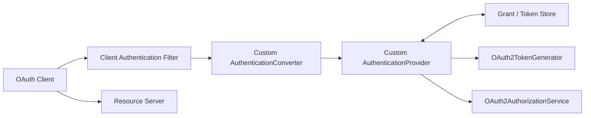
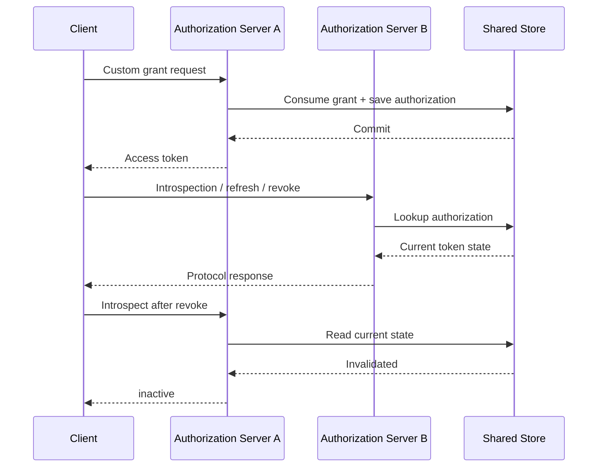

# Kiểm thử bảo mật và tương thích của grant hoặc endpoint mở rộng

Một grant hoặc endpoint mở rộng chỉ hoàn tất khi client có thể sử dụng nó theo một contract ổn định, Authorization Server xác minh đầy đủ danh tính client và bằng chứng cấp quyền, token được lưu và kiểm tra đúng vòng đời, còn các request lỗi bị từ chối theo quy tắc OAuth 2.0. Một unit test cho `AuthenticationProvider` trả về token không chứng minh được toàn bộ luồng đó. Lỗi có thể nằm ở converter, provider, thứ tự filter, client authentication, persistence, token generator, response handler hoặc cách Resource Server diễn giải token.

Spring Authorization Server cung cấp extension points cho protocol endpoints. Với custom authorization grant ở Token Endpoint, hướng dẫn chính thức dùng `AuthenticationConverter` để chuyển HTTP request thành grant authentication token, `AuthenticationProvider` để xác minh grant và phát token, rồi đăng ký hai thành phần qua `OAuth2TokenEndpointConfigurer`. Với endpoint mở rộng, ứng dụng cần xác định rõ request matcher, filter, authentication/authorization policy, success handler và error handler. [Extension Authorization Grant](https://docs.spring.io/spring-authorization-server/reference/guides/how-to-ext-grant-type.html) · [Protocol Endpoints](https://docs.spring.io/spring-authorization-server/reference/protocol-endpoints.html)

Bài thuộc chương **Mở rộng giao thức** của mô-đun **SPRING_SECURITY_OAUTH2_OIDC_AUTHORIZATION_SERVER**. Trọng tâm là xây dựng chiến lược kiểm thử bảo mật và tương thích cho custom grant hoặc endpoint: từ parser, provider và token lifecycle đến HTTP contract, tương tác client/resource server, concurrency, nâng cấp phiên bản và vận hành production.

**Phạm vi ví dụ:** API và tên extension points minh họa theo Spring Authorization Server 1.5.8. Các test dùng JUnit, Spring Test/MockMvc và có thể kết hợp Testcontainers cho database. Hãy đối chiếu dependency thực tế và cấu hình ứng dụng trước khi sao chép.

## 1. Xác định contract trước khi viết test

### 1.1. Grant mở rộng và endpoint mở rộng khác nhau

| Loại mở rộng | Ví dụ | Nơi tích hợp | Điều cần kiểm thử |
|---|---|---|---|
| Extension authorization grant | `urn:ietf:params:oauth:grant-type:custom_code` | Token Endpoint | Client authentication, grant evidence, scope, token generation, authorization persistence và OAuth error |
| Tham số mở rộng trên endpoint chuẩn | Claim request hoặc validation bổ sung | Authorization, PAR hoặc Token Endpoint configurer tương ứng | Tương thích request chuẩn, validation mặc định và tham số mới |
| Custom endpoint | Endpoint kiểm tra trạng thái hoặc xử lý protocol riêng | Security filter chain với matcher/filter riêng | Route, authentication, authorization, CSRF/CORS nếu áp dụng, response/error và rate limit |
| Custom client authentication | Phương thức xác thực client riêng | Client Authentication configurer | Xác minh credential, replay, client binding và principal trong SecurityContext |
| Custom token/claim behavior | Token format hoặc claim generator | `OAuth2TokenGenerator` và token customizer | Claims, audience, expiry, key, validation ở Resource Server và backward compatibility |

Một extension grant thường đi qua Token Endpoint đã có sẵn. Nó phải dùng cùng quy tắc client authentication và OAuth error response của endpoint đó. Một custom endpoint có URL riêng cần được tích hợp vào filter chain một cách rõ ràng; tự tạo controller không tự động kế thừa protocol security của Token Endpoint.

### 1.2. Viết contract bằng dữ liệu quan sát được

Trước khi kiểm thử, ghi rõ:

- HTTP method, path, content type và encoding;
- Tên, kiểu, số lần xuất hiện và giới hạn kích thước của từng parameter;
- Cách client xác thực;
- Grant type hoặc operation identifier;
- Client nào được phép sử dụng;
- Các scope/resource/audience có thể được yêu cầu;
- Điều kiện để grant evidence hợp lệ;
- Token types được phát, TTL và claim contract;
- Trạng thái nào được lưu và cách xử lý replay;
- Success response và error response;
- Rate limit, timeout và dependency ngoài;
- Những thay đổi tương thích giữa các phiên bản.

Ví dụ contract cho custom grant:

```text
POST /oauth2/token
Content-Type: application/x-www-form-urlencoded
Authorization: Basic <client-credentials>

grant_type=urn:ietf:params:oauth:grant-type:custom_code
code=<one-time-grant>
scope=orders.read
```

Đây chỉ là contract minh họa. Tên grant URI và parameter phải được định nghĩa trong tài liệu tích hợp của hệ thống. Theo hướng dẫn Spring Authorization Server, extension grant dùng một absolute URI duy nhất cho `grant_type`; converter chỉ nhận diện đúng grant URI của nó và trả `null` cho grant khác để converter tiếp theo có thể xử lý. [Extension Grant Guide](https://docs.spring.io/spring-authorization-server/reference/guides/how-to-ext-grant-type.html)

### 1.3. Phân biệt requirement, implementation và test oracle

| Khái niệm | Ví dụ |
|---|---|
| Requirement | Grant evidence chỉ dùng được một lần |
| Implementation | Provider tra cứu grant record, kiểm tra trạng thái và consume nguyên tử |
| Test oracle | Hai request đồng thời dùng cùng grant: tối đa một request thành công |
| Evidence | HTTP response, authorization record và audit event sau hai request |

Không viết test chỉ kiểm tra một method đã được gọi. Test phải chứng minh hành vi protocol mà client hoặc attacker có thể quan sát.

### 1.4. Ma trận vai trò và trust boundary



Client kiểm soát HTTP parameters và credential nó gửi. Client không được tự quyết định principal đã xác thực, quyền của grant, trạng thái đã consume hoặc claims bảo mật. Provider phải lấy client identity từ authentication đã được framework xác minh, rồi áp dụng policy trước khi phát token.

## 2. Kiểm thử theo từng lớp

### 2.1. Converter unit tests

`AuthenticationConverter` là ranh giới giữa HTTP và domain authentication token. Test converter riêng để xác nhận:

- Nhận đúng `grant_type` hoặc endpoint request;
- Trả `null` với request thuộc grant khác;
- Từ chối parameter bắt buộc bị thiếu, rỗng hoặc lặp;
- Từ chối giá trị sai định dạng hoặc vượt giới hạn;
- Không âm thầm chọn giá trị đầu tiên khi parameter xuất hiện nhiều lần;
- Loại các parameter dành riêng như `grant_type`, `client_id`, `client_secret` khỏi additional parameters nếu contract yêu cầu;
- Không lấy client identity từ parameter do caller tự khai;
- Không ghi raw secret/grant code vào log.

Một converter nên kiểm tra toàn bộ giá trị của parameter có tính đơn nhất. Ví dụ `code=a&code=b` không nên bị chấp nhận chỉ vì `getParameter("code")` trả về giá trị đầu tiên.

### 2.2. Provider unit tests

`AuthenticationProvider` thực hiện logic tin cậy. Test độc lập các nhánh:

- Client principal thiếu hoặc chưa authenticated;
- RegisteredClient không cho phép grant;
- Grant evidence không tồn tại, sai client, hết hạn, đã dùng hoặc bị revoke;
- Scope/resource/audience vượt quyền client hoặc consent;
- Principal/tenant binding không khớp;
- Token generator trả `null` hoặc phát sinh lỗi;
- Authorization store không lưu được;
- Grant consume bị cạnh tranh bởi request khác;
- Provider không hỗ trợ authentication token type khác.

Mock dependency ở unit test để kiểm tra nhánh logic, nhưng không dùng mock thay thế integration test persistence hoặc protocol endpoint.

### 2.3. Endpoint integration tests

Dùng `@SpringBootTest` và `@AutoConfigureMockMvc` hoặc test server thực để chạy qua toàn bộ SecurityFilterChain. Các test này xác minh:

- Endpoint matcher chọn đúng filter chain;
- Client authentication diễn ra trước custom grant provider;
- Converter/provider được đăng ký đúng;
- Success/error handler trả đúng HTTP response;
- Authorization được lưu trước khi token response thành công;
- Default grants vẫn hoạt động sau khi thêm converter;
- Endpoint khác không bị custom filter bắt nhầm.

### 2.4. Consumer/interoperability tests

Test với client thật hoặc một client test tối giản để xác minh contract trên wire:

- Basic hoặc phương thức client authentication đã công bố;
- Form encoding và parameter escaping;
- `grant_type` URI chính xác;
- Token response field names và JSON types;
- Error body và HTTP status;
- Token type, expiry, scope và refresh behavior;
- Resource Server xác minh token;
- Client SDK hoặc thư viện OAuth hiểu response.

Một mock request nội bộ không chứng minh thư viện client thực tế có thể tạo request đúng.

### 2.5. System, load và resilience tests

Cuối cùng, chạy qua topology gần production:

- Nhiều Authorization Server instances;
- Database/Redis dùng thật hoặc Testcontainers;
- Reverse proxy và TLS termination;
- Signing keys/JWKS;
- Rate limiting;
- Dependency timeout;
- Failover, restart và rolling upgrade;
- Load và concurrent replay.

Không cần chạy mọi kịch bản ở mỗi unit test. Hãy đặt mỗi invariant ở lớp test có thể quan sát và tái hiện nó đáng tin cậy.

## 3. Kiểm thử AuthenticationConverter

### 3.1. Ma trận input

| Input | Kết quả mong đợi |
|---|---|
| Đúng custom `grant_type`, đủ parameter hợp lệ | Tạo custom grant authentication token |
| Grant type chuẩn khác | Trả `null`, để converter chuẩn xử lý |
| Thiếu `grant_type` | Không nhận custom grant; endpoint xử lý theo contract chung |
| `grant_type` lạ | Không tự chuyển thành custom grant |
| Thiếu grant evidence | `invalid_request` |
| Grant evidence rỗng | `invalid_request` |
| Parameter bắt buộc lặp hai lần | `invalid_request` |
| Giá trị vượt giới hạn | Từ chối trước khi gọi downstream |
| Thêm `client_id` trong body khi client đã xác thực bằng Basic | Không dùng body để ghi đè authenticated client |
| Có parameter không được hỗ trợ | Từ chối hoặc bỏ qua theo contract đã công bố, nhất quán giữa các phiên bản |
| Body không đúng form content type | Trả lỗi request phù hợp, không parse theo giả định |

Nếu parameter là multi-valued theo protocol, định nghĩa quy tắc riêng. Không áp dụng quy tắc đơn nhất cho tất cả parameter một cách máy móc.

### 3.2. Ví dụ JUnit cho converter

Đoạn test minh họa dùng `MockHttpServletRequest`. `CustomCodeGrantAuthenticationConverter` và `CustomCodeGrantAuthenticationToken` là class của ứng dụng:

```java
import static org.junit.jupiter.api.Assertions.*;

import org.junit.jupiter.api.AfterEach;
import org.junit.jupiter.api.Test;
import org.springframework.mock.web.MockHttpServletRequest;
import org.springframework.security.core.Authentication;
import org.springframework.security.core.context.SecurityContextHolder;
import org.springframework.security.oauth2.core.OAuth2AuthenticationException;

class CustomCodeGrantAuthenticationConverterTests {

    private final CustomCodeGrantAuthenticationConverter converter =
            new CustomCodeGrantAuthenticationConverter();

    @AfterEach
    void clearSecurityContext() {
        SecurityContextHolder.clearContext();
    }

    @Test
    void convertsOnlyItsOwnGrantType() {
        MockHttpServletRequest request = new MockHttpServletRequest();
        request.setParameter("grant_type",
                "urn:ietf:params:oauth:grant-type:custom_code");
        request.setParameter("code", "one-time-code");

        Authentication result = converter.convert(request);

        assertInstanceOf(CustomCodeGrantAuthenticationToken.class, result);
    }

    @Test
    void returnsNullForAnotherGrantType() {
        MockHttpServletRequest request = new MockHttpServletRequest();
        request.setParameter("grant_type", "client_credentials");

        assertNull(converter.convert(request));
    }

    @Test
    void rejectsDuplicateGrantEvidence() {
        MockHttpServletRequest request = new MockHttpServletRequest();
        request.addParameter("grant_type",
                "urn:ietf:params:oauth:grant-type:custom_code");
        request.addParameter("code", "first");
        request.addParameter("code", "second");

        assertThrows(OAuth2AuthenticationException.class,
                () -> converter.convert(request));
    }
}
```

Test class trên cần import các class custom tương ứng. Test không mock `SecurityContextHolder` ở đây vì converter chỉ được kiểm tra nhận diện/parse. Bổ sung test riêng để xác minh client principal được lấy từ authenticated security context khi implementation cần truyền principal vào custom authentication token.

### 3.3. Kiểm tra parameter pollution

Các request như sau cần có kết quả xác định:

```http
grant_type=urn:ietf:params:oauth:grant-type:custom_code
&code=valid-code
&code=attacker-code
```

```http
grant_type=urn:ietf:params:oauth:grant-type:custom_code
&scope=orders.read
&scope=admin
```

```http
grant_type=urn:ietf:params:oauth:grant-type:custom_code
&client_id=trusted-client
&client_id=attacker-client
&code=valid-code
```

Parameter lặp có thể bị proxy, servlet container và ứng dụng diễn giải khác nhau. Hãy kiểm tra behavior qua cùng stack HTTP sẽ chạy production. Đối với parameter quan trọng, từ chối ambiguity thay vì để mỗi lớp tự chọn một giá trị.

### 3.4. Kiểm tra giới hạn request

Test các trường hợp:

- Grant code dài bất thường;
- Nhiều parameter không cần thiết;
- Body lớn;
- Encoding lỗi;
- Ký tự Unicode hoặc percent encoding không hợp lệ;
- Header Authorization quá dài;
- Request thiếu hoặc sai Content-Type.

Giới hạn phải được đặt ở cả reverse proxy/container và ứng dụng nếu dữ liệu có thể bị tiêu thụ trước khi vào converter. Không phản chiếu raw input vào error response.

## 4. Kiểm thử AuthenticationProvider và grant evidence

### 4.1. Client authentication và grant authorization

Provider phải xác minh client đã được xác thực và registration cho phép grant type. Test tối thiểu:

| Trường hợp | Kết quả |
|---|---|
| Không có authenticated client principal | `invalid_client` |
| Client secret/certificate/assertion sai | Client authentication thất bại trước khi provider chạy |
| Client đã xác thực nhưng không được đăng ký grant | `unauthorized_client` |
| Client được phép grant | Tiếp tục kiểm tra grant evidence |
| Caller gửi `client_id` khác với client đã authenticated | Không thay đổi client principal |
| Client bị disable hoặc registration đã hết hiệu lực theo policy | Từ chối |

Không chỉ kiểm tra `client_id` trong request. Nguồn client tin cậy là `OAuth2ClientAuthenticationToken` đã được Spring Security xác thực và gắn với request.

### 4.2. Grant evidence phải được ràng buộc

Nếu custom grant dùng code, ticket, assertion hoặc one-time credential, kiểm tra:

- Evidence được phát bởi issuer/source được tin cậy;
- Evidence gắn với đúng client hoặc client instance nếu protocol yêu cầu;
- Subject/principal binding chính xác;
- Tenant, resource server và audience đúng;
- Scope nằm trong quyền đã được cấp;
- Thời hạn chưa hết;
- Evidence chưa bị consume/revoke;
- Evidence không bị sửa hoặc ký bằng key không tin cậy;
- Không thể dùng evidence ở môi trường/issuer khác;
- Không thể dùng evidence của một flow khác.

Không dùng email, username hoặc parameter caller tự khai làm bằng chứng xác thực thay cho subject đã được xác minh.

### 4.3. Test replay và consume một lần

Tạo một grant evidence hợp lệ và gửi request lần đầu. Request thứ hai dùng cùng evidence phải bị từ chối theo contract. Lặp lại test:

- Cùng client, cùng node;
- Cùng client, hai node;
- Hai request gửi đồng thời;
- Request đầu timeout sau khi server đã consume;
- Server restart giữa lúc consume và lưu authorization;
- Retry sau khi client không nhận được token response.

Đây là test concurrency quan trọng. Một logic kiểu “đọc record, kiểm tra unused, rồi cập nhật used” mà không atomic có thể cho phép hai request cùng thành công.

### 4.4. Phân biệt exactly-once với idempotency

HTTP client có thể retry khi timeout và không biết server đã phát token hay chưa. Không nên tự tuyên bố custom grant hỗ trợ exactly-once chỉ vì record có cờ `used`.

Nếu protocol cần idempotency, thiết kế rõ:

- Idempotency key gắn với client và operation;
- Response có thể được trả lại an toàn cho retry hợp lệ;
- Không phát token mới ngoài ý muốn;
- Không cho client khác dùng lại key;
- TTL và retention của idempotency record;
- Cách xử lý crash giữa commit và response.

Nếu grant evidence chỉ dùng một lần và không có cơ chế trả lại response, retry sau timeout có thể phải bắt đầu flow mới. Điều này cần được ghi trong contract client.

### 4.5. Kiểm thử scope, resource và audience

Provider không được cấp quyền rộng hơn yêu cầu và consent:

- Requested scope phải là tập con scope client được phép;
- Không tự thêm scope quản trị;
- Resource/audience phải nằm trong policy;
- Refresh token (nếu được phát) phải giữ ràng buộc scope/resource theo consent;
- Claims không được tiết lộ dữ liệu tenant hoặc subject khác;
- Scope không hợp lệ trả lỗi `invalid_scope` theo protocol contract.

Test cả request không gửi scope, gửi scope rỗng, gửi scope lặp, gửi scope không được client đăng ký và scope có giá trị đúng nhưng resource sai.

### 4.6. Kiểm thử lỗi token generator và persistence

Các failure path phải có test:

- `OAuth2TokenGenerator.generate(...)` trả `null`;
- Signing key/JWK không sẵn sàng;
- Token generator timeout hoặc throw exception;
- `OAuth2AuthorizationService.save(...)` thất bại;
- Database timeout hoặc deadlock;
- Grant consume thành công nhưng save authorization thất bại;
- Save authorization thành công nhưng response handler lỗi.

Token response chỉ được trả thành công khi trạng thái cần thiết đã được lưu theo transaction policy. Không gửi token thành công nếu authorization state không thể được khôi phục hoặc kiểm soát theo thiết kế.

## 5. Kiểm thử token response và vòng đời token

### 5.1. Response contract

Với request thành công, kiểm tra:

- HTTP status;
- Content-Type JSON phù hợp với framework;
- `Cache-Control: no-store`;
- `Pragma: no-cache`;
- `access_token` tồn tại và không rỗng;
- `token_type` đúng, thường là `Bearer` với bearer access token;
- `expires_in` khớp TTL được cấu hình;
- `scope` phản ánh scope thực sự được cấp;
- `refresh_token` chỉ có khi policy/grant cho phép;
- Các extension response fields có kiểu và semantics đã công bố;
- Không có secret, grant evidence hoặc internal error detail bị trả về.

Không kiểm tra thứ tự property JSON. Hãy kiểm tra JSON semantics và schema contract.

### 5.2. Token claims và Resource Server

Nếu phát JWT access token, kiểm tra:

- Chữ ký hợp lệ với public key trong JWKS;
- `iss`, `aud`, `exp`, `iat`, `nbf` nếu có;
- Subject/client identity theo loại grant;
- Scope/authority đúng;
- Token không chứa claims vượt quyền;
- Key ID và algorithm nằm trong policy;
- Resource Server từ chối token hết hạn, sai issuer, sai audience hoặc chữ ký sai.

Nếu phát opaque token, kiểm tra introspection trả `active` chính xác, cùng scope, client, subject và expiry theo contract. Không dùng một test decode JWT để kết luận opaque token path hoạt động.

### 5.3. Token lifecycle

| Thao tác | Kiểm thử |
|---|---|
| Issue | Token và authorization record được tạo |
| Use | Resource Server chấp nhận đúng scope/resource |
| Expire | Token hết hạn bị từ chối hoặc inactive |
| Refresh | Token mới được phát theo policy; token cũ được xử lý đúng |
| Revoke | Token bị đánh dấu invalidated và introspection phản ánh |
| Introspect | Client được phép mới xem trạng thái token |
| Restart | Authorization/token state được khôi phục |
| Key rotation | Token cũ được xác minh trong thời gian overlap đã thiết kế |
| Cleanup | Không xóa record còn refresh token hoặc state cần thiết |

### 5.4. Refresh-token rotation và replay detection

Nếu extension grant phát refresh token, kiểm thử hai request đồng thời dùng cùng refresh token. Với public clients, RFC 9700 yêu cầu refresh token phải được sender-constrain hoặc dùng rotation để phát hiện replay. Khi rotation được chọn, token cũ bị invalidated và quan hệ giữa các token cần được giữ để phát hiện reuse. [RFC 9700](https://www.rfc-editor.org/rfc/rfc9700.html)

Test cần xác minh:

- Chỉ một request tiêu thụ token cũ thành công;
- Token cũ không thể tiếp tục refresh;
- Token mới gắn đúng client, subject, scope và resource;
- Replay token cũ được phát hiện theo policy;
- Việc phát hiện reuse có thể revoke token family nếu đó là chính sách;
- Trạng thái được đồng bộ giữa các node;
- Crash/failover không làm token cũ sống lại.

## 6. Kiểm thử error contract

### 6.1. OAuth error mapping

| Tình huống | OAuth error thường dùng | Điều cần kiểm tra |
|---|---|---|
| Request thiếu hoặc parameter lặp/sai | `invalid_request` | Không phát token; response không lộ input nhạy cảm |
| Client authentication sai | `invalid_client` | HTTP status và `WWW-Authenticate` theo cách xác thực |
| Client không được phép grant | `unauthorized_client` | Không chạy grant issuance |
| Grant evidence sai, hết hạn hoặc replay | `invalid_grant` | Không phân biệt chi tiết nhạy cảm không cần thiết |
| Scope không hợp lệ | `invalid_scope` | Không cấp scope rộng hơn |
| Grant type không được hỗ trợ | `unsupported_grant_type` | Client biết endpoint không hỗ trợ grant |
| Token generator hoặc server dependency lỗi | `server_error` hoặc lỗi phù hợp | Không trả stack trace/SQL/JWK detail |

Áp dụng RFC 6749 §5.2 và contract của extension. Không dùng `invalid_grant` cho mọi lỗi chỉ để đơn giản hóa; mã lỗi giúp client phân biệt request cần sửa với credential không còn hợp lệ.

### 6.2. Error response không được làm lộ dữ liệu

Kiểm tra response và log không chứa:

- Raw client secret hoặc client assertion;
- Grant code/ticket/assertion;
- Access/refresh token;
- Stack trace, SQL statement, connection string;
- Internal hostnames hoặc key identifiers nhạy cảm;
- Thông tin xác nhận một subject có tồn tại khi điều đó tạo user enumeration risk.

Có thể trả error description hữu ích nhưng phải ổn định, không phụ thuộc exception message nội bộ.

### 6.3. Không biến lỗi bảo mật thành success rỗng

Nếu grant evidence không xác minh được, provider phải từ chối. Nếu authorization persistence lỗi, không trả response chứa token chưa được lưu. Nếu endpoint không nhận diện được request, không chuyển request sang handler mặc định có thể vô tình cấp quyền khác.

## 7. Kiểm thử custom endpoint và SecurityFilterChain

### 7.1. Kiểm thử request matcher và filter ordering

Với endpoint riêng, test:

- Chỉ path và HTTP method đã định nghĩa được custom filter xử lý;
- Request tới endpoint OAuth chuẩn vẫn đi qua filter chuẩn;
- Path gần giống hoặc trailing slash không bị match ngoài ý muốn;
- HTTP method khác bị từ chối;
- Filter không chạy hai lần;
- Endpoint có đúng authentication principal trong `SecurityContext`;
- Exception được chuyển qua handler phù hợp;
- Request không được bỏ qua authorization rule của chain.

Với endpoint chuẩn, ưu tiên configurer extension points có sẵn. Với path mới, custom filter phải được gắn vào chain có matcher bao gồm path đó. Đừng giả định `getEndpointsMatcher()` tự bao gồm endpoint tùy chỉnh do ứng dụng tự thêm.

### 7.2. Kiểm thử authentication và authorization

Tách hai câu hỏi:

- **Authentication:** caller là ai? Client đã xác thực chưa? Resource owner đã đăng nhập chưa?
- **Authorization:** principal đó có được phép thực hiện operation trên resource/tenant/scope cụ thể không?

Test unauthenticated, wrong client, authenticated client không có grant, user thiếu role, tenant mismatch và scope mismatch. Không chỉ kiểm tra `.authenticated()` ở filter chain nếu endpoint cần policy chi tiết hơn.

### 7.3. CSRF, CORS và browser exposure

Nếu custom endpoint được gọi từ browser hoặc dựa trên cookie/session, đánh giá CSRF. Nếu là machine-to-machine endpoint dùng Bearer/client authentication, xác định rõ CSRF policy dựa trên credential transport thực tế và cách SecurityFilterChain cấu hình.

CORS không thay thế authentication. Test origin được phép, origin không được phép, preflight và credentialed request nếu browser cần gọi endpoint. Không bật `*` cùng credentials. Token endpoint không nên được mở CORS rộng chỉ để làm test browser thuận tiện.

### 7.4. Rate limiting và resource exhaustion

Test:

- Burst request từ một client;
- Nhiều client cùng IP;
- Grant evidence invalid liên tục;
- Payload lớn;
- Downstream dependency chậm;
- Kết nối datastore cạn;
- Request đồng thời trên cùng principal/evidence.

Rate limit nên dựa trên danh tính đã xác minh và các tín hiệu mạng phù hợp. Không dùng một parameter `client_id` do caller tự khai làm key duy nhất trước khi xác thực client.

### 7.5. HTTP method, cache và response headers

Kiểm tra endpoint không chấp nhận GET nếu contract chỉ cho POST, không trả credential trong URL, có header chống cache cho response nhạy cảm và có content type đúng. Nếu endpoint trả redirect, xác minh redirect target là URL đã được allowlist hoặc đã được ràng buộc với client; không tạo open redirect từ query parameter.

## 8. Kiểm thử tương thích với OAuth 2.0 và client hiện hữu

### 8.1. Không làm hỏng grant chuẩn

Sau khi thêm custom converter/provider, chạy regression tests cho tất cả grant đang bật:

- Authorization Code + PKCE;
- Client Credentials;
- Refresh Token;
- Device Authorization;
- Token Exchange nếu bật;
- Các grant chuẩn hoặc extension khác trong hệ thống.

Custom converter phải trả `null` cho request không thuộc grant của nó. Custom provider phải `supports(...)` đúng authentication token class. Không remove hoặc thay thế provider chuẩn ngoài chủ đích đã được review.

### 8.2. Kiểm thử exact client registration

Client registration phải cho phép đúng custom grant type. Test:

- Client có grant type;
- Client không có grant type;
- Client bị disable hoặc registration bị thay đổi;
- Client secret rotation;
- Redirect URI/scope/token settings không bị custom grant bỏ qua nếu grant dùng các policy này;
- Client ID duy nhất và internal registration ID ổn định.

Không giả định mọi client có thể dùng extension grant chỉ vì converter được đăng ký ở endpoint.

### 8.3. Tương thích trên wire

Đối với client tích hợp, giữ ổn định:

- Grant URI;
- Parameter names và encoding;
- HTTP method và path;
- Client authentication method;
- Token response JSON;
- OAuth error code;
- Token type và claim contract;
- Scope semantics;
- Retry/replay behavior.

Nếu phải đổi một field, hãy xác định phiên bản contract, thời gian chuyển tiếp và khả năng client cũ tiếp tục hoạt động. Không đổi semantics của cùng một `grant_type` mà không có versioning hoặc migration plan.

### 8.4. Metadata và tài liệu client

Nếu Authorization Server công bố metadata, kiểm tra các trường như issuer, token endpoint, grant types hoặc capability liên quan phản ánh đúng những gì được hỗ trợ. Extension grant có URI riêng; đừng giả định mọi thư viện client tự phát hiện được grant đó. Tài liệu tích hợp phải cung cấp request mẫu, client authentication, required parameters và error semantics.

### 8.5. Contract test với client thật

Dùng một client test độc lập hoặc thư viện OAuth được hỗ trợ trong hệ sinh thái:

1. Cấu hình registration và secret;
2. Gửi request qua HTTPS tới endpoint thật;
3. Xác minh status, JSON và headers;
4. Đọc token bằng Resource Server;
5. Gọi API theo scope;
6. Gửi request lỗi;
7. Thực hiện refresh/revoke nếu contract có;
8. Chạy lại với phiên bản client trước và phiên bản client mới.

Điều này phát hiện các sai khác form encoding, Basic auth, JSON type và retry behavior mà unit test không thể thấy.

## 9. Kiểm thử tương thích khi nâng cấp Spring

### 9.1. Ba lớp tương thích

| Lớp | Điều phải giữ |
|---|---|
| Source/API compatibility | Class, method, constructor, package và configurer extension points |
| Wire/protocol compatibility | Request, response, error, token claims và discovery metadata |
| Persisted-data compatibility | Serialization, database schema, token metadata và authorization state |

Một ứng dụng compile thành công sau dependency upgrade vẫn có thể phá wire contract hoặc không deserialize được authorization đã lưu từ phiên bản cũ.

### 9.2. Version matrix

Tạo CI matrix cho:

- Phiên bản Spring Authorization Server hiện tại đang chạy;
- Phiên bản mục tiêu;
- Phiên bản Spring Security/Spring Boot tương thích;
- Database/Redis adapter;
- Client SDK đang được hỗ trợ.

Không ghép tùy ý Spring Security và Spring Authorization Server khác dòng phiên bản. Dùng BOM/dependency management và ma trận tương thích chính thức.

### 9.3. Regression tests trước/sau upgrade

Chạy cùng một bộ contract tests trên hai version:

- Converter/provider behavior;
- HTTP status và OAuth error response;
- Token response fields;
- JWT headers/claims/signature;
- Authorization save/find/update;
- `findByToken` cho mọi token type;
- Refresh/revocation;
- Custom endpoint filter ordering;
- Metadata/discovery;
- Serialization read của dữ liệu đã tạo bởi version trước.

Nếu schema hoặc serialized payload thay đổi, test migration và rollback/forward-fix bằng bản sao dữ liệu đã mask.

### 9.4. Không phụ thuộc vào internal implementation

Ưu tiên public extension points như `AuthenticationConverter`, `AuthenticationProvider`, `OAuth2TokenGenerator` và configurer API. Hạn chế phụ thuộc class nội bộ, filter order không được công bố hoặc reflection. Nếu buộc phải dùng implementation detail, viết regression test rõ ràng và ghi nhận nó là compatibility risk.

## 10. Kiểm thử bảo mật theo threat model

### 10.1. Threat-to-test matrix

| Mối đe dọa | Test case | Kết quả an toàn |
|---|---|---|
| Client giả mạo | Secret/assertion sai, client ID bị thay | `invalid_client`; không phát token |
| Grant replay | Dùng lại code/ticket | Request sau bị từ chối |
| Grant substitution | Evidence của client A dùng bởi client B | Bị từ chối |
| Subject substitution | Evidence thuộc user A nhưng request cố gán user B | Không dùng subject caller tự khai |
| Scope escalation | Yêu cầu scope cao hơn quyền | `invalid_scope` hoặc lỗi policy |
| Audience/resource substitution | Xin token cho resource không được phép | Từ chối hoặc chỉ cấp audience được phép |
| Tenant crossing | Evidence của tenant A truy cập tenant B | Từ chối |
| Parameter pollution | Parameter nhạy cảm lặp hoặc mâu thuẫn | `invalid_request` |
| Token replay | Dùng refresh token cũ sau rotation | Phát hiện reuse và áp dụng policy |
| Token leakage | Token xuất hiện URL/log/error | Không phát tán token |
| Open redirect | Redirect tới URL caller tự nhập | Từ chối URL ngoài allowlist |
| Denial of service | Payload lớn, request burst, downstream timeout | Giới hạn tài nguyên, fail an toàn |
| Race condition | Hai request consume cùng grant | Tối đa một lần thành công |
| Cross-node stale state | Node khác chưa thấy revoke | Hành vi nằm trong consistency SLA |
| Key confusion | Token dùng algorithm/kid không được phép | Resource Server từ chối |
| Serialization tampering | Payload lưu trữ bị sửa | Không deserialize kiểu không tin cậy hoặc phát token từ dữ liệu lỗi |

### 10.2. Áp dụng OAuth 2.0 Security BCP

RFC 9700 cập nhật threat model OAuth 2.0. Những khuyến nghị cần được phản ánh trong test suite gồm:

- Exact string matching cho redirect URI đã đăng ký, ngoại trừ quy tắc port localhost của native app;
- Chống CSRF và authorization code injection;
- Public client dùng PKCE;
- Không tạo open redirector;
- Giới hạn quyền và audience của access token;
- Sender-constrain access token bằng mTLS/DPoP khi phù hợp;
- Public client refresh token phải sender-constrained hoặc rotation;
- Không để token xuất hiện trong URL hoặc log.

Một custom grant không được làm yếu các bảo vệ này ở flow chuẩn. Nếu extension có redirect hoặc browser interaction, phải đánh giá các threat tương ứng thay vì giả định nó không liên quan. [RFC 9700](https://www.rfc-editor.org/rfc/rfc9700.html)

### 10.3. Fuzzing và property-based testing

Với converter/parser, fuzz các input:

- Parameter thiếu, rỗng, lặp, sai encoding;
- Chuỗi Unicode, null byte và ký tự điều khiển;
- Giá trị cực dài;
- JSON lồng sâu nếu endpoint nhận JSON;
- Token/evidence malformed;
- Header trùng lặp;
- Unknown fields.

Property-based tests có thể xác minh invariant: bất kỳ request nào có duplicate required parameter đều không tạo authentication token; mọi request thuộc grant khác đều không bị custom converter consume; parser không throw lỗi ngoài dự kiến làm lộ stack trace.

## 11. Ví dụ MockMvc cho custom grant

### 11.1. Test happy path qua Token Endpoint

Test này phải dùng client authentication thật của test context, một RegisteredClient có grant type tùy chỉnh và một grant evidence fixture. Không dùng `@WithMockUser` để thay thế client authentication.

```java
@SpringBootTest
@AutoConfigureMockMvc
class CustomGrantEndpointTests {

    private static final String GRANT_TYPE =
            "urn:ietf:params:oauth:grant-type:custom_code";

    @Autowired
    MockMvc mvc;

    @Test
    void issuesTokenForAuthorizedClientAndValidGrant() throws Exception {
        mvc.perform(post("/oauth2/token")
                .with(httpBasic("custom-client", "test-secret"))
                .contentType(MediaType.APPLICATION_FORM_URLENCODED)
                .param("grant_type", GRANT_TYPE)
                .param("code", "valid-one-time-code")
                .param("scope", "orders.read"))
            .andExpect(status().isOk())
            .andExpect(header().string(
                    HttpHeaders.CACHE_CONTROL, containsString("no-store")))
            .andExpect(jsonPath("$.access_token").isNotEmpty())
            .andExpect(jsonPath("$.token_type").value("Bearer"))
            .andExpect(jsonPath("$.expires_in").isNumber())
            .andExpect(jsonPath("$.scope").value("orders.read"));
    }
}
```

Các fixture và import như `httpBasic`, `post`, `MediaType`, `HttpHeaders`, `header`, `jsonPath`, `containsString` cần được khai báo theo test project. `custom-client` phải là registration có custom grant type và secret được encode bằng PasswordEncoder phù hợp; fixture code phải được tạo trong grant store test.

### 11.2. Test client không được cấp grant

```java
@Test
void rejectsClientThatIsNotRegisteredForCustomGrant() throws Exception {
    mvc.perform(post("/oauth2/token")
            .with(httpBasic("ordinary-client", "test-secret"))
            .contentType(MediaType.APPLICATION_FORM_URLENCODED)
            .param("grant_type", GRANT_TYPE)
            .param("code", "valid-one-time-code"))
        .andExpect(status().isBadRequest())
        .andExpect(jsonPath("$.error").value("unauthorized_client"));
}
```

Status và error body cần được xác nhận với error handler/configuration của phiên bản ứng dụng. Test cũng cần xác minh grant evidence chưa bị consume khi client không được phép dùng grant.

### 11.3. Test replay

```java
@Test
void rejectsReplayedGrantEvidence() throws Exception {
    issueToken("custom-client", "test-secret", "one-time-code");

    mvc.perform(post("/oauth2/token")
            .with(httpBasic("custom-client", "test-secret"))
            .contentType(MediaType.APPLICATION_FORM_URLENCODED)
            .param("grant_type", GRANT_TYPE)
            .param("code", "one-time-code"))
        .andExpect(status().isBadRequest())
        .andExpect(jsonPath("$.error").value("invalid_grant"));
}
```

`issueToken(...)` là helper của test project. Ngoài response, hãy kiểm tra store: evidence đã consumed, authorization record chỉ được tạo theo số lần thành công, và không có token thứ hai được phát từ cùng evidence.

### 11.4. Kiểm thử không nhầm Resource Server authentication với client authentication

Spring Security Test có `jwt()` request post processor để tạo mock `Jwt` cho test authorization ở Resource Server. Nó hữu ích khi test API được bảo vệ bằng JWT, nhưng không chứng minh `OAuth2ClientAuthenticationFilter` đã xác thực client tại Token Endpoint. Với Token Endpoint, dùng client authentication thực qua HTTP Basic, `client_secret_post` nếu được hỗ trợ, private_key_jwt fixture hoặc phương thức client auth mà test đang kiểm tra. [Testing OAuth 2.0 with MockMvc](https://docs.spring.io/spring-security/reference/servlet/test/mockmvc/oauth2.html)

## 12. Kiểm thử persistence và nhiều instance

### 12.1. Kiểm tra authorization được lưu

Sau happy path, xác minh:

- Có authorization record gắn đúng RegisteredClient ID;
- Grant type đúng;
- Principal name đúng;
- Authorized scopes đúng;
- Access token value/metadata tồn tại;
- Issued-at và expires-at đúng;
- Claims được lưu nếu token generator tạo claims;
- Grant evidence được consume;
- Refresh token metadata tồn tại nếu refresh token được phát.

Không chỉ verify `authorizationService.save(...)` được gọi. Hãy đọc lại record bằng `findById` hoặc `findByToken`.

### 12.2. Kiểm tra findByToken

Với từng token type được extension tạo hoặc phụ thuộc, test:

- Lookup token trả đúng authorization;
- Lookup token sai trả null;
- Token type sai không trả nhầm record;
- Token invalidated vẫn được tìm thấy để phục vụ revoke/replay logic khi contract yêu cầu;
- Remove authorization làm lookup không còn trả record;
- Dữ liệu sau restart vẫn khôi phục đầy đủ.

### 12.3. Test hai instance



Test cần chứng minh node B có thể tìm token được node A phát, và node A thấy trạng thái revoke được node B ghi. Nếu có cache hoặc replica bất đồng bộ, đo thời gian hội tụ và xác nhận behavior đúng SLA.

### 12.4. Test failover và restart

Mô phỏng:

- Database connection bị ngắt trước khi save;
- Connection bị ngắt sau commit nhưng trước khi response về client;
- Node restart sau khi consume grant;
- Redis primary fail ngay sau khi write;
- Replica lag;
- Signing key rotation;
- Rolling deploy với hai version cùng chạy.

Sau mỗi sự cố, kiểm tra grant không bị dùng hai lần, token không bị phát lại trái phép và authorization không biến mất ngoài RPO đã công bố.

## 13. Kiểm thử observability và audit

### 13.1. Log và audit event

Có thể log:

- Request/correlation ID;
- Client ID đã xác thực;
- Grant type hoặc endpoint operation;
- Kết quả policy;
- OAuth error code;
- Latency;
- Node/region;
- Authorization ID hoặc subject fingerprint đã bảo vệ theo policy.

Không log raw client secret, client assertion, grant evidence, authorization code, access token, refresh token hoặc toàn bộ request body.

### 13.2. Metrics

Theo dõi:

- Số request theo grant type/client;
- Success và error rate;
- `invalid_client`, `unauthorized_client`, `invalid_grant`, `invalid_scope`;
- Grant replay detection;
- Token generation failure;
- Persistence error;
- Concurrent refresh conflict;
- Latency p50/p95/p99;
- Rate-limit rejection;
- Replication/cache lag;
- Cross-node lookup failure.

Không dùng token, subject hoặc email làm metrics label vì cardinality cao và có thể chứa dữ liệu nhạy cảm.

### 13.3. Test audit correctness

Mỗi lần grant bị từ chối vì replay hoặc scope escalation cần có event phù hợp, nhưng audit event không được chứa credential. Test cả trường hợp audit sink unavailable: xác định audit là synchronous requirement hay best-effort/outbox, và bảo đảm lỗi audit không vô tình biến grant bị từ chối thành thành công.

## 14. Release gate và ma trận nghiệm thu

### 14.1. Bộ kiểm thử tối thiểu

| Nhóm | Điều kiện pass |
|---|---|
| Converter | Đúng grant được nhận; request khác được bỏ qua; duplicate/malformed input bị từ chối |
| Provider | Client, grant evidence, subject, scope, audience và tenant được xác minh |
| Replay | Grant/code chỉ được consume theo policy; concurrency không tạo hai success |
| Token | Claims, TTL, response và Resource Server validation đúng |
| Persistence | Save/find/remove và mọi token lookup khôi phục chính xác |
| Error | OAuth error/status/header đúng, không rò rỉ thông tin |
| Filter chain | Endpoint matcher/order/authentication/authorization đúng |
| Regression | Grant chuẩn và endpoint chuẩn không bị ảnh hưởng |
| Compatibility | Client cũ/mới và wire contract được kiểm tra |
| Resilience | Restart/failover không phá bất biến token |
| Observability | Metrics/audit đủ dùng, không chứa credential |
| Performance | Throughput/latency và resource usage trong ngưỡng đã đặt |

### 14.2. Không phát hành khi còn lỗi nào?

Không phát hành nếu còn một trong các lỗi sau:

- Client chưa xác thực vẫn lấy được token;
- Client không được cấp grant vẫn dùng được;
- Grant evidence có thể replay hoặc consume hai lần;
- Scope/resource/audience bị mở rộng ngoài policy;
- Authorization không được lưu nhưng token vẫn được trả;
- Token đã revoke tiếp tục active ngoài SLA;
- Custom converter làm hỏng grant chuẩn;
- Error response hoặc log làm lộ credential;
- Endpoint mới bỏ qua authentication/authorization;
- Upgrade làm mất khả năng đọc authorization cũ mà chưa có migration;
- Client cũ không hiểu response/error đã công bố.

### 14.3. Canary và rollback

Triển khai extension theo client allowlist hoặc traffic cohort nếu kiến trúc hỗ trợ. Theo dõi error rate, latency, replay, persistence failure và Resource Server rejection. Rollback cần giữ schema/serialization tương thích với cả version cũ và version mới; không rollback code trong khi migration đã xóa dữ liệu mà version cũ cần đọc.

## 15. Quy trình thực hiện

1. Viết protocol contract và threat model.
2. Liệt kê grant types, token types, client authentication methods và endpoint matcher.
3. Tạo converter tests cho parameter parsing và ambiguity.
4. Tạo provider tests cho client, grant evidence, scope và token policy.
5. Tạo concurrency tests cho consume-once, code replay và refresh rotation.
6. Tạo MockMvc tests qua toàn bộ filter chain.
7. Kiểm tra success/error response và headers.
8. Đọc lại authorization persistence bằng ID và từng token type.
9. Kiểm tra token ở Resource Server hoặc introspection endpoint.
10. Chạy regression tests cho mọi grant/endpoint chuẩn.
11. Chạy consumer contract với client thực.
12. Chạy multi-instance, restart, failover và upgrade tests.
13. Đo tải, latency, rate limit và downstream timeout.
14. Kiểm tra log, audit và metrics redaction.
15. Lưu test evidence và chỉ release khi toàn bộ security gate đạt.

## 16. Bài tập thực hành

**Bối cảnh:** Authorization Server có custom grant `urn:ietf:params:oauth:grant-type:custom_code`. Client `messaging-client` gửi một code dùng một lần tới `/oauth2/token`. Provider kiểm tra code trong grant store, phát JWT access token có scope `message.read` và lưu authorization qua `OAuth2AuthorizationService`. Hệ thống chạy hai instance.

**Yêu cầu:**

1. Viết converter tests cho grant type đúng, grant khác, thiếu code và code lặp.
2. Viết provider tests cho client unauthenticated, client không được phép grant và code hết hạn.
3. Kiểm tra code được ràng buộc với client và subject đã xác minh.
4. Kiểm tra scope không thể vượt registration hoặc consent.
5. Kiểm tra hai request đồng thời dùng cùng code chỉ có tối đa một request thành công.
6. Viết MockMvc happy path dùng HTTP Basic client authentication.
7. Viết test `unauthorized_client`, `invalid_grant`, `invalid_scope` và `invalid_client`.
8. Kiểm tra token response có `no-store`, token type, expiry và scope đúng.
9. Dùng Resource Server test để xác minh JWT issuer, audience, signature và scope.
10. Đọc authorization bằng ID và access token sau khi phát.
11. Chạy test trên hai instance: node A phát token, node B introspect/revoke.
12. Mô phỏng restart/failover giữa consume code, save authorization và response.
13. Kiểm tra grant chuẩn `client_credentials` vẫn hoạt động.
14. Kiểm tra không có credential trong logs, error body hoặc metrics.
15. Viết consumer contract test cho phiên bản client hiện tại và phiên bản tiếp theo.

**Tiêu chí nghiệm thu:** Custom grant chỉ hoạt động với client đã xác thực và được đăng ký grant; code được kiểm tra và consume an toàn; token có scope/claims đúng, được lưu và xác minh bởi Resource Server; replay và concurrency bị chặn; error contract đúng; grant chuẩn không bị ảnh hưởng; trạng thái nhất quán giữa hai instance theo SLA.

## 17. Câu hỏi tự đánh giá

1. Vì sao unit test cho `AuthenticationProvider` chưa đủ để nghiệm thu custom grant?
2. `AuthenticationConverter` nên trả về gì khi request thuộc grant khác?
3. Vì sao parameter lặp có thể tạo parameter pollution?
4. Provider lấy authenticated client từ đâu?
5. Khi nào trả `unauthorized_client` và khi nào trả `invalid_grant`?
6. Vì sao grant evidence cần binding với client, subject, audience và tenant?
7. Làm thế nào test chứng minh one-time grant không bị replay dưới concurrency?
8. Vì sao token response chỉ được trả sau khi authorization state được lưu thành công?
9. Những token metadata nào cần kiểm tra sau khi issue?
10. Vì sao `jwt()` test post processor không chứng minh client authentication ở Token Endpoint?
11. Custom endpoint cần kiểm thử filter matcher và ordering như thế nào?
12. Khi nào phải đánh giá CSRF và CORS cho endpoint mở rộng?
13. Vì sao custom converter phải giữ nguyên default grant processing?
14. Ba lớp compatibility cần kiểm tra khi nâng Spring Authorization Server là gì?
15. Vì sao `findByToken` cần test theo từng token type?
16. Redis replica lag ảnh hưởng revocation test ra sao?
17. RFC 9700 yêu cầu gì đối với refresh token của public client?
18. Những dữ liệu nào tuyệt đối không được đưa vào logs?
19. Làm thế nào để rollback một release đã thay đổi persistence schema?
20. Những điều kiện nào phải chặn release dù happy-path tests đều pass?

## 18. Tài liệu tham khảo chính thức

- [Spring Authorization Server 1.5.8 — How-to: Implement an Extension Authorization Grant Type](https://docs.spring.io/spring-authorization-server/reference/guides/how-to-ext-grant-type.html): `AuthenticationConverter`, `AuthenticationProvider`, cấu hình Token Endpoint và request mẫu.
- [Spring Authorization Server 1.5.8 — Protocol Endpoints](https://docs.spring.io/spring-authorization-server/reference/protocol-endpoints.html): extension points cho authorization, PAR, device, token, introspection, revocation và OIDC endpoints.
- [Spring Authorization Server — Configuration Model](https://docs.spring.io/spring-authorization-server/reference/configuration-model.html): cấu hình core services, endpoint configurer và SecurityFilterChain.
- [Spring Security — Testing OAuth 2.0 with MockMvc](https://docs.spring.io/spring-security/reference/servlet/test/mockmvc/oauth2.html): test Resource Server JWT/Opaque token và OAuth2 login trong MockMvc.
- [RFC 6749 — The OAuth 2.0 Authorization Framework](https://www.rfc-editor.org/rfc/rfc6749.html): grant type, token request, error response và extension grants.
- [RFC 9700 — Best Current Practice for OAuth 2.0 Security](https://www.rfc-editor.org/rfc/rfc9700.html): redirect URI exact matching, PKCE, token replay, refresh token rotation, sender-constrained tokens và threat mitigations.
- [RFC 8414 — OAuth 2.0 Authorization Server Metadata](https://www.rfc-editor.org/rfc/rfc8414.html): metadata discovery và các grant types được hỗ trợ.
- [RFC 6750 — OAuth 2.0 Bearer Token Usage](https://www.rfc-editor.org/rfc/rfc6750.html): truyền Bearer token và xử lý token error.
- [RFC 7636 — Proof Key for Code Exchange](https://www.rfc-editor.org/rfc/rfc7636.html): PKCE và chống authorization code interception.

**Ghi nhớ:** Kiểm thử extension phải đi từ HTTP parsing đến provider, token, persistence và Resource Server. Xác minh client đã authenticated, grant được registration cho phép, evidence gắn đúng client/subject/resource và chỉ được consume theo policy. Kiểm tra replay/concurrency, token response, OAuth errors, filter ordering, compatibility với grant chuẩn và trạng thái giữa nhiều node. Release chỉ khi các bất biến bảo mật vẫn đúng dưới request lỗi, retry, restart và failover.
