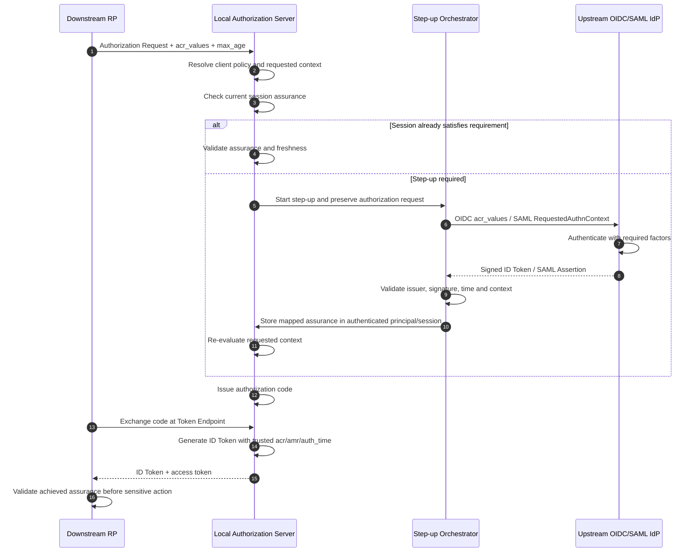

# Truyền mức độ xác thực và yêu cầu MFA theo ngữ cảnh

## 1. Bài toán: ứng dụng cần biết người dùng đã xác thực mạnh đến đâu

Một người dùng có thể đăng nhập vào hệ thống thông qua nhiều Identity Provider (IdP): tài khoản nội bộ, Microsoft Entra ID, một IdP SAML của đối tác hoặc một nhà cung cấp OpenID Connect (OIDC). Sau khi đăng nhập thành công, ứng dụng thường chỉ nhận được kết quả “đã xác thực”. Nhưng các nghiệp vụ nhạy cảm cần biết thêm:

- Người dùng đã dùng mật khẩu, OTP, khóa bảo mật hay sinh trắc học?
- Có thực sự dùng nhiều yếu tố độc lập hay chỉ đăng nhập lại bằng cùng một yếu tố?
- Lần xác thực gần nhất diễn ra lúc nào?
- IdP có đáp ứng yêu cầu MFA của ứng dụng hay chỉ tái sử dụng phiên SSO cũ?
- Authorization Server có thể phát hành ID Token thể hiện đúng mức assurance đã đạt được không?

Nếu chỉ kiểm tra người dùng đã đăng nhập, ứng dụng có thể cho phép thao tác rủi ro cao bằng một phiên SSO cũ chỉ xác thực bằng mật khẩu. Ngược lại, nếu luôn yêu cầu MFA cho mọi thao tác, trải nghiệm sẽ nặng nề và không phù hợp với mức rủi ro của từng giao dịch.

Giải pháp là truyền **Authentication Context** xuyên suốt chuỗi liên kết danh tính. Relying Party (RP) có thể yêu cầu một mức assurance hoặc phương thức xác thực cụ thể; IdP phải thực hiện xác thực phù hợp; Authorization Server kiểm tra kết quả, ánh xạ sang chính sách nội bộ rồi phát hành token với thông tin xác thực đã đạt được.

Bài này trình bày cách truyền yêu cầu assurance/MFA qua OIDC và SAML 2.0, cách nhận và xác minh kết quả từ IdP, cách ánh xạ sang chính sách nội bộ, và cách đưa kết quả vào ID Token trong Spring Authorization Server.

Bài thuộc chương **Liên kết danh tính** của module **SPRING_SECURITY_OAUTH2_OIDC_AUTHORIZATION_SERVER**. Mục tiêu tổng thể của module là **học cách thiết kế, cấu hình, bảo mật, kiểm thử và vận hành OAuth 2.0/OpenID Connect Authorization Server bằng Spring Security và Spring Authorization Server trong ứng dụng Spring Boot**.

### Mục tiêu học tập

Sau bài này, bạn có thể:

1. Phân biệt authentication method, authentication context và assurance level.
2. Giải thích ý nghĩa của OIDC acr, amr, auth_time, acr_values, claims và max_age.
3. Phân biệt yêu cầu xác thực lại với yêu cầu MFA thực sự.
4. Truyền RequestedAuthnContext và ForceAuthn trong SAML AuthnRequest.
5. Ánh xạ kết quả OIDC/SAML sang assurance policy nội bộ theo từng issuer.
6. Tùy biến Spring Security OAuth2 Login và SAML2 Login để yêu cầu context và đọc kết quả.
7. Dùng extension point của Spring Authorization Server để kiểm tra yêu cầu acr_values.
8. Đưa acr, amr và auth_time đã được xác minh vào ID Token.
9. Xử lý step-up authentication, phiên SSO cũ và yêu cầu không thể đáp ứng.
10. Kiểm thử mapping, freshness, MFA enforcement và các trường hợp IdP không đáng tin cậy.

> **Phạm vi phiên bản:** Ví dụ Spring sử dụng Spring Authorization Server 1.5.8 và Spring Security 6.5.x. API OpenSAML trong ví dụ SAML dùng dòng OpenSAML 4 được Spring Security 6.5 hỗ trợ. SPECIAL_NOTE của bài được giao để trống.

## 2. Các khái niệm cần phân biệt

### 2.1. Authentication method

Authentication method là cách người dùng chứng minh danh tính trong một lần xác thực, ví dụ:

- Password.
- One-Time Password (OTP) qua ứng dụng hoặc thiết bị.
- Push approval.
- Security key/WebAuthn.
- Smart card hoặc chứng thư số.
- Sinh trắc học.

Một phiên có thể sử dụng nhiều phương thức. Tuy nhiên, việc có hai bước tương tác không tự động chứng minh đó là MFA. Hai bước có thể cùng dựa trên một yếu tố, chẳng hạn mật khẩu và câu hỏi bí mật.

### 2.2. Authentication context

Authentication context mô tả bối cảnh hoặc loại xác thực mà IdP đã thực hiện. Context có thể bao gồm:

- Phương thức xác thực.
- Mức độ assurance mà IdP cam kết.
- Chính sách xác thực đã được áp dụng.
- Thời điểm xác thực.
- Các thuộc tính bổ sung theo profile hoặc thỏa thuận giữa các bên.

OIDC dùng claim acr để truyền Authentication Context Class Reference. SAML dùng AuthnContextClassRef hoặc AuthnContextDeclRef trong AuthnStatement.

### 2.3. Assurance level

Assurance level là mức tin cậy mà hệ thống gán cho kết quả xác thực dựa trên chính sách đã thống nhất. Ví dụ nội bộ:

| Mức | Ý nghĩa minh họa | Giao dịch phù hợp |
| --- | --- | --- |
| AAL1 | Một yếu tố hoặc phương thức cơ bản được chấp nhận | Xem thông tin phổ thông |
| AAL2 | Xác thực nhiều yếu tố theo policy | Xem dữ liệu cá nhân, cập nhật hồ sơ |
| AAL3 | Phương thức mạnh hơn, có ràng buộc thiết bị/khóa theo policy | Phê duyệt thanh toán hoặc thay đổi credential |

Các tên AAL1/AAL2/AAL3 trong bảng là nhãn policy minh họa. Nếu tổ chức áp dụng NIST SP 800-63, cần triển khai đúng yêu cầu của từng Authentication Assurance Level và mapping chính thức; không gán AAL chỉ dựa trên một chuỗi claim từ IdP.

### 2.4. acr khác amr

| Claim | Ý nghĩa | Câu hỏi được trả lời |
| --- | --- | --- |
| acr | Authentication Context Class Reference | Phiên xác thực đạt context/assurance nào? |
| amr | Authentication Methods References | Những phương thức nào đã được dùng? |
| auth_time | Thời điểm End-User được xác thực | Người dùng đã xác thực cách đây bao lâu? |
| iat | Thời điểm ID Token được phát hành | Token được phát hành lúc nào? |

acr là một chuỗi có ý nghĩa theo thỏa thuận giữa OP và RP; không có một thang số toàn cầu để so sánh mọi giá trị acr. amr là một JSON array chứa các method reference. RFC 8176 đăng ký các giá trị phổ biến như pwd, otp, mfa, hwk, fpt và face.

Không được suy ra acr mạnh chỉ vì amr có nhiều phần tử. Cũng không được suy ra MFA từ việc IdP trả về một claim tùy ý có tên mfa nếu issuer đó chưa được tin cậy và mapping chưa được xác minh.

## 3. OIDC truyền yêu cầu và kết quả assurance

OIDC định nghĩa các tham số và claims liên quan tới authentication context.

### 3.1. acr_values

acr_values là tham số tùy chọn trong Authentication Request. RP gửi một danh sách acr value, phân cách bằng dấu cách, theo thứ tự ưu tiên. OP được yêu cầu sử dụng một trong các context đó khi xử lý Authentication Request.

Ví dụ:

```http
GET /authorize?
  response_type=code&
  client_id=payments-web&
  scope=openid%20profile&
  redirect_uri=https%3A%2F%2Fpayments.example.com%2Fcallback&
  state=opaque-state&
  nonce=opaque-nonce&
  acr_values=urn%3Aexample%3Aassurance%3A2%20https%3A%2F%2Frefeds.org%2Fprofile%2Fmfa
```

RP ưu tiên context nội bộ urn:example:assurance:2 trước, sau đó chấp nhận profile MFA của REFEDS nếu OP và RP đã thống nhất mapping.

OIDC Core xem acr_values là cách yêu cầu voluntary claim. Nếu RP bắt buộc phải nhận một acr cụ thể, hãy dùng claims request parameter với essential=true và values phù hợp khi OP hỗ trợ claims parameter.

### 3.2. claims parameter để yêu cầu acr bắt buộc

Ví dụ request object:

```json
{
  "claims": {
    "id_token": {
      "acr": {
        "essential": true,
        "values": [
          "urn:example:assurance:2",
          "https://refeds.org/profile/mfa"
        ]
      }
    }
  }
}
```

Khi claims parameter được hỗ trợ và acr được yêu cầu là Essential Claim, OP phải trả về acr phù hợp với một trong các giá trị yêu cầu. OP có thể yêu cầu người dùng xác thực lại hoặc bổ sung yếu tố. Nếu không thể đáp ứng, OP phải coi authentication attempt là thất bại.

Không được âm thầm trả về acr yếu hơn rồi để RP tự đoán rằng yêu cầu đã được đáp ứng.

### 3.3. max_age và auth_time

max_age giới hạn thời gian tối đa kể từ lần End-User được xác thực. Nếu phiên hiện tại quá cũ, OP phải thực hiện lại authentication. Khi có max_age, ID Token cần chứa auth_time để RP kiểm tra freshness.

Ví dụ:

```http
GET /authorize?
  response_type=code&
  client_id=payments-web&
  scope=openid&
  max_age=300&
  acr_values=urn%3Aexample%3Aassurance%3A2
```

Yêu cầu này cần context assurance 2 và authentication time không cũ hơn 5 phút theo policy của RP.

auth_time khác iat. Nếu người dùng đăng nhập từ IdP lúc 09:00 nhưng OP phát ID Token lúc 11:00 do tái sử dụng SSO session, iat có thể là 11:00 trong khi auth_time vẫn là 09:00.

### 3.4. prompt=login không đồng nghĩa MFA

prompt=login yêu cầu OP hiển thị giao diện xác thực hoặc thực hiện re-authentication theo khả năng của OP. Nó không chỉ định yếu tố nào phải được sử dụng.

Ví dụ:

```http
GET /authorize?
  response_type=code&
  client_id=payments-web&
  scope=openid&
  prompt=login
```

Người dùng có thể nhập lại cùng mật khẩu. Nếu RP cần MFA, phải yêu cầu acr context phù hợp và xác minh kết quả.

### 3.5. Quy tắc xử lý ở RP

RP nên:

1. Gửi acr_values theo policy nghiệp vụ.
2. Dùng claims.acr essential khi cần một context bắt buộc và OP hỗ trợ.
3. Dùng max_age khi cần xác thực gần đây.
4. Xác minh chữ ký, issuer, audience, nonce, exp và các claim ID Token theo OIDC.
5. Kiểm tra auth_time khi đã gửi max_age.
6. Kiểm tra acr được trả về có nằm trong tập giá trị chấp nhận.
7. Không coi prompt=login là bằng chứng MFA.

## 4. SAML truyền yêu cầu và kết quả assurance

Trong SAML 2.0, Authentication Request có thể chứa RequestedAuthnContext. Assertion trả về chứa AuthnStatement với AuthnContext và AuthnInstant.

### 4.1. RequestedAuthnContext

RequestedAuthnContext chỉ định các lớp hoặc khai báo authentication context mà Service Provider muốn IdP đáp ứng.

Ví dụ XML:

```xml
<samlp:AuthnRequest
    xmlns:samlp="urn:oasis:names:tc:SAML:2.0:protocol"
    xmlns:saml="urn:oasis:names:tc:SAML:2.0:assertion"
    ID="_request123"
    Version="2.0"
    IssueInstant="2026-11-16T10:00:00Z">
  <samlp:RequestedAuthnContext Comparison="exact">
    <saml:AuthnContextClassRef>
      https://refeds.org/profile/mfa
    </saml:AuthnContextClassRef>
  </samlp:RequestedAuthnContext>
</samlp:AuthnRequest>
```

URI trong ví dụ là profile MFA của REFEDS. Chỉ dùng khi IdP và SP cùng hỗ trợ profile đó; nhiều IdP chỉ hỗ trợ một tập AuthnContextClassRef riêng.

### 4.2. Comparison

SAML 2.0 định nghĩa bốn giá trị:

| Comparison | Ý nghĩa |
| --- | --- |
| exact | Kết quả phải khớp chính xác ít nhất một context được yêu cầu |
| minimum | Kết quả phải mạnh ít nhất bằng một context được yêu cầu, theo đánh giá của responder |
| better | Kết quả phải mạnh hơn context được yêu cầu theo quy tắc của responder |
| maximum | Chọn context mạnh nhất có thể nhưng không vượt quá một context được yêu cầu |

Nếu bỏ qua Comparison, giá trị mặc định là exact. Trong thực tế federation, exact thường dễ dự đoán hơn. minimum/better/maximum phụ thuộc cách IdP đánh giá thứ tự mạnh/yếu; không phải mọi IdP đều triển khai giống nhau.

### 4.3. ForceAuthn

ForceAuthn=true yêu cầu IdP xác thực lại người dùng thay vì chỉ dựa vào phiên hiện có. Tuy nhiên, nó không bắt buộc IdP phải dùng MFA. Nếu cần MFA, hãy gửi RequestedAuthnContext phù hợp và kiểm tra context thực tế trong assertion.

### 4.4. AuthnStatement trong assertion

Một SAML Assertion có thể chứa AuthnStatement:

```xml
<saml:AuthnStatement
    AuthnInstant="2026-11-16T09:58:00Z"
    SessionIndex="_session-abc">
  <saml:AuthnContext>
    <saml:AuthnContextClassRef>
      https://refeds.org/profile/mfa
    </saml:AuthnContextClassRef>
  </saml:AuthnContext>
</saml:AuthnStatement>
```

RP đọc AuthnContextClassRef để xác định context đã đạt và AuthnInstant để xác định thời điểm xác thực. Không lấy SessionNotOnOrAfter thay cho AuthnInstant: một trường biểu diễn hạn phiên, trường còn lại biểu diễn thời điểm authentication.

## 5. Xây dựng assurance mapping giữa các IdP

Mỗi IdP có thể dùng URI, claim hoặc cách diễn giải khác nhau. Không có phép ánh xạ tự động từ mọi SAML AuthnContextClassRef sang OIDC acr hoặc từ amr sang AAL.

Authorization Server nên có một **assurance policy registry** được quản trị theo issuer.

### 5.1. Bảng mapping minh họa

| Issuer/protocol | Giá trị IdP trả về | Mapping nội bộ | Ghi chú |
| --- | --- | --- | --- |
| OIDC corporate IdP | acr=urn:corp:loa:1 | LOCAL_AAL1 | Chỉ được tin với issuer đã allowlist |
| OIDC corporate IdP | acr=https://refeds.org/profile/mfa | LOCAL_MFA | Kiểm tra profile và policy của issuer |
| OIDC IdP | amr=[pwd, otp] | LOCAL_MFA | Chỉ khi issuer cam kết cả hai phương thức đã được xác minh |
| SAML partner IdP | PasswordProtectedTransport | LOCAL_AAL1 | Không suy ra MFA |
| SAML partner IdP | MobileTwoFactorContract | LOCAL_MFA | Cần xác nhận semantics với IdP |
| SAML partner IdP | https://refeds.org/profile/mfa | LOCAL_MFA | Khi hai bên triển khai REFEDS MFA profile |

Các giá trị trong bảng là ví dụ để thiết kế mapping. Không coi URI hoặc amr value có tên giống nhau là cùng mức assurance nếu chưa có trust agreement.

### 5.2. Mapping phải gắn với issuer

Không ánh xạ acr chỉ bằng chuỗi giá trị. Cùng một acr string có thể mang ý nghĩa khác nhau ở hai issuer.

Một policy record nên có:

- Issuer identifier đã xác minh.
- Protocol OIDC hoặc SAML.
- ACR URI hoặc SAML AuthnContextClassRef.
- AMR allowlist nếu có.
- Assurance level nội bộ.
- Thời hạn freshness tối đa.
- Policy về phishing resistance hoặc hardware-bound factor nếu cần.
- Version và thời điểm policy có hiệu lực.

### 5.3. Không nâng assurance từ dữ liệu không đáng tin

Các trường hợp sau phải bị từ chối hoặc hạ xuống mức chưa xác minh:

- ID Token chưa xác minh chữ ký/issuer/audience.
- SAML assertion chưa xác minh signature, issuer, audience, recipient và thời hạn.
- Issuer không có trong registry.
- acr không nằm trong mapping đã phê duyệt.
- amr chứa giá trị không được tin cậy.
- auth_time thiếu hoặc quá cũ trong khi policy yêu cầu freshness.
- IdP trả về MFA claim nhưng hợp đồng không định nghĩa phương thức hoặc tiêu chí MFA.

### 5.4. MFA phải có ý nghĩa chính sách rõ ràng

MFA là kết quả của việc kết hợp các yếu tố độc lập theo policy. Không được coi hai phương thức cùng thuộc một yếu tố là MFA. Ví dụ password và PIN đều có thể là yếu tố knowledge.

Khi cần phishing-resistant MFA, policy phải xác định rõ phương thức được chấp nhận như WebAuthn/FIDO2 hoặc hardware-backed key. Không suy luận phishing resistance từ acr chung nếu issuer không có cam kết về profile đó.

## 6. Mô hình liên kết danh tính end-to-end

Trong mô hình này, ứng dụng sử dụng Spring Authorization Server làm OP nội bộ. Người dùng được xác thực thông qua upstream OIDC hoặc SAML IdP.



Các nguyên tắc:

1. RP yêu cầu mức assurance phù hợp với hành động.
2. Local AS kiểm tra client có được phép yêu cầu context đó không.
3. Nếu session chưa đủ mạnh hoặc quá cũ, step-up orchestrator bắt đầu xác thực bổ sung.
4. Upstream IdP trả kết quả đã ký.
5. Local AS xác minh và ánh xạ kết quả theo issuer-specific policy.
6. Local AS chỉ phát hành authorization code/token khi assurance đáp ứng yêu cầu.
7. ID Token thể hiện context thực tế đã đạt, không echo nguyên văn yêu cầu của RP.

## 7. Spring Security OAuth2 Login: gửi yêu cầu assurance tới OIDC IdP

Spring Security OAuth2 Login cho phép tùy biến Authorization Request bằng OAuth2AuthorizationRequestResolver. Có thể thêm các tham số OIDC như acr_values, max_age hoặc prompt.

### 7.1. Resolver cho yêu cầu MFA cố định

Ví dụ cấu hình một upstream provider luôn yêu cầu profile MFA:

```java
@Bean
OAuth2AuthorizationRequestResolver authorizationRequestResolver(
        ClientRegistrationRepository registrations) {

    DefaultOAuth2AuthorizationRequestResolver resolver =
            new DefaultOAuth2AuthorizationRequestResolver(
                    registrations, "/oauth2/authorization");

    resolver.setAuthorizationRequestCustomizer(builder ->
            builder.additionalParameters(parameters -> {
                parameters.put(
                        "acr_values",
                        "https://refeds.org/profile/mfa");
                parameters.put("max_age", 300);
            }));

    return resolver;
}
```

Gắn resolver vào oauth2Login:

```java
@Bean
SecurityFilterChain applicationSecurity(HttpSecurity http,
        OAuth2AuthorizationRequestResolver authorizationRequestResolver)
        throws Exception {

    http
        .authorizeHttpRequests(authorize ->
            authorize.anyRequest().authenticated())
        .oauth2Login(oauth2 ->
            oauth2.authorizationEndpoint(endpoint ->
                endpoint.authorizationRequestResolver(
                        authorizationRequestResolver)));

    return http.build();
}
```

Đoạn code trên áp dụng cho mọi ClientRegistration đi qua resolver này. Nếu ứng dụng có nhiều IdP với policy khác nhau, hãy dùng resolver riêng cho từng provider hoặc bọc resolver để kiểm tra registrationId trước khi thêm tham số. Với step-up động, resolver wrapper đọc yêu cầu từ route hoặc server-side context và chỉ thêm acr_values đã được allowlist. Không lấy chuỗi acr_values tùy ý từ query parameter của browser rồi chuyển thẳng tới IdP.

### 7.2. Yêu cầu động theo giao dịch

Ví dụ policy:

| Hành động | Yêu cầu |
| --- | --- |
| Đăng nhập portal | Không yêu cầu acr cụ thể |
| Xem dữ liệu cá nhân | LOCAL_AAL1 và auth_time trong 30 phút |
| Đổi thông tin thanh toán | LOCAL_MFA và auth_time trong 5 phút |
| Thay đổi recovery method | Phishing-resistant MFA theo policy |

Backend xác định policy từ hành động nghiệp vụ và lưu step-up request trong session/server-side state. Resolver chỉ sử dụng context đó để tạo Authorization Request. Hãy ràng buộc state với session, nonce và transaction ID để tránh request substitution.

### 7.3. Không dùng prompt=login thay cho acr_values

Có thể thêm prompt=login nếu muốn IdP yêu cầu xác thực lại:

```java
builder.additionalParameters(parameters -> {
    parameters.put("prompt", "login");
    parameters.put("acr_values", "urn:example:assurance:2");
});
```

prompt=login yêu cầu đăng nhập lại; acr_values yêu cầu context. Khi cần MFA, cần cả policy yêu cầu context và kiểm tra kết quả trả về.

## 8. Nhận assurance từ OIDC IdP

Spring Security OIDC Login xác minh ID Token trước khi gọi OidcUserService. OidcUser chứa claims từ ID Token và có thể có thêm UserInfo claims.

### 8.1. Đọc claim từ ID Token đã xác minh

Một custom OidcUserService có thể gọi delegate mặc định, sau đó chuyển các claim đã xác minh thành một domain object riêng:

```java
@Bean
OAuth2UserService<OidcUserRequest, OidcUser> oidcUserService(
        AssuranceMappingService mappingService) {

    OidcUserService delegate = new OidcUserService();

    return request -> {
        OidcUser user = delegate.loadUser(request);

        String issuer = request.getClientRegistration()
                .getProviderDetails().getIssuerUri();

        Map<String, Object> claims = user.getIdToken().getClaims();
        AssuranceContext assurance =
                mappingService.fromOidc(issuer, claims);

        return new AssuranceAwareOidcUser(user, assurance);
    };
}
```

AssuranceAwareOidcUser là wrapper do ứng dụng định nghĩa, triển khai OidcUser và delegate các method như getIdToken(), getUserInfo(), getClaims(), getAuthorities() và getName(). Wrapper giữ thêm AssuranceContext đã được mapping.

Không lấy acr từ UserInfo response để ghi đè kết quả trong ID Token nếu policy không cho phép. Authentication context cần được ràng buộc với lần xác thực, không chỉ là thuộc tính hồ sơ người dùng.

### 8.2. Domain model nội bộ

Ví dụ:

```java
public record AssuranceContext(
        String issuer,
        String acr,
        List<String> amr,
        Instant authTime,
        String localLevel,
        boolean phishingResistant,
        Instant verifiedAt) {
}
```

Domain object lưu cả giá trị gốc từ issuer và kết quả mapping nội bộ. Điều này giúp audit, điều tra sự cố và thay đổi mapping policy mà không làm mất provenance.

### 8.3. Mapping service phải kiểm tra đầy đủ

Phác thảo:

```java
AssuranceContext fromOidc(String issuer, Map<String, Object> claims) {
    String acr = (String) claims.get("acr");
    List<String> amr = readStringList(claims.get("amr"));
    Instant authTime = readInstant(claims.get("auth_time"));

    TrustedIssuerPolicy policy = issuerRegistry.requireTrusted(issuer);
    AssuranceRule rule = policy.requireOidcRule(acr, amr);

    if (authTime == null) {
        throw new UntrustedAuthenticationContextException(
                "auth_time is required by this policy");
    }

    rule.validateMethods(amr);
    return new AssuranceContext(
            issuer, acr, amr, authTime, rule.localLevel(),
            rule.phishingResistant(), Instant.now());
}
```

Đây là pseudocode minh họa. readStringList và readInstant phải xử lý type conversion nghiêm ngặt. Không ép kiểu tùy tiện hoặc mặc định auth_time về thời điểm hiện tại khi claim bị thiếu.

## 9. Spring Security SAML2 Login: yêu cầu AuthnContext

Spring Security 6.5 hỗ trợ tùy biến OpenSAML AuthnRequest thông qua OpenSaml4AuthenticationRequestResolver.

### 9.1. Gửi RequestedAuthnContext

Ví dụ skeleton:

```java
@Bean
Saml2AuthenticationRequestResolver samlAuthenticationRequestResolver(
        RelyingPartyRegistrationRepository registrations) {

    RelyingPartyRegistrationResolver registrationResolver =
            new DefaultRelyingPartyRegistrationResolver(registrations);

    OpenSaml4AuthenticationRequestResolver resolver =
            new OpenSaml4AuthenticationRequestResolver(registrationResolver);

    resolver.setAuthnRequestCustomizer(context -> {
        AuthnRequest request = context.getAuthnRequest();
        request.setForceAuthn(true);

        RequestedAuthnContext requested =
                buildRequestedAuthnContext(
                        "https://refeds.org/profile/mfa");
        request.setRequestedAuthnContext(requested);
    });

    return resolver;
}
```

Hàm buildRequestedAuthnContext minh họa cách tạo OpenSAML object:

```java
RequestedAuthnContext buildRequestedAuthnContext(String classRefValue) {
    XMLObjectBuilderFactory builders =
            XMLObjectProviderRegistrySupport.getBuilderFactory();

    RequestedAuthnContext requested =
            (RequestedAuthnContext) builders
                    .getBuilder(RequestedAuthnContext.DEFAULT_ELEMENT_NAME)
                    .buildObject(RequestedAuthnContext.DEFAULT_ELEMENT_NAME);

    AuthnContextClassRef classRef =
            (AuthnContextClassRef) builders
                    .getBuilder(AuthnContextClassRef.DEFAULT_ELEMENT_NAME)
                    .buildObject(AuthnContextClassRef.DEFAULT_ELEMENT_NAME);

    classRef.setURI(classRefValue);
    requested.getAuthnContextClassRefs().add(classRef);
    requested.setComparison(AuthnContextComparisonTypeEnumeration.EXACT);
    return requested;
}
```

Đây là ví dụ OpenSAML 4. Kiểm tra package/API theo dependency OpenSAML được Spring Security 6.5 quản lý. Nếu IdP không hỗ trợ REFEDS MFA URI, dùng URI đã được IdP công bố và hai bên thống nhất.

Gắn resolver vào saml2Login:

```java
@Bean
SecurityFilterChain samlSecurity(HttpSecurity http,
        Saml2AuthenticationRequestResolver resolver) throws Exception {

    http
        .authorizeHttpRequests(authorize ->
            authorize.anyRequest().authenticated())
        .saml2Login(saml ->
            saml.authenticationRequestResolver(resolver));

    return http.build();
}
```

### 9.2. Không dùng ForceAuthn như bằng chứng MFA

ForceAuthn=true yêu cầu IdP xác thực lại. Người dùng vẫn có thể chỉ nhập lại mật khẩu. RequestedAuthnContext mới là phần biểu đạt context cần đạt; response assertion phải được kiểm tra để xác nhận IdP đã đáp ứng.

### 9.3. Nhận AuthnContext và AuthnInstant từ assertion

Spring Security cho phép thay ResponseAuthenticationConverter của OpenSaml4AuthenticationProvider. Converter mặc định xử lý assertion và tạo Saml2Authentication; ứng dụng có thể đọc AuthnStatement đã được xác minh để tạo AssuranceContext.

Phác thảo:

```java
OpenSaml4AuthenticationProvider provider =
        new OpenSaml4AuthenticationProvider();

provider.setResponseAuthenticationConverter(responseToken -> {
    Saml2Authentication authentication =
            OpenSaml4AuthenticationProvider
                    .createDefaultResponseAuthenticationConverter()
                    .convert(responseToken);

    Assertion assertion =
            responseToken.getResponse().getAssertions().get(0);

    AuthnStatement statement = assertion.getAuthnStatements().stream()
            .findFirst()
            .orElseThrow(() ->
                    new UntrustedAuthenticationContextException(
                            "AuthnStatement is missing"));

    String classRef = statement.getAuthnContext()
            .getAuthnContextClassRef().getURI();
    Instant authnInstant = statement.getAuthnInstant();

    AssuranceContext assurance =
            assuranceMappingService.fromSaml(
                    trustedIssuerFor(responseToken),
                    classRef,
                    authnInstant);

    return new AssuranceAwareSaml2Authentication(
            authentication, assurance);
});
```

Đây là pseudocode ở phần wrapper và cách resolve issuer; dùng API registration/response thực tế của ứng dụng để lấy issuer đã xác minh. Nếu assertion có nhiều AuthnStatement, phải áp dụng policy chọn statement phù hợp và không tự lấy statement đầu tiên mà không xem xét semantics.

Không thay thế response/assertion validator mặc định bằng converter tùy chỉnh. Converter nên chạy sau xác minh chữ ký, issuer, audience, destination, subject confirmation, thời hạn và InResponseTo. Giữ default validation rồi bổ sung kiểm tra assurance.

## 10. Tích hợp với Spring Authorization Server

Spring Authorization Server đóng vai trò OP nội bộ trong mô hình federation. Nó cần làm ba việc:

1. Nhận yêu cầu assurance từ downstream RP.
2. Kiểm tra session hiện tại hoặc yêu cầu step-up.
3. Phát hành ID Token với acr, amr và auth_time phản ánh kết quả thực tế.

### 10.1. Authorization Endpoint có extension point để kiểm tra request

OAuth2AuthorizationEndpointConfigurer cho phép tùy biến Authorization Request Converter và AuthenticationProvider. OAuth2AuthorizationCodeRequestAuthenticationProvider có setAuthenticationValidator(...) để kiểm tra request parameters.

Validator mặc định của SAS 1.5.8 kiểm tra redirect_uri và scope. Khi bổ sung kiểm tra acr_values, cần giữ lại cả hai validator mặc định.

### 10.2. Kiểm tra acr_values theo policy

Ví dụ skeleton:

```java
Consumer<OAuth2AuthorizationCodeRequestAuthenticationContext>
        assuranceValidator = context -> {

    OAuth2AuthorizationCodeRequestAuthenticationValidator
            .DEFAULT_REDIRECT_URI_VALIDATOR.accept(context);
    OAuth2AuthorizationCodeRequestAuthenticationValidator
            .DEFAULT_SCOPE_VALIDATOR.accept(context);

    OAuth2AuthorizationCodeRequestAuthenticationToken request =
            context.getAuthentication();

    Object rawAcrValues =
            request.getAdditionalParameters().get("acr_values");

    List<String> requestedAcrValues =
            parseAndValidateAcrValues(rawAcrValues);

    clientAssurancePolicy.validateRequestedContexts(
            context.getRegisteredClient(), requestedAcrValues);

    AssuranceContext current =
            assuranceService.requireFor(request.getPrincipal());

    if (!assurancePolicy.satisfies(current, requestedAcrValues)) {
        throw new OAuth2AuthorizationCodeRequestAuthenticationException(
                new OAuth2Error("login_required",
                        "Required authentication context has not been met",
                        null),
                null);
    }

    Object rawMaxAge = request.getAdditionalParameters().get("max_age");
    if (rawMaxAge != null) {
        Duration maxAge = parseNonNegativeSeconds(rawMaxAge);
        if (!assurancePolicy.isFresh(
                current.authTime(), maxAge, clock.instant())) {
            throw new OAuth2AuthorizationCodeRequestAuthenticationException(
                    new OAuth2Error("login_required",
                            "Authentication context is too old",
                            null),
                    request);
        }
    }
};
```

Đây là pseudocode. Request converter của phiên bản SAS cần giữ acr_values trong additionalParameters; hãy kiểm tra điều đó bằng integration test. Nếu converter không giữ tham số cần thiết, thêm AuthenticationConverter tùy chỉnh để bảo toàn tham số theo đúng protocol.

Client assurance policy phải giới hạn những context mà từng client được phép yêu cầu. Nếu hỗ trợ claims request parameter, hãy phân tích claims.acr và essential/value(s) theo OIDC Core; không giả định converter mặc định đã parse hoặc enforce claims JSON. Với claims.acr essential, chỉ tiếp tục khi kết quả đạt một giá trị được yêu cầu. max_age cũng cần được xử lý rõ ràng như freshness requirement; không chỉ dựa vào acr.

Gắn validator vào provider mặc định:

```java
authorizationServer.authorizationEndpoint(endpoint ->
    endpoint.authenticationProviders(providers ->
        providers.forEach(provider -> {
            if (provider instanceof
                    OAuth2AuthorizationCodeRequestAuthenticationProvider codeProvider) {
                codeProvider.setAuthenticationValidator(assuranceValidator);
            }
        })
    )
);
```

Không thay toàn bộ validator bằng assuranceValidator nếu quên redirect_uri hoặc scope validator. Một lỗi cấu hình có thể làm suy yếu các kiểm tra protocol mặc định.

### 10.3. Step-up orchestration diễn ra trước khi cấp authorization code

Validator là hàng rào cuối cùng. Nếu session hiện tại chưa đủ mạnh, ứng dụng cần một step-up flow:

1. Giữ authorization request ban đầu trong session/server-side state.
2. Resolve yêu cầu acr_values theo policy của client.
3. Chuyển người dùng tới upstream OIDC/SAML IdP hoặc local MFA endpoint.
4. Sau khi xác thực thành công, validate response và cập nhật AssuranceContext trong principal/session.
5. Khôi phục authorization request ban đầu.
6. Chạy lại authorization flow và validator.
7. Chỉ cấp authorization code khi assurance đã đáp ứng.

Không tin một query parameter như step_up=done do browser gửi. Trạng thái hoàn tất phải đến từ kết quả authentication đã được xác minh và gắn với đúng session, user, issuer, thời điểm và request transaction.

### 10.4. Yêu cầu không được hỗ trợ

Nếu IdP không thể đáp ứng context bắt buộc:

- Không phát hành authorization code hoặc token với acr yếu hơn.
- Trả lỗi authentication/authorization phù hợp với OIDC flow.
- Có thể hiển thị trang giải thích hoặc yêu cầu dùng phương thức đăng nhập khác.
- Ghi audit event mà không lưu raw token/assertion.

## 11. Đưa acr, amr và auth_time vào ID Token

Spring Authorization Server hỗ trợ OAuth2TokenCustomizer<JwtEncodingContext> để tùy biến JWT claims. Một bean customizer có thể thêm claims cho ID Token bằng cách kiểm tra token type.

Ví dụ:

```java
@Bean
OAuth2TokenCustomizer<JwtEncodingContext> assuranceIdTokenCustomizer() {
    return context -> {
        if (!OidcParameterNames.ID_TOKEN.equals(
                context.getTokenType().getValue())) {
            return;
        }

        Object principal = context.getPrincipal().getPrincipal();
        if (!(principal instanceof AssuranceAwarePrincipal assured)) {
            throw new IllegalStateException(
                    "Verified authentication context is required");
        }

        AssuranceContext assurance = assured.getAssuranceContext();

        context.getClaims().claims(claims -> {
            claims.put("acr", assurance.acr());
            claims.put("amr", assurance.amr());
            claims.put("auth_time", assurance.authTime().getEpochSecond());
        });
    };
}
```

AssuranceAwarePrincipal là interface nội bộ do ứng dụng định nghĩa. Nếu authentication flow có principal khác nhau giữa local login, OIDC federation và SAML federation, hãy dùng một abstraction chung để cung cấp AssuranceContext.

### 11.1. Chỉ phát hành giá trị đã được xác minh

Không ghi trực tiếp giá trị acr_values từ authorization request vào ID Token. acr_values là yêu cầu của RP, không phải kết quả authentication. ID Token phải chứa acr mà Authorization Server xác định từ assurance thực tế đã đạt.

Tương tự, không lấy amr từ query parameter hoặc client-provided header. amr phải đến từ ID Token/assertion đã xác minh và được mapping theo issuer policy.

### 11.2. Một OAuth2TokenCustomizer cho nhiều loại JWT

Spring Authorization Server tự động cấu hình JwtGenerator khi không có token generator tùy chỉnh. Nếu ứng dụng có một OAuth2TokenCustomizer<JwtEncodingContext> khác để thêm claims access token, hãy hợp nhất logic vào một bean và phân nhánh theo token type. Không đăng ký nhiều bean cùng generic type rồi kỳ vọng chúng tự cộng dồn.

### 11.3. Access Token có cần acr/amr không?

Nếu Resource Server cần biết mức assurance để quyết định truy cập, có thể thêm acr/amr vào JWT access token hoặc dùng một claim assurance riêng. Chỉ thêm các claims cần thiết cho API và thống nhất contract với Resource Server.

Nếu access token là opaque/reference token, dùng OAuth2TokenCustomizer<OAuth2TokenClaimsContext> hoặc lưu assurance trong authorization metadata để introspection trả về. Không giả định customizer JWT tự áp dụng cho opaque token.

## 12. Kiểm tra freshness và step-up theo thời gian

Một session có thể từng đạt MFA nhưng đã quá cũ. Policy cần xét cả mức assurance lẫn thời điểm xác thực.

Ví dụ:

```java
boolean satisfies(
        AssuranceContext context,
        String requiredLevel,
        Duration maxAge,
        Instant now) {

    return assurancePolicy.atLeast(
                    context.localLevel(), requiredLevel)
            && context.authTime() != null
            && !context.authTime().isBefore(now.minus(maxAge))
            && !context.authTime().isAfter(now.plus(clockSkew));
}
```

Đây là pseudocode. Clock skew phải được giới hạn; không chấp nhận auth_time trong tương lai quá ngưỡng. Không dùng verifiedAt hoặc ID Token iat thay cho auth_time.

### 12.1. MFA cũ không tự động thỏa MFA mới

Ví dụ người dùng đã MFA lúc 08:00, nhưng 14:00 thực hiện thay đổi recovery phone. Nếu policy yêu cầu MFA trong 5 phút gần nhất, session cũ không đáp ứng dù acr trước đó là MFA.

### 12.2. Session SSO upstream có thể cũ hơn session local

Người dùng có thể đăng nhập local AS lúc 14:00 bằng một upstream SSO session được xác thực lúc 08:00. Local login time không thay thế auth_time của upstream authentication. Khi federation, giữ nguyên authentication time từ IdP và áp dụng freshness policy.

## 13. OIDC và SAML không có cùng semantics ở mọi IdP

Một số khác biệt cần lưu ý:

| Chủ đề | OIDC | SAML 2.0 |
| --- | --- | --- |
| Yêu cầu context | acr_values hoặc claims.acr | RequestedAuthnContext |
| Buộc xác thực lại | prompt=login; max_age | ForceAuthn |
| Kết quả context | ID Token acr | AuthnStatement/AuthnContextClassRef |
| Phương thức | ID Token amr | Thường cần mapping theo AuthnContext/attributes hoặc agreement |
| Thời điểm | auth_time | AuthnInstant |
| Freshness | max_age | SP kiểm tra AuthnInstant theo policy |
| Mức so sánh | acr_values là danh sách ưu tiên | exact/minimum/maximum/better |

Không ánh xạ một cách máy móc:

- prompt=login sang ForceAuthn=true rồi kết luận đã MFA.
- acr_values sang RequestedAuthnContext mà không kiểm tra URI tương thích.
- SAML AuthnContextClassRef sang amr.
- amr=[pwd, otp] sang một AAL chính thức nếu chưa có policy.

## 14. Step-up challenge từ Resource Server theo RFC 9470

RFC 9470 định nghĩa OAuth 2.0 Step Up Authentication Challenge Protocol. Khi access token không đạt authentication requirement, Resource Server có thể trả WWW-Authenticate với error insufficient_user_authentication và acr_values mô tả context cần thiết.

Ví dụ response:

```http
HTTP/1.1 401 Unauthorized
WWW-Authenticate: Bearer error="insufficient_user_authentication",
  acr_values="urn:example:assurance:2"
```

OAuth Client đọc challenge, bắt đầu một Authorization Request mới tới OP với acr_values được yêu cầu. OP kiểm tra session hiện tại, thực hiện step-up nếu cần và phát hành token mới sau khi assurance đạt yêu cầu.

Resource Server vẫn phải kiểm tra access token và policy của chính nó. Việc nhận claim acr không thay thế authorization theo scope, audience, tenant hoặc resource permission.

## 15. Bảo mật trust boundary trong federation

Authentication context là dữ liệu bảo mật quan trọng. Sai mapping có thể khiến một phiên password-only bị coi là MFA.

### 15.1. OIDC validation

Trước khi tin acr/amr/auth_time:

- Xác minh chữ ký ID Token theo JWKS và thuật toán được tin cậy.
- Kiểm tra iss khớp issuer đã đăng ký.
- Kiểm tra aud và azp khi cần.
- Kiểm tra exp, iat, nonce và các điều kiện OIDC.
- Kiểm tra auth_time nếu có max_age.
- Áp dụng allowlist issuer và mapping version.

Không nhận token từ issuer tự do chỉ vì JWT parse thành công.

### 15.2. SAML validation

Trước khi tin AuthnContext:

- Xác minh chữ ký Response/Assertion theo metadata và trust configuration.
- Kiểm tra Issuer, Destination, Recipient và AudienceRestriction.
- Kiểm tra InResponseTo và SubjectConfirmation.
- Kiểm tra NotBefore/NotOnOrAfter với clock skew giới hạn.
- Chống assertion replay.
- Kiểm tra AuthnStatement và AuthnInstant.

Giữ default validation của Spring Security/OpenSAML và chỉ bổ sung validator. Không tắt kiểm tra InResponseTo, audience hoặc subject confirmation để giải quyết lỗi tích hợp.

### 15.3. Không nhận MFA qua header do proxy không tin cậy

Không cho phép browser gửi X-Authenticated-MFA: true hoặc X-User-ACR rồi để Authorization Server tin trực tiếp. Nếu dùng trusted proxy/header, proxy phải xóa header từ client bên ngoài, xác thực nguồn, bảo vệ hop và chỉ truyền dữ liệu được ký hoặc bảo đảm bởi mTLS.

### 15.4. Bảo vệ provenance và audit

Lưu các thuộc tính:

- Subject nội bộ.
- Issuer đã xác minh.
- ACR gốc và local assurance level.
- AMR gốc.
- Authentication time.
- Policy mapping version.
- Thời điểm xác minh và correlation ID.

Không log raw ID Token, SAML assertion, OTP, password hoặc secret. Audit nên cho biết vì sao một request được nâng assurance mà không lưu credential.

## 16. Ma trận kiểm thử assurance và MFA

| Ca kiểm thử | Đầu vào | Kết quả mong đợi |
| --- | --- | --- |
| OIDC ACR tin cậy | Issuer allowlist, acr mapped | Tạo AssuranceContext đúng |
| OIDC issuer lạ | Issuer không có mapping | Không nâng assurance |
| OIDC acr không biết | ACR không có trong registry | Từ chối hoặc hạ về unverified |
| OIDC AMR pwd | Chỉ password | Không thỏa MFA |
| OIDC AMR pwd + otp | Issuer được tin cậy, policy đã thống nhất | Có thể map LOCAL_MFA |
| AMR claim thiếu | Không có amr | Không tự suy ra MFA |
| ACR yêu cầu essential | OP trả ACR khác | Authentication thất bại |
| ACR voluntary | OP không hỗ trợ giá trị | RP áp dụng policy fallback rõ ràng |
| max_age hợp lệ | auth_time còn mới | Đạt freshness |
| max_age hết hạn | auth_time quá cũ | Step-up/re-authentication |
| auth_time thiếu | Request yêu cầu max_age | Không chấp nhận như mới xác thực |
| auth_time tương lai | Timestamp vượt clock skew | Từ chối |
| prompt=login | OP yêu cầu login lại nhưng chỉ dùng password | Không coi là MFA |
| SAML RequestedAuthnContext exact | Assertion trả đúng class | Đạt context nếu issuer trusted |
| SAML context yếu hơn | Assertion trả PasswordProtectedTransport | Không thỏa MFA |
| SAML ForceAuthn | IdP xác thực lại nhưng không MFA | Không thỏa MFA |
| SAML AuthnInstant cũ | Assertion có AuthnInstant quá cũ | Step-up theo freshness policy |
| SAML assertion replay | Assertion đã dùng | Từ chối |
| SAML issuer lạ | Issuer không được tin cậy | Từ chối |
| Mapping đổi version | Session context dùng mapping cũ | Re-evaluate hoặc hết hạn theo policy |
| SAS acr_values hợp lệ | Client được phép yêu cầu, session đủ assurance | Authorization code được cấp |
| SAS acr_values không hỗ trợ | Giá trị không có mapping | Trả lỗi, không cấp code |
| Session thiếu assurance | Request cần MFA | Step-up trước khi tiếp tục |
| Step-up thất bại | IdP không đáp ứng | Không cấp code/token |
| Client yêu cầu ACR yếu | Client không được policy cho phép | Từ chối hoặc áp dụng mức tối thiểu theo client policy |
| ID Token customizer | Principal có AssuranceContext tin cậy | ID Token có acr/amr/auth_time |
| ID Token principal thiếu context | Không có AssuranceContext | Không phát token với claim giả |
| Client token refresh | Refresh authorization cũ | Không tự nâng acr nếu chưa có authentication event mới |
| Access token opaque | Resource Server introspects | Assurance được lấy từ metadata/introspection nếu policy yêu cầu |
| WWW-Authenticate step-up | Resource yêu cầu acr mạnh hơn | Client bắt đầu authorization flow mới |
| Header giả mạo | Browser tự gửi MFA header | Không được tin |
| Multi-issuer | Hai IdP dùng cùng acr string khác nghĩa | Mapping riêng theo issuer |

### 16.1. Test mapping độc lập

Viết unit test cho AssuranceMappingService:

```java
assertThat(mappingService.fromOidc(
        TRUSTED_ISSUER,
        Map.of(
                "acr", "https://refeds.org/profile/mfa",
                "amr", List.of("pwd", "otp"),
                "auth_time", AUTH_TIME)))
    .extracting(AssuranceContext::localLevel)
    .isEqualTo("LOCAL_MFA");
```

Đây là pseudocode. Bổ sung test issuer lạ, acr lạ, amr thiếu, auth_time thiếu và timestamp ngoài freshness window.

### 16.2. Test Authorization Server end-to-end

Integration test cần chứng minh:

1. Authorization Request có acr_values được parse và giữ lại.
2. Client policy xác định context tối thiểu.
3. Session chưa đạt context bị chuyển qua step-up.
4. Upstream result được validate và map.
5. Authorization request được khôi phục mà không mất state/nonce.
6. Authorization code chỉ được cấp khi context đạt.
7. ID Token trả acr/amr/auth_time đã xác minh.
8. Nếu IdP trả context yếu hơn, token không được phát hành.

## 17. Troubleshooting

| Hiện tượng | Nguyên nhân có thể | Cách xử lý |
| --- | --- | --- |
| IdP bỏ qua acr_values | Provider không hỗ trợ hoặc URI không đúng | Kiểm tra metadata/profile và contract với IdP |
| prompt=login nhưng không có MFA | Prompt chỉ yêu cầu xác thực lại | Gửi ACR/RequestedAuthnContext và kiểm tra kết quả |
| ID Token thiếu acr | IdP không phát claim hoặc local customizer chưa cấu hình | Kiểm tra token type và assurance principal |
| amr không có otp | IdP không công bố phương thức hoặc mapping không hỗ trợ | Xác nhận issuer contract; không tự thêm |
| auth_time mới hơn thực tế | Dùng iat hoặc thời gian local thay thế | Lấy auth_time từ ID Token/assertion đã xác minh |
| SAML IdP trả NoAuthnContext | RequestedAuthnContext không được hỗ trợ | Thống nhất URI/Comparison hoặc chọn IdP flow khác |
| ForceAuthn không tạo MFA | IdP chỉ xác thực lại password | Yêu cầu context MFA riêng |
| SAS bỏ qua acr_values | Request converter không giữ additional parameter hoặc validator chưa cấu hình | Kiểm tra token additionalParameters và custom converter |
| Session step-up lặp vô hạn | Assurance không được lưu hoặc request không được khôi phục đúng | Gắn state với session và kiểm tra mapping sau callback |
| Token có acr quá cao | Customizer echo request thay vì kết quả | Chỉ phát claim từ AssuranceContext đã xác minh |
| Hai issuer map cùng acr khác nhau | Mapping không gắn issuer | Dùng issuer-scoped registry |
| MFA session quá cũ vẫn được chấp nhận | Không kiểm tra auth_time/max_age | Áp dụng freshness policy |

Trình tự điều tra: **RP request → acr_values/claims/max_age → upstream AuthnRequest → IdP result → signature/issuer validation → assurance mapping → local session/principal → SAS validator → ID Token customizer**.

## 18. Checklist trước production

- [ ] Có registry issuer được tin cậy và mapping ACR/AMR theo từng issuer.
- [ ] Có định nghĩa nội bộ cho từng assurance level.
- [ ] Phân biệt ACR đạt được với AMR phương thức đã dùng.
- [ ] Không coi prompt=login hoặc ForceAuthn là bằng chứng MFA.
- [ ] OIDC Authorization Request chỉ gửi acr_values đã allowlist.
- [ ] Dùng claims.acr essential khi cần và OP hỗ trợ claims parameter.
- [ ] max_age được kiểm tra bằng auth_time từ IdP.
- [ ] SAML RequestedAuthnContext dùng URI đã thống nhất và Comparison rõ ràng.
- [ ] Assertion/ID Token validation mặc định được giữ nguyên.
- [ ] AssuranceContext gắn với đúng subject, issuer, session và authentication event.
- [ ] Session step-up được lưu/khôi phục an toàn, chống CSRF và request substitution.
- [ ] SAS Authorization Endpoint kiểm tra yêu cầu assurance trước khi cấp code.
- [ ] ID Token customizer phát claim từ kết quả xác minh, không echo yêu cầu.
- [ ] Access token chỉ chứa assurance claims khi Resource Server có nhu cầu rõ ràng.
- [ ] Refresh token không tự làm mới auth_time hoặc nâng assurance.
- [ ] Có audit provenance, mapping version và correlation ID.
- [ ] Có test issuer lạ, claim thiếu, context yếu, freshness và replay.
- [ ] Có quy trình khi IdP không hỗ trợ hoặc không thể đáp ứng MFA.
- [ ] Có monitoring tỷ lệ step-up, thất bại và lỗi mapping.

## 19. Tình huống tổng hợp: chuyển khoản yêu cầu MFA mới

Một khách hàng đã đăng nhập portal qua OIDC corporate IdP từ buổi sáng. Phiên hiện tại có acr LOCAL_AAL1 và auth_time cách đây ba giờ. Buổi chiều, khách hàng muốn tạo người thụ hưởng mới và chuyển tiền.

Policy của nghiệp vụ yêu cầu LOCAL_MFA và authentication time không quá 5 phút.

**Bước 1 — Resource policy:** backend xác định hành động chuyển tiền yêu cầu MFA mới.

**Bước 2 — Step-up:** ứng dụng bắt đầu OIDC Authorization Request với acr_values đã thống nhất và max_age=300. Nếu IdP hỗ trợ, có thể yêu cầu claims.acr essential.

**Bước 3 — IdP:** IdP yêu cầu người dùng xác thực bằng password và OTP hoặc phương thức mạnh hơn.

**Bước 4 — Federation validation:** Spring Security xác minh ID Token, issuer, signature, audience, nonce, exp và auth_time.

**Bước 5 — Mapping:** AssuranceMappingService xác nhận issuer được tin cậy, acr tương ứng profile MFA, amr phù hợp và auth_time còn mới. Service tạo AssuranceContext LOCAL_MFA.

**Bước 6 — Authorization Server:** Authorization Endpoint kiểm tra acr_values, client policy và AssuranceContext. Nếu đủ điều kiện, SAS tiếp tục cấp authorization code.

**Bước 7 — ID Token:** JwtEncodingContext customizer đưa acr, amr và auth_time đã xác minh vào ID Token.

**Bước 8 — Resource Server:** API kiểm tra token và policy giao dịch. Nếu token không chứa assurance phù hợp hoặc auth_time quá cũ, API từ chối và yêu cầu step-up lại.

Nếu IdP chỉ xác thực lại password, không có context MFA phù hợp, Authorization Server không cấp token cho giao dịch đó.

## 20. Tổng kết

Truyền mức độ xác thực và yêu cầu MFA theo ngữ cảnh giúp các thành phần federation thống nhất về kết quả authentication:

1. OIDC dùng acr_values/claims để yêu cầu context; acr, amr và auth_time để mô tả kết quả.
2. SAML dùng RequestedAuthnContext/ForceAuthn để yêu cầu; AuthnContextClassRef và AuthnInstant để trả kết quả.
3. prompt=login và ForceAuthn chỉ yêu cầu xác thực lại, không bảo đảm MFA.
4. acr là context đạt được; amr là phương thức đã sử dụng; auth_time là thời điểm authentication.
5. Mapping phải gắn với issuer, policy version và trust agreement.
6. Spring Security OAuth2 Login và SAML2 Login cung cấp extension point để gửi yêu cầu và chuyển kết quả vào principal.
7. Spring Authorization Server cung cấp authorization validator và JwtEncodingContext customizer để kiểm tra yêu cầu và phát hành claims.
8. Chỉ cấp authorization code/token khi assurance thực tế đáp ứng policy.
9. Freshness, provenance, replay protection và issuer validation là một phần của bảo mật federation.

Hãy coi assurance là kết quả của một authentication event đã được xác minh, không phải một nhãn do client yêu cầu. RP có thể yêu cầu MFA, nhưng chỉ IdP đáng tin cậy mới có thể chứng minh phương thức/context đã đạt; Authorization Server phải kiểm tra mapping và freshness trước khi phát hành token.

### Tài liệu tham khảo

- [OpenID Connect Core 1.0 incorporating errata set 2 — Authentication Request and ACR Claim](https://openid.net/specs/openid-connect-core-1_0.html)
- [RFC 8176 — Authentication Method Reference Values](https://www.rfc-editor.org/rfc/rfc8176)
- [RFC 9470 — OAuth 2.0 Step Up Authentication Challenge Protocol](https://www.rfc-editor.org/rfc/rfc9470)
- [OASIS — Assertions and Protocols for the SAML V2.0, Section 3.3.2.2.1 RequestedAuthnContext](https://docs.oasis-open.org/security/saml/v2.0/saml-core-2.0-os.pdf)
- [REFEDS — MFA Profile](https://refeds.org/profile/mfa)
- [Spring Security 6.5 — OAuth2 Login Advanced Configuration](https://docs.spring.io/spring-security/reference/6.5/servlet/oauth2/login/advanced.html)
- [Spring Security 6.5 — Producing SAML AuthnRequest](https://docs.spring.io/spring-security/reference/6.5/servlet/saml2/login/authentication-requests.html)
- [Spring Security 6.5 — Authenticating SAML Responses](https://docs.spring.io/spring-security/reference/6.5/servlet/saml2/login/authentication.html)
- [Spring Security 6.5 — DefaultOAuth2AuthorizationRequestResolver API](https://docs.spring.io/spring-security/reference/6.5/api/java/org/springframework/security/oauth2/client/web/DefaultOAuth2AuthorizationRequestResolver.html)
- [Spring Authorization Server 1.5.8 — Protocol Endpoints](https://docs.spring.io/spring-authorization-server/reference/protocol-endpoints.html)
- [Spring Authorization Server 1.5.8 — OAuth2AuthorizationCodeRequestAuthenticationProvider API](https://docs.spring.io/spring-authorization-server/reference/api/java/org/springframework/security/oauth2/server/authorization/authentication/OAuth2AuthorizationCodeRequestAuthenticationProvider.html)
- [Spring Authorization Server 1.5.8 — OAuth2AuthorizationCodeRequestAuthenticationToken API](https://docs.spring.io/spring-authorization-server/reference/api/java/org/springframework/security/oauth2/server/authorization/authentication/OAuth2AuthorizationCodeRequestAuthenticationToken.html)
- [Spring Authorization Server 1.5.8 — JwtEncodingContext API](https://docs.spring.io/spring-authorization-server/reference/api/java/org/springframework/security/oauth2/server/authorization/token/JwtEncodingContext.html)
- [Spring Authorization Server 1.5.8 — Core Model / Components](https://docs.spring.io/spring-authorization-server/reference/core-model-components.html)
