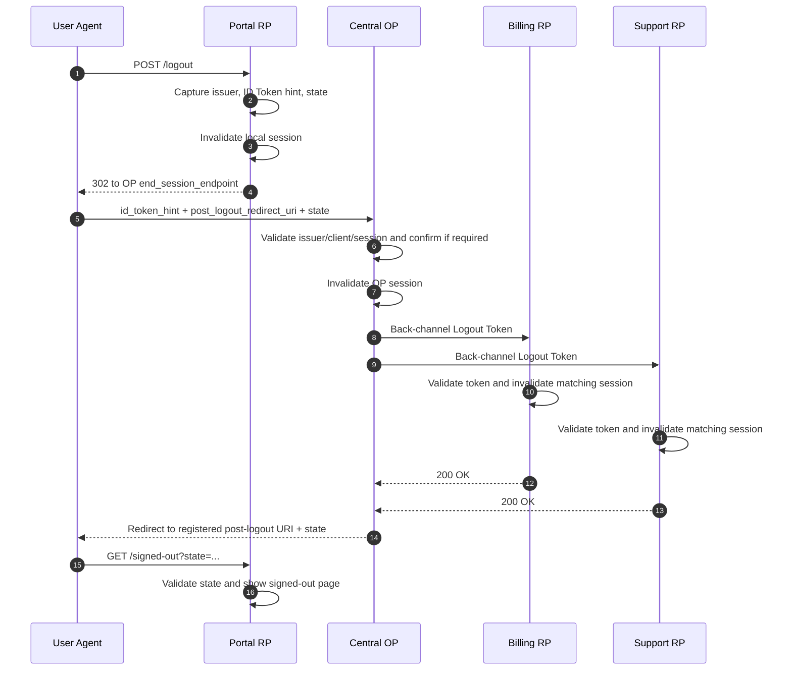

# Xử lý session và logout khi có nhiều miền xác thực

## 1. Bài toán logout trong hệ thống liên kết danh tính

Trong một nền tảng **OAuth 2.0/OpenID Connect Authorization Server** dùng **Spring Security, Spring Authorization Server và Spring Boot**, một người dùng có thể đăng nhập qua nhiều hệ thống danh tính: Identity Provider của doanh nghiệp, nhà cung cấp bên ngoài, hệ thống đối tác, hoặc một Authorization Server trung tâm đóng vai trò identity broker.

Một ứng dụng có thể đồng thời có:

- Session cục bộ của ứng dụng (Relying Party, RP).
- Session tại OpenID Provider (OP) đã xác thực người dùng.
- Session tại một hoặc nhiều upstream Identity Provider mà OP/broker dùng để federate login.
- Session tại các ứng dụng downstream mà nền tảng đang phát hành token hoặc cung cấp SSO.
- Nhiều phiên trình duyệt/thiết bị của cùng một người dùng.

Khi người dùng bấm Logout ở một ứng dụng, câu hỏi không chỉ là xóa cookie hiện tại. Hệ thống phải xác định **phiên nào cần kết thúc, ở miền xác thực nào, và thông báo tới những bên nào**. Nếu xóa nhầm tất cả phiên của người dùng, thiết bị hoặc tenant khác có thể bị đăng xuất ngoài ý muốn. Nếu chỉ xóa cookie ở một RP, người dùng có thể vẫn đăng nhập tại OP và tự động quay lại ứng dụng khi truy cập lần sau.

Trong module **SPRING_SECURITY_OAUTH2_OIDC_AUTHORIZATION_SERVER**, mục tiêu là học cách thiết kế, cấu hình, bảo mật, kiểm thử và vận hành OAuth 2.0/OpenID Connect Authorization Server bằng Spring Security và Spring Authorization Server. Bài thuộc chương **Liên kết danh tính**, tập trung xử lý session và logout khi một danh tính đi qua nhiều miền xác thực.

### Kết quả học tập

Sau bài học, bạn có thể:

1. Phân biệt RP session, OP session, upstream IdP session và downstream application session.
2. Thiết kế khóa liên kết session an toàn khi có nhiều issuer, tenant, client và thiết bị.
3. Chọn local logout, RP-Initiated Logout, Back-Channel Logout, Front-Channel Logout hoặc SAML Single Logout phù hợp.
4. Cấu hình OIDC logout ở Spring Security OAuth2 Client.
5. Cấu hình session tracking và OIDC Logout Endpoint ở Spring Authorization Server.
6. Lưu trữ session correlation trong môi trường nhiều instance.
7. Xử lý logout dây chuyền, timeout, retry, sự kiện trùng và lỗi một phần.
8. Kiểm thử việc logout đúng phiên mà không ảnh hưởng người dùng/tenant khác.

**Phạm vi ví dụ:** Spring Boot 3.x, Spring Security 6.5.x và Spring Authorization Server 1.5.8 trên Servlet stack. Các extension point và tên API được đối chiếu theo tài liệu chính thức của những phiên bản này. Nếu dự án dùng WebFlux hoặc phiên bản khác, cần dùng API reactive/tương ứng thay vì sao chép nguyên ví dụ Servlet.

## 2. Phân biệt các miền session

### 2.1. Một lần đăng nhập có thể tạo nhiều session độc lập

Giả sử người dùng mở `portal.example.com`, ứng dụng chuyển trình duyệt tới `login.example.net` để xác thực. OP có thể chuyển tiếp tới `idp.corp.example.org`. Sau khi đăng nhập thành công, người dùng mở thêm `billing.example.com` và `support.example.com`.

| Miền | Ví dụ | Session được sở hữu bởi | Cookie/session identifier |
| --- | --- | --- | --- |
| Upstream IdP | `idp.corp.example.org` | Hệ thống danh tính doanh nghiệp | Cookie của IdP |
| Central OP / Identity Broker | `login.example.net` | Authorization Server | Cookie của OP |
| RP / ứng dụng portal | `portal.example.com` | Portal | Cookie của portal |
| RP / ứng dụng billing | `billing.example.com` | Billing | Cookie của billing |
| RP / ứng dụng support | `support.example.com` | Support | Cookie của support |

Các session này có vòng đời riêng. Xóa cookie portal không tự xóa session OP hoặc session upstream IdP. Tương tự, xóa session tại OP không tự động xóa session cục bộ ở các RP nếu OP không gửi logout notification và RP không xử lý notification đó.

### 2.2. Bốn khái niệm phải tách biệt

**Local application logout** kết thúc session của ứng dụng hiện tại. Đây là hành động mà ứng dụng kiểm soát trực tiếp.

**RP-Initiated Logout** cho phép RP chuyển User Agent tới Logout Endpoint của OP để yêu cầu OP đăng xuất người dùng. OP xác định session phù hợp, có thể hỏi người dùng xác nhận và thông báo các RP đã đăng nhập với OP theo logout mechanism mà hai bên hỗ trợ.

**OP-Initiated Logout** là trường hợp OP bắt đầu thông báo logout tới các RP. OIDC định nghĩa Front-Channel Logout và Back-Channel Logout để thực hiện việc này.

**Upstream federation logout** là việc identity broker/OP yêu cầu IdP nguồn kết thúc session của người dùng. Đây là một bước khác trong chuỗi liên kết danh tính; không phải mọi OIDC RP logout đều tự động kết thúc session tại upstream IdP.

### 2.3. Danh tính không đồng nghĩa session

Một người dùng có thể có một danh tính nhưng nhiều session. Trong OIDC:

- `iss` xác định OP/issuer phát hành token.
- `sub` xác định End-User trong phạm vi issuer.
- `sid` xác định một session tại OP trong phạm vi issuer.
- `aud` xác định client/RP mà token được phát hành cho.

Không dùng riêng `sub` để tìm session trong hệ thống liên kết nhiều issuer. Hai OP độc lập có thể cùng phát hành `sub = "12345"` cho hai người khác nhau. Khóa danh tính tối thiểu phải chứa issuer và subject: `(iss, sub)`.

`sid` cũng không phải global session ID. OIDC Back-Channel Logout quy định `sid` chỉ cần duy nhất trong ngữ cảnh một issuer; do đó khóa session phải có issuer. Nếu RP có nhiều client registration/audience, cần thêm client/tenant context khi tra cứu để không logout nhầm phiên.

Không dùng email, username hoặc display name làm khóa session. Các giá trị này có thể thay đổi, không duy nhất giữa các miền và có thể được tái cấp cho người khác.

### 2.4. Identity broker phải giữ mapping giữa các miền

Nếu `login.example.net` đóng vai trò broker giữa ứng dụng và upstream IdP, broker nên lưu mối liên hệ:

| Thuộc tính | Mục đích |
| --- | --- |
| `tenant_id` | Phạm vi tổ chức/tenant của session |
| `local_session_id` | Session tại broker |
| `upstream_issuer` | Issuer của IdP đã xác thực |
| `upstream_subject` | `sub` từ IdP nguồn |
| `upstream_sid` | `sid` từ IdP nguồn nếu có |
| `downstream_client_id` | RP/client đã đăng nhập với broker |
| `downstream_sid` | Session identifier broker phát hành cho client nếu có |
| `created_at`, `last_seen_at`, `expires_at` | Quản lý vòng đời và timeout |
| `logout_status`, `logout_at` | Theo dõi tiến trình logout |

Mapping này cho phép broker biết một session downstream được tạo từ upstream identity/session nào. Nếu upstream IdP không hỗ trợ `sid` hoặc logout protocol, broker chỉ có thể kết thúc session mà broker quản lý; không thể khẳng định đã kết thúc session tại IdP nguồn.

### 2.5. Không chia sẻ session cookie giữa các miền ứng dụng

Cookie của `portal.example.com` không tự được gửi tới `billing.example.com`. Cố gắng chia sẻ một cookie Domain rộng như `.example.com` làm tăng phạm vi ảnh hưởng khi một subdomain bị compromise và khiến các ứng dụng phụ thuộc chung vào một session cookie contract.

Thông thường, mỗi RP giữ cookie host-only và session riêng. SSO được thực hiện bằng redirect qua OP; OP giữ cookie của chính OP. Khi cần logout nhiều RP, dùng OIDC logout notification thay vì yêu cầu tất cả ứng dụng dùng chung cookie.

`SameSite`, `Secure`, `HttpOnly`, domain/path của cookie và chính sách third-party cookie ảnh hưởng tới front-channel/iframe logout. Không coi việc trình duyệt xóa cookie của một site là bằng chứng rằng mọi session server-side đã bị hủy.

## 3. Chọn logout mechanism phù hợp

### 3.1. So sánh các cơ chế

| Cơ chế | Ai bắt đầu? | Kênh | Điểm mạnh | Giới hạn |
| --- | --- | --- | --- | --- |
| Local logout | RP | HTTP request tới chính RP | Đơn giản, kiểm soát trực tiếp session local | OP và RP khác vẫn có thể còn session |
| OIDC RP-Initiated Logout | RP | Browser redirect/form POST tới OP | Người dùng chủ động logout khỏi OP | Cần User Agent; kết quả downstream phụ thuộc OP notification |
| OIDC Back-Channel Logout | OP | HTTP POST trực tiếp OP → RP | Không phụ thuộc browser đang mở tab/cookie third-party | RP phải lưu session mapping; endpoint phải reachable từ OP |
| OIDC Front-Channel Logout | OP | Browser tải logout URI của RP, thường qua iframe | Có thể xóa state/cookie phía browser | Bị ảnh hưởng bởi third-party cookie blocking, iframe và browser policy |
| OIDC Session Management | RP kiểm tra trạng thái OP | Browser iframe/check session | Có thể phát hiện OP session thay đổi | Polling/iframe phụ thuộc browser và storage policy |
| SAML 2.0 Single Logout | RP hoặc Asserting Party (AP) | SAML LogoutRequest/LogoutResponse qua HTTP binding | Tích hợp được hệ sinh thái SAML | Phụ thuộc metadata, signature, binding và hỗ trợ SLO của AP |

Back-Channel Logout thường phù hợp hơn khi cần thu hồi session đáng tin cậy giữa các hệ thống server-side. Front-Channel Logout có thể bổ sung để xóa state trong browser, nhưng không nên là cơ chế duy nhất trong môi trường browser chặn third-party cookies.

### 3.2. Local logout

Local logout chỉ kết thúc session của RP hiện tại. Đây là lựa chọn phù hợp khi:

- Người dùng chỉ muốn thoát khỏi ứng dụng hiện tại.
- Ứng dụng không muốn ảnh hưởng phiên đăng nhập ở OP hoặc các RP khác.
- OP không hỗ trợ logout protocol.
- Chính sách bảo mật yêu cầu local session bị xóa ngay, kể cả khi OP không truy cập được.

Spring Security cung cấp `logout()` DSL và `LogoutSuccessHandler`. Có thể cấu hình logout endpoint, `LogoutHandler`, invalidate `HttpSession`, xóa SecurityContext và xóa cookie theo cấu hình ứng dụng.

### 3.3. RP-Initiated Logout

RP chuyển User Agent tới `end_session_endpoint` được công bố trong OP Discovery metadata. Request thường mang:

- `id_token_hint`: ID Token trước đây OP phát hành cho RP, dùng làm gợi ý về session.
- `post_logout_redirect_uri`: URI RP đề nghị trình duyệt quay về sau logout; phải được OP đăng ký và kiểm tra.
- `state`: giá trị opaque để RP tương quan callback.
- `client_id` hoặc `logout_hint`: có thể dùng theo quy tắc OIDC khi phù hợp.

Nếu có `id_token_hint`, OP phải xác minh token do chính OP phát hành và đối chiếu client/session. OIDC khuyến nghị OP chấp nhận ID Token của session hiện tại/gần đây kể cả khi `exp` đã qua, vì logout có thể xảy ra sau khi token hết hạn. Nếu không có ID Token hint hoặc hint không thuộc session hiện tại, OP phải hỏi người dùng xác nhận trước khi logout theo quy tắc RP-Initiated Logout.

`post_logout_redirect_uri` chỉ được dùng khi hợp lệ và phải exact-match một URI đã đăng ký cho đúng client. Nếu không có `id_token_hint`, OP cần có cách khác xác minh tính hợp lệ của đích trước khi redirect. Không dùng `state` như URL đích và không redirect sang URL tùy ý.

### 3.4. Back-Channel Logout

OP gửi HTTP POST tới `backchannel_logout_uri` của RP với một Logout Token là JWT được ký. RP xác minh token rồi tìm các session liên quan để kết thúc.

Logout Token có các claim quan trọng:

| Claim | Yêu cầu |
| --- | --- |
| `iss` | Bắt buộc; issuer của OP |
| `aud` | Bắt buộc; client/RP nhận logout |
| `iat` | Bắt buộc; thời điểm phát hành |
| `jti` | Bắt buộc; ID duy nhất của token |
| `events` | Bắt buộc; chứa event `http://schemas.openid.net/event/backchannel-logout` |
| `sub` | Có thể có; xác định End-User |
| `sid` | Có thể có; xác định session của End-User tại OP |
| `nonce` | Bị cấm trong Logout Token |

Logout Token phải chứa `sub`, `sid` hoặc cả hai. Nếu chỉ có `sub`, RP logout mọi session của subject đó trong phạm vi issuer/client tương ứng. Nếu có `sid`, RP có thể chỉ logout session tương ứng với `sid`. Khi xử lý token, luôn đối chiếu `iss` và `aud`; không tra cứu chỉ bằng `sub` hoặc `sid`.

### 3.5. Front-Channel Logout và browser privacy

Front-Channel Logout yêu cầu OP điều hướng User Agent tới logout URI của từng RP, thường bằng iframe. RP nhận request và xóa session/browser state tương ứng.

Vì request chạy trong context third-party, browser có thể chặn cookie hoặc storage của RP. Do đó:

- Iframe có thể không gửi session cookie của RP.
- Cookie `SameSite=Lax` hoặc `Strict` có thể không được gửi trong iframe cross-site.
- `SameSite=None` yêu cầu `Secure`, nhưng không vượt qua mọi cơ chế chặn third-party cookies.
- Một tab đóng, trình duyệt offline hoặc content blocking có thể làm notification không tới RP.

Nếu OP gửi query parameter `iss` và `sid` cho front-channel request thì cả hai phải cùng xuất hiện. RP nên đối chiếu chúng với issuer/session của ID Token hiện tại hoặc gần đây; không logout mọi session chỉ vì nhận một request iframe không xác định. Trả response không cache để tránh trình duyệt dùng lại nội dung logout cũ.

### 3.6. SAML Single Logout

Trong hệ thống có upstream/downstream SAML IdP, SAML 2.0 Single Logout (SLO) có thể được dùng thay cho OIDC logout. RP có thể gửi `saml2:LogoutRequest` tới Asserting Party; AP cũng có thể gửi LogoutRequest tới RP. Hai bên xác minh chữ ký, issuer, destination, `SessionIndex`/NameID theo profile và trả `LogoutResponse`.

Spring Security hỗ trợ RP-initiated và AP-initiated SAML SLO qua `saml2Logout()`. Cần cấu hình `SingleLogoutService` metadata, signing credential và endpoint. SLO chỉ hoạt động xuyên miền nếu các bên đều công bố và hỗ trợ SLO; không tự động chuyển đổi một logout OIDC thành SAML LogoutRequest nếu chưa có federation adapter.
## 4. Luồng logout khi có nhiều miền xác thực

### 4.1. Người dùng logout khỏi một RP và yêu cầu OP logout

Ví dụ người dùng đang ở Portal, đăng nhập bằng OP trung tâm. Portal có thể kết thúc session local trước hoặc sau khi điều hướng tới OP:

- **Local-first:** session Portal bị hủy ngay. Nếu OP không truy cập được hoặc người dùng hủy xác nhận tại OP, Portal vẫn đã logout. Cách này thường phù hợp với kỳ vọng bảo mật khi người dùng bấm Logout.
- **OP-first:** giữ session Portal trong lúc chờ OP hoàn tất. Nếu browser đóng hoặc redirect lỗi, session local có thể còn hiệu lực; cần timeout và fallback rõ ràng.

RP phải giữ đủ thông tin cần cho logout request trước khi xóa session: ID Token hint, issuer/client registration, post-logout redirect URI và transaction state. Không giữ raw access token/refresh token trong URL. Giá trị state cần ngẫu nhiên, opaque, thời hạn ngắn và ràng buộc với browser transaction.



Sơ đồ là một triển khai dùng Back-Channel Logout. Nếu OP và RP chỉ hỗ trợ Front-Channel Logout, bước thông báo sẽ đi qua User Agent và chịu ảnh hưởng browser privacy. Nếu OP không hỗ trợ notification, Portal không thể kết luận rằng Billing và Support đã logout.

### 4.2. OP logout nhiều RP

Khi OP logout một End-User, OP cần biết RP nào đã đăng nhập với OP và session nào cần kết thúc. Có thể dùng một registry/visited-client store để ghi nhận:

- issuer của OP.
- client_id của RP.
- subject và sid của session.
- backchannel_logout_uri hoặc frontchannel_logout_uri đã đăng ký.
- backchannel_logout_session_required hoặc frontchannel_logout_session_required.
- Thời điểm đăng nhập, thời điểm hết hạn và trạng thái notification.

Khi logout, OP tạo Logout Token riêng cho từng client/audience phù hợp. Không gửi một token có aud của Portal tới endpoint của Billing. Mỗi RP phải nhận token được phát hành cho đúng client của nó.

### 4.3. Broker vừa là RP vừa là OP

Identity broker thường có hai vai trò:

1. Là RP đối với upstream IdP: broker nhận ID Token từ IdP và tạo local broker session.
2. Là OP đối với downstream RP: broker phát ID Token/access token và tạo các client session liên quan.

Khi broker nhận logout từ upstream IdP, broker phải xác minh Logout Token từ đúng upstream issuer, dùng iss + sub hoặc iss + sid để tìm đúng broker session, kết thúc session tương ứng, gửi Logout Token do broker ký tới các downstream RP có session liên quan, thu hồi authorization/token theo policy và ghi audit.

Khi người dùng logout tại broker, broker có thể gửi downstream logout notifications và điều hướng browser tới upstream OP end_session_endpoint bằng ID Token hint mà broker đã nhận từ upstream. OIDC RP-Initiated Logout không phải một API server-to-server logout tổng quát; nếu không có browser redirect hoặc vendor-specific mechanism, broker không thể tự kết thúc upstream OP session chỉ bằng một HTTP call tùy ý.

### 4.4. Logout một phiên hay mọi phiên?

| Phạm vi | Khóa tìm kiếm | Kết quả |
| --- | --- | --- |
| Một thiết bị/phiên tại một OP | iss + sid + client/audience | Chỉ logout session được định danh |
| Tất cả phiên của user tại một OP/client | iss + sub + client/audience | Logout các session của subject đó ở RP tương ứng |
| Tất cả ứng dụng trong một tenant | Tenant + issuer + subject, sau đó fan-out tới clients của tenant | Logout trong tenant được chỉ định |
| Mọi thiết bị ở mọi OP | Cần mapping liên kết danh tính và chính sách cross-issuer riêng | Không thể suy ra chỉ từ một sid |

Nếu người dùng có hai tài khoản ở hai issuer khác nhau nhưng trùng email, logout ở issuer A không được tự động logout issuer B. Chỉ thực hiện cross-issuer logout khi federation mapping đã xác minh hai danh tính thuộc cùng một account và policy cho phép.
## 5. Cấu hình OIDC logout ở RP bằng Spring Security

### 5.1. RP-Initiated Logout

Spring Security OAuth2 Client cung cấp OidcClientInitiatedLogoutSuccessHandler. Handler dùng ClientRegistrationRepository để tìm cấu hình OIDC và end-session endpoint từ Provider metadata. Ví dụ với một RP:

```java
import org.springframework.context.annotation.Bean;
import org.springframework.context.annotation.Configuration;
import org.springframework.security.config.annotation.web.builders.HttpSecurity;
import org.springframework.security.oauth2.client.registration.ClientRegistrationRepository;
import org.springframework.security.oauth2.client.oidc.web.logout.OidcClientInitiatedLogoutSuccessHandler;
import org.springframework.security.web.SecurityFilterChain;
import org.springframework.security.web.authentication.logout.LogoutSuccessHandler;

@Configuration
class PortalSecurityConfiguration {

    @Bean
    LogoutSuccessHandler oidcLogoutSuccessHandler(
            ClientRegistrationRepository registrations) {

        OidcClientInitiatedLogoutSuccessHandler handler =
                new OidcClientInitiatedLogoutSuccessHandler(registrations);
        handler.setPostLogoutRedirectUri("{baseUrl}/signed-out");
        return handler;
    }

    @Bean
    SecurityFilterChain applicationSecurity(
            HttpSecurity http,
            LogoutSuccessHandler oidcLogoutSuccessHandler) throws Exception {

        http
            .authorizeHttpRequests(authorize ->
                authorize.anyRequest().authenticated())
            .oauth2Login(oauth2 -> { })
            .logout(logout ->
                logout.logoutSuccessHandler(oidcLogoutSuccessHandler));

        return http.build();
    }
}
```

Đăng ký post_logout_redirect_uri phải trùng URI đã cấu hình trên OP. Template {baseUrl} được Spring Security thay bằng base URL của ứng dụng; khi chạy sau reverse proxy, cấu hình forwarded headers/trusted proxy đúng để không sinh callback sai host hoặc scheme.

Mặc định handler redirect bằng GET. Nếu OP yêu cầu POST serialization, có thể cấu hình FormPostRedirectStrategy theo API của Spring Security. Không tự ghép end_session_endpoint từ request parameter hoặc Host header tùy ý.

### 5.2. Ứng dụng có nhiều OIDC provider

Một ClientRegistrationRepository có thể chứa nhiều registration, ví dụ corp, partner-a, partner-b. Mỗi registration có issuer, client ID, secret, redirect URI và metadata riêng. Khi logout:

- Xác định provider/registration đã tạo session hiện tại.
- Dùng ID Token hint thuộc đúng issuer/client.
- Gửi request tới end-session endpoint của registration đó.
- Dùng post-logout redirect URI đã đăng ký cho client đó.

Không chọn provider dựa trên email domain hoặc query parameter do browser gửi mà chưa đối chiếu với authentication đang lưu trong session. Nếu một ứng dụng hỗ trợ nhiều registration có cùng issuer hoặc nhiều tenant dùng client registration động, cần lưu registration ID trong session correlation và có thể cần custom LogoutSuccessHandler để chọn đúng registration.

### 5.3. Bật Back-Channel Logout ở RP

Spring Security 6.5 hỗ trợ OIDC Back-Channel Logout cho ứng dụng oauth2Login. Cấu hình cơ bản:

```java
import org.springframework.context.annotation.Bean;
import org.springframework.security.config.Customizer;
import org.springframework.security.config.annotation.web.builders.HttpSecurity;
import org.springframework.security.oauth2.client.oidc.session.OidcSessionRegistry;
import org.springframework.security.oauth2.client.oidc.web.logout.OidcBackChannelLogoutHandler;
import org.springframework.security.web.SecurityFilterChain;
import org.springframework.security.web.session.HttpSessionEventPublisher;

@Bean
OidcBackChannelLogoutHandler oidcBackChannelLogoutHandler(
        OidcSessionRegistry sessionRegistry) {

    OidcBackChannelLogoutHandler handler =
            new OidcBackChannelLogoutHandler(sessionRegistry);
    handler.setSessionCookieName("SESSION"); // Spring Session; dùng JSESSIONID nếu phù hợp
    return handler;
}

@Bean
HttpSessionEventPublisher httpSessionEventPublisher() {
    return new HttpSessionEventPublisher();
}

@Bean
SecurityFilterChain webSecurity(HttpSecurity http) throws Exception {
    http
        .oauth2Login(Customizer.withDefaults())
        .oidcLogout(oidc -> oidc.backChannel(Customizer.withDefaults()));
    return http.build();
}
```

Đoạn cấu hình cookie SESSION áp dụng khi dùng Spring Session; nếu container dùng JSESSIONID, giữ tên cookie tương ứng. oidcLogout() yêu cầu oauth2Login() đã được cấu hình. HttpSessionEventPublisher giúp registry nhận lifecycle event khi HttpSession bị invalidate để xóa mapping cũ.

Endpoint mặc định có dạng /logout/connect/back-channel/{registrationId}. registrationId xác định ClientRegistration mà Logout Token phải hướng tới. Không mở endpoint này như một endpoint local logout không xác thực; Spring Security xác minh Logout Token trước khi handler tìm session.

### 5.4. Cách Spring Security tìm đúng session

Tại thời điểm login, Spring Security lưu correlation giữa ID Token/issuer, provider session ID (sid) nếu có, CSRF token/context liên quan, session ID cục bộ của ứng dụng và registration/client đã thực hiện login.

Khi OP gọi Back-Channel Logout:

1. RP xác minh chữ ký và claim của Logout Token.
2. OidcSessionRegistry tìm các session phù hợp.
3. Nếu token có sid, RP chỉ kết thúc session liên quan đến provider session đó.
4. Nếu không có sid nhưng có sub, RP kết thúc các session của subject trong phạm vi issuer/client phù hợp.
5. Spring Security chạy các LogoutHandler cho từng session để invalidate session và dọn SecurityContext.

### 5.5. Registry mặc định và môi trường cluster

`InMemoryOidcSessionRegistry` lưu mapping trong bộ nhớ của một JVM. Nếu RP chạy nhiều instance sau load balancer, Back-Channel Logout có thể đến node không có mapping session; node đó không biết session cần invalidate.

Với cluster:

- Triển khai `OidcSessionRegistry` backed by database hoặc distributed store.
- Lưu mapping trước khi trả login success cho browser.
- Xóa mapping khi local session hết hạn, logout hoặc bị invalidate.
- Dùng transaction/atomic delete để hai logout request đồng thời không xử lý session hai lần.
- Đặt TTL cho mapping để dọn session không nhận được lifecycle event.
- Dùng shared session store (ví dụ Spring Session) hoặc cơ chế định tuyến tới node sở hữu session.

Spring Security cho phép thay `OidcSessionRegistry` bằng implementation riêng. Các method cốt lõi là lưu `OidcSessionInformation`, xóa theo client session ID và xóa các mapping được tham chiếu bởi `OidcLogoutToken`. Khi xử lý token, repository phải đối chiếu issuer và audience tương ứng, không chỉ session ID hoặc subject.

### 5.6. Kiểm tra tên cookie khi dùng Spring Session

Back-Channel Logout không dựa vào browser gửi cookie của RP tới OP. Tuy nhiên, Spring Security dùng session correlation và internal logout request để chạy logout handlers cho đúng session. `OidcBackChannelLogoutHandler` mặc định dùng tên cookie `JSESSIONID`; nếu ứng dụng dùng Spring Session với cookie `SESSION`, phải cấu hình `setSessionCookieName("SESSION")`.

Kiểm thử cấu hình này sau khi thay đổi session cookie name, reverse proxy hoặc Spring Session repository. Sai tên cookie có thể khiến endpoint nhận Logout Token hợp lệ nhưng không invalidate đúng session.

## 6. Cấu hình OIDC Logout Endpoint ở Spring Authorization Server

### 6.1. SessionRegistry của OP

Spring Authorization Server dùng `SessionRegistry` để theo dõi các session đã xác thực khi OIDC được bật. `OidcLogoutAuthenticationProvider` sử dụng registry để tìm `SessionInformation` liên quan tới End-User đang yêu cầu logout.

Ví dụ cấu hình dùng registry mặc định trong một ứng dụng Servlet:

```java
import org.springframework.context.annotation.Bean;
import org.springframework.context.annotation.Configuration;
import org.springframework.security.core.session.SessionRegistry;
import org.springframework.security.core.session.SessionRegistryImpl;
import org.springframework.security.web.session.HttpSessionEventPublisher;
import org.springframework.security.config.Customizer;
import org.springframework.security.config.annotation.web.builders.HttpSecurity;
import org.springframework.security.oauth2.server.authorization.config.annotation.web.configurers.OAuth2AuthorizationServerConfigurer;
import org.springframework.security.web.SecurityFilterChain;

@Configuration
class AuthorizationServerSecurityConfiguration {

    @Bean
    SessionRegistry sessionRegistry() {
        return new SessionRegistryImpl();
    }

    @Bean
    HttpSessionEventPublisher httpSessionEventPublisher() {
        return new HttpSessionEventPublisher();
    }

    @Bean
    SecurityFilterChain authorizationServerSecurity(HttpSecurity http)
            throws Exception {

        OAuth2AuthorizationServerConfigurer authorizationServer =
                OAuth2AuthorizationServerConfigurer.authorizationServer();

        http
            .securityMatcher(authorizationServer.getEndpointsMatcher())
            .with(authorizationServer, server ->
                server.oidc(Customizer.withDefaults()));

        return http.build();
    }
}
```

Nếu ứng dụng đã có Authorization Server filter chain, hãy thêm cấu hình OIDC vào chain đó thay vì tạo chain thứ hai có endpoint matcher trùng nhau. `SessionRegistryImpl` phù hợp development/single instance. Trong production cluster, cần registry dùng chung hoặc session architecture bảo đảm logout request tìm được session trên mọi node.

`HttpSessionEventPublisher` phát session lifecycle events để `SessionRegistryImpl` dọn `SessionInformation` khi `HttpSession` bị invalidate/destroy. Nếu bật concurrent session control, nên dùng cùng một `SessionRegistry` cho session strategy và OIDC Logout feature.

### 6.2. OIDC Logout Endpoint

Spring Authorization Server 1.5.8 cung cấp `OidcLogoutEndpointConfigurer` để xử lý RP-Initiated Logout. Filter mặc định dùng `OidcLogoutAuthenticationConverter` để parse request, `OidcLogoutAuthenticationProvider` để xác minh và tìm session, `OidcLogoutAuthenticationSuccessHandler` để thực hiện logout, cùng error handler cho validation failure.

Có thể tùy chỉnh converter, provider, success handler và error handler qua `logoutEndpoint(...)`. Default provider dùng `SessionRegistry` của OP; registry này khác với `OidcSessionRegistry` mà Spring Security OAuth2 Client dùng để lưu mapping giữa upstream OP session và local RP session.

### 6.3. SessionRegistry của OP không phải downstream RP registry

| Thành phần | Dùng ở đâu? | Mapping được quản lý |
| --- | --- | --- |
| `SessionRegistry` | Spring Authorization Server khi ứng dụng đóng vai OP | Người dùng ↔ session local tại OP |
| `OidcSessionRegistry` | Spring Security OAuth2 Client khi ứng dụng đóng vai RP | Upstream OP session (iss, sid, sub, aud) ↔ local RP session |
| Federation session store | Identity broker/OP đa miền | Upstream IdP ↔ broker session ↔ downstream client sessions |

Không dùng một registry thay thế cho cả ba vai trò nếu schema và lifecycle không thể biểu diễn đầy đủ các quan hệ đó.

### 6.4. OP phải quản lý các RP đang đăng nhập

OIDC RP-Initiated Logout yêu cầu OP dùng logout mechanism mà RP đã đăng ký để thông báo các RP đang đăng nhập cùng End-User. Trong Spring Authorization Server 1.5.8, tài liệu mô tả Logout Endpoint, provider, SessionRegistry và success handler; ứng dụng vẫn cần thiết kế cơ chế theo dõi downstream RP sessions và dispatch Back-Channel/Front-Channel notifications theo metadata đã đăng ký.

Một downstream session record tối thiểu nên gồm:

| Field | Ý nghĩa |
| --- | --- |
| `op_issuer` | Issuer của OP đang gửi logout |
| `client_id` | RP nhận Logout Token |
| `subject` | End-User subject tại OP |
| `sid` | Session ID tại OP nếu RP có session-specific logout |
| `backchannel_logout_uri` | Endpoint nhận Logout Token |
| `session_required` | RP có yêu cầu `sid` hay không |
| `last_seen_at`, `expires_at` | Vòng đời session |
| `notification_status`, `attempt_count` | Trạng thái dispatch/retry |

Khi logout, tạo một notification cho mỗi client/audience có session liên quan. Logout Token phải được ký bởi key của OP và có claim `iss`, `aud`, `iat`, `jti`, `events`; thêm `sid` và/hoặc `sub` theo phạm vi logout. Không đưa `nonce` vào Logout Token.

### 6.5. Gắn notification dispatch vào logout success handler

Spring Authorization Server cung cấp `OidcLogoutAuthenticationSuccessHandler.setLogoutHandler(...)` để gắn logout action của ứng dụng. Với broker/OP nhiều miền, handler tùy chỉnh nên:

1. Đọc session identity và client-session mapping trước khi invalidate local OP session.
2. Ghi một logout event vào transactional outbox.
3. Invalidate session OP và dọn SecurityContext.
4. Worker lấy event, tạo Logout Token riêng cho từng client và gửi tới Back-Channel Logout URI.
5. Cập nhật trạng thái delivery, retry khi lỗi tạm thời và hết hạn khi vượt retry policy.
6. Chỉ thực hiện post-logout redirect sau khi bước logout cục bộ hoàn tất theo policy.

Không gọi hàng chục endpoint RP tuần tự trong request logout của browser; một RP chậm không nên giữ session OP ở trạng thái chưa logout. Dùng outbox để không mất notification nếu tiến trình dừng sau khi session đã bị hủy nhưng trước khi gửi request. Tuy nhiên, OIDC RP-Initiated Logout yêu cầu OP hoàn tất việc thông báo các RP trước khi thực hiện post-logout redirect. Vì vậy, orchestration phải chờ lượt dispatch tới tất cả RP đã chọn hoàn tất hoặc đạt deadline/policy timeout đã định nghĩa; không redirect ngay sau khi chỉ enqueue event. Nếu còn RP thất bại, ghi nhận trạng thái và hiển thị trang kết quả phù hợp.

```json
{
  "iss": "https://login.example.net",
  "aud": "portal-client",
  "iat": 1760000000,
  "jti": "logout-event-opaque-id",
  "events": {
    "http://schemas.openid.net/event/backchannel-logout": {}
  },
  "sub": "user-subject-at-this-issuer",
  "sid": "provider-session-id"
}
```

Đây là payload minh họa. OP phải ký JWT bằng signing key của mình, đặt thời gian phát hành hợp lệ và dùng `aud` của từng client. Không gửi nguyên token mẫu hoặc dùng chung một token cho nhiều RP.

## 7. Thiết kế session store cho nhiều issuer và nhiều instance

### 7.1. Schema phải chứa issuer và client context

Một bảng mapping có thể được thiết kế như sau:

```sql
CREATE TABLE federated_session_link (
    id                    VARCHAR(64) PRIMARY KEY,
    tenant_id             VARCHAR(128) NOT NULL,
    rp_registration_id    VARCHAR(128) NOT NULL,
    client_id             VARCHAR(255) NOT NULL,
    op_issuer             VARCHAR(512) NOT NULL,
    op_subject            VARCHAR(512) NOT NULL,
    op_session_id         VARCHAR(512),
    local_session_id      VARCHAR(256) NOT NULL,
    upstream_issuer       VARCHAR(512),
    upstream_subject      VARCHAR(512),
    upstream_session_id   VARCHAR(512),
    status                VARCHAR(32) NOT NULL,
    created_at            TIMESTAMP NOT NULL,
    last_seen_at          TIMESTAMP,
    expires_at            TIMESTAMP NOT NULL,
    logged_out_at         TIMESTAMP
);

CREATE INDEX idx_session_sid
    ON federated_session_link
       (tenant_id, op_issuer, client_id, op_session_id);

CREATE INDEX idx_session_subject
    ON federated_session_link
       (tenant_id, op_issuer, client_id, op_subject);

CREATE INDEX idx_session_local
    ON federated_session_link
       (rp_registration_id, local_session_id);
```

Schema là gợi ý, cần điều chỉnh kiểu dữ liệu, index và uniqueness theo database. Những nguyên tắc quan trọng:

- Khóa tra cứu Back-Channel Logout theo issuer và audience/client.
- Nếu có `sid`, ưu tiên định danh phiên cụ thể.
- Nếu không có `sid`, dùng issuer + subject + client để tìm các session được yêu cầu logout.
- Nếu tenant là ranh giới bảo mật, tenant phải nằm trong điều kiện truy vấn.
- `local_session_id` là dữ liệu nhạy cảm; mã hóa/bảo vệ at rest và không ghi vào log.
- Không lưu raw ID Token hoặc Logout Token nếu không có nhu cầu audit rõ ràng; lưu claim cần thiết và token digest/`jti` thay thế.

### 7.2. Replay protection cho Logout Token

Logout Token là signed message mang quyền yêu cầu logout. RP cần xác minh chữ ký bằng key của đúng issuer và kiểm tra:

1. `iss` nằm trong danh sách issuer mà RP đã cấu hình tin cậy.
2. `aud` chứa client ID của RP nhận request.
3. `iat` hợp lệ theo clock-skew và maximum-age policy.
4. `events` chứa đúng Back-Channel Logout event.
5. Có `sub` hoặc `sid`.
6. Không có `nonce`.
7. Thuật toán ký được phép và chữ ký hợp lệ.
8. `jti` chưa được xử lý gần đây nếu triển khai replay detection.

Lưu replay key theo `(issuer, jti)` với TTL phù hợp. Không chỉ lưu `jti` toàn cục vì nhiều issuer có thể phát hành cùng giá trị. Nếu cùng một Logout Token được gửi lại do retry, xử lý idempotent: session đã logout thì trả success thay vì tạo lỗi làm OP retry vô hạn.

### 7.3. Outbox và delivery state

Ở OP/broker, không nên gửi notification trực tiếp trong transaction đang invalidate session. Tạo outbox record cùng transaction:

```sql
CREATE TABLE logout_notification_outbox (
    event_id          VARCHAR(64) PRIMARY KEY,
    tenant_id         VARCHAR(128) NOT NULL,
    op_issuer         VARCHAR(512) NOT NULL,
    client_id         VARCHAR(255) NOT NULL,
    subject_ref       VARCHAR(512),
    session_ref       VARCHAR(512),
    destination       VARCHAR(2048) NOT NULL,
    status            VARCHAR(32) NOT NULL,
    attempt_count     INTEGER NOT NULL DEFAULT 0,
    next_attempt_at   TIMESTAMP,
    created_at        TIMESTAMP NOT NULL,
    delivered_at      TIMESTAMP,
    last_error_code   VARCHAR(128)
);
```

Worker gửi từng notification, cập nhật delivery state và retry theo exponential backoff. Destination phải lấy từ client registration đã được kiểm tra; không dùng URL do logout request cung cấp.

Không ghi Logout Token nguyên vẹn vào log/outbox nếu không cần thiết. Có thể tạo token lúc dispatch từ event record và signing key hiện tại; lưu `jti` để deduplicate. Nếu cần lưu token để retry chính xác, phải mã hóa, giới hạn TTL và kiểm soát truy cập.

### 7.4. Xử lý nhiều session và logout song song

Một user có thể đăng nhập cùng RP trên desktop và mobile. Khi Logout Token có `sid`, chỉ xóa mapping của phiên đó. Khi token chỉ có `sub`, xóa mọi mapping phù hợp issuer/audience/subject theo spec.

Để tránh race:

- Dùng transaction hoặc atomic update từ ACTIVE sang LOGGING_OUT/LOGGED_OUT.
- Chỉ một worker claim mỗi outbox item tại một thời điểm.
- Có unique constraint trên replay key và session mapping phù hợp.
- Nếu session đã hết hạn trước khi notification tới, xem logout là đã hoàn tất.
- Không để một lỗi gửi tới RP A chặn việc logout RP B.

### 7.5. Cache và session store phải nhất quán

Trong cluster, xóa session ở database nhưng giữ authentication/session cache ở node khác có thể khiến request tiếp theo vẫn được chấp nhận. Khi logout:

- Invalidate session store dùng chung.
- Xóa session correlation và authentication cache.
- Publish invalidation event tới các node.
- Đảm bảo API/resource server có cơ chế xử lý token đã revoke nếu access token là self-contained JWT.
- Không nhầm logout session với revoke mọi access token đã phát hành.

Logout kết thúc phiên đăng nhập và ngăn session tiếp tục được sử dụng. JWT access token đã phát hành có thể còn hợp lệ đến `exp` nếu resource server không kiểm tra revocation/introspection hoặc session state. Nếu cần thu hồi gần như tức thì, cân nhắc token ngắn hạn, reference token/introspection, denylist hoặc authorization version theo threat model.

## 8. Logout upstream và downstream trong identity broker

### 8.1. Khi upstream IdP gửi logout

Nếu broker đăng nhập qua OIDC upstream, broker có thể bật Back-Channel Logout như một RP bình thường. Broker cần mapping upstream:

```text
(upstream_issuer, upstream_sub, upstream_sid)
    -> broker local session
    -> downstream RP sessions
```

Khi nhận token:

1. Xác minh token từ đúng upstream issuer.
2. Tìm broker session bằng `sid` nếu có; nếu không, tìm theo `iss` + `sub`.
3. Đối chiếu tenant và upstream client registration.
4. Đánh dấu session broker đã logout.
5. Tạo downstream logout events cho các RP liên quan.
6. Thu hồi refresh token theo policy và ghi audit.

Nếu upstream IdP gửi logout theo `sub` mà không có `sid`, broker có thể phải logout nhiều broker session của cùng subject trong issuer đó. Không áp dụng việc này sang issuer khác.

### 8.2. Khi người dùng logout tại broker

Broker có thể vừa logout các downstream RP vừa yêu cầu upstream OP logout qua RP-Initiated Logout. Trước khi xóa broker session, lưu thông tin cần để tạo upstream logout request vào một logout transaction ngắn hạn:

- Upstream issuer và registration ID.
- ID Token hint từ upstream.
- Post-logout callback URI của broker đã đăng ký với upstream.
- State ngẫu nhiên, expiry và browser correlation.

Sau đó broker invalidate local session, phát downstream logout events và redirect browser tới upstream `end_session_endpoint`. Callback phải kiểm tra state trước khi hiển thị trang hoàn tất.

Nếu upstream OP không có logout endpoint hoặc không hỗ trợ cơ chế tương thích, broker chỉ có thể kết thúc session của chính broker và thông báo cho downstream RP. Không hiển thị thông điệp “đã logout khỏi mọi hệ thống” khi chưa có xác nhận/khả năng thực hiện.

### 8.3. Kết hợp OIDC và SAML

Một broker có thể kết nối OIDC upstream và phát SAML assertion cho downstream, hoặc ngược lại. Khi nhận logout:

- Xác định protocol và issuer đã tạo session nguồn.
- Map tới đúng internal subject/session.
- Kết thúc internal session.
- Chuyển thành OIDC Logout Token hoặc SAML LogoutRequest tương ứng cho downstream.
- Theo dõi kết quả từng protocol độc lập.

Không chuyển trực tiếp OIDC `sid` thành SAML `SessionIndex` hoặc ngược lại. Đây là hai identifier thuộc hai protocol/session context khác nhau; broker cần lưu mapping rõ ràng.

## 9. Xử lý logout thất bại và lỗi một phần

### 9.1. Logout phải idempotent

OIDC Back-Channel Logout xem logout đã thành công nếu RP không còn session của End-User tại thời điểm nhận request. Vì vậy, nếu cùng Logout Token được gửi lại do timeout/retry, RP nên xác minh token, tìm session theo issuer/audience/subject/session ID, và nếu session đã bị xóa thì trả success theo semantics idempotent. Không tạo session mới hoặc thay đổi session của user khác.

Idempotency không có nghĩa bỏ qua token validation. Token sai chữ ký, issuer hoặc audience vẫn phải bị từ chối.

### 9.2. Phân loại response khi gửi Back-Channel Logout

| Response từ RP | Cách OP xử lý |
| --- | --- |
| HTTP 200 OK | Thành công |
| HTTP 204 No Content | Nên được coi là thành công tương đương 200 |
| Timeout/connection reset/5xx | Có thể retry theo backoff và deadline |
| HTTP 400 Bad Request | Logout request không hợp lệ hoặc xử lý thất bại; không retry mù quáng |
| HTTP 401/403 | Kiểm tra endpoint, network policy và implementation; không gửi token vào endpoint khác |

Một RP đã logout local thành công có thể trả 200/204 ngay cả khi không tìm thấy session nữa. Điều này giúp OP không retry vô hạn với một session đã kết thúc.

### 9.3. Logout nhiều RP có thể hoàn tất một phần

Giả sử OP có Portal, Billing và Support. Portal trả 200, Billing timeout, Support trả 400 vì không xác minh được token. Trạng thái đúng phải phản ánh từng client:

- Session OP đã bị invalidate.
- Portal đã xác nhận logout.
- Billing đang chờ retry hoặc hết deadline.
- Support có lỗi protocol/configuration cần điều tra.

Không rollback session OP chỉ vì một RP không phản hồi. Không hiển thị rằng mọi ứng dụng đã logout nếu còn notification pending/failed. Có thể hiển thị thông báo rằng người dùng đã đăng xuất khỏi tài khoản trung tâm và một số ứng dụng đang hoàn tất logout.

### 9.4. Retry và dead-letter

Worker dispatch nên dùng exponential backoff có jitter, giới hạn số lần retry và tổng thời gian retry, phân biệt lỗi mạng tạm thời với lỗi token/registration, không retry 400 vô hạn, lưu last status/error code và correlation ID, đưa event quá hạn vào dead-letter queue để vận hành xử lý, và bảo đảm retry không tạo token có audience sai hoặc token mới cho nhầm session.

Nếu signing key rotate trong thời gian retry, Logout Token mới phải được ký bằng key hiện tại được OP công bố và RP có thể xác minh. Giữ JWKS/key overlap theo quy trình rotation.

### 9.5. Refresh token và access token sau logout

Back-Channel Logout yêu cầu RP kết thúc session và xóa state liên quan. Với refresh token, OIDC Back-Channel Logout khuyến nghị revoke refresh token gắn với session nếu chúng không được cấp với `offline_access`; refresh token có `offline_access` thông thường không nên tự động revoke chỉ vì logout session browser.

Access token JWT đã phát hành không tự biến mất khi session bị xóa. Nếu resource server xác minh JWT offline, token có thể còn được chấp nhận đến expiry. Các lựa chọn gồm access token TTL ngắn, reference token/introspection, revocation/denylist có cache invalidation, hoặc claim/session version và kiểm tra trạng thái theo policy.

Không nhầm logout session browser với việc thu hồi mọi credential của người dùng trên mọi thiết bị. Phạm vi thu hồi phải theo session, client, tenant và loại token.

## 10. Bảo mật session và logout

### 10.1. Xác thực Logout Token

RP phải xác minh chữ ký theo key của issuer tin cậy, iss chính xác với issuer đã cấu hình, aud chứa client ID nhận notification, iat nằm trong clock-skew/maximum-age policy, events có Back-Channel Logout event, có sub hoặc sid, không có nonce, thuật toán không phải none và nằm trong allowlist, jti không bị replay nếu ứng dụng bật replay detection.

Không chọn decoder theo issuer do request body tự khai báo rồi tin token sau khi chữ ký hợp lệ. Issuer phải được map với cấu hình trust/client registration đã biết; nếu nhiều issuer, chọn validator/decoder theo allowlist và xác minh audience của đúng registration.

### 10.2. Logout CSRF và endpoint protocol

Local logout do browser gọi nên dùng POST và CSRF protection theo cấu hình Spring Security. Không tạo GET endpoint xóa session chỉ dựa vào việc người dùng mở một URL, vì website khác có thể kích hoạt request đó.

Back-Channel Logout là request server-to-server mang Logout Token đã ký. Dùng endpoint được Spring Security OIDC logout cấu hình, hoặc endpoint custom có cùng validation. Không bỏ CSRF bằng cách mở một endpoint logout-all nhận subject/email tùy ý.

### 10.3. Cookie và session fixation

- Cookie session phải có Secure trên HTTPS và HttpOnly.
- Chọn SameSite phù hợp với login/logout redirect và browser support.
- Không chia sẻ cookie session giữa các ứng dụng/tenant nếu không có threat model rõ.
- Dùng session fixation protection của Spring Security; session ID phải đổi sau authentication.
- Invalidate server-side session và xóa cookie với đúng Path/Domain/Max-Age.
- Không dựa riêng vào xóa cookie để thu hồi session trong cluster.

### 10.4. Giới hạn phạm vi danh tính

- Luôn scope sub bằng iss.
- Scope sid bằng iss và client/audience phù hợp.
- Scope session theo tenant nếu tenant là security boundary.
- Không dùng email làm khóa chính hoặc tự suy ra liên kết cross-issuer.
- Không để logout từ một client ảnh hưởng client khác nếu token không chỉ định audience/session đó.
- Không tin registrationId, tenant ID hoặc provider name lấy trực tiếp từ query param nếu chưa kiểm tra với session hiện tại.

### 10.5. Không để lộ token và session identifier

Không ghi ID Token hint, Logout Token, access token, refresh token, session cookie hoặc raw session ID vào log. Audit nên lưu issuer, client ID, tenant, session reference đã hash/opaque, jti, timestamp, status và correlation ID.

Giới hạn quyền truy cập tới session store và outbox. Session mapping có thể giúp tìm đúng người dùng và thiết bị; rò rỉ bảng này có thể làm lộ cấu trúc đăng nhập liên kết của tổ chức.

## 11. Kiểm thử session và logout nhiều miền

### 11.1. Ma trận kiểm thử

| ID | Kịch bản | Kết quả mong đợi |
| --- | --- | --- |
| S01 | Người dùng local logout khỏi Portal | Chỉ session Portal bị invalidate |
| S02 | RP gửi RP-Initiated Logout với ID Token hint hợp lệ | Browser được điều hướng tới đúng OP |
| S03 | OP xác minh ID Token hint của issuer khác | Không dùng hint để logout session |
| S04 | Logout request có cả client_id và ID Token hint không khớp | OP từ chối theo OIDC |
| S05 | ID Token hint hết hạn nhưng session OP hiện tại/gần đây hợp lệ | OP xử lý theo quy tắc RP-Initiated Logout, không từ chối chỉ vì exp |
| S06 | RP gửi post_logout_redirect_uri chưa đăng ký | OP không redirect tới URI đó |
| S07 | RP gửi state và logout thành công | OP echo state về callback; RP xác minh state |
| S08 | Không có ID Token hint | OP yêu cầu xác nhận người dùng trước khi logout |
| S09 | Back-channel Logout Token có chữ ký hợp lệ, iss/aud đúng | RP chấp nhận notification |
| S10 | Logout Token có issuer không được trust | RP từ chối HTTP 400 |
| S11 | Logout Token có aud của client khác | RP không logout session của client hiện tại |
| S12 | Logout Token thiếu events backchannel-logout | RP từ chối |
| S13 | Logout Token chứa nonce | RP từ chối |
| S14 | Logout Token không có sub và sid | RP từ chối |
| S15 | Logout Token có sid đúng một session | Chỉ session tương ứng bị kết thúc |
| S16 | Logout Token chỉ có sub | Các session cùng issuer/subject/client được kết thúc |
| S17 | Hai issuer có cùng sub | Logout issuer A không ảnh hưởng issuer B |
| S18 | Hai issuer có cùng sid | Logout một issuer không ảnh hưởng issuer kia |
| S19 | Hai tenant có cùng subject nhưng tách biệt | Logout tenant A không ảnh hưởng tenant B |
| S20 | Cùng Logout Token được gửi hai lần | Lần hai xử lý idempotent, không tạo lỗi ngoài ý muốn |
| S21 | Logout Token jti đã được replay | RP áp dụng replay policy và không logout sai session |
| S22 | RP đã logout trước khi notification tới | Trả success theo semantics idempotent |
| S23 | Một RP timeout khi OP fan-out | Các RP khác vẫn được notification |
| S24 | RP trả HTTP 204 | OP coi là thành công |
| S25 | RP trả HTTP 400 do token sai | Ghi lỗi, không retry mù quáng |
| S26 | Back-channel request đến node không sở hữu session | Shared registry/session store vẫn tìm và invalidate được session |
| S27 | Dùng Spring Session cookie SESSION | Handler được cấu hình đúng cookie name |
| S28 | Session hết hạn nhưng mapping còn lại | TTL/event cleanup dọn mapping |
| S29 | Upstream IdP logout broker | Broker kết thúc đúng session và phát downstream logout events |
| S30 | Broker logout khi upstream OP không hỗ trợ logout | Broker logout local/downstream và không tuyên bố đã logout upstream |
| S31 | OIDC subject và SAML SessionIndex có cùng chuỗi | Không dùng lẫn identifier giữa hai protocol |
| S32 | Front-channel logout chạy trong iframe khi browser chặn third-party cookie | Test xác nhận giới hạn; back-channel vẫn kết thúc session server-side |
| S33 | Client có nhiều session trên desktop/mobile | Logout theo sid chỉ kết thúc session được chỉ định |
| S34 | Refresh token không có offline_access gắn với session bị logout | Revoke theo policy/spec |
| S35 | Refresh token có offline_access | Không tự động revoke chỉ vì logout browser session |
| S36 | JWT access token đã phát hành khi session logout | Hành vi sau logout phù hợp token TTL/revocation policy |
| S37 | Logout request bị CSRF từ site khác | Local logout POST bị CSRF protection chặn |
| S38 | User logout rồi đăng nhập lại | Session ID mới được tạo; mapping cũ không ảnh hưởng session mới |

### 11.2. Integration test cho RP Back-Channel Logout

Với Spring Security Servlet:

1. Tạo nhiều OIDC ClientRegistration có issuer/client ID khác nhau.
2. Thực hiện login để tạo nhiều local session và ghi OIDC session mapping.
3. Gửi Logout Token đã ký tới endpoint /logout/connect/back-channel/{registrationId}.
4. Kiểm tra token đúng audience chỉ xóa session của registration tương ứng.
5. Gửi token có sid để xác nhận chỉ một phiên bị xóa.
6. Gửi token chỉ có sub để xác nhận các session phù hợp bị xóa.
7. Gửi token sai issuer, audience, signature, events, nonce và jti replay để xác nhận bị từ chối.
8. Kiểm tra HttpSessionEventPublisher dọn registry và cookie/session store được xử lý đúng.

Không chỉ gọi OidcSessionRegistry.removeSessionInformation(...) trong unit test rồi kết luận endpoint đã an toàn. Cần chạy qua filter chain để kiểm tra token validation, registration ID, session cookie và LogoutHandler.

### 11.3. Integration test cho OP/broker fan-out

Với Authorization Server đóng vai OP:

1. Đăng nhập End-User và tạo session trong SessionRegistry.
2. Tạo downstream session record cho Portal, Billing và Support.
3. Gửi RP-Initiated Logout tới OIDC Logout Endpoint.
4. Xác nhận session OP bị invalidate và outbox event được ghi trong cùng transaction.
5. Chạy notification worker, xác nhận mỗi client nhận token có audience riêng.
6. Giả lập một RP timeout và một RP trả 400; kiểm tra delivery state và retry/dead-letter.
7. Gửi lại logout request và xác nhận idempotency.
8. Xác nhận post-logout redirect chỉ tới URI đã đăng ký và state được trả lại.

### 11.4. Kiểm thử browser và SAML

Với Front-Channel Logout, kiểm thử trên browser có third-party cookie blocking, iframe restriction và SameSite policy thực tế. Kiểm tra RP không logout nhầm session khi thiếu hoặc sai issuer/session identifier.

Với SAML SLO, kiểm thử RP-initiated và AP-initiated riêng: chữ ký LogoutRequest/LogoutResponse, destination, issuer, session index, replay và endpoint binding. Không dùng một test OIDC Back-Channel để kết luận SAML SLO hoạt động.

## 12. Checklist vận hành production

**Session identity**

- [ ] Mọi session correlation chứa issuer và client/audience.
- [ ] Subject được scope theo issuer; không dùng email làm khóa session.
- [ ] Session ID opaque, không log và được bảo vệ at rest.
- [ ] Tenant boundary nằm trong truy vấn khi tenant là security boundary.
- [ ] Có TTL và cleanup cho session mapping.

**OIDC logout**

- [ ] RP-Initiated Logout dùng end_session_endpoint từ discovery/trusted metadata.
- [ ] ID Token hint thuộc đúng issuer/client/session.
- [ ] post_logout_redirect_uri được đăng ký và exact-match.
- [ ] state ngẫu nhiên, opaque, có expiry và được RP xác minh.
- [ ] Back-channel Logout Token xác minh signature, iss, aud, iat, events, sub/sid và nonce.
- [ ] Có replay/idempotency policy cho jti và notification trùng.
- [ ] Front-channel không phải cơ chế duy nhất nếu cần logout server-side tin cậy.

**Spring Security / Spring Authorization Server**

- [ ] RP bật oauth2Login và oidcLogout đúng SecurityFilterChain.
- [ ] OidcSessionRegistry dùng shared store trong cluster.
- [ ] Session cookie name của OidcBackChannelLogoutHandler khớp cấu hình Spring Session/container.
- [ ] HttpSessionEventPublisher được cấu hình khi cần lifecycle event cho registry.
- [ ] OP có SessionRegistry dùng chung với concurrent session control nếu sử dụng tính năng đó.
- [ ] OP có downstream RP session registry và notification dispatcher.
- [ ] Không nhầm SessionRegistry của OP với OidcSessionRegistry của RP.

**Vận hành**

- [ ] Logout fan-out dùng outbox, retry/backoff và dead-letter.
- [ ] Lỗi một RP không ngăn session OP bị logout.
- [ ] Có metric pending/success/failed logout notification theo issuer/client.
- [ ] Có quy trình rotate signing key và cập nhật JWKS.
- [ ] Có quy trình xử lý client/IdP bị deprovision hoặc mất trust.
- [ ] Access token/refresh token sau logout tuân thủ revocation policy.
- [ ] Có regression test cho cross-issuer, cross-tenant và multi-device logout.

## 13. Tài liệu tham khảo

- [OpenID Connect RP-Initiated Logout 1.0](https://openid.net/specs/openid-connect-rpinitiated-1_0-final.html): end_session_endpoint, id_token_hint, client_id, post_logout_redirect_uri, state, confirmation và post-logout redirect.
- [OpenID Connect Back-Channel Logout 1.0](https://openid.net/specs/openid-connect-backchannel-1_0-final.html): Logout Token claims, validation, session lookup, response 200/204 và idempotent logout.
- [OpenID Connect Front-Channel Logout 1.0](https://openid.net/specs/openid-connect-frontchannel-1_0.html): frontchannel_logout_uri, iss, sid và giới hạn third-party content.
- [OpenID Connect Session Management 1.0](https://openid.net/specs/openid-connect-session-1_0-final.html): OP/RP session state và session management.
- [Spring Security 6.5 — OIDC Logout](https://docs.spring.io/spring-security/reference/6.5/servlet/oauth2/login/logout.html): local logout, OidcClientInitiatedLogoutSuccessHandler, Back-Channel Logout, OidcSessionRegistry, Spring Session cookie name và custom registry.
- [Spring Authorization Server 1.5.8 — Core Model / Components](https://docs.spring.io/spring-authorization-server/reference/core-model-components.html): SessionRegistry, SessionRegistryImpl và HttpSessionEventPublisher.
- [Spring Authorization Server 1.5.8 — Protocol Endpoints](https://docs.spring.io/spring-authorization-server/reference/protocol-endpoints.html): OidcLogoutEndpointConfigurer, OidcLogoutAuthenticationProvider, OidcLogoutAuthenticationSuccessHandler và logout validator.
- [Spring Security — Performing Single Logout](https://docs.spring.io/spring-security/reference/servlet/saml2/logout.html): RP-initiated và AP-initiated SAML 2.0 SLO.

**Kết luận:** Logout trong hệ thống liên kết danh tính là bài toán quản lý quan hệ giữa nhiều session và nhiều issuer. Hãy tách local RP session, OP session và upstream IdP session; dùng iss + sub hoặc iss + sid cùng client/audience để xác định đúng phạm vi; lưu mapping dùng chung trong cluster; và gửi logout notification theo protocol mà từng RP hỗ trợ. Spring Security cung cấp OIDC client logout và Back-Channel Logout ở phía RP, Spring Authorization Server cung cấp OIDC Logout Endpoint và SessionRegistry ở phía OP; broker nhiều miền cần bổ sung federation session store, downstream registry và notification dispatcher có retry/idempotency.

