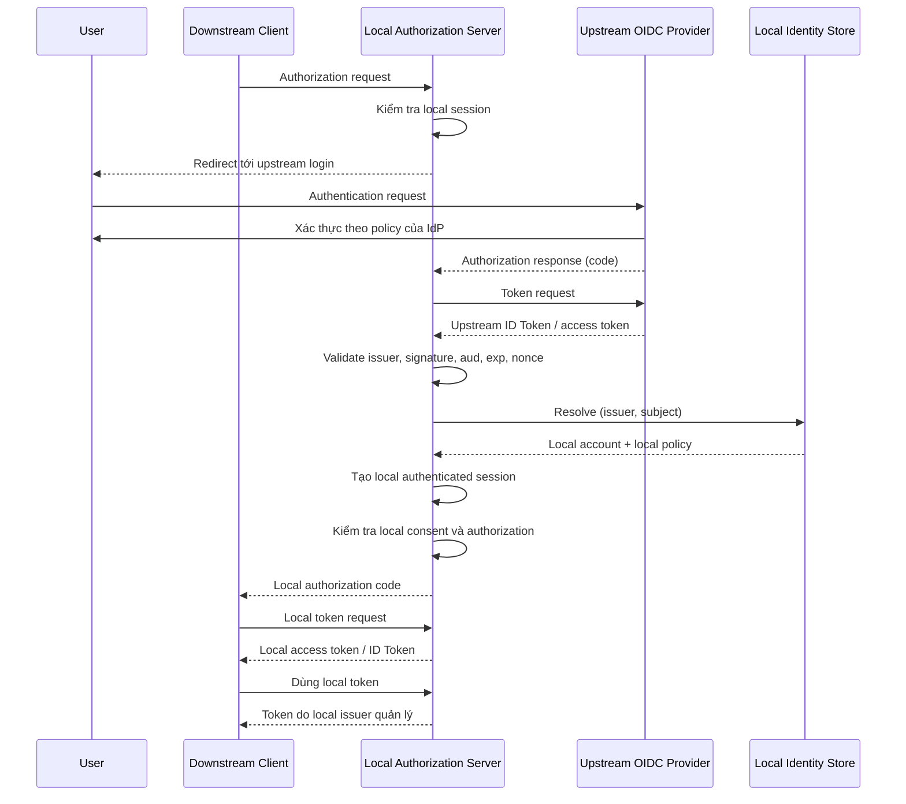
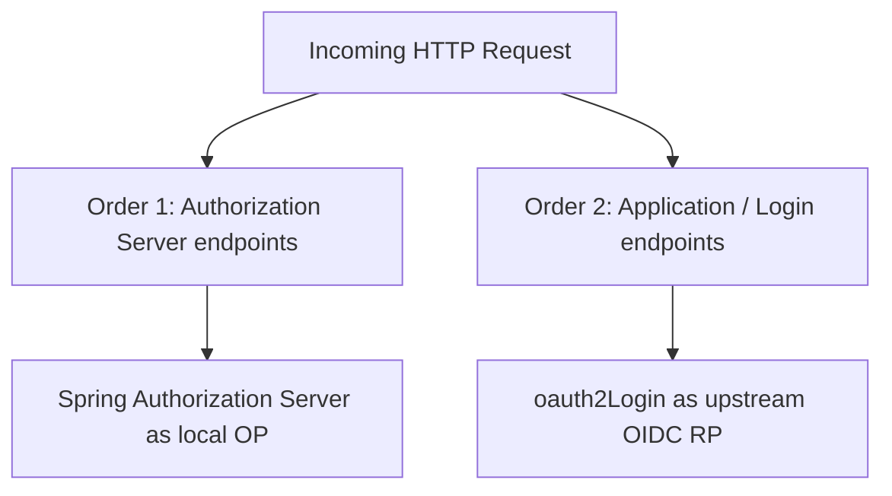

# Giới hạn trách nhiệm giữa identity federation và phát hành token

Khi Authorization Server tích hợp với một Identity Provider (IdP) bên ngoài, cần phân định rõ hai việc: IdP bên ngoài xác thực người dùng theo quan hệ tin cậy đã thiết lập; Authorization Server nội bộ quyết định người dùng đó được phép làm gì trong hệ thống và phát hành token cho các client, resource server thuộc phạm vi quản lý của mình. Việc đăng nhập thành công ở IdP không tự động cấp mọi scope, role hoặc quyền nghiệp vụ trong hệ thống nội bộ.

Trong mô hình này, ứng dụng nội bộ thường đồng thời đóng hai vai trò. Nó là OpenID Connect Relying Party (RP) đối với IdP bên ngoài để nhận kết quả đăng nhập; và là OpenID Provider (OP)/OAuth 2.0 Authorization Server đối với các client nội bộ để phát hành token. Spring Security cung cấp OAuth2 Client và `oauth2Login()` cho vai trò RP. Spring Authorization Server cung cấp protocol endpoints và token services cho vai trò OP. Việc kết hợp hai vai trò cần lớp ánh xạ danh tính và chính sách cấp quyền do ứng dụng quản lý. [Spring Security OAuth2 Login](https://docs.spring.io/spring-security/reference/servlet/oauth2/login/index.html) · [Spring Authorization Server Core Model](https://docs.spring.io/spring-authorization-server/reference/core-model-components.html)

Bài thuộc chương **Liên kết danh tính** của mô-đun **SPRING_SECURITY_OAUTH2_OIDC_AUTHORIZATION_SERVER**. Mục tiêu là hiểu ranh giới trách nhiệm giữa federation và token issuance, thiết kế ánh xạ tài khoản an toàn, phát hành token nội bộ với issuer/audience/claims riêng, và xử lý logout, consent, provisioning cùng các tình huống lỗi.

**Phạm vi ví dụ:** API minh họa theo Spring Security 7.x và Spring Authorization Server 1.5.x. Cần dùng bộ phiên bản tương thích với Spring Boot của dự án; các ví dụ cấu hình là khung tích hợp, không phải một broker hoàn chỉnh có thể triển khai production mà không bổ sung local identity service và policy.

## 1. Phân biệt identity federation với token issuance

### 1.1. Identity federation làm gì?

Identity federation thiết lập quan hệ tin cậy giữa các miền danh tính. Ứng dụng nội bộ chấp nhận kết quả xác thực từ một IdP đã được cấu hình và xác minh. Với OIDC, ứng dụng nhận ID Token và có thể gọi UserInfo Endpoint để lấy claims được phép.

Các trách nhiệm của lớp federation gồm:

- Chọn đúng upstream issuer/IdP đã được quản trị;
- Khởi tạo authentication request và giữ state/nonce;
- Xác minh ID Token, chữ ký, issuer, audience, thời hạn và nonce;
- Lấy UserInfo nếu cần và kiểm tra subject nhất quán;
- Xác định danh tính ngoài bằng issuer và subject;
- Ánh xạ danh tính ngoài sang tài khoản nội bộ;
- Kiểm tra tài khoản nội bộ còn hoạt động và được phép đăng nhập;
- Chuẩn hóa các thuộc tính/assurance được tin cậy thành local principal.

IdP ngoài chịu trách nhiệm về phương thức xác thực mà nó thực hiện, ví dụ password, passkey, MFA hoặc xác thực doanh nghiệp. Ứng dụng nội bộ vẫn phải quyết định có chấp nhận IdP đó cho use case hiện tại hay không.

### 1.2. Token issuance làm gì?

Authorization Server nội bộ chịu trách nhiệm phát hành token cho các client đã đăng ký. Nó phải quyết định:

- Client nào được phép dùng authorization grant;
- Người dùng nội bộ tương ứng là principal nào;
- Client được yêu cầu những scope/resource nào;
- Người dùng đã consent cho quyền nào;
- Chính sách local role, tenant, account status và risk có cho phép không;
- Access token/ID Token nào cần phát;
- Issuer, audience, subject, claims, signing key và TTL của token nội bộ;
- Refresh, revocation, introspection và consent được quản lý ra sao.

Spring Authorization Server biểu diễn client qua `RegisteredClient`, authorization qua `OAuth2Authorization`, consent qua `OAuth2AuthorizationConsent` và token issuance qua `OAuth2TokenGenerator`. Các thành phần này thuộc miền trách nhiệm của Authorization Server nội bộ. [Core Model / Components](https://docs.spring.io/spring-authorization-server/reference/core-model-components.html)

### 1.3. Bảng phân định trách nhiệm

| Vấn đề | Upstream IdP | Authorization Server nội bộ |
|---|---|---|
| Xác thực người dùng | Thực hiện và đưa ra kết quả | Xác minh kết quả OIDC và quyết định có chấp nhận không |
| Định danh bên ngoài | Cấp `iss` và `sub` | Lưu liên kết `(issuer, subject)` với local account |
| Local account | Không quản lý trạng thái nội bộ | Kiểm tra active, locked, suspended, tenant và policy |
| MFA/assurance | Thực hiện authentication và cung cấp context đã xác minh | Ánh xạ assurance vào local policy; yêu cầu step-up nếu cần |
| Local roles/permissions | Có thể cung cấp claims/groups theo hợp đồng | Quyết định mapping và quyền nội bộ |
| OAuth client registration | Không quyết định client nội bộ nào được dùng | Quản lý `RegisteredClient` |
| Consent | Không thay thế consent cho client nội bộ | Quản lý consent theo client và principal |
| Access token cho API nội bộ | Không phát token của hệ thống nội bộ | Phát token với issuer/audience/key/claims nội bộ |
| ID Token cho client nội bộ | Không phát ID Token thay cho local OP | Phát ID Token mới cho client nội bộ nếu dùng OIDC |
| Refresh/revocation | Quản lý token của chính IdP | Quản lý token do local Authorization Server phát |
| Logout | Quản lý session tại IdP | Quản lý local session, token và downstream logout theo policy |

### 1.4. Không biến kết quả đăng nhập thành quyền truy cập

Một ID Token hợp lệ chỉ chứng minh IdP đã xác thực một subject cho client/issuer tương ứng theo các điều kiện OIDC. Nó không chứng minh người dùng có quyền `payments.approve`, `tenant.admin` hoặc `orders.write` trong hệ thống nội bộ.

Ví dụ, nhân viên đăng nhập thành công bằng tài khoản công ty có thể được xác định là người dùng `employee-4821`. Nhưng quyền duyệt thanh toán phải được lấy từ local authorization policy, không phải suy ra chỉ từ việc IdP trả `email_verified=true` hoặc một group claim chưa được kiểm soát.

## 2. Mô hình vai trò trong kiến trúc liên kết danh tính

### 2.1. Các bên tham gia

| Thành phần | Vai trò |
|---|---|
| Upstream Identity Provider | OP xác thực người dùng và phát ID Token cho broker |
| Identity broker / ứng dụng nội bộ | RP đối với upstream; ánh xạ external identity thành local principal |
| Local Authorization Server | OP/AS đối với client nội bộ; cấp authorization và token |
| Downstream OAuth/OIDC client | RP/client yêu cầu người dùng đăng nhập và xin token nội bộ |
| Resource Server | API kiểm tra access token do local AS phát |
| Local identity store | Lưu local account, external identity links, tenant, trạng thái và policy |
| Authorization/consent store | Lưu authorization, token state và consent của local AS |

Một ứng dụng Spring Boot có thể chứa cả identity broker và Spring Authorization Server trong cùng process. Tuy nhiên, chúng vẫn là hai miền trách nhiệm riêng và cần cấu hình, kiểm thử, quan sát độc lập.

### 2.2. Luồng đăng nhập liên kết



Luồng trên thể hiện hai protocol exchange riêng:

1. Broker đăng nhập với upstream IdP bằng OAuth 2.0 Authorization Code Flow/OIDC.
2. Downstream client thực hiện authorization grant với local Authorization Server và nhận token nội bộ.

Upstream authorization code và ID Token không phải token response dành cho downstream client. Local AS hoàn tất một authorization flow riêng và phát token theo registration, consent và policy của mình.

### 2.3. Hai issuer, hai miền token

Giả sử:

- Upstream issuer: `https://login.corp.example`;
- Local issuer: `https://identity.example.internal`;
- Downstream API: `https://api.example.internal/orders`;
- Client nội bộ: `orders-portal`.

Upstream ID Token có `iss=https://login.corp.example` và `aud` là client ID của broker tại upstream IdP. Local access token có `iss=https://identity.example.internal` và `aud` là API nội bộ được local AS cho phép. Local ID Token, nếu được phát, có audience là `orders-portal`.

Không thay `iss` của upstream token bằng local issuer, không chỉ sửa audience rồi chuyển token cho API. Việc phát token nội bộ phải tạo token mới do local AS ký và quản lý.

## 3. Thiết lập trust với upstream OIDC Provider

### 3.1. Đăng ký upstream provider có kiểm soát

Mỗi upstream IdP phải được onboarding như một trust relationship có cấu hình:

- Issuer URI chính xác;
- Client ID và credential của broker;
- Authorization grant type và redirect URI;
- Scope cần thiết;
- Allowed signing algorithms;
- Discovery/JWKS policy;
- TLS và network egress policy;
- Claim mapping policy;
- Account linking policy;
- Logout integration nếu hỗ trợ;
- Owner, contact, expiry và quy trình thay đổi cấu hình.

Không nhận `issuer-uri`, JWKS URL hoặc discovery URL tùy ý từ query parameter hay từ user profile. Nếu ứng dụng tải metadata từ URL do caller kiểm soát, có thể tạo SSRF, issuer mix-up hoặc tin nhầm key server.

### 3.2. OIDC Discovery và issuer pinning

Có thể dùng `issuer-uri` trong Spring Security để discovery metadata của upstream provider:

```yaml
spring:
  security:
    oauth2:
      client:
        registration:
          corporate:
            provider: corporate
            client-id: local-broker-client
            client-secret: ${CORPORATE_OIDC_CLIENT_SECRET}
            client-authentication-method: client_secret_basic
            authorization-grant-type: authorization_code
            redirect-uri: "{baseUrl}/login/oauth2/code/{registrationId}"
            scope:
              - openid
              - profile
              - email
        provider:
          corporate:
            issuer-uri: https://login.corp.example
```

Các giá trị là ví dụ. Với production, credential phải lấy từ secret manager. `issuer-uri` phải là issuer được quản trị và so khớp chính xác với `iss` trong ID Token. Không dùng một hostname giống nhau làm bằng chứng rằng hai issuer tương đương; path của issuer cũng là một phần định danh.

### 3.3. Kiểm tra ID Token

Trước khi dùng ID Token làm bằng chứng đăng nhập, xác minh tối thiểu:

- Chữ ký hợp lệ bằng key thuộc JWKS của issuer đã pin;
- Thuật toán nằm trong allowlist;
- `iss` khớp chính xác issuer đã cấu hình;
- `aud` chứa client ID của broker;
- Nếu có nhiều audience, kiểm tra `azp` theo OIDC contract và policy;
- `exp` chưa hết hạn và `iat` nằm trong cửa sổ chấp nhận;
- `nonce` khớp giá trị đã gửi trong authentication request;
- `state` trong authorization response khớp request được lưu;
- Authorization code được dùng đúng client và redirect URI;
- PKCE được dùng khi flow/client policy yêu cầu;
- `auth_time`, `acr`, `amr` được kiểm tra nếu policy cần authentication mới hoặc assurance cụ thể.

OpenID Connect Core quy định issuer và audience phải được xác minh; `nonce` liên kết ID Token với authentication request và giảm replay. [OpenID Connect Core 1.0](https://openid.net/specs/openid-connect-core-1_0.html)

Spring Security xử lý nhiều bước protocol thông qua OAuth2 Client/OIDC login. Ứng dụng vẫn cần cấu hình provider tin cậy, giữ state/session đúng cách và viết test cho các điều kiện bảo mật mà policy nội bộ yêu cầu.

### 3.4. UserInfo không thay thế ID Token validation

UserInfo Endpoint cung cấp claims về End-User bằng access token. Nó không phải bằng chứng độc lập để bỏ qua việc xác minh ID Token. Nếu dùng UserInfo:

- Access token phải được gửi tới UserInfo Endpoint thuộc đúng provider;
- TLS và provider metadata phải được xác minh;
- `sub` trong UserInfo phải khớp `sub` trong ID Token;
- Chỉ nhận claims được yêu cầu và được policy cho phép;
- Không dùng claim thiếu nguồn gốc hoặc không có bảo đảm ổn định làm định danh tài khoản.

`OidcUserService` của Spring Security có thể gọi UserInfo Endpoint và cung cấp điểm mở rộng để ứng dụng tùy chỉnh xử lý user. [Spring Security Advanced OAuth2 Login](https://docs.spring.io/spring-security/reference/servlet/oauth2/login/advanced.html)

### 3.5. Key rotation và provider compromise

Khi upstream IdP xoay signing key, broker cần tải key mới từ JWKS đã tin cậy và xử lý overlap theo metadata/provider behavior. Không pin một public key duy nhất vĩnh viễn nếu provider hỗ trợ rotation bình thường. Ngược lại, không chấp nhận mọi key hoặc algorithm bất kỳ chỉ vì JWKS endpoint trả về chúng.

Nếu upstream issuer hoặc signing key bị compromise:

1. Đánh dấu provider bị hạn chế hoặc tạm ngừng;
2. Ngừng chấp nhận login mới từ provider đó;
3. Đánh giá session và local account link được tạo từ provider;
4. Xác định local token nào cần revoke;
5. Kiểm tra audit log và access token đã phát;
6. Khôi phục trust chỉ sau khi key/issuer được xác minh lại.

## 4. Định danh và liên kết external identity với local account

### 4.1. Dùng cặp issuer và subject

OIDC định nghĩa `sub` là subject identifier duy nhất và không được tái sử dụng trong phạm vi issuer. Khi kết hợp `iss` và `sub`, RP có định danh ổn định cho external identity. Email, phone, display name và username không có bảo đảm uniqueness/stability tương tự. [OIDC Core — Claim Stability and Uniqueness](https://openid.net/specs/openid-connect-core-1_0.html#ClaimStability)

Mô hình liên kết:

| Trường | Ý nghĩa |
|---|---|
| `provider_issuer` | Issuer đã được cấu hình và xác minh |
| `provider_subject` | `sub` từ ID Token đã xác minh |
| `local_user_id` | ID nội bộ ổn định |
| `linked_at` | Thời điểm liên kết |
| `last_authenticated_at` | Lần xác thực gần nhất |
| `status` | Active, suspended, unlinked hoặc trạng thái quản trị |
| `authentication_context` | Context được phép lưu như `acr`/`auth_time` theo policy |

Khóa duy nhất nên là cặp `(provider_issuer, provider_subject)`. Nếu dùng nhiều IdP, chỉ lưu `sub` mà không có issuer sẽ tạo nguy cơ collision giữa các miền danh tính.

### 4.2. Không dùng email làm khóa liên kết

Không nên viết logic:

```java
// Không an toàn: email không phải external subject identifier.
LocalUser user = userRepository.findByEmail(oidcUser.getEmail())
        .orElseGet(() -> userRepository.create(oidcUser.getEmail()));
```

Email có thể thay đổi, được tái sử dụng, không được xác minh hoặc có cùng giá trị ở hai issuer khác nhau. `email_verified=true` chỉ là claim của issuer trong phạm vi trust đã thiết lập; nó không biến email thành khóa định danh OIDC ổn định và không tự chứng minh hai account hiện hữu thuộc cùng một người.

### 4.3. Account linking phải có bằng chứng

Nếu người dùng muốn liên kết thêm IdP thứ hai vào local account:

1. Người dùng đăng nhập vào local account hiện tại bằng session/step-up hợp lệ;
2. Bắt đầu flow liên kết với IdP thứ hai;
3. Xác minh ID Token và `(iss, sub)` của IdP thứ hai;
4. Hiển thị rõ IdP/account đang được liên kết;
5. Yêu cầu xác nhận theo policy;
6. Lưu external identity link với unique constraint;
7. Audit ai thực hiện, lúc nào và từ session nào;
8. Xử lý collision nếu external identity đã gắn với local account khác.

Không tự động gộp hai tài khoản chỉ vì email trùng nhau. Account linking là thao tác thay đổi quyền kiểm soát tài khoản và cần bảo vệ như một thao tác nhạy cảm.

### 4.4. Pairwise subject và nhiều client upstream

OIDC provider có thể dùng pairwise subject, tức `sub` khác nhau theo sector/client để hạn chế khả năng các RP liên kết hoạt động người dùng. Nếu broker đăng ký nhiều client khác nhau tại cùng upstream IdP, cùng một người có thể có `sub` khác nhau cho mỗi client/sector.

Vì vậy, cần xem `sub` trong ngữ cảnh client/sector đã đăng ký. Nếu cần hợp nhất các identity link khác nhau, phải có quy trình linking có xác minh hoặc một identifier liên tổ chức được upstream cung cấp theo hợp đồng riêng. Không tự suy ra rằng cùng email là cùng subject.

### 4.5. Vòng đời tài khoản nội bộ

Một login upstream hợp lệ vẫn phải bị từ chối nếu local account:

- Bị suspended/disabled;
- Bị khóa do incident hoặc policy;
- Không thuộc tenant/organization được phép;
- Chưa hoàn tất onboarding bắt buộc;
- Đã bị unlink khỏi IdP đó;
- Bị yêu cầu step-up hoặc re-verification;
- Không còn đủ điều kiện truy cập ứng dụng.

Deprovisioning tại IdP không tự động cập nhật local account nếu không có SCIM, event hoặc quy trình đồng bộ riêng. Cần định nghĩa SLA đồng bộ, xử lý khi provider không gửi event và cách chặn account local trong thời gian chờ.

## 5. Ánh xạ claims và authentication context

### 5.1. Chỉ ánh xạ claims có nguồn gốc rõ

Xây dựng allowlist claim mapping thay vì sao chép toàn bộ claims upstream vào local principal/token:

| Upstream claim | Có thể dùng cho | Điều kiện |
|---|---|---|
| `sub` + `iss` | External identity link | ID Token đã được xác minh |
| `email` | Contact/display hoặc workflow xác minh | Không dùng làm primary key; xét `email_verified` |
| `name`, `given_name`, `family_name` | Hiển thị profile | Không dùng làm quyền |
| `groups` | Gợi ý mapping local role | Phải có namespace, owner và mapping policy |
| `acr` | Authentication context | Chỉ tin các giá trị trong hợp đồng assurance |
| `amr` | Phương thức xác thực | Không suy diễn assurance ngoài ý nghĩa được provider cam kết |
| `auth_time` | Thời điểm xác thực | Dùng để kiểm tra freshness/step-up |
| `locale`, `zoneinfo` | UX | Không dùng cho authorization |

Claims ngoài allowlist nên được bỏ qua hoặc giữ trong audit context có kiểm soát, không phát tự động vào token.

### 5.2. Không ánh xạ group upstream thành local role một cách trực tiếp

Ví dụ IdP trả:

```json
{
  "groups": ["employees", "finance", "global-admins"]
}
```

Không nên biến `global-admins` thành `ROLE_ADMIN` chỉ bằng cách thêm prefix. Tên group có thể do upstream administrator thay đổi; nó có thể có phạm vi toàn tổ chức hoặc không phù hợp với tenant local.

Dùng bảng mapping có kiểm soát:

| Upstream issuer | Upstream group | Local tenant | Local permission |
|---|---|---|---|
| `https://login.corp.example` | `finance-approvers` | `tenant-a` | `payment.approve` |
| `https://login.corp.example` | `support-agents` | `tenant-a` | `support.case.read` |
| `https://partner.example` | `merchant-ops` | `merchant-42` | `merchant.order.read` |

Mapping phải có owner, audit, thời hạn review và test. Nếu claim group bị thiếu hoặc không tải được, ứng dụng không được mặc định cấp quyền rộng hơn.

### 5.3. Authentication assurance không đồng nghĩa local authorization

`acr` và `amr` có thể mô tả authentication context/phương thức của upstream IdP. Local AS cần một policy mapping tường minh, ví dụ:

- `acr` thuộc tập đã thỏa mãn → authentication assurance level local tương ứng;
- `auth_time` đủ mới cho thao tác nhạy cảm;
- `amr` có yếu tố phù hợp với policy step-up;
- Không có claim assurance hoặc issuer không được tin cậy → không đạt yêu cầu step-up.

Không tin một giá trị `acr` tùy ý chỉ vì nó có tên `urn:...:loa:2`. Cần biết upstream provider định nghĩa, kiểm soát và audit giá trị đó như thế nào.

### 5.4. Local policy có quyền từ chối

Local AS có thể từ chối phát token hoặc yêu cầu xác thực bổ sung dù upstream login thành công. Ví dụ:

- Người dùng đã xác thực nhưng local account suspended;
- Upstream MFA quá cũ;
- Client yêu cầu scope ngoài policy;
- Tenant không khớp;
- Resource Server không được phép nhận token;
- Rủi ro phiên đăng nhập vượt ngưỡng;
- Consent chưa có hoặc đã bị thu hồi.

Quyết định cuối cùng về token nội bộ thuộc local Authorization Server.

## 6. Tích hợp Spring Security OAuth2 Login và Spring Authorization Server

### 6.1. Hai cấu hình bảo mật, hai vai trò

Spring Security `oauth2Login()` cấu hình ứng dụng làm OAuth2 Client/OIDC RP. Spring Authorization Server configurer cấu hình endpoint của local OP/AS. Một ứng dụng có thể dùng hai `SecurityFilterChain` riêng để phân tách endpoint và thứ tự xử lý.

Sơ đồ cấu hình khái niệm:



Authorization Server endpoints phải được match bằng endpoint matcher của configurer. Login/callback endpoints thuộc application chain. Hãy test filter chain ordering để callback `/login/oauth2/code/{registrationId}` không bị Authorization Server chain xử lý nhầm.

### 6.2. Cấu hình Authorization Server chain

Ví dụ khung cấu hình:

```java
@Bean
@Order(1)
SecurityFilterChain authorizationServerSecurityFilterChain(
        HttpSecurity http) throws Exception {

    OAuth2AuthorizationServerConfigurer authorizationServerConfigurer =
            OAuth2AuthorizationServerConfigurer.authorizationServer();

    http
        .securityMatcher(authorizationServerConfigurer.getEndpointsMatcher())
        .with(authorizationServerConfigurer, server -> server
            .oidc(Customizer.withDefaults()))
        .authorizeHttpRequests(authorize -> authorize
            .anyRequest().authenticated())
        .exceptionHandling(exceptions -> exceptions
            .defaultAuthenticationEntryPointFor(
                new LoginUrlAuthenticationEntryPoint(
                    "/oauth2/authorization/corporate"),
                new MediaTypeRequestMatcher(MediaType.TEXT_HTML)));

    return http.build();
}
```

Ví dụ giả định upstream registration có ID `corporate` và ứng dụng dùng login redirect cho browser request. Cần cấu hình issuer, JWK source, client repository, authorization/consent services và các endpoint policy theo ứng dụng. Authorization Server configurer cung cấp extension points cho core services và endpoint behavior. [Configuration Model](https://docs.spring.io/spring-authorization-server/reference/configuration-model.html)

### 6.3. Cấu hình application/login chain

```java
@Bean
@Order(2)
SecurityFilterChain applicationSecurityFilterChain(
        HttpSecurity http,
        OAuth2UserService<OidcUserRequest, OidcUser> federatedOidcUserService)
        throws Exception {

    http
        .authorizeHttpRequests(authorize -> authorize
            .requestMatchers("/assets/**", "/health").permitAll()
            .anyRequest().authenticated())
        .oauth2Login(oauth2 -> oauth2
            .userInfoEndpoint(userInfo -> userInfo
                .oidcUserService(federatedOidcUserService)));

    return http.build();
}
```

Import và các matcher cụ thể tùy ứng dụng. Nếu hỗ trợ nhiều upstream IdP, cần xác định cách chọn provider theo tenant/domain hoặc chính sách onboarding. Không nhận registration ID tùy ý rồi tự tạo provider từ URL do người dùng gửi.

### 6.4. OidcUserService làm điểm ánh xạ local identity

Spring Security cho phép cung cấp custom `OidcUserService` để xử lý UserInfo và ánh xạ principal. Có thể dùng delegate mặc định để giữ OIDC validation/fetch behavior, sau đó gọi local identity service:

```java
import java.util.Map;

import org.springframework.security.oauth2.client.oidc.userinfo.OidcUserRequest;
import org.springframework.security.oauth2.client.oidc.userinfo.OidcUserService;
import org.springframework.security.oauth2.client.userinfo.OAuth2UserService;
import org.springframework.security.oauth2.core.oidc.user.OidcUser;

@Bean
OAuth2UserService<OidcUserRequest, OidcUser> federatedOidcUserService(
        FederatedIdentityService identityService,
        FederatedClaimMapper claimMapper,
        LocalOidcPrincipalFactory principalFactory) {

    OidcUserService delegate = new OidcUserService();

    return request -> {
        OidcUser upstreamUser = delegate.loadUser(request);

        String issuer = upstreamUser.getIdToken()
                .getClaimAsString("iss");
        String subject = upstreamUser.getIdToken()
                .getSubject();

        Map<String, Object> approvedClaims =
                claimMapper.mapAllowedClaims(upstreamUser.getClaims());

        LocalFederatedAccount account = identityService
                .resolveOrProvision(issuer, subject, approvedClaims);

        return principalFactory.create(account, upstreamUser);
    };
}
```

`FederatedIdentityService`, `FederatedClaimMapper`, `LocalFederatedAccount` và `LocalOidcPrincipalFactory` là abstraction do ứng dụng định nghĩa. Factory nên tạo một `OidcUser` wrapper có `getName()` ổn định theo local subject và authorities lấy từ local policy. Wrapper có thể triển khai thêm interface `LocalFederatedPrincipal` bên dưới để token customizer đọc local subject/tenant/authorities. Nó có thể giữ upstream authentication context để audit, nhưng không được khiến upstream token claims tự động trở thành local token claims.

Nếu ứng dụng không muốn tự động provision tài khoản, `resolveOrProvision` phải chỉ tìm account đã tồn tại và từ chối account chưa được onboarding. Không nên tạo local user chỉ vì bất kỳ IdP nào trả một ID Token hợp lệ.

### 6.5. Local principal và local token claims

Principal dùng trong local Authorization Server cần đại diện cho local account. Một thiết kế có thể chứa:

```java
import java.util.Set;

public interface LocalFederatedPrincipal {
    String subject();
    String tenantId();
    Set<String> authorities();
}
```

Đây là interface ứng dụng minh họa. Class principal thực tế triển khai cả `OidcUser` và `LocalFederatedPrincipal`; `getName()` trả local subject ổn định, còn các method trong interface cung cấp dữ liệu đã được local policy quyết định. External issuer/subject và authentication context có thể được lưu trong một object riêng để audit. Không dùng raw upstream ID Token làm access token nội bộ.

Nếu phát JWT bằng Spring Authorization Server, có thể dùng `OAuth2TokenCustomizer<JwtEncodingContext>` để thêm local claims sau khi kiểm tra loại token:

```java
import org.springframework.security.oauth2.core.oidc.OidcParameterNames;
import org.springframework.security.oauth2.server.authorization.OAuth2TokenType;
import org.springframework.security.oauth2.server.authorization.token.JwtEncodingContext;
import org.springframework.security.oauth2.server.authorization.token.OAuth2TokenCustomizer;

@Bean
OAuth2TokenCustomizer<JwtEncodingContext> localTokenClaimsCustomizer() {
    return context -> {
        Object principal = context.getPrincipal().getPrincipal();
        if (!(principal instanceof LocalFederatedPrincipal user)) {
            return;
        }

        if (OAuth2TokenType.ACCESS_TOKEN.equals(context.getTokenType())) {
            context.getClaims().subject(user.subject());
            context.getClaims().claim("tenant_id", user.tenantId());
            context.getClaims().claim(
                    "authorities", user.authorities());
        }

        if (OidcParameterNames.ID_TOKEN.equals(
                context.getTokenType().getValue())) {
            context.getClaims().subject(user.subject());
        }
    };
}
```

Đây là ví dụ cho custom principal và JWT token generator. Với token generator tự viết, phải gắn customizer vào generator đó. Chỉ thêm claims đã được local policy quyết định; không sao chép nguyên `groups`, `roles`, `email` hoặc `acr` từ upstream vào mọi token. `tenant_id` và `authorities` chỉ là ví dụ, cần bảo đảm Resource Server hiểu đúng contract và không tin token từ issuer khác.

### 6.6. Giữ issuer và signing key của local AS

Local AS phải ký token bằng key do local trust domain quản lý. Token do local AS phát phải có:

- `iss` là local issuer;
- `aud` là downstream resource/client được cho phép;
- `sub` là local subject ổn định;
- `exp`, `iat` và các claim thời gian theo policy;
- Scope/authority được local AS cấp;
- `kid`/algorithm thuộc key policy local;
- Token metadata và revocation state được lưu theo thiết kế.

Không dùng private signing key của upstream IdP để ký token nội bộ. Không đặt issuer upstream vào token nội bộ chỉ vì upstream đã xác thực user.

## 7. Phân biệt các loại token trong federation

### 7.1. Upstream ID Token

ID Token là assertion về việc xác thực End-User cho OIDC client cụ thể. Nó có `iss`, `sub`, `aud`, `exp`, `iat` và có thể có `auth_time`, `acr`, `amr`, `nonce`. Audience là client ID của broker tại upstream IdP, không phải mặc nhiên là local downstream client hoặc API.

### 7.2. Upstream Access Token

Upstream access token cho phép broker gọi resource server thuộc upstream provider theo scope/audience mà provider đã cấp. Nó không tự động có quyền truy cập API nội bộ. Không gửi token này đến local Resource Server trừ khi API nội bộ được thiết kế để tin đúng issuer, audience, key và policy của upstream.

### 7.3. Local Access Token

Local access token do local AS phát cho client nội bộ. Nó có issuer, audience, scope, subject và lifetime theo policy nội bộ. Resource Server nội bộ phải validate token theo local issuer/JWKS hoặc introspection endpoint đã cấu hình.

### 7.4. Local ID Token

Nếu local AS bật OIDC, nó phát ID Token mới cho downstream client. ID Token này xác nhận local OP đã xác thực subject nội bộ cho client đó, theo authentication session và policy local. Nó không phải bản sao ID Token upstream.

### 7.5. Local Refresh Token

Refresh token do local AS phát và quản lý. Việc upstream access token hết hạn không tự động làm local refresh token hết hạn, và ngược lại. Local AS cần policy riêng về TTL, rotation, reuse detection, revocation và điều kiện reauthentication.

### 7.6. Bảng so sánh

| Thuộc tính | Upstream ID Token | Upstream Access Token | Local Access Token | Local ID Token |
|---|---|---|---|---|
| Issuer | Upstream IdP | Upstream AS | Local AS | Local AS |
| Audience | Broker client ID | Upstream resource | Local API/resource | Local downstream client |
| Mục đích | Xác minh login upstream | Gọi upstream API | Gọi local API | Login downstream OIDC client |
| Subject | Upstream `sub` | Theo semantics upstream | Local subject | Local subject |
| Signing key | Upstream | Upstream hoặc opaque | Local | Local |
| Revocation/lifecycle | Upstream quản lý | Upstream quản lý | Local AS quản lý | Local AS quản lý |
| Được gửi tới local API? | Không | Chỉ khi có trust contract rõ | Có, nếu đúng audience | Không dùng làm API access token |

## 8. Khi nào cần token exchange hoặc token relay?

### 8.1. Không chuyển tiếp token chỉ vì đã có token

Nếu broker giữ upstream access token, token đó có thể được dùng để gọi API upstream theo scope/audience của nó. Không chuyển tiếp nó cho downstream client hoặc API nội bộ một cách tự động.

Các lựa chọn cần phân biệt:

- **Local token issuance:** local AS phát token mới dựa trên local principal và local authorization policy.
- **Server-side token relay:** backend giữ upstream token và dùng nó để gọi upstream API; token không lộ cho browser/downstream client nếu không cần.
- **Token exchange:** client gửi subject token tới STS/Authorization Server có hỗ trợ RFC 8693 để xin token mới cho audience/resource khác theo policy.
- **Credential delegation:** cho phép một service hành động thay mặt subject với actor identity và giới hạn rõ ràng.

### 8.2. Token exchange là một protocol riêng

RFC 8693 định nghĩa token exchange qua extension grant `urn:ietf:params:oauth:grant-type:token-exchange`. Authorization Server phải xác minh subject token, actor token nếu có, token type, audience/resource và policy trước khi phát token mới. Chỉ đổi audience hoặc sao chép claims mà không xác minh token nguồn không phải token exchange an toàn. [RFC 8693](https://www.rfc-editor.org/rfc/rfc8693.html)

Khi triển khai token exchange, xác định:

- Client nào được phép gọi exchange;
- Loại `subject_token`/`actor_token` được chấp nhận;
- Issuer và signature validation;
- Subject và actor binding;
- Audience/resource mục tiêu;
- Scope tối đa được cấp;
- Delegation/impersonation policy;
- Lifetime của output token;
- Revocation propagation nếu cần;
- Audit trail và chống confused deputy.

### 8.3. Không tạo confused deputy

Nếu broker có quyền gọi nhiều upstream API, không để downstream client chỉ cần cung cấp một upstream token bất kỳ rồi yêu cầu local AS đổi thành token có quyền rộng hơn. Phải xác minh token thuộc đúng issuer, audience, client/subject, resource và nằm trong delegation policy. Output token không được có quyền vượt quá quyền subject và actor được phép sử dụng.

## 9. Consent và authorization nội bộ

### 9.1. Login không đồng nghĩa consent

Upstream IdP xác thực user; local AS vẫn phải quyết định client nội bộ được yêu cầu scope nào và user đã chấp thuận scope nào. Nếu local client yêu cầu `orders.read` và `payments.approve`, việc IdP login thành công không có nghĩa cả hai quyền đã được consent.

Spring Authorization Server biểu diễn consent bằng `OAuth2AuthorizationConsent`, liên kết RegisteredClient và principal. Authorities trong consent có thể đại diện scope, claim hoặc quyền đã được người dùng chấp thuận. [Core Model / Components](https://docs.spring.io/spring-authorization-server/reference/core-model-components.html)

### 9.2. Local authorization policy

Kết quả federation cần được kết hợp với:

- Local account status;
- Local roles/permissions;
- Tenant membership;
- Client registration;
- Requested scope;
- Resource/audience;
- Consent;
- Risk/step-up requirements;
- Business policy.

Không để upstream IdP quyết định trực tiếp mọi scope của local client trừ khi có một trust agreement và mapping policy được kiểm soát cụ thể.

### 9.3. Scope và role không giống nhau

Scope thường mô tả quyền client được cấp trong OAuth request; role/authority có thể là thuộc tính của principal hoặc local authorization policy. Một group claim từ IdP không tự động là scope. Cần định nghĩa cách mapping từ external group sang local permission, rồi từ local policy sang scope/token claim.

## 10. Logout và session giữa hai trust domain

### 10.1. Có nhiều session độc lập

Trong identity federation, có thể tồn tại:

1. Session tại upstream IdP;
2. Local browser session của broker/Authorization Server;
3. Local OAuth authorization/token state;
4. Session của downstream RP/client;
5. Upstream authorized-client token được backend lưu để gọi API ngoài.

Logout một session không tự động xóa mọi session hoặc token còn lại.

### 10.2. Local logout

Local logout cần xác định:

- Xóa local HTTP session và SecurityContext;
- Xóa hoặc vô hiệu hóa local authorized-client state nếu policy yêu cầu;
- Revoke local refresh token/authorization khi cần;
- Thông báo downstream RP bằng front-channel/back-channel logout nếu đã hỗ trợ;
- Giữ audit event;
- Xử lý browser cookie và session fixation.

Local logout không đồng nghĩa upstream IdP session đã kết thúc. Người dùng có thể được đăng nhập lại ngay khi bắt đầu login mới vì upstream SSO session vẫn còn.

### 10.3. Upstream RP-Initiated Logout

Nếu local broker muốn yêu cầu upstream OP logout, có thể dùng RP-Initiated Logout với `end_session_endpoint` từ discovery metadata và `id_token_hint` phù hợp. Cần xác minh post-logout redirect URI và state theo spec. Upstream logout chỉ điều khiển session tại upstream OP và các RP mà OP thông báo; nó không tự động revoke local access token đã phát trước đó. [RP-Initiated Logout 1.0](https://openid.net/specs/openid-connect-rpinitiated-1_0.html)

### 10.4. Back-channel logout và local token revocation

Nếu upstream IdP hỗ trợ Back-Channel Logout, broker có thể nhận Logout Token và xác định session liên quan bằng `iss`, `sub` và/hoặc `sid`. Sau khi xác minh logout token, broker có thể xóa local session tương ứng và áp dụng policy revoke local authorization/refresh token. Back-channel logout không tự động định nghĩa mọi chính sách revoke; local AS phải quyết định và triển khai rõ. [Back-Channel Logout 1.0](https://openid.net/specs/openid-connect-backchannel-1_0.html)

### 10.5. Fresh authentication và step-up

Một local session có thể còn hiệu lực trong khi upstream authentication đã quá cũ. Với thao tác nhạy cảm, local AS có thể yêu cầu reauthentication bằng `max_age`, `prompt` hoặc policy tương ứng, rồi kiểm tra `auth_time` và `acr` trong kết quả mới. Không chỉ kiểm tra cookie local còn tồn tại để kết luận authentication vẫn đủ mới.

## 11. Ranh giới dữ liệu và quyền sở hữu

### 11.1. Dữ liệu upstream và local

| Dữ liệu | Nguồn có thẩm quyền | Lưu ở local? | Có phát xuống token? |
|---|---|---|---|
| Upstream issuer/subject | Upstream IdP | Có, trong external identity link | Thường không cần phát |
| Email/profile | Upstream IdP, có thể đồng bộ | Có thể lưu bản sao với source/timestamp | Chỉ khi client cần và policy cho phép |
| Local user ID | Local identity service | Có | Có thể làm local `sub` |
| Local roles/permissions | Local authorization system | Có | Chỉ claims/scope cần thiết |
| Upstream access token | Upstream IdP | Chỉ khi cần gọi upstream API; phải bảo vệ | Không mặc định |
| Upstream ID Token | Upstream IdP | Có thể lưu metadata tối thiểu cho audit/session | Không phát lại như local ID Token |
| Local access/ID/refresh token | Local AS | Authorization store | Theo protocol |
| Consent | Local AS/resource owner | Có | Thường phản ánh qua scope/authorization |
| Authentication context | Upstream, sau đó local mapping | Lưu theo policy | Chỉ khi cần và đã chuẩn hóa |

### 11.2. Provenance và freshness

Nếu lưu claims để dùng sau login, nên biết:

- Claim đến từ issuer nào;
- Được nhận lúc nào;
- Được xác minh theo protocol nào;
- Có `email_verified` hay assurance context không;
- Claim có thể thay đổi hay cần đồng bộ lại;
- Khi upstream account bị khóa, local system nhận biết bằng cách nào.

Không coi profile snapshot cũ là bằng chứng xác thực hiện tại. Một local token có thể được phát sau khi upstream claim đã thay đổi nếu không có đồng bộ hoặc reauthentication policy.

### 11.3. Giới hạn dữ liệu token

Chỉ đưa các claim cần thiết cho client/resource. Không đưa toàn bộ profile, group, email, employee number hoặc dữ liệu nhạy cảm vào access token chỉ vì chúng có sẵn ở upstream. JWT thường được nhiều service đọc và có thể lưu trong log/telemetry; giảm claims giúp giảm rò rỉ và coupling.

## 12. Kiểm thử ranh giới federation và issuance

### 12.1. Upstream OIDC validation tests

| Trường hợp | Kết quả |
|---|---|
| Chữ ký ID Token sai | Login thất bại |
| `iss` khác issuer đã cấu hình | Từ chối |
| `aud` không chứa broker client ID | Từ chối |
| `azp` không hợp lệ khi cần kiểm tra | Từ chối |
| `exp` đã hết hạn | Từ chối |
| `nonce` không khớp | Từ chối |
| `state` không khớp | Từ chối |
| UserInfo `sub` khác ID Token `sub` | Từ chối |
| JWKS key rotation hợp lệ | Chấp nhận key mới theo policy |
| Unknown signing algorithm | Từ chối |

### 12.2. Local identity mapping tests

- Cùng `(iss, sub)` luôn resolve cùng local account;
- Cùng `sub` nhưng issuer khác resolve identity khác;
- Email trùng không tự động merge account;
- External identity đã gắn account khác không thể link lại tùy tiện;
- Local account disabled/suspended bị từ chối;
- Tenant mismatch bị từ chối;
- Claims ngoài allowlist không được đưa vào local principal;
- Group claim chỉ tạo quyền qua mapping policy;
- Account unlink/revocation được áp dụng theo policy.

### 12.3. Local token issuance tests

- Local token có issuer nội bộ;
- Access token audience là resource nội bộ được cho phép;
- Local `sub` là stable local subject;
- Scope là kết quả local policy/consent;
- Signing key thuộc local AS;
- Token không chứa upstream ID Token hoặc raw upstream access token;
- Local refresh/revoke/introspection hoạt động độc lập;
- Client không được đăng ký grant/scope không thể nhận token.

### 12.4. Session/logout tests

- Local logout xóa local session;
- Upstream logout không bị giả định đã revoke local token;
- Back-channel Logout Token được xác minh trước khi xử lý;
- Logout event chỉ ảnh hưởng đúng session `iss`/`sub`/`sid`;
- Local refresh token bị revoke theo policy;
- User có thể cần reauthentication nếu upstream SSO session vẫn còn;
- Downstream logout notifications được gửi/nhận đúng khi có cấu hình.

### 12.5. Multi-IdP và account-linking tests

Chạy test với hai issuer khác nhau trả cùng email, cùng display name hoặc cùng `sub`. Hệ thống phải giữ identity links riêng. Test pairwise subject, provider removal, key rotation và provider disable để bảo đảm không có identity collision hoặc tự động liên kết nhầm.

## 13. Các lỗi thiết kế thường gặp

| Lỗi | Hậu quả | Cách xử lý |
|---|---|---|
| Dùng email làm external identity key | Account collision hoặc chiếm quyền khi email thay đổi/tái sử dụng | Dùng `(iss, sub)` |
| Phát lại upstream ID Token cho downstream client | Sai issuer/audience và sai trust domain | Local AS phát ID Token mới |
| Chuyển upstream access token sang local API | API nhận token sai audience/issuer | Phát local access token hoặc token exchange có policy |
| Copy mọi upstream group thành local role | Privilege escalation | Allowlist và mapping có owner |
| Tin `email_verified` như authorization | Người dùng nhận quyền không liên quan | Dùng local policy và consent |
| Dùng `acr` không có trust contract | Giả mạo assurance | Pin issuer và map giá trị đã thỏa thuận |
| Cho phép dynamic issuer từ input | SSRF/issuer mix-up | Chọn provider từ registry quản trị |
| Login IdP thành công là tự tạo admin | Elevation of privilege | Onboarding/provisioning và local role assignment riêng |
| Logout local nhưng tưởng upstream đã logout | SSO tự đăng nhập lại | Phân biệt session và hỗ trợ RP-initiated logout khi cần |
| Upstream logout nhưng giữ local refresh token vô thời hạn | Local access tiếp tục sau upstream logout | Local session/token revocation policy |
| Dùng local session cũ cho thao tác nhạy cảm | Không đạt yêu cầu reauthentication | `max_age`, `auth_time`, step-up |
| Không xử lý deprovisioning | Account local còn active sau khi IdP khóa user | SCIM/event/reconciliation và local deny |
| Đưa raw upstream token vào JWT local | Credential leakage và coupling | Không copy; dùng token relay/exchange riêng |
| Cùng local `sub` cho nhiều người từ nhiều issuer | Collision và audit sai | Stable local subject độc lập với upstream |

## 14. Quy trình onboarding một upstream IdP

1. Xác định issuer, owner, mục đích và nhóm người dùng được phép.
2. Đăng ký broker client tại upstream IdP.
3. Khai báo redirect URI chính xác và client authentication method.
4. Cấu hình issuer URI, discovery/JWKS và TLS policy.
5. Chọn scope tối thiểu, thường bắt đầu từ `openid` và chỉ thêm profile/email khi cần.
6. Định nghĩa claim allowlist và mapping cho local account.
7. Thiết kế external identity key `(iss, sub)`.
8. Định nghĩa account provisioning/linking và deprovisioning.
9. Định nghĩa local role, tenant, scope và consent policy.
10. Cấu hình `oauth2Login()` và custom `OidcUserService`.
11. Cấu hình local AS token issuer, key, audience, claims và TTL.
12. Xác định logout, session, step-up và refresh-token policy.
13. Chạy validation, account-linking, token-issuance và multi-IdP tests.
14. Triển khai canary cho nhóm người dùng nhỏ.
15. Theo dõi lỗi issuer validation, account mapping, local denial và token issuance.
16. Chỉ mở rộng khi audit và support flow hoạt động.

## 15. Bài tập thực hành

**Bối cảnh:** Một doanh nghiệp có upstream IdP `https://login.corp.example`. Ứng dụng Spring Boot đóng vai trò OIDC RP đối với IdP này và chạy Spring Authorization Server cho các client nội bộ. Client `orders-portal` cần access token để gọi `https://api.example.internal/orders`.

**Yêu cầu:**

1. Cấu hình upstream OIDC client bằng `issuer-uri`, client ID/secret, redirect URI và scope tối thiểu.
2. Tách Authorization Server `SecurityFilterChain` và application/login `SecurityFilterChain`.
3. Viết custom `OidcUserService` dùng delegate mặc định để lấy upstream OIDC user.
4. Xác minh local identity bằng cặp `(iss, sub)`.
5. Tạo local principal với local subject và authorities từ local policy.
6. Viết test chứng minh hai issuer có cùng email không bị merge account.
7. Viết mapping policy cho upstream group `finance-approvers` sang local permission `payment.approve` theo tenant.
8. Kiểm tra user bị suspended tại local account không được cấp local token dù upstream login thành công.
9. Phát local JWT access token có local issuer, local subject, audience API và scope được consent.
10. Xác minh local token không chứa upstream ID Token hoặc raw upstream access token.
11. Kiểm thử Resource Server chỉ tin local issuer cho API nội bộ.
12. Xác định cách dùng upstream access token khi backend cần gọi API của upstream.
13. Thiết kế local logout và upstream RP-Initiated Logout.
14. Kiểm thử refresh/revocation của local token sau upstream logout.
15. Xây dựng quy trình deprovisioning khi user bị khóa ở upstream.

**Tiêu chí nghiệm thu:** Upstream IdP chỉ xác thực danh tính trong trust domain của nó; local identity service xác định local account; local Authorization Server quyết định consent/scope/audience và phát token mới do local issuer ký. Không có email-based account merge, không có upstream token bị dùng sai audience, và logout/provisioning được xử lý theo policy rõ ràng.

## 16. Câu hỏi tự đánh giá

1. Identity federation và token issuance khác nhau ở trách nhiệm nào?
2. Vì sao ứng dụng có thể đồng thời là OIDC RP và local OIDC OP?
3. `iss` và `sub` được dùng cùng nhau như thế nào để định danh external identity?
4. Vì sao email không phải khóa liên kết tài khoản an toàn?
5. ID Token và access token của upstream có mục đích khác nhau ra sao?
6. Vì sao local AS cần phát token mới thay vì chuyển tiếp upstream ID Token?
7. Audience của upstream access token có ý nghĩa gì?
8. Local principal nên dùng local subject hay upstream subject?
9. Khi nào cần custom `OidcUserService`?
10. Vì sao UserInfo `sub` cần khớp ID Token `sub`?
11. Claims nào có thể được allowlist và claims nào không được dùng làm local authorization?
12. Vì sao upstream group không tự động trở thành local role?
13. `acr`, `amr` và `auth_time` có thể được dùng trong step-up policy thế nào?
14. Local consent khác upstream authentication ra sao?
15. Khi nào cần token exchange theo RFC 8693?
16. Vì sao local logout không tự động kết thúc upstream IdP session?
17. Back-channel logout cần xác minh những dữ liệu nào?
18. Làm thế nào xử lý local account khi upstream user bị deprovision?
19. Vì sao không được nhận issuer URI tùy ý từ người dùng?
20. Những test nào chứng minh local token chỉ chứa quyền do local AS cấp?

## 17. Tài liệu tham khảo chính thức

- [Spring Security — OAuth2 Login](https://docs.spring.io/spring-security/reference/servlet/oauth2/login/index.html): cấu hình ứng dụng làm OAuth2 Client/OIDC RP.
- [Spring Security — Advanced OAuth2 Login Configuration](https://docs.spring.io/spring-security/reference/servlet/oauth2/login/advanced.html): `OidcUserService`, UserInfo và mapping authorities.
- [Spring Authorization Server — Core Model / Components](https://docs.spring.io/spring-authorization-server/reference/core-model-components.html): RegisteredClient, OAuth2Authorization, consent và token generator.
- [Spring Authorization Server — Configuration Model](https://docs.spring.io/spring-authorization-server/reference/configuration-model.html): cấu hình Authorization Server và các endpoint configurer.
- [OpenID Connect Core 1.0](https://openid.net/specs/openid-connect-core-1_0.html): ID Token, validation, issuer/subject stability, nonce và claims.
- [RFC 8693 — OAuth 2.0 Token Exchange](https://www.rfc-editor.org/rfc/rfc8693.html): subject token, actor token, audience/resource và token exchange policy.
- [OpenID Connect RP-Initiated Logout 1.0](https://openid.net/specs/openid-connect-rpinitiated-1_0.html): yêu cầu logout từ RP tới upstream OP.
- [OpenID Connect Back-Channel Logout 1.0](https://openid.net/specs/openid-connect-backchannel-1_0.html): Logout Token và cách RP xử lý session.
- [RFC 9700 — Best Current Practice for OAuth 2.0 Security](https://www.rfc-editor.org/rfc/rfc9700.html): OAuth security threats và các biện pháp bảo vệ token/authorization flows.

**Ghi nhớ:** Upstream IdP xác thực người dùng; local identity service ánh xạ external identity sang local account; local Authorization Server quyết định quyền và phát token nội bộ. Dùng `(iss, sub)` để liên kết danh tính, giữ local `sub`, issuer, audience và signing key độc lập, ánh xạ claims qua allowlist và local policy. Phân biệt upstream/local token, local/upstream session, consent và revocation. Federation thiết lập niềm tin về danh tính; nó không chuyển giao toàn bộ quyền cấp token cho upstream IdP.
