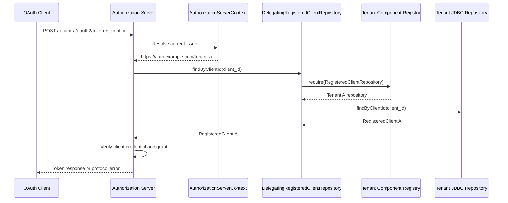
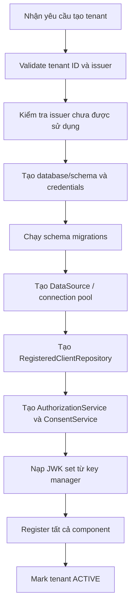

# Tách RegisteredClientRepository theo tenant

## 1. Vì sao phải tách RegisteredClientRepository?

Trong chương **Đa tenant** của module **SPRING_SECURITY_OAUTH2_OIDC_AUTHORIZATION_SERVER**, chúng ta học cách thiết kế, cấu hình, bảo mật, kiểm thử và vận hành OAuth 2.0/OpenID Connect Authorization Server bằng Spring Security và Spring Authorization Server trong ứng dụng Spring Boot.

Một Authorization Server phục vụ nhiều tổ chức cần bảo đảm client của tenant A không thể được tìm thấy, sửa đổi hoặc sử dụng trong ngữ cảnh của tenant B. Mỗi tenant có thể có client ID, client secret, redirect URI, grant type, scope và chính sách riêng. Nếu mọi client cùng nằm trong một repository nhưng truy vấn không có tenant boundary, một lỗi định tuyến có thể làm lộ cấu hình hoặc cấp token theo policy của tenant khác.

Spring Authorization Server định nghĩa RegisteredClientRepository là thành phần trung tâm để lưu và tra cứu RegisteredClient. Repository được gọi trong nhiều protocol flow, gồm client authentication, authorization grant, token introspection và dynamic client registration.

Interface có ba method:

| Method | Mục đích |
| --- | --- |
| save(RegisteredClient registeredClient) | Lưu client registration. |
| findById(String id) | Tìm registration theo ID nội bộ. |
| findByClientId(String clientId) | Tìm registration theo OAuth client identifier. |

Các method không nhận tham số tenant. Vì vậy, khi triển khai đa tenant, ứng dụng cần xác định tenant từ ngữ cảnh Authorization Server của request rồi delegate tới repository tương ứng.

Spring Authorization Server 1.5.8 có hướng dẫn chính thức về mô hình này: bật nhiều issuer trên cùng host, dùng AuthorizationServerContextHolder để lấy issuer hiện tại, tạo component registry theo issuer và dùng một repository tổng hợp để chuyển lời gọi tới repository riêng của tenant.

### Mục tiêu học tập

Sau bài này, bạn có thể:

- Hiểu hợp đồng và vai trò của RegisteredClientRepository.
- Dùng issuer hiện tại làm tenant identifier trong mô hình nhiều issuer.
- Bật multipleIssuersAllowed(true) đúng cách.
- Xây component registry ánh xạ issuer tới repository cụ thể.
- Tạo DelegatingRegisteredClientRepository dùng các repository JDBC riêng.
- Chọn cách cô lập bằng database, schema hoặc shared table.
- Bảo vệ lookup, save, cache, transaction và dynamic registration khỏi cross-tenant access.
- Nhận biết các service khác cũng cần tách tenant để Authorization Server thực sự an toàn.

## 2. RegisteredClientRepository trong Spring Authorization Server

### 2.1. RegisteredClient chứa những dữ liệu nào?

RegisteredClient mô tả một OAuth 2.0 client đã được đăng ký. Các trường quan trọng gồm:

| Thuộc tính | Ý nghĩa |
| --- | --- |
| id | ID nội bộ duy nhất của registration. |
| clientId | Client identifier mà ứng dụng client gửi trong protocol request. |
| clientIdIssuedAt | Thời điểm cấp client ID. |
| clientSecret | Secret đã encode nếu client cần shared secret. |
| clientSecretExpiresAt | Thời điểm secret hết hạn. |
| clientAuthenticationMethods | Phương thức xác thực client. |
| authorizationGrantTypes | Grant type client được phép dùng. |
| redirectUris | Redirect URI đã đăng ký. |
| postLogoutRedirectUris | URI được phép nhận redirect sau logout. |
| scopes | Scope client được phép yêu cầu. |
| clientSettings | Cấu hình client như PKCE và consent. |
| tokenSettings | TTL, refresh token reuse và các token setting khác. |

Client ID không phải secret. Client secret phải được encode bằng Spring Security PasswordEncoder trước khi lưu; không đưa plaintext secret vào database.

### 2.2. Repository là thành phần dùng chung của protocol

Các thành phần trong Spring Authorization Server gọi repository ở nhiều thời điểm:

- Client authentication cần tìm client bằng client_id trước khi xác minh credential.
- Token Endpoint cần đọc grant type, auth method, scope và token settings.
- Authorization flow cần kiểm tra redirect URI và client settings.
- Introspection/revocation cần liên kết authorization với RegisteredClient.
- Dynamic Client Registration cần lưu hoặc đọc registration.

Vì repository xuất hiện ở nhiều flow, việc chọn nhầm tenant không chỉ là lỗi dữ liệu. Nó có thể làm sai issuer, grant policy, redirect URI hoặc credential được chấp nhận.

### 2.3. Hai implementation mặc định

Spring Authorization Server cung cấp:

- InMemoryRegisteredClientRepository: phù hợp phát triển và kiểm thử.
- JdbcRegisteredClientRepository: lưu client bằng JDBC và JdbcOperations.

Trong production, dùng repository bền vững. Với đa tenant, có thể tạo một JdbcRegisteredClientRepository cho mỗi tenant và bọc chúng bằng một repository delegate.

## 3. Chọn tenant bằng issuer identifier

### 3.1. Issuer đại diện cho tenant

OpenID Connect Discovery và OAuth 2.0 Authorization Server Metadata cho phép issuer identifier chứa path component. Spring Authorization Server có thể dùng phần issuer này làm tenant identifier.

Ví dụ hai tenant dùng chung host:

```text
https://auth.example.com/tenant-a
https://auth.example.com/tenant-b
```

Các protocol endpoint sẽ nằm dưới issuer tương ứng:

```text
https://auth.example.com/tenant-a/oauth2/authorize
https://auth.example.com/tenant-a/oauth2/token
https://auth.example.com/tenant-a/oauth2/jwks

https://auth.example.com/tenant-b/oauth2/authorize
https://auth.example.com/tenant-b/oauth2/token
https://auth.example.com/tenant-b/oauth2/jwks
```

Mỗi issuer có metadata riêng. Discovery response của tenant A phải trả issuer và endpoint thuộc tenant A; tenant B phải trả issuer và endpoint thuộc tenant B.

### 3.2. Bật nhiều issuer trên cùng host

Mặc định, hỗ trợ nhiều issuer trên cùng host bị tắt. Bật bằng AuthorizationServerSettings:

```java
import org.springframework.context.annotation.Bean;
import org.springframework.context.annotation.Configuration;
import org.springframework.security.oauth2.server.authorization.settings.AuthorizationServerSettings;

@Configuration(proxyBeanMethods = false)
public class AuthorizationServerSettingsConfig {

    @Bean
    AuthorizationServerSettings authorizationServerSettings() {
        return AuthorizationServerSettings.builder()
                .multipleIssuersAllowed(true)
                .build();
    }
}
```

Trong cấu hình multi-issuer, không gọi issuer("https://auth.example.com") để cố định một issuer duy nhất. Việc cấu hình issuer cố định sẽ ép server về single-tenant issuer context. Khi nhiều issuer được bật, Spring có thể phân giải issuer từ request hiện tại.

### 3.3. AuthorizationServerContextHolder

AuthorizationServerContext chứa thông tin runtime của Authorization Server, gồm AuthorizationServerSettings và issuer hiện tại.

Lấy issuer hiện tại bằng:

```java
import org.springframework.security.oauth2.server.authorization.context.AuthorizationServerContext;
import org.springframework.security.oauth2.server.authorization.context.AuthorizationServerContextHolder;

AuthorizationServerContext context =
        AuthorizationServerContextHolder.getContext();

String issuer = context.getIssuer();
```

Khi issuer không được cấu hình cố định, getIssuer() phân giải issuer từ request hiện tại. Ví dụ request tới https://auth.example.com/tenant-a/oauth2/token có thể cho issuer https://auth.example.com/tenant-a.

### 3.4. Issuer phải được allowlist

Không lấy tenant bằng cách tìm một chuỗi bất kỳ trong URL rồi truy vấn repository tương ứng. Chỉ những issuer đã được đăng ký và phê duyệt mới được sử dụng.

Registry phải tra cứu issuer chính xác. Tránh dùng phép so khớp suffix như issuer.endsWith(tenantId) làm cơ chế duy nhất, vì hai tenant identifier có thể có quan hệ hậu tố hoặc URL khác nhau có thể va chạm. Lưu và so khớp canonical issuer đầy đủ.

Nếu hệ thống đứng sau reverse proxy, chỉ tin forwarded host/proto header từ proxy đã được cấu hình tin cậy. Không để client tự gửi X-Forwarded-Host hoặc Forwarded để chọn issuer khác.

## 4. Component registry theo issuer

### 4.1. Registry làm nhiệm vụ gì?

Registry lưu component cụ thể của từng issuer. Ví dụ:

```text
https://auth.example.com/tenant-a
    -> RegisteredClientRepository A
    -> OAuth2AuthorizationService A
    -> OAuth2AuthorizationConsentService A
    -> JWKSource A

https://auth.example.com/tenant-b
    -> RegisteredClientRepository B
    -> OAuth2AuthorizationService B
    -> OAuth2AuthorizationConsentService B
    -> JWKSource B
```

Mỗi component tổng hợp lấy issuer từ AuthorizationServerContextHolder rồi lấy implementation tương ứng.

### 4.2. Triển khai registry

Ví dụ dưới đây dùng map thread-safe và so khớp issuer chính xác:

```java
import java.util.Map;
import java.util.concurrent.ConcurrentHashMap;
import java.util.concurrent.ConcurrentMap;

import org.springframework.security.oauth2.server.authorization.context.AuthorizationServerContext;
import org.springframework.security.oauth2.server.authorization.context.AuthorizationServerContextHolder;
import org.springframework.stereotype.Component;
import org.springframework.util.Assert;

@Component
public class TenantPerIssuerComponentRegistry {

    private final ConcurrentMap<String, ConcurrentMap<Class<?>, Object>> registry =
            new ConcurrentHashMap<>();

    public <T> void register(String issuer, Class<T> componentType, T component) {
        Assert.hasText(issuer, "issuer cannot be empty");
        Assert.notNull(componentType, "componentType cannot be null");
        Assert.notNull(component, "component cannot be null");

        ConcurrentMap<Class<?>, Object> components =
                this.registry.computeIfAbsent(
                        issuer, key -> new ConcurrentHashMap<>());
        Object previous = components.putIfAbsent(componentType, component);
        Assert.state(previous == null,
                "Component already registered for issuer and type");
    }

    public void registerAll(String issuer, Map<Class<?>, ?> components) {
        Assert.hasText(issuer, "issuer cannot be empty");
        Assert.notEmpty(components, "components cannot be empty");

        ConcurrentMap<Class<?>, Object> snapshot = new ConcurrentHashMap<>();
        components.forEach((componentType, component) -> {
            Assert.notNull(componentType, "componentType cannot be null");
            Assert.notNull(component, "component cannot be null");
            snapshot.put(componentType, component);
        });

        Object previous = this.registry.putIfAbsent(issuer, snapshot);
        Assert.state(previous == null, "Issuer is already registered");
    }

    public <T> T require(Class<T> componentType) {
        AuthorizationServerContext context =
                AuthorizationServerContextHolder.getContext();
        Assert.state(context != null && context.getIssuer() != null,
                "AuthorizationServerContext with issuer is required");

        String issuer = context.getIssuer();
        Map<Class<?>, Object> components = this.registry.get(issuer);
        Assert.state(components != null,
                "Issuer is not registered: " + issuer);

        Object component = components.get(componentType);
        Assert.state(component != null,
                "Component is not registered for issuer: " + issuer);

        return componentType.cast(component);
    }
}
```

Registry này có các thuộc tính quan trọng:

- Issuer là key đầy đủ, không dùng substring/suffix matching.
- Chỉ issuer được đăng ký mới có component.
- Thiếu issuer hoặc component thì fail closed.
- putIfAbsent ngăn vô tình ghi đè component đã đăng ký.
- ConcurrentHashMap hỗ trợ đọc đồng thời từ nhiều request.

Trong hệ thống lớn, registry còn cần quản lý vòng đời component, tenant status, rotation và đóng resource khi tenant bị deprovision.

### 4.3. Chuẩn hóa issuer

Issuer phải nhất quán giữa lúc đăng ký component và lúc request được phân giải. Không tự ý bỏ path, thay host hoặc đổi scheme. Hãy xác định một quy tắc canonicalization duy nhất khi onboarding tenant:

- Scheme và host đúng theo public issuer.
- Port được xác định rõ.
- Path tenant có encoding hợp lệ.
- Không có query hoặc fragment.
- Quy tắc dấu slash cuối nhất quán.

Không chuẩn hóa theo cách khiến hai issuer khác nhau trở thành một key. So khớp exact key sau khi đã xác thực/canonicalize tại ranh giới onboarding.

## 5. DelegatingRegisteredClientRepository

### 5.1. Nguyên tắc delegate

Một repository tổng hợp triển khai interface RegisteredClientRepository. Mỗi method lấy repository hiện tại từ registry rồi chuyển tiếp lời gọi:

```java
import org.springframework.security.oauth2.server.authorization.client.RegisteredClient;
import org.springframework.security.oauth2.server.authorization.client.RegisteredClientRepository;
import org.springframework.stereotype.Component;

@Component
public final class DelegatingRegisteredClientRepository
        implements RegisteredClientRepository {

    private final TenantPerIssuerComponentRegistry componentRegistry;

    public DelegatingRegisteredClientRepository(
            TenantPerIssuerComponentRegistry componentRegistry) {
        this.componentRegistry = componentRegistry;
    }

    @Override
    public void save(RegisteredClient registeredClient) {
        currentRepository().save(registeredClient);
    }

    @Override
    public RegisteredClient findById(String id) {
        return currentRepository().findById(id);
    }

    @Override
    public RegisteredClient findByClientId(String clientId) {
        return currentRepository().findByClientId(clientId);
    }

    private RegisteredClientRepository currentRepository() {
        return this.componentRegistry.require(RegisteredClientRepository.class);
    }
}
```

Repository delegate không cần tự parse client ID hoặc tự chọn tenant bằng request parameter. Tenant đã được xác định qua issuer context của request và registry chỉ trả component của issuer đó.

### 5.2. Vì sao phải delegate cả ba method?

Nếu chỉ delegate findByClientId mà để findById truy cập kho dữ liệu global, các thao tác phục hồi authorization có thể lấy RegisteredClient từ tenant khác.

Nếu chỉ delegate hai method đọc mà save ghi vào repository mặc định, dynamic registration có thể lưu client sai tenant.

Ba method phải dùng cùng một tenant selection rule.

### 5.3. Lỗi khi không tìm thấy tenant

Không fallback về repository mặc định hoặc tenant đầu tiên trong map khi issuer không tồn tại. Fallback như vậy biến một lỗi định tuyến thành khả năng truy cập dữ liệu chéo tenant.

Hãy trả lỗi server phù hợp qua error handling của ứng dụng, ghi audit/correlation ID và không tiết lộ danh sách tenant đang tồn tại cho caller.

## 6. Cấu hình repository JDBC riêng cho từng tenant

### 6.1. Mỗi tenant có DataSource riêng

Spring Authorization Server 1.5.8 minh họa một JdbcRegisteredClientRepository cho mỗi issuer, mỗi repository nhận JdbcTemplate gắn với DataSource riêng.

Ví dụ cấu hình hai tenant:

```java
import javax.sql.DataSource;

import org.springframework.beans.factory.annotation.Qualifier;
import org.springframework.boot.jdbc.DataSourceBuilder;
import org.springframework.context.annotation.Bean;
import org.springframework.context.annotation.Configuration;
import org.springframework.jdbc.core.JdbcTemplate;
import org.springframework.security.oauth2.server.authorization.client.JdbcRegisteredClientRepository;
import org.springframework.security.oauth2.server.authorization.client.RegisteredClientRepository;

@Configuration(proxyBeanMethods = false)
public class RegisteredClientRepositoryConfig {

    @Bean
    RegisteredClientRepository registeredClientRepository(
            @Qualifier("tenantADataSource") DataSource tenantADataSource,
            @Qualifier("tenantBDataSource") DataSource tenantBDataSource,
            TenantPerIssuerComponentRegistry registry) {

        RegisteredClientRepository tenantARepository =
                new JdbcRegisteredClientRepository(
                        new JdbcTemplate(tenantADataSource));

        RegisteredClientRepository tenantBRepository =
                new JdbcRegisteredClientRepository(
                        new JdbcTemplate(tenantBDataSource));

        registry.register(
                "https://auth.example.com/tenant-a",
                RegisteredClientRepository.class,
                tenantARepository);

        registry.register(
                "https://auth.example.com/tenant-b",
                RegisteredClientRepository.class,
                tenantBRepository);

        return new DelegatingRegisteredClientRepository(registry);
    }
}
```

Hai DataSource phải được cấu hình với schema tương thích Spring Authorization Server. Dùng migration tool để tạo bảng trước khi bật tenant; không dựa vào việc application tự tạo schema ở mọi lần khởi động.

### 6.2. DataSource riêng cho từng tenant

Có thể cấu hình DataSource bằng HikariCP hoặc connection pool khác. Ví dụ dưới đây chỉ minh họa tên bean và cách inject:

```java
@Bean("tenantADataSource")
DataSource tenantADataSource(TenantDatabaseProperties properties) {
    return DataSourceBuilder.create()
            .url(properties.tenantA().jdbcUrl())
            .username(properties.tenantA().username())
            .password(properties.tenantA().password())
            .build();
}
```

Trong production, thông tin kết nối nên đến từ secret manager hoặc cấu hình được bảo vệ. Không hardcode username/password trong source.

### 6.3. Đăng ký repository vào SecurityFilterChain

RegisteredClientRepository là thành phần bắt buộc của Authorization Server. Có thể cấu hình trực tiếp qua OAuth2AuthorizationServerConfigurer:

```java
@Bean
SecurityFilterChain authorizationServerSecurityFilterChain(
        HttpSecurity http,
        RegisteredClientRepository registeredClientRepository) throws Exception {

    OAuth2AuthorizationServerConfigurer authorizationServerConfigurer =
            OAuth2AuthorizationServerConfigurer.authorizationServer();

    http
        .securityMatcher(authorizationServerConfigurer.getEndpointsMatcher())
        .with(authorizationServerConfigurer, authorizationServer ->
            authorizationServer
                .registeredClientRepository(registeredClientRepository)
        );

    return http.build();
}
```

Đây là phần minh họa cách gắn repository vào configurer. Ứng dụng vẫn cần cấu hình filter chain, authentication, token generator, issuer, JWK và các endpoint cần thiết khác.

## 7. Luồng lookup client theo tenant

### 7.1. Client Authentication

Client Authentication xảy ra trước khi Token Endpoint xử lý grant. Spring cần tra cứu client bằng client_id, vì vậy repository phải xác định tenant ngay từ issuer của request.



### 7.2. Cùng client_id ở hai tenant

Với repository tách riêng, tenant A và tenant B có thể cùng đăng ký client ID portal:

| Issuer | Client ID | Repository |
| --- | --- | --- |
| https://auth.example.com/tenant-a | portal | Tenant A database/schema. |
| https://auth.example.com/tenant-b | portal | Tenant B database/schema. |

Client identity trong mô hình nhiều issuer cần được hiểu theo cặp issuer và client ID. Resource Server cũng phải xác minh issuer và audience; không được coi client_id giống nhau là cùng một client trên toàn hệ thống.

### 7.3. Không dùng client_id để tự suy ra tenant

client_id là dữ liệu request và chưa được xác thực khi repository lookup bắt đầu. Không phân tích prefix tenant-a rồi mặc nhiên tin tenant do client khai báo. Tenant phải đến từ issuer context đã được server phân giải và allowlist.

Nếu kiến trúc không dùng nhiều issuer và không có tenant context đáng tin cậy tại thời điểm client lookup, hãy yêu cầu client ID duy nhất toàn hệ thống hoặc thiết kế một lớp định tuyến tenant được xác thực trước client authentication.

## 8. Chọn mô hình cô lập dữ liệu

Có ba mô hình phổ biến. Mỗi mô hình có trade-off về mức cô lập, chi phí và vận hành.

| Mô hình | Cách làm | Ưu điểm | Chi phí/rủi ro |
| --- | --- | --- | --- |
| Database per tenant | Mỗi tenant có database và DataSource riêng. | Cô lập mạnh, backup/restore và quota riêng. | Nhiều connection pool, migration và database cần vận hành. |
| Schema per tenant | Cùng database server nhưng mỗi tenant có schema riêng. | Tách namespace và có thể dùng chung hạ tầng DB. | Cần routing schema chính xác, quản lý search path và migration từng schema. |
| Shared table | Một bảng có cột tenant_id. | Ít database/pool, quản lý tập trung, tiết kiệm tài nguyên. | Mọi query phải có tenant predicate; một query thiếu điều kiện có thể gây rò dữ liệu. |

### 8.1. Database per tenant

Tạo một JdbcRegisteredClientRepository và một DataSource cho mỗi tenant. Đây là mô hình trực tiếp trong hướng dẫn Spring Authorization Server.

Ưu điểm:

- Repository của tenant A không nhìn thấy database của tenant B.
- Có thể cấp backup, restore, encryption và quota theo tenant.
- Client ID có thể trùng giữa các tenant.
- Giảm nguy cơ query thiếu tenant_id làm lộ client.

Hạn chế:

- Số lượng tenant lớn làm tăng số DataSource và connection pool.
- Phải quản lý secret kết nối và migration cho từng tenant.
- Provisioning/deprovisioning cần tự động hóa.

### 8.2. Schema per tenant

Có thể tạo mỗi tenant một schema với bảng oauth2_registered_client tương tự nhau, sau đó cấu hình DataSource/JdbcTemplate hoặc connection initialization để truy cập đúng schema.

Không ghép schema name trực tiếp từ request parameter vào SQL. Schema phải được lấy từ registry đã xác thực và được quote/validate theo database engine. Cần kiểm tra connection pool có reset schema/session state khi connection được trả lại hay không.

### 8.3. Shared table với tenant_id

Nếu dùng một bảng chung, schema cần thêm cột tenant:

```sql
ALTER TABLE oauth2_registered_client
    ADD COLUMN tenant_id VARCHAR(100);

-- Backfill tenant_id for existing registrations before enforcing NOT NULL.
-- The exact UPDATE and ALTER syntax depends on the database engine.

CREATE UNIQUE INDEX uk_registered_client_tenant_client
    ON oauth2_registered_client (tenant_id, client_id);

CREATE UNIQUE INDEX uk_registered_client_tenant_id
    ON oauth2_registered_client (tenant_id, id);
```

Đây là migration minh họa; cần backfill dữ liệu cũ trước khi đặt NOT NULL, kiểm tra dialect và constraint của database thực tế.

JdbcRegisteredClientRepository mặc định dùng schema/SQL của framework, không tự thêm tenant_id vào mọi query chỉ vì cột mới xuất hiện. Shared-table model cần custom implementation của RegisteredClientRepository hoặc một cơ chế persistence khác có tenant predicate cho cả save, findById và findByClientId.

Query phải luôn giới hạn tenant:

```sql
SELECT *
FROM oauth2_registered_client
WHERE tenant_id = ?
  AND client_id = ?;
```

Không viết một query dự phòng chỉ có client_id khi tenant context bị thiếu. Không dựa riêng vào application code nếu database có thể hỗ trợ row-level security; hãy cân nhắc RLS như một lớp bảo vệ bổ sung.

## 9. Phân biệt internal ID, client_id và tenant ID

Ba giá trị này có ý nghĩa khác nhau:

| Giá trị | Mục đích | Quy tắc |
| --- | --- | --- |
| Tenant ID/issuer | Chọn miền dữ liệu và issuer của Authorization Server. | Phải được server xác định và allowlist. |
| RegisteredClient.id | Khóa nội bộ liên kết authorization record với client. | Duy nhất trong phạm vi storage; shared database thường cần duy nhất toàn cục. |
| RegisteredClient.clientId | Client identifier trong OAuth protocol. | Có thể unique toàn hệ thống hoặc unique trong tenant tùy kiến trúc. |

Trong database per tenant, hai tenant có thể có cùng internal ID nếu mỗi database độc lập. Trong shared table, nên dùng UUID/global ID hoặc unique constraint composite có tenant.

OAuth2Authorization lưu registeredClientId để liên kết tới RegisteredClient. Vì vậy, OAuth2AuthorizationService phải tra cứu RegisteredClient trong đúng tenant. Không để authorization của tenant A tham chiếu ID được giải nghĩa trong repository tenant B.

## 10. Các component khác cũng phải được tách tenant

Tách RegisteredClientRepository là một phần quan trọng nhưng chưa đủ để có Authorization Server đa tenant an toàn.

Spring Authorization Server 1.5.8 hướng dẫn bốn component cần multi-tenant capability:

1. RegisteredClientRepository.
2. OAuth2AuthorizationService.
3. OAuth2AuthorizationConsentService.
4. JWKSource<SecurityContext>.

### 10.1. OAuth2AuthorizationService

Authorization service lưu authorization code, access token, refresh token, ID Token, principal và state của grant. Nếu client được tra cứu ở tenant A nhưng authorization được lưu vào kho global không có tenant boundary, token state có thể bị đọc hoặc thu hồi sai tenant.

Tạo một JdbcOAuth2AuthorizationService cho mỗi tenant và delegate bằng cùng issuer registry. Khi khởi tạo service con, truyền RegisteredClientRepository delegate tương ứng để lúc khôi phục authorization, client được tra cứu trong tenant hiện tại.

### 10.2. OAuth2AuthorizationConsentService

Consent gắn với RegisteredClient và resource owner. Nếu consent dùng chung không có tenant boundary, một tenant có thể vô tình thừa hưởng consent của tenant khác, đặc biệt khi cùng principal name và client ID.

Tạo JdbcOAuth2AuthorizationConsentService theo tenant và delegate theo issuer. Khi tìm consent, cặp client registration và principal phải được giải nghĩa trong đúng tenant.

### 10.3. JWKSource

JWKSource quyết định key nào ký token và public key nào được công bố qua JWKS endpoint. Mỗi tenant có thể có JWK set riêng để token của tenant A không được ký bằng private key của tenant B.

Tạo JWKSource<SecurityContext> tổng hợp, lấy JWK set theo issuer hiện tại. Khi ký JWT, key selection phải thuộc tenant của request. Khi phục vụ JWKS endpoint, chỉ công bố public key của issuer tương ứng.

### 10.4. Những component khác cần xem xét

Tùy ứng dụng, còn có thể phải tách:

- OIDC UserInfo và user/subject lookup.
- Dynamic Client Registration metadata và registration access token.
- Token customizer và claim policy.
- Device authorization state.
- PAR request state.
- Token revocation/introspection state.
- Audit, rate limit, quota và tenant-specific policy.
- Cache cho client, authorization và JWK.

Mọi dữ liệu được tra cứu trong protocol flow cần có tenant boundary nhất quán.

## 11. Đăng ký OAuth2AuthorizationService theo tenant

Mẫu delegate tương tự repository:

```java
import org.springframework.security.oauth2.server.authorization.OAuth2Authorization;
import org.springframework.security.oauth2.server.authorization.OAuth2AuthorizationService;
import org.springframework.security.oauth2.server.authorization.OAuth2TokenType;

public final class DelegatingOAuth2AuthorizationService
        implements OAuth2AuthorizationService {

    private final TenantPerIssuerComponentRegistry registry;

    public DelegatingOAuth2AuthorizationService(
            TenantPerIssuerComponentRegistry registry) {
        this.registry = registry;
    }

    @Override
    public void save(OAuth2Authorization authorization) {
        current().save(authorization);
    }

    @Override
    public void remove(OAuth2Authorization authorization) {
        current().remove(authorization);
    }

    @Override
    public OAuth2Authorization findById(String id) {
        return current().findById(id);
    }

    @Override
    public OAuth2Authorization findByToken(
            String token, OAuth2TokenType tokenType) {
        return current().findByToken(token, tokenType);
    }

    private OAuth2AuthorizationService current() {
        return registry.require(OAuth2AuthorizationService.class);
    }
}
```

Khi đăng ký các implementation JDBC:

```java
JdbcOAuth2AuthorizationService tenantAAuthorizationService =
        new JdbcOAuth2AuthorizationService(
                new JdbcTemplate(tenantADataSource),
                delegatingRegisteredClientRepository);

JdbcOAuth2AuthorizationService tenantBAuthorizationService =
        new JdbcOAuth2AuthorizationService(
                new JdbcTemplate(tenantBDataSource),
                delegatingRegisteredClientRepository);

registry.register(
        "https://auth.example.com/tenant-a",
        OAuth2AuthorizationService.class,
        tenantAAuthorizationService);

registry.register(
        "https://auth.example.com/tenant-b",
        OAuth2AuthorizationService.class,
        tenantBAuthorizationService);
```

Ví dụ cần được đặt trong quá trình bootstrap component. Cả hai service JDBC dùng repository delegate; khi đọc authorization trong request, issuer context chọn đúng repository con.

## 12. Đăng ký OAuth2AuthorizationConsentService theo tenant

Delegate cần chuyển tiếp đủ ba method:

```java
import org.springframework.security.oauth2.server.authorization.OAuth2AuthorizationConsent;
import org.springframework.security.oauth2.server.authorization.OAuth2AuthorizationConsentService;

public final class DelegatingOAuth2AuthorizationConsentService
        implements OAuth2AuthorizationConsentService {

    private final TenantPerIssuerComponentRegistry registry;

    public DelegatingOAuth2AuthorizationConsentService(
            TenantPerIssuerComponentRegistry registry) {
        this.registry = registry;
    }

    @Override
    public void save(OAuth2AuthorizationConsent consent) {
        current().save(consent);
    }

    @Override
    public void remove(OAuth2AuthorizationConsent consent) {
        current().remove(consent);
    }

    @Override
    public OAuth2AuthorizationConsent findById(
            String registeredClientId, String principalName) {
        return current().findById(registeredClientId, principalName);
    }

    private OAuth2AuthorizationConsentService current() {
        return registry.require(OAuth2AuthorizationConsentService.class);
    }
}
```

Đăng ký một JdbcOAuth2AuthorizationConsentService riêng cho từng tenant bằng DataSource tương ứng. Không dùng global consent repository khi RegisteredClient đã được partition theo issuer.

## 13. JWKSource và signing key theo tenant

### 13.1. Chọn JWK set theo issuer

JWKSource tổng hợp có thể lấy JWKSet từ registry:

```java
import java.util.List;

import com.nimbusds.jose.jwk.JWK;
import com.nimbusds.jose.jwk.JWKSet;
import com.nimbusds.jose.jwk.JWKSelector;
import com.nimbusds.jose.jwk.source.JWKSource;
import com.nimbusds.jose.proc.SecurityContext;

public final class TenantJWKSource implements JWKSource<SecurityContext> {

    private final TenantPerIssuerComponentRegistry registry;

    public TenantJWKSource(TenantPerIssuerComponentRegistry registry) {
        this.registry = registry;
    }

    @Override
    public List<JWK> get(
            JWKSelector selector,
            SecurityContext context) {
        JWKSet jwkSet = this.registry.require(JWKSet.class);
        return selector.select(jwkSet);
    }
}
```

Registry cần đăng ký JWK set riêng theo issuer. Trong production, private key nên được quản lý bởi KMS/HSM hoặc secret/key management system phù hợp. Ví dụ sinh RSA key trong bộ nhớ chỉ phù hợp minh họa/test.

### 13.2. Vì sao key cần tenant boundary?

Nếu mọi issuer dùng chung private key, token của tenant A và B có thể cùng được ký bởi một key. Điều này không nhất thiết sai trong mọi kiến trúc, nhưng làm giảm khả năng cô lập và tăng tác động khi key bị lộ.

Với key riêng:

- Tenant có thể rotate/revoke key độc lập.
- JWKS của issuer chỉ công bố public key tương ứng.
- Sự cố private key của một tenant ít ảnh hưởng tenant khác.
- Quy trình audit và ownership key rõ hơn.

Resource Server vẫn phải kiểm tra iss và aud. Chữ ký hợp lệ từ một key không tự chứng minh token thuộc đúng issuer hoặc resource.

### 13.3. Key rotation

Mỗi tenant cần quy trình rotation:

1. Tạo key mới trong key manager.
2. Công bố public key mới trong JWKS của issuer.
3. Chuyển ký token mới sang key mới.
4. Giữ public key cũ đủ lâu để xác minh token còn hạn.
5. Gỡ public key cũ khi không còn token hợp lệ dùng key đó.

Không xóa JWK cũ ngay khi đổi signing key nếu access token cũ vẫn còn hiệu lực.

## 14. Đăng ký toàn bộ component cho một tenant

Khi onboarding tenant, các component nên được khởi tạo như một nhóm nhất quán:

```java
import java.util.Map;

public void registerTenantComponents(
        String issuer,
        DataSource dataSource,
        TenantPerIssuerComponentRegistry registry,
        RegisteredClientRepository delegatingRegisteredClientRepository) {

    JdbcTemplate jdbc = new JdbcTemplate(dataSource);

    RegisteredClientRepository clients =
            new JdbcRegisteredClientRepository(jdbc);

    OAuth2AuthorizationService authorizations =
            new JdbcOAuth2AuthorizationService(
                    jdbc, delegatingRegisteredClientRepository);

    OAuth2AuthorizationConsentService consents =
            new JdbcOAuth2AuthorizationConsentService(
                    jdbc, delegatingRegisteredClientRepository);

    JWKSet jwkSet = loadTenantJwkSetFromKeyManager(issuer);

    registry.registerAll(issuer, Map.of(
            RegisteredClientRepository.class, clients,
            OAuth2AuthorizationService.class, authorizations,
            OAuth2AuthorizationConsentService.class, consents,
            JWKSet.class, jwkSet));
}
```

Đây là skeleton minh họa; cần import java.util.Map và Assert.notEmpty có thể được thay bằng validation tương đương theo phiên bản Spring đang dùng. registerAll tạo snapshot component rồi công bố issuer bằng một thao tác putIfAbsent, tránh để request nhìn thấy tenant chỉ có một phần component.

Cần bảo đảm:

- Schema đã được migrate trước khi component được công bố.
- DataSource có giới hạn pool và credential đúng tenant.
- JWK set đã được nạp từ key manager.
- Registry không công bố tenant khi chỉ một vài component đã sẵn sàng.
- Nếu bước khởi tạo thất bại, giải phóng resource đã tạo và không để tenant ở trạng thái nửa đăng ký.

Trong production, nên có một TenantDescriptor/tenant lifecycle state riêng để quản lý PROVISIONING, ACTIVE, SUSPENDED và DEPROVISIONING.

## 15. Thêm tenant động khi runtime

### 15.1. Khi nào cần dynamic tenant registry?

Nếu số tenant cố định, có thể tạo các bean DataSource/repository riêng khi application khởi động. Nếu tenant được thêm hoặc xóa khi hệ thống đang chạy, khai báo mọi DataSource bằng @Bean có thể không phù hợp.

Spring Authorization Server hướng dẫn có thể đăng ký DataSource và các component vào registry lúc startup hoặc runtime.

### 15.2. Quy trình onboarding tenant



Tenant chỉ được đánh dấu ACTIVE sau khi mọi dependency thiết yếu sẵn sàng. Nếu registry được cập nhật trước migration hoặc trước khi JWK sẵn sàng, request đầu tiên có thể thất bại giữa chừng.

### 15.3. Quản lý vòng đời DataSource

DataSource thường giữ connection pool và thread housekeeping. Khi deprovision tenant:

- Ngừng nhận request mới cho issuer đó.
- Xác định cách xử lý authorization/token còn hiệu lực.
- Thu hồi hoặc vô hiệu hóa client theo policy.
- Gỡ component khỏi registry theo trình tự an toàn.
- Đóng connection pool sau khi request đang chạy kết thúc.
- Giữ dữ liệu theo retention/backup policy.

Không tạo một pool mới cho mỗi request. Component và DataSource phải có vòng đời dài hơn request và được quản lý tập trung.

### 15.4. Giới hạn số tenant

Nếu mỗi tenant có nhiều pool riêng, số connection tối đa xấp xỉ tổng pool của tất cả tenant và tất cả application replica. Cần đặt quota và giới hạn theo database capacity. Tenant count tăng không đồng nghĩa connection count được phép tăng không giới hạn.

## 16. Tenant context, transaction và thread

### 16.1. Context phải có trước khi repository được gọi

Trong multi-issuer flow của Spring Authorization Server, AuthorizationServerContextHolder cung cấp issuer hiện tại cho component registry. Repository delegate chỉ nên được gọi khi context đã sẵn sàng.

Nếu có admin API hoặc background job gọi RegisteredClientRepository ngoài protocol request, AuthorizationServerContextHolder có thể không tồn tại. Các use case đó cần một đường gọi rõ ràng có tenant đã được xác thực, ví dụ một service nhận tenant ID và lấy repository cụ thể từ registry. Không đoán tenant mặc định.

### 16.2. Context gắn với request thread

AuthorizationServerContextHolder dùng context gắn với thread hiện tại. Khi dùng async executor, scheduler hoặc message consumer, không giả định context tự truyền sang thread khác.

Worker nên nhận issuer/tenant ID như một trường dữ liệu đã được xác thực, kiểm tra trạng thái tenant và mở execution context phù hợp trước khi gọi component. Luôn clear context sau khi xử lý để tránh rò context giữa các request nếu ứng dụng tự quản lý ThreadLocal.

### 16.3. Không đổi tenant giữa transaction

Transaction JDBC đã lấy connection từ DataSource hoặc routing layer thì connection đó gắn với transaction hiện tại. Đổi issuer/tenant giữa transaction không làm connection tự chuyển sang database khác.

Vì vậy:

- Xác định issuer trước khi bắt đầu persistence transaction.
- Giữ tenant context bất biến trong suốt transaction.
- Không gọi service tenant B từ transaction đang chạy với connection tenant A.
- Với cross-tenant administration, dùng transaction riêng cho từng tenant hoặc một workflow có trạng thái rõ ràng.

### 16.4. Transaction manager phải khớp DataSource

JdbcRegisteredClientRepository, JdbcOAuth2AuthorizationService và JdbcOAuth2AuthorizationConsentService dùng JdbcOperations gắn với DataSource của tenant. Nếu một nghiệp vụ cần nhiều thao tác JDBC cùng commit/rollback, transaction manager phải quản lý đúng DataSource mà các thao tác đó sử dụng.

Trong mô hình có nhiều DataSource vật lý, một transaction manager tĩnh không tự động chuyển sang database của issuer hiện tại. Có thể dùng một tenant-aware routing DataSource với tenant context được cố định trước khi transaction bắt đầu, hoặc quản lý transaction manager theo tenant bằng một abstraction có vòng đời rõ ràng. Không đổi issuer sau khi transaction đã lấy connection.

Nếu các service dùng các DataSource khác nhau, một @Transactional cục bộ không tạo distributed transaction. Cần dùng cùng transactional resource hoặc thiết kế outbox/saga cho thao tác liên hệ nhiều database.

## 17. Cache cũng phải có tenant boundary

Một cache global có key chỉ là client_id có thể trả RegisteredClient của tenant A cho request tenant B nếu hai tenant cùng dùng client ID.

Cache key nên chứa issuer/tenant:

```text
cache key = issuer + ":" + client_id
cache key = issuer + ":" + registered_client_internal_id
```

Cache invalidation cũng phải tenant-aware. Khi client của tenant A đổi secret, redirect URI hoặc scope, không xóa/ghi đè cache entry tenant B có cùng client ID.

Không cache negative lookup global theo client ID đơn lẻ. Nếu portal không tồn tại ở tenant A nhưng tồn tại ở tenant B, cache miss của A không được áp dụng cho B.

## 18. Dynamic Client Registration và tenant

Nếu bật OpenID Connect Dynamic Client Registration, request registration đi qua issuer của tenant. RegisteredClientRepository.save() phải delegate tới repository của issuer đó.

Các nguyên tắc:

- Initial Access Token phải được cấp và xác minh trong tenant tương ứng.
- Registration Access Token phải gắn với registration và tenant.
- registration_client_uri phải dùng issuer/endpoint của tenant.
- Read/update/delete registration phải kiểm tra cùng tenant boundary nếu ứng dụng triển khai các thao tác đó.
- Không cho token registration của tenant A đọc client tenant B.

Dynamic registration không được tự tạo tenant mới chỉ vì request chứa một issuer chưa biết. Tenant phải được provision và allowlist trước khi cho phép registration.

## 19. Bảo mật và lỗi thường gặp

### 19.1. Không tin tenant header tùy ý

Một header như X-Tenant-Id do client gửi không phải bằng chứng client được phép truy cập tenant đó. Nếu dùng host/path/forwarded header để chọn issuer, cần bảo vệ proxy boundary và kiểm tra issuer trong allowlist.

### 19.2. Không fallback sang repository global

Khi registry không tìm thấy issuer, trả lỗi. Không chuyển sang repository mặc định, tenant đầu tiên hoặc một tenant public không được yêu cầu rõ ràng.

### 19.3. Không dùng suffix matching

So sánh issuer bằng suffix có thể làm nhầm issuer. Dùng exact canonical issuer string làm key. Nếu cần map path tenant ID, parse bằng URI/path parser rồi tra tenant registry; không dùng chuỗi con tùy tiện.

### 19.4. Không chỉ tách client repository

Nếu RegisteredClientRepository được partition nhưng authorization, consent hoặc JWK vẫn dùng global store, tenant boundary chưa hoàn chỉnh. Kiểm tra tất cả component được gọi trong flow và mọi cache liên quan.

### 19.5. Không log secret/token

Không log client secret, authorization code, access token, refresh token, registration access token hoặc Authorization header khi debug tenant routing. Dùng correlation ID, issuer đã được allowlist và client ID nếu policy cho phép.

### 19.6. Lỗi thường gặp

| Triệu chứng | Nguyên nhân có thể | Cách xử lý |
| --- | --- | --- |
| Repository không tìm thấy tenant | Không có AuthorizationServerContext hoặc issuer chưa đăng ký. | Kiểm tra multi-issuer setting và issuer allowlist. |
| Mọi request đều vào một tenant | Issuer bị cấu hình cố định bằng issuer(...). | Bỏ issuer cố định khi dùng multi-issuer. |
| Client của tenant khác được tìm thấy | Delegate dùng global repository hoặc cache key thiếu tenant. | Delegate đủ ba method và tenant-scope cache. |
| Dynamic registration lưu nhầm tenant | Save không dùng issuer context hiện tại. | Kiểm tra request issuer và repository delegate. |
| Authorization không khôi phục được | Authorization service và client repository dùng tenant context khác nhau. | Delegate cả hai bằng cùng issuer registry. |
| Token ký bằng key sai tenant | JWKSource global hoặc registry chọn sai issuer. | Tách JWKSource/JWKSet và kiểm tra iss. |
| Tenant mới lỗi ngay sau onboarding | Registry công bố trước migration/component readiness. | Đăng ký nguyên tử sau khi mọi dependency sẵn sàng. |
| Async job tra cứu nhầm tenant | Context không được truyền hoặc không được thiết lập. | Truyền tenant ID đã xác thực và tạo context trong worker. |
| Pool database cạn | Mỗi tenant tạo pool không giới hạn. | Đặt quota, pool budget và lifecycle cho DataSource. |

## 20. Kiểm thử RegisteredClientRepository đa tenant

| Nhóm kiểm thử | Kịch bản | Kỳ vọng |
| --- | --- | --- |
| Registry lookup | Issuer A đã đăng ký. | Trả repository A. |
| Registry lookup | Issuer chưa biết. | Fail closed, không fallback. |
| Issuer matching | Issuer B có suffix gần giống issuer A. | Chỉ exact issuer mới được chọn. |
| Missing context | Gọi repository khi không có AuthorizationServerContext. | Lỗi cấu hình/ngữ cảnh rõ ràng. |
| Client lookup | Cùng client ID ở tenant A và B. | Mỗi issuer trả đúng registration riêng. |
| Internal ID lookup | Cùng internal ID trong hai DB độc lập. | Mỗi tenant chỉ đọc ID trong storage của mình. |
| Save | Đăng ký client qua issuer A. | Chỉ database/schema A có record mới. |
| Cross-tenant | Token/issuer A tìm client chỉ có ở B. | Không tìm thấy client. |
| Client authentication | Secret A dùng với issuer B. | Authentication thất bại. |
| Grant policy | Client A xin grant/scope chỉ có ở B. | Bị từ chối. |
| Authorization persistence | Token phát ở tenant A. | Authorization được lưu ở A. |
| Consent | Cùng principal/client ID ở hai tenant. | Consent không bị dùng chéo. |
| JWK | Gọi JWKS issuer A/B. | Chỉ public key đúng issuer được công bố. |
| JWT validation | Token issuer A gửi tới resource server yêu cầu issuer B. | Bị từ chối. |
| Dynamic registration | Đăng ký qua issuer A. | Registration và management token gắn với A. |
| Cache | Cache cùng client ID ở hai tenant. | Hai entry tách biệt. |
| Concurrency | Nhiều request đồng thời trên hai issuer. | Không lẫn repository/context. |
| Dynamic tenant | Tenant chưa active nhận request. | Bị từ chối cho tới khi provision hoàn tất. |
| Deprovision | Tenant đã suspended/deprovisioning. | Không tạo registration hoặc token mới. |

### 20.1. Integration test với hai issuer

Tạo hai issuer:

- https://auth.example.com/tenant-a
- https://auth.example.com/tenant-b

Đăng ký cùng client ID portal nhưng dùng secret và scope khác nhau trong từng repository. Gửi token request tới từng issuer:

1. Secret A với issuer A phải thành công nếu grant hợp lệ.
2. Secret A với issuer B phải thất bại.
3. Secret B với issuer B phải thành công nếu grant hợp lệ.
4. JWT do issuer A ký phải có iss là issuer A.
5. JWKS của issuer A không được trả private key hoặc key set của B.

### 20.2. Test component registry

Kiểm tra registry với issuer chưa đăng ký, issuer sai scheme/host/path, trailing slash khác quy tắc, context null và component type chưa được register. Các trường hợp thiếu context hoặc tenant không tồn tại phải thất bại rõ ràng.

## 21. Bài tập thực hành và checklist

### Bài tập 1 — Hai tenant, hai repository

Tạo hai DataSource và hai JdbcRegisteredClientRepository. Đăng ký chúng vào component registry theo issuer, rồi tạo DelegatingRegisteredClientRepository.

### Bài tập 2 — Bật multiple issuers

Cấu hình multipleIssuersAllowed(true). Dùng hai path issuer và kiểm tra Discovery metadata trả đúng token endpoint, JWKS URI và issuer.

### Bài tập 3 — Cùng client ID

Đăng ký client ID portal ở hai tenant với secret/scope khác nhau. Kiểm tra findByClientId trả đúng record theo issuer.

### Bài tập 4 — Tách authorization và consent

Tạo hai JdbcOAuth2AuthorizationService và hai JdbcOAuth2AuthorizationConsentService theo tenant. Kiểm tra authorization/consent không đọc chéo.

### Bài tập 5 — Tách signing key

Tạo JWK set riêng cho từng tenant. Phát JWT qua mỗi issuer và kiểm tra issuer, kid, JWKS response.

### Bài tập 6 — Dynamic tenant lifecycle

Viết service provision tenant theo các bước database/schema, migration, DataSource, repository, authorization/consent service, JWK và registry. Chỉ bật tenant sau khi tất cả component sẵn sàng.

### Checklist hoàn thành

- [ ] Hiểu ba method của RegisteredClientRepository.
- [ ] Hiểu vì sao repository cần tenant-aware delegation.
- [ ] Bật multipleIssuersAllowed(true) và không cố định issuer trong multi-issuer mode.
- [ ] Lấy issuer từ AuthorizationServerContextHolder.
- [ ] Dùng exact issuer allowlist trong component registry.
- [ ] Delegate save, findById và findByClientId.
- [ ] Chọn database/schema/shared-table model phù hợp.
- [ ] Hiểu shared table cần tenant predicate trong mọi query.
- [ ] Tách OAuth2AuthorizationService, OAuth2AuthorizationConsentService và JWKSource.
- [ ] Dùng tenant-aware cache key.
- [ ] Bảo đảm tenant context ổn định trong transaction và async worker.
- [ ] Quản lý onboarding, suspension và deprovision tenant.
- [ ] Kiểm thử cross-tenant lookup, client authentication, token, consent và JWKS.

## 22. Tài liệu tham khảo

- [Spring Authorization Server 1.5.8 — How-to: Implement Multitenancy](https://docs.spring.io/spring-authorization-server/reference/guides/how-to-multitenancy.html) — multiple issuers, component registry, delegating RegisteredClientRepository, authorization/consent services, JWKSource và dynamic tenant.
- [Spring Authorization Server — Core Model Components](https://docs.spring.io/spring-authorization-server/reference/core-model-components.html) — RegisteredClient, RegisteredClientRepository, OAuth2Authorization và OAuth2AuthorizationService.
- [Spring Authorization Server API — RegisteredClientRepository](https://docs.spring.io/spring-authorization-server/reference/api/java/org/springframework/security/oauth2/server/authorization/client/RegisteredClientRepository.html) — contract của save, findById và findByClientId.
- [Spring Authorization Server API — AuthorizationServerContext](https://docs.spring.io/spring-authorization-server/reference/api/java/org/springframework/security/oauth2/server/authorization/context/AuthorizationServerContext.html) — issuer được phân giải từ AuthorizationServerContext.
- [Spring Authorization Server API — AuthorizationServerSettings.Builder](https://docs.spring.io/spring-authorization-server/reference/api/java/org/springframework/security/oauth2/server/authorization/settings/AuthorizationServerSettings.Builder.html) — cấu hình multipleIssuersAllowed.
- [RFC 8414 — OAuth 2.0 Authorization Server Metadata](https://www.rfc-editor.org/rfc/rfc8414) — issuer và metadata endpoint.
- [OpenID Connect Discovery 1.0](https://openid.net/specs/openid-connect-discovery-1_0.html) — issuer, provider configuration và endpoint discovery.
- [RFC 7519 — JSON Web Token](https://www.rfc-editor.org/rfc/rfc7519) — issuer (iss), audience (aud) và claims thời gian.

**Kết luận:** Để tách RegisteredClientRepository theo tenant, hãy xác định tenant bằng issuer hiện tại, đăng ký repository cụ thể cho từng issuer và dùng một repository delegate chuyển tiếp cả save, findById lẫn findByClientId. Spring Authorization Server 1.5.8 cung cấp pattern này cùng component registry và các JDBC repository riêng. Để bảo đảm cô lập end-to-end, phải áp dụng cùng tenant boundary cho authorization, consent, JWK, cache và các luồng quản trị/dynamic registration.
