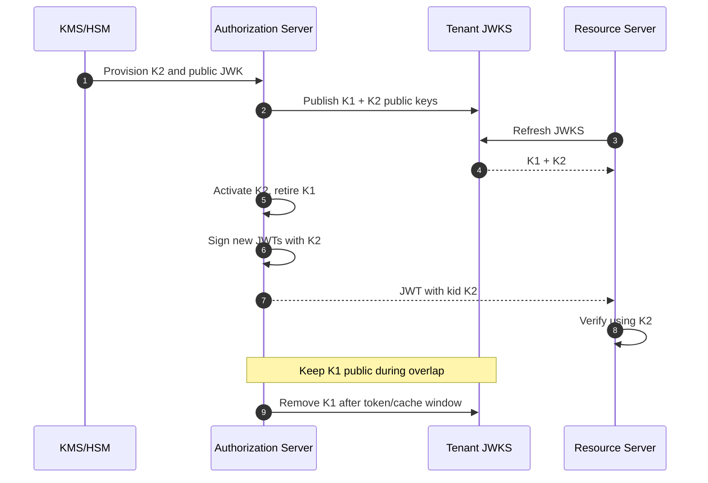

# Cô lập khóa ký, JWKS và chính sách token giữa các tenant

## 1. Bài toán: nhiều tenant dùng chung Authorization Server

Một nền tảng SaaS có thể phục vụ nhiều tổ chức trên cùng cụm Spring Authorization Server. Mỗi tổ chức có client, người dùng, scope, resource và chính sách token riêng. Một số tổ chức còn yêu cầu khóa ký do chính họ quản lý hoặc khóa được lưu trong KMS/HSM riêng.

Nếu tất cả tenant dùng chung một cặp khóa ký và một JWK Set, mọi token có cùng nguồn khóa xác minh. Resource Server khó phân biệt tenant chỉ dựa trên chữ ký; một cấu hình sai audience hoặc issuer có thể khiến token của tenant A được chấp nhận trong ngữ cảnh tenant B. Việc xoay khóa, thu hồi khóa hoặc thay chính sách cho một tenant cũng có thể ảnh hưởng toàn hệ thống.

Thiết kế multi-tenant cần cô lập ít nhất ba lớp:

1. **Khóa ký và JWKS:** mỗi issuer chỉ ký bằng khóa thuộc tenant đó và chỉ công bố public key của tenant đó.
2. **Chính sách token:** mỗi tenant có audience, scope, TTL, token format, grant và claim policy phù hợp.
3. **Xác minh ở Resource Server:** token phải có issuer được tin cậy, chữ ký khớp khóa của issuer đó và audience đúng với API đang nhận token.

Bài này hướng dẫn cách triển khai các lớp đó với Spring Authorization Server 1.5.8, Spring Security 6.5 và mô hình nhiều issuer trên cùng host. Nội dung bao gồm quản lý key ring, JWKSource theo issuer, JWKS discovery, rotation, token customization, Resource Server resolver và kiểm thử ngăn truy cập chéo tenant.

Bài thuộc chương **Đa tenant** của module **SPRING_SECURITY_OAUTH2_OIDC_AUTHORIZATION_SERVER**. Mục tiêu tổng thể của module là **học cách thiết kế, cấu hình, bảo mật, kiểm thử và vận hành OAuth 2.0/OpenID Connect Authorization Server bằng Spring Security và Spring Authorization Server trong ứng dụng Spring Boot**.

### Mục tiêu học tập

Sau bài này, bạn có thể:

- Xác định tenant bằng issuer URI đã chuẩn hóa.
- Bật multiple issuers per host trong Spring Authorization Server.
- Chọn JWKSet theo issuer hiện tại bằng JWKSource tổng hợp.
- Tách private signing key khỏi public JWKS và lưu private key trong KMS/HSM.
- Thiết kế key ring, key ID, key status và quy trình rotation.
- Công bố JWKS và metadata riêng cho từng issuer.
- Áp dụng token settings, audience, scope và claim policy theo tenant/client.
- Cấu hình Resource Server chọn JwtDecoder theo issuer allowlist.
- Ngăn token của tenant A được dùng trong tenant B.
- Kiểm thử key isolation, JWKS isolation, rotation, cache và token policy.

> **Phạm vi phiên bản:** Ví dụ sử dụng Spring Authorization Server 1.5.8 và Spring Security 6.5.x. Các ví dụ KMS/HSM và persistence là mẫu kiến trúc; API cụ thể phụ thuộc nhà cung cấp. SPECIAL_NOTE của bài được giao để trống.

## 2. Ranh giới tenant được xác định bằng issuer

Trong OAuth 2.0/OIDC, issuer (claim iss) là định danh của Authorization Server. Spring Authorization Server hỗ trợ nhiều issuer trên cùng host bằng cách đưa tenant vào path của issuer URI.

Ví dụ:

| Tenant | Issuer | JWK Set URI |
| --- | --- | --- |
| tenant-a | https://auth.example.com/tenant-a | https://auth.example.com/tenant-a/oauth2/jwks |
| tenant-b | https://auth.example.com/tenant-b | https://auth.example.com/tenant-b/oauth2/jwks |

Metadata OIDC của mỗi issuer công bố endpoint tương ứng. Client của tenant A discovery metadata từ issuer A sẽ nhận jwks_uri của A; tenant B nhận JWKS URI của B.

### 2.1. Bật multiple issuers

Spring Authorization Server tắt chế độ nhiều issuer trên một host theo mặc định. Cấu hình:

```java
@Bean
AuthorizationServerSettings authorizationServerSettings() {
    return AuthorizationServerSettings.builder()
            .multipleIssuersAllowed(true)
            .build();
}
```

Trong cấu hình này, không gọi issuer("https://auth.example.com"). Khi issuer được cấu hình cố định, Authorization Server chuyển sang một issuer duy nhất. Với multi-tenant, issuer được phân giải từ request hiện tại.

### 2.2. AuthorizationServerContext

AuthorizationServerContext cung cấp issuer hiện tại và AuthorizationServerSettings. Spring lưu context vào AuthorizationServerContextHolder bằng ThreadLocal.

```java
AuthorizationServerContext context =
        AuthorizationServerContextHolder.getContext();

Assert.state(context != null, "AuthorizationServerContext is required");
String issuer = context.getIssuer();
```

Issuer có thể được phân giải từ request path, ví dụ:

- https://auth.example.com/tenant-a/oauth2/token → issuer https://auth.example.com/tenant-a.
- https://auth.example.com/tenant-b/oauth2/jwks → issuer https://auth.example.com/tenant-b.

Đây là nguồn định tuyến tenant cho các component chạy trong request pipeline của Authorization Server.

### 2.3. Chuẩn hóa issuer URI

Issuer là định danh chính xác, không phải tên tenant gần đúng. Registry nên lưu và tra cứu toàn bộ canonical issuer URI:

```java
Map<String, TenantRuntime> tenantsByIssuer;

TenantRuntime requireTenant(String issuer) {
    TenantRuntime tenant = tenantsByIssuer.get(issuer);
    if (tenant == null) {
        throw new IllegalStateException("Unknown issuer");
    }
    return tenant;
}
```

Không dùng endsWith(tenantId) hoặc contains(tenantId) để chọn tenant trong production. Hai issuer có suffix giống nhau hoặc path lồng nhau có thể bị phân giải nhầm. Dùng exact match sau khi chuẩn hóa scheme, host, port và path theo quy ước triển khai.

Nếu TLS terminate tại reverse proxy, chỉ tin forwarded host/proto headers từ proxy đã được cấu hình tin cậy. Proxy phải loại bỏ header do client tự gửi và ghi lại giá trị chuẩn. Nếu không, attacker có thể tác động issuer được phân giải từ request.

## 3. Các thành phần phải được cô lập theo tenant

Spring Authorization Server xác định JWKSource<SecurityContext> là một trong các component cần hỗ trợ multi-tenancy. Những component dữ liệu khác cũng phải được phân tách:

| Component | Dữ liệu | Cách cô lập |
| --- | --- | --- |
| JWKSource<SecurityContext> | Private signing key và public JWK | Key ring riêng theo issuer |
| RegisteredClientRepository | Client ID, grant, scope, token settings | Repository/schema/database riêng hoặc tenant predicate |
| OAuth2AuthorizationService | Authorization code, access/refresh token, metadata | Storage riêng hoặc tenant predicate |
| OAuth2AuthorizationConsentService | Consent của user/client | Storage riêng hoặc tenant predicate |
| TenantTokenPolicyRegistry | Audience, TTL cap, scope policy, token claims | Policy record riêng theo issuer |

Nếu chỉ cô lập JWKSource nhưng dùng chung RegisteredClientRepository mà không có tenant boundary, client ID của tenant A có thể được tìm thấy trong request tenant B. Nếu dùng chung authorization store mà thiếu tenant predicate, token introspection hoặc revocation có thể đọc nhầm authorization của tenant khác.

Có thể dùng database riêng, schema riêng hoặc shared tables có tenant_id. Dù chọn mô hình nào, mọi thao tác phải được ràng buộc bằng issuer đã xác minh.

## 4. Kiến trúc tổng thể

Mỗi tenant có một issuer, key ring, client registry và token policy riêng. Spring Authorization Server có thể dùng một bean JWKSource tổng hợp, nhưng bean này chỉ trả về key set của issuer hiện tại.

```mermaid
flowchart TB
    subgraph AS["Spring Authorization Server"]
        R["Issuer Resolver"]
        C["AuthorizationServerContext"]
        R --> C
        C --> J["Tenant JWKSource"]
        C --> P["Tenant Token Policy"]
        C --> RC["Tenant RegisteredClientRepository"]
        C --> A["Tenant Authorization / Consent Store"]
        J --> KA["Key Ring A"]
        J --> KB["Key Ring B"]
        P --> PA["Policy A"]
        P --> PB["Policy B"]
    end
    RP1["Tenant A Client"] -->|/tenant-a/oauth2/token| AS
    RP2["Tenant B Client"] -->|/tenant-b/oauth2/token| AS
    AS --> JWKA["/tenant-a/oauth2/jwks"]
    AS --> JWKB["/tenant-b/oauth2/jwks"]
    JWKA --> RSA["Tenant A Resource Server"]
    JWKB --> RSB["Tenant B Resource Server"]
```



Luồng xử lý:

1. Request tới endpoint chứa issuer path.
2. Spring tạo AuthorizationServerContext với issuer hiện tại.
3. JWKSource hoặc token customizer lấy issuer từ context.
4. Registry trả key ring hoặc token policy được đăng ký cho issuer đó.
5. Authorization Server ký token bằng private key của tenant.
6. Metadata/JWKS endpoint của issuer công bố public key tương ứng.
7. Resource Server xác minh iss, chọn đúng decoder/JWKS và kiểm tra aud.

## 5. Thiết kế key ring cho mỗi tenant

Một key ring nên quản lý vòng đời nhiều khóa, không chỉ một cặp key đang hoạt động.

### 5.1. Trạng thái khóa

| Trạng thái | Được dùng để ký token mới? | Có được công bố public key? |
| --- | --- | --- |
| PREPARED | Không | Có thể công bố trước khi kích hoạt |
| ACTIVE | Có | Có |
| RETIRED | Không | Có trong thời gian token cũ còn hiệu lực |
| REVOKED | Không | Tùy chính sách khẩn cấp; thường loại khỏi JWKS và xử lý token đã phát hành |
| DESTROYED | Không | Không |

Mỗi tenant chỉ nên có một signing key ACTIVE cho mỗi thuật toán/purpose tại một thời điểm, trừ khi có chủ đích hỗ trợ nhiều thuật toán. Key cũ ở trạng thái RETIRED chỉ giữ public material để xác minh token đã phát hành trước đó.

### 5.2. Metadata của một key

Key registry có thể lưu:

| Field | Ý nghĩa |
| --- | --- |
| issuer | Issuer sở hữu key |
| kid | Key ID trong JWK/JWS header |
| algorithm | Thuật toán ký được phép, ví dụ RS256 hoặc ES256 |
| keyType | RSA hoặc EC |
| keyPurpose | sig cho signing |
| kmsKeyReference | ID tham chiếu tới key trong KMS/HSM |
| status | PREPARED, ACTIVE, RETIRED, REVOKED |
| activatedAt | Thời điểm bắt đầu ký |
| retiredAt | Thời điểm ngừng ký |
| publishUntil | Thời điểm có thể ngừng công bố public key |
| policyVersion | Version policy liên quan |

Không lưu private key plaintext trong bảng cấu hình tenant hoặc file application properties. Chỉ lưu reference tới KMS/HSM hoặc secret store có kiểm soát quyền. Nếu dùng private key object trong memory, tải nó từ secret manager có kiểm soát quyền và không log/serialize object.

### 5.3. Khóa của Authorization Server khác khóa của OAuth client

JWKSource ở Authorization Server cung cấp khóa ký token của Authorization Server.

RegisteredClient.getClientSettings().getJwkSetUrl() lại có thể trỏ tới JWK Set của OAuth client, chẳng hạn để xác minh private_key_jwt hoặc self-signed certificate mTLS. Hai nguồn khóa phục vụ hai vai trò khác nhau và không được dùng lẫn.

## 6. Lưu khóa trong KMS/HSM

Production nên dùng khóa bất đối xứng và bảo vệ private key bằng KMS/HSM hoặc dịch vụ ký chuyên dụng.

Một quy trình provisioning:

1. Tạo tenant và canonical issuer.
2. Tạo key pair trong KMS/HSM bằng thuật toán đã được policy cho phép.
3. Lấy public key và tạo JWK có kid, use=sig, alg.
4. Lưu kmsKeyReference, public JWK và trạng thái key trong key registry.
5. Kiểm tra key có thể ký và public key xác minh được chữ ký thử nghiệm.
6. Đăng ký key ring vào tenant registry.
7. Chỉ sau khi mọi component đã sẵn sàng mới kích hoạt issuer.

Nếu KMS/HSM hỗ trợ remote signing, có thể triển khai JwtEncoder/signing adapter gọi KMS thay vì đưa private key vào JVM. Khi đó phải kiểm soát timeout, retry, idempotency, key version và khả năng phục hồi khi dịch vụ ký không sẵn sàng.

### 6.1. Tạo JWK từ key pair

Ví dụ minh họa với RSA key pair đã được cấp từ nguồn bảo mật:

```java
RSAKey signingJwk = new RSAKey.Builder(publicKey)
        .privateKey(privateKey)
        .keyUse(KeyUse.SIGNATURE)
        .algorithm(JWSAlgorithm.RS256)
        .keyID(kid)
        .build();
```

Trong mô hình KMS/HSM, private key có thể không xuất ra được. Khi đó không thể dùng trực tiếp privateKey như ví dụ trên; cần signer/JwtEncoder tích hợp KMS và JWKSource trả public JWK phù hợp cho discovery.

Không sinh key mới ngẫu nhiên mỗi lần ứng dụng restart. Làm vậy sẽ khiến các token cũ không còn xác minh được và JWKS thay đổi ngoài quy trình rotation.

## 7. JWKSource theo issuer

Spring Authorization Server dùng JWKSource<SecurityContext> để lấy khóa khi ký JWT và phục vụ JWK Set endpoint. Trong multi-tenant, cần một implementation tổng hợp chọn key set theo issuer hiện tại.

### 7.1. Tenant key registry

Ví dụ model:

```java
public record TenantKeyRing(
        String issuer,
        JWKSet signingKeySet,
        String activeKid,
        String policyVersion) {
}

public interface TenantKeyRingRegistry {
    TenantKeyRing requireByIssuer(String issuer);
}
```

Registry phải kiểm tra issuer có trong allowlist và trả lỗi nếu không có. Không fallback sang key ring mặc định hoặc key của tenant đầu tiên.

### 7.2. Composite JWKSource

```java
final class TenantJwkSource implements JWKSource<SecurityContext> {

    private final TenantKeyRingRegistry keyRings;

    TenantJwkSource(TenantKeyRingRegistry keyRings) {
        this.keyRings = keyRings;
    }

    @Override
    public List<JWK> get(
            JWKSelector selector,
            SecurityContext securityContext) throws KeySourceException {

        AuthorizationServerContext context =
                AuthorizationServerContextHolder.getContext();
        if (context == null || !StringUtils.hasText(context.getIssuer())) {
            throw new KeySourceException(
                    "Authorization Server issuer context is missing");
        }

        TenantKeyRing keyRing =
                keyRings.requireByIssuer(context.getIssuer());

        return selector.select(keyRing.signingKeySet());
    }
}
```

Đây là skeleton minh họa. TenantKeyRingRegistry nên dùng exact issuer match và trả key set riêng. Không tạo một JWKSet chứa key của tất cả tenant rồi để Nimbus tự chọn bằng kid: kid chỉ định danh key trong một JWK Set, không phải ranh giới tin cậy giữa các issuer.

### 7.3. Không có tenant context thì fail closed

Nếu AuthorizationServerContextHolder.getContext() trả null hoặc issuer chưa được đăng ký, JWKSource phải báo lỗi. Không dùng global key làm fallback. Fallback có thể khiến request sai issuer ký được bằng key của tenant khác.

AuthorizationServerContextHolder dùng ThreadLocal. Với background job, scheduled rotation hoặc tác vụ async, không dựa vào ThreadLocal. Hãy truyền issuer/key ring tường minh vào service quản trị hoặc gọi trực tiếp component theo tenant.

### 7.4. Chỉ key ACTIVE được dùng ký

Key ring có thể chứa:

- Key ACTIVE có private signing material.
- Key RETIRED chỉ có public material để xác minh token cũ.
- Key PREPARED đã công bố public JWK nhưng chưa được chọn để ký.

JWK selection cho signing phải chọn đúng key ACTIVE phù hợp thuật toán và có quyền ký. Key RETIRED/PREPARED không được vô tình trở thành signing key chỉ vì cùng xuất hiện trong JWKSet.

## 8. JWKS và metadata riêng cho từng issuer

Spring Authorization Server chỉ cấu hình JWK Set endpoint khi có bean JWKSource<SecurityContext>. Với multiple issuers, endpoint được định tuyến theo issuer path.

Ví dụ:

| Metadata request | jwks_uri được công bố |
| --- | --- |
| https://auth.example.com/tenant-a/.well-known/openid-configuration | https://auth.example.com/tenant-a/oauth2/jwks |
| https://auth.example.com/tenant-b/.well-known/openid-configuration | https://auth.example.com/tenant-b/oauth2/jwks |

Resource Server phải lấy JWKS URI từ metadata của issuer tương ứng hoặc từ cấu hình trusted issuer được quản trị.

### 8.1. JWK Set chỉ chứa public key material

Private key dùng ký token không được xuất hiện trong HTTP JWKS response. Public JWK thường có các thuộc tính như:

- kty: loại key, ví dụ RSA hoặc EC.
- kid: key identifier.
- use: sig.
- alg: thuật toán được phép.
- n, e với RSA hoặc crv, x, y với EC.

Không công bố các private parameters như d, p, q, dp, dq, qi hoặc symmetric key k. Dù JWKSource nội bộ cần private key cho signing, hãy kiểm tra response thực tế của JWK Set endpoint chỉ chứa public parameters.

### 8.2. Không gộp JWKS của nhiều tenant

JWKS của tenant A không được chứa public key của tenant B. Nếu gộp toàn bộ key vào một endpoint, Resource Server có thể tìm thấy key có cùng kid nhưng thuộc issuer khác; việc cache key cũng dễ bị trộn.

Nếu tenant A và B tình cờ có cùng chuỗi kid, điều đó vẫn có thể hợp lệ vì mỗi issuer có JWK Set riêng. Nhưng mọi cache/index nội bộ phải dùng khóa ghép (issuer hoặc jwks_uri, kid), không dùng kid đơn lẻ.

### 8.3. Discovery là nguồn cấu hình, không phải nguồn tin cậy tự do

OIDC Provider Configuration công bố issuer và jwks_uri. Client/Resource Server phải kiểm tra issuer đúng với issuer đã cấu hình tin cậy. Không lấy jku hoặc x5u tùy ý từ JWT header rồi tải URL đó. Điều này có thể tạo SSRF và cho attacker điều khiển nguồn khóa xác minh.

## 9. Quy trình xoay khóa an toàn

Rotation cần khoảng thời gian overlap để token mới dùng key mới trong khi token cũ vẫn xác minh được.

### 9.1. Rotation thông thường

Giả sử tenant A đang ký bằng K1 và muốn chuyển sang K2:

1. Tạo K2 trong KMS/HSM và gán kid=tenant-a-2026-02.
2. Đưa public JWK của K2 vào JWKS tenant A trước khi ký token bằng K2.
3. Kiểm tra Resource Server có thể tải và nhận diện K2.
4. Chuyển trạng thái K2 thành ACTIVE; K1 thành RETIRED.
5. Token mới được ký bằng K2.
6. Giữ public JWK K1 trong JWKS ít nhất đến khi token cuối cùng ký bằng K1 hết hạn, cộng clock skew và thời gian cache.
7. Sau thời gian overlap, gỡ public JWK K1 khỏi JWKS.
8. Hủy hoặc vô hiệu hóa private key K1 theo chính sách lưu trữ/audit.

### 9.2. Sequence rotation



### 9.3. Tính thời gian overlap

Thời gian giữ public key cũ tối thiểu nên bao gồm:

max(token TTL của tenant/client ký bằng key cũ) + clock skew + JWKS cache lifetime + propagation delay.

Nếu tenant có nhiều client với TTL khác nhau, dùng TTL lớn nhất có thể được ký bằng key cũ. Không xóa key cũ chỉ vì key mới đã hoạt động.

### 9.4. Rotation khẩn cấp khi private key bị lộ

Khi nghi ngờ private key bị compromise:

- Dừng ký bằng key đó ngay.
- Kích hoạt key mới.
- Loại public key bị compromise khỏi JWKS theo incident policy.
- Làm mới/invalidate cache JWKS tại Resource Server có khả năng quản lý.
- Xác định token đã phát hành bằng key bị lộ và revoke/deny theo chính sách.
- Với JWT tự chứa, việc xóa key khỏi JWKS không bảo đảm mọi Resource Server đã cache key lập tức từ chối token; cần xử lý cache và token TTL/revocation bổ sung.
- Ghi audit, giữ bằng chứng và đánh giá phạm vi tenant bị ảnh hưởng.

Không xoay key của mọi tenant nếu chỉ một tenant bị compromise, trừ khi có bằng chứng khóa hoặc hạ tầng dùng chung đã bị ảnh hưởng.

## 10. kid, thuật toán và key usage

kid được dùng để chọn key trong JWK Set, đặc biệt trong key rollover. Theo RFC 7517, các key trong cùng JWK Set SHOULD có kid khác nhau.

Các nguyên tắc:

1. Sinh kid duy nhất trong từng JWK Set và không tái sử dụng cho key material khác.
2. Cache key theo issuer/JWKS URI cùng kid.
3. Chỉ dùng key có use=sig và thuật toán đúng policy.
4. Cấu hình allowlist thuật toán; không tin thuật toán do token header tự chọn.
5. Không dùng cùng một private key cho nhiều tenant chỉ để tiết kiệm vận hành.
6. Không để thuật toán HMAC dùng chung secret giữa tenant nếu cần cô lập issuer.

Ví dụ tenant A dùng RS256, tenant B dùng ES256. Resource Server cần xác minh theo metadata và policy của issuer; không chấp nhận algorithm downgrade hoặc algorithm confusion.

### 10.1. Không dùng kid làm tenant identifier

kid chỉ là key ID. Nó không chứng minh token thuộc tenant nào. Tenant phải được xác định bằng issuer đã xác minh; sau đó mới chọn JWK Set tương ứng. Không chọn tenant bằng prefix của kid, custom header hoặc query parameter.

### 10.2. Tránh SSRF và injection qua header

Không dùng jku, x5u hoặc URL tùy ý từ JWT header để tải khóa. Không ghép kid trực tiếp vào SQL/LDAP query. Nếu key registry có lookup động, dùng parameterized query và allowlist issuer/JWKS URI đã được quản trị.

## 11. Thiết kế chính sách token theo tenant

Khóa ký riêng là chưa đủ. Tenant A và B có thể cần TTL, audience, scope, token format và claim policy khác nhau.

### 11.1. Hai tầng policy

Nên có hai tầng:

- **Tenant policy:** giới hạn tối đa và mặc định của tenant, ví dụ audience được phép, TTL tối đa, thuật toán, scope namespace, token format và claim policy.
- **Client policy:** cấu hình cụ thể trong RegisteredClient, ví dụ grant type, scope, access token TTL, refresh token TTL, refresh token reuse và access token format.

Client policy không được vượt quá giới hạn tenant policy.

### 11.2. Ví dụ bảng policy

| Policy | tenant-a | tenant-b |
| --- | --- | --- |
| Access token TTL tối đa | 10 phút | 5 phút |
| Refresh token TTL tối đa | 8 giờ | 2 giờ |
| Access token format | JWT | Opaque |
| Audience được phép | api-a | api-b |
| Scope namespace | a.* | b.* |
| Signing algorithm | RS256 | ES256 |
| Refresh token reuse | false | false |
| Policy version | 7 | 3 |

Giá trị trong bảng là ví dụ. Thời hạn thực tế cần theo risk model và yêu cầu vận hành của từng tenant.

### 11.3. RegisteredClient phải nằm trong tenant repository

Spring Authorization Server cho phép cấu hình TokenSettings trên từng RegisteredClient. Trong multi-tenant, RegisteredClient phải được lưu trong repository của tenant hiện tại.

```java
TokenSettings tokenSettings = TokenSettings.builder()
        .accessTokenTimeToLive(Duration.ofMinutes(5))
        .refreshTokenTimeToLive(Duration.ofHours(2))
        .reuseRefreshTokens(false)
        .accessTokenFormat(OAuth2TokenFormat.SELF_CONTAINED)
        .build();

RegisteredClient client = RegisteredClient.withId(UUID.randomUUID().toString())
        .clientId("tenant-b-orders")
        .clientAuthenticationMethod(ClientAuthenticationMethod.CLIENT_SECRET_BASIC)
        .authorizationGrantType(AuthorizationGrantType.AUTHORIZATION_CODE)
        .authorizationGrantType(AuthorizationGrantType.REFRESH_TOKEN)
        .redirectUri("https://orders.tenant-b.example/callback")
        .scope("b.orders.read")
        .tokenSettings(tokenSettings)
        .build();

tenantBRegisteredClientRepository.save(client);
```

Đây là ví dụ provisioning. Secret phải được encode trước khi lưu nếu client dùng secret. Service tạo/cập nhật RegisteredClient phải kiểm tra TTL, grant, scope và format nằm trong tenant policy.

## 12. Tenant-aware token customization

OAuth2TokenContext cung cấp:

- getAuthorizationServerContext() — issuer hiện tại.
- getRegisteredClient() — client đã được đăng ký.
- getAuthorizedScopes() — scope được cấp.
- getTokenType() — loại token đang tạo.
- getAuthorizationGrantType() — grant type.

Nhờ đó, token customizer có thể lấy policy theo issuer và client.

### 12.1. Thêm tenant claim và audience vào JWT access token

```java
@Bean
OAuth2TokenCustomizer<JwtEncodingContext> tenantJwtCustomizer(
        TenantTokenPolicyRegistry policies) {

    return context -> {
        String issuer =
                context.getAuthorizationServerContext().getIssuer();
        TenantTokenPolicy policy = policies.requireByIssuer(issuer);
        RegisteredClient client = context.getRegisteredClient();

        if (OAuth2TokenType.ACCESS_TOKEN.equals(context.getTokenType())) {
            Collection<String> audiences =
                    policy.audiencesFor(client, context.getAuthorizedScopes());

            context.getClaims()
                    .audience(audiences)
                    .claim("tenant_id", policy.tenantId())
                    .claim("tenant_policy_version", policy.version());
        }
    };
}
```

Đây là skeleton. audiencesFor(...) phải kiểm tra client và scope được phép trước khi trả audience. Không lấy audience tùy ý từ request hoặc metadata client chưa được kiểm duyệt.

Không ghi đè iss bằng tenant ID. Issuer URI vẫn là định danh của Authorization Server; tenant_id chỉ là claim bổ sung để ứng dụng downstream tiện sử dụng. Resource Server vẫn phải xác minh issuer.

### 12.2. Không thay đổi audience của ID Token như access token

ID Token có semantics OIDC riêng: audience chủ yếu xác định client OIDC mà ID Token được phát hành cho. Không ghi audience của Resource Server vào ID Token để thay thế client audience. Trong customizer, phân nhánh theo token type và chỉ thêm claim cần thiết mà không phá vỡ quy tắc OIDC.

### 12.3. TokenSettings quyết định TTL

TokenSettings là nơi cấu hình access token TTL, refresh token TTL, reuse refresh token và token format theo RegisteredClient. Tenant provisioning phải áp dụng tenant cap trước khi lưu RegisteredClient.

Không chỉ dựa vào customizer để sửa exp sau khi token generator đã tạo token. Nếu cần một hard cap động ở thời điểm phát hành, hãy thiết kế token generator/policy layer rõ ràng và bảo đảm expiresAt trong token, OAuth2Authorization metadata và response đồng nhất.

### 12.4. JWT và opaque token

Spring Authorization Server hỗ trợ:

| Token format | Cách xác minh | Chính sách multi-tenant |
| --- | --- | --- |
| SELF_CONTAINED | Resource Server xác minh chữ ký JWT bằng JWKS | Phải kiểm tra issuer, audience và claim policy |
| REFERENCE | Resource Server gọi introspection | Introspection endpoint phải được định tuyến và xác thực theo tenant |

Với opaque access token, có thể dùng OAuth2TokenCustomizer<OAuth2TokenClaimsContext> để thêm claims. Cần bảo đảm authorization/introspection persistence lưu được các claims cần thiết. JWT customizer không tự áp dụng cho opaque token.

## 13. Cấu hình Resource Server xác minh theo issuer

Resource Server có thể nhận token từ nhiều issuer. Cần chọn decoder dựa trên issuer trong JWT, nhưng issuer ban đầu chưa được tin cậy cho tới khi chữ ký và claim validation thành công.

### 13.1. Allowlist issuer

Spring Security cung cấp JwtIssuerAuthenticationManagerResolver. Với danh sách issuer cố định:

```java
JwtIssuerAuthenticationManagerResolver resolver =
        JwtIssuerAuthenticationManagerResolver.fromTrustedIssuers(
                "https://auth.example.com/tenant-a",
                "https://auth.example.com/tenant-b");

http
    .authorizeHttpRequests(authorize ->
        authorize.anyRequest().authenticated())
    .oauth2ResourceServer(oauth2 ->
        oauth2.authenticationManagerResolver(resolver));
```

Resolver dùng iss trong JWT để chọn AuthenticationManager, nhưng chỉ chấp nhận issuer được tin cậy. Không tự tạo decoder cho mọi URL iss mà token gửi lên.

### 13.2. Kiểm tra audience theo tenant

Issuer validation trả lời “ai phát hành token?”. Audience validation trả lời “token được phát hành cho API nào?”. Cả hai đều cần thiết.

Khi mỗi tenant có audience khác nhau, có thể tạo AuthenticationManager riêng với JwtDecoder và validator tương ứng:

```java
Map<String, AuthenticationManager> managers = new ConcurrentHashMap<>();

for (TenantResourcePolicy tenant : trustedTenantPolicies) {
    NimbusJwtDecoder decoder =
            NimbusJwtDecoder.withIssuerLocation(tenant.issuer()).build();

    OAuth2TokenValidator<Jwt> issuerAndTime =
            JwtValidators.createDefaultWithIssuer(tenant.issuer());

    OAuth2TokenValidator<Jwt> audience =
            new JwtClaimValidator<List<String>>(
                    "aud",
                    values -> values != null
                            && values.contains(tenant.resourceAudience()));

    decoder.setJwtValidator(
            new DelegatingOAuth2TokenValidator<>(issuerAndTime, audience));

    JwtAuthenticationProvider provider =
            new JwtAuthenticationProvider(decoder);
    managers.put(tenant.issuer(), provider::authenticate);
}

JwtIssuerAuthenticationManagerResolver resolver =
        new JwtIssuerAuthenticationManagerResolver(managers::get);
```

Đây là skeleton minh họa. trustedTenantPolicies phải đến từ tenant registry đã được quản trị. JwtIssuerAuthenticationManagerResolver sẽ gọi map bằng issuer; map không có issuer thì trả null và request bị từ chối. Tùy cấu trúc audience của ứng dụng, có thể cần validator hỗ trợ cả String và Collection<String>.

### 13.3. Không dùng tenant claim thay cho issuer validation

Không xác định tenant chỉ bằng claim tenant_id. Claim đó do issuer ký nhưng chỉ có ý nghĩa sau khi token được xác minh. Quy trình đúng:

1. Đọc issuer để chọn decoder trong allowlist.
2. Xác minh chữ ký bằng JWKS của issuer.
3. Xác minh iss, exp, nbf, aud và các validator khác.
4. Sau đó mới dùng tenant_id đã ký để áp dụng policy nghiệp vụ.

## 14. Cache JWKS và cách tránh trộn tenant

Resource Server thường cache JWK Set để tránh tải JWKS trong mọi request. Cache là cần thiết cho hiệu năng nhưng phải được phân vùng theo issuer.

### 14.1. Cache key phải có issuer

Không dùng cache key chỉ là kid. Cấu trúc hợp lý:

cache key = canonical issuer + jwks_uri + kid.

Hai tenant có thể cùng có kid=key-1; public key khác nhau và JWKS URI khác nhau. Cache chỉ theo kid có thể trả nhầm key.

### 14.2. Unknown kid và refresh JWKS

Khi Resource Server nhận token có kid chưa có trong cache, decoder có thể tải lại JWK Set theo cơ chế của thư viện. Cần giới hạn:

- Chỉ tải từ JWKS URI đã lấy từ issuer tin cậy.
- Timeout và giới hạn retry.
- Không để token giả mạo tạo request tải JWKS liên tục.
- Có rate limit hoặc request coalescing cho cache miss.
- Không fallback sang key set của tenant khác khi không tìm thấy kid.

### 14.3. TTL cache và key rotation

Cache duration ảnh hưởng thời gian Resource Server nhận biết key mới và key bị gỡ. Rotation plan phải phối hợp thời gian publish, cache TTL, token TTL và clock skew.

Không giả định mọi Resource Server refresh cache cùng lúc. Kiểm thử thực tế với nhiều node, nhiều region và các decoder đã warm cache.

## 15. Chính sách token phải được kiểm soát theo tenant

Một tenant có thể yêu cầu token TTL ngắn hơn, scope namespace riêng, audience riêng hoặc token format khác. Cần kiểm soát các điểm sau:

### 15.1. Scope và grant

- RegisteredClient của tenant A không được truy vấn trong tenant B.
- Scope phải được cấp phát theo tenant namespace hoặc policy registry.
- Tenant không thể yêu cầu grant type mà policy không cho phép.
- Refresh token không được mở rộng scope vượt authorization đã cấp.

### 15.2. Audience

Mỗi Resource Server nên có audience riêng hoặc audience mapping rõ ràng. Token tenant A không được chấp nhận bởi API chỉ dành cho tenant B. Nếu một API thực sự phục vụ nhiều tenant, API vẫn phải kiểm tra tenant binding và resource ownership sau xác minh JWT.

### 15.3. TTL và refresh policy

Tenant policy có thể đặt:

- Access token TTL tối đa.
- Refresh token TTL tối đa.
- Refresh token rotation/reuse policy.
- Thời gian sống authorization code.
- Chính sách token revoke và session.

Giới hạn ở tenant level là hard cap; RegisteredClient có thể chọn TTL thấp hơn nhưng không được vượt cap.

### 15.4. Token claims

Chỉ phát hành claims cần thiết cho Resource Server. Claims tenant phải được lấy từ policy/authorization context đã xác minh, không lấy từ client request hoặc header tự do. Tránh đưa dữ liệu nhạy cảm tenant vào JWT vì JWT thường có thể đọc được bởi bên nắm token.

### 15.5. Phân biệt các loại JWT

Nếu cùng issuer phát hành ID Token và access token, Resource Server không được chấp nhận ID Token như access token. Dùng validation rule riêng theo loại token, audience khác nhau và token type/header phù hợp. Không chỉ dựa vào việc chữ ký hợp lệ.

## 16. Quản lý tenant lifecycle

Tạo tenant không chỉ là thêm một issuer string vào map. Cần provisioning đồng bộ:

1. Xác thực tenant request và tạo tenant ID bất biến.
2. Tạo canonical issuer và kiểm tra trùng.
3. Provision datasource/schema cho client, authorization và consent.
4. Provision key ring trong KMS/HSM.
5. Tạo tenant token policy và audience allowlist.
6. Tạo component registry entries.
7. Chạy self-test signing/verification và JWKS discovery.
8. Chỉ chuyển tenant sang ACTIVE khi mọi component đã sẵn sàng.

### 16.1. Đăng ký động phải atomic về trạng thái

Nếu key ring được đăng ký nhưng repository chưa sẵn sàng, tenant có thể phát token mà không lưu được authorization. Nếu metadata đã công bố nhưng JWKS chưa có, client không thể xác minh token.

Hãy dùng lifecycle state như PROVISIONING, ACTIVE, SUSPENDED, DECOMMISSIONING. Chỉ ACTIVE mới được nhận protocol traffic. Cập nhật registry theo một thao tác quản trị có kiểm soát và có rollback.

### 16.2. Suspend và decommission

Khi suspend tenant:

- Ngừng cấp token mới.
- Từ chối authorization/token endpoint theo policy.
- Xử lý refresh token, authorization và session hiện có.
- Có thể tiếp tục phục vụ public JWKS trong thời gian token còn hiệu lực nếu Resource Server cần xác minh token đã phát hành.

Khi decommission:

- Ngừng công bố metadata theo lịch.
- Giữ public key theo retention window cần thiết hoặc thu hồi khẩn cấp.
- Thu hồi client, authorization và consent.
- Xóa key material theo quy trình KMS/HSM.
- Lưu audit evidence theo retention policy.

## 17. Bảo vệ registry và key management

Registry là control plane bảo mật. Nếu attacker sửa mapping issuer → key ring, họ có thể khiến tenant dùng key sai hoặc Resource Server tải key từ nguồn độc hại.

Các biện pháp:

- Chỉ admin/service identity có quyền tạo hoặc thay đổi tenant key ring.
- Tách quyền tạo key, kích hoạt key, rotation và hủy key.
- Dùng approval workflow cho thay đổi signing key production.
- Audit issuer, kid, KMS reference, status và actor.
- Không log private key, secret, KMS credentials hoặc raw token.
- Mã hóa database/backup chứa key metadata và policy.
- Dùng mTLS/TLS cho KMS, database và JWKS endpoint.
- Chặn SSRF bằng allowlist jwks_uri, KMS endpoint và metadata source.
- Có alert khi một tenant bất ngờ thay key hoặc algorithm.

## 18. Ma trận kiểm thử tenant isolation

| Ca kiểm thử | Điều kiện | Kết quả mong đợi |
| --- | --- | --- |
| Issuer A signing | Request tới tenant A | JWKSource chọn key ring A |
| Issuer B signing | Request tới tenant B | JWKSource chọn key ring B |
| Unknown issuer | Issuer không có registry | Fail closed |
| Missing context | Không có AuthorizationServerContext | Không dùng global key fallback |
| JWKS A | GET tenant A JWKS URI | Chỉ public keys của A |
| JWKS B | GET tenant B JWKS URI | Chỉ public keys của B |
| Cross-tenant JWKS | Token A với key B | Chữ ký không xác minh |
| Same kid across tenants | A và B cùng chuỗi kid | Cache vẫn tách theo issuer/JWKS URI |
| Duplicate kid within set | Hai key trong cùng JWKS trùng kid | Provisioning bị từ chối |
| Private key exposure | Kiểm tra HTTP JWKS | Không có private JWK parameters |
| Rotation publish | K2 được công bố trước khi ký | Resource Server nhận diện K2 |
| Rotation overlap | Token K1 còn hạn | K1 vẫn xác minh trong overlap |
| Rotation cleanup | Hết token/cache window | K1 được gỡ theo policy |
| Key compromise | K1 bị revoke | K1 ngừng ký; incident policy xử lý token/caches |
| Wrong issuer | Token ký bằng A nhưng iss là B | Resource Server từ chối |
| Wrong audience | Token A gửi tới API B | Audience validator từ chối |
| Wrong tenant claim | tenant_id không khớp issuer policy | Từ chối hoặc không cấp quyền |
| Client repository isolation | Client A lookup ở B | Không tìm thấy |
| Authorization isolation | Authorization A lookup ở B | Không tìm thấy |
| Token TTL cap | Client yêu cầu TTL vượt tenant cap | Provisioning/update bị từ chối |
| Scope isolation | Client A xin scope B | invalid_scope hoặc policy denial |
| Token format policy | Tenant yêu cầu format không được phép | Không phát token |
| Untrusted jku | JWT header chứa URL lạ | Không tải URL |
| Host header spoof | Client tự đặt forwarded host | Issuer không đổi |
| Dynamic tenant partial setup | Thiếu key ring hoặc store | Tenant không chuyển ACTIVE |
| Cache miss flood | Nhiều token có kid lạ | Rate limit/coalescing hoạt động |
| Async task | Không có request ThreadLocal | Tenant phải được truyền tường minh |
| Decommission | Tenant bị ngừng | Không cấp token mới; JWKS retention đúng policy |

### 18.1. Kiểm thử chữ ký chéo tenant

Tạo hai cặp key riêng:

- K_A ký JWT có iss=https://auth.example.com/tenant-a.
- K_B ký JWT có iss=https://auth.example.com/tenant-b.

Xác minh:

1. Decoder A chấp nhận token A.
2. Decoder B chấp nhận token B.
3. Decoder A từ chối token B dù kid tình cờ giống nhau.
4. Decoder B từ chối token A.
5. Sửa iss trong token A thành issuer B làm chữ ký hoặc issuer validation thất bại.
6. Đổi aud token A thành audience B làm audience validator thất bại.

Test này phải chạy qua Resource Server thực tế, không chỉ gọi JWKSelector trong unit test.

## 19. Troubleshooting

| Hiện tượng | Nguyên nhân có thể | Cách xử lý |
| --- | --- | --- |
| Token tenant A được ký bằng key B | Registry chọn sai issuer hoặc dùng global key | Kiểm tra exact issuer mapping và JWKSource |
| JWKS tenant A chứa key B | Trả nhầm JWKSet hoặc gộp key set | Tách key ring và kiểm tra endpoint response |
| Resource Server báo unknown kid sau rotation | Public key mới chưa được publish/cache refresh | Publish trước khi ký, kiểm tra JWKS cache |
| Token cũ lỗi sau rotation | Gỡ public key cũ quá sớm | Tính overlap theo token TTL, skew và cache |
| Tenant B nhận token A | Thiếu issuer/audience/tenant validation | Bổ sung issuer và audience validator |
| Same kid trả sai key | Cache chỉ dùng kid làm key | Cache theo issuer/JWKS URI + kid |
| JWKSource không tìm được tenant | Context null hoặc issuer canonical khác registry | Kiểm tra request path, proxy và exact URI |
| Issuer đổi theo Host header | Forwarded headers không được tin cậy đúng cách | Chỉ tin proxy và allowlist host |
| KMS timeout làm token endpoint lỗi | Signing service không sẵn sàng | Timeout, circuit breaker, capacity và HA |
| Client settings tenant A xuất hiện ở B | RegisteredClientRepository dùng chung thiếu predicate | Tách repository hoặc tenant filter |
| Token TTL vượt tenant cap | Client provisioning không enforce policy | Validate TokenSettings trước save |
| Tenant mới phát token nhưng JWKS 404 | Provisioning chưa atomic | Chỉ ACTIVE sau self-test đầy đủ |
| Background rotation không có issuer context | Dựa vào ThreadLocal ngoài request | Truyền issuer/key ring tường minh |

Trình tự điều tra: **canonical issuer → AuthorizationServerContext → tenant registry → JWKSource/key ring → signing kid/algorithm → JWKS response/cache → token iss/aud → Resource Server decoder → tenant policy**.

## 20. Tình huống tổng hợp: hai tenant dùng chung cụm Authorization Server

Một nền tảng SaaS phục vụ tenant A và B. Cả hai dùng chung domain auth.example.com, nhưng có key, API audience và token TTL khác nhau.

**Bước 1 — Issuer:** cấu hình multipleIssuersAllowed(true), dùng issuer path /tenant-a và /tenant-b, không đặt issuer cố định.

**Bước 2 — Provisioning:** tạo key A trong KMS, key B trong HSM; tạo hai key ring và hai tenant policy.

**Bước 3 — Component registry:** đăng ký JWKSource key ring A/B, RegisteredClientRepository A/B, OAuth2AuthorizationService A/B và consent service A/B theo canonical issuer.

**Bước 4 — Signing:** request Token Endpoint của A lấy context issuer A, JWKSource chọn private key A. Request của B chọn private key B.

**Bước 5 — Discovery:** OIDC metadata A trả JWKS URI A; metadata B trả JWKS URI B. Hai JWKS chỉ chứa public key tương ứng.

**Bước 6 — Token policy:** tenant A cấp JWT audience api-a, TTL tối đa 10 phút. Tenant B cấp opaque token hoặc JWT audience api-b, TTL tối đa 5 phút theo policy.

**Bước 7 — Resource Server:** resolver chỉ chấp nhận hai issuer đã allowlist. Decoder từng issuer xác minh chữ ký, iss, aud, exp và các claim policy.

**Bước 8 — Rotation:** tenant A xoay K1 sang K2 mà không ảnh hưởng key ring B. K1 được giữ public trong overlap window; B không cần rotate.

Kết quả là cùng một cụm có thể phục vụ nhiều tenant, nhưng key, JWKS, client, authorization và token policy vẫn được phân vùng theo issuer.

## 21. Checklist trước production

- [ ] Issuer URI là canonical identifier và được allowlist.
- [ ] multipleIssuersAllowed(true) được bật; không cấu hình issuer cố định trong multi-issuer mode.
- [ ] Trusted proxy/forwarded headers được cấu hình để chống host spoofing.
- [ ] Registry dùng exact issuer lookup và fail closed.
- [ ] Mỗi tenant có key ring riêng và key được lưu trong KMS/HSM hoặc secret store an toàn.
- [ ] Private signing key không xuất hiện trong HTTP JWKS.
- [ ] JWKSource chỉ trả key set của issuer hiện tại.
- [ ] kid duy nhất trong từng JWK Set và cache có issuer scope.
- [ ] JWKS URI của mỗi issuer được công bố đúng trong discovery metadata.
- [ ] Rotation publish-before-sign và giữ public key cũ theo overlap window.
- [ ] Có quy trình key compromise và cache invalidation.
- [ ] RegisteredClientRepository, authorization store và consent store được cô lập theo tenant.
- [ ] TokenSettings của từng client không vượt tenant policy.
- [ ] Access token có audience phù hợp resource server.
- [ ] Resource Server xác minh issuer, chữ ký, audience, thời hạn và token type.
- [ ] Resource Server không tải JWKS từ jku/x5u không tin cậy.
- [ ] Claims tenant chỉ được dùng sau khi token đã xác minh.
- [ ] Async/background job nhận tenant context tường minh.
- [ ] Provisioning chỉ kích hoạt tenant sau khi key, JWKS, store và policy sẵn sàng.
- [ ] Có test cross-tenant signature, JWKS, audience, client lookup và token policy.
- [ ] Có metric/audit cho signing, rotation, unknown issuer/kid và KMS errors.

## 22. Tổng kết

Cô lập khóa ký, JWKS và chính sách token giữa các tenant cần một ranh giới issuer rõ ràng và nhất quán:

1. Dùng issuer URI làm tenant identifier và bật multiple issuers per host trong SAS.
2. Resolve tenant từ AuthorizationServerContext hiện tại và tra registry bằng exact issuer.
3. Dùng một composite JWKSource nhưng trả key ring riêng của từng issuer.
4. Lưu private signing key trong KMS/HSM; JWKS chỉ công bố public key.
5. Xoay khóa bằng overlap: publish public key mới trước khi ký và giữ public key cũ đến hết token/cache window.
6. Phân vùng RegisteredClient, authorization store và consent store theo tenant.
7. Áp dụng TokenSettings, audience, scope, claims và token format theo tenant policy.
8. Resource Server phải kiểm tra issuer và audience; kid hoặc tenant_id không thay thế trust validation.
9. Cache JWKS theo issuer/JWKS URI và kid; không gộp key của nhiều tenant.
10. Kiểm thử cross-tenant rejection, key rotation, cache, host spoofing và provisioning lifecycle.

Hãy xem issuer là ranh giới bảo mật xuyên suốt. Request của tenant nào chỉ được dùng key ring, client registry, authorization store và token policy của issuer đó; token chỉ được chấp nhận khi chữ ký thuộc issuer tin cậy và audience đúng với Resource Server.

### Tài liệu tham khảo

- [Spring Authorization Server 1.5.8 — How-to: Implement Multitenancy](https://docs.spring.io/spring-authorization-server/reference/guides/how-to-multitenancy.html)
- [Spring Authorization Server 1.5.8 — Configuration Model](https://docs.spring.io/spring-authorization-server/reference/configuration-model.html)
- [Spring Authorization Server 1.5.8 — Core Model / Components](https://docs.spring.io/spring-authorization-server/reference/core-model-components.html)
- [Spring Authorization Server 1.5.8 — AuthorizationServerSettings API](https://docs.spring.io/spring-authorization-server/reference/api/java/org/springframework/security/oauth2/server/authorization/settings/AuthorizationServerSettings.html)
- [Spring Authorization Server 1.5.8 — AuthorizationServerContextHolder API](https://docs.spring.io/spring-authorization-server/reference/api/java/org/springframework/security/oauth2/server/authorization/context/AuthorizationServerContextHolder.html)
- [Spring Authorization Server 1.5.8 — NimbusJwkSetEndpointFilter API](https://docs.spring.io/spring-authorization-server/reference/api/java/org/springframework/security/oauth2/server/authorization/web/NimbusJwkSetEndpointFilter.html)
- [Spring Security 6.5 — OAuth 2.0 Resource Server Multi-tenancy](https://docs.spring.io/spring-security/reference/6.5/servlet/oauth2/resource-server/multitenancy.html)
- [Spring Security 6.5 — OAuth 2.0 Resource Server JWT](https://docs.spring.io/spring-security/reference/6.5/servlet/oauth2/resource-server/jwt.html)
- [RFC 7517 — JSON Web Key (JWK), Section 4.5 and Section 5](https://www.rfc-editor.org/rfc/rfc7517)
- [RFC 8414 — OAuth 2.0 Authorization Server Metadata](https://www.rfc-editor.org/rfc/rfc8414)
- [RFC 8725 — JSON Web Token Best Current Practices, Sections 3.8–3.12](https://www.rfc-editor.org/rfc/rfc8725)
- [OpenID Connect Discovery 1.0](https://openid.net/specs/openid-connect-discovery-1_0.html)
