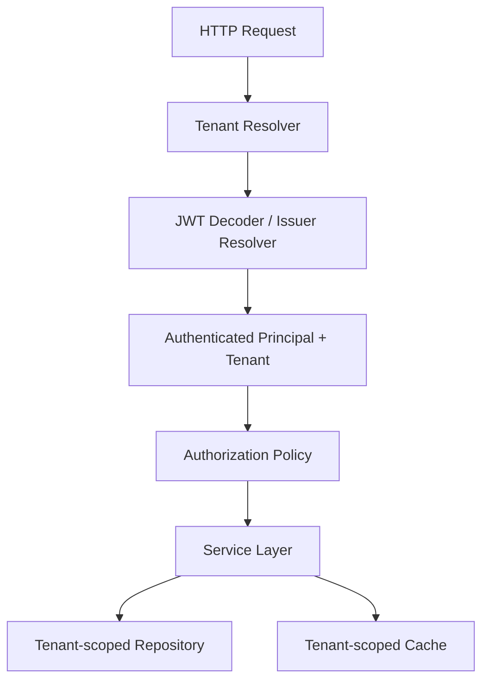

# Kiểm thử ngăn truy cập chéo tenant, nhầm issuer và nhầm khóa

Trong Authorization Server đa tenant, kiểm tra một JWT có chữ ký hợp lệ chưa đủ để kết luận request an toàn. Token có thể được ký đúng nhưng thuộc tenant khác; issuer có thể hợp lệ nhưng không dành cho API đang nhận request; `kid` có thể trùng giữa hai tenant; hoặc dữ liệu authorization của tenant A bị truy vấn qua repository của tenant B. Các lỗi này thường xuất hiện ở ranh giới giữa tenant resolution, JWT validation, key selection, authorization policy và persistence.

Bài học này xây dựng chiến lược kiểm thử để chứng minh ba bất biến: **request chỉ được xử lý trong tenant đã được xác định đáng tin cậy; token chỉ được xác minh bằng issuer và key thuộc tenant đó; dữ liệu và quyền của tenant khác không thể được truy cập qua request, cache, repository hay tác vụ nền**.

Spring Authorization Server 1.5.8 có hướng dẫn triển khai nhiều issuer trên cùng host, trong đó các component như `RegisteredClientRepository`, `OAuth2AuthorizationService`, `OAuth2AuthorizationConsentService` và `JWKSource` phải được chọn theo issuer. Spring Security Resource Server hỗ trợ tenant-aware authentication thông qua `JwtIssuerAuthenticationManagerResolver` và `AuthenticationManagerResolver`. Đây là các điểm tích hợp cần đưa vào integration test, bên cạnh test policy nghiệp vụ của ứng dụng. [Spring Authorization Server — How-to: Implement Multitenancy](https://docs.spring.io/spring-authorization-server/reference/guides/how-to-multitenancy.html) · [Spring Security — OAuth 2.0 Resource Server Multi-tenancy](https://docs.spring.io/spring-security/reference/servlet/oauth2/resource-server/multitenancy.html)

**Phạm vi ví dụ:** Spring Authorization Server 1.5.8 và Spring Security tương thích. Các URI, tenant và key trong bài đều là dữ liệu minh họa. Đối chiếu phiên bản Spring Boot/Spring Security thực tế trước khi sao chép cấu hình.

## 1. Xác định threat model và bất biến bảo mật

### 1.1. Ba nhóm lỗi cần ngăn

| Nhóm | Ví dụ lỗi | Hậu quả |
|---|---|---|
| Cross-tenant access | User thuộc tenant A đọc order hoặc authorization của tenant B | Rò rỉ dữ liệu, sửa dữ liệu hoặc thực hiện hành động trái quyền |
| Issuer confusion | Token của issuer A được chấp nhận ở tenant B; callback trả về từ issuer khác với issuer đã bắt đầu flow | Token/code bị chuyển sai trust domain |
| Key confusion | Resolver lấy nhầm JWKS, cache `kid` không có issuer, key của A xác minh token B | Kẻ tấn công dùng token hoặc key của tenant khác để vượt xác thực |

Ba nhóm này có thể kết hợp. Ví dụ hai tenant dùng cùng `kid`, cache toàn cục trả public key của A cho request B; nếu hệ thống cũng bỏ qua exact issuer validation thì token của A có thể bị chấp nhận trong ngữ cảnh B.

### 1.2. Định nghĩa các bất biến

Trước khi viết test, ghi rõ các điều kiện sau và gắn mỗi điều kiện với một test oracle:

1. Mỗi request được gắn với đúng một tenant đã được registry cho phép.
2. Tenant được lấy từ nguồn định tuyến đã kiểm soát, không lấy trực tiếp từ input tùy ý của caller.
3. `iss` trong JWT phải khớp chính xác issuer đã đăng ký và được xác minh bằng key thuộc issuer đó.
4. `aud` phải chứa resource server/API đang nhận token.
5. `tenant_id` trong token, nếu dùng, phải khớp tenant của resource đang truy cập.
6. `kid` chỉ được tra cứu trong JWK Set đã gắn với issuer tương ứng.
7. Tenant không tồn tại, bị disable hoặc chưa hoàn tất provisioning phải bị từ chối; không fallback sang tenant mặc định.
8. Client, authorization, consent, signing key, cache và dữ liệu nghiệp vụ phải được cô lập theo tenant.
9. Mọi đường truy vấn và background job đều giữ tenant context chính xác.
10. Tenant context được xóa sau request để không rò rỉ sang request tiếp theo trên cùng thread.
11. Token hợp lệ về chữ ký nhưng sai tenant, issuer, audience hoặc quyền vẫn phải bị từ chối.
12. Tenant A không thể làm thay đổi cấu hình, key hoặc trạng thái token của tenant B.

Một test chỉ xác nhận HTTP 200 cho token hợp lệ không chứng minh các bất biến này. Cần có test âm tính cho từng ranh giới.

### 1.3. Ma trận tài sản, trust boundary và đối tượng tấn công

| Tài sản | Trust boundary | Đầu vào có thể bị kiểm soát |
|---|---|---|
| Tenant registry | Request → tenant resolver | Host, path, forwarded headers, tenant header |
| Issuer metadata | Client/RP → Authorization Server | Authorization response, discovery metadata |
| JWT | Client → Resource Server | Header, issuer, audience, subject, key ID, claims |
| JWKS | Issuer → verifier | Key set, key rotation, key ID, algorithm, use |
| Client registration | Client → Token Endpoint | Client ID, grant, redirect URI, scope |
| Authorization/consent | Protocol provider → persistence | Authorization ID, principal, token lookup |
| Tenant business data | Authenticated principal → repository | Record ID, tenant ID, filter/query |
| Cache | Request/service → cache | Cache key, tenant context, invalidation |

### 1.4. Phân biệt xác thực token và phân quyền tài nguyên

- **Xác thực token:** Chữ ký, issuer, thời hạn, audience và các claim bắt buộc có hợp lệ không?
- **Phân quyền tenant:** Principal có thuộc tenant của tài nguyên và có quyền thực hiện operation không?
- **Cô lập dữ liệu:** Repository chỉ đọc/ghi record trong tenant context đã xác minh không?

Một JWT ký hợp lệ bởi issuer A có thể được xác thực thành công, nhưng request vẫn phải bị từ chối nếu đang truy cập dữ liệu tenant B. Vì vậy, không gom toàn bộ test vào một assertion kiểu `authenticated()`.

## 2. Xác định tenant từ nguồn đáng tin cậy

### 2.1. Các cách định tuyến tenant

| Nguồn | Ví dụ | Điều kiện an toàn |
|---|---|---|
| Issuer path | `https://auth.example.com/acme` | Issuer được cấu hình trước; path được ánh xạ chính xác |
| Subdomain | `https://acme.auth.example.com` | Domain được registry cho phép; xử lý proxy/Host header đúng |
| Dedicated host | `https://auth-acme.example.com` | Mapping host → tenant được quản trị |
| API route | `/api/tenants/acme/orders` | Tenant trong route phải khớp token và quyền principal |
| Tenant claim trong JWT | `tenant_id=acme` | Chỉ dùng sau khi JWT được xác minh chữ ký/issuer; không dùng claim chưa xác minh để cấp quyền |
| Gateway context | Header nội bộ do gateway ký/kiểm soát | Chỉ tin header sau khi gateway được xác thực và header do caller gửi đã bị loại bỏ |

Không có một nguồn tenant phù hợp cho mọi ứng dụng. Hãy chọn một nguồn chính cho mỗi endpoint và định nghĩa rõ cách đối chiếu với các nguồn còn lại.

### 2.2. Không tin X-Tenant-ID do caller tự gửi

Request sau không được tự động đặt tenant context:

```http
GET /api/orders/42
Authorization: Bearer <token>
X-Tenant-ID: tenant-b
```

Nếu client có thể tự đổi header, nó có thể thử truy cập dữ liệu tenant khác. Nếu gateway thêm tenant header, gateway phải xóa header cùng tên do client gửi trước khi gắn giá trị đã xác minh; ứng dụng phải chỉ nhận traffic từ gateway đáng tin cậy hoặc xác minh chữ ký/mTLS của gateway.

### 2.3. Kiểm soát Host và forwarded headers

Khi tenant được xác định qua hostname:

- Chỉ chấp nhận hostname nằm trong tenant/domain registry;
- Cấu hình reverse proxy để ghi đè `Forwarded`/`X-Forwarded-*` từ client;
- Chỉ tin forwarded headers từ proxy đã khai báo;
- Không dùng `Host` hoặc `X-Forwarded-Host` để tạo issuer mới tùy ý;
- Kiểm tra port, scheme và path canonical;
- Từ chối host lạ, host alias chưa đăng ký và header trùng/mâu thuẫn.

Test phải đi qua reverse proxy hoặc mô phỏng chính xác cấu hình forwarded headers. Mock request nội bộ có thể bỏ qua lớp dễ bị giả mạo nhất.

### 2.4. Canonical issuer và exact match

Issuer là identifier, không phải chuỗi để so khớp gần đúng. Không dùng `endsWith`, `contains`, prefix mơ hồ hoặc so khớp sau khi bỏ path để chọn tenant.

Ví dụ hai issuer sau là hai giá trị khác nhau:

```text
https://auth.example.com/acme
https://auth.example.com/acme-labs
```

Một registry nên ánh xạ chính xác issuer đã chuẩn hóa theo quy ước cấu hình. Tránh tự ý loại trailing slash, đổi case path hoặc decode URI trước khi so sánh nếu điều đó khiến hai issuer khác nhau trở thành cùng một key. Hãy quy định canonical form khi onboarding tenant và lưu chính xác giá trị đó.

### 2.5. Test tenant resolver

| Test | Input | Kỳ vọng |
|---|---|---|
| Tenant hợp lệ | Host/path đã đăng ký | Resolve đúng tenant |
| Tenant không tồn tại | Host/path lạ | Từ chối |
| Tenant bị disable | Tenant có trạng thái inactive | Từ chối |
| Tenant ID gần giống | `acme-labs` khi tenant là `acme` | Không resolve nhầm |
| Header bị giả mạo | `X-Tenant-ID` do caller gửi | Bị bỏ qua hoặc từ chối |
| Host và route mâu thuẫn | Host A, path B | Từ chối theo policy |
| Forwarded host không tin cậy | Header do client tự chèn | Không làm thay đổi tenant |
| Thiếu tenant context | Request vào endpoint cần tenant | Fail closed, không fallback |

## 3. Kiểm thử nhiều issuer trong Spring Authorization Server

### 3.1. Issuer có path đại diện tenant

Spring Authorization Server hỗ trợ nhiều issuer trên cùng host bằng path component. Ví dụ:

| Tenant | Issuer | Token Endpoint | JWKS Endpoint |
|---|---|---|---|
| `acme` | `https://auth.example.com/acme` | `/acme/oauth2/token` | `/acme/oauth2/jwks` |
| `globex` | `https://auth.example.com/globex` | `/globex/oauth2/token` | `/globex/oauth2/jwks` |

Metadata phải trả issuer và endpoint URL đúng tenant. Discovery của `acme` không được trả `jwks_uri` hoặc `token_endpoint` của `globex`.

Spring Authorization Server tắt multiple issuers per host theo mặc định. Với mô hình issuer path, cấu hình `AuthorizationServerSettings` như sau:

```java
@Bean
AuthorizationServerSettings authorizationServerSettings() {
    return AuthorizationServerSettings.builder()
            .multipleIssuersAllowed(true)
            .build();
}
```

Bật option này chỉ cho phép nhiều issuer trên host. Nó không tự tạo tenant registry, database riêng, JWK Set riêng hay authorization policy. Các thành phần cần tenant-aware vẫn phải được cấu hình và kiểm thử. [Spring Authorization Server — Enable Multiple Issuers](https://docs.spring.io/spring-authorization-server/reference/guides/how-to-multitenancy.html)

### 3.2. Những component phải được phân giải theo issuer

Hướng dẫn Spring Authorization Server nêu các component cần hỗ trợ multi-tenancy:

- `RegisteredClientRepository`;
- `OAuth2AuthorizationService`;
- `OAuth2AuthorizationConsentService`;
- `JWKSource<SecurityContext>`.

Nếu các component này dùng chung implementation, implementation phải có cơ chế tenant scoping rõ ràng. Có thể dùng schema riêng, database riêng hoặc shared schema với tenant discriminator và ràng buộc query. [Spring Authorization Server — Multi-tenant Components](https://docs.spring.io/spring-authorization-server/reference/guides/how-to-multitenancy.html)

### 3.3. Registry phải dùng exact issuer key

Ví dụ registry tối giản:

```java
@Component
public class TenantComponentRegistry {

    private final ConcurrentMap<String, TenantComponents> tenants =
            new ConcurrentHashMap<>();

    public void register(String issuer, TenantComponents components) {
        if (issuer == null || issuer.isBlank()) {
            throw new IllegalArgumentException("issuer is required");
        }
        if (components == null) {
            throw new IllegalArgumentException("components are required");
        }

        TenantComponents previous = tenants.putIfAbsent(issuer, components);
        if (previous != null) {
            throw new IllegalStateException("issuer is already registered");
        }
    }

    public TenantComponents requireIssuer(String issuer) {
        TenantComponents components = tenants.get(issuer);
        if (components == null || !components.enabled()) {
            throw new IllegalArgumentException("unknown or disabled issuer");
        }
        return components;
    }
}
```

`TenantComponents` là record/application object chứa repository, authorization service, consent service, JWK source và trạng thái tenant. Ví dụ này minh họa lookup exact-key. Trong production, registry còn cần kiểm soát cập nhật, disable, rotation, concurrency và lifecycle của connection pool.

Không dùng một map toàn cục chỉ theo `kid` hoặc `clientId` để tìm component của tenant. Cùng một client ID hoặc key ID có thể tồn tại ở nhiều tenant.

### 3.4. Lấy tenant hiện tại từ AuthorizationServerContext

Trong luồng xử lý protocol của Spring Authorization Server, `AuthorizationServerContextHolder` cung cấp `AuthorizationServerContext`, trong đó có issuer hiện tại. Delegating component có thể dùng issuer này để chọn repository tương ứng.

```java
TenantComponents currentTenant(TenantComponentRegistry registry) {
    AuthorizationServerContext context =
            AuthorizationServerContextHolder.getContext();

    if (context == null || context.getIssuer() == null) {
        throw new IllegalStateException("issuer context is unavailable");
    }

    return registry.requireIssuer(context.getIssuer());
}
```

Ví dụ này cần import `AuthorizationServerContext`, `AuthorizationServerContextHolder` và `TenantComponents` theo package/application thực tế. Nếu không có issuer context hoặc issuer không có trong allowlist, request phải thất bại. Không fallback sang component mặc định.

### 3.5. Kiểm thử từng delegating component

| Component | Hành vi phải kiểm tra |
|---|---|
| `RegisteredClientRepository` | `findByClientId`/`findById` chỉ đọc registration của issuer hiện tại |
| `OAuth2AuthorizationService` | `save`, `remove`, `findById`, `findByToken` chỉ thao tác store tenant hiện tại |
| `OAuth2AuthorizationConsentService` | Consent lookup/save/remove không lẫn principal/client giữa tenant |
| `JWKSource` | Signing và JWKS endpoint chỉ dùng key set của issuer hiện tại |

Test cả lookup thành công lẫn trường hợp ID trùng nhau giữa hai tenant. Cùng một client ID, authorization ID hoặc principal name có thể hợp lệ trong hai tenant độc lập; kết quả phải được phân biệt bằng tenant context.

### 3.6. Kiểm thử metadata discovery

Với từng tenant, gọi:

- OIDC Provider Configuration Endpoint;
- OAuth Authorization Server Metadata Endpoint;
- JWKS Endpoint.

Xác minh:

- `issuer` khớp chính xác tenant;
- `authorization_endpoint`, `token_endpoint`, `introspection_endpoint`, `revocation_endpoint` trỏ về issuer tương ứng;
- `jwks_uri` trỏ tới key set của tenant đó;
- Metadata của tenant A không chứa URL endpoint của tenant B;
- Unknown tenant không trả metadata của tenant mặc định;
- Tenant disabled không tiếp tục được công bố như tenant đang hoạt động.

## 4. Kiểm thử Resource Server phân giải issuer

### 4.1. Tenant-aware AuthenticationManagerResolver

Resource Server có thể xác minh token từ nhiều issuer bằng `JwtIssuerAuthenticationManagerResolver`. Với tập issuer tĩnh, dùng allowlist:

```java
@Bean
AuthenticationManagerResolver<HttpServletRequest> authenticationManagerResolver() {
    return JwtIssuerAuthenticationManagerResolver.fromTrustedIssuers(
            "https://auth.example.com/acme",
            "https://auth.example.com/globex"
    );
}
```

Sau đó đăng ký resolver vào Resource Server:

```java
http
    .authorizeHttpRequests(authorize -> authorize
        .anyRequest().authenticated())
    .oauth2ResourceServer(oauth2 -> oauth2
        .authenticationManagerResolver(authenticationManagerResolver));
```

Spring Security chọn `AuthenticationManager` dựa trên issuer trong JWT và chỉ nên chấp nhận issuer đã tin cậy. Endpoint discovery/decoder được khởi tạo theo nhu cầu trong cách triển khai này. [Spring Security — Resolving Tenant by JWT Issuer](https://docs.spring.io/spring-security/reference/servlet/oauth2/resource-server/multitenancy.html)

### 4.2. Issuer chưa xác minh chỉ là routing hint

Trước khi chữ ký được xác minh, claim issuer trong JWT là dữ liệu không đáng tin cậy. Resolver có thể đọc nó để chọn một verifier trong allowlist, nhưng không được xem nó là bằng chứng token hợp lệ.

Luồng an toàn:

1. Parse token đủ để lấy issuer làm routing hint;
2. Kiểm tra issuer có trong allowlist;
3. Chọn decoder/JWK source đã gắn với issuer đó;
4. Xác minh chữ ký bằng key thuộc issuer;
5. Xác minh exact issuer, expiry, not-before và các claim bắt buộc;
6. Xác minh audience của API;
7. Chuyển principal/tenant đã xác minh vào authorization policy.

Nếu issuer không nằm trong allowlist, dừng trước khi tạo decoder hoặc gọi discovery URL. Không tạo `JwtDecoder` từ một issuer URL tùy ý do token cung cấp vì có thể dẫn tới SSRF và trust expansion.

### 4.3. Dynamic tenant registry

Nếu tenant được thêm/xóa lúc runtime, có thể dùng repository chứa `AuthenticationManager` đã được tạo từ cấu hình tenant đã phê duyệt. Spring Security hỗ trợ `JwtIssuerAuthenticationManagerResolver` với strategy tra manager theo issuer. Tài liệu nhấn mạnh không được lấy bất kỳ issuer nào rồi tự tạo manager; issuer phải được xác minh từ nguồn tin cậy như allowlist. [Spring Security — Dynamic Tenants](https://docs.spring.io/spring-security/reference/servlet/oauth2/resource-server/multitenancy.html)

Khi thêm tenant:

- Xác minh tenant onboarding và issuer ownership;
- Kiểm tra issuer uniqueness;
- Pin metadata/JWKS URL theo cấu hình đã duyệt;
- Tạo decoder/manager và validator;
- Đăng ký nguyên tử sau khi mọi component sẵn sàng.

Khi disable/remove tenant:

- Ngừng nhận request mới;
- Gỡ tenant khỏi resolver/registry;
- Invalidate decoder/JWK cache;
- Xử lý token còn hiệu lực theo policy;
- Không để manager cũ tiếp tục được dùng vô thời hạn.

### 4.4. Test issuer resolver

| Test | Token | Kỳ vọng |
|---|---|---|
| Issuer A tin cậy | issuer A, chữ ký bằng key A | Decoder A xác minh |
| Issuer B tin cậy | issuer B, chữ ký bằng key B | Decoder B xác minh |
| Issuer không biết | issuer attacker | Từ chối; không discovery issuer tùy ý |
| Issuer A, ký bằng key B | issuer A, chữ ký B | Chữ ký thất bại |
| Issuer B, ký bằng key A | issuer B, chữ ký A | Chữ ký thất bại |
| Issuer sai một ký tự | issuer gần giống A | Từ chối |
| Issuer trùng suffix | issuer của host lạ kết thúc bằng /acme | Không match issuer A |
| Tenant đã disabled | issuer A | Từ chối theo trạng thái registry |

## 5. Kiểm thử issuer confusion và OAuth mix-up

### 5.1. Phân biệt JWT issuer với authorization response issuer

Có hai ngữ cảnh cần test riêng:

- JWT issuer: issuer đã phát hành JWT. Resource Server xác minh nó cùng chữ ký, key và audience.
- OAuth authorization response issuer: issuer của Authorization Server trả authorization response cho client. RFC 9207 định nghĩa parameter này để chống mix-up khi client tương tác với nhiều Authorization Server.

Không nhầm hai bước này. Một client có thể xác minh JWT đúng nhưng vẫn gửi authorization code tới nhầm token endpoint nếu callback flow không ràng buộc issuer của authorization response. [RFC 9207 — OAuth 2.0 Authorization Server Issuer Identification](https://www.rfc-editor.org/rfc/rfc9207.html)

### 5.2. Kiểm thử issuer trong authorization response

Khi client dùng nhiều Authorization Server:

- Gắn transaction/state với issuer đã chọn khi bắt đầu flow;
- Xác minh issuer trong authorization response khớp issuer đã lưu;
- Không chọn token endpoint bằng parameter do callback tự khai;
- Không gửi code/client credential đến token endpoint của issuer khác;
- Nếu response chứa nhiều issuer identifier mâu thuẫn, từ chối;
- Kiểm thử cả authorization success và error response.

RFC 9207 nêu response parameter issuer là biện pháp chống mix-up; client cần so sánh nó với issuer mong đợi. [RFC 9207](https://www.rfc-editor.org/rfc/rfc9207.html)

### 5.3. Test case mix-up

| Tình huống | Kỳ vọng |
|---|---|
| Flow bắt đầu với issuer A, callback trả issuer A | Tiếp tục |
| Flow bắt đầu với issuer A, callback trả issuer B | Từ chối; không redeem code |
| Callback thiếu issuer khi policy yêu cầu RFC 9207 | Từ chối |
| State của tenant A dùng trong callback tenant B | Từ chối |
| Code A bị gửi tới token endpoint B | Không gửi; nếu test server nhận thì từ chối |
| Metadata issuer A trỏ endpoint B | Phát hiện cấu hình sai và chặn onboarding |
| Hai issuer có identifier trùng nhau | Không cho đăng ký đồng thời |

## 6. Kiểm thử phân tách JWK và signing key

### 6.1. Key ID chỉ có ý nghĩa trong JWK Set tương ứng

Hai tenant có thể cùng dùng `kid=key-2026-01` nhưng public key khác nhau. Đây không phải xung đột nếu mỗi key ID được phân giải trong JWK Set của issuer tương ứng.

Cache toàn cục dạng `Map<kid, PublicKey>` là thiết kế nguy hiểm. Khóa cache nên bao gồm ít nhất issuer và key ID, hoặc cache toàn bộ JWK Set theo issuer.

Ví dụ khóa cache:

```text
jwks:https://auth.example.com/acme:key-2026-01
jwks:https://auth.example.com/globex:key-2026-01
```

### 6.2. Các kiểm tra key bắt buộc

- Key được lấy từ JWKS URI đã cấu hình cho issuer đã tin cậy;
- Chữ ký được xác minh bằng key thuộc JWK Set của issuer đó;
- Algorithm thuộc allowlist và phù hợp loại key;
- Key type, use và key_ops phù hợp mục đích verify/sign;
- Key ID được xử lý trong namespace issuer;
- Không tin jku hoặc x5u tùy ý trong JWT header;
- Không chấp nhận thuật toán none;
- Không dùng cùng key cho mục đích khác nhau nếu policy yêu cầu tách;
- Private signing key của tenant A không xuất hiện trong JWKS hoặc keystore context của tenant B.

RFC 8725 yêu cầu xác minh thuật toán, ràng buộc key với issuer, kiểm tra audience và không tin các URL/key locator tùy ý từ JWT header. [RFC 8725 — JWT Best Current Practices](https://www.rfc-editor.org/rfc/rfc8725.html)

### 6.3. Kiểm thử cùng key ID, khác key

Tạo hai key pair độc lập:

- Tenant A: key ID shared-kid, key pair A;
- Tenant B: key ID shared-kid, key pair B.

Sau đó tạo token:

| Token | Issuer | Chữ ký | Kết quả |
|---|---|---|---|
| A hợp lệ | A | Private key A | Chấp nhận ở A |
| B hợp lệ | B | Private key B | Chấp nhận ở B |
| Giả A bằng key B | A | Private key B | Từ chối |
| Giả B bằng key A | B | Private key A | Từ chối |
| A dùng key ID không tồn tại | A | Key không đăng ký | Từ chối |
| A đổi header key ID thành key B | A | Private key A | Từ chối nếu không khớp key A đã chọn |

Test này phát hiện cache hoặc resolver chỉ tra key ID mà quên issuer.

### 6.4. Key rotation và cache invalidation

Với mỗi tenant, test:

1. JWKS ban đầu có key K1;
2. Phát token bằng K1;
3. Thêm K2 vào JWKS và bắt đầu ký token mới bằng K2;
4. Verifier tải được K2;
5. Token cũ K1 vẫn được xác minh trong thời gian overlap;
6. Sau khi token K1 hết hạn và policy cho phép, gỡ K1;
7. Cache được refresh/invalidate đúng;
8. Tenant B không bị ảnh hưởng bởi rotation của tenant A.

Không xóa key cũ ngay khi bắt đầu rotation nếu vẫn còn token hợp lệ được ký bằng key đó. Ngược lại, khi key bị compromise, quy trình emergency rotation/revocation phải có thể vô hiệu hóa key nhanh chóng.

### 6.5. Kiểm thử metadata/JWKS isolation

Với từng issuer:

- JWKS endpoint chỉ trả public keys của issuer đó;
- Không bao giờ trả private key;
- Key ID có thể trùng tenant khác mà không gây nhầm;
- JWK Set không chứa key đã bị thu hồi ngoài overlap policy;
- JWKS cache key bao gồm issuer;
- Một tenant không thể thay đổi JWKS URI của tenant khác;
- Tenant disabled không còn được cấp token hoặc công bố key ngoài policy.

## 7. Kiểm thử JWT validation theo tenant

### 7.1. Không chỉ kiểm tra chữ ký

Một token chỉ được chấp nhận khi toàn bộ điều kiện phù hợp:

| Thành phần | Kiểm tra |
|---|---|
| Signature | Hợp lệ với public key của issuer đã chọn |
| Issuer | Exact match với issuer được tin cậy |
| Audience | Có API/resource đang nhận token |
| Expiry | Chưa hết hạn |
| Not-before | Đã đến thời điểm có hiệu lực |
| Issued-at | Nằm trong policy về thời gian phát hành |
| Subject | Có định dạng/định danh hợp lệ theo tenant |
| Tenant claim | Khớp tenant của resource nếu claim này được dùng |
| Scope/authorities | Chỉ có quyền đã cấp |
| Token type/profile | Đúng loại token mà endpoint chấp nhận |

RFC 8725 khuyến nghị kiểm tra issuer và subject, audience, algorithm, explicit typing và các validation rule tách biệt cho từng loại JWT. [RFC 8725](https://www.rfc-editor.org/rfc/rfc8725.html)

### 7.2. Kiểm thử audience substitution

Giả sử issuer A phát token cho api-a và api-b. Token dành cho api-a không được chấp nhận ở api-b nếu audience không bao gồm api-b.

Test:

- Đúng issuer, đúng audience;
- Đúng issuer, audience của API tenant khác;
- Đúng issuer, thiếu audience;
- Audience chứa nhiều giá trị nhưng không có resource hiện tại;
- Audience có URL gần giống nhưng khác host/path;
- Token ID Token bị gửi làm access token;
- Token access token của API khác bị dùng làm credential.

### 7.3. Cấu hình validator audience theo tenant

Issuer resolver giúp chọn đúng decoder, nhưng ứng dụng vẫn phải đặt audience mà API mong đợi. Với mỗi tenant, có thể tạo một decoder/AuthenticationManager đã gắn validator tương ứng khi tenant được onboard:

```java
import org.springframework.security.oauth2.core.OAuth2Error;
import org.springframework.security.oauth2.core.OAuth2ErrorCodes;
import org.springframework.security.oauth2.core.OAuth2TokenValidator;
import org.springframework.security.oauth2.core.OAuth2TokenValidatorResult;
import org.springframework.security.oauth2.core.DelegatingOAuth2TokenValidator;
import org.springframework.security.oauth2.jwt.Jwt;
import org.springframework.security.oauth2.jwt.JwtDecoder;
import org.springframework.security.oauth2.jwt.JwtValidators;
import org.springframework.security.oauth2.jwt.NimbusJwtDecoder;

OAuth2TokenValidator<Jwt> audienceValidator(String expectedAudience) {
    OAuth2Error error = new OAuth2Error(
            OAuth2ErrorCodes.INVALID_TOKEN,
            "The token audience is not accepted",
            null);

    return jwt -> jwt.getAudience().contains(expectedAudience)
            ? OAuth2TokenValidatorResult.success()
            : OAuth2TokenValidatorResult.failure(error);
}

JwtDecoder tenantDecoder(TenantDefinition tenant) {
    NimbusJwtDecoder decoder = NimbusJwtDecoder
            .withIssuerLocation(tenant.issuer())
            .build();

    decoder.setJwtValidator(new DelegatingOAuth2TokenValidator<>(
            JwtValidators.createDefaultWithIssuer(tenant.issuer()),
            audienceValidator(tenant.audience())));
    return decoder;
}
```

`TenantDefinition` là record do ứng dụng định nghĩa, có `issuer()` và `audience()`. Đăng ký AuthenticationManager được tạo từ decoder này dưới exact issuer key trong tenant registry. Nếu dùng `fromTrustedIssuers` trực tiếp, hãy bổ sung cách cấu hình audience validation cho từng issuer; allowlist issuer tự nó không định nghĩa audience nghiệp vụ của API.

### 7.4. Kiểm thử tenant claim và route tenant

Nếu token có tenant claim, resource server phải đối chiếu claim đã xác minh với tenant của resource. Không dùng tenant claim từ JWT trước khi signature validation hoàn tất.

Ví dụ:

- Token: issuer A, tenant A;
- Request: /api/tenants/A/orders/42 → có thể tiếp tục kiểm tra permission;
- Request: /api/tenants/B/orders/42 → từ chối;
- Token: issuer A, tenant B → từ chối theo token profile/policy;
- Token: issuer B, tenant A → từ chối.

Không phải hệ thống nào cũng cần cả issuer và tenant claim, nhưng nếu cả hai được dùng, phải định nghĩa mapping một-một hoặc một issuer-to-tenant rõ ràng. Không suy ra tenant từ subject hoặc client ID.

### 7.5. Phân biệt 401 và 403

Thông thường:

- **401 Unauthorized:** token không hợp lệ, sai issuer, sai chữ ký, hết hạn hoặc không thể xác thực;
- **403 Forbidden:** token hợp lệ nhưng principal không có quyền trên tenant/resource/operation.

HTTP status có thể thay đổi theo exception handler, nhưng contract phải nhất quán. Test không được biến invalid token thành 403 một cách mơ hồ nếu điều đó che khuất lỗi xác thực.

## 8. Kiểm thử data isolation và persistence

### 8.1. Kiểm thử repository theo tenant

Với cùng một business key, tạo dữ liệu ở hai tenant:

| Tenant | Order ID | Owner | Giá trị |
|---|---|---|---|
| A | order-100 | user-a | A-PRIVATE |
| B | order-100 | user-b | B-PRIVATE |

Các test phải chứng minh:

- User A chỉ đọc được A-PRIVATE;
- User B chỉ đọc được B-PRIVATE;
- ID giống nhau không làm query trả nhầm row;
- Update/delete của A không thay đổi row của B;
- Query thiếu tenant context bị fail closed;
- Query theo ID nhưng không có tenant predicate không được sử dụng ở đường truy cập multi-tenant.

### 8.2. Shared schema với tenant discriminator

Nếu nhiều tenant dùng chung bảng, mọi query cần tenant predicate hoặc row-level security:

```sql
SELECT id, owner_id, status
FROM orders
WHERE tenant_id = :trustedTenantId
  AND id = :orderId;
```

Trusted tenant ID phải đến từ tenant context đã được xác minh. Không bind thẳng giá trị từ query parameter hoặc header do caller kiểm soát.

Cần test cả đường findById, batch query, pagination, export, report, background cleanup và native SQL. Một repository method an toàn không bảo đảm tất cả query khác cũng có tenant predicate.

### 8.3. Schema/database riêng theo tenant

Nếu dùng schema hoặc database riêng:

- Kiểm tra datasource/schema được chọn theo tenant context;
- Không reuse connection/session đã SET SCHEMA mà không reset;
- Connection pool phải không để session state của tenant A tồn tại khi connection được cấp cho B;
- Migration chỉ chạy trên database/schema đúng tenant;
- Backup/restore không ghi đè nhầm tenant;
- Monitoring và admin tooling cũng cần tenant scoping.

Test connection pool reuse bằng nhiều request xen kẽ A → B → A trên cùng pool.

### 8.4. Authorization và consent isolation

Test các service của Spring Authorization Server:

- Client ID giống nhau giữa A và B nhưng registration được phân giải đúng;
- Internal RegisteredClient ID không bị nhầm;
- Authorization ID trùng giữa hai store không trả nhầm record;
- findByToken chỉ tra trong tenant context hiện tại;
- Refresh token của A không được B tìm thấy;
- Consent của principal/client ở A không được B sử dụng;
- Remove/revoke ở A không xóa authorization của B.

### 8.5. Unique constraint và ID collision

Nếu shared schema, unique key nên bao gồm tenant discriminator khi nghiệp vụ cho phép cùng ID giữa các tenant. Nếu ID phải global unique, vẫn cần tenant predicate cho mọi access. Không dùng global uniqueness thay cho authorization boundary.

## 9. Kiểm thử tenant propagation và cache isolation

### 9.1. Tenant context qua các tầng



Tenant context phải được truyền qua service, repository, cache, message consumer và background job. Không để từng tầng tự suy ra tenant theo quy tắc khác nhau.

### 9.2. ThreadLocal và async execution

Nếu ứng dụng dùng ThreadLocal để lưu tenant context:

- Đặt context trước khi gọi service;
- Dùng try/finally để clear;
- Không giả định context tự truyền qua @Async, executor, scheduler hoặc reactive pipeline;
- Có cơ chế context propagation rõ ràng;
- Kiểm thử thread reuse để phát hiện tenant leakage.

Test quan trọng: request tenant A hoàn tất, thread được tái sử dụng cho request tenant B; request B không được nhìn context A.

### 9.3. Cache key phải có tenant namespace

Không dùng cache key chỉ theo userId, clientId, orderId hoặc key ID nếu các giá trị đó có thể trùng giữa tenant.

Ví dụ:

```text
tenant:acme:order:order-100
tenant:globex:order:order-100

tenant:acme:jwks:key-2026-01
tenant:globex:jwks:key-2026-01
```

Test cache hit/miss, eviction, invalidation và warm-up với hai tenant có cùng business ID. Xác minh cache của A không thể trả object B và ngược lại.

### 9.4. Cache invalidation khi tenant thay đổi trạng thái

Khi tenant bị disable hoặc đổi issuer/key:

- Xóa hoặc vô hiệu hóa cache liên quan;
- Gỡ AuthenticationManager/decoder cũ;
- Xóa tenant khỏi routing registry;
- Không giữ stale JWKS/authorization policy quá thời gian cho phép;
- Không cho node khác trong cluster tiếp tục dùng registry cũ.

Test trên nhiều application instance, không chỉ một JVM.

## 10. Kiểm thử authorization ở Resource Server

### 10.1. Tenant match là điều kiện cần, chưa phải điều kiện đủ

Sau khi token hợp lệ và tenant khớp, vẫn phải kiểm tra:

- User có membership còn hiệu lực;
- Client có được phép gọi API;
- Scope/authority đáp ứng operation;
- Object owner hoặc relationship policy;
- Resource thuộc đúng tenant;
- Tenant có đang active và không bị suspended.

Không coi tenant A trong claim là quyền truy cập mọi tài nguyên trong tenant A.

### 10.2. Test object-level authorization

Tạo hai user trong cùng tenant và hai tenant khác nhau. Kiểm tra:

- User A không đọc object riêng của user B nếu policy owner-based;
- Tenant A không đọc object tenant B dù đoán đúng ID;
- Admin tenant A không trở thành global admin;
- Support operator chỉ cross-tenant khi có explicit break-glass permission, audit và thời hạn;
- Client credentials token không được giả làm user token nếu API yêu cầu subject user.

### 10.3. Test tenant switch

Nếu ứng dụng cho phép user chuyển tenant:

1. User có membership ở A và B;
2. User chọn tenant A;
3. Session/principal context được cập nhật theo quy trình xác thực;
4. Token mới được phát với tenant/scope phù hợp;
5. Token cũ của A không bị diễn giải thành token B;
6. Tenant B không được thêm vào token cũ bằng request parameter;
7. Chuyển lại A không làm cache hoặc SecurityContext giữ quyền của B.

Không cho client chỉ sửa header X-Tenant-ID để đổi tenant của principal.

## 11. Kiểm thử key confusion và JWT substitution

### 11.1. Threat-to-test matrix

| Mối đe dọa | Cách tạo test | Kết quả |
|---|---|---|
| Key của A xác minh token B | Ký token issuer B bằng private key A | Chữ ký không hợp lệ với JWKS B |
| Trùng key ID | A và B cùng key ID, key khác nhau | Resolver dùng issuer namespace; không nhầm key |
| Thuật toán none | Tạo JWT không chữ ký | Từ chối |
| Algorithm confusion | Thay thuật toán sang loại khác | Từ chối theo allowlist/key type |
| jku tùy ý | Header trỏ tới server attacker | Không thực hiện outbound request |
| x5u tùy ý | Header chứa URL ngoài allowlist | Không tải URL |
| Key type sai | Dùng HMAC key ở decoder chỉ chấp nhận RSA/EC | Từ chối |
| Key đã bị gỡ | Token ký bằng key không còn được tin | Từ chối sau cache/policy window |
| JWT type confusion | Dùng ID Token ở API access-token endpoint | Từ chối theo profile/audience/type |
| Issuer substitution | Đổi claim issuer nhưng giữ chữ ký cũ | Chữ ký/issuer validation thất bại |

### 11.2. Không lấy JWKS URL từ JWT header

Không làm theo mô hình:

```java
// Không an toàn: URL do token header cung cấp có thể trỏ tới host bất kỳ.
URL jwksUrl = new URL(jwtHeader.get("jku").toString());
JWKSet jwkSet = JWKSet.load(jwksUrl);
```

JWKS URI phải đến từ metadata/configuration của issuer đã được tin cậy và được kiểm soát bởi tenant onboarding. RFC 8725 cảnh báo việc theo jku/x5u tùy ý có thể tạo SSRF. [RFC 8725 — Do Not Trust Received Claims](https://www.rfc-editor.org/rfc/rfc8725.html)

### 11.3. Tách validation profile giữa các loại JWT

Nếu cùng issuer phát nhiều loại JWT, chẳng hạn access token, ID Token, logout token hoặc token nội bộ khác, validator cần phân biệt chúng bằng các điều kiện mutually exclusive:

- Token type hoặc token profile nếu được định nghĩa;
- Audience khác nhau;
- Required claims khác nhau;
- Key set hoặc signing policy khác nhau nếu cần;
- Issuer khác nhau khi có nhiều trust domain.

Test dùng ID Token làm access token, token của service A ở service B và token có audience đúng nhưng token type sai.

## 12. Bộ test integration với token ký thật

### 12.1. Vì sao mock JWT chưa đủ?

Spring Security Test có thể tạo mock Jwt để test authorization rule. Cách đó hữu ích cho test method security hoặc controller policy, nhưng thường bỏ qua:

- Chữ ký JWS;
- JWK selection;
- Issuer resolver;
- Decoder;
- Key rotation;
- Audience validator;
- Cache JWKS.

Vì vậy, cần hai nhóm test:

1. **Policy test:** có thể dùng mock Jwt đã xác thực để test tenant claim, scope và object authorization.
2. **Decoder integration test:** tạo JWT ký thật bằng key A/B và gửi qua HTTP Bearer header để chạy resolver, decoder và JWK selection thật.

### 12.2. Fixture hai tenant

Tạo fixture:

| Thuộc tính | Tenant A | Tenant B |
|---|---|---|
| Issuer | `https://auth.example.com/acme` | `https://auth.example.com/globex` |
| Tenant claim | `acme` | `globex` |
| Key ID | `shared-kid` | `shared-kid` |
| Signing key | RSA key A | RSA key B |
| Audience | `orders-api` | `orders-api` |
| Subject | `user-100` | `user-100` |

Cùng subject, audience và key ID được dùng có chủ ý để chứng minh issuer và key namespace mới là yếu tố phân biệt tenant.

### 12.3. Ví dụ test registry exact match

```java
@Test
void registryDoesNotResolveIssuerBySuffix() {
    TenantComponents acme = componentsFor("acme");
    registry.register("https://auth.example.com/acme", acme);

    assertSame(acme, registry.requireIssuer(
            "https://auth.example.com/acme"));

    assertThrows(IllegalArgumentException.class,
            () -> registry.requireIssuer(
                    "https://evil.example/acme"));
}
```

Test này bảo vệ registry khỏi cách so khớp issuer theo suffix. Bổ sung test với acme-labs, trailing slash và path encoding theo canonical issuer policy của hệ thống.

### 12.4. Ví dụ MockMvc với JWT ký thật

```java
@Test
void tenantATokenCannotReadTenantBResource() throws Exception {
    String token = signedAccessToken(
            tenantAKey,
            "https://auth.example.com/acme",
            "orders-api",
            "user-100",
            "acme");

    mvc.perform(get("/api/tenants/globex/orders/order-100")
            .header(HttpHeaders.AUTHORIZATION, "Bearer " + token))
        .andExpect(status().isForbidden());
}
```

`signedAccessToken(...)` là fixture helper ký JWT bằng private key A. Kỳ vọng 403 ở ví dụ này giả định issuer A và chữ ký đều hợp lệ, nhưng authorization policy phát hiện route tenant globex không khớp tenant acme trong principal. Nếu resolver/endpoint contract từ chối sớm hơn, status có thể là 401; hãy chọn một điểm chặn rõ ràng và test nhất quán.

### 12.5. Test token B ký bằng key A

```java
@Test
void tenantBIssuerCannotBeVerifiedWithTenantAKey() throws Exception {
    String token = signedAccessToken(
            tenantAKey,
            "https://auth.example.com/globex",
            "orders-api",
            "user-100",
            "globex");

    mvc.perform(get("/api/tenants/globex/orders/order-100")
            .header(HttpHeaders.AUTHORIZATION, "Bearer " + token))
        .andExpect(status().isUnauthorized());
}
```

Token khai báo issuer B nhưng chữ ký tạo bằng private key A. Resolver chọn verifier B theo issuer; verifier B chỉ tin public key B nên phải từ chối. Không thay test này bằng jwt() mock post processor vì mock không thực hiện chữ ký.

### 12.6. Kiểm thử policy bằng mock Jwt

Với controller/service authorization, có thể tạo mock Jwt có claims tenant để kiểm tra:

- Token tenant A và route tenant A được phép nếu scope/role đủ;
- Token tenant A và route tenant B bị từ chối;
- Token thiếu tenant claim bị từ chối nếu policy yêu cầu claim;
- Token có tenant không nằm trong membership bị từ chối;
- Scope đúng nhưng object owner sai vẫn bị từ chối.

Ghi rõ đây là policy test sau authentication. Nó không thay thế decoder/JWKS integration test.

## 13. Kiểm thử concurrency và tenant lifecycle

### 13.1. Hai tenant cùng hoạt động đồng thời

Chạy request song song:

- A phát token trong khi B phát token;
- A rotate key trong khi B introspect;
- A revoke authorization trong khi B revoke authorization;
- A update client registration trong khi B đọc client;
- A tạo consent trong khi B xóa consent;
- Nhiều request có cùng client ID, subject, key ID và record ID ở hai tenant.

Kỳ vọng mỗi thao tác chỉ tác động tenant của nó.

### 13.2. Tenant provisioning

Tenant chỉ được đưa vào registry sau khi các thành phần cần thiết đã sẵn sàng:

1. Cấp tenant ID và issuer canonical;
2. Tạo schema/database và migration;
3. Tạo RegisteredClient repository;
4. Tạo authorization và consent services;
5. Tạo/đăng ký JWK source;
6. Khởi tạo validator/AuthenticationManager nếu Resource Server cần;
7. Kiểm tra discovery/JWKS;
8. Đăng ký tenant atomically và đánh dấu active.

Không để một tenant xuất hiện trong resolver trước khi JWK source hoặc persistence component đã sẵn sàng.

### 13.3. Tenant disable/offboarding

Khi tenant bị disable:

- Ngừng phát token mới;
- Ngừng xác minh token theo policy;
- Vô hiệu hóa client registrations;
- Xử lý refresh token và authorization đang hoạt động;
- Gỡ component khỏi registry;
- Invalidate cache/decoder/JWK selector;
- Bảo toàn dữ liệu audit và quy trình export/retention;
- Chặn tenant context cũ trên các node khác.

Test race giữa request đang chạy và thao tác disable. Định nghĩa rõ request đang xử lý được phép hoàn tất hay phải bị hủy.

### 13.4. Tenant ID reuse

Không tái sử dụng tenant ID/issuer cũ cho một tổ chức khác nếu còn token, log, cache, backup hoặc dữ liệu liên kết với identifier đó. Nếu bắt buộc tái sử dụng tên hiển thị, hãy tạo issuer/tenant key mới và giữ tombstone cho identifier cũ.

## 14. Kiểm thử observability và incident response

### 14.1. Audit event

Audit nên ghi đủ để điều tra:

- Tenant/issuer đã resolve;
- Client ID đã xác thực;
- Subject đã xác minh hoặc subject fingerprint theo policy;
- Resource/operation;
- Kết quả authorization;
- Failure category: unknown issuer, invalid signature, audience mismatch, tenant mismatch, key lookup failure;
- Node/region và correlation ID;
- Key ID ở mức an toàn nếu cần điều tra rotation.

Không log raw JWT, access token, refresh token, private key, client secret hoặc toàn bộ Authorization header.

### 14.2. Metrics

Theo dõi theo tenant nhưng tránh cardinality quá cao:

- Authentication success/failure;
- Unknown/disabled issuer;
- Signature failure;
- Audience/tenant mismatch;
- JWK fetch/refresh failure;
- Cache hit/miss và invalidation lag;
- Cross-tenant authorization denial;
- Repository query failure;
- Tenant provisioning/disable events;
- Latency p50/p95/p99 theo endpoint/tenant tier.

Không dùng token, subject hoặc resource ID làm metrics label.

### 14.3. Test không rò rỉ dữ liệu khi lỗi

Khi issuer lạ, key không tồn tại hoặc tenant context bị thiếu:

- Error response không tiết lộ tenant có tồn tại hay không nếu policy yêu cầu chống enumeration;
- Không trả JWK Set mặc định;
- Không trả metadata của tenant khác;
- Không ghi raw token vào log;
- Không gọi URL từ jku/issuer tùy ý;
- Không fallback sang database hoặc key của tenant mặc định.

### 14.4. Incident drill

Diễn tập các tình huống:

- Signing key tenant A bị compromise;
- Tenant A vô tình nhận JWK Set của B;
- Issuer metadata bị thay đổi;
- Cache manager chứa issuer đã bị disable;
- Query không có tenant predicate làm lộ record;
- Tenant context rò rỉ giữa hai request;
- Tenant onboarding sai issuer hoặc trùng issuer.

Xác định cách disable issuer, rotate key, revoke token, clear cache, truy vấn audit và thông báo tenant owner.

## 15. Ma trận kiểm thử tổng hợp

| Nhóm | Positive tests | Negative/security tests | Integration level |
|---|---|---|---|
| Tenant resolution | Host/path/issuer hợp lệ | Unknown, disabled, spoofed header, host mismatch | MVC/proxy integration |
| Authorization Server | Metadata/token endpoint đúng issuer | Issuer không allowlist, component thiếu | Spring Boot integration |
| Resource Server | JWT A/B hợp lệ | Issuer lạ, issuer/key mismatch, audience sai | Signed JWT + MockMvc |
| JWK | Key đúng issuer, rotation overlap | Trùng key ID, key sai tenant, thuật toán none, jku | JWK/decoder integration |
| Persistence | CRUD trong tenant | ID collision, query chéo tenant, missing context | Testcontainers/database |
| Cache | Cache hit đúng tenant | Key collision, stale tenant, invalidation lỗi | Multi-instance |
| Authorization | Role/scope đúng | Route tenant mismatch, object owner mismatch | Service/API integration |
| Lifecycle | Provision/disable thành công | Partial provisioning, race, stale manager | Concurrency/system |
| Observability | Audit/metrics đúng | Credential leakage, tenant enumeration | Log/metrics tests |
| OAuth client mix-up | Callback issuer đúng | Callback issuer khác, state cross-tenant | Browser/client integration |

## 16. Release gate

Không phát hành khi còn một trong các điều kiện sau:

- Issuer không được allowlist vẫn có thể kích hoạt discovery hoặc decoder;
- JWT được xác minh bằng key của tenant khác;
- Hai tenant cùng key ID làm cache chọn sai key;
- Token tenant A truy cập được endpoint hoặc dữ liệu tenant B;
- Tenant context bị giữ lại trên thread/request kế tiếp;
- Repository hoặc cache có đường truy cập không tenant-scoped;
- Audience không được kiểm tra;
- JWT type không được phân biệt khi endpoint cần profile riêng;
- Unknown tenant fallback sang tenant mặc định;
- Tenant disable nhưng node khác vẫn chấp nhận token theo registry cũ ngoài SLA;
- Metadata/JWKS endpoint công bố key hoặc endpoint của tenant khác;
- Log/audit chứa bearer token hoặc private key;
- OAuth callback không xác minh issuer trong flow multi-authorization-server;
- Key rotation làm token cũ hợp lệ ngoài policy hoặc token mới bị từ chối ngoài overlap dự kiến.

Một release chỉ đạt khi test chạy trên topology nhiều instance và store/cache gần production, không chỉ trên một JVM với mock repository.

## 17. Quy trình thực hiện

1. Viết threat model cho cross-tenant access, issuer confusion và key confusion.
2. Chọn nguồn tenant resolver và canonical issuer format.
3. Xây tenant registry dùng exact key và allowlist.
4. Cấu hình multi-issuer Authorization Server nếu dùng issuer path.
5. Tạo delegating client, authorization, consent và JWK components.
6. Cấu hình Resource Server issuer resolver theo trusted issuer registry.
7. Thêm issuer, audience, tenant claim và algorithm validation.
8. Tạo hai tenant fixture có cùng subject, client ID và key ID nhưng key riêng.
9. Viết test registry/tenant resolver và metadata/JWKS isolation.
10. Viết signed JWT tests cho issuer/key/audience mismatch.
11. Viết repository/cache isolation tests.
12. Viết object-level authorization và route tenant mismatch tests.
13. Chạy concurrency, tenant disable và key rotation tests.
14. Chạy multi-instance, reverse proxy và failover tests.
15. Kiểm tra log, audit, metrics và incident runbook.
16. Lưu evidence cho từng security invariant và chỉ release khi toàn bộ gate đạt.

## 18. Bài tập thực hành

**Bối cảnh:** Một Spring Authorization Server phục vụ hai tenant acme và globex trên cùng host. Issuer tương ứng là `https://auth.example.com/acme` và `https://auth.example.com/globex`. Hai tenant có thể dùng cùng client ID, subject, authorization ID và key ID, nhưng dữ liệu và signing key độc lập. Một Resource Server phục vụ API `/api/tenants/{tenantId}/orders`.

**Yêu cầu:**

1. Bật multiple issuers và kiểm tra metadata cho từng issuer.
2. Xây TenantComponentRegistry tra cứu exact issuer.
3. Tạo repository, authorization service, consent service và JWK source riêng cho mỗi tenant.
4. Cấu hình Resource Server chỉ tin hai issuer trong allowlist.
5. Tạo hai RSA key pair có cùng key ID nhưng khác key material.
6. Phát JWT hợp lệ cho từng tenant với cùng subject và audience.
7. Kiểm tra token A truy cập route A thành công nếu có scope/permission phù hợp.
8. Kiểm tra token A truy cập route B bị từ chối.
9. Tạo token có issuer B nhưng ký bằng key A; xác minh bị từ chối.
10. Tạo token có issuer A nhưng audience B; xác minh bị từ chối.
11. Thử issuer lạ và xác minh hệ thống không tạo discovery request tới URL đó.
12. Tạo hai record cùng ID trong shared database và kiểm tra query không lẫn tenant.
13. Kiểm tra cache key có tenant namespace.
14. Chạy request A → B trên cùng thread/connection pool để tìm tenant context leakage.
15. Rotate key A trong khi B vẫn xác minh token bình thường.
16. Disable tenant B và xác minh mọi instance ngừng nhận token B theo SLA.
17. Kiểm tra callback OAuth có issuer response đúng theo RFC 9207 nếu client hỗ trợ nhiều AS.
18. Xác minh logs và metrics không chứa raw token.

**Tiêu chí nghiệm thu:** Mọi request được resolve vào tenant allowlist; issuer và audience được xác minh chính xác; key lookup được namespace theo issuer; token của A không thể được xác minh bằng key B hoặc truy cập tài nguyên B; persistence/cache/context không rò rỉ dữ liệu; tenant disable và key rotation được áp dụng đồng nhất trên các instance.

## 19. Câu hỏi tự đánh giá

1. Vì sao chữ ký JWT hợp lệ chưa chứng minh token thuộc tenant đang xử lý request?
2. Vì sao không dùng X-Tenant-ID do caller gửi làm nguồn tenant đáng tin cậy?
3. Issuer path có thể đại diện tenant như thế nào trong Spring Authorization Server?
4. Vì sao multipleIssuersAllowed(true) chưa đủ để triển khai multi-tenancy an toàn?
5. Bốn component nào của Spring Authorization Server cần được phân giải theo issuer?
6. Vì sao registry cần exact issuer matching thay vì endsWith?
7. AuthorizationServerContextHolder cung cấp thông tin gì cho delegating component?
8. JwtIssuerAuthenticationManagerResolver chọn AuthenticationManager theo claim nào?
9. Vì sao issuer chưa xác minh chỉ được dùng làm routing hint?
10. Vì sao không được tạo decoder từ issuer URL tùy ý trong JWT?
11. RFC 9207 giải quyết loại mix-up nào?
12. JWT issuer khác authorization response issuer như thế nào?
13. Vì sao hai tenant có thể cùng key ID mà vẫn an toàn nếu namespace đúng?
14. Cache JWK nên được khóa theo dữ liệu nào?
15. RFC 8725 khuyến nghị gì về algorithm, issuer, audience, jku và x5u?
16. Vì sao cần so khớp tenant claim với tenant của resource?
17. Khi nào trả 401 và khi nào trả 403?
18. Làm thế nào phát hiện query database thiếu tenant predicate?
19. Vì sao ThreadLocal tenant context phải được clear?
20. Cần làm gì khi tenant bị disable trong lúc có request đang chạy?

## 20. Tài liệu tham khảo chính thức

- [Spring Authorization Server 1.5.8 — How-to: Implement Multitenancy](https://docs.spring.io/spring-authorization-server/reference/guides/how-to-multitenancy.html): multiple issuers, tenant registry, RegisteredClientRepository, authorization/consent services và multi-tenant JWKSource.
- [Spring Security — OAuth 2.0 Resource Server Multi-tenancy](https://docs.spring.io/spring-security/reference/servlet/oauth2/resource-server/multitenancy.html): JwtIssuerAuthenticationManagerResolver, dynamic trusted tenant registry, tenant-aware JWK selection và validator.
- [RFC 8725 — JSON Web Token Best Current Practices](https://www.rfc-editor.org/rfc/rfc8725.html): algorithm verification, issuer/subject, audience, untrusted claims, explicit typing và mutually exclusive validation rules.
- [RFC 9207 — OAuth 2.0 Authorization Server Issuer Identification](https://www.rfc-editor.org/rfc/rfc9207.html): response parameter issuer và biện pháp chống authorization server mix-up.
- [RFC 8414 — OAuth 2.0 Authorization Server Metadata](https://www.rfc-editor.org/rfc/rfc8414.html): issuer identifier và metadata endpoints.
- [RFC 7517 — JSON Web Key (JWK)](https://www.rfc-editor.org/rfc/rfc7517.html): JWK Set, key ID và key metadata.
- [RFC 7519 — JSON Web Token (JWT)](https://www.rfc-editor.org/rfc/rfc7519.html): registered claims như issuer, subject, audience, expiry, not-before và issued-at.
- [OWASP Authorization Cheat Sheet](https://cheatsheetseries.owasp.org/cheatsheets/Authorization_Cheat_Sheet.html): deny by default, least privilege và kiểm tra authorization trên mọi request.

**Ghi nhớ:** Tenant isolation phải được kiểm tra xuyên suốt từ request resolver đến issuer, decoder, JWK source, authorization policy, repository và cache. Issuer quyết định trust domain; key phải thuộc issuer; audience quyết định resource nhận token; tenant policy quyết định principal được truy cập dữ liệu nào. Hãy kiểm thử bằng token ký thật, hai tenant có ID và key ID trùng nhau, request đồng thời và nhiều application instance. Không fallback khi tenant/issuer/key không xác định được.
