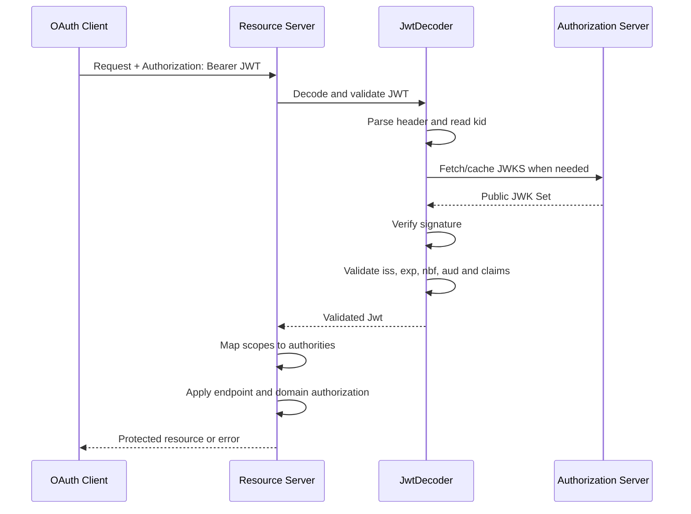

# Tích hợp Resource Server xác minh JWT bằng issuer và JWKS

## 1. Vai trò của Resource Server trong hệ thống OAuth 2.0

Trong chương **Tích hợp ứng dụng** của module **SPRING_SECURITY_OAUTH2_OIDC_AUTHORIZATION_SERVER**, chúng ta học cách thiết kế, cấu hình, bảo mật, kiểm thử và vận hành OAuth 2.0/OpenID Connect Authorization Server bằng Spring Security và Spring Authorization Server trong ứng dụng Spring Boot.

Authorization Server xác thực client hoặc resource owner theo grant phù hợp, áp dụng policy cấp quyền và phát hành token. Resource Server bảo vệ API, nhận access token từ client và quyết định request có được phép truy cập tài nguyên hay không.

Khi dùng JWT access token, Resource Server không cần gọi Authorization Server cho từng request để introspect token. Nó có thể xác minh chữ ký bằng public key được công bố qua JSON Web Key Set (JWKS), sau đó kiểm tra các claim cần thiết. Mô hình này giảm round trip trên đường request và cho phép nhiều Resource Server xác minh token độc lập.

Tuy nhiên, chữ ký hợp lệ mới chỉ chứng minh token được ký bởi một key tương ứng. Resource Server vẫn phải kiểm tra token đến từ issuer được tin cậy, token dành cho API của mình, còn hiệu lực và có scope/authority phù hợp với endpoint.

### Mục tiêu học tập

Sau bài này, bạn có thể:

- Phân biệt Authorization Server, Resource Server, access token và ID Token.
- Cấu hình Spring Boot Resource Server bằng issuer URI và JWKS.
- Hiểu discovery metadata, jwks_uri, kid và key rotation.
- Xác minh chữ ký, iss, aud, exp và nbf.
- Áp dụng authorization theo scope bằng SCOPE_ authorities.
- Bổ sung validator cho audience và claim nghiệp vụ.
- Xử lý nhiều issuer/tenant bằng JwtIssuerAuthenticationManagerResolver.
- Truyền tenant context từ JWT đã xác minh vào tầng nghiệp vụ.
- Kiểm thử token hợp lệ, token sai issuer/audience, key rotation và lỗi JWKS.

## 2. Access Token khác ID Token

OAuth 2.0 định nghĩa access token để client truy cập protected resource. OpenID Connect định nghĩa ID Token để client biết kết quả xác thực người dùng và nhận các claim về authentication.

Hai token có mục đích khác nhau:

| Đặc điểm | Access Token | ID Token |
| --- | --- | --- |
| Người nhận chính | Resource Server/API được chỉ định trong aud. | OIDC client có client_id tương ứng trong aud. |
| Mục đích | Ủy quyền truy cập API. | Truyền kết quả authentication cho client. |
| Claim thường dùng | iss, sub, aud, exp, iat, scope hoặc scp. | iss, sub, aud, exp, iat, nonce, auth_time và claim OIDC. |
| Nơi xác minh | Resource Server. | OIDC client/Relying Party. |
| Quyết định truy cập API | Kết hợp scope, audience và policy. | Không dùng thay access token. |

Không gửi ID Token vào API chỉ vì nó là JWT có chữ ký hợp lệ. ID Token thường có audience là ứng dụng web/mobile; API cần access token có audience dành cho chính API đó.

Resource Server cũng không nên chấp nhận một JWT bất kỳ do cùng Authorization Server ký. Nó phải kiểm tra token type/profile và audience được cấp cho resource của mình.

## 3. JWT và JWKS hoạt động như thế nào?

### 3.1. JWT có ba phần

JWT dạng compact thường gồm ba phần Base64URL, ngăn cách bởi dấu chấm:

```text
BASE64URL(header).BASE64URL(payload).BASE64URL(signature)
```

- **Header** mô tả thuật toán ký và key identifier, ví dụ alg và kid.
- **Payload** chứa claims như iss, sub, aud, exp, scope.
- **Signature** cho phép bên nhận kiểm tra header/payload có bị thay đổi sau khi ký hay không.

Payload được mã hóa Base64URL, không được mã hóa bí mật. Bất kỳ ai có token đều có thể đọc claims. Không đưa password, client secret, private data hoặc dữ liệu nhạy cảm không cần thiết vào JWT.

### 3.2. JWK và JWKS

JWK (JSON Web Key) là biểu diễn JSON của một khóa mật mã. JWKS (JSON Web Key Set) là một tập JWK, thường được Authorization Server công bố tại endpoint jwks_uri.

Với chữ ký bất đối xứng:

- Authorization Server giữ private key và dùng nó để ký token.
- Authorization Server công bố public key trong JWKS.
- Resource Server tải public key và dùng nó để xác minh chữ ký.

Public key có thể được công khai; private key tuyệt đối không được xuất hiện trong JWKS response.

### 3.3. kid dùng để chọn key

Khi có nhiều public key trong JWKS, header kid giúp decoder chọn key tương ứng. kid chỉ là định danh để tìm key, không phải bằng chứng token đáng tin cậy.

Resource Server phải xác minh chữ ký bằng public key đã lấy từ JWKS được cấu hình hoặc discovery từ issuer tin cậy. Không tự tải key từ URL do token header hoặc claim tùy ý cung cấp.

### 3.4. Luồng xác minh



Resource Server chỉ tạo Authentication sau khi decoder xác minh token thành công. Nếu bất kỳ bước xác minh nào thất bại, request không được coi là authenticated.

## 4. Dependency và cấu hình cơ bản

### 4.1. Dependency

Với Spring Boot, dùng starter Resource Server:

```xml
<dependency>
    <groupId>org.springframework.boot</groupId>
    <artifactId>spring-boot-starter-oauth2-resource-server</artifactId>
</dependency>
```

Starter cung cấp hỗ trợ Resource Server và JWT. Ở mức thư viện Spring Security, hai module cốt lõi là spring-security-oauth2-resource-server và spring-security-oauth2-jose; module JOSE cung cấp chức năng decode và verify JWT.

Không tự khai báo version Spring Security khác version do Spring Boot dependency management quản lý nếu chưa có lý do tương thích rõ ràng.

### 4.2. Cấu hình issuer URI

Giả sử Authorization Server phát hành access token với issuer:

```text
https://auth.example.com
```

Cấu hình Resource Server:

```yaml
spring:
  security:
    oauth2:
      resourceserver:
        jwt:
          issuer-uri: https://auth.example.com
          audiences: https://orders-api.example.com
```

issuer-uri phải khớp chính xác với claim iss trong access token. audiences yêu cầu token có audience dành cho API. Một token có chữ ký hợp lệ nhưng không có audience này sẽ bị từ chối.

### 4.3. Cấu hình JWKS URI trực tiếp

Nếu Authorization Server không công bố metadata endpoint phù hợp hoặc Resource Server cần biết trước JWKS endpoint, có thể cấu hình cả issuer và JWKS URI:

```yaml
spring:
  security:
    oauth2:
      resourceserver:
        jwt:
          issuer-uri: https://auth.example.com
          jwk-set-uri: https://auth.example.com/oauth2/jwks
          audiences: https://orders-api.example.com
```

jwk-set-uri chỉ định nơi lấy public key. Vẫn giữ issuer-uri để kiểm tra claim iss. Nếu chỉ cấu hình JWKS URI mà không thêm issuer validator, Resource Server có thể xác minh chữ ký nhưng chưa chắc token được phát hành bởi issuer mà API mong đợi.

### 4.4. Discovery metadata

Khi chỉ cấu hình issuer-uri, Spring Security dùng Provider Configuration hoặc Authorization Server Metadata endpoint để tìm trường jwks_uri. Tùy issuer và metadata profile, endpoint discovery có thể là:

- https://auth.example.com/.well-known/openid-configuration
- https://auth.example.com/.well-known/oauth-authorization-server

Với issuer chứa path, Spring Security hỗ trợ các vị trí well-known tương ứng theo quy tắc discovery. Hãy kiểm tra metadata response thực tế và bảo đảm issuer trong metadata khớp issuer đã cấu hình.

Trong Spring Authorization Server, JWKS endpoint mặc định thường là /oauth2/jwks; metadata là nguồn công bố URL tương ứng. Resource Server nên dựa vào metadata hoặc cấu hình endpoint đã được quản trị thay vì tự ghép URL từ request.

### 4.5. Startup và lần xác minh đầu tiên

Với cấu hình Spring Boot mặc định, quá trình discovery có thể được trì hoãn đến lần đầu Resource Server nhận bearer JWT. Điều này giúp startup của API không nhất thiết phụ thuộc Authorization Server đang hoạt động ngay lúc khởi động.

Khi Resource Server cần xác minh token, nó lấy metadata/JWKS theo cấu hình, chọn public key tương ứng và kiểm tra token. Nếu ứng dụng tự khai báo JwtDecoder bean, hãy hiểu rõ việc khởi tạo decoder có thể thực hiện discovery sớm hơn và ảnh hưởng startup dependency.

## 5. Cấu hình SecurityFilterChain cho API

Ví dụ bảo vệ endpoint theo scope:

```java
import static org.springframework.security.oauth2.core.authorization.OAuth2AuthorizationManagers.hasScope;

import org.springframework.context.annotation.Bean;
import org.springframework.context.annotation.Configuration;
import org.springframework.security.config.Customizer;
import org.springframework.security.config.annotation.web.builders.HttpSecurity;
import org.springframework.security.web.SecurityFilterChain;

@Configuration(proxyBeanMethods = false)
public class ResourceServerSecurityConfig {

    @Bean
    SecurityFilterChain apiSecurityFilterChain(HttpSecurity http)
            throws Exception {

        http
            .authorizeHttpRequests(authorize -> authorize
                .requestMatchers("/actuator/health").permitAll()
                .requestMatchers("/api/orders/**").access(hasScope("orders.read"))
                .requestMatchers("/api/order-admin/**").access(hasScope("orders.write"))
                .anyRequest().authenticated()
            )
            .oauth2ResourceServer(oauth2 ->
                oauth2.jwt(Customizer.withDefaults())
            );

        return http.build();
    }
}
```

Khi dùng JWT Resource Server mặc định, Spring Security ánh xạ scope thành authority có prefix SCOPE_. Vì vậy hasScope("orders.read") tương đương kiểm tra authority SCOPE_orders.read.

Nếu dùng hasAuthority, phải viết đầy đủ prefix:

```java
.requestMatchers("/api/orders/**")
.hasAuthority("SCOPE_orders.read")
```

permitAll() cho health endpoint không làm các endpoint nghiệp vụ trở nên public. Hãy khai báo route cụ thể trước rule tổng quát và tránh vô tình dùng permitAll() cho API có dữ liệu tenant.

### 5.1. Bật method security

Có thể đặt authorization gần service method:

```java
import org.springframework.security.access.prepost.PreAuthorize;
import org.springframework.stereotype.Service;

@Service
public class OrderQueryService {

    @PreAuthorize("hasAuthority('SCOPE_orders.read')")
    public Order findOrder(String orderId) {
        // Load order and apply tenant/domain checks.
        return loadOrder(orderId);
    }
}
```

Kích hoạt method security:

```java
import org.springframework.context.annotation.Configuration;
import org.springframework.security.config.annotation.method.configuration.EnableMethodSecurity;

@Configuration
@EnableMethodSecurity
public class MethodSecurityConfig {
}
```

Scope kiểm soát quyền ở mức API/action. Service vẫn phải kiểm tra user/client có quyền truy cập đúng order, account hoặc tenant cụ thể hay không.

## 6. JwtDecoder xác minh những gì?

JwtAuthenticationProvider dùng JwtDecoder để parse, xác minh chữ ký và validate claims. Với JWT access token, các kiểm tra quan trọng gồm:

| Thành phần | Cần kiểm tra | Mục đích |
| --- | --- | --- |
| Signature | Chữ ký khớp public key trong JWKS. | Token không bị sửa và được ký bởi private key tương ứng. |
| iss | Issuer khớp issuer tin cậy. | Token đến từ Authorization Server mong đợi. |
| aud | Audience chứa identifier của API. | Token được phát hành cho đúng Resource Server. |
| exp | Chưa hết hạn. | Giới hạn thời gian sử dụng token. |
| nbf | Thời điểm hiện tại đã qua nbf. | Không chấp nhận token chưa có hiệu lực. |
| alg | Thuật toán nằm trong allowlist. | Ngăn chấp nhận thuật toán không mong muốn. |
| Claims nghiệp vụ | Tenant, scope, subject và policy cần thiết hợp lệ. | Bảo đảm token phù hợp với authorization của API. |

iat cho biết thời điểm phát hành, nhưng không thay thế exp. Nếu policy cần giới hạn tuổi token tối đa hoặc yêu cầu iat, hãy thêm validator riêng.

### 6.1. Issuer là ai phát hành token

Claim iss định danh Authorization Server. Giá trị phải khớp issuer được tin cậy, gồm scheme, host và path. Không bỏ path hoặc tự đổi trailing slash để làm token khớp gần đúng.

Trong hệ thống nhiều issuer, iss còn giúp phân biệt miền danh tính của tenant. Cùng sub từ hai issuer khác nhau không mặc nhiên là cùng một người.

### 6.2. Audience là ai được nhận token

Claim aud chỉ ra resource server mà token dành cho. Nếu API Orders nhận token cho API Billing, chữ ký vẫn có thể hợp lệ nhưng API Orders phải từ chối do sai audience.

Audience có thể là một string hoặc danh sách URI/string trong JWT. Spring Security biểu diễn audience qua Jwt.getAudience(), cho phép kiểm tra một API identifier trong danh sách.

Không thay audience validation bằng kiểm tra scope. Scope và audience trả lời hai câu hỏi khác nhau:

- Audience: token được gửi tới API nào?
- Scope: token cho phép thực hiện loại hành động nào trên API đó?

### 6.3. Expiration và clock skew

Token có exp trong tương lai vẫn có thể bị từ chối nếu nbf nằm trong tương lai hoặc timestamp không hợp lệ. Đồng hồ giữa Authorization Server và Resource Server cần được đồng bộ.

Spring Security có thể cấu hình clock skew cho timestamp validator. Chỉ đặt một khoảng nhỏ phù hợp với sai lệch đồng hồ thực tế; không kéo dài token lifetime bằng cách đặt skew quá lớn.

## 7. Thêm audience validator bằng Java

Nếu không dùng thuộc tính audiences của Spring Boot hoặc cần policy phức tạp hơn, có thể cấu hình JwtDecoder và validator trực tiếp.

Ví dụ yêu cầu issuer chính xác và audience phải chứa https://orders-api.example.com:

```java
import org.springframework.context.annotation.Bean;
import org.springframework.context.annotation.Configuration;
import org.springframework.security.oauth2.core.OAuth2Error;
import org.springframework.security.oauth2.core.DelegatingOAuth2TokenValidator;
import org.springframework.security.oauth2.core.OAuth2TokenValidator;
import org.springframework.security.oauth2.core.OAuth2TokenValidatorResult;
import org.springframework.security.oauth2.jwt.Jwt;
import org.springframework.security.oauth2.jwt.JwtDecoder;
import org.springframework.security.oauth2.jwt.JwtValidators;
import org.springframework.security.oauth2.jwt.NimbusJwtDecoder;

@Configuration(proxyBeanMethods = false)
public class JwtDecoderConfig {

    private static final String ISSUER =
            "https://auth.example.com";
    private static final String AUDIENCE =
            "https://orders-api.example.com";

    @Bean
    JwtDecoder jwtDecoder() {
        NimbusJwtDecoder decoder =
                NimbusJwtDecoder.withIssuerLocation(ISSUER).build();

        OAuth2TokenValidator<Jwt> issuerAndTimestampValidator =
                JwtValidators.createDefaultWithIssuer(ISSUER);

        OAuth2TokenValidator<Jwt> audienceValidator = jwt -> {
            if (jwt.getAudience() != null &&
                    jwt.getAudience().contains(AUDIENCE)) {
                return OAuth2TokenValidatorResult.success();
            }

            OAuth2Error error = new OAuth2Error(
                    "invalid_token",
                    "The required audience is missing",
                    null);
            return OAuth2TokenValidatorResult.failure(error);
        };

        decoder.setJwtValidator(
                new DelegatingOAuth2TokenValidator<>(
                        issuerAndTimestampValidator,
                        audienceValidator));

        return decoder;
    }
}
```

JwtValidators.createDefaultWithIssuer() giữ các validator timestamp mặc định và kiểm tra issuer. DelegatingOAuth2TokenValidator kết hợp chúng với audience validator. Không thay toàn bộ validator mặc định bằng một lambda chỉ kiểm tra audience.

Khi khai báo JwtDecoder bean, cấu hình decoder này sẽ thay decoder auto-configured của Spring Boot. Hãy kiểm tra issuer discovery, JWKS URI, thuật toán được tin cậy, timeout và cache theo yêu cầu vận hành.

### 7.1. Authorization Server phải phát audience dành cho API

Resource Server chỉ có thể kiểm tra audience nếu access token thực sự chứa claim aud. Với Spring Authorization Server, có thể thêm audience vào JWT access token bằng OAuth2TokenCustomizer:

```java
import java.util.List;

import org.springframework.context.annotation.Bean;
import org.springframework.context.annotation.Configuration;
import org.springframework.security.oauth2.server.authorization.OAuth2TokenType;
import org.springframework.security.oauth2.server.authorization.token.JwtEncodingContext;
import org.springframework.security.oauth2.server.authorization.token.OAuth2TokenCustomizer;

@Configuration(proxyBeanMethods = false)
public class AccessTokenAudienceConfig {

    @Bean
    OAuth2TokenCustomizer<JwtEncodingContext> accessTokenAudienceCustomizer() {
        return context -> {
            if (OAuth2TokenType.ACCESS_TOKEN.equals(context.getTokenType())) {
                context.getClaims().audience(
                        List.of("https://orders-api.example.com"));
            }
        };
    }
}
```

Ví dụ dùng audience cố định cho một API. Trong hệ thống có nhiều API, hãy xác định audience theo resource đã được client yêu cầu và policy đã xác minh; không thêm mọi audience vào mọi access token. Chỉ tùy biến JWT access token, không áp dụng audience API cho ID Token.

## 8. Thuật toán chữ ký và key selection

### 8.1. Chỉ tin thuật toán được phê duyệt

Resource Server cần có allowlist thuật toán chữ ký. Không lấy giá trị alg từ JWT rồi tự động chấp nhận thuật toán bất kỳ.

Spring Security NimbusJwtDecoder có cấu hình thuật toán được tin cậy qua builder hoặc Spring Boot property jws-algorithms. Chọn thuật toán phù hợp với signing key và tiêu chuẩn của tổ chức, ví dụ RSA hoặc EC.

Nếu Authorization Server ký bằng RS256, Resource Server cần xác minh bằng public RSA key tương ứng. Nếu chuyển sang ES256, cần cấu hình decoder chấp nhận thuật toán EC đã phê duyệt và bảo đảm key trong JWKS tương thích.

Không cho phép none, không dùng shared secret HMAC như một public key trong JWKS và không suy luận thuật toán từ dữ liệu không đáng tin cậy.

### 8.2. Key selection qua kid

Khi token có kid, decoder chọn JWK tương ứng trong key set. Nếu không tìm thấy key hoặc chữ ký không khớp, xác minh thất bại.

Không tự viết logic nếu không tìm thấy kid thì thử mọi key/thuật toán bất kỳ để làm token qua được. Unknown key có thể là token giả, token ký bởi issuer khác hoặc token phát hành bằng key mới chưa được công bố đúng cách.

### 8.3. Không lấy JWKS URI từ JWT

Một token không được quyền chỉ định URL mà Resource Server sẽ tải public key. Nếu ứng dụng ghép JWKS URI từ claim iss hoặc một header chưa xác minh, attacker có thể khiến server truy cập endpoint ngoài dự kiến.

Hãy ánh xạ issuer tới metadata/JWKS URI từ registry tin cậy hoặc cấu hình quản trị. Với multi-issuer, allowlist issuer trước khi khởi tạo decoder.

## 9. Key rotation và cache JWKS

Authorization Server có thể thay đổi signing key mà không cần cấu hình lại mọi Resource Server. Khi JWKS công bố key mới, Spring Security có thể tự động dùng key mới để xác minh token.

Quy trình rotation an toàn:

1. Tạo key mới trong key management system.
2. Công bố public key mới trong JWKS, với kid mới.
3. Chờ Resource Server có thể tải/nhìn thấy key mới.
4. Chuyển Authorization Server sang ký token bằng private key mới.
5. Giữ public key cũ trong JWKS trong suốt thời gian token cũ còn có thể hợp lệ.
6. Gỡ public key cũ sau khi token được ký bằng key đó hết hạn, cộng clock skew và khoảng đệm vận hành.

Nếu chuyển ký bằng key mới trước khi public key mới được công bố, Resource Server có thể không xác minh được token mới. Nếu gỡ key cũ quá sớm, token hợp lệ đã phát trước đó có thể bị từ chối.

JWKS thường được cache để tránh gọi Authorization Server cho mọi request. Vì vậy, khi điều tra lỗi rotation, kiểm tra cache lifetime, response cache headers, unknown kid, khả năng refresh key set và network tới JWKS endpoint.

Không cache private key ở Resource Server. Resource Server chỉ cần public key.

## 10. Ánh xạ scope thành GrantedAuthority

Spring Security mặc định dùng JwtAuthenticationConverter và JwtGrantedAuthoritiesConverter để ánh xạ scope trong JWT thành GrantedAuthority.

Ví dụ token có:

```json
{
  "iss": "https://auth.example.com",
  "aud": ["https://orders-api.example.com"],
  "sub": "user-123",
  "scope": "orders.read orders.write"
}
```

Authorities mặc định:

```text
SCOPE_orders.read
SCOPE_orders.write
```

Có thể dùng chúng trong URL authorization hoặc method security:

```java
.requestMatchers(HttpMethod.GET, "/api/orders/**")
.hasAuthority("SCOPE_orders.read")
.requestMatchers(HttpMethod.POST, "/api/orders/**")
.hasAuthority("SCOPE_orders.write")
```

Không tự động coi mọi claim roles, groups, permissions là authority nếu chưa định nghĩa contract giữa Authorization Server và Resource Server. Nếu cần custom mapping, hãy dùng JwtAuthenticationConverter và chỉ ánh xạ claim được ký, có schema rõ ràng và thuộc issuer tin cậy.

### 10.1. Custom converter khi issuer dùng claim riêng

Ví dụ Authorization Server phát claim authorities với danh sách quyền nội bộ:

```java
import java.util.Collection;
import java.util.ArrayList;
import java.util.List;
import java.util.Set;

import org.springframework.context.annotation.Bean;
import org.springframework.context.annotation.Configuration;
import org.springframework.core.convert.converter.Converter;
import org.springframework.security.core.GrantedAuthority;
import org.springframework.security.core.authority.SimpleGrantedAuthority;
import org.springframework.security.oauth2.jwt.Jwt;
import org.springframework.security.oauth2.server.resource.authentication.JwtAuthenticationConverter;
import org.springframework.security.oauth2.server.resource.authentication.JwtGrantedAuthoritiesConverter;

@Configuration(proxyBeanMethods = false)
public class JwtAuthoritiesConfig {

    private static final Set<String> ALLOWED_AUTHORITIES =
            Set.of("ROLE_SUPPORT", "ROLE_ORDER_AUDITOR");

    @Bean
    JwtAuthenticationConverter jwtAuthenticationConverter() {
        JwtGrantedAuthoritiesConverter scopes =
                new JwtGrantedAuthoritiesConverter();

        Converter<Jwt, Collection<GrantedAuthority>> authoritiesConverter =
                jwt -> {
                    Collection<GrantedAuthority> authorities = new ArrayList<>();
                    Collection<GrantedAuthority> scopeAuthorities =
                            scopes.convert(jwt);
                    if (scopeAuthorities != null) {
                        authorities.addAll(scopeAuthorities);
                    }
                    List<String> tokenAuthorities =
                            jwt.getClaimAsStringList("authorities");
                    if (tokenAuthorities != null) {
                        tokenAuthorities.stream()
                                .filter(ALLOWED_AUTHORITIES::contains)
                                .map(SimpleGrantedAuthority::new)
                                .forEach(authorities::add);
                    }
                    return authorities;
                };

        JwtAuthenticationConverter converter =
                new JwtAuthenticationConverter();
        converter.setJwtGrantedAuthoritiesConverter(authoritiesConverter);
        return converter;
    }
}
```

Đoạn code trên giữ mapping scope mặc định. Nếu cần ánh xạ claim custom, hãy thêm authority từ allowlist rõ ràng, tránh biến chuỗi bất kỳ trong token thành quyền quản trị.

Gắn converter vào Resource Server:

```java
http.oauth2ResourceServer(oauth2 ->
        oauth2.jwt(jwt ->
                jwt.jwtAuthenticationConverter(jwtAuthenticationConverter)));
```

## 11. Xử lý principal và tenant context

Mặc định, Authentication.getPrincipal() là đối tượng Jwt; Authentication.getName() thường lấy từ claim sub.

Trong ứng dụng đa tenant, sub không nhất thiết duy nhất toàn hệ thống. Một định danh an toàn thường cần kết hợp issuer và subject:

```text
principal key = iss + ":" + sub
```

Nếu token có claim tenant_id, chỉ dùng nó sau khi decoder đã xác minh chữ ký và issuer. Đồng thời kiểm tra tenant đó có tương thích với issuer và resource mà API phục vụ.

Không dùng tenant ID trong request header làm nguồn sự thật duy nhất. Client có thể sửa header. Tenant context cần được suy ra từ authenticated principal/issuer hoặc kiểm tra với một tenant mapping tin cậy.

### 11.1. Không nhầm scope với quyền trên từng bản ghi

Scope orders.read có thể cho phép gọi chức năng đọc order, nhưng không tự cho phép đọc mọi order. Service cần kiểm tra order thuộc tenant/account mà principal được phép truy cập.

Ví dụ:

```java
import org.springframework.security.core.context.SecurityContextHolder;
import org.springframework.security.oauth2.jwt.Jwt;

@PreAuthorize("hasAuthority('SCOPE_orders.read')")
public Order findOrder(String orderId) {
    Jwt jwt = (Jwt) SecurityContextHolder.getContext()
            .getAuthentication().getPrincipal();

    String issuer = jwt.getIssuer().toString();
    String subject = jwt.getSubject();

    return orderRepository.findVisibleOrder(orderId, issuer, subject)
            .orElseThrow(OrderNotFoundException::new);
}
```

Query dữ liệu cần tenant/subject predicate hoặc row-level security tương ứng. Không chỉ tải order theo ID rồi tin rằng scope đã đủ để bảo vệ quyền sở hữu.

## 12. Resource Server hỗ trợ nhiều issuer

Một Resource Server có thể chấp nhận access token từ nhiều Authorization Server hoặc nhiều issuer của một Authorization Server đa tenant. Khi đó, mỗi issuer có thể có:

- JWKS URI và signing key khác nhau.
- Audience/API identifier khác nhau.
- Scope/claim policy khác nhau.
- Tenant mapping khác nhau.

Spring Security cung cấp JwtIssuerAuthenticationManagerResolver để chọn AuthenticationManager dựa trên issuer claim trong JWT.

### 12.1. Allowlist issuer tĩnh

Với danh sách issuer cố định:

```java
import org.springframework.context.annotation.Bean;
import org.springframework.context.annotation.Configuration;
import org.springframework.security.config.annotation.web.builders.HttpSecurity;
import org.springframework.security.oauth2.server.resource.authentication.JwtIssuerAuthenticationManagerResolver;
import org.springframework.security.web.SecurityFilterChain;

@Configuration(proxyBeanMethods = false)
public class MultiIssuerResourceServerConfig {

    @Bean
    SecurityFilterChain apiSecurityFilterChain(HttpSecurity http)
            throws Exception {

        JwtIssuerAuthenticationManagerResolver resolver =
                JwtIssuerAuthenticationManagerResolver.fromTrustedIssuers(
                        "https://auth.example.com/tenant-a",
                        "https://auth.example.com/tenant-b");

        http
            .authorizeHttpRequests(authorize -> authorize
                .anyRequest().authenticated()
            )
            .oauth2ResourceServer(oauth2 ->
                oauth2.authenticationManagerResolver(resolver)
            );

        return http.build();
    }
}
```

Resolver chỉ chấp nhận issuer trong danh sách tin cậy. Mỗi issuer có decoder/provider tương ứng và issuer validation của nó. Các issuer endpoint được nạp lazy, vì vậy ứng dụng không nhất thiết phải gọi tất cả Authorization Server khi startup. Đoạn cấu hình này minh họa allowlist và issuer validation; nếu API yêu cầu audience cụ thể, hãy thêm audience validator vào decoder của từng issuer như phần tiếp theo.

### 12.2. Issuer claim ban đầu chưa được xác minh

Resolver phải đọc iss để chọn AuthenticationManager trước khi decoder xác minh chữ ký. Giá trị đó chỉ được dùng như khóa tra cứu trong allowlist.

Sau khi chọn được manager, JwtDecoder vẫn phải xác minh chữ ký, issuer, timestamp và audience. Không dùng claim iss chưa xác minh để truy cập database tenant, lấy secret, gọi URL tùy ý hoặc cấp quyền.

### 12.3. Audience khác nhau theo issuer

Nếu mọi tenant đều phục vụ cùng một API audience, có thể cấu hình một audience validator chung trong từng decoder. Nếu mỗi tenant có audience riêng, cần xây AuthenticationManager/JwtDecoder cho từng issuer với audience tương ứng.

Không chỉ allowlist issuer mà bỏ audience validation. Một token được ký bởi issuer tin cậy vẫn có thể dành cho API khác.

## 13. Multi-issuer với AuthenticationManager riêng cho từng tenant

Khi mỗi issuer có audience hoặc policy riêng, tạo decoder/provider riêng rồi đăng ký trong map theo issuer:

```java
import java.util.Map;

import org.springframework.context.annotation.Bean;
import org.springframework.context.annotation.Configuration;
import org.springframework.security.authentication.AuthenticationManager;
import org.springframework.security.oauth2.core.OAuth2Error;
import org.springframework.security.oauth2.core.DelegatingOAuth2TokenValidator;
import org.springframework.security.oauth2.core.OAuth2TokenValidator;
import org.springframework.security.oauth2.core.OAuth2TokenValidatorResult;
import org.springframework.security.oauth2.jwt.Jwt;
import org.springframework.security.oauth2.jwt.JwtValidators;
import org.springframework.security.oauth2.jwt.NimbusJwtDecoder;
import org.springframework.security.oauth2.server.resource.authentication.JwtAuthenticationProvider;
import org.springframework.security.oauth2.server.resource.authentication.JwtIssuerAuthenticationManagerResolver;

@Configuration(proxyBeanMethods = false)
public class TenantAuthenticationManagersConfig {

    private AuthenticationManager managerFor(
            String issuer, String audience) {

        NimbusJwtDecoder decoder =
                NimbusJwtDecoder.withIssuerLocation(issuer).build();

        OAuth2TokenValidator<Jwt> audienceValidator = jwt -> {
            if (jwt.getAudience() != null &&
                    jwt.getAudience().contains(audience)) {
                return OAuth2TokenValidatorResult.success();
            }
            return OAuth2TokenValidatorResult.failure(
                    new OAuth2Error(
                            "invalid_token",
                            "Invalid audience",
                            null));
        };

        decoder.setJwtValidator(
                new DelegatingOAuth2TokenValidator<>(
                        JwtValidators.createDefaultWithIssuer(issuer),
                        audienceValidator));

        JwtAuthenticationProvider provider =
                new JwtAuthenticationProvider(decoder);
        return provider::authenticate;
    }

    @Bean
    JwtIssuerAuthenticationManagerResolver tenantResolver() {
        Map<String, AuthenticationManager> managers = Map.of(
                "https://auth.example.com/tenant-a",
                managerFor(
                        "https://auth.example.com/tenant-a",
                        "https://orders-a.example.com"),
                "https://auth.example.com/tenant-b",
                managerFor(
                        "https://auth.example.com/tenant-b",
                        "https://orders-b.example.com"));

        return new JwtIssuerAuthenticationManagerResolver(managers::get);
    }
}
```

Đây là ví dụ cho danh sách issuer tĩnh. Nếu số tenant lớn, nên nạp issuer/audience/JWKS configuration từ tenant registry đã được quản trị và cache AuthenticationManager theo issuer.

Map manager không được tạo từ một issuer tùy ý do client gửi. Chỉ tenant đã provision, active và có issuer metadata được xác minh mới được đưa vào map.

## 14. Thêm và gỡ tenant động

Nếu tenant có thể được tạo khi Resource Server đang chạy, có thể dùng repository AuthenticationManager có thể cập nhật:

```java
import java.util.concurrent.ConcurrentHashMap;
import java.util.concurrent.ConcurrentMap;

import org.springframework.security.authentication.AuthenticationManager;
import org.springframework.security.oauth2.jwt.JwtDecoders;
import org.springframework.security.oauth2.server.resource.authentication.JwtAuthenticationProvider;
import org.springframework.security.oauth2.server.resource.authentication.JwtIssuerAuthenticationManagerResolver;

public final class DynamicTenantAuthenticationManagers {

    private final ConcurrentMap<String, AuthenticationManager> managers =
            new ConcurrentHashMap<>();

    public JwtIssuerAuthenticationManagerResolver resolver() {
        return new JwtIssuerAuthenticationManagerResolver(managers::get);
    }

    public void registerTrustedTenant(String issuer) {
        // issuer must come from the trusted tenant registry, not from a JWT.
        JwtAuthenticationProvider provider =
                new JwtAuthenticationProvider(
                        JwtDecoders.fromIssuerLocation(issuer));
        managers.put(issuer, provider::authenticate);
    }

    public void removeTenant(String issuer) {
        managers.remove(issuer);
    }
}
```

Đây là skeleton minh họa. Trước khi registerTrustedTenant, hệ thống phải xác minh tenant được provision, issuer thuộc allowlist và audience/policy đã được cấu hình. Trong production, manager được tạo cần áp dụng audience validator riêng như phần trước; ví dụ JwtDecoders.fromIssuerLocation chỉ minh họa việc tạo decoder có issuer validation mặc định.

Không triển khai endpoint công khai kiểu register-issuer?url=... rồi tạo decoder cho URL người gọi cung cấp. Cách làm đó có thể tạo SSRF, khiến Resource Server tải JWKS từ máy nội bộ hoặc endpoint attacker kiểm soát.

Khi gỡ tenant, cần đồng bộ việc từ chối token mới, cache, request đang chạy và policy dữ liệu. Việc xóa manager khỏi map không tự thu hồi token đã phát; Resource Server cần chính sách về token lifetime, revocation/introspection hoặc denylist nếu cần thu hồi tức thời.

## 15. Tenant propagation sau xác minh

Chọn đúng AuthenticationManager mới chỉ giải quyết việc xác minh token. Ứng dụng còn phải truyền tenant context vào authorization và data access.

Một cách tiếp cận:

1. Decoder xác minh signature, issuer, audience và timestamp.
2. JwtAuthenticationProvider tạo JwtAuthenticationToken.
3. Controller/service lấy issuer và claim tenant từ Jwt đã xác minh.
4. Domain service kiểm tra tenant/subject có quyền trên resource.
5. Repository query luôn giới hạn tenant.

Không dùng claim tenant_id như authority quản trị. Tenant ID là context phân vùng dữ liệu; quyền hành động vẫn phải dựa trên scope/authority và policy nghiệp vụ.

Nếu một API nhận token từ nhiều issuer, lưu issuer cùng subject trong audit log và principal key để tránh trộn hai user có cùng sub.

## 16. JWT validation và authorization là hai lớp khác nhau

| Lớp | Câu hỏi | Ví dụ |
| --- | --- | --- |
| Token validation | Token có hợp lệ và dành cho API này không? | Signature, issuer, audience, expiry, not-before. |
| Coarse-grained authorization | Token có scope cho action này không? | SCOPE_orders.read. |
| Domain authorization | Principal có được truy cập bản ghi cụ thể không? | Order thuộc tenant/account của principal. |
| Data isolation | Query có giới hạn dữ liệu đúng tenant không? | Tenant predicate hoặc row-level security. |

Một JWT có chữ ký đúng và scope orders.read vẫn không có nghĩa người dùng được đọc order của tenant khác. Resource Server phải thực hiện đủ các lớp kiểm tra.

## 17. Lỗi xác minh và HTTP response

Resource Server thường trả:

| Tình huống | HTTP response thường gặp | Ý nghĩa |
| --- | --- | --- |
| Không có bearer token trên endpoint yêu cầu authentication | 401 Unauthorized | Caller chưa cung cấp credential. |
| JWT sai định dạng, chữ ký sai, issuer/audience sai hoặc hết hạn | 401 Unauthorized | Bearer token không hợp lệ. |
| Token hợp lệ nhưng thiếu scope/authority | 403 Forbidden | Principal đã xác thực nhưng không đủ quyền. |
| JWKS/metadata endpoint không khả dụng | Lỗi xác minh server-side, thường trả 5xx hoặc authentication failure tùy nguyên nhân/configuration | API không thể xác minh token đáng tin cậy. |

Không biến lỗi JWKS/network thành cho phép truy cập. Khi không xác minh được chữ ký, Resource Server phải fail closed.

### 17.1. Không tiết lộ chi tiết nội bộ

Không trả cho client:

- JWKS URL nội bộ hoặc connection string.
- Stack trace của decoder.
- Nội dung token hoặc private claim không cần thiết.
- Chi tiết tenant khác tồn tại hay không.
- Public key cache hoặc trạng thái key management nội bộ.

Log correlation ID, issuer đã được allowlist, error category và endpoint; không log raw bearer token.

### 17.2. Phân biệt 401 và 403

401 nói rằng request chưa có authentication hợp lệ. 403 nói rằng authentication đã thành công nhưng quyền không đủ.

Nếu token thiếu scope, không nên trả 401 chỉ để che việc policy không cho phép. Hãy dùng 403/Bearer error phù hợp và không tiết lộ dữ liệu resource.

## 18. Hiệu năng, cache và khả năng sẵn sàng

### 18.1. JWKS không nên bị gọi mỗi request

Resource Server sử dụng cache cho key material để tránh fetch JWKS liên tục. Điều này giảm latency và tải cho Authorization Server. Khi key rotation, cache behavior quyết định thời gian Resource Server nhìn thấy key mới.

Theo dõi:

- JWKS fetch latency và failure count.
- Decoder/authentication failure theo category.
- Unknown kid rate.
- Cache refresh và key rotation event.
- Request authentication latency.

Không tạo một decoder mới cho mỗi request. Với multi-issuer, cache manager/decoder theo issuer và quản lý lifecycle.

### 18.2. Timeout và network

JWKS endpoint là dependency trong quá trình xác minh khi key chưa có trong cache hoặc cần refresh. Đặt connect/read timeout phù hợp nếu tự cấu hình HTTP client/decoder; không để một endpoint chậm giữ thread request vô hạn.

Resource Server nên có network route ổn định tới metadata/JWKS endpoint. Nếu dùng egress proxy, kiểm soát DNS, TLS certificate và allowed destination.

### 18.3. Có nên cache kết quả xác minh JWT?

Thông thường nên để decoder và JWKS cache làm nhiệm vụ của chúng. Cache toàn bộ kết quả xác minh theo raw token có thể làm phức tạp revocation, expiry, audience và policy changes. Nếu buộc phải cache, TTL không được vượt thời hạn token và phải xét issuer, audience, validator version cùng revocation policy.

### 18.4. JWT hay opaque token?

JWT phù hợp khi Resource Server cần xác minh cục bộ và chấp nhận độ trễ thu hồi theo token lifetime/key policy. Opaque token phù hợp khi cần introspection tập trung hoặc trạng thái token có thể thay đổi tức thời.

Không chọn JWT chỉ vì dễ decode. Quyết định phải xét revocation, số lượng resource server, độ nhạy của quyền, latency và availability.

## 19. Kiểm thử Resource Server

Kiểm thử ở hai lớp: authorization behavior và cryptographic token validation.

| Nhóm | Kịch bản | Kỳ vọng |
| --- | --- | --- |
| Valid token | Signature đúng, issuer/audience hợp lệ, còn hạn. | Authentication thành công. |
| Invalid signature | Thay payload hoặc ký bằng key khác. | 401. |
| Unknown issuer | iss không thuộc allowlist. | Bị từ chối trước khi chọn manager. |
| Wrong issuer | Token ký đúng nhưng iss khác issuer cấu hình. | 401. |
| Wrong audience | Token dành cho API khác. | 401. |
| Expired | exp đã qua. | 401. |
| Not before | nbf nằm trong tương lai ngoài clock skew. | 401. |
| Missing audience | Token không có aud yêu cầu. | 401. |
| Scope allowed | Có orders.read và gọi GET endpoint. | Thành công. |
| Scope missing | Token hợp lệ nhưng thiếu orders.write. | 403. |
| Wrong tenant | Token tenant A truy cập resource tenant B. | Bị domain policy từ chối. |
| Same subject, different issuer | Hai issuer có cùng sub. | Hai principal identity không bị trộn. |
| Key rotation | JWKS công bố key mới và token dùng kid mới. | Token mới được xác minh sau khi key được tải. |
| Old key overlap | Token cũ vẫn còn hạn và key cũ còn trong JWKS. | Token cũ tiếp tục hợp lệ. |
| Old key removed | Token cũ hết hạn và key cũ được gỡ. | Token cũ không còn được xác minh. |
| Unknown kid | kid không có trong JWKS. | Bị từ chối; không fallback sang key tùy ý. |
| JWKS unavailable | Key chưa cache và endpoint không truy cập được. | Không cho phép request. |
| Dynamic tenant | Tenant chưa được đăng ký. | Resolver từ chối. |
| Dynamic tenant removal | Tenant bị gỡ khỏi allowlist. | Token mới từ issuer đó bị từ chối. |
| ID Token presented | Gửi ID Token có audience là web client tới API. | API từ chối do sai audience/token profile. |
| No bearer token | Gọi endpoint cần authentication mà không có token. | 401. |

### 19.1. MockMvc và jwt() test

Spring Security Test cung cấp request postprocessor jwt() để tạo JwtAuthenticationToken giả lập. Nó hữu ích khi kiểm tra URL authorization, method security, scope/authority mapping và domain authorization dựa trên principal/claims.

Tuy nhiên, jwt() không chứng minh decoder đã xác minh chữ ký, JWKS, issuer hoặc audience. Các kiểm tra mật mã cần integration test với JWT được ký thật và public key tương ứng.

### 19.2. Integration test với JWK Set thật

Tạo test Authorization Server hoặc JWK Set test có private key/public key riêng. Phát token có issuer, audience, scope và thời hạn xác định. Cho Resource Server tải public key và gửi request thực tế.

Thử sửa một byte payload, đổi issuer, đổi audience, hết hạn token và thay kid. Những trường hợp này phải bị từ chối.

### 19.3. Test nhiều issuer

Tạo hai issuer có signing key và audience khác nhau. Xác nhận:

1. Token A qua API/manager A.
2. Token A không qua manager B nếu issuer/audience không khớp.
3. Issuer ngoài allowlist bị từ chối.
4. Cùng sub nhưng issuer khác nhau tạo identity khác nhau.
5. Tenant context sau authentication luôn khớp issuer đã xác minh.

## 20. Troubleshooting

| Triệu chứng | Nguyên nhân có thể | Hướng xử lý |
| --- | --- | --- |
| The iss claim is not valid | issuer-uri không khớp claim iss, khác path hoặc trailing slash. | So sánh chính xác issuer trong metadata và token. |
| Invalid audience | Token không dành cho API hiện tại hoặc Authorization Server chưa phát aud phù hợp. | Cấu hình audience ở cả hai phía. |
| Unable to resolve the Configuration with the provided Issuer | Metadata endpoint sai hoặc không truy cập được. | Kiểm tra discovery URL, TLS, DNS và issuer metadata. |
| Unable to find a signing key that matches | kid không có trong JWKS, cache cũ hoặc key chưa publish. | Kiểm tra JWKS, kid, cache và thứ tự rotation. |
| Token hợp lệ nhưng 403 | Scope thiếu hoặc authority mapping không khớp. | Kiểm tra scope/scp, prefix SCOPE_ và policy endpoint. |
| Tất cả issuer đều bị từ chối | Resolver allowlist sai hoặc issuer string không khớp. | Kiểm tra exact issuer và manager registry. |
| Một tenant dùng nhầm audience | Decoder dùng validator chung không phù hợp. | Tạo manager/decoder với audience riêng theo issuer. |
| API phụ thuộc Authorization Server lúc startup | Custom decoder discovery eager hoặc cấu hình bootstrap đồng bộ. | Xem lại lazy discovery và JWKS configuration. |
| Token cũ bị từ chối sau rotation | Public key cũ bị gỡ sớm hoặc cache/clock skew không phù hợp. | Duy trì overlap key và đồng bộ thời gian. |
| Resource Server gọi URL lạ để tải JWKS | Issuer/JWKS endpoint lấy từ dữ liệu không tin cậy. | Dùng issuer allowlist và tenant registry quản trị. |
| Token tenant A đọc dữ liệu tenant B | Chỉ kiểm tra scope, thiếu domain/data isolation. | Gắn tenant context đã xác minh vào mọi query. |

## 21. Bài tập thực hành và checklist

### Bài tập 1 — Cấu hình issuer và JWKS

Tạo Resource Server Spring Boot, thêm starter OAuth2 Resource Server, cấu hình issuer-uri và gọi API bằng JWT access token do Authorization Server phát hành. Quan sát discovery metadata và JWKS.

### Bài tập 2 — Bổ sung audience

Phát token dành cho https://orders-api.example.com. Cấu hình Resource Server yêu cầu audience này. Thử token có audience của Billing API và xác nhận bị từ chối.

### Bài tập 3 — Scope authorization

Tạo endpoint GET yêu cầu orders.read, endpoint POST yêu cầu orders.write. Kiểm tra authority SCOPE_ và phân biệt 401 với 403.

### Bài tập 4 — Key rotation

Phát token bằng key A, công bố key B, chuyển ký token mới bằng B và giữ A trong JWKS. Xác nhận cả token cũ và mới đều được xác minh trong giai đoạn overlap.

### Bài tập 5 — Multi-issuer

Cấu hình hai issuer trong JwtIssuerAuthenticationManagerResolver. Gán audience riêng cho từng tenant và kiểm tra token không thể đi qua decoder của tenant khác.

### Bài tập 6 — Tenant data isolation

Lấy issuer và subject từ Jwt đã xác minh. Dùng chúng để giới hạn truy vấn dữ liệu. Thử gửi tenant header khác và xác nhận API không truy cập được dữ liệu tenant khác.

### Checklist hoàn thành

- [ ] Phân biệt Access Token và ID Token.
- [ ] Có dependency Resource Server và JOSE phù hợp.
- [ ] Cấu hình issuer-uri đúng với claim iss.
- [ ] Discovery metadata trả đúng issuer và jwks_uri.
- [ ] Chỉ dùng public key từ JWKS tin cậy.
- [ ] Xác minh chữ ký, iss, aud, exp và nbf.
- [ ] Có audience validation cho API.
- [ ] Chỉ tin thuật toán chữ ký đã allowlist.
- [ ] Hiểu kid, JWKS cache và key rotation.
- [ ] Ánh xạ scope thành SCOPE_ authorities.
- [ ] Kiểm tra domain permission và tenant data isolation.
- [ ] Multi-issuer chỉ chấp nhận issuer được allowlist.
- [ ] Không lấy JWKS URL từ token hoặc request chưa xác minh.
- [ ] Không log raw bearer token.
- [ ] Kiểm thử cả authorization behavior và chữ ký JWT thật.

## 22. Tài liệu tham khảo

- [Spring Security 6.5 — OAuth 2.0 Resource Server JWT](https://docs.spring.io/spring-security/reference/6.5/servlet/oauth2/resource-server/jwt.html) — dependency, issuer discovery, JWKS, audience, decoder và scope mapping.
- [Spring Security 6.5 — OAuth 2.0 Resource Server Multi-tenancy](https://docs.spring.io/spring-security/reference/6.5/servlet/oauth2/resource-server/multitenancy.html) — JwtIssuerAuthenticationManagerResolver, trusted issuers, dynamic tenants và tenant propagation.
- [Spring Authorization Server — Configuration Model](https://docs.spring.io/spring-authorization-server/reference/configuration-model.html) — cấu hình Authorization Server và protocol endpoints.
- [Spring Authorization Server — Core Model Components](https://docs.spring.io/spring-authorization-server/reference/core-model-components.html) — token generation, JWK và authorization model.
- [RFC 7517 — JSON Web Key](https://www.rfc-editor.org/rfc/rfc7517) — JWK và JWK Set.
- [RFC 7519 — JSON Web Token](https://www.rfc-editor.org/rfc/rfc7519) — JWT claims, issuer, audience và thời hạn.
- [RFC 8414 — OAuth 2.0 Authorization Server Metadata](https://www.rfc-editor.org/rfc/rfc8414) — metadata và jwks_uri.
- [RFC 9068 — JWT Profile for OAuth 2.0 Access Tokens](https://www.rfc-editor.org/rfc/rfc9068) — profile JWT access token.
- [RFC 6750 — OAuth 2.0 Bearer Token Usage](https://www.rfc-editor.org/rfc/rfc6750) — bearer token và error response.

**Kết luận:** Resource Server phải xác minh chữ ký JWT bằng public key lấy từ JWKS tin cậy, kiểm tra issuer và audience chính xác, xác nhận thời hạn token rồi mới ánh xạ scope thành authority và áp dụng authorization. Với nhiều tenant, chọn decoder theo issuer đã allowlist, áp dụng audience/policy riêng và truyền tenant context từ JWT đã xác minh xuống tầng dữ liệu. Chữ ký hợp lệ là điều kiện cần; quyền truy cập API còn phụ thuộc audience, scope và domain authorization.
