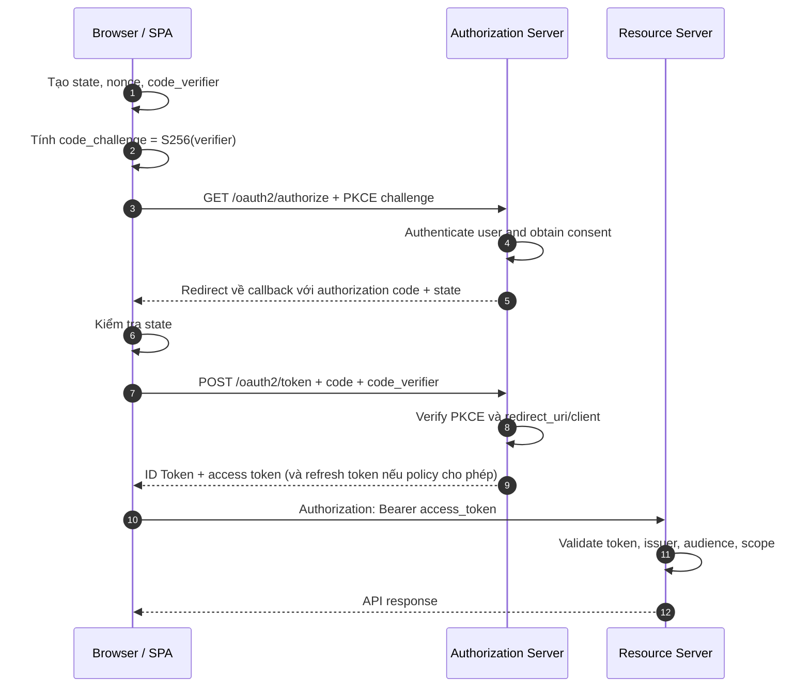
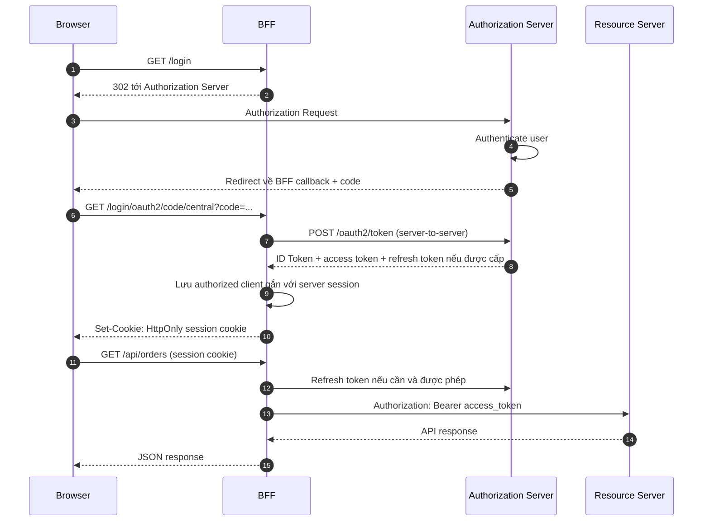

# Thiết kế client SPA với PKCE và cân nhắc mô hình BFF

## 1. Bài toán tích hợp SPA với Authorization Server

Ứng dụng Single Page Application (SPA) chạy JavaScript trong trình duyệt, vì vậy mã nguồn và mọi dữ liệu mà ứng dụng nhận được đều nằm trong môi trường do người dùng kiểm soát. SPA không thể giữ một client secret theo cách an toàn như ứng dụng server-side. Trong OAuth 2.0, SPA vì thế là **public client**.

Một SPA thường cần đăng nhập người dùng qua OpenID Connect (OIDC), gọi API được bảo vệ bằng access token và duy trì trạng thái đăng nhập khi tải lại trang. Có hai kiến trúc phổ biến:

- **SPA gọi Authorization Server và Resource Server trực tiếp:** trình duyệt thực hiện Authorization Code Flow với PKCE, nhận token và gửi access token tới API.
- **Backend for Frontend (BFF):** trình duyệt chỉ giao tiếp với backend cùng ứng dụng; BFF thực hiện OAuth/OIDC ở server-side, giữ token và đại diện người dùng gọi API.

Không có một lựa chọn đúng cho mọi hệ thống. SPA trực tiếp giảm thành phần backend và phù hợp với ứng dụng thuần client, nhưng token nằm trong môi trường JavaScript. BFF giảm việc phơi bày token cho browser, đổi lại cần vận hành session server-side, bảo vệ cookie và CSRF, cũng như một backend làm trung gian.

Trong module **SPRING_SECURITY_OAUTH2_OIDC_AUTHORIZATION_SERVER**, mục tiêu là học cách thiết kế, cấu hình, bảo mật, kiểm thử và vận hành OAuth 2.0/OpenID Connect Authorization Server bằng Spring Security và Spring Authorization Server. Bài thuộc chương **Tích hợp ứng dụng**, tập trung thiết kế SPA public client với PKCE và đánh giá khi nào nên dùng BFF.

### Kết quả học tập

Sau bài học, bạn có thể:

1. Phân biệt public client SPA và confidential client BFF.
2. Mô tả Authorization Code Flow với PKCE S256 và vai trò của `state`, `nonce`, `code_verifier`.
3. Đăng ký SPA client trong Spring Authorization Server với `ClientAuthenticationMethod.NONE` và bắt buộc PKCE.
4. Cấu hình CORS cho Token Endpoint và Resource Server mà không nhầm CORS với authentication/CSRF.
5. Đánh giá cách lưu access token/refresh token trong trình duyệt và rủi ro XSS.
6. Thiết kế BFF giữ token ở server-side, dùng session cookie và bảo vệ CSRF.
7. So sánh SPA trực tiếp, BFF và token-mediating backend theo threat model, vận hành và trải nghiệm người dùng.
8. Xây dựng test matrix cho redirect, PKCE, CORS, session, refresh và logout.

**Phạm vi ví dụ:** Spring Boot 3.x, Spring Security 6.5.x và Spring Authorization Server 1.5.8 trên Servlet stack. Các API minh họa tập trung vào cấu hình OAuth/OIDC; cần ghép vào `SecurityFilterChain`, `RegisteredClientRepository`, key management và resource server hiện có của ứng dụng.

## 2. Ba kiến trúc ứng dụng thường gặp

### 2.1. SPA gọi trực tiếp Authorization Server và API

Trong kiến trúc này, trình duyệt là OAuth public client:

1. SPA chuyển trình duyệt tới Authorization Endpoint.
2. Authorization Server xác thực người dùng và cấp authorization code.
3. SPA đổi code tại Token Endpoint bằng `code_verifier`.
4. SPA giữ access token trong runtime và gửi Bearer token tới Resource Server.



Ưu điểm là kiến trúc đơn giản, không cần backend chỉ để chuyển tiếp token. Nhược điểm là access token có mặt trong JavaScript runtime. Nếu ứng dụng bị XSS, mã độc có thể gọi API bằng token của người dùng hoặc lấy token từ nơi lưu trữ mà JavaScript đọc được.

### 2.2. Backend for Frontend (BFF)

BFF là backend riêng cho một giao diện hoặc nhóm giao diện. Browser không nhận OAuth access token/refresh token. BFF là confidential client, thực hiện Authorization Code Flow ở server-side, giữ token trong session/authorized-client store và gọi Resource Server thay người dùng.



BFF giữ OAuth token ở server-side. Browser chỉ giữ cookie session có `Secure`, `HttpOnly`, `SameSite` phù hợp. Điều này giảm nguy cơ đánh cắp token qua JavaScript, nhưng không loại bỏ XSS: script độc hại vẫn có thể thực hiện thao tác thay mặt người dùng trong origin của ứng dụng.

BFF cũng cần bảo vệ CSRF vì browser tự động gửi cookie theo request. Với BFF, CSRF là một phần thiết kế bắt buộc của các API thay đổi trạng thái.

### 2.3. Token-mediating backend

Một biến thể trung gian là backend thực hiện OAuth code exchange và trả access token cho SPA, nhưng SPA vẫn dùng token để gọi Resource Server trực tiếp. Cách này có thể giữ client secret ở server, nhưng access token vẫn nằm trong browser và có thể bị XSS đánh cắp.

Token-mediating backend không có cùng lợi ích bảo vệ token như BFF. Chỉ chọn khi có lý do kiến trúc rõ ràng, ví dụ cần backend xử lý confidential-client authentication nhưng vẫn muốn browser gọi API trực tiếp. Phải đánh giá riêng nơi token được lưu, cách refresh và mức độ phơi bày token.

### 2.4. So sánh nhanh

| Tiêu chí | SPA trực tiếp | Token-mediating backend | BFF |
| --- | --- | --- | --- |
| OAuth client | Public client | Backend confidential client | Backend confidential client |
| PKCE | Bắt buộc cho public client | Nên dùng | Nên dùng |
| Token trong browser | Có | Có | Không |
| API call | Browser → API | Browser → API | Browser → BFF → API |
| Cookie session | Không bắt buộc | Tùy thiết kế | Thường dùng |
| CORS | SPA cần CORS tới AS Token Endpoint và API | SPA cần CORS tới backend/token API và Resource Server | Browser thường chỉ gọi cùng origin BFF |
| CSRF | Không dựa vào cookie bearer; vẫn bảo vệ endpoint cookie-based nếu có | Tùy cơ chế session/cookie | Bắt buộc xử lý cho request dùng session cookie |
| XSS impact | Có thể đánh cắp token và thao tác API | Có thể đánh cắp access token | Không đọc trực tiếp OAuth token, nhưng vẫn có thể thao tác thay người dùng |
| Vận hành | Ít backend hơn | Có backend trung gian | Cần session store và backend proxy |

## 3. Chọn public client hay confidential client

### 3.1. SPA là public client

Public client không thể chứng minh danh tính bằng một secret được giữ bí mật. Mọi giá trị nhúng vào bundle JavaScript, biến môi trường build-time hoặc file cấu hình tải xuống đều có thể được người dùng đọc.

Vì vậy:

- Không cấu hình client secret trong SPA.
- Không dùng `client_secret_basic` hoặc `client_secret_post` từ browser.
- Đăng ký client với `ClientAuthenticationMethod.NONE`.
- Dùng Authorization Code Grant với PKCE `S256`.
- Không dùng Implicit Grant hoặc Resource Owner Password Credentials Grant cho ứng dụng mới.
- Giới hạn redirect URI, scope, grant type và audience theo nhu cầu thực.

PKCE ràng buộc authorization code với `code_verifier` mà SPA tạo trước khi chuyển trình duyệt tới OP. Kẻ chặn được authorization code nhưng không có verifier sẽ không đổi được code thành token. PKCE không biến SPA thành confidential client và không bảo vệ token nếu attacker đã chạy JavaScript trong origin của SPA.

### 3.2. BFF là confidential client

BFF chạy trên server do tổ chức kiểm soát, nên có thể xác thực client bằng:

- `client_secret_basic` với secret được lưu trong secret manager và luân chuyển định kỳ.
- `private_key_jwt` nếu hệ thống có quản lý private key và rotation phù hợp.
- Mutual TLS khi hạ tầng và Authorization Server hỗ trợ.

BFF vẫn nên dùng PKCE cho Authorization Code Flow để tăng bảo vệ authorization code. PKCE và confidential-client authentication bổ sung cho nhau: một bên ràng buộc code với browser transaction, bên kia xác thực backend client.

Không chuyển cùng một client registration giữa SPA và BFF chỉ bằng cách thêm secret vào frontend. Nên tách client ID, redirect URI, authentication method, scope và policy theo vai trò của từng ứng dụng.

### 3.3. Quyết định theo threat model

SPA trực tiếp có thể phù hợp khi ứng dụng thuần client, không có backend nghiệp vụ riêng, API chấp nhận Bearer token từ browser và CORS có thể cấu hình chặt, tổ chức chấp nhận token tồn tại trong runtime trình duyệt và có biện pháp giảm XSS, không cần giữ refresh token dài hạn trong browser.

BFF thường phù hợp khi dữ liệu nhạy cảm hoặc nghiệp vụ có mức rủi ro cao, cần giữ refresh token và access token ngoài trình duyệt, đã có backend hoặc có thể triển khai backend cùng origin, muốn áp dụng session revocation/server-side authorization/audit tập trung, hoặc nhiều API nội bộ cần token relay mà không muốn browser biết credential.

## 4. Authorization Code Flow với PKCE cho SPA

### 4.1. Tạo verifier và challenge

SPA tạo một `code_verifier` ngẫu nhiên, có entropy cao và đáp ứng độ dài 43–128 ký tự theo RFC 7636. Từ verifier, SPA tạo challenge:

```text
code_challenge = BASE64URL-ENCODE(SHA256(ASCII(code_verifier)))
code_challenge_method = S256
```

Không dùng `plain` trong ứng dụng mới. Verifier phải được lưu tạm đủ để dùng ở callback; không gửi verifier trong Authorization Request.

### 4.2. Authorization Request

Request thường có:

| Parameter | Vai trò |
| --- | --- |
| `response_type=code` | Yêu cầu authorization code |
| `client_id` | Public client ID đã đăng ký |
| `redirect_uri` | Callback URI phải khớp registration |
| `scope` | Quyền yêu cầu; OIDC cần `openid` |
| `state` | Chống request forgery và liên kết callback với browser transaction |
| `nonce` | Ràng buộc ID Token với OIDC authentication request |
| `code_challenge` | PKCE challenge |
| `code_challenge_method=S256` | Thuật toán challenge |

Ví dụ request:

```http
GET /oauth2/authorize?
  response_type=code&
  client_id=spa-web&
  redirect_uri=https%3A%2F%2Fapp.example.com%2Fcallback&
  scope=openid%20profile%20orders.read&
  state=opaque-random-state&
  nonce=opaque-random-nonce&
  code_challenge=BASE64URL_SHA256_CHALLENGE&
  code_challenge_method=S256
```

`state` và `nonce` phải được tạo độc lập, không dùng cùng một giá trị. Lưu state, nonce và verifier trong transaction store có TTL, gắn với tab/browser context theo thư viện OIDC đang dùng.

### 4.3. Xử lý callback

Khi browser quay về callback:

1. Kiểm tra callback có `error` hay `code`.
2. Đối chiếu `state` với transaction đã khởi tạo; từ chối callback không có state hợp lệ.
3. Lấy `code_verifier` tương ứng với transaction.
4. Gửi authorization code, redirect URI và verifier tới Token Endpoint.
5. Xác minh ID Token: chữ ký, issuer, audience, thời gian, nonce và các claim theo OIDC.
6. Xóa transaction state/verifier sau khi hoàn tất hoặc hết hạn.

Không tin `sub`, email hoặc role lấy trực tiếp từ query parameter callback. Identity phải đến từ ID Token đã xác minh hoặc userinfo endpoint được gọi theo OIDC policy.

### 4.4. Token Request

SPA gửi form-urlencoded request:

```http
POST /oauth2/token
Content-Type: application/x-www-form-urlencoded

grant_type=authorization_code&
client_id=spa-web&
code=AUTHORIZATION_CODE&
redirect_uri=https%3A%2F%2Fapp.example.com%2Fcallback&
code_verifier=ORIGINAL_CODE_VERIFIER
```

Không gửi client secret. Authorization Server phải xác minh code tồn tại, chưa dùng, chưa hết hạn và thuộc đúng client; `redirect_uri` khớp với URI của authorization request/registration theo protocol; `code_verifier` tạo ra challenge đã lưu cùng authorization code; client và grant type được phép.

Authorization code phải dùng một lần. Sau khi đổi code thành công, lần đổi tiếp theo phải bị từ chối.

### 4.5. State, nonce và PKCE giải quyết các vấn đề khác nhau

| Cơ chế | Bảo vệ chính | Không thay thế |
| --- | --- | --- |
| `state` | Correlation và CSRF protection cho authorization response | PKCE hoặc ID Token validation |
| `nonce` | Ràng buộc ID Token với OIDC request, chống replay/mix-up trong OIDC | `state` hoặc PKCE |
| PKCE | Chống authorization code interception/injection bằng verifier | XSS protection hoặc client authentication |
| Redirect URI exact match | Ngăn code/token bị gửi tới callback không được đăng ký | `state`, `nonce` hoặc PKCE |

Dùng đồng thời các cơ chế này theo flow. Không bỏ `state` chỉ vì đã có PKCE, và không bỏ PKCE chỉ vì client đã có `state`.

## 5. Đăng ký SPA public client trong Spring Authorization Server

### 5.1. RegisteredClient cho SPA

SPA phải được đăng ký là public client: authentication method `NONE`, Authorization Code Grant, redirect URI cụ thể và bắt buộc PKCE.

```java
import java.time.Duration;
import java.util.UUID;

import org.springframework.security.oauth2.core.AuthorizationGrantType;
import org.springframework.security.oauth2.core.ClientAuthenticationMethod;
import org.springframework.security.oauth2.server.authorization.client.RegisteredClient;
import org.springframework.security.oauth2.server.authorization.settings.ClientSettings;
import org.springframework.security.oauth2.server.authorization.settings.TokenSettings;

RegisteredClient spaClient = RegisteredClient.withId(UUID.randomUUID().toString())
        .clientId("spa-web")
        .clientName("Web SPA")
        .clientAuthenticationMethod(ClientAuthenticationMethod.NONE)
        .authorizationGrantType(AuthorizationGrantType.AUTHORIZATION_CODE)
        .redirectUri("https://app.example.com/callback")
        .postLogoutRedirectUri("https://app.example.com/signed-out")
        .scope("openid")
        .scope("profile")
        .scope("orders.read")
        .clientSettings(ClientSettings.builder()
                .requireProofKey(true)
                .requireAuthorizationConsent(true)
                .build())
        .tokenSettings(TokenSettings.builder()
                .accessTokenTimeToLive(Duration.ofMinutes(5))
                .build())
        .build();
```

Lưu `RegisteredClient` vào `RegisteredClientRepository` (JDBC hoặc implementation phù hợp). Không thêm `.clientSecret(...)` cho public SPA. Nếu ứng dụng không dùng OIDC, bỏ scope `openid`/`profile` và chỉ dùng OAuth scope theo API contract.

`requireProofKey(true)` buộc client cung cấp PKCE challenge. Thiết lập này tự nó không biểu đạt policy chỉ chấp nhận S256; nếu deployment yêu cầu S256-only, cần bảo đảm validator của Authorization Code Request từ chối challenge method `plain` và có integration test cho trường hợp đó. Trong môi trường có nhiều loại client, policy PKCE nên được áp dụng theo client registration, không dựa vào việc browser tự khai báo là SPA.

### 5.2. Không cấp quyền rộng hơn nhu cầu

Chỉ đăng ký redirect URI HTTPS cụ thể cho production, scope cần thiết, Authorization Code Grant, post-logout redirect URI cụ thể nếu dùng OIDC RP-Initiated Logout và thời hạn access token phù hợp với mức rủi ro.

Không dùng wildcard redirect URI như `https://*.example.com/*`. Không cho SPA dùng `client_credentials`: grant này dành cho machine-to-machine client có credential server-side. Không cho SPA giữ client secret hoặc private key.

### 5.3. Cấu hình CORS cho Token Endpoint

Browser SPA đổi code trực tiếp tại Token Endpoint nên Token Endpoint phải cho phép origin của SPA theo CORS. CORS không áp dụng cho top-level browser redirect tới Authorization Endpoint; nó áp dụng cho cross-origin `fetch`/XHR, ví dụ request tới Token Endpoint và Resource Server.

Ví dụ cấu hình CORS cho origin cụ thể:

```java
import java.util.List;

import org.springframework.context.annotation.Bean;
import org.springframework.context.annotation.Configuration;
import org.springframework.web.cors.CorsConfiguration;
import org.springframework.web.cors.CorsConfigurationSource;
import org.springframework.web.cors.UrlBasedCorsConfigurationSource;

@Configuration
class SpaCorsConfiguration {

    @Bean
    CorsConfigurationSource corsConfigurationSource() {
        CorsConfiguration cors = new CorsConfiguration();
        cors.setAllowedOrigins(List.of("https://app.example.com"));
        cors.setAllowedMethods(List.of("POST", "OPTIONS"));
        cors.setAllowedHeaders(List.of("Content-Type"));
        cors.setAllowCredentials(false);
        cors.setMaxAge(3600L);

        UrlBasedCorsConfigurationSource source =
                new UrlBasedCorsConfigurationSource();
        source.registerCorsConfiguration("/oauth2/token", cors);
        return source;
    }
}
```

Trong Authorization Server `SecurityFilterChain`, bật CORS:

```java
http
    .securityMatcher(authorizationServerConfigurer.getEndpointsMatcher())
    .cors(org.springframework.security.config.Customizer.withDefaults())
    .with(authorizationServerConfigurer, authorizationServer -> {
        // OIDC, token endpoint và các endpoint đã cấu hình
    });
```

Đây là đoạn bổ sung vào filter chain Authorization Server hiện có. Nếu dùng nhiều `SecurityFilterChain`, xác nhận chain xử lý `/oauth2/token` thực sự sử dụng `CorsConfigurationSource` này và CORS filter chạy trước authentication để xử lý preflight `OPTIONS`.

SPA public client không dùng cookie để gọi Token Endpoint, vì vậy `allowCredentials(false)` là lựa chọn phù hợp. Không dùng `allowedOrigins("*")` trong production. Nếu có nhiều môi trường, khai báo từng origin qua cấu hình triển khai; không phản chiếu Origin tùy ý.

### 5.4. CORS ở Resource Server

Nếu SPA gọi API trực tiếp, Resource Server cũng cần CORS cho origin của SPA. Cho phép đúng HTTP methods và headers mà API cần, thường gồm `Authorization` và `Content-Type`. Preflight `OPTIONS` không nên bị yêu cầu Bearer token trước khi CORS filter trả lời.

CORS chỉ là chính sách browser quyết định JavaScript có đọc được response hay không. Nó không xác thực access token, không cấp quyền truy cập API và không ngăn một client ngoài browser gửi request. Resource Server vẫn phải xác minh chữ ký/issuer/audience/thời hạn và authority/scope của token.

## 6. Bảo vệ token trong SPA

### 6.1. Token storage là quyết định bảo mật

Với SPA gọi API trực tiếp, access token cần được đưa vào request Authorization header. Có một số nơi có thể lưu token, nhưng mỗi nơi có rủi ro khác nhau:

| Nơi lưu | Đặc điểm | Đánh giá |
| --- | --- | --- |
| JavaScript memory | Token mất khi reload/tab đóng; chỉ code đang chạy truy cập được | Thường là lựa chọn ít rủi ro hơn cho access token |
| `sessionStorage` | Tồn tại qua reload trong tab, JavaScript cùng origin đọc được | Tiện hơn memory nhưng XSS có thể đọc |
| `localStorage` | Tồn tại lâu và chia sẻ giữa các tab cùng origin | Không khuyến nghị lưu bearer/refresh token dài hạn |
| IndexedDB | Lưu trữ bền vững, JavaScript cùng origin truy cập được | Không loại bỏ rủi ro XSS |
| Cookie HttpOnly | JavaScript không đọc được, browser tự gửi theo cookie rules | Cần CSRF protection; phù hợp hơn với BFF session |

Không có storage nào trong browser bảo vệ token khỏi một XSS đang thực thi trong cùng origin. Memory storage giảm thời gian tồn tại và hạn chế token nằm trong kho bền vững, nhưng script độc hại vẫn có thể đọc runtime hoặc gọi API thay người dùng.

### 6.2. Không lưu refresh token dài hạn trong browser nếu có thể tránh

Access token nên có TTL ngắn phù hợp với API risk. Refresh token có giá trị cao hơn vì có thể dùng để cấp access token mới trong thời gian dài.

Nếu SPA cần refresh token, Authorization Server phải áp dụng policy cho public client theo OAuth Security BCP:

- Dùng refresh token rotation với phát hiện reuse, hoặc sender-constrained refresh token khi hệ sinh thái hỗ trợ.
- Giới hạn thời gian sống và phạm vi client/session.
- Revoke token family khi phát hiện token cũ được tái sử dụng nếu implementation hỗ trợ family semantics.
- Yêu cầu consent/`offline_access` theo chính sách.
- Không phát hành refresh token dài hạn bất biến cho public client.

Chỉ cấu hình rotation không đồng nghĩa đã có đầy đủ reuse detection. Cần xác minh hành vi của token service/version và kiểm thử việc phát hiện refresh token cũ được gửi lại. Nếu không có cơ chế phù hợp, cân nhắc không cấp refresh token cho SPA và yêu cầu người dùng xác thực lại khi access token hết hạn.

### 6.3. Giảm rủi ro XSS

Vì SPA chạy JavaScript, giảm XSS là phần của thiết kế OAuth:

- Dùng Content Security Policy (CSP) chặt, tránh `unsafe-inline`/`unsafe-eval` nếu ứng dụng có thể đáp ứng.
- Dùng Trusted Types khi framework và browser target hỗ trợ.
- Escape output theo context; không render HTML không tin cậy.
- Hạn chế third-party scripts, tag manager và dependency không cần thiết.
- Cập nhật dependency, kiểm tra supply-chain và khóa phiên bản build.
- Không đưa token vào URL, query string, fragment, analytics, error report hoặc log.
- Không expose token qua `window` global hoặc postMessage không kiểm tra origin.
- Kiểm tra `postMessage` sender origin và message schema chính xác.

PKCE bảo vệ authorization code trong quá trình chuyển giao; nó không phải biện pháp chống XSS. Nếu attacker thực thi JavaScript trong SPA, attacker có thể sử dụng quyền của SPA trong thời gian script tồn tại.

### 6.4. Dùng thư viện OIDC đã được kiểm chứng

Trong SPA, nên dùng thư viện OIDC/OAuth client được duy trì để tạo verifier/challenge bằng CSPRNG và SHA-256, quản lý state/nonce và callback transaction, kiểm tra issuer/audience/nonce và chữ ký ID Token, xử lý clock skew/discovery/JWKS rotation/token expiry, tránh tự viết parser JWT hoặc ghép URL authorization/token endpoint thủ công.

Không coi việc decode JWT bằng Base64 là xác minh token. SPA có thể đọc claim để hiển thị UI, nhưng API phải tự xác minh access token và quyền trên server.

## 7. Thiết kế BFF với Spring Security

### 7.1. Đăng ký confidential client cho BFF

BFF có callback server-side và xác thực client. Ví dụ dùng `client_secret_basic`; trong production, secret phải lấy từ secret manager, không hard-code:

```java
import java.util.UUID;

import org.springframework.security.oauth2.core.AuthorizationGrantType;
import org.springframework.security.oauth2.core.ClientAuthenticationMethod;
import org.springframework.security.oauth2.server.authorization.client.RegisteredClient;
import org.springframework.security.oauth2.server.authorization.settings.ClientSettings;

RegisteredClient bffClient = RegisteredClient.withId(UUID.randomUUID().toString())
        .clientId("portal-bff")
        .clientSecret(passwordEncoder.encode(bffClientSecret))
        .clientAuthenticationMethod(ClientAuthenticationMethod.CLIENT_SECRET_BASIC)
        .authorizationGrantType(AuthorizationGrantType.AUTHORIZATION_CODE)
        .redirectUri("https://portal.example.com/login/oauth2/code/central")
        .postLogoutRedirectUri("https://portal.example.com/signed-out")
        .scope("openid")
        .scope("profile")
        .scope("orders.read")
        .clientSettings(ClientSettings.builder()
                .requireProofKey(true)
                .requireAuthorizationConsent(true)
                .build())
        .build();
```

`passwordEncoder` và `bffClientSecret` là dependency/configuration của ứng dụng. Có thể dùng `private_key_jwt` thay secret khi hạ tầng key management hỗ trợ. Dù là confidential client, BFF vẫn nên dùng PKCE.

### 7.2. Cấu hình OAuth2 Login ở BFF

Spring Security OAuth2 Client có thể xử lý Authorization Code Flow và lưu `OAuth2AuthorizedClient` phía server:

```java
import org.springframework.context.annotation.Bean;
import org.springframework.context.annotation.Configuration;
import org.springframework.security.config.Customizer;
import org.springframework.security.config.annotation.web.builders.HttpSecurity;
import org.springframework.security.web.SecurityFilterChain;

@Configuration
class BffSecurityConfiguration {

    @Bean
    SecurityFilterChain bffSecurity(HttpSecurity http) throws Exception {
        http
            .authorizeHttpRequests(authorize -> authorize
                .requestMatchers("/", "/assets/**", "/csrf").permitAll()
                .anyRequest().authenticated())
            .oauth2Login(Customizer.withDefaults())
            .oauth2Client(Customizer.withDefaults())
            .csrf(Customizer.withDefaults())
            .logout(Customizer.withDefaults());

        return http.build();
    }
}
```

Đây là khung cấu hình cho BFF Servlet. `ClientRegistration` trỏ tới issuer và client registration của BFF; callback mặc định thường có dạng `/login/oauth2/code/{registrationId}`. Session và authorized client phải được lưu server-side, gắn với principal/session hiện tại. Nếu chạy nhiều instance, dùng Spring Session/shared store và authorized-client persistence tương ứng. Route `/csrf` trong ví dụ là endpoint ứng dụng cần triển khai để trả CSRF token cho frontend; không phải endpoint tự có của Spring Security.

Không disable CSRF chỉ vì backend dùng JSON API. Cookie session được browser gửi tự động, vì vậy mọi request thay đổi trạng thái cần CSRF token hoặc một biện pháp chống CSRF phù hợp. Giữ CSRF protection mặc định và cung cấp endpoint/cơ chế để frontend lấy token CSRF; gửi token qua header như `X-CSRF-TOKEN` cho POST/PUT/PATCH/DELETE.

### 7.3. Cookie session của BFF

Ví dụ cấu hình cookie:

```yaml
server:
  servlet:
    session:
      cookie:
        name: __Host-SESSION
        http-only: true
        secure: true
        same-site: lax
        path: /
```

Cookie prefix `__Host-` yêu cầu HTTPS (Secure), `Path=/` và không có `Domain` attribute. Cấu hình reverse proxy phải bảo đảm ứng dụng nhận diện đúng scheme HTTPS. `SameSite=Lax` phù hợp với authorization code callback thông thường qua top-level GET; nếu dùng response mode POST, phải đánh giá lại cookie policy và kiểm thử callback. Nếu frontend và BFF thực sự khác site và buộc phải gửi cookie cross-site, có thể cần `SameSite=None; Secure`, nhưng phải đánh giá kỹ third-party cookie policy và CSRF. Ưu tiên triển khai BFF cùng origin với frontend.

Không dùng cookie session làm nơi lưu access token. Cookie chỉ mang session identifier ngẫu nhiên; token ở server-side session/authorized-client store. Session identifier cần được rotate sau authentication và invalidate khi logout/timeout.

### 7.4. Gọi Resource Server từ BFF

BFF dùng `OAuth2AuthorizedClientManager` để lấy authorized client gắn với user/session và gắn access token vào request server-to-server. Ví dụ với `WebClient` trong Servlet application:

```java
import org.springframework.context.annotation.Bean;
import org.springframework.security.oauth2.client.OAuth2AuthorizedClientManager;
import org.springframework.security.oauth2.client.OAuth2AuthorizedClientProviderBuilder;
import org.springframework.security.oauth2.client.registration.ClientRegistrationRepository;
import org.springframework.security.oauth2.client.web.DefaultOAuth2AuthorizedClientManager;
import org.springframework.security.oauth2.client.web.OAuth2AuthorizedClientRepository;
import org.springframework.security.oauth2.client.web.reactive.function.client.ServletOAuth2AuthorizedClientExchangeFilterFunction;
import org.springframework.web.reactive.function.client.WebClient;

@Bean
OAuth2AuthorizedClientManager authorizedClientManager(
        ClientRegistrationRepository registrations,
        OAuth2AuthorizedClientRepository authorizedClients) {

    var manager = new DefaultOAuth2AuthorizedClientManager(
            registrations, authorizedClients);
    manager.setAuthorizedClientProvider(
            OAuth2AuthorizedClientProviderBuilder.builder()
                    .authorizationCode()
                    .refreshToken()
                    .build());
    return manager;
}

@Bean
WebClient resourceApiClient(OAuth2AuthorizedClientManager manager) {
    var oauth2 = new ServletOAuth2AuthorizedClientExchangeFilterFunction(manager);
    oauth2.setDefaultOAuth2AuthorizedClient(true);
    return WebClient.builder()
            .apply(oauth2.oauth2Configuration())
            .baseUrl("https://api.example.com")
            .build();
}
```

Đây là một cấu hình cơ sở; cần kiểm soát registration/client được chọn cho từng API, không tự động gửi cùng một access token tới mọi host. Chỉ gọi API có audience phù hợp. Nếu BFF truy cập nhiều Resource Server, dùng authorized client/registration rõ ràng cho từng đích.

Không chuyển tiếp nguyên Authorization header do browser gửi tới BFF. BFF phải lấy token từ authorized client gắn với session đã xác thực, rồi tự tạo header outbound. Không cho browser chọn tùy ý token, audience hoặc destination URL.

### 7.5. CSRF cho BFF

BFF dùng cookie session nên request state-changing phải có anti-CSRF defense. Có thể dùng synchronizer token do server tạo và kiểm tra, hoặc double-submit cookie được thiết kế đúng; đồng thời kiểm tra Origin/Referer khi phù hợp.

Luồng thường gặp:

1. Browser lấy CSRF token từ endpoint cùng origin.
2. Frontend lưu token trong memory.
3. Với request thay đổi trạng thái, frontend gửi token qua custom header.
4. Spring Security so sánh token với token gắn session/cookie.
5. Request thiếu/sai token bị từ chối.

CSRF token không phải OAuth access token và không được dùng để gọi Resource Server. `SameSite` là lớp phòng vệ bổ sung, không thay thế CSRF token trong ứng dụng cần hỗ trợ nhiều browser/context.

XSS vẫn có thể đọc CSRF token hoặc gọi API cùng origin. CSP, output encoding và dependency hygiene vẫn cần thiết ngay cả khi dùng BFF.

## 8. CORS, CSRF và cookie: chọn đúng cơ chế

### 8.1. CORS không phải CSRF protection

Hai cơ chế giải quyết hai vấn đề khác nhau:

| Cơ chế | Câu hỏi được giải quyết | Ví dụ |
| --- | --- | --- |
| CORS | Browser có cho JavaScript ở origin A đọc response từ origin B không? | SPA gọi Token Endpoint hoặc API khác origin |
| CSRF protection | Request dùng credential tự động gửi (thường là cookie) có thực sự được khởi tạo từ ứng dụng hợp lệ không? | BFF nhận POST /api/orders bằng session cookie |
| OAuth client authentication | Client nào đang gọi Token Endpoint và có credential hợp lệ không? | BFF xác thực bằng client secret/private key |
| Access token validation | Request API có token hợp lệ và đủ quyền không? | Resource Server kiểm tra signature, issuer, audience, expiry, scope |

CORS không thay thế CSRF. Một request có thể được server xử lý dù browser không cho JavaScript đọc response; CORS không phải cơ chế xác thực request. Ngược lại, CSRF token không cấp quyền CORS cho SPA gọi API.

### 8.2. Khi nào cần allow credentials?

Với SPA public client gọi Token Endpoint bằng form request và không dùng cookie, đặt allowCredentials(false). Với BFF cùng origin, browser gửi session cookie tới BFF theo cookie policy và thường không cần CORS.

Nếu frontend và BFF khác origin nhưng cùng site hoặc khác site:

- Chỉ khai báo origin cụ thể, không dùng wildcard khi allowCredentials(true).
- Chỉ cho phép credentials khi thực sự cần cookie cross-origin.
- Cấu hình cookie SameSite, Secure, Domain, Path đúng.
- Giữ CSRF token và kiểm tra Origin/Referer.
- Kiểm thử trên browser thật vì third-party cookie restrictions thay đổi theo browser.

Không dùng Access-Control-Allow-Origin: * cùng credentials. Không echo lại Origin tùy ý chỉ vì request có header Origin.

### 8.3. Token Endpoint và Authorization Endpoint

Trong SPA trực tiếp, browser điều hướng top-level tới Authorization Endpoint. Đây là navigation, không phải cross-origin XHR; không cần bật CORS chỉ để redirect tới endpoint đó.

Sau callback, SPA dùng fetch/XHR tới Token Endpoint. Đây là cross-origin request nếu SPA và OP khác origin, nên Token Endpoint cần CORS đúng origin/method/header. BFF đổi code server-to-server nên CORS không tham gia vào request token exchange.

## 9. Refresh, logout và vòng đời session

### 9.1. Refresh token ở SPA

Nếu SPA không có refresh token, access token hết hạn thì thư viện OIDC có thể khởi động authorization flow lại. Người dùng có thể không phải nhập mật khẩu nếu OP session vẫn còn.

Nếu Authorization Server cho public SPA dùng refresh token, phải áp dụng OAuth Security BCP: rotation hoặc sender-constraining, giới hạn TTL, kiểm soát offline_access và phát hiện reuse. Spring Authorization Server có TokenSettings.reuseRefreshTokens(false) để không tái sử dụng refresh token cũ khi cấp token mới; cấu hình này là một phần của rotation, không tự chứng minh đã có family-wide reuse detection/revocation. Cần kiểm thử và bổ sung policy tương ứng.

Không lưu refresh token trong localStorage như một cách duy trì đăng nhập tiện lợi. Nếu yêu cầu refresh dài hạn là bắt buộc, BFF thường có mô hình bảo vệ dễ kiểm soát hơn.

### 9.2. Refresh token ở BFF

BFF giữ refresh token trong server-side authorized-client store, không trả token đó cho browser. Khi access token gần hết hạn, OAuth2AuthorizedClientManager có thể dùng refresh token để lấy access token mới theo provider đã cấu hình.

Production cần:

- Lưu authorized client gắn với principal và session cụ thể.
- Bảo vệ refresh token at rest; hạn chế quyền đọc database/cache.
- Xử lý refresh đồng thời để hai request không cùng dùng một refresh token đã bị rotate.
- Revoke refresh token khi logout hoặc session bị deprovision theo policy.
- Xóa authorized client khi session timeout, logout hoặc tài khoản bị khóa.
- Có shared storage khi BFF chạy nhiều instance.

### 9.3. Logout ở SPA

Local logout của SPA phải xóa token khỏi runtime/storage và transaction state. Nhưng điều đó không tự kết thúc OP session. Nếu cần logout khỏi OP, SPA khởi tạo RP-Initiated Logout tới end_session_endpoint đã được discovery metadata công bố, gửi id_token_hint, post_logout_redirect_uri đã đăng ký và state nếu flow yêu cầu.

Không tự tạo URL logout từ query parameter do browser gửi. Không dùng URL tùy ý làm post-logout redirect. Nếu OP không hỗ trợ RP-Initiated Logout, SPA chỉ có thể kết thúc trạng thái local và cần nói rõ session OP có thể vẫn còn.

### 9.4. Logout ở BFF

BFF cần invalidate server-side session, xóa authorized client/refresh token theo policy và xóa cookie session. Nếu cần OP logout, BFF có thể dùng OidcClientInitiatedLogoutSuccessHandler của Spring Security để redirect browser tới OP sau khi local session đã được xử lý.

Ví dụ handler:

```java
import org.springframework.context.annotation.Bean;
import org.springframework.security.oauth2.client.registration.ClientRegistrationRepository;
import org.springframework.security.oauth2.client.oidc.web.logout.OidcClientInitiatedLogoutSuccessHandler;
import org.springframework.security.web.authentication.logout.LogoutSuccessHandler;

@Bean
LogoutSuccessHandler bffOidcLogoutSuccessHandler(
        ClientRegistrationRepository registrations) {
    var handler = new OidcClientInitiatedLogoutSuccessHandler(registrations);
    handler.setPostLogoutRedirectUri("{baseUrl}/signed-out");
    return handler;
}
```

Đăng ký post-logout redirect URI tương ứng trên OP và kiểm tra reverse proxy/base URL. Logout local vẫn phải hoạt động nếu OP không truy cập được; không để session BFF tiếp tục có hiệu lực chỉ vì redirect OP thất bại.

Để dùng handler này, inject bean vào SecurityFilterChain và cấu hình `logout.logoutSuccessHandler(bffOidcLogoutSuccessHandler)`. Đồng thời bảo đảm logout POST vẫn đi qua CSRF protection.

### 9.5. Logout không đồng nghĩa access token đã phát hành bị vô hiệu ngay

Kết thúc browser/BFF session không tự làm JWT access token đã phát hành biến mất. Nếu Resource Server xác minh JWT offline, token có thể còn hợp lệ tới exp. Nếu cần thu hồi gần như tức thì, cân nhắc access token TTL ngắn, reference token/introspection, revocation/denylist hoặc kiểm tra authorization/session version.

Phạm vi logout/revoke phải rõ: một browser session, một client, một thiết bị, một tenant hay mọi session của user. Không thu hồi credential ở các client/issuer khác chỉ vì email hoặc username trùng nhau.

## 10. Triển khai và vận hành

### 10.1. Ranh giới origin và reverse proxy

Với BFF, nên đặt frontend và BFF cùng origin, ví dụ static SPA và /api/** cùng được reverse proxy về BFF. Cách này giảm CORS và đơn giản hóa cookie policy. Nếu có nhiều subdomain, xác định rõ site/origin và cookie scope trước khi cấu hình.

Sau reverse proxy:

- Chỉ tin forwarded headers từ proxy đã xác thực.
- Không lấy base URL từ Host header tùy ý.
- Bảo đảm redirect URI, issuer và callback dùng HTTPS.
- Giới hạn request body, header size và timeout ở các endpoint login/callback.
- Không cache callback, token response, CSRF token hoặc response chứa thông tin session.

### 10.2. Quản lý client registration theo môi trường

Tách SPA client và BFF client. Production/staging/development nên có redirect URI, origin, client ID và credential riêng. Không dùng client secret production trong build frontend hoặc CI artifact.

Khi đổi domain/callback:

1. Đăng ký redirect URI chính xác trên Authorization Server.
2. Cập nhật allowed CORS origins cho SPA nếu cần.
3. Cập nhật post-logout redirect URI.
4. Kiểm thử authorization request, callback và logout.
5. Xóa URI cũ khi đã hết thời gian chuyển đổi.

Không cho phép wildcard redirect URI để tiện triển khai preview environment. Dùng client registration riêng cho preview với thời hạn và scope giới hạn.

### 10.3. Logging và telemetry

Không log access token, refresh token, authorization code, client secret, PKCE verifier, ID Token nguyên vẹn, session cookie hoặc CSRF token. Có thể log client ID/registration ID, issuer và endpoint, grant type và scope đã được chuẩn hóa, correlation ID/trace ID, OAuth error code và HTTP status, kết quả PKCE validation mà không ghi verifier/challenge, session reference đã hash/opaque cho BFF.

Theo dõi tỉ lệ lỗi invalid_grant, invalid_client, PKCE mismatch, CORS preflight failure, callback state mismatch, refresh token reuse và BFF session timeout. Không đưa token hoặc dữ liệu cá nhân vào metric label.

### 10.4. Availability và session storage

SPA trực tiếp ít phụ thuộc backend session, nhưng phụ thuộc Authorization Server, JWKS endpoint và Resource Server. BFF phụ thuộc thêm session store và BFF availability. Với BFF cluster, session store và authorized-client store cần chia sẻ giữa node; đảm bảo session rotation/invalidation nhất quán.

Thiết lập timeout cho login/callback, Token Endpoint và outbound API. Một Resource Server chậm không nên giữ session lock quá lâu hoặc chặn toàn bộ request của người dùng. Với refresh token rotation, serialize refresh theo authorized client/session để tránh race.

## 11. Kiểm thử SPA và BFF

### 11.1. Ma trận kiểm thử

| ID | Kịch bản | Kết quả mong đợi |
| --- | --- | --- |
| A01 | SPA gửi Authorization Request có code challenge S256 | AS nhận request và gắn challenge vào authorization code |
| A02 | SPA bỏ code_challenge khi client yêu cầu PKCE | AS từ chối authorization request |
| A03 | SPA gửi code_challenge_method=plain | AS từ chối nếu policy yêu cầu S256 |
| A04 | SPA đổi code với verifier đúng | Token Endpoint cấp token |
| A05 | SPA đổi code với verifier sai | invalid_grant/PKCE validation failure theo protocol |
| A06 | SPA đổi authorization code lần thứ hai | AS từ chối code đã dùng |
| A07 | SPA dùng redirect URI khác registration | AS từ chối |
| A08 | Callback có state không khớp | SPA từ chối callback và không dùng code |
| A09 | ID Token nonce không khớp | OIDC client từ chối authentication |
| A10 | SPA gửi client secret | Client không dựa vào secret; request không được dùng secret để xác thực |
| A11 | SPA yêu cầu grant type không đăng ký | AS từ chối |
| A12 | SPA gọi Token Endpoint từ origin được phép | CORS response đúng origin/method/header |
| A13 | SPA gọi Token Endpoint từ origin không được phép | Browser không được CORS access; AS không cấp quyền chỉ dựa trên Origin |
| A14 | Preflight OPTIONS tới Token Endpoint | CORS filter trả lời trước authentication |
| A15 | SPA gọi API với access token hợp lệ | Resource Server trả response |
| A16 | SPA gọi API với token sai audience | Resource Server từ chối |
| A17 | SPA gọi API với token hết hạn | Resource Server từ chối |
| A18 | SPA access token được lưu trong memory và reload trang | Token không còn trong runtime; flow đăng nhập/refresh chạy theo policy |
| A19 | SPA có XSS test payload | CSP/output encoding giảm thiểu; test không coi PKCE là biện pháp chống XSS |
| A20 | Public SPA được cấp refresh token theo policy | Rotation/sender-constraining và reuse behavior được kiểm chứng |
| A21 | Refresh token cũ được dùng lại sau rotation | AS phát hiện/revoke theo reuse policy |
| A22 | BFF callback nhận authorization code hợp lệ | BFF đổi code server-to-server và tạo session |
| A23 | BFF browser response | Chỉ có session cookie, không có OAuth access/refresh token |
| A24 | BFF nhận POST không có CSRF token | Spring Security từ chối |
| A25 | BFF nhận POST có CSRF token hợp lệ | Request được xử lý theo authorization policy |
| A26 | BFF session cookie thiếu Secure/HttpOnly/SameSite policy | Deployment check phát hiện cấu hình sai |
| A27 | BFF gọi API downstream | Token lấy từ authorized client gắn với principal/session |
| A28 | BFF cố gửi token tới host/audience không được phép | Outbound policy chặn |
| A29 | Hai request đồng thời cần refresh cùng authorized client | Không dùng lại refresh token đã rotate; refresh được serialize |
| A30 | BFF logout khi OP đang unavailable | Session local vẫn bị invalidate và cookie được xóa |
| A31 | BFF RP-Initiated Logout | Chỉ redirect tới end_session_endpoint và URI đã đăng ký |
| A32 | BFF cluster xử lý session trên node khác | Shared session/authorized-client store tìm được session |
| A33 | Token xuất hiện trong URL/log/analytics | Test hoặc log scan phát hiện và loại bỏ |
| A34 | CORS bật allowCredentials và wildcard origin | Configuration test thất bại |

### 11.2. Kiểm thử Authorization Server

Với Spring Authorization Server:

1. Tạo RegisteredClient public với ClientAuthenticationMethod.NONE, Authorization Code Grant và requireProofKey(true).
2. Gửi authorization request có PKCE S256 và xác minh code được tạo.
3. Gửi token request với verifier đúng/sai và kiểm tra kết quả.
4. Kiểm tra code một lần, redirect URI và client ID.
5. Gửi request từ origin được/không được phép để kiểm tra CORS.
6. Kiểm tra consent/scope và audience của access token.
7. Nếu cấp refresh token cho SPA, kiểm thử rotation và reuse detection theo implementation thực.

Không chỉ test RegisteredClient object; phải chạy qua Authorization Endpoint, Token Endpoint và Resource Server filter chain để kiểm tra protocol response.

### 11.3. Kiểm thử BFF

Với Spring Security OAuth2 Client:

1. Khởi động BFF với session store và ClientRegistration của BFF.
2. Thực hiện login Authorization Code Flow và callback.
3. Kiểm tra token chỉ tồn tại ở server-side authorized-client store.
4. Gọi API BFF với cookie hợp lệ; xác minh BFF lấy token từ principal hiện tại.
5. Gửi request thay đổi trạng thái thiếu/sai CSRF token và xác nhận bị từ chối.
6. Thử session fixation, timeout, logout và refresh rotation.
7. Chạy nhiều instance để xác minh session/authorized-client persistence.
8. Giả lập Resource Server unavailable và refresh token invalid để xác minh lỗi được xử lý mà không lộ credential.

## 12. Checklist thiết kế production

**SPA public client**

- [ ] Chỉ dùng Authorization Code Grant với PKCE S256.
- [ ] Không có client secret/private key trong frontend bundle.
- [ ] Redirect URI exact match và dùng HTTPS.
- [ ] state, nonce, code_verifier ngẫu nhiên, độc lập, có TTL và được xóa sau callback.
- [ ] ID Token được xác minh đầy đủ; access token được API xác minh server-side.
- [ ] Token không nằm trong URL, log, analytics hoặc persistent storage không cần thiết.
- [ ] Refresh token public client có rotation/sender-constraining và reuse policy đã kiểm thử.
- [ ] CORS allowlist chỉ gồm origin cần thiết.

**BFF**

- [ ] BFF có client registration riêng và confidential-client authentication.
- [ ] PKCE vẫn bật cho Authorization Code Flow.
- [ ] Access/refresh token chỉ được lưu server-side.
- [ ] Session cookie có Secure, HttpOnly, SameSite và host/domain/path đúng.
- [ ] CSRF protection hoạt động cho mọi request dùng cookie session.
- [ ] Authorized client được gắn với principal/session và lưu shared trong cluster.
- [ ] Outbound token chỉ gửi tới Resource Server có audience phù hợp.
- [ ] Logout invalidate session local, xóa cookie và xử lý authorized client theo policy.

**Authorization Server / Resource Server**

- [ ] Public SPA được đăng ký với ClientAuthenticationMethod.NONE.
- [ ] PKCE được bắt buộc bằng client policy; S256 được yêu cầu theo policy.
- [ ] Không cấp client_credentials cho SPA.
- [ ] Scope/audience/TTL tối thiểu cần thiết.
- [ ] CORS và authentication được cấu hình độc lập.
- [ ] Resource Server xác minh issuer, audience, signature, expiry và authority.
- [ ] Có test cho code replay, PKCE mismatch, CORS, CSRF, refresh và logout.

## 13. Tài liệu tham khảo

- [RFC 6749 — OAuth 2.0 Authorization Framework](https://www.rfc-editor.org/rfc/rfc6749.html): Authorization Code Grant, public/confidential client và Token Endpoint.
- [RFC 7636 — Proof Key for Code Exchange (PKCE)](https://www.rfc-editor.org/rfc/rfc7636.html): code_verifier, code_challenge và S256.
- [RFC 9700 — Best Current Practice for OAuth 2.0 Security](https://www.rfc-editor.org/rfc/rfc9700.html): PKCE, refresh token rotation/sender constraint, redirect URI và các threat mitigation.
- [OpenID Connect Core 1.0](https://openid.net/specs/openid-connect-core-1_0.html): Authorization Code Flow, ID Token, nonce và validation.
- [OpenID Connect Discovery 1.0](https://openid.net/specs/openid-connect-discovery-1_0.html): issuer, authorization endpoint, token endpoint và JWKS URI.
- [Spring Authorization Server 1.5.8 — Core Model / Components](https://docs.spring.io/spring-authorization-server/reference/core-model-components.html): RegisteredClient, ClientSettings và TokenSettings.
- [Spring Authorization Server 1.5.8 — Protocol Endpoints](https://docs.spring.io/spring-authorization-server/reference/protocol-endpoints.html): Authorization Endpoint, Token Endpoint và PKCE/client configuration.
- [Spring Security 6.5 — OAuth2 Login](https://docs.spring.io/spring-security/reference/6.5/servlet/oauth2/login/index.html): OAuth2 Login và OIDC client integration.
- [Spring Security 6.5 — OAuth2 Client](https://docs.spring.io/spring-security/reference/6.5/servlet/oauth2/client/index.html): OAuth2AuthorizedClientManager, authorized client persistence và WebClient integration.
- [Spring Security 6.5 — CSRF](https://docs.spring.io/spring-security/reference/6.5/servlet/exploits/csrf.html): CSRF token repository và request handling.
- [OWASP Cross Site Scripting Prevention Cheat Sheet](https://cheatsheetseries.owasp.org/cheatsheets/Cross_Site_Scripting_Prevention_Cheat_Sheet.html): output encoding và XSS defense.
- [OWASP HTML5 Security Cheat Sheet](https://cheatsheetseries.owasp.org/cheatsheets/HTML5_Security_Cheat_Sheet.html): browser storage và client-side security.

**Kết luận:** SPA là public client và cần Authorization Code Flow với PKCE S256; không thể giữ client secret trong browser. Khi chọn SPA trực tiếp, quản lý token trong runtime, giảm XSS, cấu hình CORS chặt và kiểm soát refresh token theo OAuth Security BCP. Khi chọn BFF, giữ OAuth token ở server-side, dùng confidential client và session cookie an toàn, đồng thời bảo vệ CSRF. Quyết định nên dựa trên threat model, mức nhạy cảm dữ liệu, khả năng vận hành backend/session store và yêu cầu trải nghiệm người dùng.
