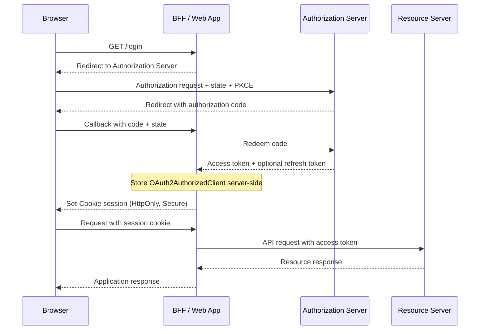

# Ranh giới lưu token, session và trách nhiệm bảo vệ của từng ứng dụng

Trong một hệ thống OAuth 2.0/OpenID Connect, nhiều ứng dụng có thể cùng tham gia một phiên làm việc: trình duyệt, frontend SPA, backend-for-frontend (BFF), API gateway, backend service, mobile app, Resource Server và Authorization Server. Mỗi thành phần giữ một loại trạng thái khác nhau. Nếu không xác định rõ thành phần nào sở hữu access token, refresh token, authorization state, HTTP session và cookie, hệ thống dễ tạo ra token bị sao chép quá rộng, logout không thu hồi được credential, hoặc một ứng dụng vô tình gửi token tới service không đúng audience.

Nguyên tắc thiết kế là **mỗi credential có một owner rõ ràng, một nơi lưu trữ được kiểm soát, một vòng đời và một quy trình thu hồi**. Ứng dụng nhận token phải bảo vệ token trong phạm vi công việc của nó; ứng dụng chuyển tiếp token phải kiểm tra đích nhận; Authorization Server quản lý authorization/token state do nó phát hành; Resource Server chỉ xác minh token và thực thi policy cho API của mình.

Bài học này phân biệt token với session, giải thích trách nhiệm của từng loại ứng dụng, trình bày các lựa chọn lưu trữ và cấu hình Spring Security/Spring Authorization Server, rồi xây dựng test cho refresh, logout, revocation và rò rỉ credential.

**Phạm vi ví dụ:** Phần OAuth2 Client/BFF dùng API Spring Security hiện hành. Ví dụ cấu hình riêng cho Spring Authorization Server 1.5.8 cần đi cùng dòng Spring Security 6.5.x tương thích. Từ Spring Security 7.0, Authorization Server đã được tích hợp vào Spring Security; không ghép artifact Spring Authorization Server 1.5.x với Spring Security 7.x. Nếu dự án dùng Spring Security 7.x, hãy dùng module Authorization Server trong chính dòng Spring Security đó và đối chiếu package/API theo phiên bản. [Spring Authorization Server chuyển sang Spring Security 7.0](https://spring.io/blog/2025/09/11/spring-authorization-server-moving-to-spring-security-7-0/) · [Spring Authorization Server 1.5.8](https://spring.io/blog/2026/06/09/spring-authorization-server-releases-2026-06/)

**Lưu ý bảo mật phiên bản:** DefaultConsentPage của Spring Authorization Server 1.5.0–1.5.8 bị ảnh hưởng bởi CVE-2026-59316. Nếu duy trì nhánh 1.5.8, không dùng trang consent mặc định; hãy cấu hình custom consent page có HTML entity encoding hoặc dùng bản vá được hỗ trợ. Trong dòng Spring Security tích hợp Authorization Server, các bản 7.0.0–7.0.6 và 7.1.0 bị ảnh hưởng bởi CVE-2026-47877; bản sửa là 7.0.7 và 7.1.1 trở lên. [CVE-2026-59316](https://spring.io/security/cve-2026-59316) · [CVE-2026-47877](https://spring.io/security/cve-2026-47877)

## 1. Phân biệt token, authorization và session

### 1.1. Access token là credential truy cập API

Access token là credential được cấp cho client để gọi một hoặc nhiều Resource Server trong giới hạn scope, audience, thời hạn và các ràng buộc khác. Token có thể là JWT self-contained hoặc opaque reference token.

- Client gửi access token tới Resource Server bằng header Authorization với scheme Bearer.
- Resource Server xác minh JWT bằng issuer/JWK/claim validation hoặc introspect opaque token.
- Token chỉ được dùng cho resource và audience đã được cấp.
- Token hết hạn hoặc bị revoke thì không còn được chấp nhận theo policy của Resource Server.

Access token không phải cookie đăng nhập của browser và cũng không phải bằng chứng rằng một HTTP session cụ thể vẫn tồn tại.

### 1.2. Refresh token là credential để xin access token mới

Refresh token được client giữ để yêu cầu Authorization Server cấp access token mới khi token hiện tại hết hạn hoặc sắp hết hạn. Nó thường có thời hạn dài hơn access token và có quyền sử dụng nhạy cảm hơn.

- Chỉ client được phép và đã được xác thực theo registration mới được dùng refresh token.
- Public client cần cơ chế bảo vệ phù hợp như rotation/reuse detection theo policy.
- Refresh token không được gửi tới Resource Server.
- Khi logout hoặc account compromise, phải có chính sách revoke refresh token/authorization liên quan.

Không đưa refresh token vào JavaScript/browser storage nếu kiến trúc có thể giữ nó ở backend/BFF hoặc secure storage của native application.

### 1.3. HTTP session là trạng thái của một ứng dụng web

HTTP session thường được nhận diện qua cookie session như JSESSIONID. Trong Spring Security servlet application, session có thể chứa hoặc liên kết tới SecurityContext, saved request, CSRF state, OAuth2 authorization request và dữ liệu ứng dụng.

Session cookie thường chỉ là một session identifier ngẫu nhiên. Nó không phải access token của Authorization Server và không nên được gửi tới Resource Server như bearer credential.

Session có vòng đời riêng:

- Tạo khi ứng dụng cần lưu trạng thái giữa các request;
- Có idle timeout và có thể có absolute lifetime;
- Có thể bị invalidate khi logout hoặc khi session hết hạn;
- Có thể được rotate ID sau authentication để chống session fixation;
- Có thể tồn tại dù access token đã hết hạn, nếu ứng dụng còn session và có refresh/re-authentication policy.

### 1.4. Authorization record ở Authorization Server

Spring Authorization Server dùng OAuth2Authorization để lưu trạng thái authorization và các token liên quan. Record có thể chứa access token, refresh token, authorization code, metadata, claims và attributes tùy grant. OAuth2AuthorizationService là nơi lưu và truy vấn các authorization này; nó phục vụ grant processing, introspection, revocation và các protocol flow khác.

Đây là trạng thái phía Authorization Server, khác với OAuth2AuthorizedClient mà OAuth2 Client application giữ để gọi API bên ngoài. [Spring Authorization Server — Core Model / Components](https://docs.spring.io/spring-authorization-server/reference/core-model-components.html)

### 1.5. Bốn khái niệm không được gộp làm một

| Thành phần | Ý nghĩa | Owner điển hình |
|---|---|---|
| Access token | Credential gọi resource | OAuth2 client sở hữu token |
| Refresh token | Credential xin token mới | OAuth2 client được cấp token |
| HTTP session | Trạng thái đăng nhập web và request của app | Web app/BFF |
| OAuth2 authorization | Record về grant, consent và token đã phát | Authorization Server |

Một user có thể có local web session nhưng access token của downstream API đã hết hạn. Một refresh token có thể còn hợp lệ trong khi browser session đã logout. Một token bị revoke ở Authorization Server có thể vẫn nằm trong cache của client, nhưng Resource Server phải từ chối nó theo cơ chế validation/introspection/revocation đã triển khai.

## 2. Xác định owner và trust boundary của từng ứng dụng

### 2.1. Ma trận trách nhiệm

| Thành phần | Credential/state thường giữ | Trách nhiệm bảo vệ |
|---|---|---|
| Browser SPA | App session cookie hoặc access token ngắn hạn nếu gọi API trực tiếp | Bảo vệ origin/XSS/CSRF; không để token vào URL/log |
| BFF | HTTP session, OAuth2AuthorizedClient, access/refresh token | Server-side token storage, session controls, CSRF và outbound destination control |
| Backend web app | HTTP session, OAuth2AuthorizedClient của user | Bảo vệ session, authorized-client store và token relay |
| Mobile app | Access/refresh token trong OS secure storage | PKCE, external browser, device storage và app lifecycle |
| Machine-to-machine service | Client credential hoặc workload identity; access token | Secret/key management, workload identity, token cache và least privilege |
| API gateway | Có thể giữ token theo flow; thường xác minh hoặc relay có giới hạn | Audience, routing, token exchange/relay và không log bearer token |
| Resource Server | Thường không cần giữ bearer token lâu dài | Validate token, authorization và audit request |
| Authorization Server | Client registration, authorization, consent, token state và signing key | Token issuance, persistence, rotation, revocation và protocol security |

Không phải mọi thành phần đều cần lưu access token. Resource Server nhận bearer token trong request, xác minh nó rồi dùng principal/claims cho request hiện tại; nó không nên lưu bản sao token vào session hoặc database nếu không có use case cụ thể.

### 2.2. Kiến trúc BFF

Trong mô hình BFF, browser chỉ giữ cookie session của BFF. BFF thực hiện OAuth2 Authorization Code Flow với PKCE nếu phù hợp, nhận token, lưu OAuth2AuthorizedClient ở server-side store và gọi Resource Server thay mặt browser.



Browser không cần biết access token/refresh token của upstream API. Cookie session vẫn là bearer-like credential đối với BFF nên phải được bảo vệ bằng TLS, HttpOnly, Secure, SameSite, CSRF protection và session expiration.

### 2.3. SPA gọi Resource Server trực tiếp

Trong mô hình browser-based client, JavaScript nhận và sử dụng access token để gọi API. Browser application phải chịu trách nhiệm bảo vệ token trong runtime và storage. Persistent storage như localStorage, sessionStorage hoặc IndexedDB có thể bị đọc bởi malicious JavaScript chạy cùng origin. In-memory storage giới hạn thời gian tồn tại nhưng không loại bỏ nguy cơ script độc hại điều khiển app để sử dụng token.

RFC 10017 phân tích các lựa chọn lưu token browser và nhấn mạnh rằng không có browser storage nào hoàn toàn ngăn được malicious code chạy trong origin lấy hoặc sử dụng token. Khi có thể, cân nhắc BFF để giữ token ở server-side. [RFC 10017 — OAuth 2.0 for Browser-Based Applications](https://www.rfc-editor.org/rfc/rfc10017.html)

### 2.4. Native mobile application

Native app là public client, không thể giữ client secret tĩnh như confidential server application. Nên dùng Authorization Code Flow với PKCE và external user-agent/system browser. Access/refresh token cần được bảo vệ bằng secure storage của hệ điều hành, ví dụ Keychain/Keystore-backed facility; không lưu plain text trong preferences, log, backup hoặc file không được bảo vệ.

Khi thiết bị bị mất, app bị gỡ hoặc user logout, cần có cơ chế xóa local credential và revoke server-side refresh token/authorization nếu policy yêu cầu. Việc xóa token trên thiết bị không tự revoke token đã phát.

### 2.5. Machine-to-machine service

Service chạy nền thường dùng client_credentials hoặc workload identity. Token thuộc service principal, không phải user session. Service giữ client credential/private key trong secret manager hoặc HSM-backed system, xin access token với scope/audience tối thiểu và cache token đến gần expiry.

Không dùng chung một service account có quyền rộng cho mọi workload nếu có thể cấp identity riêng theo service/environment. Không lưu client secret trong source code, image layer, command-line argument hoặc log.

## 3. Chọn nơi lưu access token và refresh token

### 3.1. Bảng quyết định theo loại ứng dụng

| Ứng dụng | Access token | Refresh token | Session/cookie |
|---|---|---|---|
| BFF | Server-side authorized-client store | Server-side, encrypted at rest | Browser giữ opaque session cookie |
| Server-rendered web app | Server-side authorized-client store | Server-side, encrypted at rest | HTTP session |
| SPA direct | Thường in-memory; cân nhắc worker isolation | Hạn chế tối đa; nếu dùng cần storage strategy rõ | Không biến bearer token thành session cookie |
| Native mobile | OS-protected secure storage | OS-protected secure storage, rotation-aware | App login state do app quản lý |
| M2M service | Server-side token cache | Thường không dùng refresh token với client credentials; xin token mới | Không có end-user HTTP session |
| Resource Server | Không lưu token sau request | Không giữ refresh token của caller | Thường stateless |

Đây là lựa chọn kiến trúc, không phải quy tắc cứng cho mọi framework. Hãy đánh giá threat model, khả năng XSS, CSRF, thiết bị, network, token lifetime và yêu cầu offline.

### 3.2. BFF: lưu token server-side

BFF có thể lưu authorized client trong JDBC-backed store hoặc một store phân tán được bảo vệ. Bản ghi nên liên kết với local principal/session, client registration và resource/audience theo policy.

Yêu cầu:

- Chỉ backend process có quyền đọc token store;
- Mã hóa dữ liệu nhạy cảm khi lưu trữ, quản lý encryption key riêng với database;
- Giới hạn DB role và network access;
- Không expose token store qua API browser;
- Không log serialized authorized client;
- Có retention/cleanup cho record hết hạn, logout hoặc unlink;
- Có transaction/concurrency policy cho refresh-token rotation.

### 3.3. SPA: cân nhắc storage và XSS

localStorage tiện cho việc giữ token qua reload và chia sẻ giữa tab, nhưng JavaScript cùng origin có thể đọc nó. sessionStorage giới hạn theo tab nhưng vẫn đọc được bởi script cùng origin. IndexedDB là persistent asynchronous store, nhưng cũng không phải ranh giới bảo mật chống XSS.

In-memory storage giảm thời gian token tồn tại sau reload/tab close. Web Worker có thể cô lập một số thao tác token khỏi main thread, nhưng malicious script vẫn có thể điều khiển app gửi request hoặc gọi API mà worker cung cấp. Không tuyên bố storage mechanism nào miễn nhiễm XSS.

### 3.4. Mobile: secure storage và backup

Token native cần được lưu trong OS secure storage, gắn với device/user profile theo policy. Kiểm tra:

- Token có bị đưa vào cloud backup không;
- Token có bị xuất hiện trong crash report hoặc debug log không;
- App có xóa token khi logout, account removal hoặc device enrollment reset không;
- Refresh rotation có được cập nhật nguyên tử không;
- App xử lý clock skew, offline và refresh failure như thế nào;
- Jailbreak/root hoặc device compromise được xử lý theo risk policy nào.

### 3.5. Không lưu bearer token trong URL

Không đặt access token hoặc refresh token vào query string, path, fragment được chuyển lên backend, analytics event hay redirect URL. URL có thể xuất hiện trong browser history, referrer, proxy access log, telemetry và screenshot.

Bearer token chỉ gửi trong Authorization header qua TLS tới đúng resource. Tránh ghi toàn bộ header vào log hoặc tracing.

## 4. Phân biệt hai mô hình authorized-client trong Spring

### 4.1. OAuth2AuthorizedClient thuộc OAuth2 Client application

Trong Spring Security OAuth2 Client, OAuth2AuthorizedClient liên kết ClientRegistration, principal/resource owner, access token và optional refresh token. Nó đại diện cho authorization mà ứng dụng client có thể dùng để truy cập protected resource.

OAuth2AuthorizedClientRepository chịu trách nhiệm lưu authorized client qua các web request. OAuth2AuthorizedClientService quản lý authorized client ở application level. Các implementation mặc định có thể lưu in-memory; Spring Security cũng cung cấp JDBC service để persist. [Spring Security — OAuth2 Client Core Interfaces](https://docs.spring.io/spring-security/reference/servlet/oauth2/client/core.html)

### 4.2. OAuth2Authorization thuộc Authorization Server

OAuth2Authorization lưu authorization do local Authorization Server cấp. Nó liên kết RegisteredClient, principal, grant, authorized scopes, token và metadata. OAuth2AuthorizationService là component trung tâm để save/load authorization, hỗ trợ token introspection, revocation và protocol processing.

Không dùng OAuth2AuthorizedClientService thay cho OAuth2AuthorizationService; hai service có ownership và lifecycle khác nhau.

### 4.3. Bảng đối chiếu Spring

| Spring type | Nằm ở đâu | Dùng để làm gì |
|---|---|---|
| OAuth2AuthorizedClient | OAuth2 Client/BFF | Giữ token mà app client nhận từ Authorization Server |
| OAuth2AuthorizedClientRepository | OAuth2 Client web app | Lưu authorized client giữa các web request |
| OAuth2AuthorizedClientService | OAuth2 Client application | Load/save/remove authorized client ở application level |
| OAuth2AuthorizedClientManager | OAuth2 Client application | Authorize hoặc re-authorize client, ví dụ refresh token |
| OAuth2Authorization | Authorization Server | Lưu grant và token do server phát |
| OAuth2AuthorizationService | Authorization Server | Persist/query authorization và token state |
| OAuth2AuthorizationConsentService | Authorization Server | Lưu consent của principal cho RegisteredClient |

### 4.4. Lưu trữ in-memory và JDBC

In-memory service phù hợp cho development/test đơn giản. Khi chạy nhiều instance hoặc cần token survive restart, dùng persistent store thích hợp. Spring Security cung cấp JdbcOAuth2AuthorizedClientService; Spring Authorization Server cung cấp JdbcOAuth2AuthorizationService và JdbcOAuth2AuthorizationConsentService.

Persistent storage không tự động có nghĩa dữ liệu đã được mã hóa. Cần đánh giá database encryption, column/application-level encryption, key management, backup, access control và log masking. [Spring Security — Authorized Client Features](https://docs.spring.io/spring-security/reference/servlet/oauth2/client/authorized-clients.html) · [Spring Authorization Server — Core Model](https://docs.spring.io/spring-authorization-server/reference/core-model-components.html)

## 5. Cấu hình OAuth2 Client cho web application/BFF

### 5.1. Đăng ký client và giữ secret ngoài source

Ví dụ cấu hình client registration:

```yaml
spring:
  security:
    oauth2:
      client:
        registration:
          orders-bff:
            provider: local-as
            client-id: orders-bff
            client-secret: ${OAUTH_CLIENT_SECRET}
            client-authentication-method: client_secret_basic
            authorization-grant-type: authorization_code
            redirect-uri: "{baseUrl}/login/oauth2/code/{registrationId}"
            scope:
              - openid
              - orders.read
        provider:
          local-as:
            issuer-uri: https://identity.example.internal
```

OAUTH_CLIENT_SECRET_FROM_SECRET_MANAGER là placeholder minh họa; inject secret qua secret manager hoặc protected runtime configuration. Không commit secret thật. Redirect URI phải được đăng ký chính xác và chạy qua HTTPS ở production.

### 5.2. Lưu authorization request trong session

Spring Security mặc định dùng HttpSessionOAuth2AuthorizationRequestRepository để giữ OAuth2AuthorizationRequest giữa lúc redirect tới Authorization Server và lúc nhận callback. Request này chứa dữ liệu cần để correlate/validate authorization response, ví dụ state và các tham số flow.

Không tắt state correlation hoặc tự dựng callback handler bỏ qua kiểm tra state. Nếu dùng custom AuthorizationRequestRepository, phải bảo đảm state được ràng buộc với browser transaction và có TTL. [Spring Security — Authorization Code Grant](https://docs.spring.io/spring-security/reference/servlet/oauth2/client/authorization-grants.html)

### 5.3. SecurityFilterChain cho BFF

Ví dụ servlet application dùng session-based login:

```java
@Bean
SecurityFilterChain bffSecurity(HttpSecurity http) throws Exception {
    http
        .authorizeHttpRequests(authorize -> authorize
            .requestMatchers("/", "/assets/**", "/health").permitAll()
            .anyRequest().authenticated())
        .oauth2Login(Customizer.withDefaults())
        .sessionManagement(session -> session
            .sessionCreationPolicy(SessionCreationPolicy.IF_REQUIRED)
            .sessionFixation(fixation -> fixation.changeSessionId()))
        .csrf(Customizer.withDefaults());

    return http.build();
}
```

Đây là cấu hình khung cho servlet BFF. CSRF protection vẫn cần cho các request thay đổi state dùng cookie session. changeSessionId là session fixation protection; Spring Security cũng cung cấp các lựa chọn session fixation khác. Nếu ứng dụng có API stateless riêng, tách security chain theo matcher và policy, không vô tình áp dụng session policy của BFF cho mọi endpoint. [Spring Security — Session Management](https://docs.spring.io/spring-security/reference/servlet/authentication/session-management.html)

### 5.4. Cấu hình session cookie

Ví dụ cấu hình cookie cho production:

```yaml
server:
  servlet:
    session:
      cookie:
        name: BFF_SESSION
        http-only: true
        secure: true
        same-site: lax
```

Đặt cookie domain/path hẹp nhất có thể. Không đặt Domain rộng cho mọi subdomain nếu không cần. SameSite=Lax thường phù hợp cho nhiều top-level login redirect; flow cross-site đặc thù có thể cần điều chỉnh. SameSite không thay thế CSRF token và không thay thế kiểm tra Origin/Referer theo policy.

### 5.5. Session store trong môi trường nhiều instance

Nếu BFF chạy nhiều instance, session cần shared store hoặc sticky routing có kiểm soát. Shared session store phải bảo vệ SecurityContext, saved request và các attribute nhạy cảm. Nếu session chứa OAuth2 authorized client, bản ghi token cũng phải được bảo vệ tương ứng.

Test failover: user đăng nhập ở instance A, request tiếp theo sang instance B vẫn được xử lý đúng; logout/revocation từ một node phải có hiệu lực theo SLA trên mọi node.

## 6. Persist OAuth2AuthorizedClient và tự refresh token

### 6.1. Repository hay service?

Dùng OAuth2AuthorizedClientRepository khi authorization gắn với web request/session. Dùng OAuth2AuthorizedClientService khi cần load/save authorized client ở application level, chẳng hạn background task hoặc service process không có HttpServletRequest.

Spring Security có JdbcOAuth2AuthorizedClientService để lưu authorized client vào database. Nếu app dùng custom store, cần implement concurrency, encryption, expiry và cleanup theo contract.

### 6.2. Cấu hình manager cho web request

OAuth2AuthorizedClientManager điều phối authorize/re-authorize và persistence. Provider có thể hỗ trợ authorization code, refresh token và client credentials:

```java
@Bean
OAuth2AuthorizedClientManager authorizedClientManager(
        ClientRegistrationRepository registrations,
        OAuth2AuthorizedClientRepository authorizedClients) {

    OAuth2AuthorizedClientProvider provider =
            OAuth2AuthorizedClientProviderBuilder.builder()
                    .authorizationCode()
                    .refreshToken()
                    .clientCredentials()
                    .build();

    DefaultOAuth2AuthorizedClientManager manager =
            new DefaultOAuth2AuthorizedClientManager(
                    registrations, authorizedClients);
    manager.setAuthorizedClientProvider(provider);
    return manager;
}
```

DefaultOAuth2AuthorizedClientManager làm việc trong ngữ cảnh web request và dùng repository. Khi refresh token hợp lệ, provider có thể lấy access token mới và success handler lưu authorized client đã cập nhật. Khi re-authorization thất bại vì refresh token không còn hợp lệ, failure handler mặc định có thể remove authorized client cũ. [Spring Security — OAuth2AuthorizedClientManager](https://docs.spring.io/spring-security/reference/servlet/oauth2/client/core.html)

### 6.3. Cấu hình manager cho background service

Background task không có servlet request có thể dùng AuthorizedClientServiceOAuth2AuthorizedClientManager cùng OAuth2AuthorizedClientService. Client principal/service identity phải được xác định ổn định, không giả lập user session.

```java
@Bean
OAuth2AuthorizedClientManager serviceAuthorizedClientManager(
        ClientRegistrationRepository registrations,
        OAuth2AuthorizedClientService authorizedClientService) {

    OAuth2AuthorizedClientProvider provider =
            OAuth2AuthorizedClientProviderBuilder.builder()
                    .clientCredentials()
                    .build();

    AuthorizedClientServiceOAuth2AuthorizedClientManager manager =
            new AuthorizedClientServiceOAuth2AuthorizedClientManager(
                    registrations, authorizedClientService);
    manager.setAuthorizedClientProvider(provider);
    return manager;
}
```

Chỉ bật grant mà service thực sự cần. client_credentials token đại diện client/service, không đại diện user đã đăng nhập trên browser.

### 6.4. Gọi Resource Server bằng RestClient

Spring Security cung cấp OAuth2ClientHttpRequestInterceptor để phối hợp RestClient với OAuth2AuthorizedClientManager:

```java
@Bean
RestClient ordersRestClient(
        OAuth2AuthorizedClientManager authorizedClientManager) {

    OAuth2ClientHttpRequestInterceptor interceptor =
            new OAuth2ClientHttpRequestInterceptor(
                    authorizedClientManager);

    return RestClient.builder()
            .requestInterceptor(interceptor)
            .build();
}
```

Khi gọi API, chỉ định registration ID và principal phù hợp bằng request attributes hoặc interceptor resolver. Đặt base URL/destination allowlist cho RestClient; không dùng interceptor gắn bearer token vào request tới URL do người dùng kiểm soát. Nếu cần xử lý invalid token, cấu hình authorization failure handler để remove authorized client cũ theo đúng principal/registration. [Spring Security — Authorized Client Features](https://docs.spring.io/spring-security/reference/servlet/oauth2/client/authorized-clients.html)

### 6.5. Refresh token và rotation

Khi Authorization Server bật refresh-token rotation, refresh token cũ có thể bị vô hiệu hóa khi token mới được phát. Client phải lưu refresh token mới cùng access token mới một cách nguyên tử. Nếu hai request đồng thời cùng dùng refresh token cũ:

- Một request có thể refresh thành công;
- Request còn lại có thể bị invalid_grant do token cũ đã bị tiêu thụ;
- Nếu failure handler xóa nhầm bản ghi mới, user bị logout ngoài ý muốn;
- Nếu hai instance ghi đè lẫn nhau, token store có thể giữ refresh token cũ.

Giải pháp gồm serialize refresh theo authorized-client key, optimistic locking/version, transaction hoặc distributed lock phù hợp. Không giả định một OAuth2AuthorizedClientManager tự giải quyết mọi race condition của custom distributed store.

### 6.6. Cấu hình refresh token rotation ở Authorization Server

Với Spring Authorization Server, TokenSettings của RegisteredClient điều khiển TTL và việc reuse refresh token. Ví dụ:

```java
TokenSettings tokenSettings = TokenSettings.builder()
        .accessTokenTimeToLive(Duration.ofMinutes(5))
        .refreshTokenTimeToLive(Duration.ofDays(14))
        .reuseRefreshTokens(false)
        .build();
```

reuseRefreshTokens(false) yêu cầu phát refresh token mới theo hành vi của server version/configuration tương ứng. Cần kiểm thử reuse detection, concurrent refresh, revoke và token-family policy. Không chỉ thay cấu hình mà bỏ qua khả năng client mất đồng bộ khi refresh song song.

## 7. Bảo vệ dữ liệu token khi lưu trữ

### 7.1. Phân loại dữ liệu nhạy cảm

| Dữ liệu | Mức nhạy cảm | Kiểm soát |
|---|---|---|
| Access token | Cao | Hạn chế quyền đọc, mã hóa at rest, không log |
| Refresh token | Rất cao | Mã hóa at rest, rotation/reuse detection, revoke |
| Authorization code | Cao, lifetime ngắn | Lưu an toàn, dùng một lần, ràng buộc client/redirect |
| Client secret | Rất cao | Secret manager, hash/encoder tại AS theo loại secret |
| Private signing key | Cực cao | HSM/KMS/keystore, access policy, rotation |
| Session ID cookie | Cao | TLS, HttpOnly, Secure, SameSite, rotate/invalidate |
| Principal/session metadata | Tùy dữ liệu | Minimize, access control, retention |
| Consent record | Nhạy cảm nghiệp vụ | Tenant/principal/client scoping, audit |

### 7.2. Encryption at rest và key separation

Nếu token được lưu trong JDBC store, database encryption/TDE bảo vệ storage media nhưng không nhất thiết bảo vệ token khỏi database principal có quyền đọc bảng. Với threat model yêu cầu, dùng application-level envelope encryption hoặc column-level encryption. Encryption key phải được quản lý ngoài database, có rotation và audit.

Không dùng cùng một key cho:

- Ký JWT;
- Mã hóa token store;
- Mã hóa session;
- Mã hóa backup.

Tách key theo mục đích và environment giúp giới hạn phạm vi khi một key bị lộ.

### 7.3. Access control và backup

- Database account của BFF chỉ đọc/ghi authorized-client rows cần thiết;
- Resource Server không có quyền đọc refresh token store;
- Operator access được audit và giới hạn;
- Backup chứa token/session được mã hóa và kiểm soát retention;
- Restore test phải bảo đảm token đã revoke trước thời điểm backup không bị hồi sinh ngoài policy;
- Xóa dữ liệu account/session theo retention và privacy policy.

### 7.4. Không đưa token vào log, trace hoặc error report

Redact Authorization, Cookie, Set-Cookie, access_token, refresh_token, client_secret và token response body khỏi logs/traces. Không thêm token vào MDC, span attribute, metric label hoặc exception message.

Khi điều tra lỗi, log token fingerprint/hash ngắn nếu cần correlation, không log token gốc. Fingerprint cũng cần policy vì có thể trở thành identifier nhạy cảm.

## 8. Token relay và trách nhiệm của API gateway/backend

### 8.1. Relay là chuyển tiếp credential có chủ đích

Token relay là việc backend/gateway nhận token từ một client rồi gửi tiếp tới downstream service. Trước khi relay, phải xác minh downstream service thực sự được phép nhận token đó:

- Issuer có được downstream tin cậy không?
- Audience của token có chứa downstream resource không?
- Scope có đủ và không rộng quá không?
- Token có bị ràng buộc sender/client không?
- Downstream có cần user identity hay service identity?
- Có cần token exchange để phát token mới cho audience đích không?

Không chuyển tiếp token chỉ vì nó có mặt trong request.

### 8.2. Không relay token tới arbitrary URL

Nếu backend gọi URL do user cung cấp, không gắn bearer token tự động. Một SSRF hoặc redirect có thể làm token bị gửi đến host attacker. Dùng service-specific client, fixed base URL, allowlist host/scheme và không forward Authorization header qua redirect sang origin khác.

### 8.3. Khi nào dùng token exchange

Nếu token hiện tại có audience A nhưng service B cần token riêng, cân nhắc RFC 8693 token exchange hoặc cơ chế delegation tương ứng. Authorization Server/STS phải xác minh subject token, actor/client, audience/resource và scope policy rồi phát token mới.

Token exchange có thể tạo credential có audience và lifetime hẹp hơn. Nó không phải thao tác sửa claim hoặc đổi aud trên token cũ.

### 8.4. Gateway không trở thành owner của mọi token

Gateway có thể validate token, route request hoặc exchange token, nhưng cần xác định rõ nó lưu token bao lâu và có thay mặt user gọi API nào. Nếu gateway chỉ proxy bearer token, tránh ghi token vào cache/log. Nếu gateway giữ refresh token, gateway đã trở thành một OAuth2 client có trách nhiệm bảo vệ credential và logout/revocation tương ứng.

## 9. Session cookie, CSRF và XSS

### 9.1. Cookie session là bearer credential của web app

Ai lấy được session cookie có thể sử dụng session trong thời gian cookie/session còn hiệu lực. Bảo vệ cookie:

- Secure để chỉ gửi qua HTTPS;
- HttpOnly để JavaScript không đọc trực tiếp;
- SameSite phù hợp với login redirect và cross-site requirements;
- Domain/Path giới hạn;
- Session ID rotate sau login/privilege elevation;
- Idle timeout và absolute timeout;
- Invalidate server-side khi logout, disable account hoặc security event.

HttpOnly không ngăn malicious script gửi request bằng cookie trong browser; nó chỉ hạn chế đọc cookie bằng JavaScript. Vì vậy CSRF protection vẫn cần.

### 9.2. CSRF với cookie-based authentication

Browser tự động gửi cookie theo request phù hợp. Attacker có thể dụ browser gửi state-changing request nếu ứng dụng không kiểm tra CSRF. Giữ CSRF protection cho form/API sử dụng cookie session, dùng synchronizer token hoặc pattern phù hợp với framework và kiểm tra Origin/Referer theo policy.

Không tắt CSRF toàn cục chỉ vì ứng dụng có một số endpoint Bearer-token stateless. Tách filter chain hoặc matcher theo endpoint authentication model.

### 9.3. XSS và token theft

XSS có thể đọc token trong web storage hoặc gọi chức năng app để thực hiện hành động thay user. BFF giảm việc JavaScript truy cập trực tiếp OAuth token, nhưng XSS vẫn có thể dùng browser session cookie để gọi BFF như user trong session đó.

Do vậy BFF không thay thế output encoding, CSP, dependency hygiene, input handling và kiểm soát script. Bảo vệ cả session cookie lẫn ứng dụng browser.

### 9.4. CORS không phải authorization

CORS quyết định browser JavaScript từ origin nào được đọc response; nó không thay thế authentication, authorization hoặc CSRF protection. Không dùng wildcard origin với credentialed requests. Resource Server vẫn phải validate token và quyền bất kể request đến từ browser origin nào.

## 10. Logout: xóa session, authorized client và revoke token

### 10.1. Logout có nhiều lớp

Logout có thể bao gồm:

1. Xóa local browser session;
2. Xóa local SecurityContext và session cookie;
3. Xóa OAuth2AuthorizedClient tại BFF;
4. Revoke refresh token/authorization tại Authorization Server nếu policy yêu cầu;
5. Xóa local app state/cache;
6. Kết thúc upstream OIDC provider session nếu cần;
7. Thông báo downstream RP/client bằng logout protocol đã hỗ trợ.

Một bước không tự động thực hiện tất cả các bước còn lại.

### 10.2. Spring Security local logout

Spring Security POST /logout mặc định invalidate HTTP session, clear SecurityContext/SecurityContextRepository, xóa CSRF state và phát logout event. Có thể bổ sung LogoutHandler để xóa cookie custom hoặc authorized-client state. [Spring Security — Handling Logouts](https://docs.spring.io/spring-security/reference/servlet/authentication/logout.html)

Ví dụ:

```java
@Bean
SecurityFilterChain bffSecurity(HttpSecurity http) throws Exception {
    http
        .authorizeHttpRequests(authorize -> authorize
            .anyRequest().authenticated())
        .oauth2Login(Customizer.withDefaults())
        .logout(logout -> logout
            .deleteCookies("BFF_SESSION")
            .logoutSuccessUrl("/"));

    return http.build();
}
```

Cookie name phải khớp cookie session thực tế. Servlet container thường quản lý session cookie riêng; deleteCookies cần được kiểm tra trong môi trường triển khai. Spring Security invalidate session qua SecurityContextLogoutHandler; không dựa vào việc chỉ gửi cookie rỗng để kết luận server session đã bị xóa.

### 10.3. Xóa authorized client

Khi user logout, BFF cần remove authorized client gắn với đúng registration ID và principal name. Ví dụ logic ứng dụng:

```java
authorizedClientService.removeAuthorizedClient(
        "orders-bff",
        authentication.getName());
```

Nếu dùng OAuth2AuthorizedClientRepository, dùng đúng repository API và request/response context. Xóa authorized client khỏi BFF store ngăn app tiếp tục dùng token đã lưu; nó không nhất thiết revoke token ở Authorization Server.

### 10.4. Revocation tại Authorization Server

RFC 7009 định nghĩa token revocation endpoint. Client gửi token cần revoke tới Authorization Server qua TLS và xác thực theo client policy. Khi revoke refresh token, server có thể vô hiệu hóa access token liên quan theo semantics/implementation của authorization server. Resource Server cần có cơ chế nhận biết revocation: introspection, denylist/cache invalidation hoặc access token lifetime ngắn tùy token format và kiến trúc.

Với JWT self-contained, Resource Server offline validation không tự biết token vừa bị revoke nếu không có thêm revocation signal/check. Đây là lý do token lifetime, refresh-token revocation, introspection và distributed cache phải được thiết kế cùng nhau. [RFC 7009 — Token Revocation](https://www.rfc-editor.org/rfc/rfc7009.html)

### 10.5. Logout ở upstream OIDC Provider

RP-Initiated Logout có thể yêu cầu upstream OP kết thúc session đăng nhập của user. Việc đó không tự xóa local BFF session hoặc revoke token local do Authorization Server khác phát. Cần xác định issuer nào sở hữu session/token và gọi logout/revocation endpoint phù hợp. Nếu có Back-Channel Logout, verify Logout Token và map tới local session trước khi xóa.

## 11. Phân biệt lifetime và đồng bộ vòng đời

### 11.1. Bốn clock độc lập

| Clock | Ví dụ | Điều gì kết thúc |
|---|---|---|
| Browser cookie lifetime | Session cookie hoặc persistent cookie | Browser ngừng gửi cookie theo expiry |
| Server HTTP session timeout | Idle 20 phút | Local app session bị invalidate |
| Access token TTL | 5 phút | Resource Server từ chối token hết hạn |
| Refresh token TTL/revocation | 14 ngày hoặc bị revoke | Client không xin được access token mới |

Các con số chỉ là ví dụ. Không đồng bộ các lifetime bằng cách đặt tất cả bằng nhau. Hãy xác định idle timeout, absolute session lifetime, access token TTL và refresh token TTL theo risk/use case.

### 11.2. Session còn sống, access token hết hạn

BFF có thể giữ session đăng nhập và dùng refresh token để xin access token mới. Nếu refresh thất bại do revoke/expiry, BFF nên remove authorized client và yêu cầu user reauthenticate hoặc hiển thị trạng thái phù hợp.

Không tiếp tục gọi API bằng token hết hạn hoặc tự động fallback sang token của service account nếu hành động cần user identity.

### 11.3. Access token còn sống, user đã logout

Sau local logout, browser không còn session cookie hợp lệ nhưng access token đã bị copy trước đó có thể vẫn dùng được đến khi hết hạn hoặc bị revoke/denied. Nếu yêu cầu logout tức thời trên mọi API, cần revocation/introspection/denylist hoặc cơ chế session/authorization version check. Chỉ invalidate HTTP session không thể thu hồi một bearer token đã phát cho client.

### 11.4. Account disable và security event

Khi user bị disable, password reset, MFA reset, role removal hoặc nghi ngờ compromise, cần policy xác định:

- Invalidate local sessions;
- Remove authorized clients;
- Revoke refresh tokens và authorization;
- Revoke/deny access token còn hạn nếu cần;
- Invalidate caches;
- Propagate event tới các app/region;
- Audit thời gian từ event đến khi mọi Resource Server áp dụng.

## 12. Test ranh giới lưu trữ và ownership

### 12.1. Token storage tests

| Test | Kỳ vọng |
|---|---|
| Browser response sau login BFF | Không chứa access/refresh token trong HTML, JSON hoặc cookie |
| Browser cookie | Có Secure/HttpOnly/SameSite và scope phù hợp |
| Database authorized-client store | Token chỉ được service role cần thiết đọc |
| Log/tracing | Không chứa Authorization/Cookie/token response |
| Backup/restore | Token store được bảo vệ và retention/revocation policy vẫn đúng |
| Resource Server | Không persist bearer token vào business record/session ngoài use case |
| Mobile app | Token không nằm trong plain preferences/log/backup |
| M2M secret | Không có secret trong repository, image hoặc build artifact |

### 12.2. Session tests

- Session ID thay đổi sau login;
- Session hết idle timeout bị từ chối;
- Absolute session lifetime được áp dụng;
- Logout invalidate server session;
- Cookie cũ không khôi phục session;
- Session A không dùng được ở user B sau account switch;
- Session store hoạt động qua failover nhiều instance;
- CSRF token bắt buộc cho state-changing cookie-authenticated request.

### 12.3. Authorized-client tests

- Authorized client gắn đúng registration ID và principal;
- Principal A không load được authorized client của B;
- Refresh thành công lưu access token và refresh token mới;
- Refresh failure remove đúng record;
- Concurrent refresh không ghi đè refresh token mới bằng token cũ;
- Client credentials token không bị gắn nhầm vào user principal;
- Remove authorized client khi logout không ảnh hưởng principal khác.

### 12.4. Revocation/logout tests

- Local logout xóa session;
- BFF authorized client được remove;
- Refresh token bị revoke theo policy;
- Resource Server từ chối token sau khi revocation có hiệu lực theo SLA;
- Logout từ upstream provider xử lý đúng session mapping;
- Logout token giả hoặc sai issuer bị từ chối;
- Một user logout không làm revoke token của user khác;
- Logout không để lại token trong cache hoặc background task.

## 13. Các lỗi thiết kế thường gặp

| Lỗi | Hậu quả | Cách xử lý |
|---|---|---|
| Coi session cookie là access token | Gửi sai credential tới API | Phân biệt app session và OAuth bearer token |
| Lưu refresh token trong localStorage | XSS có thể lấy credential dài hạn | BFF/server-side hoặc secure storage phù hợp |
| Dùng chung token giữa nhiều app | Audience/scope quá rộng và khó revoke | Token riêng theo client/resource |
| Ghi token vào log | Credential bị lộ qua observability | Redact header/body và log fingerprint nếu cần |
| Xóa cookie nhưng không invalidate session | Session server-side vẫn còn | Dùng Spring Security logout handler |
| Remove authorized client nhưng không revoke | Token đã copy vẫn dùng được | Revoke refresh/authorization theo policy |
| Revoke JWT nhưng Resource Server offline | Token vẫn được chấp nhận đến expiry | Introspection/denylist/short TTL |
| Refresh song song | Refresh token rotation race và user bị logout | Lock/version/atomic persistence |
| Gắn bearer token vào mọi RestClient URL | Token leak sang host khác | Fixed destination và allowlist |
| Dùng client credentials thay user token | Mất user identity/audit và quyền quá rộng | Chọn grant theo actor thực |
| Tắt CSRF vì có OAuth | Cookie-authenticated endpoints dễ bị CSRF | Giữ CSRF hoặc tách chain đúng cách |
| Tin HttpOnly ngăn XSS hoàn toàn | Script độc hại vẫn thao tác app bằng cookie | CSP, output encoding, CSRF và BFF |
| Chỉ invalidate local session khi account bị compromise | Token/refresh token còn hiệu lực | Session invalidation + token revocation |
| Dùng in-memory store trên nhiều node | Mất token/session khi restart hoặc node khác không thấy | Shared persistent store phù hợp |

## 14. Quy trình thiết kế và vận hành

1. Vẽ sơ đồ browser/mobile/BFF/backend/gateway/Resource Server/Authorization Server.
2. Với từng credential, ghi owner, nơi lưu, principal/client binding và audience.
3. Quyết định browser có giữ OAuth token trực tiếp hay dùng BFF.
4. Xác định OAuth2AuthorizedClientRepository hoặc OAuth2AuthorizedClientService cho client app.
5. Xác định OAuth2AuthorizationService và consent store cho Authorization Server.
6. Chọn persistent store khi cần multi-instance/restart; bảo vệ token at rest và backup.
7. Thiết lập cookie/session policy, CSRF, session fixation, idle/absolute timeout.
8. Thiết lập access/refresh TTL, rotation, reuse detection và concurrent refresh policy.
9. Cấu hình outbound client chỉ gửi bearer token tới destination allowlist.
10. Định nghĩa local logout, authorized-client removal, token revocation và upstream logout.
11. Định nghĩa account disable/compromise event và propagation SLA.
12. Viết test storage/session/refresh/revocation và multi-instance failover.
13. Kiểm tra log/trace/metrics redaction và quyền truy cập token store.
14. Diễn tập mất database, key rotation, logout và refresh failure.
15. Review lại ownership khi thêm ứng dụng, API, tenant hoặc trust domain mới.

## 15. Bài tập thực hành

**Bối cảnh:** Một hệ thống có SPA orders-ui, BFF orders-bff, Spring Authorization Server tại https://identity.example.internal và Resource Server orders-api. BFF đăng nhập bằng Authorization Code Flow, browser dùng cookie session và BFF gọi API bằng access token. BFF cần refresh token để giữ trải nghiệm đăng nhập trong thời gian cho phép.

**Yêu cầu:**

1. Vẽ sequence diagram cho login, callback, token exchange, API call và logout.
2. Chỉ rõ browser cookie, HTTP session, OAuth2AuthorizedClient, OAuth2Authorization và token store thuộc app nào.
3. Cấu hình oauth2Login() và session-based SecurityFilterChain.
4. Cấu hình session cookie Secure, HttpOnly, SameSite và CSRF.
5. Dùng persistent OAuth2AuthorizedClientService/repository cho môi trường nhiều instance.
6. Dùng OAuth2AuthorizedClientManager hỗ trợ refresh token.
7. Cấu hình outbound RestClient chỉ gửi token tới orders-api.
8. Cấu hình refresh token rotation ở RegisteredClient.
9. Viết test hai request đồng thời cùng refresh token và xác minh store không mất token mới.
10. Viết test browser response không chứa access/refresh token.
11. Viết test session fixation, idle timeout và logout.
12. Viết test remove authorized client và revoke refresh token.
13. Viết test Resource Server phản ánh revocation theo SLA đã chọn.
14. Viết test log/trace không chứa bearer token, cookie hoặc client secret.
15. Diễn tập BFF restart/failover và xác minh session/authorized-client state đúng.

**Tiêu chí nghiệm thu:** Browser chỉ giữ app session cookie; BFF sở hữu authorized client và bảo vệ access/refresh token server-side; Authorization Server sở hữu authorization/token state đã phát; Resource Server chỉ validate token và policy. Logout xóa session và authorized client, đồng thời revoke token theo yêu cầu; refresh rotation không bị race; token không bị relay tới host ngoài allowlist.

## 16. Câu hỏi tự đánh giá

1. Access token khác HTTP session ở mục đích và owner nào?
2. Refresh token được gửi tới endpoint nào và vì sao không gửi tới Resource Server?
3. OAuth2AuthorizedClient khác OAuth2Authorization như thế nào?
4. Khi nào dùng OAuth2AuthorizedClientRepository, khi nào dùng OAuth2AuthorizedClientService?
5. Vì sao BFF giữ token server-side và browser chỉ giữ session cookie?
6. Vì sao HttpOnly không thay thế CSRF protection?
7. Vì sao localStorage không phải nơi lưu refresh token an toàn trước XSS?
8. Native app nên dùng flow nào và lưu token ở đâu?
9. Vì sao client credentials token không đại diện cho user đang đăng nhập?
10. OAuth2AuthorizedClientManager đảm nhiệm điều gì?
11. Background job nên dùng manager/repository nào?
12. Vì sao RestClient interceptor cần destination allowlist?
13. Refresh token rotation tạo race condition nào?
14. reuseRefreshTokens(false) có ý nghĩa gì ở Authorization Server?
15. Database encryption/TDE có bảo vệ token khỏi mọi database reader không?
16. Local logout có tự revoke access token đã phát không?
17. Vì sao Resource Server offline JWT validation có thể chưa biết token bị revoke?
18. Khi account bị disable, cần xử lý những session/token nào?
19. Khi nào cần token exchange thay cho token relay?
20. Những test nào chứng minh token ownership và logout contract hoạt động đúng?

## 17. Tài liệu tham khảo chính thức

- [Spring Security — OAuth2 Client Core Interfaces](https://docs.spring.io/spring-security/reference/servlet/oauth2/client/core.html): OAuth2AuthorizedClient, repository, service và manager.
- [Spring Security — Authorized Client Features](https://docs.spring.io/spring-security/reference/servlet/oauth2/client/authorized-clients.html): persistence, RestClient integration và failure handling.
- [Spring Security — Authorization Code Grant](https://docs.spring.io/spring-security/reference/servlet/oauth2/client/authorization-grants.html): authorization request repository và code exchange.
- [Spring Security — Session Management](https://docs.spring.io/spring-security/reference/servlet/authentication/session-management.html): session fixation, concurrent sessions và session lifecycle.
- [Spring Security — Handling Logouts](https://docs.spring.io/spring-security/reference/servlet/authentication/logout.html): invalidate session, clear SecurityContext, cookie cleanup và logout handlers.
- [Spring Authorization Server — Core Model / Components](https://docs.spring.io/spring-authorization-server/reference/core-model-components.html): RegisteredClient, OAuth2Authorization, token state, authorization/consent services và token generator.
- [Spring Security 7 — Authorization Server Core Model / Components](https://docs.spring.io/spring-security/reference/servlet/oauth2/authorization-server/core-model-components.html): mô hình tương ứng sau khi Authorization Server được tích hợp vào Spring Security.
- [Spring Security 7 — Authorization Server Configuration Model](https://docs.spring.io/spring-security/reference/servlet/oauth2/authorization-server/configuration-model.html): cấu hình protocol endpoints và core components ở dòng 7.x.
- [RFC 10017 — OAuth 2.0 for Browser-Based Applications](https://www.rfc-editor.org/rfc/rfc10017.html): browser token storage, in-memory/persistent storage và threat model cho malicious JavaScript.
- [RFC 7009 — OAuth 2.0 Token Revocation](https://www.rfc-editor.org/rfc/rfc7009.html): revocation endpoint và token invalidation semantics.
- [RFC 9449 — OAuth 2.0 Demonstrating Proof of Possession (DPoP)](https://www.rfc-editor.org/rfc/rfc9449.html): sender-constrained access tokens và proof-of-possession.
- [OWASP Session Management Cheat Sheet](https://cheatsheetseries.owasp.org/cheatsheets/Session_Management_Cheat_Sheet.html): session identifier, cookie và lifecycle controls.

**Ghi nhớ:** Access token, refresh token, HTTP session và Authorization Server authorization record có owner và vòng đời riêng. BFF giữ token ở server-side store và browser giữ session cookie; SPA/mobile cần storage strategy theo threat model; Resource Server xác minh token và quyền; Authorization Server quản lý token state và revocation. Logout phải xử lý session, authorized client và server-side token state theo policy. Không log token, không relay tới arbitrary URL và không giả định xóa cookie đồng nghĩa token đã bị revoke.
