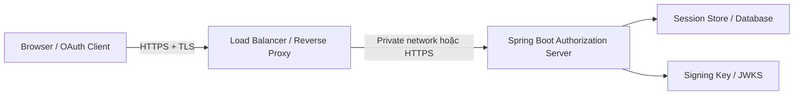
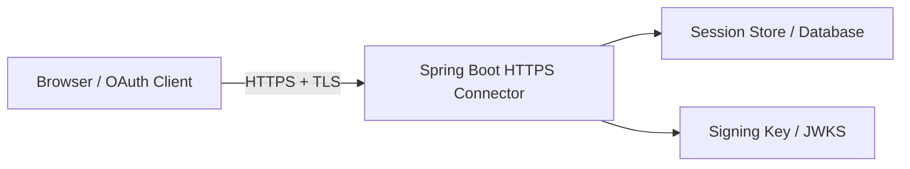

# Bắt buộc HTTPS và cấu hình cookie Secure, HttpOnly, SameSite

## 1. Vì sao Authorization Server phải bắt buộc HTTPS?

Authorization Server (AS) xử lý thông tin xác thực, authorization code, access token, refresh token, ID Token và session đăng nhập. Nếu các request đi qua HTTP thuần, kẻ tấn công có khả năng nghe lén, sửa nội dung hoặc chèn response trên đường truyền. Điều này có thể làm lộ credential, chiếm authorization code, thay đổi redirect hoặc can thiệp vào phiên đăng nhập.

Vì vậy, HTTPS phải bảo vệ toàn bộ bề mặt HTTP của AS và ứng dụng liên quan, bao gồm:

- Authorization Endpoint và Token Endpoint.
- OIDC Discovery, JWKS, UserInfo, Revocation, Introspection và Logout Endpoint nếu được bật.
- Trang đăng nhập, trang consent, trang quản trị và static resources.
- Redirect URI của client và callback của identity provider.
- API và endpoint quản trị nội bộ có dữ liệu xác thực hoặc session.

HTTPS là HTTP chạy trên TLS. TLS cung cấp mã hóa, xác thực máy chủ bằng chứng thư và bảo vệ tính toàn vẹn dữ liệu trên kết nối. Trong môi trường production, dùng TLS 1.3 hoặc TLS 1.2 với cipher suite an toàn; tắt TLS 1.0/1.1 và các cấu hình lỗi thời.

Cookie flags Secure, HttpOnly, SameSite bổ sung bảo vệ cho session cookie ở browser. Chúng không thay thế TLS: Secure chỉ yêu cầu browser gửi cookie qua HTTPS; HttpOnly hạn chế JavaScript đọc cookie; SameSite điều khiển khi browser gửi cookie trong request cross-site.

Trong module **SPRING_SECURITY_OAUTH2_OIDC_AUTHORIZATION_SERVER**, mục tiêu là học cách thiết kế, cấu hình, bảo mật, kiểm thử và vận hành OAuth 2.0/OpenID Connect Authorization Server bằng Spring Security và Spring Authorization Server. Bài thuộc chương **Bảo vệ máy chủ**, tập trung bắt buộc HTTPS và thiết lập cookie session an toàn cho ứng dụng Spring Boot.

### Kết quả học tập

Sau bài học, bạn có thể:

1. Phân biệt TLS termination tại reverse proxy và TLS end-to-end tới ứng dụng.
2. Cấu hình HTTPS redirect và HSTS trong Spring Security 6.5.
3. Cấu hình TLS cho embedded server Spring Boot khi ứng dụng tự kết thúc TLS.
4. Xử lý Forwarded/X-Forwarded-* an toàn sau load balancer.
5. Cấu hình session cookie với Secure, HttpOnly, SameSite và prefix __Host-.
6. Tùy chỉnh cookie của Spring Session bằng DefaultCookieSerializer.
7. Chọn SameSite phù hợp với OIDC redirect, form_post, iframe và logout.
8. Kiểm thử HTTPS, HSTS, cookie attributes và hành vi session trong browser.

**Phạm vi ví dụ:** Spring Boot 3.x, Spring Security 6.5.x và Spring Authorization Server 1.5.8 trên Servlet stack. Các ví dụ cấu hình được ghép vào SecurityFilterChain và application.yml của ứng dụng hiện có.

## 2. Mô hình TLS trong triển khai Spring Boot

### 2.1. TLS termination tại reverse proxy

Mô hình phổ biến là browser kết nối HTTPS tới load balancer/reverse proxy. Proxy giữ certificate public, kết thúc TLS và chuyển request tới Spring Boot:



Trong mô hình này, Spring Boot có thể nhận kết nối nội bộ bằng HTTP. Ứng dụng vẫn cần biết request gốc từ browser dùng HTTPS để:

- Sinh redirect URI và absolute URL đúng scheme.
- Đánh dấu session cookie Secure.
- Phát HSTS đúng cách.
- Áp dụng HTTPS redirect mà không tạo vòng lặp redirect.
- Công bố issuer và endpoint URL là HTTPS.

Proxy phải loại bỏ các header forwarded do client bên ngoài gửi vào rồi tự đặt lại giá trị tin cậy, chẳng hạn Forwarded hoặc X-Forwarded-Proto. Chỉ nhận request từ proxy đã được kiểm soát; không để browser tự khai báo scheme/host mà ứng dụng tin tưởng.

Nếu kết nối proxy → application đi qua mạng không tin cậy, hãy dùng TLS cho hop nội bộ, network policy hoặc mTLS. TLS chỉ kết thúc ở proxy không tự bảo vệ dữ liệu trên đoạn mạng còn lại.

### 2.2. TLS end-to-end tại embedded server

Spring Boot cũng có thể tự kết thúc TLS bằng certificate/keystore cấu hình trên embedded Tomcat, Jetty hoặc Undertow:



Mô hình này phù hợp khi ứng dụng được expose trực tiếp hoặc khi cần mã hóa cả kết nối từ proxy tới application. Nếu proxy vẫn đứng trước application, có thể cấu hình TLS ở cả hai hop.

### 2.3. So sánh

| Tiêu chí | TLS termination tại proxy | TLS tại embedded server |
| --- | --- | --- |
| Certificate public | Quản lý tại proxy/load balancer | Quản lý tại Spring Boot hoặc secret volume |
| HTTPS redirect | Thường do proxy thực hiện, có thể bổ sung ở Spring Security | Có thể do Spring Security/connector thực hiện |
| Scheme mà app nhìn thấy | Cần forwarded-header integration | Request trực tiếp đã là HTTPS |
| Cookie Secure | Cần cấu hình secure=true và forwarded scheme đúng | Connector nhận HTTPS; vẫn nên cấu hình explicit |
| Hop nội bộ | Cân nhắc TLS/mTLS và network isolation | Không có hop proxy nếu expose trực tiếp |
| Vận hành certificate | Tập trung ở edge | Theo từng application/instance hoặc secret mount |

Không quan trọng TLS được kết thúc ở đâu, browser và mọi client bên ngoài phải luôn kết nối bằng HTTPS. Các endpoint OAuth/OIDC công bố ra ngoài không được dùng HTTP.

## 3. Cấu hình HTTPS ở Spring Security

### 3.1. Redirect HTTP sang HTTPS

Spring Security 6.5 cung cấp redirectToHttps(...) cho Servlet application. Có thể áp dụng vào mỗi SecurityFilterChain phục vụ request cần HTTPS:

```java
import org.springframework.context.annotation.Bean;
import org.springframework.security.config.Customizer;
import org.springframework.security.config.annotation.web.builders.HttpSecurity;
import org.springframework.security.web.SecurityFilterChain;

@Bean
SecurityFilterChain applicationSecurity(HttpSecurity http) throws Exception {
    http
        .authorizeHttpRequests(authorize -> authorize
            .anyRequest().authenticated())
        .redirectToHttps(Customizer.withDefaults());

    return http.build();
}
```

redirectToHttps thay thế cấu hình requiresChannel đã deprecated trong Spring Security 6.5. Nếu ứng dụng có nhiều filter chain, cấu hình HTTPS cho từng chain phù hợp; filter chain đầu tiên match request sẽ xử lý request đó.

Không gửi credential hoặc request body nhạy cảm qua HTTP rồi trông chờ redirect bảo vệ request. HTTPS redirect là biện pháp điều hướng, không mã hóa request HTTP đã gửi. OAuth client phải cấu hình Token Endpoint và các endpoint khác bằng HTTPS ngay từ đầu. Ở edge, có thể từ chối HTTP cho các endpoint nhận POST nhạy cảm; nếu redirect POST, dùng status 307/308 để giữ method/body theo policy.

Với Authorization Server, thêm cấu hình này vào chain đang xử lý Authorization Server endpoints. Ví dụ phần cấu hình cần ghép vào chain hiện có:

```java
http
    .securityMatcher(authorizationServerConfigurer.getEndpointsMatcher())
    .with(authorizationServerConfigurer, authorizationServer ->
        authorizationServer.oidc(Customizer.withDefaults()))
    .authorizeHttpRequests(authorize ->
        authorize.anyRequest().authenticated())
    .redirectToHttps(Customizer.withDefaults());
```

Đây là phần minh họa cho filter chain Authorization Server, không phải một chain độc lập thay thế toàn bộ cấu hình client authentication, endpoint và exception handling của ứng dụng.

Nếu reverse proxy đã redirect HTTP → HTTPS, cấu hình redirect ở application có thể là lớp phòng vệ bổ sung. Khi bật cả hai, phải cấu hình forwarded headers đúng để Spring Security nhận diện request gốc là HTTPS; nếu không, ứng dụng có thể redirect lặp.

### 3.2. Cấu hình HSTS

HTTP Strict Transport Security (HSTS) yêu cầu browser ghi nhớ rằng host phải được truy cập bằng HTTPS trong thời gian được khai báo. Spring Security bật HSTS mặc định cho request được nhận diện là secure; có thể cấu hình rõ ràng:

```java
http.headers(headers -> headers
    .httpStrictTransportSecurity(hsts -> hsts
        .maxAgeInSeconds(31_536_000)
        .includeSubDomains(true)
    )
);
```

Header tạo ra có dạng:

```http
Strict-Transport-Security: max-age=31536000; includeSubDomains
```

Chỉ bật includeSubDomains khi tất cả subdomain liên quan đều hỗ trợ HTTPS ổn định. Directive preload chỉ nên thêm sau khi toàn bộ domain đáp ứng điều kiện của HSTS preload list và tổ chức chấp nhận việc browser ép HTTPS dài hạn. Không bật preload chỉ để tăng điểm scanner.

HSTS chỉ được browser chấp nhận từ HTTPS response hợp lệ. Response HTTP không được gửi HSTS header theo RFC. HSTS cũng không thay thế HTTP → HTTPS redirect cho client chưa có policy HSTS.

HSTS là chỉ thị cho browser; nó không thay thế TLS validation ở service-to-service client, SDK hoặc hệ thống batch. Các client này vẫn phải cấu hình endpoint HTTPS và xác minh certificate.

### 3.3. Công bố issuer và endpoint bằng HTTPS

Authorization Server nên dùng issuer URL canonical, cố định và HTTPS:

```java
import org.springframework.context.annotation.Bean;
import org.springframework.security.oauth2.server.authorization.settings.AuthorizationServerSettings;

@Bean
AuthorizationServerSettings authorizationServerSettings() {
    return AuthorizationServerSettings.builder()
            .issuer("https://login.example.com")
            .build();
}
```

Không tạo issuer động từ Host hoặc forwarded header chưa được xác thực. Issuer xuất hiện trong Discovery metadata và token claim iss; thay đổi scheme/host ngoài ý muốn sẽ làm client và Resource Server không xác minh được issuer hoặc tạo ra trust boundary sai.

Đăng ký redirect URI, post-logout redirect URI và các endpoint client bằng HTTPS trong production. Không dùng wildcard URI hoặc tự động hạ xuống HTTP khi proxy/backend báo scheme nội bộ là HTTP.

## 4. Cấu hình khi chạy sau reverse proxy

### 4.1. Bật forwarded-header support

Khi TLS kết thúc ở proxy, Spring Boot cần đọc thông tin request gốc do proxy gửi. Với Servlet stack, có thể dùng Spring Framework ForwardedHeaderFilter thông qua cấu hình:

```yaml
server:
  forward-headers-strategy: framework
  tomcat:
    redirect-context-root: false
```

server.forward-headers-strategy: framework bật cơ chế xử lý Forwarded và các header X-Forwarded-*. Thuộc tính server.tomcat.redirect-context-root: false cần cân nhắc khi dùng Tomcat và kết thúc SSL tại proxy để X-Forwarded-Proto được xử lý trước redirect context-root.

Chỉ dùng cấu hình này khi proxy nằm trong trust boundary. Proxy phải:

1. Xóa Forwarded, X-Forwarded-Proto, X-Forwarded-Host, X-Forwarded-Port do client gửi vào.
2. Tự ghi lại các header dựa trên kết nối thực tế của client.
3. Chỉ chuyển tiếp tới application qua mạng private hoặc TLS.
4. Ngăn truy cập trực tiếp từ Internet tới port nội bộ của Spring Boot.

Nếu application có thể được truy cập trực tiếp, attacker có thể tự gửi X-Forwarded-Proto: https để đánh lừa ứng dụng rằng request HTTP là HTTPS. Không giải quyết vấn đề này bằng cách tin mọi forwarded header.

### 4.2. Cấu hình redirect ở edge và application

Ingress/load balancer nên redirect mọi HTTP request public sang HTTPS trước khi chuyển tiếp vào application. Application có thể bật redirectToHttps như một lớp bảo vệ bổ sung. Kiểm thử cả request tới proxy lẫn request nội bộ; không để health check hoặc readiness probe vô tình tạo redirect loop.

Nếu proxy chuyển request HTTPS bên ngoài thành HTTP nội bộ, forwarded-header support phải chạy trước Spring Security để request.isSecure() phản ánh scheme gốc. Khi đó redirectToHttps không được hiểu nhầm request là HTTP và redirect lặp.

### 4.3. Không để Host header quyết định issuer

Forwarded host có thể cần cho link/callback do application tạo, nhưng issuer của Authorization Server nên là cấu hình canonical. Không dùng Host hoặc X-Forwarded-Host chưa được lọc để thay đổi iss, discovery URL hoặc redirect URI. Mọi public endpoint phải khớp DNS name và certificate mà client tin cậy.

## 5. Cấu hình TLS cho embedded Spring Boot server

Nếu Spring Boot tự kết thúc TLS, có thể cấu hình PKCS#12 keystore:

```yaml
server:
  port: 8443
  ssl:
    enabled: true
    key-store: ${TLS_KEYSTORE:file:/run/secrets/auth-server.p12}
    key-store-type: PKCS12
    key-store-password: ${TLS_KEYSTORE_PASSWORD}
    key-alias: auth-server
    enabled-protocols:
      - TLSv1.3
      - TLSv1.2
```

File keystore và password phải được mount/inject từ secret manager hoặc hệ thống quản lý secret. Không commit private key, keystore password hoặc certificate private material vào Git. Quy trình production cần theo dõi expiry, rotation và chain của certificate.

Nếu ứng dụng dùng TLS termination tại proxy và chỉ nhận HTTP nội bộ, không thêm cấu hình server.ssl này trừ khi muốn bật TLS cho hop proxy → application. Hai mô hình có cách cấu hình khác nhau; tránh vô tình mở connector HTTP public song song với HTTPS.

### 5.1. Certificate và TLS policy

- Dùng certificate có SAN khớp hostname public của Authorization Server.
- Cung cấp full certificate chain cần thiết.
- Tự động gia hạn và reload/restart theo quy trình có kiểm soát.
- Chỉ bật TLS 1.2 và TLS 1.3; ưu tiên TLS 1.3 khi client hỗ trợ.
- Tắt cipher suite yếu, compression và giao thức cũ tại proxy/connector.
- Đồng bộ thời gian hệ thống để kiểm tra certificate và token timestamp chính xác.
- Không dùng self-signed certificate trong môi trường public production trừ khi trust distribution đã được quản lý rõ.

## 6. Cấu hình session cookie trong Spring Boot

### 6.1. Cấu hình cookie bằng application.yml

Spring Boot cho phép cấu hình session cookie qua server.servlet.session.cookie.*. Ví dụ:

```yaml
server:
  servlet:
    session:
      cookie:
        name: __Host-SESSION
        secure: true
        http-only: true
        same-site: lax
        path: /
```

Không khai báo domain trong ví dụ này để browser tạo host-only cookie. Prefix __Host- yêu cầu cookie có Secure, Path=/ và không có Domain attribute. Nếu thiếu một điều kiện, browser hiện đại sẽ từ chối cookie mang prefix này.

Nếu container đang dùng JSESSIONID, có thể giữ tên mặc định và vẫn cấu hình secure, http-only, same-site, path. Chọn tên __Host-SESSION khi toàn bộ ứng dụng chạy HTTPS và cookie path có thể là /.

### 6.2. Ý nghĩa từng thuộc tính

| Thuộc tính | Tác dụng | Điều cần nhớ |
| --- | --- | --- |
| Secure | Browser chỉ gửi cookie qua HTTPS | Không mã hóa cookie trong storage; TLS vẫn bắt buộc |
| HttpOnly | JavaScript không đọc cookie qua document.cookie | Không ngăn XSS gửi request thay người dùng |
| SameSite | Giới hạn cookie trong request cross-site | Có thể ảnh hưởng OIDC callback và iframe |
| Path | Giới hạn path gửi cookie | __Host- yêu cầu / |
| Domain | Mở rộng cookie sang subdomain | Bỏ thuộc tính này để dùng host-only cookie khi có thể |

HttpOnly nên bật cho session identifier. Không áp dụng HttpOnly=false cho session cookie chỉ vì frontend cần biết người dùng đã đăng nhập; hãy cung cấp endpoint session/status không tiết lộ session identifier.

### 6.3. Không nhầm session cookie với mọi cookie khác

Các thuộc tính trên trong server.servlet.session.cookie áp dụng cho session cookie do Servlet container/Spring Session quản lý. Chúng không tự động cấu hình mọi cookie do ứng dụng, thư viện OIDC, remember-me hoặc CSRF repository tạo ra.

Kiểm tra từng Set-Cookie trong response:

- Session cookie.
- Remember-me cookie nếu bật.
- Cookie CSRF nếu dùng cookie repository.
- Cookie state/nonce nếu thư viện OIDC tự quản lý.
- Cookie do reverse proxy hoặc gateway thêm vào.

Cookie nào chứa credential hoặc session identifier cần có chính sách Secure/HttpOnly/SameSite phù hợp. Cookie CSRF mà JavaScript cần đọc có thể phải HttpOnly=false, nhưng chỉ áp dụng cho cookie CSRF đó; không hạ bảo vệ của session cookie.

## 7. Cấu hình cookie khi dùng Spring Session

### 7.1. DefaultCookieSerializer

Khi ứng dụng dùng Spring Session (Redis/JDBC hoặc repository khác), có thể tùy chỉnh cách ghi session cookie bằng DefaultCookieSerializer:

```java
import org.springframework.context.annotation.Bean;
import org.springframework.context.annotation.Configuration;
import org.springframework.session.web.http.CookieSerializer;
import org.springframework.session.web.http.DefaultCookieSerializer;

@Configuration
class SessionCookieConfiguration {

    @Bean
    CookieSerializer cookieSerializer() {
        DefaultCookieSerializer serializer = new DefaultCookieSerializer();
        serializer.setCookieName("__Host-SESSION");
        serializer.setCookiePath("/");
        serializer.setUseSecureCookie(true);
        serializer.setUseHttpOnlyCookie(true);
        serializer.setSameSite("Lax");
        // Không gọi setDomainName hoặc setDomainNamePattern.
        return serializer;
    }
}
```

Bean này điều khiển session cookie do Spring Session serialize. Nếu đã khai báo custom serializer, kiểm tra nó không ghi đè cấu hình server.servlet.session.cookie.* theo cách ngoài dự kiến. Không tạo hai cơ chế ghi cùng một session cookie với thuộc tính khác nhau.

DefaultCookieSerializer mặc định dùng HttpOnly và SameSite Lax; Secure mặc định dựa trên HttpServletRequest.isSecure(). Trong production, đặt Secure explicit để cookie luôn có flag này, đồng thời cấu hình forwarded headers đúng nếu TLS kết thúc ở proxy.

### 7.2. Thay đổi cookie cần đồng bộ

Khi đổi cookie name, Path, Domain hoặc SameSite:

1. Xác định cookie cũ đang được browser giữ.
2. Gửi cookie deletion với đúng tên, Path và Domain tương ứng.
3. Phát cookie mới với flags mới.
4. Kiểm thử đăng nhập, callback OIDC, refresh, logout và session timeout.
5. Xóa cookie cũ trên mọi hostname/path từng được sử dụng.

Cookie cùng tên nhưng khác Path/Domain có thể tồn tại đồng thời trong browser. Khi đó server có thể nhận nhiều giá trị cùng tên; cần tránh cấu hình cookie chồng lấn.

## 8. Chọn SameSite phù hợp với OAuth/OIDC

### 8.1. Lax, Strict và None

| Giá trị | Hành vi khái quát | Ứng dụng thường gặp |
| --- | --- | --- |
| Strict | Hạn chế cookie trong navigation bắt đầu từ site khác | Ứng dụng ít cần cross-site navigation; có thể làm mất session trong OIDC redirect |
| Lax | Cho cookie trong same-site request và top-level cross-site safe navigation như GET | Thường phù hợp với Authorization Code callback dạng query |
| None | Cho phép cookie trong cross-site request nếu browser chấp nhận | Chỉ dùng khi flow thực sự cần; bắt buộc Secure |

### 8.2. Authorization Code callback dạng GET

Với Authorization Code Flow thông thường, OP redirect browser về RP/ứng dụng bằng top-level GET mang authorization code và state. SameSite=Lax thường cho phép session cookie đi cùng navigation này, nên là điểm khởi đầu hợp lý cho session cookie.

SameSite=Strict có thể khiến cookie không được gửi khi browser quay từ OP khác site về callback. Ứng dụng có thể mất liên kết với login transaction hoặc session trước đó. Không chọn Strict chỉ vì muốn mức bảo vệ cao hơn mà chưa kiểm thử toàn bộ flow.

### 8.3. Response mode form_post

Nếu OIDC response mode là form_post, OP gửi authorization response bằng cross-site POST tới callback. Cookie Lax thường không được gửi trong cross-site POST. Khi flow này là yêu cầu thực tế, cần đánh giá SameSite=None; Secure hoặc một thiết kế callback/session khác phù hợp với thư viện và browser hỗ trợ.

Không chuyển toàn bộ cookie của hệ thống sang None để sửa một callback. Chỉ điều chỉnh cookie liên quan, bảo vệ CSRF và kiểm thử trên browser thực tế.

### 8.4. Iframe và Front-Channel Logout

OIDC Front-Channel Logout có thể tải logout URI của RP trong iframe từ OP. Cookie Lax/Strict có thể không được gửi trong third-party context. SameSite=None; Secure cho phép browser gửi cookie theo thuộc tính cookie, nhưng chính sách chặn third-party cookies của browser vẫn có thể ngăn việc đó.

Nếu cần logout server-side tin cậy, ưu tiên Back-Channel Logout hoặc cơ chế server-to-server đã xác thực. Không dựa duy nhất vào iframe để kết thúc session.

### 8.5. SameSite không thay thế CSRF

SameSite là lớp giảm thiểu CSRF, không phải cơ chế duy nhất. Các ứng dụng dùng session cookie vẫn phải giữ CSRF protection cho request thay đổi trạng thái và kiểm tra origin theo threat model. Không tắt CSRF toàn bộ chỉ vì cookie được đặt Lax hoặc Strict.

## 9. Session lifecycle và bảo vệ cookie

### 9.1. Session fixation

Sau khi người dùng xác thực thành công, session ID phải được thay đổi để ngăn attacker cố định session ID trước authentication rồi tái sử dụng sau khi nạn nhân đăng nhập. Spring Security Servlet mặc định dùng session fixation protection phù hợp với Servlet container hiện đại; không tự tắt cơ chế này nếu không có lý do rõ ràng.

Khi logout hoặc session hết hạn:

- Invalidate session server-side.
- Xóa session cookie với đúng cookie name, Path và Domain đã phát hành.
- Xóa authorized client/refresh token gắn với session theo policy.
- Xóa cache/session correlation liên quan.
- Không chỉ xóa cookie ở browser rồi giữ session còn hiệu lực trong store.

### 9.2. Giới hạn phạm vi cookie

Ưu tiên host-only cookie, không đặt Domain rộng như .example.com để chia sẻ session giữa nhiều ứng dụng. Cookie domain rộng làm tăng ảnh hưởng nếu một subdomain bị chiếm quyền và khiến các ứng dụng phụ thuộc cùng một session boundary.

Prefix __Host- giúp browser enforce ba điều kiện: Secure, Path=/ và không có Domain. Đây là lựa chọn phù hợp cho session cookie của một host độc lập như login.example.com. Nếu ứng dụng cần cookie path hẹp hoặc domain scope, không dùng prefix này.

### 9.3. Tắt URL-based session tracking

Không để Servlet container viết session ID vào URL như ;jsessionid=.... Session ID trong URL có thể lọt vào browser history, access log, analytics, Referer hoặc screenshot.

Có thể giới hạn tracking mode chỉ còn cookie:

```yaml
server:
  servlet:
    session:
      tracking-modes:
        - cookie
      timeout: 20m
```

Timeout 20 phút chỉ là ví dụ; chọn theo risk, trải nghiệm và policy của tổ chức. Session timeout không thay thế token TTL, refresh token policy hoặc logout/revocation.

### 9.4. CSRF vẫn cần được bật

Session cookie được browser tự động gửi kèm request theo cookie policy. Nếu ứng dụng dùng session cho login, consent hoặc trang quản trị, giữ CSRF protection của Spring Security cho các request thay đổi trạng thái.

Không disable CSRF cho toàn bộ Authorization Server chỉ để làm một API hoạt động. Spring Authorization Server có request matcher và filter riêng cho protocol endpoints; nếu cần tùy chỉnh CSRF ignore list, chỉ loại trừ đúng endpoint không dùng cookie authentication và xác minh hành vi bằng integration test. Login form, consent form và application management endpoint vẫn cần bảo vệ phù hợp.

## 10. Ghép cấu hình vào Authorization Server

### 10.1. Cấu hình cho Authorization Server và application chain

Một ứng dụng thường có ít nhất hai filter chain: chain của Authorization Server và chain của ứng dụng (login, consent, trang quản trị). HTTPS redirect và HSTS cần được áp dụng cho các chain phục vụ browser/client:

```java
import org.springframework.context.annotation.Bean;
import org.springframework.core.annotation.Order;
import org.springframework.security.config.Customizer;
import org.springframework.security.config.annotation.web.builders.HttpSecurity;
import org.springframework.security.web.SecurityFilterChain;
import org.springframework.security.oauth2.server.authorization.config.annotation.web.configurers.OAuth2AuthorizationServerConfigurer;

@Bean
@Order(1)
SecurityFilterChain authorizationServerSecurity(HttpSecurity http) throws Exception {
    OAuth2AuthorizationServerConfigurer authorizationServerConfigurer =
            OAuth2AuthorizationServerConfigurer.authorizationServer();

    http
        .securityMatcher(authorizationServerConfigurer.getEndpointsMatcher())
        .with(authorizationServerConfigurer, server ->
            server.oidc(Customizer.withDefaults()))
        .authorizeHttpRequests(authorize ->
            authorize.anyRequest().authenticated())
        .redirectToHttps(Customizer.withDefaults())
        .headers(headers -> headers
            .httpStrictTransportSecurity(hsts -> hsts
                .maxAgeInSeconds(31_536_000)
                .includeSubDomains(true)));

    return http.build();
}
```

Đoạn code thể hiện vị trí cấu hình HTTPS/HSTS; constructor/configurer và các endpoint khác phải theo cấu hình Spring Authorization Server hiện có của ứng dụng. Nếu dùng nhiều chain, cấu hình tương ứng ở chain ứng dụng. Chỉ bật includeSubDomains khi mọi subdomain nằm trong phạm vi HSTS đều chạy HTTPS.

### 10.2. Ví dụ application.yml cho mô hình sau proxy

```yaml
server:
  forward-headers-strategy: framework
  tomcat:
    redirect-context-root: false
  servlet:
    session:
      timeout: 20m
      tracking-modes:
        - cookie
      cookie:
        name: __Host-SESSION
        secure: true
        http-only: true
        same-site: lax
        path: /
```

Proxy phải kết thúc TLS, redirect HTTP ở edge, sanitize forwarded headers và chỉ cho phép kết nối nội bộ từ proxy tới ứng dụng. Nếu dùng embedded TLS thay vì TLS termination ở proxy, bỏ forwarded-header setting nếu không cần và cấu hình server.ssl theo mô hình ở mục 5.

### 10.3. Những cookie nào nên HttpOnly?

Session identifier, remember-me credential và cookie chứa dữ liệu xác thực nên HttpOnly. Cookie CSRF có thể cần đọc được bởi JavaScript tùy cách tích hợp SPA; nếu dùng loại cookie này, chỉ mở quyền đọc cho cookie CSRF, không áp dụng sang session cookie.

Nếu frontend cần biết trạng thái đăng nhập, cung cấp endpoint JSON cùng origin trả trạng thái tối thiểu; không expose session ID, access token hoặc refresh token để JavaScript đọc.

## 11. Kiểm thử HTTPS và cookie

### 11.1. Kiểm thử bằng HTTP client

Có thể kiểm tra redirect HTTP:

```bash
curl -I http://login.example.com/oauth2/authorize
```

Kết quả mong đợi là redirect tới HTTPS, thường là status 301/302/307/308 tùy edge/application. Kiểm tra HTTPS response:

```bash
curl -I https://login.example.com/.well-known/openid-configuration
```

Response phải có certificate hợp lệ và HSTS header. Nếu endpoint yêu cầu authentication, dùng một endpoint public phù hợp để kiểm tra TLS/headers.

Kiểm tra session cookie sau login bằng browser DevTools hoặc HTTP client giữ cookie jar. Cookie session cần có Secure, HttpOnly và SameSite đúng policy. Với prefix __Host-, kiểm tra Path=/ và không có Domain.

### 11.2. Ma trận kiểm thử

| ID | Kịch bản | Kết quả mong đợi |
| --- | --- | --- |
| H01 | Truy cập public endpoint bằng HTTP | Redirect tới HTTPS hoặc bị edge từ chối |
| H02 | Truy cập cùng endpoint bằng HTTPS | TLS handshake thành công, certificate hợp lệ |
| H03 | TLS 1.0/1.1 | Handshake bị từ chối |
| H04 | TLS 1.2/1.3 | Handshake thành công theo policy |
| H05 | Certificate hết hạn hoặc hostname không khớp | Client từ chối kết nối |
| H06 | HTTPS response | Có Strict-Transport-Security |
| H07 | HTTP response | Không dựa vào HSTS header; HTTP phải redirect/block |
| H08 | includeSubDomains bật | Tất cả subdomain trong phạm vi đều HTTPS |
| H09 | HSTS preload | Chỉ bật khi domain đáp ứng điều kiện preload |
| H10 | Request qua proxy có X-Forwarded-Proto=https | Application nhận diện request gốc là secure |
| H11 | Client tự gửi X-Forwarded-Proto=https trực tiếp | Header giả bị proxy xóa hoặc request direct bị chặn |
| H12 | Redirect sau login sau TLS termination | Redirect URI có scheme/host public chính xác |
| H13 | Discovery metadata | issuer và endpoint URL đều dùng HTTPS canonical |
| H14 | Session cookie sau login | Có Secure và HttpOnly |
| H15 | Session cookie SameSite=Lax | Có SameSite=Lax |
| H16 | Cookie prefix __Host- | Có Secure, Path=/ và không có Domain |
| H17 | Cookie Domain được cấu hình ngoài ý muốn | Deployment test phát hiện cookie không còn host-only |
| H18 | OIDC callback dạng top-level GET | Session cookie Lax được gửi theo browser policy |
| H19 | OIDC callback dạng form_post | Kiểm tra cookie behavior; không giả định Lax sẽ được gửi |
| H20 | SameSite=Strict với callback cross-site | Kiểm thử xác nhận session không bị mất ngoài ý muốn |
| H21 | SameSite=None | Cookie có Secure và browser policy được kiểm tra |
| H22 | Front-channel logout trong iframe | Kiểm tra giới hạn third-party cookie thực tế |
| H23 | Cookie session | JavaScript không đọc được qua document.cookie |
| H24 | Session fixation | Session ID thay đổi sau authentication |
| H25 | Logout | Server-side session bị invalidate và cookie được xóa |
| H26 | URL chứa jsessionid | Không xuất hiện session ID trong URL |
| H27 | POST thay đổi trạng thái thiếu CSRF token | Request bị từ chối |
| H28 | Spring Session cluster | Cookie và session được xử lý nhất quán giữa các node |
| H29 | Health check qua proxy | Không tạo redirect loop hoặc báo sai trạng thái |
| H30 | HSTS includeSubDomains | Không làm hỏng subdomain chưa hỗ trợ HTTPS |

### 11.3. Kiểm thử browser thực tế

SameSite và third-party cookie phụ thuộc browser policy. Hãy kiểm thử trên các browser được tổ chức hỗ trợ, ít nhất các flow:

1. Mở SPA → redirect tới OP → login → callback về client.
2. Consent và quay lại client.
3. Refresh trang sau login.
4. Mở tab mới và đăng nhập SSO.
5. RP-Initiated Logout và quay về post-logout URI.
6. Front-Channel Logout nếu được bật.
7. Back-Channel Logout khi browser đóng hoặc offline.

Không chỉ kiểm tra header Set-Cookie; xác minh browser thực sự gửi cookie trong request cần thiết.

## 12. Checklist production

**TLS và HTTPS**

- [ ] Mọi public endpoint dùng HTTPS.
- [ ] TLS 1.2/1.3 được bật; giao thức cũ bị tắt.
- [ ] Certificate có SAN đúng hostname, full chain và quy trình rotation.
- [ ] HTTP public redirect hoặc bị chặn tại edge.
- [ ] Proxy → application dùng private network hoặc TLS/mTLS theo threat model.
- [ ] Forwarded headers chỉ được tin từ proxy đã xác thực.
- [ ] Issuer, Discovery, redirect URI và callback đều dùng URL HTTPS canonical.

**HSTS**

- [ ] HSTS được phát trên HTTPS response.
- [ ] max-age phù hợp với quy trình triển khai.
- [ ] includeSubDomains chỉ bật khi tất cả subdomain hỗ trợ HTTPS.
- [ ] preload chỉ bật sau khi đáp ứng đầy đủ yêu cầu.

**Cookie và session**

- [ ] Session cookie có Secure và HttpOnly.
- [ ] SameSite được chọn theo OIDC response mode và browser support.
- [ ] Cookie dùng host-only scope nếu có thể; không chia sẻ Domain rộng không cần thiết.
- [ ] Prefix __Host- có Secure, Path=/ và không có Domain.
- [ ] Session ID được rotate sau authentication.
- [ ] Session cookie được xóa đúng Path/Domain khi logout.
- [ ] URL-based session tracking bị tắt.
- [ ] CSRF protection vẫn hoạt động cho request dùng cookie.
- [ ] Các cookie khác như remember-me/CSRF được đánh giá riêng.

**Vận hành**

- [ ] Không có HTTP connector public ngoài dự kiến.
- [ ] Health check và readiness probe không tạo redirect loop.
- [ ] Log không chứa cookie, session ID, authorization code hoặc token.
- [ ] Có kiểm thử browser cho callback GET, form_post và logout iframe nếu sử dụng.
- [ ] Có cảnh báo certificate sắp hết hạn và metric TLS/redirect error.

## 13. Tài liệu tham khảo

- [RFC 8446 — The Transport Layer Security (TLS) Protocol Version 1.3](https://www.rfc-editor.org/rfc/rfc8446.html): TLS 1.3 handshake, encryption và integrity.
- [RFC 6797 — HTTP Strict Transport Security (HSTS)](https://www.rfc-editor.org/rfc/rfc6797.html): Strict-Transport-Security, max-age và includeSubDomains.
- [Spring Security 6.5 — HTTP](https://docs.spring.io/spring-security/reference/6.5/features/exploits/http.html): HTTPS redirect, HSTS và proxy configuration.
- [Spring Security 6.5 — Security HTTP Response Headers](https://docs.spring.io/spring-security/reference/6.5/servlet/exploits/headers.html): HSTS defaults và explicit configuration.
- [Spring Boot 3.5 — Embedded Web Servers](https://docs.spring.io/spring-boot/3.5/how-to/webserver.html): TLS termination at proxy, ForwardedHeaderFilter và forward-headers-strategy.
- [Spring Boot 3.5 — Servlet Web Applications](https://docs.spring.io/spring-boot/3.5/reference/web/servlet.html): session cookie properties và SameSite.
- [Spring Session — DefaultCookieSerializer API](https://docs.spring.io/spring-session/reference/api/java/org/springframework/session/web/http/DefaultCookieSerializer.html): Secure, HttpOnly, SameSite, cookie name/path/domain.
- [OWASP Transport Layer Security Cheat Sheet](https://cheatsheetseries.owasp.org/cheatsheets/Transport_Layer_Security_Cheat_Sheet.html): TLS configuration and deployment.
- [OWASP Session Management Cheat Sheet](https://cheatsheetseries.owasp.org/cheatsheets/Session_Management_Cheat_Sheet.html): session identifier, cookie attributes và lifecycle.
- [OWASP Cross-Site Request Forgery Prevention Cheat Sheet](https://cheatsheetseries.owasp.org/cheatsheets/Cross-Site_Request_Forgery_Prevention_Cheat_Sheet.html): CSRF protection và cookie-based sessions.

**Kết luận:** HTTPS phải bao phủ toàn bộ luồng OAuth/OIDC và các endpoint của Authorization Server. Khi chạy sau proxy, chỉ tin forwarded headers từ proxy đã được kiểm soát để ứng dụng nhận diện đúng scheme public. Session cookie cần Secure, HttpOnly và SameSite được chọn theo OIDC callback/logout flow; ưu tiên host-only cookie và prefix __Host- khi phù hợp. HSTS, HTTPS redirect, cookie flags và CSRF là các lớp bảo vệ bổ sung, mỗi lớp giải quyết một phần khác nhau của threat model.
