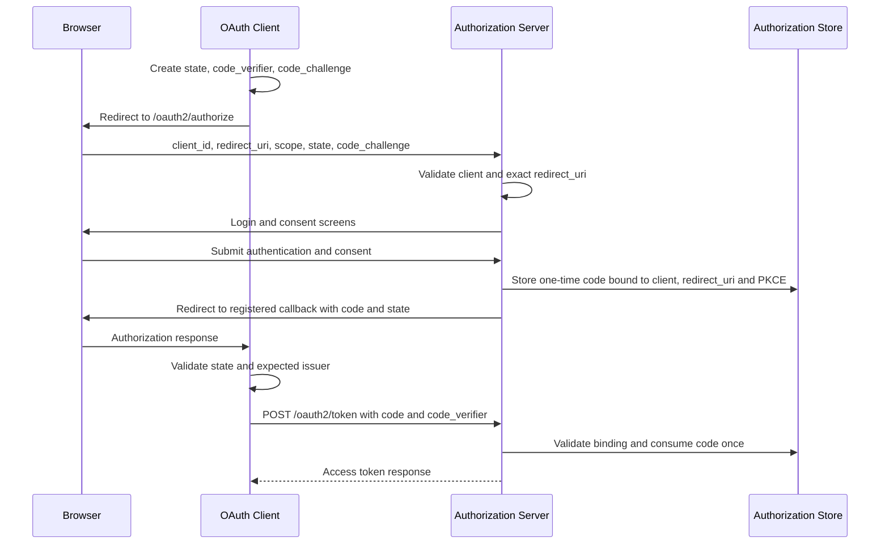
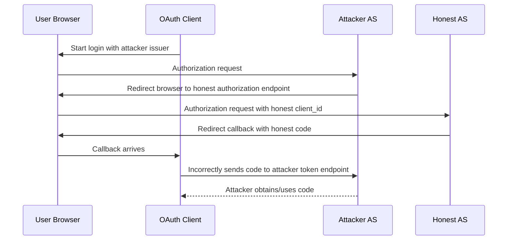

# Ngăn open redirect, authorization response injection và mix-up attack

## 1. Vì sao Authorization Server phải bảo vệ redirect flow?

Trong chương **Bảo vệ máy chủ** của module **SPRING_SECURITY_OAUTH2_OIDC_AUTHORIZATION_SERVER**, chúng ta học cách thiết kế, cấu hình, bảo mật, kiểm thử và vận hành OAuth 2.0/OpenID Connect Authorization Server bằng Spring Security và Spring Authorization Server trong ứng dụng Spring Boot.

Authorization Code Flow dùng trình duyệt của người dùng để chuyển qua lại giữa client và Authorization Server. Authorization Server xác thực người dùng, xin consent nếu cần, sau đó chuyển trình duyệt về redirect URI của client cùng authorization response. Luồng này tạo ra nhiều ranh giới tin cậy:

- Authorization Server phải chắc chắn response chỉ được gửi tới redirect URI đã đăng ký của đúng client.
- Client phải chắc chắn callback thuộc về authorization request mà chính nó đã khởi tạo.
- Client phải chắc chắn authorization response đến từ đúng Authorization Server đã chọn.
- Authorization Server phải bảo vệ authorization code khỏi bị đánh cắp, phát lại hoặc dùng trong một transaction khác.

Ba nhóm tấn công trong bài có liên quan nhưng khác nhau:

| Tấn công | Lỗi cốt lõi | Hậu quả |
| --- | --- | --- |
| Open redirect | Endpoint chuyển trình duyệt tới URL tùy ý hoặc redirect URI được kiểm tra lỏng lẻo. | Authorization code/token có thể bị chuyển tới attacker; URL hợp lệ của domain còn có thể bị dùng để phishing. |
| Authorization response injection | Client nhận code/state/response không gắn đúng transaction hoặc attacker chèn code lấy từ phiên khác. | Client có thể đăng nhập nhầm danh tính hoặc đổi code của nạn nhân lấy token. |
| Mix-up attack | Client hỗ trợ nhiều Authorization Server nhưng không xác định response thuộc issuer nào. | Client gửi authorization code hoặc token tới token endpoint của attacker. |

RFC 9700 là Best Current Practice hiện hành cho OAuth 2.0 Security. Bài dùng các yêu cầu của RFC này cùng RFC 9207 về issuer identification, sau đó liên hệ với extension point của Spring Authorization Server 1.5.8 và Spring Security 6.5.

### Mục tiêu học tập

Sau bài này, bạn có thể:

- Giải thích rủi ro khi redirect URI được so khớp bằng wildcard, prefix hoặc suffix.
- Giữ exact redirect URI validation trong Spring Authorization Server.
- Ngăn open redirect ở Authorization Server và ứng dụng client.
- Bảo vệ callback bằng state, PKCE và OIDC nonce.
- Hiểu authorization code injection và PKCE downgrade.
- Nhận diện mix-up attack khi client kết nối nhiều issuer.
- Phát hành và xác minh response parameter iss theo RFC 9207.
- Tích hợp các extension point success/error response và metadata của Spring Authorization Server.
- Viết kiểm thử âm cho redirect, callback, issuer và code redemption.

## 2. Authorization Code Flow và các điểm cần bảo vệ

Một luồng Authorization Code tiêu chuẩn:



Các kiểm tra ở Authorization Endpoint và callback của client bổ sung cho nhau. Exact redirect URI không thay thế state/PKCE; state/PKCE cũng không cho phép Authorization Server redirect tới URL chưa đăng ký.

## 3. Redirect URI phải được đăng ký trước

### 3.1. Redirect URI là đích nhận authorization response

Client đăng ký redirect URI khi được tạo trong Authorization Server. Ví dụ:

```text
https://portal.example.com/login/oauth2/code/corporate
https://mobile.example.com/oauth/callback
http://127.0.0.1:43127/callback
```

Authorization request có thể gửi tham số redirect_uri. Authorization Server phải kiểm tra URI này thuộc đúng RegisteredClient. Nếu client đã gửi redirect_uri ở authorization request, token request phải gửi lại cùng giá trị đó theo yêu cầu của Authorization Code Grant.

Không dùng redirect URI để chọn tenant, issuer hoặc client registration bằng cách đoán chuỗi. Client ID phải được tra cứu trước, rồi redirect URI được kiểm tra trong tập URI của chính client đó.

### 3.2. Exact string matching

RFC 9700 yêu cầu Authorization Server so sánh redirect URI với URI đã đăng ký bằng exact string matching. Ngoại lệ được tiêu chuẩn nêu rõ là port động cho loopback redirect URI của native application.

Ví dụ URI đã đăng ký:

```text
https://portal.example.com/oauth/callback
```

| URI nhận được | Kết quả |
| --- | --- |
| https://portal.example.com/oauth/callback | Chấp nhận. |
| https://portal.example.com/oauth/callback/ | Từ chối. |
| https://portal.example.com/oauth/callback?next=/home | Từ chối nếu chưa đăng ký đúng URI này. |
| https://portal.example.com.evil.example/oauth/callback | Từ chối. |
| https://evil.example/portal.example.com/oauth/callback | Từ chối. |
| http://portal.example.com/oauth/callback | Từ chối vì scheme khác. |
| https://portal.example.com:443/oauth/callback | Không tự chuẩn hóa để coi là giống chuỗi đã đăng ký. |

Không tự decode rồi encode, lowercase host, bỏ port mặc định, bỏ dấu slash hoặc chuẩn hóa path trước khi so sánh theo cách làm hai URI khác nhau trở thành một URI. Nếu hệ thống cần nhiều callback, đăng ký từng URI cụ thể.

### 3.3. Không dùng wildcard

Tránh các pattern như:

```text
https://*.example.com/*
https://portal.example.com/*
https://portal.example.com/callback?*
```

Wildcard khiến việc xác định host/path được phép trở nên phức tạp. Subdomain có thể bị takeover, route có thể trở thành open redirector hoặc một query parameter có thể thay đổi đích điều hướng.

### 3.4. Ngoại lệ loopback của native app

Native app thường mở một local HTTP listener trên port ngẫu nhiên. RFC 8252 cho phép Authorization Server chấp nhận port thay đổi cho loopback IP redirect URI, ví dụ http://127.0.0.1:{port}/callback.

Ngoại lệ này chỉ áp dụng cho loopback redirect URI của native app. Không mở rộng thành wildcard port cho hostname public, không áp dụng cho web application và không cho phép scheme tùy ý.

Ưu tiên loopback IP literal 127.0.0.1 hoặc [::1] theo profile native app. Không dùng localhost theo cách cho phép resolver trỏ tới host khác hoặc bị proxy ngoài kiểm soát.

## 4. Spring Authorization Server kiểm tra redirect URI

### 4.1. Default validator

Spring Authorization Server 1.5.8 dùng OAuth2AuthorizationCodeRequestAuthenticationValidator để kiểm tra các tham số authorization request, trong đó có redirect_uri và scope. Nếu validation thất bại, provider ném OAuth2AuthorizationCodeRequestAuthenticationException.

Đây là lớp kiểm tra cần được giữ nguyên trong production. Không thay default validator bằng một custom validator chỉ kiểm tra client ID hoặc một regex lỏng.

### 4.2. Đăng ký client với redirect URI cụ thể

Ví dụ một confidential web client:

```java
import java.util.UUID;

import org.springframework.context.annotation.Bean;
import org.springframework.context.annotation.Configuration;
import org.springframework.security.oauth2.core.AuthorizationGrantType;
import org.springframework.security.oauth2.core.ClientAuthenticationMethod;
import org.springframework.security.oauth2.server.authorization.client.RegisteredClient;
import org.springframework.security.oauth2.server.authorization.client.RegisteredClientRepository;
import org.springframework.security.oauth2.server.authorization.client.InMemoryRegisteredClientRepository;
import org.springframework.security.oauth2.server.authorization.settings.ClientSettings;

@Configuration(proxyBeanMethods = false)
public class RegisteredClientConfig {

    @Bean
    RegisteredClientRepository registeredClientRepository() {
        RegisteredClient portal = RegisteredClient.withId(
                        UUID.randomUUID().toString())
                .clientId("portal-web")
                .clientSecret("REPLACE_WITH_PASSWORD_ENCODER_OUTPUT")
                .clientAuthenticationMethod(
                        ClientAuthenticationMethod.CLIENT_SECRET_BASIC)
                .authorizationGrantType(AuthorizationGrantType.AUTHORIZATION_CODE)
                .redirectUri(
                        "https://portal.example.com/login/oauth2/code/corporate")
                .scope("openid")
                .scope("profile")
                .scope("orders.read")
                .clientSettings(ClientSettings.builder()
                        .requireProofKey(true)
                        .requireAuthorizationConsent(true)
                        .build())
                .build();

        return new InMemoryRegisteredClientRepository(portal);
    }
}
```

Đây là ví dụ minh họa; production cần repository bền vững và secret đã encode bằng PasswordEncoder thực tế. requireProofKey(true) buộc client dùng PKCE trong Authorization Code Flow. Không tắt PKCE chỉ vì client là confidential.

### 4.3. Custom validator phải giữ default behavior

Chỉ thay redirect validator khi có yêu cầu nghiệp vụ bổ sung đã được phân tích. Nếu viết custom validator, dùng exact membership trong danh sách URI của RegisteredClient và tiếp tục chạy default scope validator:

```java
import java.util.function.Consumer;

import org.springframework.security.oauth2.core.OAuth2Error;
import org.springframework.security.oauth2.core.OAuth2ErrorCodes;
import org.springframework.security.oauth2.server.authorization.authentication.OAuth2AuthorizationCodeRequestAuthenticationContext;
import org.springframework.security.oauth2.server.authorization.authentication.OAuth2AuthorizationCodeRequestAuthenticationException;
import org.springframework.security.oauth2.server.authorization.authentication.OAuth2AuthorizationCodeRequestAuthenticationProvider;
import org.springframework.security.oauth2.server.authorization.authentication.OAuth2AuthorizationCodeRequestAuthenticationToken;
import org.springframework.security.oauth2.server.authorization.authentication.OAuth2AuthorizationCodeRequestAuthenticationValidator;
import org.springframework.security.oauth2.server.authorization.client.RegisteredClient;

public final class StrictRedirectUriValidator
        implements Consumer<OAuth2AuthorizationCodeRequestAuthenticationContext> {

    @Override
    public void accept(
            OAuth2AuthorizationCodeRequestAuthenticationContext context) {
        OAuth2AuthorizationCodeRequestAuthenticationToken request =
                context.getAuthentication();
        RegisteredClient client = context.getRegisteredClient();
        String requestedRedirectUri = request.getRedirectUri();

        if (requestedRedirectUri == null ||
                !client.getRedirectUris().contains(requestedRedirectUri)) {
            throw new OAuth2AuthorizationCodeRequestAuthenticationException(
                    new OAuth2Error(OAuth2ErrorCodes.INVALID_REQUEST),
                    null);
        }
    }
}
```

Gắn validator vào provider:

```java
Consumer<OAuth2AuthorizationCodeRequestAuthenticationContext> validator =
        new StrictRedirectUriValidator()
                .andThen(
                        OAuth2AuthorizationCodeRequestAuthenticationValidator
                                .DEFAULT_SCOPE_VALIDATOR);

authorizationServer.authorizationEndpoint(endpoint ->
        endpoint.authenticationProviders(providers ->
                providers.forEach(provider -> {
                    if (provider instanceof
                            OAuth2AuthorizationCodeRequestAuthenticationProvider codeProvider) {
                        codeProvider.setAuthenticationValidator(validator);
                    }
                })));
```

Đoạn cấu hình trên minh họa extension point của Spring Authorization Server 1.5.8. Trong ứng dụng thực tế, cấu hình nằm trong SecurityFilterChain đã tạo bằng OAuth2AuthorizationServerConfigurer. Nếu không có yêu cầu bổ sung, giữ default validator là lựa chọn đơn giản và an toàn hơn.

Validator minh họa này yêu cầu redirect_uri phải có trong mọi authorization request. Đây là policy chặt hơn trường hợp OAuth cho phép bỏ redirect_uri khi client chỉ đăng ký một URI. Nếu triển khai cần hỗ trợ trường hợp đó, hãy giữ default validator của framework và chỉ bổ sung kiểm tra khác mà không làm yếu quy tắc so khớp URI.

## 5. Authorization Server không được trở thành open redirector

### 5.1. Không redirect khi client hoặc redirect URI không hợp lệ

Nếu client_id không tồn tại hoặc redirect URI không thuộc client, Authorization Server không được tự động chuyển browser tới URI được request cung cấp.

Ví dụ request độc hại:

```http
GET /oauth2/authorize?response_type=code
    &client_id=portal-web
    &redirect_uri=https%3A%2F%2Fevil.example%2Fcollect
    &scope=orders.read
```

Authorization Server phải từ chối request và hiển thị lỗi tại chính Authorization Server. Không đưa redirect_uri chưa xác minh vào header Location, kể cả khi muốn hiển thị trang lỗi thân thiện.

Chỉ sau khi xác định được client và redirect URI hợp lệ, Authorization Server mới được dùng URI đó cho authorization response theo protocol.

### 5.2. Redirect error chỉ tới URI đã xác minh

Khi request có redirect URI hợp lệ nhưng bị từ chối do scope, consent hoặc policy, Authorization Server có thể gửi OAuth error response về URI đã xác minh. Không tự động redirect lỗi tới URI chưa xác minh chỉ để giữ trải nghiệm nhất quán.

Error response cũng chứa dữ liệu protocol như error, error_description, error_uri và state. Client phải xử lý chúng sau khi đã xác thực transaction và issuer.

### 5.3. Dynamic Client Registration làm tăng rủi ro

Nếu bật Dynamic Client Registration, attacker có thể đăng ký client của họ với redirect URI trỏ tới website phishing hoặc endpoint có open redirect. Việc redirect URI khớp với một registration không có nghĩa website đó đáng tin cậy.

Với client mới hoặc registration không được kiểm duyệt:

- Hiển thị tên client và domain redirect URI để người dùng có thể nhận biết.
- Không tự động chuyển người dùng sau một lỗi hoặc consent bị từ chối nếu URI chưa được tin cậy.
- Áp dụng policy kiểm duyệt, allowlist domain hoặc quy trình phê duyệt theo mức rủi ro.
- Giới hạn khả năng tự đăng ký client và theo dõi registration bất thường.

## 6. Open redirect trong ứng dụng client

Authorization Server có thể kiểm tra đúng redirect URI, nhưng callback của client vẫn có thể là open redirector.

Ví dụ endpoint không an toàn:

```java
@GetMapping("/continue")
String continueTo(@RequestParam String returnUrl) {
    return "redirect:" + returnUrl;
}
```

Attacker có thể tạo URL trông như thuộc domain của ứng dụng:

```text
https://portal.example.com/continue?returnUrl=https://evil.example
```

Người dùng tin domain portal.example.com, nhưng trình duyệt bị chuyển tới attacker. Nếu URL này được dùng làm callback hoặc có thể mang code/token trong query/fragment, attacker có thể thu thập credential.

### 6.1. Lưu relative path thay vì URL tùy ý

Nếu cần quay lại trang ban đầu sau login, chỉ lưu một relative path đã kiểm tra, ví dụ /orders/123. Không lưu URL tuyệt đối do client gửi rồi redirect lại.

Một hàm kiểm tra đơn giản:

```java
public String safeReturnPath(String candidate) {
    if (candidate == null ||
            !candidate.startsWith("/") ||
            candidate.startsWith("//") ||
            candidate.contains("\\") ||
            candidate.contains("\r") ||
            candidate.contains("\n")) {
        return "/";
    }
    return candidate;
}
```

Đây chỉ là lớp kiểm tra ban đầu. Nếu ứng dụng có encoded slash, double encoding, path traversal hoặc reverse proxy rewrite, cần kiểm tra theo URI parser và routing thực tế. Tốt hơn là lưu một route key hoặc ID trang đã được server định nghĩa.

### 6.2. Không đưa return URL thô vào state

state là dữ liệu liên kết authorization request với browser session, không phải cơ chế tin cậy để chứa URL điều hướng tùy ý. Lưu return path trong session/server-side store dưới một transaction key ngẫu nhiên. state chỉ mang giá trị ngẫu nhiên để tra cứu transaction.

Không dùng startsWith("https://portal.example.com") để allowlist URL. Kiểu kiểm tra này có thể chấp nhận https://portal.example.com.evil.example, userinfo tricks hoặc URL đã mã hóa khác cách.

## 7. Authorization response injection là gì?

Authorization response injection xảy ra khi attacker làm client nhận một response không thuộc transaction mà client đã khởi tạo, hoặc thay code trong response bằng code lấy từ một transaction khác.

Một kịch bản code injection:

1. Attacker tự đăng nhập qua client và Authorization Server, nhận authorization code gắn với tài khoản của attacker.
2. Attacker bắt đầu một transaction login khác trong browser của nạn nhân.
3. Attacker thay authorization code trong callback bằng code đã lấy ở bước 1.
4. Client gửi code đó tới Token Endpoint bằng thông tin của transaction nạn nhân.
5. Nếu code không gắn PKCE verifier hoặc client instance đúng, client có thể tạo session mang identity/resource không đúng transaction.

Một response giả cũng có thể chứa state do attacker tự chọn, error giả hoặc issuer khác. Vì vậy client không được chỉ kiểm tra response có code hay không.

## 8. Ràng buộc callback với state

### 8.1. State là correlation và CSRF token

Client tạo một state ngẫu nhiên, khó đoán cho từng authorization request. Giá trị đó được lưu cùng browser session hoặc một kho server-side có ràng buộc với browser. Khi callback đến, client tìm transaction đang chờ và xác minh state khớp.

Một state an toàn cần:

- Được sinh mới cho mỗi authorization transaction.
- Có entropy đủ lớn từ secure random generator.
- Được gắn với browser/session đã khởi tạo flow.
- Chỉ được dùng một lần và bị xóa sau khi xử lý.
- Không chứa dữ liệu tin cậy chưa được ký/mã hóa.
- Không được chấp nhận nếu thiếu, sai hoặc transaction đã hết hạn.

Không dùng một hằng số state cho mọi người dùng hoặc mọi lần login. Không chỉ kiểm tra tham số state có mặt.

### 8.2. Spring Security lưu authorization request

Spring Security OAuth2 Client dùng AuthorizationRequestRepository để lưu OAuth2AuthorizationRequest từ lúc bắt đầu flow đến khi callback được xử lý. Implementation mặc định là HttpSessionOAuth2AuthorizationRequestRepository, lưu request trong HttpSession.

Có thể khai báo rõ repository này trong cấu hình OAuth2 Login:

```java
import org.springframework.context.annotation.Bean;
import org.springframework.context.annotation.Configuration;
import org.springframework.security.config.annotation.web.builders.HttpSecurity;
import org.springframework.security.oauth2.client.web.HttpSessionOAuth2AuthorizationRequestRepository;
import org.springframework.security.web.SecurityFilterChain;

@Configuration(proxyBeanMethods = false)
public class OAuth2ClientSecurityConfig {

    @Bean
    SecurityFilterChain clientSecurityFilterChain(HttpSecurity http)
            throws Exception {
        http
            .oauth2Login(oauth2 -> oauth2
                .authorizationEndpoint(endpoint ->
                    endpoint.authorizationRequestRepository(
                            new HttpSessionOAuth2AuthorizationRequestRepository())
                )
            );

        return http.build();
    }
}
```

Đây là cấu hình tường minh cho hành vi session repository mặc định. Nếu dùng custom repository hoặc stateless cookie, phải bảo vệ tính toàn vẹn, confidentiality khi cần, session binding, expiry và one-time consumption. Không đặt toàn bộ authorization request chưa ký trong cookie có thể bị sửa.

### 8.3. Session cookie cũng cần bảo vệ

Với web client, session cookie cần Secure, HttpOnly và SameSite phù hợp response mode/callback. Không giảm SameSite hoặc tắt CSRF protection toàn ứng dụng chỉ để làm callback hoạt động; hãy kiểm thử flow thực tế và cấu hình ngoại lệ có phạm vi hẹp nếu cần.

## 9. PKCE chống authorization code injection

### 9.1. Cách hoạt động

PKCE ràng buộc authorization code với client instance đã tạo request:

```text
code_verifier = random high-entropy secret
code_challenge = BASE64URL(SHA256(code_verifier))
code_challenge_method = S256
```

Client gửi code_challenge và code_challenge_method=S256 ở Authorization Request. Khi đổi code ở Token Endpoint, client gửi code_verifier. Authorization Server tính lại challenge và chỉ cấp token nếu verifier khớp challenge đã lưu cùng code.

Attacker lấy được code nhưng không có verifier của transaction gốc sẽ không đổi được code thành token.

### 9.2. PKCE phải dùng S256

Client nên dùng S256. Không dùng plain vì verifier được gửi nguyên văn trong authorization request và có thể bị lộ qua front channel. RFC 9700 khuyến nghị method không để lộ verifier; S256 là method đáp ứng yêu cầu này.

### 9.3. Authorization Server phải enforce PKCE

Spring Authorization Server cho phép bắt buộc PKCE bằng ClientSettings.requireProofKey(true):

```java
RegisteredClient publicClient = RegisteredClient.withId(
                UUID.randomUUID().toString())
        .clientId("spa-client")
        .clientAuthenticationMethod(ClientAuthenticationMethod.NONE)
        .authorizationGrantType(AuthorizationGrantType.AUTHORIZATION_CODE)
        .redirectUri("https://app.example.com/callback")
        .scope("openid")
        .scope("profile")
        .clientSettings(ClientSettings.builder()
                .requireProofKey(true)
                .requireAuthorizationConsent(true)
                .build())
        .build();
```

Spring Authorization Server 1.5.8 mặc định bật requireProofKey cho client. Vẫn nên khai báo tường minh ở client public để policy dễ review và tránh cấu hình khác môi trường. Authorization Server phải kiểm tra verifier ở Token Endpoint và chống downgrade: nếu request token gửi code_verifier cho code không được tạo với code_challenge, phải từ chối.

### 9.4. Confidential client cũng nên dùng PKCE

Client secret bảo vệ client authentication nhưng không ngăn mọi trường hợp authorization code bị chèn vào browser session của client hợp lệ. RFC 9700 khuyến nghị PKCE cho confidential client vì nó ràng buộc code với đúng transaction. Không coi client secret là lý do để bỏ PKCE.

## 10. OIDC nonce bảo vệ authentication response

Trong OpenID Connect, nonce được client tạo cho mỗi authentication request và gửi tới OpenID Provider. Provider đưa giá trị đó vào ID Token. Client kiểm tra nonce trong ID Token có khớp transaction đã lưu hay không.

Nonce giúp phát hiện ID Token bị phát lại hoặc code bị chèn từ một transaction OIDC khác, nếu client thực sự xác minh nonce trước khi sử dụng token.

Phân biệt ba giá trị:

| Giá trị | Vai trò |
| --- | --- |
| state | Liên kết authorization response với browser transaction và chống CSRF. |
| PKCE code_verifier | Chứng minh client đang đổi code chính là client instance tạo code challenge. |
| OIDC nonce | Liên kết ID Token với authentication request cụ thể và chống replay/injection trong OIDC. |

Nonce không thay PKCE cho OAuth-only client. Với OIDC, nếu dựa vào nonce như một biện pháp code-injection defense, client phải xác minh nonce trong ID Token nhận từ Token Endpoint và không sử dụng ID Token/access token cho đến khi xác minh thành công.

Spring Security OIDC Login xử lý xác minh ID Token theo OIDC provider flow. Không tự viết parser ID Token rồi bỏ qua chữ ký, issuer, audience, expiry hoặc nonce.

## 11. Callback phải xử lý response đúng thứ tự

Khi callback nhận code, state, error và các response parameter khác, client nên thực hiện theo thứ tự:

1. Xác định transaction đang chờ dựa trên browser/session context.
2. Kiểm tra transaction còn hạn và chưa được dùng.
3. So khớp state với giá trị đã lưu.
4. Nếu có nhiều issuer, kiểm tra issuer response theo RFC 9207 hoặc countermeasure tương đương.
5. Chỉ sau các bước trên mới xử lý error hoặc gửi code tới Token Endpoint.
6. Gửi đúng redirect_uri, client authentication và code_verifier của transaction.
7. Với OIDC, xác minh ID Token, gồm nonce, trước khi dùng kết quả authentication.
8. Xóa transaction state sau khi xử lý thành công hoặc thất bại.

Nếu state hoặc issuer sai, không hiển thị error_description như thể nó đến từ provider dự kiến. Hãy dừng flow, ghi audit event không chứa credential và yêu cầu người dùng bắt đầu lại.

Không chấp nhận nhiều giá trị code, state hoặc iss mâu thuẫn trong cùng response. Parser cần xử lý duplicate query parameters một cách fail-closed.

## 12. Mix-up attack xảy ra như thế nào?

Mix-up attack liên quan đến client hỗ trợ hai hoặc nhiều Authorization Server. Giả sử:

- Honest Authorization Server: https://login.example.com.
- Attacker Authorization Server: https://evil.example.
- Client dùng cùng một callback URI cho cả hai issuer.

Attacker có thể khiến browser đi qua Authorization Server của họ rồi chuyển request tới honest server. Honest server phát authorization code, nhưng client vẫn nghĩ response đến từ issuer attacker đã chọn ban đầu. Client gửi code tới token endpoint attacker; attacker thu được code và có thể đổi hoặc khai thác nó.



Điểm yếu là client không ràng buộc response với issuer đã chọn cho transaction. Việc chỉ lưu authorization server URL không đủ nếu endpoint metadata của issuer có thể bị tráo; client cần xác định issuer và bộ endpoint/token endpoint từ metadata tin cậy.

## 13. RFC 9207: Authorization Server Issuer Identification

RFC 9207 định nghĩa response parameter iss. Authorization Server hỗ trợ RFC này phải thêm issuer identifier vào authorization response, gồm cả response thành công và error response được redirect về client.

Ví dụ:

```http
HTTP/1.1 302 Found
Location: https://client.example/callback
  ?code=SplxlOBeZQQYbYS6WxSbIA
  &state=af0ifjsldkj
  &iss=https%3A%2F%2Flogin.example.com
```

Error response cũng phải có iss:

```http
HTTP/1.1 302 Found
Location: https://client.example/callback
  ?error=access_denied
  &state=af0ifjsldkj
  &iss=https%3A%2F%2Flogin.example.com
```

Authorization Server Metadata phải công bố:

```json
{
  "issuer": "https://login.example.com",
  "authorization_response_iss_parameter_supported": true
}
```

Giá trị iss trong response phải giống chính xác issuer trong metadata. RFC 9207 yêu cầu client URL-decode giá trị form-encoded rồi so sánh bằng simple string comparison; không tự lowercase, bỏ port, bỏ trailing slash hoặc normalize URI để làm hai issuer khác nhau trở thành một.

## 14. Client xác minh issuer trước khi đổi code

Client phải lưu issuer đã chọn cùng transaction và browser session. Khi nhận response:

- Nếu metadata cho biết issuer hỗ trợ response iss, parameter phải hiện diện.
- Nếu iss hiện diện, decode theo application/x-www-form-urlencoded rồi so sánh chính xác với issuer đã lưu.
- Nếu không khớp, abort flow; không gửi code tới Token Endpoint.
- Với error response, không mặc định error đến từ issuer dự kiến nếu issuer check thất bại.
- Nếu response chứa nhiều issuer identity (ví dụ response parameter và ID Token), các giá trị phải nhất quán.

Nếu client tương tác với issuer hỗ trợ và không hỗ trợ RFC 9207, client phải lưu trạng thái support theo từng issuer. Không được chấp nhận response thiếu iss từ issuer đã quảng cáo hỗ trợ.

### 14.1. Alternative: distinct redirect URI per issuer

RFC 9700 cho phép client dùng redirect URI khác nhau cho từng issuer khi không có cách issuer identification khác. Client phải kiểm tra callback URI thực tế nhận response có đúng URI dành cho issuer đó không.

Đây là biện pháp dự phòng; RFC 9700 khuyến nghị ưu tiên issuer identification. Distinct redirect URI khó vận hành khi một client registration cần dùng với nhiều issuer và vẫn có thể bị vô hiệu nếu Authorization Server kiểm tra redirect URI kém.

## 15. Spring Security OAuth2 Client và multi-issuer

### 15.1. Cấu hình ClientRegistration rõ ràng

Mỗi issuer nên có một ClientRegistration riêng, chứa authorization URI, token URI, issuer URI, client ID và redirect URI đã được đăng ký. Không nhận token endpoint từ query parameter hoặc dữ liệu do browser tự gửi.

Ví dụ cấu hình Boot:

```yaml
spring:
  security:
    oauth2:
      client:
        registration:
          corporate:
            provider: corporate
            client-id: portal-web
            client-secret: REPLACE_WITH_SECRET_MANAGER_REFERENCE
            client-authentication-method: client_secret_basic
            authorization-grant-type: authorization_code
            redirect-uri: "{baseUrl}/login/oauth2/code/{registrationId}"
            scope:
              - openid
              - profile
              - orders.read
        provider:
          corporate:
            issuer-uri: https://login.example.com
```

redirect-uri template được mở rộng từ base URL của ứng dụng. Nếu chạy sau reverse proxy, chỉ tin Forwarded/X-Forwarded-* header từ proxy đã được cấu hình tin cậy và strip header giả do client gửi. Nếu không, attacker có thể làm ứng dụng tạo redirect URI dựa trên host/proto do họ kiểm soát.

### 15.2. PKCE cho OAuth2 Client

Spring Security tự dùng PKCE cho public client theo điều kiện cấu hình của ClientRegistration; có thể yêu cầu PKCE tường minh bằng ClientRegistration.ClientSettings.requireProofKey(true). Với confidential client, nên bật để bảo vệ authorization code injection.

### 15.3. RFC 9207 cần được kiểm tra theo phiên bản

Spring Security 6.5 cung cấp AuthorizationRequestRepository, OAuth2AuthorizationRequestResolver và các filter xử lý callback. Tài liệu OAuth2 Login mô tả việc lưu request và đổi code, nhưng không nên mặc định rằng mọi bản 6.5 tự động thực hiện đầy đủ RFC 9207 cho ứng dụng multi-issuer.

Với client kết nối nhiều issuer, hãy xác minh phiên bản thực tế có kiểm tra response iss trước token exchange hay không. Nếu chưa có, thêm callback guard/custom flow trước bước đổi code, lấy expected issuer từ authorization request đã lưu trong session. Không kiểm tra iss bằng giá trị do callback tự khai báo làm nguồn expected.

Không coi việc cấu hình hai ClientRegistration riêng là đã hoàn tất mix-up defense. Client vẫn phải xác minh response thuộc đúng issuer và gửi code tới token endpoint của registration đã lưu trong transaction.

## 16. Spring Authorization Server 1.5.8 và RFC 9207

### 16.1. Extension point có sẵn

Spring Authorization Server 1.5.8 cho phép tùy chỉnh Authorization Endpoint bằng:

- authorizationResponseHandler: xử lý authorization response thành công.
- errorResponseHandler: xử lý authorization error response.
- authorizationServerMetadataCustomizer: bổ sung metadata của Authorization Server.

Tài liệu 1.5.8 mô tả các extension point này, nhưng không tài liệu hóa một cấu hình bật RFC 9207 tự động. Vì vậy, không công bố metadata authorization_response_iss_parameter_supported=true nếu response handler chưa thực sự thêm iss.

### 16.2. Công bố metadata sau khi đã triển khai response

Metadata customizer có thể thêm claim RFC 9207:

```java
authorizationServer.authorizationServerMetadataEndpoint(metadata ->
        metadata.authorizationServerMetadataCustomizer(builder ->
                builder.claim(
                        "authorization_response_iss_parameter_supported",
                        true)));
```

Đoạn này chỉ công bố capability. Nó không tự thêm iss vào redirect response.

### 16.3. Tùy biến cả success và error handler

Để triển khai RFC 9207 trong ứng dụng dùng Spring Authorization Server 1.5.8, cần cung cấp cả hai handler:

```java
authorizationServer.authorizationEndpoint(endpoint -> endpoint
        .authorizationResponseHandler(issuerAwareSuccessHandler)
        .errorResponseHandler(issuerAwareErrorHandler));
```

issuerAwareSuccessHandler và issuerAwareErrorHandler là implementation do ứng dụng sở hữu. Mỗi handler phải giữ nguyên protocol behavior mặc định, dùng issuer chính thức từ AuthorizationServerContext/AuthorizationServerSettings, thêm parameter iss vào response redirect đã được xác minh và giữ nguyên state/error fields theo chuẩn.

Các yêu cầu triển khai:

1. Chỉ thêm iss khi response được gửi tới redirect URI đã được xác minh.
2. Thêm issuer vào cả success response lẫn redirect-based error response.
3. URL-encode giá trị issuer đúng một lần khi tạo Location URI.
4. Không dùng issuer từ request parameter hoặc Host header không tin cậy.
5. Không redirect về URI không hợp lệ chỉ để gửi error có iss.
6. Metadata authorization_response_iss_parameter_supported chỉ là true khi cả hai handler đã được triển khai và kiểm thử.

Đây là điểm tích hợp cần code review và integration test riêng. Không copy một response handler đơn giản chỉ nối chuỗi vào Location; cần xử lý query parameter đã có, encoding, duplicate parameter, response mode và error path.

### 16.4. Multi-issuer

Nếu Authorization Server hỗ trợ nhiều issuer, iss trong response phải là issuer của request hiện tại, không phải một issuer global cố định. Giá trị phải trùng issuer metadata của tenant tương ứng. Test chéo tenant để chắc chắn response của tenant A không mang issuer B.

## 17. Không làm lộ authorization response

Authorization code và state thường xuất hiện trong query string của callback. Chúng có thể bị lộ qua:

- Browser history hoặc ảnh chụp URL.
- HTTP access log, reverse proxy log và APM trace.
- Referer header khi callback page tải tài nguyên bên thứ ba.
- Analytics, error tracking hoặc client-side telemetry.
- Trang lỗi hiển thị lại query parameter.

Các biện pháp:

- Dùng Authorization Code Flow, không dùng Implicit Flow để trả access token qua front channel.
- Bảo vệ code bằng PKCE và chỉ cho phép redeem một lần.
- Đặt Referrer-Policy: no-referrer cho trang callback/authorization page phù hợp.
- Không tải script, image, iframe hoặc analytics bên thứ ba trên trang hiển thị authorization response.
- Đặt Cache-Control: no-store cho trang/response nhạy cảm.
- Không ghi raw code, state, token hoặc full callback URL vào log.
- Sau khi xử lý callback, chuyển sang URL sạch bằng redirect nội bộ và không mang query nhạy cảm theo.

### 17.1. Redirect status sau khi nhận credential

Authorization Server thường chuyển từ form đăng nhập bằng POST sang client redirect. Tránh dùng HTTP 307 cho bước này vì browser có thể gửi lại body POST chứa credential người dùng tới client. RFC 9700 chỉ ra 307 giữ nguyên method/body; 303 buộc chuyển thành GET. Kiểm tra redirect strategy của ứng dụng và proxy, không thay status code tùy tiện.

## 18. Reverse proxy và redirect URI

Ứng dụng chạy sau load balancer/reverse proxy có thể nhận request nội bộ qua HTTP nhưng public URL là HTTPS. Nếu Spring tạo redirect URI từ host/proto nội bộ, URI không khớp registration hoặc có thể bị attacker tác động bằng forwarded header.

Quy tắc:

- TLS kết thúc ở proxy được quản trị.
- Proxy xóa Forwarded/X-Forwarded-* do client tự gửi rồi ghi lại giá trị tin cậy.
- Spring chỉ xử lý forwarded header theo topology đã xác định.
- Không cho request tự chọn host để thay redirect URI.
- Dùng public base URL cố định khi deployment có domain ổn định.
- Kiểm tra redirect URI thực tế được gửi trong authorization request và token request.

Không giải quyết lỗi redirect mismatch bằng cách cho phép mọi host hoặc bật wildcard.

## 19. Authorization response, state và issuer trong audit

Khi ghi audit cho Authorization Code Flow, lưu các thông tin không nhạy cảm đủ để tái dựng transaction:

- Client ID và issuer đã chọn.
- Redirect URI registration ID hoặc fingerprint đã kiểm tra.
- Correlation ID/transaction ID nội bộ.
- Kết quả state, PKCE và issuer validation.
- Kết quả consent và authorization policy.
- Error category, timestamp và callback route.

Không lưu raw authorization code, code verifier, access token, refresh token hoặc state secret. Nếu cần đối chiếu state, lưu hash hoặc transaction ID nội bộ.

Với multi-issuer, không chỉ log registration ID; phải log issuer đã chọn để điều tra mix-up. Nhưng issuer dùng trong audit phải đến từ cấu hình/metadata tin cậy, không lấy từ response chưa được xác minh.

## 20. Kiểm thử bảo mật redirect và response

Kiểm thử cả Authorization Server lẫn OAuth Client. Chỉ test happy path không đủ để chứng minh redirect/callback an toàn.

| Nhóm | Kịch bản | Kỳ vọng |
| --- | --- | --- |
| Redirect exact match | URI đúng hoàn toàn. | Authorization request tiếp tục. |
| Redirect suffix | Host là portal.example.com.evil.example. | Bị từ chối. |
| Redirect prefix | Path bắt đầu giống URI đã đăng ký nhưng có suffix lạ. | Bị từ chối. |
| Scheme mismatch | Đăng ký HTTPS, request dùng HTTP. | Bị từ chối. |
| Port mismatch | Web redirect URI đổi port. | Bị từ chối. |
| Query mismatch | Thêm query parameter chưa đăng ký. | Bị từ chối. |
| Wildcard | URI khớp wildcard domain/path. | Registration không được phép dùng wildcard. |
| Native loopback | Port loopback thay đổi theo profile native app. | Chỉ ngoại lệ native loopback được áp dụng. |
| Unknown client | client_id không tồn tại. | Không redirect tới redirect_uri request gửi lên. |
| Invalid redirect | Client hợp lệ nhưng redirect_uri sai. | Hiển thị lỗi tại Authorization Server; không redirect tới URI sai. |
| Open redirect client | returnUrl=https://evil.example. | Không điều hướng ra domain ngoài allowlist. |
| Encoded redirect | Double encoding, backslash, CRLF hoặc scheme-relative URL. | Bị từ chối. |
| Missing state | Callback không có state trong flow yêu cầu state. | Callback bị từ chối. |
| Wrong state | State khác transaction đã lưu. | Callback bị từ chối trước token exchange. |
| Replayed state | Dùng lại state đã tiêu thụ. | Callback bị từ chối. |
| Expired transaction | Callback đến sau thời gian chờ. | Callback bị từ chối. |
| Code injection | Code của attacker được chèn vào transaction nạn nhân. | PKCE verifier không khớp; token exchange thất bại. |
| Missing verifier | Client không gửi code_verifier cho code yêu cầu PKCE. | Token Endpoint từ chối. |
| PKCE downgrade | Token request có verifier nhưng authorization code không có challenge. | Bị từ chối. |
| Wrong verifier | Verifier không tạo ra challenge đã lưu. | Bị từ chối. |
| Nonce mismatch | ID Token nonce khác transaction. | OIDC authentication thất bại; không sử dụng token. |
| Wrong issuer | Response iss khác issuer đã lưu. | Abort trước token exchange. |
| Missing issuer | Issuer quảng cáo RFC 9207 nhưng response thiếu iss. | Client từ chối response. |
| Error issuer mismatch | Response error có iss khác issuer mong đợi. | Không tin error; abort flow. |
| Duplicate issuer | Response có hai giá trị iss mâu thuẫn. | Bị từ chối. |
| Tenant mix-up | Tenant A response chứa issuer B. | Bị từ chối. |
| Referer leakage | Callback page tải third-party resource. | Không gửi code/state trong Referer. |
| 307 credential forwarding | Login POST bị redirect 307 tới client. | Không chuyển credential POST body tới client. |

### 20.1. Integration test với Spring Authorization Server

Tạo RegisteredClient có một redirect URI duy nhất và bật requireProofKey(true). Gửi request tới /oauth2/authorize với các biến thể redirect URI. Kiểm tra:

1. URI đúng nhận authorization flow.
2. URI sai không xuất hiện trong Location response.
3. Authorization code được lưu cùng client, redirect URI và PKCE challenge.
4. Token request thiếu hoặc sai verifier bị từ chối.
5. Code đã redeem không thể dùng lần thứ hai.

Nếu có custom RFC 9207 handler, kiểm tra cả success response và error response đều có iss, metadata có authorization_response_iss_parameter_supported=true, và issuer tenant đúng.

### 20.2. Integration test với Spring Security OAuth2 Client

Kiểm tra:

1. Authorization request chứa state transaction-specific.
2. PKCE dùng S256 và verifier không xuất hiện trong front channel.
3. Callback state sai không gọi Token Endpoint.
4. Issuer mismatch không gọi Token Endpoint.
5. Callback thành công chỉ dùng token endpoint của ClientRegistration đã lưu.
6. OIDC nonce mismatch làm authentication thất bại.

Có thể dùng MockMvc để test filter/callback behavior, nhưng nên có ít nhất một end-to-end test với Authorization Server và browser redirect thực tế cho các đường lỗi quan trọng.

## 21. Troubleshooting

| Triệu chứng | Nguyên nhân có thể | Hướng xử lý |
| --- | --- | --- |
| Authorization request báo invalid_request | redirect_uri không khớp exact string hoặc scope không hợp lệ. | So sánh URI raw với RegisteredClient redirectUris. |
| Login hoạt động local nhưng lỗi sau proxy | Base URL/proto/host bị tính từ header sai hoặc proxy chưa set forwarded headers đúng. | Cấu hình proxy trust và public base URL. |
| Người dùng bị chuyển tới website lạ sau login | Client có open redirect hoặc returnUrl chưa được allowlist. | Lưu route key/relative path server-side. |
| Callback báo state mismatch | Session cookie không quay lại, transaction hết hạn hoặc callback không cùng browser. | Kiểm tra SameSite/Secure, session affinity và state repository. |
| Code exchange báo PKCE failure | Verifier không cùng transaction hoặc bị mất khi chuyển node. | Lưu verifier an toàn cùng authorization request. |
| Code injection vẫn có thể xảy ra | PKCE không bắt buộc hoặc verifier bị dùng chung. | Bật requireProofKey, S256 và verifier riêng mỗi flow. |
| OIDC login lỗi nonce | ID Token nonce không khớp hoặc custom flow bỏ qua nonce validation. | Dùng OIDC provider chuẩn và kiểm tra nonce trước khi dùng token. |
| Multi-issuer client đổi code sai token endpoint | Chỉ lưu authorization URL, không lưu issuer/metadata tuple theo transaction. | Lưu issuer và endpoint tuple cùng state; xác minh response iss. |
| Metadata quảng cáo iss nhưng response thiếu | Metadata được bật trước khi success/error handler thêm iss. | Đồng bộ hai handler và metadata; không quảng cáo capability giả. |
| Success response có iss nhưng error response thiếu | Chỉ tùy biến success handler. | Tùy biến và kiểm thử error handler riêng. |
| Response iss không khớp metadata | Issuer cấu hình khác public issuer hoặc tenant context sai. | Dùng issuer chính thức và so sánh exact string. |
| Code bị lộ qua log | Access log/APM ghi full query string. | Redact code/state/token và giới hạn callback logging. |

## 22. Bài tập thực hành và checklist

### Bài tập 1 — Exact redirect URI

Đăng ký một client có một redirect URI. Gửi request với host suffix, path suffix, port khác, scheme khác và query khác. Xác nhận chỉ chuỗi đã đăng ký được chấp nhận.

### Bài tập 2 — PKCE enforcement

Đăng ký public client với requireProofKey(true). Thử authorization request không có challenge, dùng plain, gửi verifier sai và gửi verifier cho code không có challenge. Xác nhận các trường hợp không hợp lệ bị từ chối.

### Bài tập 3 — Client open redirect

Tìm mọi endpoint có returnUrl, next, redirect, continue hoặc target. Viết test với absolute URL ngoài domain, scheme-relative URL, encoded URL và backslash. Chỉ cho phép route nội bộ đã xác định.

### Bài tập 4 — Authorization response injection

Tạo hai transaction với hai PKCE verifier. Lấy code từ transaction A rồi chèn vào callback B. Xác nhận client không đổi được code do verifier không khớp.

### Bài tập 5 — OIDC nonce

Khởi tạo hai OIDC login transaction, thay ID Token nonce của transaction này bằng token của transaction kia. Xác nhận OIDC login thất bại trước khi lưu principal/session.

### Bài tập 6 — Mix-up với hai issuer

Cấu hình hai Authorization Server/issuer có cùng callback URI. Giả lập response của issuer A trong transaction chọn issuer B. Xác nhận client kiểm tra iss và dừng trước khi gửi code tới Token Endpoint.

### Bài tập 7 — RFC 9207 ở Authorization Server

Triển khai issuer-aware success handler và error handler trong Spring Authorization Server 1.5.8. Chỉ bật metadata claim sau khi cả hai handler đều thêm iss. Kiểm tra issuer chính xác trong response và metadata.

### Checklist hoàn thành

- [ ] RegisteredClient chỉ chứa redirect URI cụ thể.
- [ ] Redirect URI được so khớp exact string.
- [ ] Không dùng wildcard, prefix hoặc suffix matching cho web redirect URI.
- [ ] Ngoại lệ port động chỉ áp dụng cho native loopback redirect URI.
- [ ] Invalid client/redirect URI không gây redirect ra ngoài.
- [ ] Không có endpoint open redirect ở Authorization Server hoặc client.
- [ ] Return path được lưu server-side hoặc giới hạn vào route nội bộ.
- [ ] State ngẫu nhiên, transaction-specific, session-bound và one-time.
- [ ] PKCE S256 được bật cho public client và khuyến nghị cho confidential client.
- [ ] Authorization Server enforce code_verifier và chống PKCE downgrade.
- [ ] OIDC nonce được kiểm tra trước khi dùng ID Token/access token.
- [ ] Callback kiểm tra state trước token exchange.
- [ ] Multi-issuer client xác minh issuer response theo RFC 9207.
- [ ] Client lưu issuer/token endpoint tuple theo transaction.
- [ ] RFC 9207 metadata chỉ bật sau khi success và error response đều có iss.
- [ ] Callback page không tải tài nguyên bên thứ ba làm lộ Referer.
- [ ] Log/APM đã redact code, state và token.
- [ ] Có integration test redirect, PKCE, nonce, mix-up và response error.

## 23. Tài liệu tham khảo

- [RFC 9700 — Best Current Practice for OAuth 2.0 Security](https://www.rfc-editor.org/rfc/rfc9700.html) — exact redirect URI, open redirect, authorization code injection, PKCE, CSRF và mix-up.
- [RFC 9207 — OAuth 2.0 Authorization Server Issuer Identification](https://www.rfc-editor.org/rfc/rfc9207.html) — response parameter iss, metadata support và issuer validation.
- [RFC 7636 — Proof Key for Code Exchange (PKCE)](https://www.rfc-editor.org/rfc/rfc7636.html) — code challenge và verifier.
- [RFC 8252 — OAuth 2.0 for Native Apps](https://www.rfc-editor.org/rfc/rfc8252.html) — loopback redirect URI và native app best practices.
- [RFC 6749 — The OAuth 2.0 Authorization Framework](https://www.rfc-editor.org/rfc/rfc6749.html) — authorization request/response, redirect URI và authorization code grant.
- [RFC 8414 — OAuth 2.0 Authorization Server Metadata](https://www.rfc-editor.org/rfc/rfc8414.html) — issuer và metadata capability.
- [Spring Authorization Server 1.5.8 — Protocol Endpoints](https://docs.spring.io/spring-authorization-server/reference/protocol-endpoints.html) — authorization endpoint validators, success/error handlers và metadata customizer.
- [Spring Authorization Server 1.5.8 API — OAuth2AuthorizationCodeRequestAuthenticationProvider](https://docs.spring.io/spring-authorization-server/reference/api/java/org/springframework/security/oauth2/server/authorization/authentication/OAuth2AuthorizationCodeRequestAuthenticationProvider.html) — custom authorization request validator.
- [Spring Authorization Server — How-to: Authenticate using a Single Page Application with PKCE](https://docs.spring.io/spring-authorization-server/reference/guides/how-to-pkce.html) — cấu hình public client và requireProofKey.
- [Spring Security 6.5 — Authorization Grant Support](https://docs.spring.io/spring-security/reference/6.5/servlet/oauth2/client/authorization-grants.html) — OAuth2AuthorizationRequestResolver, redirect URI template và PKCE.
- [Spring Security 6.5 — Core Interfaces and Classes](https://docs.spring.io/spring-security/reference/6.5/servlet/oauth2/client/core.html) — ClientRegistration, issuer metadata và requireProofKey.

**Kết luận:** Bảo vệ redirect flow cần nhiều lớp đồng thời. Authorization Server chỉ chấp nhận redirect URI đã đăng ký bằng exact matching và không redirect khi client/URI chưa được xác minh. Client ràng buộc callback với transaction bằng state, PKCE và OIDC nonce. Khi hỗ trợ nhiều issuer, client phải xác minh issuer response theo RFC 9207 trước khi đổi authorization code. Với Spring Authorization Server 1.5.8, giữ default redirect validator; nếu tự triển khai RFC 9207, phải thêm iss vào cả success và error response rồi mới quảng cáo capability trong metadata.
