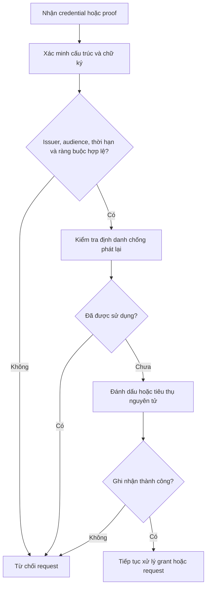
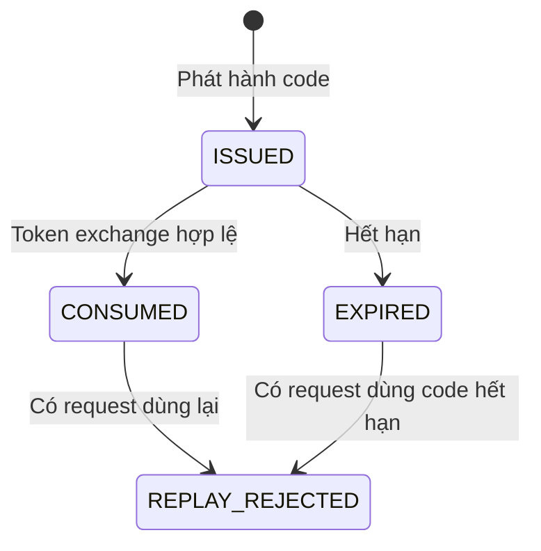

# Chống phát lại code, client assertion, device code và DPoP proof

## 1. Mục tiêu và phạm vi

Trong module `SPRING_SECURITY_OAUTH2_OIDC_AUTHORIZATION_SERVER`, bảo vệ máy chủ OAuth 2.0/OpenID Connect không chỉ là xác minh chữ ký hay kiểm tra thời hạn của token. Authorization Server còn phải bảo đảm một thông điệp xác thực hoặc một mã cấp quyền hợp lệ không thể bị kẻ tấn công thu thập rồi gửi lại để thực hiện cùng một hành động lần thứ hai.

Kiểu tấn công này được gọi là **replay attack** (tấn công phát lại). Kẻ tấn công có thể lấy được authorization code từ lịch sử trình duyệt, log, URL bị rò rỉ hoặc kênh truyền không an toàn; sao chép JWT client assertion; quan sát device code; hoặc ghi lại một DPoP proof. Nếu máy chủ chỉ kiểm tra chữ ký và `exp`, thông điệp bị đánh cắp vẫn có thể hợp lệ trong một khoảng thời gian.

Bài học này tập trung vào bốn loại dữ liệu thường gặp ở Authorization Server:

| Dữ liệu | Mục đích | Rủi ro khi bị phát lại | Biện pháp cốt lõi |
|---|---|---|---|
| Authorization code | Đổi quyền cấp phép thành token | Kẻ khác đổi code để lấy token; hoặc đổi lại code đã dùng | Code ngắn hạn, ràng buộc client/redirect URI/PKCE và chỉ tiêu thụ thành công một lần |
| Client assertion | Xác thực client bằng JWT | JWT assertion đã ký bị gửi lại để giả mạo lần xác thực tiếp theo | `exp`, `iat`, `aud`, `jti`, xác minh chữ ký và kho chống phát lại dùng chung |
| Device code | Hoàn tất Device Authorization Grant | Một device code đã được phê duyệt bị đổi nhiều lần | Trạng thái chờ/phê duyệt/từ chối/đã dùng và chuyển trạng thái nguyên tử |
| DPoP proof | Chứng minh client giữ khóa riêng gắn với từng HTTP request | Proof hợp lệ bị dùng lại trên cùng hoặc request khác | Kiểm tra chữ ký, `htm`, `htu`, `iat`, `jti`, nonce và ràng buộc khóa |

Các tiêu chuẩn liên quan gồm OAuth 2.0 (RFC 6749), PKCE (RFC 7636), OAuth 2.0 Device Authorization Grant (RFC 8628), JWT Profile for OAuth 2.0 Client Authentication and Authorization Grants (RFC 7523) và Demonstrating Proof of Possession (DPoP, RFC 9449).

## 2. Nguyên tắc thiết kế chống phát lại

Một cơ chế chống phát lại đáng tin cậy thường kết hợp năm thuộc tính:

1. **Tính hợp lệ:** xác minh chữ ký, issuer, audience, client, scope và các ràng buộc giao thức.
2. **Tính mới:** giới hạn thời gian chấp nhận bằng `exp`, `iat` và clock skew nhỏ.
3. **Tính duy nhất:** nhận diện một lần sử dụng bằng `jti`, code hoặc định danh thông điệp.
4. **Tính ràng buộc:** gắn thông điệp với đúng client, redirect URI, HTTP method, URI hoặc khóa công khai.
5. **Tính nguyên tử:** khi nhiều request đến đồng thời, chỉ một request được phép tiêu thụ thông điệp.

Chỉ kiểm tra thời hạn là chưa đủ. Ví dụ, một client assertion có `exp` sau thời điểm hiện tại vẫn có thể được gửi lại hàng chục lần trong khoảng hiệu lực. Tương tự, DPoP proof có chữ ký hợp lệ vẫn không chứng minh rằng proof chưa từng được sử dụng. Máy chủ phải ghi nhận việc sử dụng hoặc chuyển trạng thái của credential theo cách nhất quán giữa các instance.

Một luồng kiểm tra tổng quát có thể mô tả như sau:



Thứ tự cụ thể có thể khác theo giao thức. Điểm quan trọng là thao tác kiểm tra và ghi nhận phải chống được race condition. Hai request đồng thời không được cùng đọc trạng thái “chưa sử dụng” rồi cùng phát hành token.

### 2.1. Phạm vi lưu trạng thái chống phát lại

Kho chống phát lại phải được dùng chung bởi mọi instance có thể xử lý cùng credential. Nếu instance A ghi nhận `jti` nhưng instance B không nhìn thấy bản ghi đó, kẻ tấn công có thể gửi lại assertion hoặc proof đến B.

Có thể sử dụng:

- Cơ sở dữ liệu quan hệ với khóa duy nhất và transaction.
- Redis hoặc kho key-value phân tán có thao tác tạo khóa kiểu `SET NX` cùng TTL.
- Cơ chế lưu trữ nhất quán khác có thao tác compare-and-set hoặc insert-if-absent.

Cache cục bộ trong JVM chỉ phù hợp với thử nghiệm đơn instance. Không dùng cache cục bộ làm hàng rào bảo mật cho hệ thống nhiều node. Nếu kho chống phát lại không khả dụng, quyết định an toàn thường là từ chối request có liên quan thay vì bỏ qua bước kiểm tra.

### 2.2. Thời gian và TTL

Các node cần đồng bộ thời gian bằng NTP hoặc cơ chế tương đương. Clock skew chỉ nên đủ cho sai lệch thực tế giữa các máy; không mở rộng cửa sổ chấp nhận quá mức.

TTL của bản ghi chống phát lại phải bao phủ toàn bộ khoảng thời gian mà thông điệp có thể còn được chấp nhận. Với client assertion, TTL thường kéo dài đến `exp` cộng clock skew. Với DPoP proof, TTL cần bao phủ cửa sổ tuổi proof được chấp nhận. Với code và device code, trạng thái tiêu thụ phải tồn tại đủ lâu để mọi node nhận ra credential đã dùng, ít nhất đến khi credential hết hạn và hết thời gian xử lý liên quan.

## 3. Chống phát lại authorization code

### 3.1. Vì sao authorization code phải dùng một lần?

Trong Authorization Code Flow, Authorization Server chuyển một authorization code cho client qua redirect URI. Client gửi code đến token endpoint để đổi lấy token. Code là credential ngắn hạn, có thể bị lộ qua lịch sử trình duyệt, log proxy, hệ thống phân tích URL, trang lỗi hoặc cấu hình redirect sai.

Theo RFC 6749, authorization code không được sử dụng nhiều hơn một lần. Khi phát hiện code đã được sử dụng, Authorization Server phải từ chối request. Máy chủ cũng nên thu hồi các token đã phát hành trước đó dựa trên code bị phát lại nếu có thể xác định và thu hồi chúng.

### 3.2. Ràng buộc authorization code

Một authorization code an toàn cần có các thuộc tính sau:

- Được sinh từ bộ tạo số ngẫu nhiên mật mã với entropy đủ lớn; không chứa dữ liệu nhạy cảm có thể đoán được.
- Có thời hạn ngắn, phù hợp với thời gian hoàn tất redirect và token exchange.
- Được ràng buộc với `RegisteredClient`, redirect URI đã xác thực, grant và các thông tin của authorization request.
- Khi client sử dụng PKCE, lưu `code_challenge` và `code_challenge_method`; token endpoint phải xác minh `code_verifier` tương ứng.
- Chỉ được tiêu thụ thành công một lần.
- Không xuất hiện trong log, trace, metric label, URL theo dõi hoặc thông báo lỗi.

PKCE và chống phát lại giải quyết hai phần khác nhau. PKCE ràng buộc code với bên giữ `code_verifier`, nhờ đó giảm nguy cơ kẻ chặn được code tự đổi code. Cơ chế tiêu thụ một lần ngăn chính code đó được đổi lặp lại. Bật PKCE không loại bỏ yêu cầu single-use.

Tham số `state` giúp client liên kết response với authorization request và chống một số dạng CSRF. Trong OpenID Connect, `nonce` giúp client liên kết ID Token với authentication request. Hai giá trị này không thay thế việc tiêu thụ authorization code một lần.

### 3.3. Mô hình trạng thái

Có thể xem vòng đời code như một máy trạng thái đơn giản:



Khi token endpoint nhận code, máy chủ xác minh client, redirect URI, PKCE verifier và các điều kiện của grant. Sau đó, việc chuyển `ISSUED` sang `CONSUMED` phải là thao tác nguyên tử. Chỉ request thắng thao tác chuyển trạng thái mới được tiếp tục phát hành token.

Một câu lệnh SQL minh họa cho nguyên tắc tiêu thụ nguyên tử là:

```sql
UPDATE one_time_credential
   SET consumed_at = CURRENT_TIMESTAMP
 WHERE credential_hash = :credential_hash
   AND consumed_at IS NULL
   AND expires_at > CURRENT_TIMESTAMP;
```

Ứng dụng chỉ coi credential đã được tiêu thụ thành công khi số dòng cập nhật bằng `1`. Nếu kết quả bằng `0`, credential đã hết hạn, không tồn tại hoặc đã được request khác tiêu thụ. Đây là bảng minh họa cho thiết kế lưu trữ tùy chỉnh; không phải tên bảng mặc định của Spring Authorization Server.

Trong hệ thống thực tế, thao tác tiêu thụ code và lưu authorization/token cần nằm trong ranh giới transaction phù hợp. Cần bảo đảm hai request đồng thời không thể cùng phát hành token từ một code. Có thể dùng khóa duy nhất, optimistic locking, row-level lock hoặc câu lệnh cập nhật có điều kiện tùy mô hình lưu trữ.

### 3.4. Áp dụng trong Spring Authorization Server

Spring Authorization Server cung cấp luồng xử lý Authorization Code Grant ở token endpoint. Provider tiêu chuẩn đọc authorization thông qua `OAuth2AuthorizationService`, xác minh các điều kiện của code, đánh dấu token code đã invalidated và lưu authorization đã cập nhật. Hãy giữ luồng xử lý tiêu chuẩn này khi không có yêu cầu giao thức đặc biệt.

Các thành phần cần quan tâm:

| Thành phần | Vai trò trong chống phát lại |
|---|---|
| `RegisteredClientRepository` | Lưu client, grant type, redirect URI và cấu hình client liên quan |
| `OAuth2AuthorizationService` | Lưu authorization cùng trạng thái và token của authorization |
| Authorization Code Authentication Provider | Xác minh và xử lý việc đổi authorization code tại token endpoint |
| PKCE validation | Xác minh `code_verifier` với challenge đã lưu |
| Cơ sở dữ liệu dùng chung | Bảo đảm trạng thái code đã tiêu thụ được mọi instance nhìn thấy |

Với môi trường production nhiều instance, cần đánh giá cách `OAuth2AuthorizationService` đang lưu và cập nhật authorization. `InMemoryOAuth2AuthorizationService` phù hợp cho thử nghiệm hoặc ứng dụng đơn giản, không cung cấp trạng thái dùng chung bền vững giữa nhiều process. Có thể dùng JDBC service hoặc một implementation tùy chỉnh phù hợp với kiến trúc lưu trữ.

Không nên mặc định rằng việc gọi `save` trên một implementation bất kỳ tự tạo ra thao tác consume nguyên tử khi hai request chạy song song. Hãy kiểm tra transaction, isolation level và cách cập nhật bản ghi trong phiên bản thư viện đang triển khai. Nếu yêu cầu bảo mật cần bảo đảm đúng một request thắng, hãy bổ sung cơ chế đồng bộ hoặc implementation lưu trữ/provider có thao tác tiêu thụ nguyên tử. Việc tùy biến provider phải giữ nguyên mọi kiểm tra giao thức của provider tiêu chuẩn, gồm client, redirect URI, PKCE, thời hạn và trạng thái authorization.

Khi phát hiện code đã dùng, trả lỗi OAuth phù hợp như `invalid_grant`, không tiết lộ code thuộc authorization nào. Nếu có thể liên kết các token đã phát hành với authorization bị phát lại, áp dụng chính sách thu hồi tương ứng và ghi nhận sự kiện bảo mật.

## 4. Chống phát lại client assertion

### 4.1. Client assertion là gì?

Với phương thức xác thực client bằng JWT, client gửi JWT trong `client_assertion` cùng `client_assertion_type` tại token endpoint. Assertion thường được ký bằng khóa riêng của client (`private_key_jwt`) hoặc bằng bí mật chia sẻ (`client_secret_jwt`). Authorization Server xác minh assertion để xác thực client.

Một assertion hợp lệ về chữ ký vẫn có thể bị sao chép và gửi lại. Vì vậy, chữ ký số chứng minh nguồn gốc và tính toàn vẹn của JWT, còn cơ chế chống phát lại phải chứng minh assertion chưa được chấp nhận trước đó.

### 4.2. Các claim cần xác minh

| Claim/header | Ý nghĩa và kiểm tra |
|---|---|
| `iss` | Định danh bên phát hành assertion; trong profile client authentication thường là client ID |
| `sub` | Chủ thể được xác thực; phải khớp client ID theo profile được cấu hình |
| `aud` | Phải chứa audience mà Authorization Server chấp nhận, thường là token endpoint hoặc định danh Authorization Server đã công bố |
| `exp` | Thời điểm hết hạn; phải ở tương lai và cửa sổ hiệu lực nên ngắn |
| `iat` | Thời điểm tạo; từ chối assertion quá cũ hoặc ở tương lai vượt clock skew |
| `jti` | Định danh duy nhất của assertion; dùng để phát hiện assertion đã được chấp nhận |
| `alg` | Thuật toán ký nằm trong allowlist của client/server; từ chối `none` và thuật toán không được phép |
| `kid` | Chọn khóa xác minh phù hợp; không dùng `kid` làm bằng chứng xác thực độc lập |

Không lấy `iss`, `sub`, `aud` từ dữ liệu chưa xác minh để quyết định tin cậy khóa. Quy trình phải chọn client và khóa theo cấu hình tin cậy, xác minh chữ ký, rồi xác minh đầy đủ claim và chính sách thuật toán. Với `private_key_jwt`, ưu tiên thuật toán bất đối xứng và quản lý vòng đời khóa rõ ràng.

### 4.3. Kho chống phát lại cho `jti`

Sau khi assertion vượt qua kiểm tra chữ ký và claim, máy chủ cần đăng ký `jti` theo thao tác insert-if-absent. Khóa chống phát lại nên bao gồm phạm vi client để hai client độc lập không vô tình xung đột:

```text
replay:client-assertion:{client_id}:{hash(jti)}
```

Nếu khóa đã tồn tại, assertion là bản phát lại và phải bị từ chối. Nếu chưa tồn tại, chỉ một request có thể tạo khóa thành công. TTL của khóa kéo dài đến `exp` cộng clock skew cho phép. Có thể lưu hash của `jti` thay vì giá trị gốc để giảm dữ liệu định danh trong kho cache.

Ví dụ pseudocode với Redis:

```java
Duration ttl = Duration.between(clock.instant(), assertionExpiresAt.plus(clockSkew));
if (ttl.isNegative() || ttl.isZero()) {
    throw invalidClient("Client assertion has expired");
}

String key = "replay:client-assertion:" + clientId + ":" + sha256(jti);
Boolean firstUse = stringRedisTemplate.opsForValue()
        .setIfAbsent(key, "1", ttl);

if (!Boolean.TRUE.equals(firstUse)) {
    // false: jti đã tồn tại; null: không xác nhận được thao tác ghi.
    throw invalidClient("Client assertion was already used");
}
```

Đây là đoạn minh họa cho service chống phát lại; `clock`, `clockSkew`, `sha256` và `invalidClient` cần được cung cấp bởi ứng dụng. Không coi giá trị `null` từ thao tác ghi là thành công. Với Redis Cluster hoặc hệ thống đa vùng, cần xác minh mức nhất quán và phạm vi chia sẻ của kho dữ liệu đáp ứng yêu cầu triển khai.

Một lựa chọn khác là bảng có khóa duy nhất:

```sql
CREATE TABLE oauth2_replay_guard (
    purpose        VARCHAR(40)  NOT NULL,
    subject_id     VARCHAR(200) NOT NULL,
    token_id_hash  CHAR(64)     NOT NULL,
    expires_at     TIMESTAMP    NOT NULL,
    PRIMARY KEY (purpose, subject_id, token_id_hash)
);
```

Với client assertion, `purpose` là `CLIENT_ASSERTION`, `subject_id` là client ID và `token_id_hash` là hash của `jti`. Việc insert phải dựa vào ràng buộc khóa chính để xử lý đồng thời; không triển khai theo kiểu `SELECT` kiểm tra rồi `INSERT` tách rời mà không có khóa hoặc transaction phù hợp.

### 4.4. Tích hợp với Spring Authorization Server

Spring Authorization Server hỗ trợ client authentication bằng JWT assertion. Luồng xác thực cần thực hiện cả xác minh JWT lẫn kiểm tra phát lại. Trong các phiên bản có `JwtClientAssertionDecoderFactory`, có thể tùy biến validator của decoder để áp dụng các quy tắc claim và chữ ký phù hợp với `RegisteredClient`. Tuy nhiên, validator thuần túy không tự tạo ra kho `jti` dùng chung; việc tiêu thụ `jti` cần được tích hợp vào luồng xác thực client ở vị trí chỉ chạy sau khi assertion đã được xác minh.

Khi tùy biến `OAuth2ClientAuthenticationProvider` hoặc thành phần xác thực tương ứng, cần giữ các kiểm tra chuẩn của Spring Authorization Server và ánh xạ lỗi về `invalid_client`. Tránh ghi nhận `jti` trước khi xác minh chữ ký, audience và client, vì request giả mạo có thể cố tình chiếm trước `jti` của client hợp lệ. Ngược lại, sau khi đã chấp nhận assertion, không được bỏ qua bước ghi nhận chỉ vì cache tạm thời gặp lỗi.

Chính sách thực tế nên giới hạn thời gian sống assertion ở mức ngắn (ví dụ một vài phút hoặc ngắn hơn tùy khả năng đồng bộ thời gian), chấp nhận clock skew có giới hạn, yêu cầu `jti`, và chỉ cho phép thuật toán ký được cấu hình rõ ràng cho client. Việc xoay khóa cần hỗ trợ khoảng thời gian chuyển tiếp có kiểm soát, nhưng không được làm suy yếu kiểm tra audience hoặc tính duy nhất của `jti`.

## 5. Chống phát lại device code

### 5.1. Hai mã trong Device Authorization Grant

Device Authorization Grant (RFC 8628) dành cho thiết bị có khả năng nhập liệu hạn chế. Thiết bị yêu cầu cấp quyền, nhận `device_code`, `user_code`, `verification_uri` và khoảng thời gian polling. Người dùng mở trang xác minh trên thiết bị khác, nhập user code và phê duyệt yêu cầu. Thiết bị tiếp tục polling token endpoint bằng device code.

Hai mã có mục đích và mức độ nhạy cảm khác nhau:

- `device_code` là credential bí mật mà thiết bị dùng tại token endpoint. Phải sinh với entropy cao, giữ kín và chỉ dùng trong thời hạn được cấp.
- `user_code` là mã ngắn để con người nhập trên trang xác minh. Vì không gian giá trị nhỏ hơn, nó cần rate limit, giới hạn số lần thử và biện pháp chống dò đoán.

Không dùng `user_code` như bearer credential để đổi token. Không ghi `device_code` hoặc `user_code` nguyên văn vào log hay telemetry.

### 5.2. Trạng thái và phản hồi polling

Authorization Server cần quản lý ít nhất các trạng thái sau:

| Trạng thái | Ý nghĩa | Phản hồi khi thiết bị polling |
|---|---|---|
| `PENDING` | Người dùng chưa hoàn tất phê duyệt | `authorization_pending` |
| `APPROVED` | Người dùng đã phê duyệt và request còn hiệu lực | Có thể phát hành token nếu device code được tiêu thụ thành công |
| `DENIED` | Người dùng từ chối | `access_denied` |
| `CONSUMED` | Device code đã được dùng để phát hành token | Từ chối lần dùng tiếp theo, thường bằng `invalid_grant` |
| `EXPIRED` | Device code đã hết hạn | `expired_token` |

Client phải tuân thủ `interval` trong response. Nếu polling nhanh hơn mức cho phép, Authorization Server trả `slow_down`; theo RFC 8628, client tăng khoảng thời gian polling theo quy tắc của giao thức. Khi vẫn đang chờ người dùng, máy chủ trả `authorization_pending`. Các phản hồi này không được làm mới thời hạn device code vô hạn.

### 5.3. Tiêu thụ device code một lần

Khi người dùng đã phê duyệt, request polling đầu tiên hợp lệ có thể đổi device code thành token. Chuyển trạng thái `APPROVED` sang `CONSUMED` phải nguyên tử. Nếu hai polling request đồng thời đến hai instance, chỉ một request được phát hành token. Request còn lại phải bị từ chối.

Trình tự xử lý nên bảo đảm:

1. Xác định device code và client tương ứng.
2. Xác minh device code tồn tại, chưa hết hạn và được cấp cho client đang gọi.
3. Kiểm tra trạng thái phê duyệt hoặc từ chối.
4. Nếu đang `PENDING`, trả `authorization_pending`; nếu polling quá nhanh, áp dụng `slow_down`.
5. Nếu `APPROVED`, tiêu thụ code bằng cập nhật có điều kiện trong transaction.
6. Chỉ khi thao tác tiêu thụ thành công mới phát hành và lưu token.
7. Mọi lần sử dụng sau đó đều bị từ chối.

Không chuyển sang `CONSUMED` trước khi kiểm tra client và các điều kiện của grant. Đồng thời, không phát hành token rồi mới cập nhật trạng thái code trong một thao tác độc lập có thể thất bại, vì điều đó có thể tạo ra nhiều lần phát hành token.

### 5.4. Bảo vệ trang xác minh

Trang nhập `user_code` là một bề mặt tấn công riêng. Cần giới hạn số lần thử theo IP, session và/hoặc user code; áp dụng CAPTCHA hoặc biện pháp tăng cường khi có dấu hiệu dò đoán; không tiết lộ mã có tồn tại hay không trước khi người dùng hoàn tất bước xác minh cần thiết; và yêu cầu người dùng đăng nhập hoặc xác thực phù hợp trước khi phê duyệt.

Trang xác minh phải hiển thị đủ thông tin để người dùng nhận biết thiết bị hoặc yêu cầu đang xin quyền. Không tự động phê duyệt chỉ vì người dùng nhập đúng mã. Việc phê duyệt phải gắn với authorization request đã lưu, client, scope và thời hạn cụ thể.

### 5.5. Tích hợp trong Spring Authorization Server

Spring Authorization Server có các thành phần xử lý Device Authorization Grant và device code tại token endpoint. Hãy dùng cấu hình grant và provider tiêu chuẩn của phiên bản thư viện đang triển khai; lưu authorization bằng `OAuth2AuthorizationService` có trạng thái dùng chung giữa các instance.

Đối với triển khai phân tán, cần xác minh thao tác chuyển device code sang trạng thái invalidated/consumed được bảo vệ bởi transaction hoặc cơ chế cập nhật nguyên tử. Nếu implementation lưu trữ hiện tại không đáp ứng yêu cầu đó, hãy bổ sung cơ chế đồng bộ ở tầng persistence hoặc tùy biến provider có kiểm soát. Không tạo endpoint đổi device code riêng bỏ qua kiểm tra client, trạng thái người dùng, thời hạn, polling interval và scope.

## 6. Chống phát lại DPoP proof

### 6.1. DPoP giải quyết vấn đề gì?

DPoP (RFC 9449) là cơ chế proof-of-possession ở tầng ứng dụng. Client tạo một JWT proof và ký bằng khóa riêng của mình để chứng minh đang giữ khóa tương ứng với khóa công khai được công bố trong proof. DPoP có thể ràng buộc access token với khóa đó, giảm nguy cơ một access token bị đánh cắp có thể được sử dụng độc lập.

DPoP proof được tạo cho từng HTTP request. Vì vậy, một proof hợp lệ cần gắn với method, URI và thời điểm của request. Nếu máy chủ chỉ kiểm tra chữ ký, kẻ tấn công có thể gửi lại chính proof đã ghi được trong cửa sổ thời gian hợp lệ. Máy chủ cần kiểm tra `jti` và phát hiện proof đã dùng.

### 6.2. Cấu trúc proof và các claim quan trọng

DPoP proof là JWT có header và payload theo profile của RFC 9449:

| Thành phần | Kiểm tra |
|---|---|
| Header `typ` | Phải là `dpop+jwt` |
| Header `alg` | Thuật toán bất đối xứng được phép; từ chối `none` và thuật toán không nằm trong allowlist |
| Header `jwk` | Chứa khóa công khai để xác minh chữ ký; không chấp nhận tham số khóa riêng |
| `jti` | Định danh duy nhất cho proof; phát hiện giá trị đã được dùng với khóa tương ứng |
| `htm` | HTTP method của request, phải khớp method thực tế |
| `htu` | HTTP URI đích theo quy tắc chuẩn hóa của DPoP, phải khớp URI request |
| `iat` | Thời điểm tạo proof; phải nằm trong cửa sổ thời gian được chấp nhận |
| `nonce` | Có mặt khi server yêu cầu nonce; phải khớp nonce hợp lệ do server cấp |
| `ath` | Hash của access token khi proof được gửi đến protected resource |

Không yêu cầu `ath` ở token endpoint khi chưa có access token được gửi kèm. Ở resource server, khi client gửi access token theo scheme `DPoP`, phải xác minh `ath` khớp hash của đúng access token đang được sử dụng.

### 6.3. Trình tự xác minh proof

Một quy trình xác minh điển hình gồm:

1. Đọc DPoP proof từ HTTP header `DPoP`; từ chối nếu thiếu trong endpoint yêu cầu DPoP.
2. Kiểm tra `typ`, `alg` và cấu trúc JWK; chỉ dùng khóa công khai được phép.
3. Xác minh chữ ký JWT bằng khóa công khai trong proof.
4. Tính JWK thumbprint (`jkt`) và kiểm tra `htm` với HTTP method thực tế.
5. Chuẩn hóa URI theo quy tắc DPoP rồi so sánh với `htu`. Không so sánh tùy tiện URI nội bộ phía sau reverse proxy với URI công khai mà client đã ký.
6. Kiểm tra `iat` trong cửa sổ thời gian cho phép và kiểm tra `nonce` nếu endpoint yêu cầu.
7. Đăng ký cặp khóa và `jti` vào kho chống phát lại bằng thao tác nguyên tử. Từ chối proof nếu đã có bản ghi.
8. Ở resource server, kiểm tra `ath` và xác nhận khóa proof khớp `cnf.jkt` của access token.
9. Chỉ tiếp tục xử lý request sau khi toàn bộ bước xác minh thành công.

Định danh chống phát lại thường có dạng:

```text
replay:dpop:{jkt}:{hash(jti)}
```

Phạm vi này giúp phân biệt các khóa công khai khác nhau. Kho chống phát lại cần được chia sẻ bởi các instance có thể xử lý cùng request. TTL nên kết thúc sau khi proof chắc chắn nằm ngoài cửa sổ `iat` mà server chấp nhận, cộng clock skew.

### 6.4. Nonce và retry

Authorization Server hoặc Resource Server có thể yêu cầu DPoP nonce để giảm nguy cơ proof được tạo trước rồi phát lại. Server gửi nonce trong header `DPoP-Nonce`; client phải tạo proof mới chứa nonce đó và gửi lại request. Khi yêu cầu nonce chưa được đáp ứng, server có thể trả lỗi `use_dpop_nonce` theo RFC 9449.

Nonce không thay thế kiểm tra `jti`. Nonce ràng buộc proof với một thử thách do server cấp; `jti` giúp phát hiện cùng một proof đã được sử dụng. Khi client retry request, client phải tạo proof mới với `jti` mới và nonce hiện hành nếu server yêu cầu. Không gửi lại nguyên JWT proof cũ.

### 6.5. Ràng buộc access token với khóa DPoP

Khi token endpoint chấp nhận DPoP proof trong quá trình cấp token, Authorization Server có thể ràng buộc access token với khóa công khai của proof. Token mang confirmation claim `cnf` chứa JWK thumbprint `jkt`. Token response dùng `token_type` là `DPoP`.

Khi resource server nhận request, nó phải xác minh access token như bình thường và đồng thời xác minh DPoP proof mới của request. JWK thumbprint của proof phải khớp `cnf.jkt`; claim `ath` phải khớp access token; `htm`, `htu`, `iat`, `jti` và nonce phải hợp lệ. Nếu access token được gửi bằng scheme `Bearer` trong khi chính sách yêu cầu DPoP, không được bỏ qua ràng buộc proof.

Với refresh token được ràng buộc DPoP, client phải chứng minh đang giữ khóa tương ứng khi sử dụng refresh token. Chính sách đổi khóa cần được thiết kế rõ ràng; không tự động chấp nhận một khóa mới chỉ vì client vẫn có refresh token.

### 6.6. Lưu ý khi triển khai sau reverse proxy

`htu` là điểm dễ sai khi Authorization Server hoặc Resource Server chạy sau load balancer, ingress hay reverse proxy. Ứng dụng có thể nhìn thấy scheme `http` và host nội bộ, trong khi client ký URI công khai `https://auth.example.com/...`.

Chỉ tin các forwarded header từ proxy nằm trong danh sách tin cậy. Cấu hình Spring để xử lý forwarded headers nhất quán với hạ tầng; không cho phép client bên ngoài tự đặt `X-Forwarded-Host` hoặc `Forwarded` rồi làm thay đổi URI mà server dùng để xác minh. Nếu không xác định được URI công khai một cách đáng tin cậy, hãy từ chối proof thay vì nới lỏng so sánh `htu`.

### 6.7. Tích hợp DPoP với Spring

Khả năng hỗ trợ DPoP có thể khác nhau theo phiên bản Spring Authorization Server và Spring Security. Trước khi triển khai, kiểm tra API và mức hỗ trợ của đúng phiên bản đang dùng. Nếu phiên bản cung cấp hỗ trợ DPoP tích hợp, cấu hình theo API đó và xác minh cả token endpoint lẫn resource server. Nếu cần tự mở rộng, các điểm tích hợp thường nằm ở bước chuyển đổi/xác thực request của token endpoint và filter xác thực tại resource server.

Không coi việc thêm một `JwtDecoder` thông thường là đã hoàn tất DPoP. DPoP cần xác minh method, URI, thời gian, nonce, `jti`, `ath` và quan hệ giữa JWK thumbprint với `cnf.jkt`. Cũng không chỉ thêm `cnf.jkt` bằng token customizer: claim này chỉ có ý nghĩa khi server đã xác minh proof và gắn token với đúng khóa.

## 7. Tổ chức các cơ chế trong ứng dụng Spring

Một kiến trúc dễ kiểm soát thường tách rõ các trách nhiệm:

| Trách nhiệm | Thành phần gợi ý | Yêu cầu |
|---|---|---|
| Lưu client | `RegisteredClientRepository` | Client ID, grant, authentication method và key metadata có nguồn tin cậy |
| Lưu authorization/token | `OAuth2AuthorizationService` | Trạng thái dùng chung, transaction và khả năng cập nhật nhất quán |
| Xác minh JWT assertion | JWT decoder/validator và client authentication provider | Xác minh chữ ký, issuer, subject, audience, thời gian, thuật toán |
| Phát hiện assertion/proof đã dùng | `ReplayGuard` tùy chỉnh với Redis hoặc DB | Insert-if-absent, TTL, chia sẻ giữa các instance |
| Tiêu thụ code/device code | Provider và persistence của grant | Chuyển trạng thái nguyên tử, chỉ một request thành công |
| Xác minh DPoP ở resource server | Filter/provider xác thực DPoP | Kiểm tra proof và access token trong cùng request context |
| Đồng hồ | `Clock` được inject | Có thể kiểm thử và đồng bộ giữa các node |

Nên gom thao tác phát hiện `jti` vào một service có API rõ ràng, chẳng hạn `consume(namespace, subject, jti, expiresAt)`. Service này chỉ trả về thành công khi nó ghi nhận được lần sử dụng đầu tiên. Mọi luồng gọi phải xử lý kết quả thất bại theo đúng giao thức: `invalid_client` cho client assertion, lỗi DPoP phù hợp cho proof, hoặc `invalid_grant` cho code đã dùng.

Không nên đưa toàn bộ logic chống phát lại vào `OAuth2TokenCustomizer`. Token customizer chủ yếu thay đổi claim lúc tạo token; nó không thay thế việc xác minh request và cập nhật trạng thái một lần. Cũng không nên đặt một bộ lọc chung tiêu thụ mọi `jti` mà không phân biệt namespace và chủ thể, vì các loại JWT khác nhau có phạm vi định danh và vòng đời khác nhau.

### 7.1. Ví dụ về hợp đồng của ReplayGuard

Đoạn mã dưới đây minh họa hợp đồng của service dùng chung. Phần lưu trữ thực tế có thể dùng Redis hoặc database:

```java
public interface ReplayGuard {

    /**
     * Ghi nhận lần sử dụng đầu tiên của một định danh.
     * Ném ReplayDetectedException nếu định danh đã tồn tại
     * hoặc không thể xác nhận thao tác ghi thành công.
     */
    void consume(
            String namespace,
            String subject,
            String jti,
            Instant expiresAt);
}
```

Ví dụ namespace:

```text
CLIENT_ASSERTION
DPOP_PROOF
```

Với authorization code và device code, thao tác phù hợp thường là chuyển trạng thái của chính authorization record sang consumed/invalidated trong transaction phát hành token, thay vì chỉ thêm một `jti` vào cache. Điều đó giúp việc tiêu thụ credential và lưu token có thể được phối hợp nhất quán.

### 7.2. Cấu hình và vận hành nhiều instance

Trong môi trường nhiều instance:

- Tất cả instance phải dùng chung kho authorization và kho chống phát lại.
- Khóa cache phải có namespace và phạm vi chủ thể rõ ràng.
- TTL phải được đặt theo thời hạn thực tế của credential/proof, không dùng một TTL tùy tiện cho mọi loại.
- Không dựa vào sticky session để bảo đảm an toàn; request tiếp theo có thể đến node khác.
- Quyết định fail-open/fail-closed phải được thống nhất. Với bước chống phát lại, lỗi kho lưu trữ thường phải làm request thất bại an toàn.
- Dọn dữ liệu hết hạn theo TTL hoặc tác vụ nền; không xóa bản ghi sớm hơn cửa sổ chấp nhận.
- Giới hạn quyền truy cập, mã hóa kết nối và bảo vệ dữ liệu của Redis/database như thành phần bảo mật trọng yếu.

## 8. Kiểm thử chống phát lại

Kiểm thử chỉ gửi một request hợp lệ không chứng minh được cơ chế chống phát lại. Cần kiểm tra request lặp lại, request đồng thời và request được chuyển giữa nhiều instance.

| Kịch bản | Kết quả mong đợi |
|---|---|
| Đổi authorization code hợp lệ lần đầu | Thành công đúng một lần |
| Đổi lại cùng authorization code | `invalid_grant`; không phát hành thêm token |
| Hai request đổi cùng code đồng thời | Chính xác một request thành công |
| Code hết hạn hoặc sai PKCE/redirect URI | Bị từ chối; không phát hành token |
| Gửi lại cùng client assertion `jti` | Lần đầu có thể thành công; lần sau bị từ chối bằng lỗi client authentication |
| Cùng `jti` nhưng thuộc hai client khác nhau | Không xung đột nếu namespace được thiết kế theo client |
| Assertion sai chữ ký hoặc sai audience | Bị từ chối; không được coi là assertion hợp lệ |
| Gửi lại device code sau khi đã đổi token | Bị từ chối; không phát hành token thứ hai |
| Poll khi device request đang chờ | `authorization_pending` |
| Poll nhanh hơn `interval` | `slow_down` và client điều chỉnh nhịp polling |
| Hai polling request cùng device code sau phê duyệt | Chỉ một request tiêu thụ code và phát hành token |
| Gửi lại cùng DPoP proof | Bị từ chối do `jti` đã dùng |
| DPoP proof có `htm` hoặc `htu` sai | Bị từ chối |
| DPoP proof quá cũ hoặc nonce không hợp lệ | Bị từ chối hoặc yêu cầu nonce mới theo chính sách |
| DPoP proof có khóa không khớp `cnf.jkt` | Resource server từ chối request |
| Hai node nhận cùng assertion/proof gần như đồng thời | Chỉ một lần sử dụng được chấp nhận |
| Kho chống phát lại không truy cập được | Request bị từ chối an toàn; không bỏ qua kiểm tra |

Nên có integration test dùng cùng database/Redis với nhiều request đồng thời. Với bài toán race condition, kiểm thử tuần tự không đủ. Có thể dùng barrier/latch để cho nhiều thread gửi cùng credential tại một thời điểm, sau đó xác nhận số request thành công bằng đúng một.

Ngoài ra, kiểm tra hành vi sau khi restart node, khi cache failover, khi đồng hồ lệch trong giới hạn cho phép và khi một request được định tuyến sang instance khác. Những tình huống này thường phát hiện lỗi mà unit test của một service đơn lẻ không thể thấy.

## 9. Quan sát và xử lý sự cố

Nên tạo metric đếm số lần từ chối theo nhóm nguyên nhân, chẳng hạn:

- `authorization_code_replay_rejected`
- `client_assertion_replay_rejected`
- `device_code_replay_rejected`
- `dpop_proof_replay_rejected`
- `replay_store_unavailable`
- `dpop_nonce_required`

Metric label chỉ nên chứa loại grant, endpoint hoặc mã lỗi có cardinality thấp. Không đưa code, `jti`, device code, user code, access token, assertion JWT hay DPoP JWT vào metric label.

Log sự kiện bảo mật có thể chứa request correlation ID, client ID đã được xác minh, endpoint, thời điểm và loại lỗi. Không log nguyên credential. Nếu cần liên kết các lần thử, dùng hash có kiểm soát hoặc mã sự kiện nội bộ; không ghi lại token để phục vụ debug.

Khi tỷ lệ replay tăng đột biến, kiểm tra log gateway, khả năng rò rỉ URL, retry của client, đồng hồ giữa các node, cấu hình TTL và tính nhất quán của kho cache. Một client retry sai cách có thể tạo nhiều lỗi replay mà không có tấn công; tuy vậy, không nên tự động nới lỏng chính sách để làm mất cảnh báo.

## 10. Các lỗi thiết kế thường gặp

| Lỗi | Hệ quả | Cách khắc phục |
|---|---|---|
| Chỉ kiểm tra `exp` của assertion/proof | Credential vẫn dùng lại được trong cửa sổ hiệu lực | Ghi nhận `jti` trong kho dùng chung |
| Dùng cache cục bộ cho nhiều node | Request lặp lại có thể qua node khác | Dùng DB/Redis dùng chung với thao tác nguyên tử |
| Kiểm tra tồn tại rồi mới ghi theo hai bước không khóa | Hai request đồng thời cùng vượt qua | Dùng unique constraint, `SET NX`, transaction hoặc compare-and-set |
| Dùng TTL quá ngắn | Bản ghi biến mất khi credential vẫn còn được chấp nhận | Tính TTL từ `exp` hoặc cửa sổ `iat` cộng clock skew |
| Dùng một namespace cho mọi loại JWT | Va chạm định danh hoặc khó phân tích sự cố | Tách namespace theo loại proof và chủ thể |
| Chỉ bật PKCE rồi bỏ qua single-use code | Code vẫn có thể bị gửi lại và gây xử lý lặp | Giữ PKCE cùng cơ chế tiêu thụ code một lần |
| Xem `user_code` như bí mật đủ mạnh | Dễ bị dò đoán do không gian mã ngắn | Rate limit, giới hạn lần thử và xác thực người dùng |
| Phát hành token trước khi consume device code | Race condition có thể tạo nhiều token | Consume nguyên tử trước và trong cùng transaction phù hợp |
| Chỉ kiểm tra chữ ký DPoP | Proof có thể bị phát lại hoặc dùng cho request khác | Kiểm tra `htm`, `htu`, `iat`, `jti`, nonce và token binding |
| Tin forwarded header từ mọi nguồn | Kẻ tấn công có thể làm sai URI dùng để kiểm tra `htu` | Chỉ tin proxy đã cấu hình và chuẩn hóa URI nhất quán |
| Bỏ qua lỗi Redis/database | Hệ thống vô tình fail-open | Từ chối request khi không xác nhận được lần sử dụng đầu tiên |
| Log toàn bộ JWT/code để debug | Tạo thêm nguồn rò rỉ credential | Log metadata an toàn và correlation ID |

## 11. Checklist triển khai

- [ ] Authorization code có entropy cao, thời hạn ngắn, ràng buộc client và redirect URI.
- [ ] PKCE được yêu cầu cho client phù hợp và luôn xác minh `code_verifier`.
- [ ] Authorization code chỉ được consume một lần; cập nhật trạng thái nguyên tử.
- [ ] Khi code bị phát lại, từ chối và áp dụng chính sách thu hồi token liên quan khi có thể.
- [ ] Client assertion kiểm tra chữ ký, `iss`, `sub`, `aud`, `exp`, `iat`, `jti` và allowlist thuật toán.
- [ ] `jti` của client assertion được ghi nhận nguyên tử trong kho dùng chung theo phạm vi client.
- [ ] Device code được sinh an toàn, ràng buộc với client và chỉ được đổi một lần.
- [ ] Device authorization xử lý đúng `authorization_pending`, `slow_down`, `access_denied` và hết hạn.
- [ ] Trang xác minh user code có rate limit và chống dò đoán.
- [ ] DPoP proof kiểm tra `typ`, `alg`, JWK, chữ ký, `htm`, `htu`, `iat`, `jti` và nonce theo chính sách.
- [ ] Resource server kiểm tra `ath` và `cnf.jkt` khi dùng access token DPoP.
- [ ] Kho chống phát lại dùng chung giữa các node, có TTL đúng và xử lý lỗi theo hướng fail-closed.
- [ ] Có integration test cho replay tuần tự, replay đồng thời, nhiều instance và kho lưu trữ bị lỗi.
- [ ] Log và metric không làm lộ code, assertion, device code, access token hoặc DPoP proof.

## 12. Kết luận

Chống phát lại cần được thiết kế theo vòng đời của từng loại credential. Authorization code và device code cần trạng thái tiêu thụ một lần được cập nhật nguyên tử. Client assertion cần `jti` duy nhất được ghi nhận sau khi JWT đã được xác minh. DPoP proof cần gắn với HTTP request và khóa công khai, đồng thời được kiểm tra tính mới và tính duy nhất. Trong Spring Authorization Server, các provider và `OAuth2AuthorizationService` tiêu chuẩn là nền tảng xử lý grant; hệ thống production phải bổ sung persistence, transaction và kho chống phát lại dùng chung phù hợp với mô hình triển khai.
