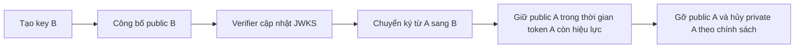

# Bảo vệ secret, private key, token và thông tin cá nhân

## 1. Mục tiêu và phạm vi

Trong module `SPRING_SECURITY_OAUTH2_OIDC_AUTHORIZATION_SERVER`, Authorization Server nắm giữ nhiều loại dữ liệu có giá trị cao: client secret, khóa riêng dùng ký token, khóa mã hóa, authorization code, access token, refresh token, ID Token và thông tin nhận dạng người dùng. Nếu những dữ liệu này bị lộ, kẻ tấn công có thể giả mạo client, phát hành hoặc sử dụng token trái phép, đọc dữ liệu người dùng hay duy trì quyền truy cập sau khi mật khẩu đã được đổi.

Bảo vệ dữ liệu nhạy cảm cần bao phủ toàn bộ vòng đời: tạo, phân phối, lưu trữ, sử dụng, xoay vòng, thu hồi, sao lưu và hủy bỏ. Chỉ mã hóa ổ đĩa hoặc che giá trị trong giao diện quản trị là chưa đủ. Ứng dụng còn phải giới hạn nơi secret xuất hiện, giới hạn ai có thể sử dụng nó, tránh đưa token vào log và bảo đảm dữ liệu cá nhân chỉ được thu thập, chia sẻ trong phạm vi cần thiết.

Bài học tập trung vào bốn nhóm dữ liệu:

| Nhóm | Ví dụ | Hậu quả khi bị lộ | Kiểm soát trọng tâm |
|---|---|---|---|
| Secret xác thực | Client secret, database password, API credential | Giả mạo client hoặc truy cập hệ thống phụ trợ | Secret manager, mã hóa, phân quyền, xoay vòng và theo dõi sử dụng |
| Khóa mật mã | Private signing key, private encryption key, TLS private key | Ký token giả, giải mã dữ liệu hoặc giả mạo endpoint | KMS/HSM, kiểm soát truy cập, tách nhiệm vụ, rotation và audit |
| Token/credential | Authorization code, access token, refresh token, ID Token | Chiếm quyền phiên, truy cập API hoặc giả mạo danh tính | TLS, thời hạn ngắn, lưu trữ an toàn, ràng buộc và thu hồi |
| Dữ liệu cá nhân | Subject ID, email, tên, số điện thoại, nhóm quyền | Xâm phạm riêng tư, lộ hồ sơ hoặc suy luận thông tin nhạy cảm | Tối thiểu hóa, phân quyền, mã hóa, retention và audit |

## 2. Phân loại dữ liệu và xác định ranh giới tin cậy

Trước khi chọn công nghệ bảo vệ, hãy lập danh mục dữ liệu và xác định nơi dữ liệu đi qua. Một Authorization Server thường có các ranh giới sau:

1. **Build và source control:** mã nguồn, file cấu hình mẫu, pipeline và artifact.
2. **Runtime:** biến môi trường, JVM memory, file mount, process argument và log.
3. **Kho dữ liệu:** database chứa client, authorization, token và thông tin người dùng.
4. **Hệ thống quản lý khóa:** Secret Manager, KMS, HSM hoặc dịch vụ ký từ xa.
5. **Kênh giao tiếp:** trình duyệt, token endpoint, userinfo endpoint, introspection và API resource server.
6. **Vận hành:** backup, tracing, monitoring, ticket, dump bộ nhớ và công cụ hỗ trợ.

Một giá trị có thể được bảo vệ ở database nhưng vẫn bị lộ trong log hoặc bản backup. Vì vậy, phân loại cần dựa trên toàn bộ đường đi của dữ liệu.

| Mức phân loại | Ví dụ | Nguyên tắc xử lý |
|---|---|---|
| Công khai | Discovery metadata, public JWKS, tài liệu API | Có thể công bố theo chính sách; vẫn kiểm soát tính toàn vẹn |
| Nội bộ | Tên service, mã cấu hình không nhạy cảm | Chỉ chia sẻ trong phạm vi công việc |
| Bí mật | Client secret, access token, refresh token, authorization code | Chỉ cấp cho thành phần cần sử dụng; không ghi log; mã hóa khi lưu và truyền |
| Rất nhạy cảm | Private signing key, master encryption key, recovery key | Ưu tiên KMS/HSM; phân quyền chặt, audit mọi thao tác, có quy trình khôi phục và thay thế |
| Dữ liệu cá nhân | Email, tên, số điện thoại, subject liên kết tài khoản | Chỉ xử lý theo mục đích; giới hạn truy cập, thời hạn lưu và phạm vi chia sẻ |

Không coi mọi dữ liệu trong JWT là công khai. JWT có thể được ký nhưng payload của JWS thường chỉ được mã hóa dạng Base64URL, bất kỳ ai có token đều có thể đọc claim. Chữ ký bảo vệ tính toàn vẹn, không bảo vệ tính bí mật. Nếu payload chứa dữ liệu cần giữ kín, hãy giảm claim hoặc dùng cơ chế mã hóa phù hợp; không tự thêm thông tin nhạy cảm vào access token chỉ vì token đã được ký.

## 3. Quản lý secret của ứng dụng và OAuth client

### 3.1. Không đặt secret trong source code

Không commit password, client secret, API key, private key, file keystore hoặc token thật vào Git. Các vị trí thường bị bỏ sót gồm:

- `application.yml`, `application.properties` và file cấu hình profile.
- Dockerfile, image layer, Helm values, manifest Kubernetes và file compose.
- Script triển khai, lệnh shell, pipeline YAML và biến build.
- Test fixture, snapshot, log mẫu, tài liệu hướng dẫn và file `.env`.
- Giá trị mặc định trong code hoặc cấu hình dành cho môi trường local.

File `.gitignore` giúp ngăn một số file mới bị thêm vào Git, nhưng không xóa secret đã commit trước đó. Khi secret đã vào lịch sử repository, cần xem như secret đã bị lộ: thu hồi hoặc xoay vòng credential, rà soát lịch sử và bản sao liên quan, rồi xử lý repository theo quy trình tổ chức.

### 3.2. Dùng secret manager hoặc cơ chế cấp secret của nền tảng

Production nên lấy secret từ hệ thống quản lý secret tập trung hoặc cơ chế cấp credential được bảo vệ của nền tảng, ví dụ:

- Secret Manager của cloud provider.
- HashiCorp Vault hoặc dịch vụ quản lý secret tương đương.
- Kubernetes Secret kết hợp mã hóa etcd, RBAC, phân phối an toàn và chính sách rotation.
- Cơ chế workload identity để ứng dụng lấy credential ngắn hạn thay vì lưu một password dài hạn.

Secret manager cần hỗ trợ phân quyền theo workload, audit truy cập, versioning, rotation và thu hồi. Không cấp một secret dùng chung cho toàn bộ môi trường dev, test, staging và production. Mỗi môi trường và mỗi ứng dụng nên có danh tính và phạm vi quyền riêng.

Kubernetes Secret lưu dữ liệu ở dạng Base64 trong manifest/API; Base64 không phải mã hóa. Cần bật encryption at rest cho etcd, giới hạn RBAC, bảo vệ quyền đọc secret, tránh in manifest chứa secret ra log và kiểm soát quyền truy cập node. Nếu nền tảng hỗ trợ external secret store hoặc workload identity, cân nhắc sử dụng để giảm thời gian secret tồn tại trong cấu hình tĩnh.

### 3.3. Cấu hình Spring Boot để nhận secret ngoài source

Spring Boot hỗ trợ externalized configuration. Ứng dụng có thể đọc property từ environment, file mount hoặc config tree. File cấu hình chỉ giữ tên property và tham chiếu đến nguồn cung cấp secret.

Ví dụ cấu hình không chứa giá trị bí mật:

```yaml
spring:
  datasource:
    url: jdbc:postgresql://db.internal:5432/authorization
    username: ${DB_USERNAME}
    password: ${DB_PASSWORD}

authorization:
  bootstrap:
    client-secret: ${BOOTSTRAP_CLIENT_SECRET}
```

Ở môi trường production, các biến trên cần được inject từ secret manager hoặc runtime secret provider. Không ghi giá trị thực vào file `.env` đã commit, Docker build argument, command line hoặc log pipeline.

Với config tree, có thể mount thư mục secret bên ngoài image:

```yaml
spring:
  config:
    import: "configtree:/run/secrets/"
```

Ví dụ file `/run/secrets/spring.datasource.password` cung cấp property `spring.datasource.password`. Quyền đọc thư mục phải giới hạn cho process ứng dụng; không mount thư mục đó vào container không cần secret. Cần kiểm tra cấu trúc file và cách đặt tên property theo phiên bản Spring Boot đang dùng.

Nên gom cấu hình liên quan vào `@ConfigurationProperties` để kiểm tra tính đầy đủ và kiểu dữ liệu khi khởi động. Tránh phân tán nhiều `@Value` đọc secret khắp codebase, khiến khó kiểm kê và khó thay đổi nguồn cung cấp.

```java
@ConfigurationProperties(prefix = "authorization.bootstrap")
public record BootstrapClientProperties(String clientSecret) {
}
```

Đây chỉ là ví dụ binding cấu hình. Trong production, bootstrap secret cần có vòng đời rõ ràng, chỉ được dùng trong giai đoạn cần thiết và nên được thay thế bằng quy trình cấp client credential an toàn. Không bật debug hoặc actuator endpoint có thể hiển thị configuration properties nhạy cảm cho người dùng không được phép.

### 3.4. Lưu client secret an toàn

Client secret là shared secret giữa client và Authorization Server. Khi đăng ký client, chỉ hiển thị secret một lần nếu quy trình sản phẩm cho phép; không trả secret đầy đủ trong API quản trị hoặc giao diện sau khi đã lưu.

Spring Authorization Server lưu thông tin client qua `RegisteredClientRepository`. Secret lưu trong `RegisteredClient` cần được mã hóa một chiều bằng `PasswordEncoder` trước khi persistence. Ví dụ:

```java
RegisteredClient client = RegisteredClient.withId(UUID.randomUUID().toString())
        .clientId("billing-service")
        .clientSecret(passwordEncoder.encode(rawClientSecret))
        .clientAuthenticationMethod(ClientAuthenticationMethod.CLIENT_SECRET_BASIC)
        .authorizationGrantType(AuthorizationGrantType.CLIENT_CREDENTIALS)
        .scope("billing.read")
        .build();

registeredClientRepository.save(client);
```

Đoạn mã giả định `passwordEncoder` đã được cấu hình và `rawClientSecret` được cấp qua kênh an toàn. Không hardcode giá trị thật trong ví dụ hoặc source code. Cần bảo đảm cấu hình encoder nhất quán giữa lúc lưu và xác minh; khi thay thuật toán hoặc tham số hash, xây dựng kế hoạch migration phù hợp.

Không thể lấy lại client secret ban đầu từ hash một chiều. Nếu client làm mất secret, quy trình đúng là cấp secret mới, cập nhật client theo giai đoạn và thu hồi secret cũ. Với hệ thống cần xác thực bằng private key, cân nhắc `private_key_jwt` để tránh phân phối shared secret, nhưng private key của client vẫn phải được bảo vệ ở phía client.

## 4. Bảo vệ private key và khóa mật mã

### 4.1. Tách các mục đích sử dụng khóa

Không dùng một khóa duy nhất cho mọi chức năng. Phân tách ít nhất các mục đích:

- Khóa ký JWT/access token/ID Token.
- Khóa mã hóa dữ liệu hoặc mã hóa backup.
- Khóa TLS cho kết nối mạng.
- Khóa xác thực client hoặc ký assertion của từng client.
- Khóa dùng để bảo vệ dữ liệu secret khác (key-encryption key).

Việc tách khóa giảm phạm vi ảnh hưởng khi một khóa bị lộ và cho phép áp dụng chu kỳ rotation, quyền truy cập và quy trình khôi phục khác nhau. Dùng thuật toán và kích thước khóa theo tiêu chuẩn hiện hành, cấu hình allowlist rõ ràng và loại bỏ thuật toán yếu hoặc không còn được hỗ trợ.

### 4.2. Ưu tiên KMS/HSM cho khóa ký production

Private signing key của Authorization Server có giá trị rất cao. Nếu kẻ tấn công lấy được khóa ký còn hiệu lực, họ có thể tạo JWT giả mà resource server tin cậy nếu không có biện pháp phát hiện khác.

Trong production, cân nhắc lưu khóa trong KMS hoặc HSM để private key không cần xuất ra dưới dạng file hoặc biến môi trường. Ứng dụng được cấp quyền gọi thao tác ký bằng danh tính workload. KMS/HSM cần hỗ trợ audit, giới hạn thuật toán, phân quyền theo key, rotation và quy trình backup/recovery thích hợp.

Nếu thư viện hoặc cấu hình hiện tại chỉ hỗ trợ khóa nằm trong process, cần thiết kế adapter ký phù hợp với API của phiên bản đang dùng. Việc tích hợp HSM/KMS có thể cần `JWKSource`, `JwtEncoder` hoặc thành phần ký tùy chỉnh. Không giả định rằng chỉ cấu hình URL KMS là Spring Authorization Server tự động chuyển mọi thao tác ký sang HSM.

### 4.3. Công bố public key qua JWKS

OpenID Provider thường công bố public key qua endpoint JWKS được discovery metadata tham chiếu. Public key có thể được phân phối để resource server và client xác minh chữ ký. Private key tuyệt đối không được xuất hiện trong JWKS.

Khi công bố JWK, chỉ đưa các trường public cần thiết. Không đưa `d`, `p`, `q`, `dp`, `dq`, `qi` hoặc thành phần private tương đương vào response. Kiểm tra endpoint JWKS từ một mạng client độc lập để xác nhận response chỉ có public material.

Mỗi khóa nên có `kid` ổn định để verifier chọn đúng key. `kid` là định danh công khai, không phải secret. Tránh tái sử dụng `kid` cho khóa khác trong cùng thời gian cache có thể còn giữ JWKS cũ.

### 4.4. Mã hóa khóa khi lưu

Nếu private key buộc phải lưu trong file hoặc database, mã hóa nó bằng key-encryption key được quản lý riêng. Tách quyền đọc ciphertext khỏi quyền giải mã; bảo vệ khóa giải mã trong KMS/HSM hoặc hệ thống tương đương. Hạn chế quyền đọc file, không bake private key vào container image và không đặt file key trong thư mục static/web root.

Không lưu master key cạnh ciphertext theo cách khiến một lần truy cập filesystem lấy được cả hai. Backup chứa private key phải được bảo vệ tương đương bản gốc, có kiểm soát truy cập và kiểm tra khả năng khôi phục định kỳ. Nếu dùng Java keystore, password bảo vệ keystore cũng là secret và cần được cấp từ nguồn an toàn.

## 5. Xoay vòng và thu hồi khóa

Rotation cần được lên kế hoạch trước khi khóa hết hạn hoặc có sự cố. Với khóa ký JWT, không thể chỉ thay khóa rồi xóa ngay public key cũ, vì token đã phát hành bằng khóa cũ vẫn có thể còn hiệu lực và verifier có thể đang cache JWKS.

Một quy trình rollover thường gồm:

1. Tạo key pair mới trong KMS/HSM hoặc môi trường quản lý khóa tin cậy; gán `kid` mới.
2. Công bố public key mới trong JWKS trước khi bắt đầu ký bằng khóa đó.
3. Chờ khoảng thời gian để resource server và client refresh JWKS/cache.
4. Chuyển Authorization Server sang ký bằng private key mới.
5. Giữ public key cũ trong JWKS ít nhất đến khi token ký bằng khóa cũ hết hạn, cộng clock skew và thời gian cache phù hợp.
6. Xác minh không còn token hợp lệ cần khóa cũ; sau đó mới gỡ public key cũ theo chính sách.
7. Thu hồi hoặc tiêu hủy private key cũ theo quy trình, đồng thời giữ audit record cần thiết.



Nếu khóa bị nghi ngờ lộ, quy trình khẩn cấp có thể phải gỡ public key cũ ngay và từ chối token được ký bằng key đó. Điều này có thể làm gián đoạn request đang sử dụng token hợp lệ; cần phối hợp phát hành token mới, cập nhật verifier và xử lý incident. Không áp dụng lịch rollover thông thường cho khóa đã bị xâm phạm.

Client secret cũng cần rotation có giai đoạn: tạo secret mới, cập nhật client, xác nhận client mới hoạt động, sau đó vô hiệu hóa secret cũ. Nếu hệ thống chỉ hỗ trợ một secret tại một thời điểm, lên lịch chuyển đổi để tránh downtime và chuẩn bị rollback có kiểm soát.

## 6. Bảo vệ access token, refresh token và authorization code

### 6.1. Giảm khả năng token bị lộ

Token là bearer credential trừ khi được ràng buộc bằng cơ chế proof-of-possession. Người có access token thường có thể sử dụng quyền của token cho đến khi token hết hạn hoặc bị thu hồi. Vì vậy:

- Chỉ truyền token qua TLS; không gửi token qua query parameter hoặc URL.
- Dùng header `Authorization` theo scheme phù hợp; tránh lưu token trong browser URL, analytics hoặc referrer.
- Không ghi token vào application log, access log, tracing span, exception message hoặc metric label.
- Giới hạn scope và audience theo API cần truy cập.
- Đặt access token lifetime ngắn theo rủi ro và khả năng refresh/re-authenticate.
- Bảo vệ nơi client lưu token; ứng dụng trình duyệt cần cân nhắc XSS, CSRF và chính sách cookie/storage.
- Không trả token trong response lỗi hoặc trang debug.

Không coi việc token là JWT đã ký khiến token an toàn khi bị lộ. Người nhận token có thể sử dụng bearer token cho đến khi hết hiệu lực. Với dữ liệu claim, chữ ký cũng không che nội dung payload.

### 6.2. Chọn JWT access token hay reference token

JWT access token cho phép resource server xác minh chữ ký và claim cục bộ, giảm nhu cầu gọi introspection ở mỗi request. Đổi lại, token có thể khó thu hồi tức thời nếu verifier chỉ kiểm tra chữ ký và `exp`. Cần cân nhắc thời hạn ngắn, denylist hoặc cơ chế kiểm tra trạng thái bổ sung cho các tình huống cần thu hồi nhanh.

Reference token là giá trị opaque, resource server cần introspection hoặc cơ chế tra cứu trạng thái. Điều này giúp Authorization Server kiểm soát trạng thái tập trung và thu hồi dễ hơn, nhưng làm tăng phụ thuộc runtime vào introspection service và yêu cầu bảo vệ kết nối, credential của resource server.

Spring Authorization Server hỗ trợ cấu hình access token dạng self-contained JWT hoặc reference token theo khả năng của phiên bản. Khi dùng reference token, bảo vệ token storage và introspection endpoint. Khi dùng JWT, bảo vệ signing key, JWKS, thời hạn token và chính sách verifier.

### 6.3. Lưu trữ authorization và token

`OAuth2AuthorizationService` quản lý authorization cùng token và metadata liên quan. Trong production, dùng implementation persistence phù hợp, giới hạn quyền truy cập database và mã hóa dữ liệu nhạy cảm ở tầng lưu trữ. Cân nhắc mã hóa trường chứa token/credential nếu threat model yêu cầu bảo vệ kể cả khi bản sao database bị đọc.

Không mặc định rằng database encryption at rest bảo vệ token khỏi mọi người có quyền truy vấn database. Ứng dụng, DBA, backup operator và hệ thống phân tích dữ liệu có thể có mức truy cập khác nhau. Áp dụng least privilege, audit truy vấn nhạy cảm, bảo vệ backup và tách quyền quản trị khóa mã hóa khỏi quyền quản trị database.

Với reference token hoặc token được lưu để phục vụ thu hồi, có thể thiết kế lưu hash/lookup digest khi kiến trúc cho phép, để giảm khả năng token gốc bị lấy từ database. Cần giữ khả năng tra cứu chính xác, tránh hash yếu và xác minh implementation của thư viện có hỗ trợ mô hình đó hay không. Không tự thay đổi schema persistence của Spring Authorization Server nếu chưa kiểm tra tác động đến truy vấn và token lifecycle.

### 6.4. Refresh token rotation và phát hiện reuse

Refresh token có tuổi thọ dài và thường có giá trị cao hơn access token. Dùng refresh token rotation để mỗi lần refresh thành công phát hành refresh token mới và vô hiệu hóa token cũ. Nếu token cũ xuất hiện lại, coi đó là dấu hiệu có thể đã bị sao chép; áp dụng chính sách thu hồi token family hoặc authorization liên quan.

Spring Authorization Server cung cấp tùy chọn `reuseRefreshTokens` trong `TokenSettings`. Khi cấu hình `false`, hệ thống yêu cầu refresh token mới sau lần refresh thành công. Ví dụ:

```java
TokenSettings tokenSettings = TokenSettings.builder()
        .accessTokenTimeToLive(Duration.ofMinutes(5))
        .refreshTokenTimeToLive(Duration.ofHours(8))
        .reuseRefreshTokens(false)
        .build();
```

Thời hạn trong ví dụ chỉ minh họa; chọn giá trị theo threat model và trải nghiệm sản phẩm. Cần xác minh implementation persistence lưu trạng thái token cũ một cách nhất quán và xử lý request refresh đồng thời. Rotation không tự động đồng nghĩa đã có đầy đủ reuse detection cho mọi tình huống; phải kiểm thử token cũ bị dùng lại, retry do mạng và hai request refresh đồng thời.

Khi phát hiện reuse, quyết định thu hồi phải cân bằng bảo mật và tác động người dùng. Có thể vô hiệu hóa toàn bộ authorization/session liên quan, yêu cầu đăng nhập lại và phát cảnh báo bảo mật. Không log refresh token trong quá trình điều tra.

### 6.5. Cookie và trình duyệt

Nếu ứng dụng lưu session hoặc token trong cookie, cấu hình `Secure`, `HttpOnly` và `SameSite` phù hợp. Cookie `HttpOnly` giảm khả năng JavaScript đọc cookie nhưng không tự loại bỏ CSRF. Với cookie tự động được trình duyệt gửi, cần chính sách CSRF và kiểm tra origin phù hợp.

Không lưu access token hoặc refresh token dài hạn trong `localStorage` nếu có thể tránh, vì JavaScript chạy cùng origin có thể đọc dữ liệu khi xảy ra XSS. Với kiến trúc Backend-for-Frontend, cân nhắc giữ token phía server và dùng cookie session an toàn cho browser. Thiết kế phải xét cả XSS, CSRF, session fixation, logout và multi-tab.

## 7. Bảo vệ ID Token và dữ liệu OpenID Connect

ID Token là assertion về kết quả xác thực người dùng dành cho OIDC client. Nó có thể chứa `sub`, `iss`, `aud`, `auth_time`, `nonce`, `email`, `name` hoặc claim khác tùy scope và cấu hình. Client phải xác minh chữ ký, issuer, audience, thời hạn và nonce theo OIDC Core; không dùng ID Token làm access token gọi API.

Chỉ phát hành claim thực sự cần thiết. Ví dụ, API chỉ cần biết user có quyền đọc hóa đơn thì không cần nhận ngày sinh, số điện thoại hoặc địa chỉ. Dùng `sub` ổn định trong phạm vi issuer để liên kết danh tính; không mặc định email là định danh bất biến hoặc duy nhất.

OIDC UserInfo endpoint có thể trả thêm claim theo scope và quyền của người dùng. Cần kiểm tra access token, giới hạn claim theo scope, kiểm soát client được phép yêu cầu dữ liệu và tránh trả toàn bộ hồ sơ người dùng. Với dữ liệu nhạy cảm, xem xét consent và chính sách chia sẻ theo mục đích.

Nếu client không cần thông tin nhận dạng trực tiếp, cân nhắc pairwise subject identifier để giảm khả năng liên kết hoạt động người dùng giữa các client. Cần bảo đảm cách ánh xạ subject ổn định trong phạm vi client/sector theo yêu cầu OIDC và không vô tình thay đổi danh tính liên kết khi xoay cấu hình.

## 8. Tối thiểu hóa và bảo vệ thông tin cá nhân

### 8.1. Thu thập đúng mục đích

Trước khi thêm claim hoặc trường dữ liệu mới, trả lời các câu hỏi:

1. Dữ liệu này phục vụ chức năng hoặc nghĩa vụ cụ thể nào?
2. Có thể dùng định danh nội bộ hoặc thuộc tính ít nhạy cảm hơn không?
3. Thành phần nào cần nhận dữ liệu và trong bao lâu?
4. Dữ liệu có cần xuất hiện trong ID Token, access token hoặc UserInfo không?
5. Khi người dùng cập nhật hoặc xóa dữ liệu, các bản sao và token cũ được xử lý ra sao?

Không thu thập dữ liệu “để dành dùng sau” nếu chưa có mục đích rõ ràng. Không phát hành toàn bộ thuộc tính người dùng trong token chỉ vì việc thêm claim dễ thực hiện.

### 8.2. Phân quyền truy cập theo vai trò và mục đích

Tách quyền của application operator, support, developer, auditor, database administrator và service account. Người hỗ trợ có thể cần xem trạng thái authorization hoặc một phần định danh để xử lý yêu cầu, nhưng không nhất thiết cần đọc token hoặc private key.

Áp dụng least privilege ở nhiều tầng:

- Scope và audience quyết định API nào có thể nhận token.
- Claim quyết định thông tin nào được chuyển đến client/resource server.
- Database role giới hạn bảng và cột được truy cập.
- Secret manager policy giới hạn workload nào đọc secret hoặc gọi thao tác ký.
- Admin UI che dữ liệu nhạy cảm và ghi audit khi xem hoặc thay đổi.

Không dùng scope như một nhãn thay thế cho authorization chi tiết. Resource server vẫn phải kiểm tra quyền đối với tài nguyên và hành động cụ thể.

### 8.3. Mã hóa, pseudonymization và phân vùng dữ liệu

Mã hóa dữ liệu cá nhân khi truyền bằng TLS và khi lưu theo yêu cầu của threat model. Với trường nhạy cảm, cân nhắc field-level encryption bằng data encryption key được bảo vệ bởi KMS. Quản lý version của key để có thể giải mã dữ liệu cũ trong giai đoạn chuyển đổi và tái mã hóa khi cần.

Pseudonymization thay định danh trực tiếp bằng mã thay thế có thể giảm rủi ro trong log, phân tích và môi trường test. Tuy nhiên, nếu vẫn có bảng ánh xạ hoặc khả năng liên kết ngược, dữ liệu vẫn cần được bảo vệ như dữ liệu cá nhân. Hash email hoặc số điện thoại không tự động làm dữ liệu vô danh; không gian giá trị có thể đoán được và có thể bị dò ngược.

Không dùng dữ liệu production chứa thông tin cá nhân làm fixture test nếu chưa có biện pháp khử nhận dạng và phê duyệt phù hợp. Dữ liệu test nên là dữ liệu tổng hợp hoặc dữ liệu đã được xử lý để không nhận diện cá nhân.

### 8.4. Retention và xóa dữ liệu

Xác định thời hạn lưu cho authorization, token, consent, audit log, profile và backup. Khi hết mục đích hoặc hết thời hạn theo chính sách, xóa hoặc ẩn danh dữ liệu theo quy trình. Xóa một bản ghi chính không đồng nghĩa dữ liệu đã biến mất khỏi replica, backup, data warehouse hoặc log archive.

Thiết kế retention cần phối hợp với yêu cầu điều tra bảo mật, nghĩa vụ lưu trữ và quyền của chủ thể dữ liệu. Hạn chế lưu payload token trong audit log; lưu metadata tối thiểu như client ID, subject reference đã pseudonymize, thời điểm, hành động và kết quả.

## 9. Ngăn rò rỉ qua log, trace và công cụ vận hành

Log và telemetry thường tạo ra bản sao dữ liệu nhạy cảm ngoài dự kiến. Cần có chính sách redaction ở gateway, framework logging và ứng dụng. Các trường tuyệt đối không ghi nguyên văn gồm:

- `Authorization`, `Proxy-Authorization`, `Cookie` và `Set-Cookie` chứa credential.
- `access_token`, `refresh_token`, `id_token`, authorization code và device code.
- `client_secret`, `client_assertion`, private key, keystore password và database password.
- DPoP proof hoặc JWT assertion có thể được dùng lại.
- PII không cần thiết như email, số điện thoại, địa chỉ hoặc nội dung hồ sơ.

Đặc biệt chú ý access log của reverse proxy: mặc định log URL có thể làm lộ query parameter. Dù ứng dụng không dùng token trong query string, callback URL có thể chứa authorization code. Cấu hình proxy để không ghi query string nhạy cảm hoặc áp dụng redaction trước khi ghi log.

Không gửi token hoặc secret trong exception message. Tránh log toàn bộ request/response body ở token endpoint, introspection, revocation, registration và UserInfo. Distributed tracing cần lọc header nhạy cảm và không capture payload theo mặc định.

Khi cần tương quan sự kiện, dùng request ID, client ID đã xác minh, loại grant, endpoint và mã lỗi. Nếu cần fingerprint token để điều tra, dùng digest được thiết kế cho mục đích đó và giới hạn quyền truy cập; không ghi token gốc hoặc dùng fingerprint làm credential.

Actuator endpoint như `env`, `configprops`, `heapdump`, `threaddump` và endpoint quản trị khác có thể tiết lộ cấu hình hoặc dữ liệu trong memory. Chỉ expose endpoint cần thiết, bảo vệ bằng authentication/authorization, giới hạn network và kiểm tra response có che secret đúng cách. Heap dump và crash dump có thể chứa token, password hoặc private material; quản lý chúng như dữ liệu bí mật, giới hạn thời gian tồn tại và quyền tải xuống.

## 10. Mã hóa kết nối và bảo vệ kênh trao đổi

TLS phải được áp dụng cho browser-to-Authorization-Server, service-to-service, kết nối database, cache, secret manager, KMS và hệ thống quản trị. Tắt protocol/cipher suite yếu theo tiêu chuẩn vận hành hiện hành. Quản lý certificate, hostname validation và rotation; không tắt kiểm tra chứng thư để khắc phục lỗi môi trường.

Với kết nối nội bộ nhạy cảm, cân nhắc mutual TLS để xác thực cả client và server. mTLS ở transport layer và OAuth client authentication là hai lớp có thể bổ sung cho nhau; việc dùng một lớp không tự động thay thế chính sách của lớp còn lại.

Không gửi token đến endpoint không được xác thực TLS. Không cho phép redirect tùy tiện của request mang Authorization header sang host khác. Kiểm tra cấu hình proxy và egress policy để token chỉ đến resource server đã được phép.

## 11. Kiểm thử và xác minh cấu hình bảo vệ

Kiểm thử cần xác minh dữ liệu được bảo vệ trên đường đi thực tế, không chỉ kiểm tra rằng ứng dụng khởi động được.

| Kịch bản | Kết quả mong đợi |
|---|---|
| Quét source repository và artifact tìm secret | Không có credential production hoặc private key thật |
| Đọc cấu hình runtime qua endpoint quản trị | Secret được che hoặc endpoint bị giới hạn quyền |
| Đăng ký client và đọc lại bản ghi | Client secret được lưu dạng hash/encoded phù hợp, không phải plaintext |
| Gọi JWKS endpoint | Chỉ có public key; không có private JWK parameter |
| Xoay signing key | Token mới dùng `kid` mới; token cũ còn xác minh được trong giai đoạn chuyển tiếp |
| Gỡ key cũ sau rollover | Không làm hỏng token còn hiệu lực theo chính sách |
| Gửi refresh token đã được rotation | Token cũ bị từ chối và reuse được ghi nhận theo chính sách |
| Kiểm tra log và trace khi gọi token endpoint | Không xuất hiện token, assertion, client secret hoặc authorization code |
| Kiểm tra access token claims | Chỉ chứa claim cần thiết cho audience và scope |
| Truy cập UserInfo bằng scope hạn chế | Chỉ trả claim được phép |
| Truy cập database bằng role vận hành | Không đọc được dữ liệu ngoài phạm vi được cấp |
| Khôi phục backup | Chỉ người/quy trình được phép mới giải mã và khôi phục được dữ liệu |
| Thu hồi secret sau sự cố | Credential cũ không còn được chấp nhận |
| Thử kết nối qua TLS không hợp lệ | Kết nối bị từ chối; không bỏ qua kiểm tra certificate |

Tự động hóa secret scanning trong pre-commit, CI và kiểm tra định kỳ repository. Bổ sung dependency/container scanning và kiểm tra cấu hình triển khai. Khi scanner phát hiện secret, không chỉ xóa dòng khỏi commit mới: phải xác định credential còn hiệu lực hay không, xoay vòng, rà soát log và artifact đã phát hành.

## 12. Ứng phó khi secret hoặc token bị lộ

Khi phát hiện credential có thể đã bị lộ, cần xử lý theo thứ tự ưu tiên để chặn việc sử dụng tiếp:

1. Xác định loại credential, chủ thể, môi trường, phạm vi quyền và thời điểm có thể bị lộ.
2. Thu hồi hoặc vô hiệu hóa credential theo khả năng của hệ thống; với signing key, đánh giá việc gỡ public key và từ chối token đã ký bằng key đó.
3. Xoay secret/key bằng quy trình an toàn; cấp lại client credential hoặc yêu cầu đăng nhập/ủy quyền lại khi cần.
4. Rà soát log, audit event, network access và hành vi sử dụng bất thường trong khoảng thời gian liên quan.
5. Kiểm tra bản sao trong Git, artifact, container image, backup, ticket, chat, trace và hệ thống log; hạn chế truy cập và xử lý theo chính sách.
6. Đánh giá dữ liệu cá nhân hoặc hệ thống bị ảnh hưởng, thông báo theo quy trình pháp lý và tổ chức áp dụng.
7. Ghi nhận nguyên nhân gốc, cập nhật kiểm soát phòng ngừa và kiểm thử lại đường đi của secret.

Không gửi secret mới qua cùng kênh đã làm lộ secret cũ. Không xóa log điều tra một cách tùy tiện; bảo toàn bằng chứng theo quy trình incident response, đồng thời giới hạn người được xem dữ liệu nhạy cảm.

## 13. Các lỗi thường gặp

| Lỗi | Rủi ro | Cách khắc phục |
|---|---|---|
| Đặt client secret trong YAML hoặc Git | Secret tồn tại trong lịch sử và artifact | Lấy từ secret manager; xoay vòng nếu đã commit |
| Dùng Base64 như cơ chế mã hóa | Bất kỳ ai đọc được manifest đều giải mã được | Mã hóa at rest và giới hạn quyền truy cập |
| Lưu client secret plaintext | Database leak làm lộ credential trực tiếp | Dùng `PasswordEncoder` và quy trình cấp lại |
| Đặt private key trong image hoặc biến môi trường dài hạn | Khó kiểm soát bản sao và phạm vi truy cập | KMS/HSM hoặc file mount được bảo vệ; tách quyền |
| Công bố private JWK qua JWKS | Kẻ khác có thể ký token giả | Chỉ công bố public JWK; kiểm thử response |
| Xóa public key cũ ngay khi rollover | Verifier từ chối token cũ còn hiệu lực | Giữ public key đến hết lifetime và cache window |
| Dùng một key cho ký và mã hóa | Tăng phạm vi ảnh hưởng khi key lộ | Tách key theo mục đích và quyền sử dụng |
| Ghi token vào log hoặc trace | Log trở thành nguồn credential bị đánh cắp | Redact header, body, URL và exception |
| Thêm quá nhiều PII vào JWT | Mở rộng số hệ thống nhìn thấy dữ liệu cá nhân | Tối thiểu hóa claim theo scope/audience |
| Cho rằng JWT đã ký là bí mật | Payload có thể được đọc bởi người có token | Không đưa dữ liệu bí mật vào JWS payload |
| Không rotation refresh token | Token bị sao chép có thể dùng trong thời gian dài | Rotation, reuse detection và thu hồi token family |
| Dùng dữ liệu production trong test | PII lan sang môi trường ít bảo vệ | Dùng dữ liệu tổng hợp hoặc khử nhận dạng |
| Backup không được bảo vệ | Lộ dữ liệu cũ và khóa đã hết hạn | Mã hóa backup, giới hạn quyền, retention và kiểm thử restore |

## 14. Checklist triển khai

- [ ] Có danh mục secret, key, token và PII cùng owner, mục đích và nơi lưu trữ.
- [ ] Không commit secret hoặc private key; secret scanning chạy trong CI và repository.
- [ ] Mỗi môi trường dùng credential riêng; workload có danh tính và quyền tối thiểu.
- [ ] Secret được cấp từ secret manager hoặc runtime secret provider; không bake vào image.
- [ ] Client secret được hash/encode bằng `PasswordEncoder` trước khi lưu.
- [ ] Private signing key được bảo vệ bằng KMS/HSM hoặc cơ chế lưu trữ mã hóa và kiểm soát chặt.
- [ ] JWKS chỉ công bố public key; `kid` và quy trình rollover được quản lý rõ ràng.
- [ ] Có quy trình rotation, thu hồi, backup và recovery cho từng loại khóa/secret.
- [ ] Token được truyền qua TLS, không xuất hiện trong URL, log, trace hoặc metric.
- [ ] Access token có scope, audience và lifetime phù hợp; refresh token có rotation/reuse policy.
- [ ] ID Token và UserInfo chỉ chứa claim cần thiết theo scope và mục đích.
- [ ] PII được phân quyền, mã hóa, pseudonymize khi phù hợp và có retention policy.
- [ ] Actuator, dump, admin endpoint và công cụ hỗ trợ được giới hạn quyền truy cập.
- [ ] Backup, replica, log archive và dữ liệu test được bảo vệ theo phân loại.
- [ ] Có kiểm thử secret scanning, key rollover, token leakage, refresh token reuse và incident response.

## 15. Kết luận

Bảo vệ Authorization Server đòi hỏi quản lý secret, private key, token và thông tin cá nhân như những tài sản có vòng đời riêng. Secret cần được cấp và xoay vòng qua hệ thống quản lý tập trung; private key ký token cần được cô lập và công bố public key đúng cách; token cần giới hạn thời hạn, quyền, nơi lưu và khả năng thu hồi; PII cần được tối thiểu hóa, phân quyền và xóa theo chính sách. Trong Spring Authorization Server, `RegisteredClientRepository`, `OAuth2AuthorizationService`, `TokenSettings`, cấu hình externalized của Spring Boot và các điểm tích hợp quản lý khóa là những phần quan trọng để triển khai các kiểm soát này. Hiệu quả cuối cùng phải được xác minh qua kiểm thử cấu hình, kiểm thử vận hành và diễn tập xử lý sự cố.
