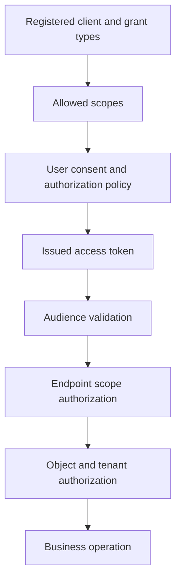

# Giới hạn scope, audience và đặc quyền quản trị theo least privilege

## 1. Least privilege trong OAuth 2.0

Trong chương **Bảo vệ máy chủ** của module **SPRING_SECURITY_OAUTH2_OIDC_AUTHORIZATION_SERVER**, chúng ta học cách thiết kế, cấu hình, bảo mật, kiểm thử và vận hành OAuth 2.0/OpenID Connect Authorization Server bằng Spring Security và Spring Authorization Server.

Nguyên tắc **least privilege** yêu cầu mỗi user, client, service và access token chỉ có đúng quyền cần thiết để hoàn thành một use case trong khoảng thời gian cần thiết. Khi token bị lộ hoặc client bị xâm nhập, phạm vi thiệt hại vì thế được giới hạn.

RFC 9700 khuyến nghị giới hạn privilege của access token ở mức tối thiểu cho ứng dụng/use case, đồng thời giới hạn audience vào một Resource Server cụ thể hoặc một nhóm rất nhỏ Resource Server. Mỗi Resource Server phải tự kiểm tra token có được phát hành cho chính nó hay không.

Trong hệ thống Spring Authorization Server, least privilege cần được thực hiện ở nhiều lớp:

1. **Client registration:** client chỉ được phép yêu cầu grant type và tập scope cần thiết.
2. **Authorization/consent:** user chỉ cấp phần scope phù hợp với policy và mục đích sử dụng.
3. **Token issuance:** access token chỉ mang scope đã được cấp và audience được xác định từ policy tin cậy.
4. **Resource Server:** API kiểm tra issuer, audience, scope và quyền trên resource cụ thể.
5. **Admin plane:** thao tác quản trị có client, audience, scope, authentication và quy trình phê duyệt riêng.

Không có một claim hoặc annotation duy nhất nào tạo ra least privilege. Đây là policy xuyên suốt từ lúc đăng ký client đến lúc API thực thi hành động.

### Mục tiêu học tập

Sau bài này, bạn có thể:

- Phân biệt scope, audience, role, permission và quyền trên resource.
- Thiết kế scope taxonomy theo hành động và miền nghiệp vụ.
- Giới hạn scope theo RegisteredClient, grant type, user consent và policy.
- Gắn JWT access token với đúng audience.
- Tách client, scope và API quản trị khỏi ứng dụng thông thường.
- Cấu hình Spring Authorization Server 1.5.8 để phát token theo policy.
- Cấu hình Spring Security 6.5 để kiểm tra scope ở URL và method.
- Kết hợp RBAC, ABAC, tenant isolation và object-level authorization.
- Kiểm thử việc từ chối token thừa quyền, sai audience hoặc thiếu scope.

## 2. Phân biệt scope, audience và đặc quyền quản trị

Ba khái niệm này giải quyết ba câu hỏi khác nhau:

| Khái niệm | Câu hỏi | Ví dụ |
| --- | --- | --- |
| Scope | Token được phép thực hiện loại hành động nào? | orders.read, orders.cancel. |
| Audience (aud) | Token được phát hành cho Resource Server nào? | https://orders-api.example.com. |
| Admin privilege | Principal/client nào được phép thực hiện thao tác quản trị nhạy cảm? | orders.admin.users.disable. |

Ví dụ một token có scope orders.read nhưng audience là Billing API vẫn phải bị Orders API từ chối. Token có audience Orders API nhưng thiếu orders.cancel cũng không được hủy đơn hàng. Token có scope quản trị chỉ được chấp nhận khi client, principal, audience và policy đều cho phép hành động đó.

### 2.1. Scope không phải role

OAuth scope là quyền được cấp cho access token trong một ngữ cảnh client/resource. Role thường mô tả nhóm trách nhiệm của một user hoặc service trong hệ thống. Permission mô tả một hành động cụ thể trên một loại đối tượng hoặc tài nguyên.

Ví dụ:

- Role ROLE_ORDER_MANAGER có thể gom một tập permission nghiệp vụ.
- Scope orders.read cho phép token gọi chức năng đọc đơn hàng.
- Permission order:123:read có thể cho biết một principal được đọc đúng đơn hàng 123.

Không mặc định ánh xạ mọi role thành scope hoặc mọi scope thành role. Scope thường là coarse-grained authorization; domain policy vẫn phải quyết định principal có quyền trên bản ghi cụ thể hay không.

### 2.2. Audience không phải scope

Audience giới hạn nơi token được sử dụng. Scope giới hạn hành động token có thể thực hiện tại resource đó.

Một token có thể có:

```json
{
  "iss": "https://auth.example.com",
  "aud": ["https://orders-api.example.com"],
  "scope": "orders.read orders.cancel"
}
```

Orders API kiểm tra aud chứa identifier của chính nó và sau đó kiểm tra scope phù hợp endpoint. Không dùng scope để suy ra audience hoặc ngược lại.

### 2.3. Admin privilege là quyền có tác động lớn

Quyền quản trị thường có khả năng thay đổi user, client, tenant, signing key, policy hoặc trạng thái hệ thống. Không cấp một scope admin chung cho mọi thao tác. Hãy tách theo hành động và resource:

- orders.admin.users.read
- orders.admin.users.disable
- orders.admin.clients.read
- orders.admin.clients.manage
- orders.admin.refunds.approve
- orders.admin.audit.read

Một token chỉ cần đọc danh sách user không nên đồng thời có quyền khóa user, thay client registration hoặc phê duyệt refund.

## 3. Mô hình giới hạn quyền theo nhiều lớp

Least privilege có thể được mô tả bằng một chuỗi giới hạn:



Mỗi lớp chỉ thu hẹp quyền. Không lớp nào được tự mở rộng quyền vượt quá lớp trước.

Ví dụ:

- Client storefront-web chỉ được đăng ký orders.read và orders.create.
- User chỉ consent orders.read.
- Token được phát với orders.read và audience Orders API.
- Orders API chỉ cho phép GET khi có SCOPE_orders.read.
- Service kiểm tra đơn hàng thuộc tenant mà principal được phép truy cập.

Ngay cả khi token hợp lệ về chữ ký, issuer và thời gian, nó vẫn không được phép gọi endpoint hoặc đọc bản ghi nằm ngoài các giới hạn trên.

## 4. Thiết kế scope taxonomy

### 4.1. Đặt tên theo resource và action

Một scope tốt có tên rõ ràng, ổn định và có thể review:

```text
orders.read
orders.create
orders.update
orders.cancel
orders.refund.request
orders.refund.approve
users.profile.read
users.profile.update
users.admin.disable
clients.admin.read
clients.admin.manage
```

Scope nên phản ánh hành động API thực sự hỗ trợ. Tránh tên chung như api, full_access, read, write, root hoặc admin nếu chúng bao trùm nhiều resource và use case.

### 4.2. Không tạo scope hierarchy ngầm

Không tự hiểu orders.write bao gồm orders.read, hoặc orders.admin bao gồm tất cả scope khác, trừ khi policy được định nghĩa, kiểm thử và công bố rõ.

Nếu một use case cần cả đọc và ghi, client nên được cấp cả hai scope:

```text
orders.read orders.update
```

Việc liệt kê rõ giúp consent screen, audit log và policy review thể hiện chính xác quyền đã cấp.

### 4.3. Tách quyền đọc và ghi

Đọc dữ liệu và thay đổi dữ liệu có mức rủi ro khác nhau. Nên tách:

| API action | Scope đề xuất |
| --- | --- |
| GET order detail/list | orders.read |
| POST create order | orders.create |
| PATCH order | orders.update |
| POST cancel order | orders.cancel |
| POST request refund | orders.refund.request |
| POST approve refund | orders.refund.approve |

Không dùng một scope orders.manage nếu client chỉ cần đọc hoặc chỉ cần tạo đơn hàng.

### 4.4. Tách scope user và machine

Một user-facing client và một background service có thể cần quyền khác nhau. Không cấp quyền quản trị machine cho client web chỉ vì chúng cùng gọi Orders API.

Ví dụ:

- storefront-web: orders.read, orders.create.
- fulfillment-worker: orders.read, orders.update.
- refund-approval-console: orders.read, orders.refund.approve.
- nightly-reconciliation: orders.read, orders.admin.reconcile.

## 5. Giới hạn scope trong RegisteredClient

RegisteredClient là ranh giới đầu tiên xác định scope mà một client được phép yêu cầu. Spring Authorization Server 1.5.8 lưu tập scope này trong RegisteredClient.

Ví dụ hai client có phạm vi khác nhau:

```java
import java.time.Duration;
import java.util.List;
import java.util.UUID;

import org.springframework.context.annotation.Bean;
import org.springframework.context.annotation.Configuration;
import org.springframework.security.oauth2.core.AuthorizationGrantType;
import org.springframework.security.oauth2.core.ClientAuthenticationMethod;
import org.springframework.security.oauth2.server.authorization.client.InMemoryRegisteredClientRepository;
import org.springframework.security.oauth2.server.authorization.client.RegisteredClient;
import org.springframework.security.oauth2.server.authorization.client.RegisteredClientRepository;
import org.springframework.security.oauth2.server.authorization.settings.ClientSettings;
import org.springframework.security.oauth2.server.authorization.settings.TokenSettings;

@Configuration(proxyBeanMethods = false)
public class RegisteredClientLeastPrivilegeConfig {

    @Bean
    RegisteredClientRepository registeredClientRepository() {
        RegisteredClient storefront = RegisteredClient.withId(
                        UUID.randomUUID().toString())
                .clientId("storefront-web")
                .clientSecret("ENCODED_SECRET_FROM_PASSWORD_ENCODER")
                .clientAuthenticationMethod(
                        ClientAuthenticationMethod.CLIENT_SECRET_BASIC)
                .authorizationGrantType(AuthorizationGrantType.AUTHORIZATION_CODE)
                .redirectUri("https://shop.example.com/login/oauth2/code/storefront")
                .scope("orders.read")
                .scope("orders.create")
                .clientSettings(ClientSettings.builder()
                        .requireProofKey(true)
                        .requireAuthorizationConsent(true)
                        .build())
                .tokenSettings(TokenSettings.builder()
                        .accessTokenTimeToLive(Duration.ofMinutes(5))
                        .build())
                .build();

        RegisteredClient adminConsole = RegisteredClient.withId(
                        UUID.randomUUID().toString())
                .clientId("orders-admin-console")
                .clientSecret("ENCODED_ADMIN_SECRET_FROM_PASSWORD_ENCODER")
                .clientAuthenticationMethod(
                        ClientAuthenticationMethod.CLIENT_SECRET_BASIC)
                .authorizationGrantType(AuthorizationGrantType.AUTHORIZATION_CODE)
                .redirectUri("https://admin.example.com/login/oauth2/code/orders")
                .scope("orders.admin.users.read")
                .scope("orders.admin.users.disable")
                .scope("orders.admin.audit.read")
                .clientSettings(ClientSettings.builder()
                        .requireProofKey(true)
                        .requireAuthorizationConsent(true)
                        .build())
                .tokenSettings(TokenSettings.builder()
                        .accessTokenTimeToLive(Duration.ofMinutes(5))
                        .build())
                .build();

        return new InMemoryRegisteredClientRepository(
                List.of(storefront, adminConsole));
    }
}
```

Đây là ví dụ cho development/test. Production nên dùng JdbcRegisteredClientRepository hoặc repository phù hợp và lưu secret đã encode bằng PasswordEncoder. Không lưu secret dạng rõ hoặc dùng InMemoryRegisteredClientRepository cho triển khai cần tồn tại qua restart.

storefront-web không có scope quản trị trong registration. Ngay cả khi client gửi thêm orders.admin.users.disable trong authorization request, Authorization Server không được cấp scope ngoài tập được đăng ký.

### 5.1. Grant type cũng là một giới hạn

Chỉ đăng ký grant type client thực sự cần:

- Web application có user login thường dùng Authorization Code + PKCE.
- Service-to-service có thể dùng Client Credentials.
- Không bật Password Grant hoặc grant tùy biến không cần thiết.
- Không cấp Client Credentials cho SPA/mobile app vì không thể giữ client secret an toàn.

Scope allowlist không có ý nghĩa nếu client được cấp grant type hoặc credential mạnh hơn use case yêu cầu.

## 6. Consent và authorized scopes

Trong Authorization Code Flow, client có thể yêu cầu một tập scope nhưng resource owner chỉ chấp thuận một tập con. Spring Authorization Server biểu diễn consent bằng OAuth2AuthorizationConsent, lưu authorities đã được resource owner cấp cho client.

Sau khi flow hoàn tất, OAuth2Authorization lưu authorizedScopes. Đây là tập scope được cấp cho authorization cụ thể, khác với tập scope tối đa được đăng ký trên client.

Ví dụ:

| Giai đoạn | Scope |
| --- | --- |
| RegisteredClient cho phép | orders.read, orders.create, orders.cancel |
| Client yêu cầu | orders.read, orders.create |
| User consent | orders.read |
| Access token được cấp | orders.read |

Không thêm scope chỉ vì nó có trong RegisteredClient. Token customizer và logic phát token phải dựa trên authorized scopes sau khi áp dụng authorization policy.

### 6.1. Consent screen cần diễn giải quyền

Consent screen nên trình bày tên ứng dụng/client, Resource Server mà ứng dụng muốn truy cập, hành động tương ứng với từng scope, scope nhạy cảm hoặc quyền quản trị và tác động của quyền cấp.

Không hiển thị tên scope kỹ thuật mà không giải thích cho user. Không gộp quyền đọc, ghi và quản trị thành một checkbox Cho phép truy cập.

### 6.2. Consent không thay thế policy server-side

Consent chứng minh resource owner đã chấp thuận một phần quyền được yêu cầu. Authorization Server vẫn phải áp dụng policy như client có được xin scope đó không, user có đủ privilege không, tenant có được dùng resource đó không và scope có phù hợp audience không.

Với Client Credentials Grant, không có resource owner để consent. Authorization Server phải giới hạn scope bằng client registration, service account policy và resource policy.

Đặc biệt, việc user bấm consent không tự chứng minh user có quyền quản trị. Authorization Server phải kiểm tra entitlement của principal trước khi cho phép admin scope xuất hiện trong authorization/token flow. Consent trả lời user có chấp thuận client dùng quyền hay không; policy server-side trả lời user đó có đủ điều kiện được cấp quyền hay không.

## 7. Giới hạn scope theo client, user và grant

Một scope chỉ được cấp khi mọi điều kiện cần thiết đều đúng:

```text
granted scopes
    = client allowed scopes
    ∩ grant/requested scopes
    ∩ user consent (when applicable)
    ∩ server-side authorization policy
```

Đây là mô hình khái niệm. Từng grant type có quy tắc protocol riêng, nhưng nguyên tắc chung là mỗi lớp policy chỉ được thu hẹp tập quyền.

### 7.1. User không được vượt quyền của chính họ

Một user có role CUSTOMER_SUPPORT có thể được đọc thông tin đơn hàng để hỗ trợ khách hàng nhưng không được cấp scope orders.admin.users.disable. Nếu client yêu cầu scope này, Authorization Server phải từ chối hoặc không cấp scope đó theo protocol/policy đã định nghĩa.

### 7.2. Client không được vượt quyền đăng ký

Client storefront-web không thể tự thêm scope quản trị vào token request. Tập scope trong RegisteredClient là giới hạn phía server, không lấy danh sách scope từ request làm nguồn tin cậy.

### 7.3. Client Credentials cần service principal riêng

Với Client Credentials, principal đại diện client/service chứ không phải user đang đăng nhập. Không copy toàn bộ user roles vào token machine-to-machine.

Mỗi service nên có client ID riêng, credential riêng và có rotation, grant type tối thiểu, scope riêng theo workload, audience của API đích và token TTL ngắn.

Không dùng chung một service client có quyền đọc/ghi/quản trị trên mọi API cho tất cả batch job.

## 8. Scope không thay thế audience restriction

RFC 9700 khuyến nghị access token chỉ dành cho một Resource Server hoặc một nhóm rất nhỏ Resource Server. Resource Server phải từ chối token nếu audience không chứa chính nó.

Ví dụ:

| Resource Server | Audience |
| --- | --- |
| Orders API | https://orders-api.example.com |
| Billing API | https://billing-api.example.com |
| Orders Admin API | https://orders-admin-api.example.com |

Không phát một access token audience https://all-apis.example.com chỉ để client dùng chung token ở mọi service. Điều đó mở rộng tác động nếu token bị lộ và khiến resource khó phân biệt token có đúng mục tiêu hay không.

### 8.1. Resource Indicators

RFC 8707 định nghĩa request parameter resource, cho phép client chỉ rõ protected resource mà token cần truy cập. Authorization Server có thể dùng resource indicator để áp dụng policy và tạo audience phù hợp.

Giá trị resource phải là URI tuyệt đối, không có fragment. Authorization Server cần kiểm tra resource có nằm trong danh sách được phép cho client/grant hay không. Nếu không chấp nhận resource, có thể trả invalid_target.

Spring Authorization Server 1.5.8 có cơ chế custom token generation và endpoint extension, nhưng không nên mặc định rằng resource indicator được hỗ trợ đầy đủ chỉ vì RegisteredClient có scopes. Nếu triển khai RFC 8707, phải:

1. Parse và validate resource tại Authorization Endpoint/Token Endpoint.
2. Kiểm tra resource thuộc allowlist client.
3. Lưu resource đã được cấp cùng authorization/grant.
4. Khi phát token, lấy resource từ authorization state đã xác minh.
5. Đặt audience tương ứng và không echo URL tùy ý từ request vào aud.
6. Khi refresh hoặc exchange, chỉ cho phép resource nằm trong grant ban đầu hoặc subset được policy cho phép.

### 8.2. Một token cho nhiều audience chỉ khi thật sự cần

Nếu client phải gọi nhiều API, ưu tiên xin token riêng cho từng resource. Chỉ dùng nhiều audience khi các API có cùng trust boundary và có lý do vận hành rõ. Mỗi Resource Server vẫn phải kiểm tra audience của chính mình.

## 9. Phát audience theo policy trong Spring Authorization Server

Spring Authorization Server 1.5.8 cung cấp OAuth2TokenCustomizer<JwtEncodingContext> để tùy biến header/claims của JWT. Context chứa RegisteredClient, authorizedScopes, principal, grant type và token type.

Ví dụ ánh xạ client ID sang audience đã được quản trị:

```java
import java.util.List;
import java.util.Map;
import java.util.Set;

import org.springframework.context.annotation.Bean;
import org.springframework.context.annotation.Configuration;
import org.springframework.security.oauth2.server.authorization.OAuth2TokenType;
import org.springframework.security.oauth2.server.authorization.token.JwtEncodingContext;
import org.springframework.security.oauth2.server.authorization.token.OAuth2TokenCustomizer;

@Configuration(proxyBeanMethods = false)
public class AccessTokenAudiencePolicy {

    private static final Map<String, String> CLIENT_AUDIENCES = Map.of(
            "storefront-web", "https://orders-api.example.com",
            "orders-admin-console", "https://orders-admin-api.example.com",
            "billing-worker", "https://billing-api.example.com");

    private static final Set<String> ADMIN_SCOPES = Set.of(
            "orders.admin.users.read",
            "orders.admin.users.disable",
            "orders.admin.audit.read");

    @Bean
    OAuth2TokenCustomizer<JwtEncodingContext> accessTokenCustomizer() {
        return context -> {
            if (!OAuth2TokenType.ACCESS_TOKEN.equals(context.getTokenType())) {
                return;
            }

            String clientId = context.getRegisteredClient().getClientId();
            String audience = CLIENT_AUDIENCES.get(clientId);
            if (audience == null) {
                throw new IllegalStateException(
                        "No audience policy is registered for this client");
            }

            boolean requestsAdminScope = context.getAuthorizedScopes()
                    .stream()
                    .anyMatch(ADMIN_SCOPES::contains);

            boolean hasAdminPrincipal = context.getPrincipal().getAuthorities()
                    .stream()
                    .anyMatch(authority ->
                            "ROLE_ORDERS_ADMIN".equals(authority.getAuthority()));

            if (requestsAdminScope &&
                    (!"orders-admin-console".equals(clientId) ||
                            !hasAdminPrincipal)) {
                throw new IllegalStateException(
                        "The client or principal is not allowed to receive admin scopes");
            }

            context.getClaims().audience(List.of(audience));
        };
    }
}
```

Đây là policy minh họa. Trong hệ thống thực tế, danh sách client/audience/scope nên được quản trị trong cấu hình hoặc policy store có kiểm soát. Kiểm tra ROLE_ORDERS_ADMIN ở đây là lớp chặn cuối; authorization policy nên loại admin scope khỏi request của user không đủ quyền trước khi phát authorization code. Nếu có nhiều OAuth2TokenCustomizer<JwtEncodingContext>, hợp nhất logic vào một bean để tránh khai báo trùng generic type. Customizer này chỉ áp dụng cho JWT access token; opaque token cần customizer/token generator tương ứng.

Không lấy audience từ request parameter, Host header hoặc một claim chưa xác minh. Audience phải đến từ mapping resource đã được quản trị.

### 9.1. Vì sao customizer kiểm tra authorized scopes?

context.getAuthorizedScopes() là scope được cấp cho authorization đang xử lý. Không dùng scope client vừa yêu cầu hoặc scope mặc định ở UI để tạo claim. Nếu scope không được cấp, nó không được xuất hiện trong access token.

### 9.2. Không đưa audience API vào ID Token

Audience của ID Token thường xác định OIDC client, còn audience của access token xác định Resource Server. Customizer cần kiểm tra OAuth2TokenType.ACCESS_TOKEN trước khi thay đổi claim. Không ghi đè audience ID Token bằng API audience.

## 10. Resource Server phải xác minh audience

Mỗi Resource Server cần cấu hình issuer và audience của chính nó. Ví dụ Orders API:

```yaml
spring:
  security:
    oauth2:
      resourceserver:
        jwt:
          issuer-uri: https://auth.example.com
          audiences: https://orders-api.example.com
```

Với Spring Security 6.5, issuer-uri kiểm tra issuer; audiences kiểm tra token có audience của API. Nếu token có chữ ký hợp lệ nhưng chỉ dành cho Billing API, Orders API phải từ chối.

Nếu khai báo JwtDecoder tùy chỉnh, giữ cả issuer validation, timestamp validation và audience validation. Không vô tình thay default validator bằng một validator chỉ kiểm tra scope.

### 10.1. Opaque token

Với opaque/reference token, Resource Server dùng introspection thay vì tự decode JWT. Resource Server vẫn phải xác định token có được phát hành cho resource đó hay không và policy nào được áp dụng. Nếu introspection response hoặc authorization server policy không cung cấp audience đủ rõ, phải bổ sung resource binding phía Authorization Server hoặc một cơ chế kiểm tra tương đương.

## 11. Bảo vệ endpoint bằng scope trong Spring Security

Spring Security mặc định ánh xạ mỗi scope trong JWT thành GrantedAuthority có prefix SCOPE_. Vì vậy scope orders.read trở thành SCOPE_orders.read.

Ví dụ:

```java
import static org.springframework.http.HttpMethod.GET;
import static org.springframework.http.HttpMethod.POST;

import org.springframework.context.annotation.Bean;
import org.springframework.context.annotation.Configuration;
import org.springframework.security.config.Customizer;
import org.springframework.security.config.annotation.web.builders.HttpSecurity;
import org.springframework.security.web.SecurityFilterChain;

@Configuration(proxyBeanMethods = false)
public class OrdersApiSecurityConfig {

    @Bean
    SecurityFilterChain apiSecurityFilterChain(HttpSecurity http)
            throws Exception {
        http
            .authorizeHttpRequests(authorize -> authorize
                .requestMatchers("/actuator/health").permitAll()
                .requestMatchers(GET, "/api/orders/**")
                    .hasAuthority("SCOPE_orders.read")
                .requestMatchers(POST, "/api/orders")
                    .hasAuthority("SCOPE_orders.create")
                .requestMatchers(POST, "/api/orders/*/cancel")
                    .hasAuthority("SCOPE_orders.cancel")
                .anyRequest().denyAll()
            )
            .oauth2ResourceServer(oauth2 ->
                oauth2.jwt(Customizer.withDefaults())
            );

        return http.build();
    }
}
```

Các rule cụ thể được khai báo trước rule tổng quát. anyRequest().denyAll() giúp endpoint mới không tự động trở thành authenticated-only rồi vô tình thiếu scope. Khi thêm API mới, developer phải khai báo quyền rõ ràng.

### 11.1. Scope theo HTTP method

Một route có thể có hành động khác nhau theo method. Ví dụ GET order cần orders.read, POST cancel cần orders.cancel. Không chỉ bảo vệ /api/orders/** bằng một scope orders.manage quá rộng.

### 11.2. Không nhầm 401 và 403

- 401 Unauthorized: token thiếu, không hợp lệ, sai issuer/audience hoặc hết hạn.
- 403 Forbidden: token hợp lệ nhưng thiếu scope hoặc domain policy từ chối.

Không biến thiếu scope thành permitAll, và không bỏ qua authorization vì client đã authenticate thành công.

## 12. Bảo vệ method và service layer

URL authorization là lớp đầu tiên. Service method cũng cần kiểm tra quyền vì cùng một service có thể được gọi từ nhiều controller, message listener hoặc scheduled job.

Bật method security:

```java
import org.springframework.context.annotation.Configuration;
import org.springframework.security.config.annotation.method.configuration.EnableMethodSecurity;

@Configuration
@EnableMethodSecurity
public class MethodSecurityConfiguration {
}
```

Sau đó bảo vệ service:

```java
import org.springframework.security.access.prepost.PreAuthorize;
import org.springframework.stereotype.Service;

@Service
public class OrderCommandService {

    @PreAuthorize("hasAuthority('SCOPE_orders.cancel')")
    public void cancelOrder(String orderId) {
        // Apply domain rules and persist the cancellation.
    }
}
```

Method security không thay domain validation. Service vẫn cần kiểm tra trạng thái order, thời hạn hủy, tenant và người sở hữu đơn hàng.

## 13. Object-level authorization và tenant isolation

Scope orders.read cho phép gọi chức năng đọc order. Nó không tự cho phép đọc mọi order trong hệ thống.

Một service có thể kết hợp scope và quyền trên bản ghi:

```java
import org.springframework.security.core.Authentication;
import org.springframework.security.oauth2.server.resource.authentication.JwtAuthenticationToken;
import org.springframework.stereotype.Component;

@Component("orderAuthorization")
public class OrderAuthorization {

    private final OrderRepository orderRepository;

    public OrderAuthorization(OrderRepository orderRepository) {
        this.orderRepository = orderRepository;
    }

    public boolean canRead(Authentication authentication, String orderId) {
        if (!(authentication instanceof JwtAuthenticationToken jwtAuth)) {
            return false;
        }

        String tenantId =
                jwtAuth.getToken().getClaimAsString("tenant_id");
        String subject = jwtAuth.getToken().getSubject();

        if (tenantId == null || subject == null) {
            return false;
        }

        return orderRepository.existsReadableOrder(
                orderId, tenantId, subject);
    }
}
```

Áp dụng trong service:

```java
import org.springframework.security.access.prepost.PreAuthorize;

@PreAuthorize(
        "hasAuthority('SCOPE_orders.read') and " +
        "@orderAuthorization.canRead(authentication, #orderId)")
public Order findOrder(String orderId) {
    return orderRepository.findById(orderId)
            .orElseThrow(OrderNotFoundException::new);
}
```

Repository method existsReadableOrder cần kiểm tra tenant/owner trong database. Khi tải dữ liệu, query cũng phải giới hạn tenant; không chỉ kiểm tra quyền rồi tải bản ghi theo ID mà bỏ tenant predicate.

Nếu principal là service account, domain policy có thể dùng service identity thay vì user subject. Không giả định mọi token đều đại diện user.

## 14. Tách biệt admin client và admin API

### 14.1. Dùng client registration riêng

Không thêm admin scope vào client web thông thường. Tạo client riêng cho admin console với client ID riêng và credential riêng, redirect URI chỉ thuộc admin console, Authorization Code + PKCE, authorization consent hoặc policy cấp quyền tương đương, scope quản trị cụ thể theo action, access token TTL ngắn, authentication mạnh hơn và audit riêng.

Client Credentials cho automation quản trị cũng cần client ID riêng, scope nhỏ và service identity được quản lý. Không dùng credential của admin console trong cron job.

### 14.2. Audience riêng cho admin plane

Nếu admin API là một Resource Server riêng, cấp audience riêng, ví dụ:

```text
https://orders-admin-api.example.com
```

Admin API chỉ nhận token có audience này và các admin scopes cụ thể. Token audience Orders API không thể gọi admin API, kể cả khi nó có scope trùng tên do cấu hình sai.

Ví dụ cấu hình Resource Server riêng cho Orders Admin API:

```yaml
spring:
  security:
    oauth2:
      resourceserver:
        jwt:
          issuer-uri: https://auth.example.com
          audiences: https://orders-admin-api.example.com
```

Endpoint khóa user cần scope riêng:

```java
.requestMatchers(POST, "/admin/users/*/disable")
    .hasAuthority("SCOPE_orders.admin.users.disable")
```

Nếu admin routes và user routes cùng nằm trong một Resource Server, chúng dùng cùng audience của resource đó; khi ấy phải tách scope và policy chặt chẽ. Chỉ đổi path /admin không tự tạo ra audience boundary.

### 14.3. Tách admin plane khỏi public API

Với thao tác tác động lớn, nên triển khai admin API trong service/network zone riêng:

- Không public trực tiếp qua Internet nếu không cần.
- Chỉ nhận traffic từ gateway/VPN/management network đã xác thực.
- Dùng firewall/network policy và mTLS khi phù hợp.
- Tách database credential và quyền truy cập dữ liệu.
- Có rate limit, audit và alert riêng.

Network isolation bổ sung cho OAuth authorization; nó không thay scope, audience hoặc authentication.

## 15. Giới hạn thao tác quản trị theo action

Không dùng một scope admin cho tất cả endpoint. Ví dụ:

| Thao tác | Scope |
| --- | --- |
| Xem danh sách user | orders.admin.users.read |
| Khóa user | orders.admin.users.disable |
| Xem client registration | orders.admin.clients.read |
| Thay đổi client registration | orders.admin.clients.manage |
| Xem audit log | orders.admin.audit.read |
| Phê duyệt refund | orders.admin.refunds.approve |

Một nhân viên hỗ trợ có thể được đọc thông tin user nhưng không được khóa user hoặc thay đổi client. Một batch job có thể được chạy reconciliation nhưng không được đăng nhập vào admin console hoặc sửa RegisteredClient.

### 15.1. Separation of duties

Một số hành động nên yêu cầu hai người hoặc hai bước phê duyệt:

- Thay signing key hoặc issuer configuration.
- Thay đổi client có scope quản trị.
- Tạo client có quyền truy cập dữ liệu nhạy cảm.
- Phê duyệt refund vượt ngưỡng.
- Xóa tenant hoặc khóa tài khoản đặc quyền.

Không nên để một token duy nhất có thể tạo yêu cầu, tự phê duyệt và thực thi một thay đổi nhạy cảm.

## 16. Step-up authentication cho thao tác nhạy cảm

Scope quản trị xác định quyền được cấp, nhưng một thao tác rất nhạy cảm có thể yêu cầu authentication gần đây hoặc mức assurance cao hơn.

Policy step-up có thể yêu cầu MFA đã hoàn tất, auth_time trong một khoảng ngắn, acr/amr đạt mức assurance được chấp thuận, phiên quản trị riêng và thời hạn ngắn, hoặc re-authentication trước khi thực hiện hành động.

Resource Server chỉ tin các claim này khi chúng đến từ issuer tin cậy, được ký và có semantics rõ trong contract. Không coi một string amr: ["mfa"] tự khai báo là bằng chứng MFA nếu Authorization Server không thực sự xác minh.

Step-up không thay scope. User vẫn phải có scope orders.admin.users.disable, đồng thời thỏa điều kiện authentication freshness.

## 17. Tùy biến authority trong access token

Spring Authorization Server cho phép thêm claim riêng vào JWT bằng OAuth2TokenCustomizer<JwtEncodingContext>. Chỉ thêm dữ liệu cần cho Resource Server và đúng token type.

Nếu cần đưa một tập permission vào token, hãy lấy permission từ authorization service đáng tin cậy, chỉ đưa permission liên quan đến audience hiện tại, giới hạn số lượng claim và kích thước token, không copy toàn bộ role của user vào mọi access token, và không tạo authority từ request parameter hoặc client tự gửi.

Ví dụ Spring Authorization Server có thể thêm claim permissions từ principal sau khi đã áp dụng policy. Đây là minh họa; hệ thống thực tế nên dùng entitlement service và mapping theo resource:

```java
import java.util.Set;
import java.util.stream.Collectors;

import org.springframework.context.annotation.Bean;
import org.springframework.context.annotation.Configuration;
import org.springframework.security.core.GrantedAuthority;
import org.springframework.security.oauth2.server.authorization.OAuth2TokenType;
import org.springframework.security.oauth2.server.authorization.token.JwtEncodingContext;
import org.springframework.security.oauth2.server.authorization.token.OAuth2TokenCustomizer;

@Configuration(proxyBeanMethods = false)
public class PermissionClaimsConfiguration {

    @Bean
    OAuth2TokenCustomizer<JwtEncodingContext> permissionClaimsCustomizer() {
        return context -> {
            if (!OAuth2TokenType.ACCESS_TOKEN.equals(context.getTokenType())) {
                return;
            }

            Set<String> permissions = context.getPrincipal().getAuthorities()
                    .stream()
                    .map(GrantedAuthority::getAuthority)
                    .filter(authority -> authority.startsWith("PERM_"))
                    .map(authority -> authority.substring("PERM_".length()))
                    .filter(permission -> permission.startsWith("orders."))
                    .collect(Collectors.toUnmodifiableSet());

            context.getClaims().claim("permissions", permissions);
        };
    }
}
```

Ví dụ này minh họa cách lọc authority theo namespace. Nó không tự chứng minh user được phép trên từng order; object-level policy vẫn được thực hiện tại Resource Server. Nếu đã có OAuth2TokenCustomizer<JwtEncodingContext> cho audience, hãy hợp nhất logic vào cùng customizer thay vì khai báo nhiều bean trùng generic type.

Claim permissions không tự động trở thành GrantedAuthority trong Spring Security. Nếu Resource Server cần dùng claim này trong hasAuthority/PreAuthorize, phải cấu hình JwtAuthenticationConverter với mapping allowlist rõ ràng. Nếu không, giữ claim như dữ liệu bổ sung và kiểm tra nó trong domain policy; không tự động nâng mọi giá trị thành quyền.

### 17.1. Đừng biến role thành scope một cách máy móc

Nếu đưa role vào token, Resource Server cần biết role thuộc user hay client, role có hiệu lực ở audience nào, role có bị giới hạn tenant không, role có thay đổi thường xuyên không và token lifetime có đủ ngắn để thay đổi quyền được phản ánh kịp thời không.

Với quyền thay đổi thường xuyên hoặc có tác động lớn, cân nhắc truy vấn policy service hoặc introspection thay vì nhúng toàn bộ quyền vào JWT sống lâu.

## 18. Token lifetime và thu hẹp quyền theo thời gian

Token ít quyền nhưng sống quá lâu vẫn tạo rủi ro. Token admin nên có TTL ngắn hơn token user thông thường nếu use case cho phép.

Các nguyên tắc:

- Access token có thời hạn ngắn theo rủi ro và độ trễ vận hành.
- Refresh token chỉ cấp cho client thật sự cần phiên dài.
- Client Credentials thường xin access token mới thay vì dùng refresh token.
- Refresh flow không được mở rộng scope vượt grant ban đầu.
- Khi user mất quyền hoặc client bị disable, có quy trình revoke authorization/token.
- Admin action nhạy cảm có thể yêu cầu token mới sau step-up.

TokenSettings của Spring Authorization Server cho phép cấu hình access token TTL và refresh token behavior theo RegisteredClient. Cấu hình TTL không thay thế revocation, audience validation hoặc endpoint authorization.

## 19. Dynamic Client Registration và scope quản trị

Dynamic Client Registration có thể cho phép client tự đăng ký. Nếu không kiểm soát, client có thể xin scope rộng hoặc khai báo mục đích không đúng.

Policy registration cần:

- Chỉ cho phép grant type phù hợp loại client.
- Allowlist scope theo loại ứng dụng và resource.
- Không cấp scope quản trị cho public client theo mặc định. Nếu có SPA quản trị, phải có registration riêng, PKCE, authentication/step-up policy và review rủi ro rõ ràng.
- Yêu cầu review/phê duyệt cho scope nhạy cảm.
- Đặt audience/resource binding theo policy.
- Giới hạn số client, redirect URI và credential.
- Có quy trình revoke client/credential khi phát hiện lạm dụng.

Không cho client tự đăng ký scope tùy ý chỉ vì protocol cho phép gửi danh sách scope trong metadata. Authorization Server phải là nơi quyết định tập quyền tối đa.

## 20. Audit và giám sát privilege

Least privilege cần được quan sát sau khi triển khai. Theo dõi client nào đang xin scope nào, tỷ lệ scope được yêu cầu/cấp/consent, audience nào được phát cho từng client, token admin được phát cho principal/client nào, endpoint admin nào được gọi và kết quả authorization, số lần bị từ chối do sai audience hoặc thiếu scope, client có scope nhưng không dùng trong thời gian dài, và thay đổi RegisteredClient/consent/policy.

Không log raw access token, refresh token hoặc client secret. Log client ID, principal identifier phù hợp, audience, scope đã cấp, correlation ID và kết quả policy.

### 20.1. Quy trình rà soát định kỳ

Định kỳ:

1. So sánh scope đã đăng ký với scope thực tế client sử dụng.
2. Loại bỏ scope không còn cần.
3. Rà soát client có quyền quản trị và chủ sở hữu.
4. Kiểm tra audience có quá rộng không.
5. Kiểm tra service account không hoạt động và credential cũ.
6. Kiểm tra user/role đã rời tổ chức nhưng consent/token còn hiệu lực.
7. Kiểm thử revoke và disable client.

Không giữ quyền cũ chỉ vì client có thể cần lại trong tương lai. Cấp lại khi có nhu cầu được phê duyệt.

## 21. Kiểm thử least privilege

Kiểm thử cả token issuance và Resource Server. Một API từ chối request không chứng minh Authorization Server đã cấp token tối thiểu; ngược lại, token có scope tối thiểu không bảo đảm API kiểm tra đúng.

| Nhóm | Kịch bản | Kỳ vọng |
| --- | --- | --- |
| Client scope boundary | Client xin scope không nằm trong RegisteredClient. | Scope không được cấp; request bị từ chối hoặc scope bị loại theo protocol/policy. |
| Consent subset | User chỉ consent một phần scope. | Token chỉ chứa scope được chấp thuận. |
| Client Credentials | Service xin scope quản trị ngoài allowlist. | Token không được cấp scope đó. |
| Audience | Token chỉ dành cho Billing API gửi tới Orders API. | Orders API từ chối. |
| Multiple audience | Token có audience quá rộng. | Policy phát token từ chối hoặc Resource Server không chấp nhận audience ngoài allowlist. |
| Scope missing | Token thiếu orders.cancel gọi cancel endpoint. | 403 Forbidden. |
| Read/write separation | Token có orders.read gọi POST create. | Bị từ chối. |
| Admin scope | Storefront token gọi admin API. | Bị từ chối do audience/scope. |
| Admin client | Admin console token thiếu orders.admin.users.disable. | Không khóa user được. |
| Cross tenant | Token tenant A đọc order tenant B. | Domain authorization từ chối. |
| Client disabled | Client bị disable nhưng token cũ vẫn còn hạn. | Kết quả theo revocation/introspection policy; không mặc định token JWT tự mất hiệu lực. |
| Expired token | Token hết hạn. | 401 Unauthorized. |
| Unknown scope | JWT chứa scope không nằm trong contract. | Không ánh xạ thành authority được chấp nhận. |
| Role confusion | User role được đưa nhầm vào client/service principal. | Test phát hiện principal type/claim mapping sai. |
| Admin step-up | Scope đúng nhưng MFA/authentication freshness không đạt. | Thao tác nhạy cảm bị từ chối. |
| Token refresh | Refresh request cố mở rộng scope. | Chỉ scope nằm trong grant/policy được cấp lại. |
| DCR overprivilege | Client tự đăng ký xin admin scope. | Registration bị từ chối hoặc cần phê duyệt đặc biệt. |
| Default deny | Endpoint mới chưa có authorization rule. | Request bị từ chối. |

### 21.1. Unit test cho scope policy

Test policy mapping từ client ID sang scope/audience với các trường hợp client hợp lệ và audience hợp lệ, client không tồn tại trong mapping, client thông thường xin admin scope, admin client chỉ xin một scope quản trị, và client xin scope ngoài registration.

### 21.2. Integration test với JWT thật

Tạo JWT được ký bởi key test, đặt issuer, audience và scope cụ thể. Gửi token tới API:

- Sai audience phải thất bại ở decoder.
- Đúng audience nhưng thiếu scope phải thất bại ở authorization.
- Đúng audience/scope nhưng sai tenant phải thất bại ở domain policy.
- Đúng toàn bộ policy mới được thực hiện nghiệp vụ.

Không chỉ dùng jwt() request postprocessor để kết luận audience/signature validation hoạt động; postprocessor này mô phỏng authentication đã được tạo, không kiểm tra chữ ký thật.

## 22. Troubleshooting

| Triệu chứng | Nguyên nhân có thể | Hướng xử lý |
| --- | --- | --- |
| Client nhận scope rộng hơn mong muốn | RegisteredClient có scope quá rộng hoặc customizer thêm claim quyền tùy ý. | Thu hẹp registration và chỉ dùng authorized scopes. |
| Token có scope nhưng API trả 403 | Endpoint yêu cầu authority khác hoặc prefix mapping sai. | Kiểm tra SCOPE_ và rule theo HTTP method. |
| Token hợp lệ nhưng API trả 401 | Audience hoặc issuer không khớp. | Kiểm tra audiences và issuer-uri. |
| Token dùng được ở nhiều API | Audience chung hoặc Resource Server không kiểm tra audience. | Tách audience và bật validator ở từng API. |
| Admin client có quyền quá rộng | Dùng scope admin chung hoặc tái sử dụng client web. | Tách client, audience và scope theo thao tác. |
| User consent quá nhiều quyền | Consent screen gộp quyền hoặc client xin quá nhiều scope. | Hiển thị từng quyền và giới hạn requested scopes. |
| Service account có quyền user | Copy role của user vào client credentials token. | Tách principal type và entitlement machine. |
| User tenant A truy cập dữ liệu tenant B | Chỉ kiểm tra scope, thiếu object-level/tenant predicate. | Bổ sung ABAC và tenant filter trong repository. |
| Quyền bị thay đổi nhưng token vẫn dùng được | JWT tự chứa claims và TTL dài. | Giảm TTL, revoke/introspection hoặc policy check online. |
| Admin endpoint mới bị mở | Rule cuối chỉ authenticated(). | Dùng default deny và khai báo scope tường minh. |

## 23. Bài tập thực hành và checklist

### Bài tập 1 — Thiết kế scope taxonomy

Thiết kế scope cho Orders API gồm đọc, tạo, cập nhật, hủy và phê duyệt refund. Tách quyền user-facing và admin. Không dùng scope chung admin hoặc write.

### Bài tập 2 — Tạo RegisteredClient least privilege

Tạo storefront-web chỉ có orders.read và orders.create. Tạo orders-admin-console với một vài admin scopes riêng. Thử yêu cầu scope không được đăng ký và quan sát kết quả.

### Bài tập 3 — Audience binding

Tạo Orders API và Billing API với audience riêng. Phát token cho từng client và thử dùng chéo giữa hai API. Xác nhận API từ chối token sai audience.

### Bài tập 4 — Consent subset

Yêu cầu ba scope nhưng chỉ consent một scope. Kiểm tra access token chỉ mang scope đã cấp.

### Bài tập 5 — Admin API

Tách admin endpoint, yêu cầu audience admin API và scope theo từng hành động. Thử dùng token storefront để gọi endpoint quản trị.

### Bài tập 6 — Tenant/object authorization

Tạo hai tenant có order ID khác nhau. Token tenant A có orders.read nhưng không được đọc order tenant B.

### Bài tập 7 — Review privilege

Viết báo cáo client nào đang có scope quản trị, audience nào được cấp, token TTL và owner. Đề xuất loại bỏ scope/client không còn cần.

### Checklist hoàn thành

- [ ] Scope được đặt tên theo resource và action.
- [ ] Không có scope admin hoặc full_access dùng chung không giới hạn.
- [ ] Scope đọc/ghi/quản trị được tách.
- [ ] RegisteredClient chỉ có grant type và scope cần thiết.
- [ ] Authorization consent có thể cấp subset scope.
- [ ] Client Credentials dùng service principal riêng.
- [ ] Token chỉ mang authorized scopes.
- [ ] Audience được xác định từ mapping/policy tin cậy.
- [ ] Mỗi Resource Server xác minh audience của chính nó.
- [ ] Admin client và admin API được tách phù hợp.
- [ ] Admin action có step-up/separation of duties khi cần.
- [ ] Endpoint và method đều có authorization policy.
- [ ] Domain service kiểm tra object-level và tenant access.
- [ ] Endpoint chưa khai báo policy bị deny.
- [ ] Access token TTL phù hợp với rủi ro.
- [ ] Có quy trình revoke/disable client và rà soát consent.
- [ ] Audit log không chứa raw token hoặc secret.
- [ ] Có test sai audience, thiếu scope, overprivilege và cross-tenant.

## 24. Tài liệu tham khảo

- [RFC 9700 — Best Current Practice for OAuth 2.0 Security](https://www.rfc-editor.org/rfc/rfc9700.html) — access token privilege restriction và audience restriction.
- [RFC 8707 — Resource Indicators for OAuth 2.0](https://www.rfc-editor.org/rfc/rfc8707.html) — request parameter resource và audience-aware token issuance.
- [RFC 9068 — JWT Profile for OAuth 2.0 Access Tokens](https://www.rfc-editor.org/rfc/rfc9068.html) — JWT access token claims, issuer và audience.
- [Spring Authorization Server 1.5.8 — Core Model / Components](https://docs.spring.io/spring-authorization-server/reference/core-model-components.html) — RegisteredClient scopes, OAuth2Authorization authorizedScopes, consent và token customizer.
- [Spring Authorization Server 1.5.8 — Add authorities as custom claims in JWT access tokens](https://docs.spring.io/spring-authorization-server/reference/guides/how-to-custom-claims-authorities.html) — thêm claim từ authority vào JWT access token.
- [Spring Security 6.5 — OAuth 2.0 Resource Server JWT](https://docs.spring.io/spring-security/reference/6.5/servlet/oauth2/resource-server/jwt.html) — audience validation, scope-to-authority mapping và JwtAuthenticationConverter.
- [Spring Security 6.5 — Authorize HttpServletRequests](https://docs.spring.io/spring-security/reference/6.5/servlet/authorization/authorize-http-requests.html) — requestMatchers, hasAuthority, method-based authorization và denyAll.
- [Spring Security 6.5 — Method Security](https://docs.spring.io/spring-security/reference/6.5/servlet/authorization/method-security.html) — PreAuthorize, hasPermission và object-level authorization.

**Kết luận:** Least privilege cần giới hạn quyền từ client registration, grant và consent đến token issuance và API authorization. Scope xác định hành động, audience xác định Resource Server nhận token, còn admin privilege phải được tách theo client, API, thao tác và policy xác thực. Spring Authorization Server cung cấp RegisteredClient, authorizedScopes và token customization để giới hạn token; Spring Security xác minh audience, ánh xạ scope thành authority và thực thi policy ở endpoint/method. Quyền trên từng bản ghi và tenant vẫn phải được kiểm tra ở tầng nghiệp vụ.
