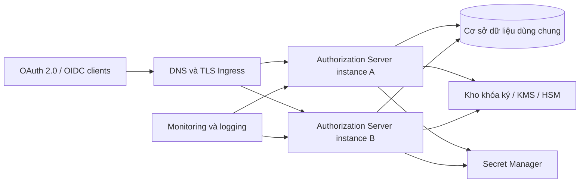

# Đóng gói ứng dụng và cấu hình môi trường production

Đưa một OAuth 2.0/OpenID Connect Authorization Server vào production đòi hỏi nhiều hơn việc đóng gói Spring Boot thành một JAR rồi chạy trên máy chủ. Dịch vụ này quản lý client, consent, authorization code, access token, refresh token và khóa ký. Vì vậy, cách đóng gói, cấu hình mạng, lưu trữ dữ liệu và quản lý khóa đều ảnh hưởng trực tiếp đến khả năng cấp và xác minh token.

Bài học tập trung vào cách chuẩn bị một ứng dụng Spring Authorization Server để triển khai lặp lại được, cấu hình theo từng môi trường và vận hành an toàn khi có nhiều instance. Các ví dụ giả định ứng dụng được xây dựng bằng Spring Boot; hãy điều chỉnh phiên bản Java, plugin build và cấu hình theo phiên bản Spring Boot/Spring Authorization Server mà dự án đang sử dụng.

## 1. Mục tiêu của một bản triển khai production

Một bản triển khai có thể vận hành ổn định cần đáp ứng các mục tiêu sau:

- **Artifact bất biến:** cùng một phiên bản mã nguồn tạo ra cùng một artifact hoặc image đã được định danh. Môi trường development, staging và production chạy cùng artifact; khác biệt nằm ở cấu hình runtime.
- **Cấu hình bên ngoài:** issuer, địa chỉ cơ sở dữ liệu, thông tin kết nối và giới hạn tài nguyên được cung cấp từ môi trường triển khai hoặc hệ thống quản lý cấu hình.
- **Dữ liệu bền vững:** client đã đăng ký, consent và trạng thái authorization phải còn sau khi ứng dụng khởi động lại hoặc chuyển request sang instance khác.
- **Khóa ký ổn định:** mọi instance có thể xác minh token do các instance còn lại phát hành; khóa riêng không bị tạo lại tùy tiện mỗi lần khởi động.
- **Địa chỉ công khai nhất quán:** issuer, discovery metadata, endpoint và redirect URI phải phản ánh đúng địa chỉ mà client truy cập từ bên ngoài.
- **Có khả năng quan sát và phục hồi:** có health check, log phù hợp, backup, quy trình triển khai và rollback.

Authorization Server thường nằm trên đường đi của đăng nhập và cấp token cho nhiều ứng dụng. Một cấu hình sai có thể làm hỏng đồng loạt luồng đăng nhập, refresh token hoặc xác minh chữ ký trên toàn hệ thống.

## 2. Kiến trúc triển khai tham khảo

Trong production, nên tách ứng dụng khỏi các thành phần cần dùng chung và có vòng đời riêng:



Ingress hoặc reverse proxy tiếp nhận kết nối HTTPS, định tuyến đến một trong các instance. Các instance dùng chung cơ sở dữ liệu và cùng truy cập một nguồn khóa ký đã được bảo vệ. Secret Manager cung cấp thông tin nhạy cảm khi ứng dụng khởi động hoặc khi nền tảng triển khai gắn secret vào workload.

Sơ đồ này không bắt buộc phải dùng một sản phẩm cụ thể. Cơ sở dữ liệu có thể là dịch vụ quản lý hoặc cụm do tổ chức vận hành; kho khóa có thể là KMS, HSM hoặc secret manager có kiểm soát truy cập phù hợp. Điều quan trọng là mọi instance phải có cùng góc nhìn về dữ liệu cấp quyền và khóa xác minh token.

## 3. Chuẩn bị cấu hình của Spring Authorization Server

### 3.1. Cố định issuer theo địa chỉ công khai

Issuer là định danh của Authorization Server. Giá trị này xuất hiện trong discovery metadata và claim `iss` của JWT. Nó phải ổn định giữa các lần triển khai và giữa các instance, đồng thời khớp chính xác với địa chỉ mà client tin cậy.

Có thể đưa issuer vào `AuthorizationServerSettings` thay vì gắn cứng trong mã nguồn:

```java
@Configuration
public class AuthorizationServerDeploymentConfig {

    @Bean
    AuthorizationServerSettings authorizationServerSettings(
            @Value("${app.security.issuer}") String issuer) {
        return AuthorizationServerSettings.builder()
                .issuer(issuer)
                .build();
    }
}
```

Trong cấu hình production, cung cấp giá trị từ biến môi trường hoặc hệ thống cấu hình:

```yaml
app:
  security:
    issuer: ${AUTH_SERVER_ISSUER}
```

Ví dụ giá trị là `https://auth.example.com`. Không dùng hostname nội bộ của container làm issuer công khai. Cũng không tạo issuer khác nhau theo replica, pod hoặc địa chỉ IP của máy chủ.

### 3.2. Kiểm tra các cấu hình bảo mật liên quan

Trước khi đóng gói, xác nhận các cấu hình sau đã được quản lý theo môi trường:

- Redirect URI của từng client là URI cụ thể đã đăng ký. Tránh wildcard hoặc quy tắc cho phép chuyển hướng đến host tùy ý.
- Client ID, loại client, authentication method, grant type, scope và yêu cầu PKCE phù hợp với từng ứng dụng.
- Access token, refresh token và authorization code có thời hạn phù hợp với chính sách bảo mật.
- Cơ chế consent được giữ nhất quán giữa các lần triển khai.
- Các `SecurityFilterChain` bảo vệ authorization endpoint, token endpoint, OIDC endpoint và endpoint quản trị theo đúng phạm vi.
- Cấu hình CORS chỉ cho phép origin cần thiết. Không mở CORS rộng để khắc phục lỗi cấu hình của client.

Không tắt CSRF trên toàn ứng dụng chỉ vì Authorization Server có các endpoint OAuth 2.0. Cần áp dụng quy tắc bảo vệ theo từng security filter chain và theo loại endpoint.

## 4. Đóng gói artifact và image

### 4.1. Tạo artifact có thể tái lập

Dùng Maven Wrapper hoặc Gradle Wrapper đã được commit cùng dự án để CI và máy phát triển chạy cùng phiên bản công cụ. Ví dụ:

```bash
# Maven
./mvnw clean verify

# Gradle
./gradlew clean check bootJar
```

Chọn lệnh tương ứng với build system thực tế; không cần chạy cả hai. Bước build nên thực hiện kiểm thử, kiểm tra dependency và tạo JAR thực thi. Đặt tên phiên bản hoặc gắn commit SHA để có thể truy nguyên image đang chạy về mã nguồn và lần build.

Không chép secret, private key, file cấu hình production hoặc dữ liệu client vào JAR. Artifact cần giống nhau giữa các môi trường; thông tin khác nhau được truyền vào lúc chạy.

### 4.2. Tạo OCI image

Nếu dự án dùng Spring Boot Maven Plugin, có thể tạo image bằng buildpack:

```bash
./mvnw spring-boot:build-image \
  -Dspring-boot.build-image.imageName=registry.example.com/security/authorization-server:1.0.0
```

Với Gradle và Spring Boot Gradle Plugin:

```bash
./gradlew bootBuildImage \
  --imageName=registry.example.com/security/authorization-server:1.0.0
```

Buildpack giúp tạo image từ ứng dụng Spring Boot mà không cần tự duy trì Dockerfile. Nếu dùng Dockerfile, hãy chọn JRE có phiên bản tương thích với Java target của ứng dụng, chạy bằng user không có quyền root và chỉ đưa artifact cần thiết vào image. Ví dụ minh họa:

```dockerfile
FROM eclipse-temurin:21-jre
WORKDIR /app
COPY target/authorization-server.jar /app/app.jar
USER 10001:10001
EXPOSE 8080
ENTRYPOINT ["java", "-XX:MaxRAMPercentage=75.0", "-jar", "/app/app.jar"]
```

Ví dụ trên giả định artifact đã được đặt tên `authorization-server.jar` và ứng dụng chạy trên Java 21. Nếu dự án dùng Java 17 hoặc phiên bản khác, hãy chọn image runtime tương ứng. `MaxRAMPercentage` cần được cân chỉnh theo giới hạn bộ nhớ của container và phần bộ nhớ dành cho native memory, thread stack cùng các thành phần ngoài heap.

Trong CI, nên gắn tag bất biến hoặc digest cho image, lưu SBOM, quét lỗ hổng dependency và image, rồi ký image theo quy trình của tổ chức. Tránh dùng tag `latest` làm định danh duy nhất cho production vì tag có thể trỏ sang nội dung khác.

## 5. Externalize cấu hình theo môi trường

### 5.1. Tách cấu hình khỏi artifact

Spring Boot hỗ trợ cấu hình qua `application.yml`, profile, biến môi trường và các nguồn cấu hình bên ngoài. Có thể giữ các giá trị mặc định không nhạy cảm trong repository, nhưng production phải cung cấp rõ các giá trị bắt buộc như issuer và thông tin kết nối cơ sở dữ liệu.

Ví dụ một phần cấu hình production:

```yaml
server:
  port: ${SERVER_PORT:8080}
  forward-headers-strategy: framework
  shutdown: graceful

spring:
  datasource:
    url: ${DB_URL}
    username: ${DB_USERNAME}
    password: ${DB_PASSWORD}
    hikari:
      minimum-idle: ${DB_POOL_MIN:5}
      maximum-pool-size: ${DB_POOL_MAX:20}
  lifecycle:
    timeout-per-shutdown-phase: 30s

app:
  security:
    issuer: ${AUTH_SERVER_ISSUER}

management:
  endpoints:
    web:
      exposure:
        include: health,info
  endpoint:
    health:
      probes:
        enabled: true
      show-details: never
      group:
        readiness:
          include: readinessState,db
```

Đây là cấu hình minh họa, không phải một file hoàn chỉnh cho mọi ứng dụng. Chỉ bật `forward-headers-strategy: framework` khi ứng dụng nằm sau proxy đáng tin cậy có thiết lập forwarded header đúng cách. Nếu không dùng reverse proxy hoặc nền tảng có cơ chế khác, chọn chiến lược phù hợp thay vì sao chép nguyên cấu hình.

Khi biến bắt buộc như `AUTH_SERVER_ISSUER` hoặc `DB_URL` bị thiếu, ứng dụng nên dừng khởi động và báo lỗi cấu hình rõ ràng. Không đặt một giá trị production giả làm mặc định để ứng dụng âm thầm chạy với issuer hoặc database sai.

### 5.2. Phân biệt cấu hình thường và secret

Các giá trị như port, tên profile, mức log và giới hạn pool thường có thể được quản lý như cấu hình thông thường. Những giá trị sau phải được coi là secret:

- Mật khẩu database và thông tin xác thực dịch vụ.
- Private key hoặc thông tin truy cập KMS/HSM.
- Client secret của confidential client.
- Token truy cập các hệ thống quản trị hoặc secret manager.

Lưu secret trong secret manager hoặc cơ chế secret của nền tảng triển khai. Giới hạn quyền đọc theo service account và môi trường. Không commit secret vào Git, không đưa secret vào Docker build argument, image layer, log hoặc thông tin chẩn đoán. Nếu secret đã bị commit, xóa khỏi file không làm secret cũ mất hiệu lực; cần thu hồi và cấp lại.

Có thể dùng profile như `production` để bật cấu hình phù hợp, nhưng profile không phải nơi bảo vệ secret. Ví dụ `SPRING_PROFILES_ACTIVE=production` chỉ chọn tập cấu hình; giá trị nhạy cảm vẫn phải đến từ nguồn secret được kiểm soát.

### 5.3. Cấu hình kết nối database có giới hạn

Pool connection phải được tính theo tổng số instance, không chỉ theo một instance. Nếu mỗi instance có `maximum-pool-size` là 20 và có 6 replica, ứng dụng có thể mở tối đa khoảng 120 connection, chưa tính job hoặc dịch vụ khác. Tổng này phải nằm trong giới hạn database và vẫn chừa dung lượng cho vận hành.

Đặt timeout kết nối, timeout truy vấn và giới hạn pool theo độ trễ thực tế. Không tăng pool tùy tiện khi token endpoint chậm; trước tiên xác định bottleneck nằm ở database, CPU, khóa ký hay dịch vụ phụ thuộc.

## 6. Lưu trữ dữ liệu cấp quyền bền vững

Spring Authorization Server cần lưu các đối tượng có ý nghĩa lâu dài hoặc cần dùng lại giữa nhiều request. Những repository trong bộ nhớ phù hợp cho demo và kiểm thử đơn giản, nhưng không đáp ứng yêu cầu production khi ứng dụng restart hoặc chạy nhiều replica.

Các interface thường cần được triển khai bằng JDBC hoặc một cơ chế lưu trữ bền vững phù hợp:

- `RegisteredClientRepository`: thông tin client đã đăng ký, gồm client ID, phương thức xác thực, grant type, redirect URI và scope.
- `OAuth2AuthorizationService`: trạng thái authorization và token liên quan, bao gồm authorization code, access token và refresh token theo cấu hình grant đang dùng.
- `OAuth2AuthorizationConsentService`: consent mà người dùng đã cấp cho client.

Spring Authorization Server cung cấp các triển khai JDBC như `JdbcRegisteredClientRepository`, `JdbcOAuth2AuthorizationService` và `JdbcOAuth2AuthorizationConsentService`. Ví dụ cấu hình rút gọn:

```java
@Configuration
public class AuthorizationPersistenceConfig {

    @Bean
    RegisteredClientRepository registeredClientRepository(JdbcTemplate jdbcTemplate) {
        return new JdbcRegisteredClientRepository(jdbcTemplate);
    }

    @Bean
    OAuth2AuthorizationService authorizationService(
            JdbcTemplate jdbcTemplate,
            RegisteredClientRepository registeredClients) {
        return new JdbcOAuth2AuthorizationService(jdbcTemplate, registeredClients);
    }

    @Bean
    OAuth2AuthorizationConsentService authorizationConsentService(
            JdbcTemplate jdbcTemplate,
            RegisteredClientRepository registeredClients) {
        return new JdbcOAuth2AuthorizationConsentService(jdbcTemplate, registeredClients);
    }
}
```

Các class JDBC cần schema tương ứng. Quản lý schema bằng Flyway hoặc Liquibase để thay đổi được version hóa, có thể xem xét trước khi triển khai và có thể phối hợp với quy trình rollback. Lấy schema khởi tạo từ tài liệu hoặc tài nguyên đúng phiên bản Spring Authorization Server đang dùng; không tự giả định schema của phiên bản khác tương thích hoàn toàn.

Khi triển khai nhiều replica, mọi instance phải dùng cùng nguồn dữ liệu. Điều này đặc biệt quan trọng với authorization code và refresh token: một request có thể được xử lý ở instance A, request tiếp theo đến instance B. Nếu mỗi instance có kho dữ liệu riêng hoặc dùng repository trong bộ nhớ, trạng thái sẽ không nhất quán.

Cơ sở dữ liệu chứa dữ liệu bảo mật có giá trị cao. Hạn chế quyền truy cập theo nguyên tắc tối thiểu, bật mã hóa khi truyền và khi lưu, backup định kỳ, giám sát truy cập bất thường và kiểm tra khả năng restore. Tránh ghi nội dung token, authorization code hoặc client secret vào log truy vấn.

## 7. Quản lý khóa ký JWT và JWK

### 7.1. Giữ khóa ổn định giữa các instance

Nếu Authorization Server phát hành JWT, các instance cần dùng một nguồn khóa ký được quản lý thống nhất. Không tạo cặp khóa ngẫu nhiên mới ở mỗi lần khởi động rồi chỉ giữ trong bộ nhớ. Nếu instance A ký token bằng khóa riêng A nhưng instance B chỉ công bố khóa công khai B, token do A phát hành có thể không xác minh được khi request đến B. Restart cũng có thể khiến token còn hạn không còn xác minh được.

Các lựa chọn thường gặp:

- KMS hoặc HSM quản lý thao tác ký và quyền truy cập khóa.
- Secret manager lưu khóa được mã hóa, sau đó workload được cấp quyền đọc khi khởi động.
- Volume hoặc secret được nền tảng mount với quyền đọc giới hạn, nếu mô hình vận hành cho phép.

Mọi replica phải dùng cùng bộ khóa đang hoạt động và công bố cùng tập public JWK. Khóa riêng không được đưa vào image, repository hoặc log. Phân quyền riêng cho thao tác ký; không cấp quyền quản trị toàn bộ kho khóa cho ứng dụng nếu chỉ cần ký bằng một key cụ thể.

### 7.2. Lập kế hoạch xoay vòng khóa

Không chờ đến khi khóa hết hạn hoặc gặp sự cố mới nghĩ đến rotation. Một quy trình rotation an toàn thường gồm:

1. Tạo khóa mới trong KMS/HSM hoặc secret manager và gán `kid` duy nhất.
2. Công bố public key mới trong JWKS trước khi bắt đầu ký bằng private key mới. Việc này cho phép bên tiêu thụ cập nhật cache khóa.
3. Chuyển Authorization Server sang ký token mới bằng khóa mới.
4. Tiếp tục công bố public key cũ trong khoảng thời gian cần thiết để xác minh token đã phát hành trước đó.
5. Chỉ loại bỏ public key cũ khi token cuối cùng được ký bằng khóa đó đã hết hạn, cộng thêm clock skew và khoảng an toàn cho cache JWKS của bên tiêu thụ.

Không tái sử dụng `kid` cho nội dung khóa khác. Theo dõi thời điểm bắt đầu ký bằng khóa mới và thời hạn dài nhất của token để tính thời điểm có thể loại bỏ khóa cũ. Quy trình khôi phục khóa cũng cần được kiểm tra để tránh mất khả năng xác minh token sau sự cố.

Khóa ký JWT, chứng thư TLS và khóa mã hóa dữ liệu có mục đích khác nhau. Quản lý vòng đời và quyền truy cập của chúng riêng biệt; thay chứng thư TLS không đồng nghĩa đã xoay khóa ký JWT.

## 8. Reverse proxy, TLS và địa chỉ endpoint

Trong nhiều hệ thống, TLS kết thúc tại ingress hoặc load balancer rồi request được chuyển tiếp vào ứng dụng. Authorization Server phải nhận biết đúng scheme, host và port công khai để tạo redirect và metadata chính xác.

Một số điểm cần kiểm tra:

- Client truy cập Authorization Server qua HTTPS; chỉ cho phép HTTP ở mạng nội bộ nếu kiến trúc và chính sách bảo mật cho phép.
- Proxy đặt `Forwarded` hoặc `X-Forwarded-*` theo chuẩn triển khai. Chỉ tin các header này từ proxy được kiểm soát; chặn truy cập trực tiếp không đáng tin cậy vào ứng dụng để client bên ngoài không thể tự giả mạo host hoặc scheme.
- Issuer cấu hình phải khớp địa chỉ HTTPS công khai và claim `iss` trong token.
- Discovery metadata và JWKS endpoint phải truy cập được từ các bên cần dùng chúng.
- Redirect URI của client phải khớp chính xác với URI đã đăng ký, gồm scheme, host, path và quy tắc port.
- Firewall chỉ mở các cổng cần thiết. Endpoint quản trị và actuator không nên được công khai rộng rãi.

Sau khi triển khai, kiểm tra tài liệu discovery tại đường dẫn OIDC phù hợp với cấu hình, thường là `/.well-known/openid-configuration` dưới issuer. Xác minh trường `issuer`, các endpoint được công bố và `jwks_uri` đều trỏ đến địa chỉ dự kiến.

## 9. Health check, graceful shutdown và logging

### 9.1. Phân biệt liveness và readiness

Health check cần giúp nền tảng quyết định khi nào nên khởi động lại process và khi nào nên ngừng gửi traffic đến instance:

- **Liveness:** cho biết process còn hoạt động. Không nên phụ thuộc vào database hoặc hệ thống bên ngoài; nếu database tạm thời lỗi mà liveness cũng lỗi, nền tảng có thể restart hàng loạt instance và làm sự cố nặng hơn.
- **Readiness:** cho biết instance đã sẵn sàng nhận request. Với Authorization Server, database thường là dependency thiết yếu vì token, client và consent cần được đọc hoặc ghi. Có thể đưa health contributor `db` vào readiness group như ví dụ cấu hình ở trên.
- **Startup probe:** hữu ích khi ứng dụng cần thời gian khởi động, tải cấu hình hoặc kết nối dependency trước khi readiness đạt trạng thái UP.

Chỉ expose endpoint cần thiết, giới hạn truy cập theo mạng hoặc security rule và không trả chi tiết nội bộ ra bên ngoài. Không công khai health detail chứa hostname database, thông tin kết nối hoặc dữ liệu nhạy cảm.

### 9.2. Tắt ứng dụng có kiểm soát

`server.shutdown: graceful` yêu cầu Spring Boot ngừng nhận request mới trong quá trình shutdown và chờ các request đang xử lý trong giới hạn cấu hình. Thời gian `spring.lifecycle.timeout-per-shutdown-phase` phải phù hợp với thời gian termination của nền tảng.

Khi chạy trên Kubernetes hoặc nền tảng tương tự, cần phối hợp readiness, tín hiệu shutdown và `terminationGracePeriodSeconds`. Nền tảng nên ngừng gửi traffic trước khi process bị kết thúc cưỡng bức. Không đặt thời gian chờ quá ngắn khiến request token hoặc refresh token đang xử lý bị ngắt giữa chừng.

### 9.3. Log đủ dùng nhưng không làm lộ thông tin

Log nên có timestamp, mức log, service name, phiên bản build, trace/correlation ID và kết quả xử lý cần thiết để điều tra. Tuyệt đối tránh ghi access token, refresh token, authorization code, client secret, mật khẩu, private key hoặc toàn bộ header `Authorization`.

Ở production, tránh bật DEBUG cho package bảo mật trong thời gian dài. Nếu cần điều tra tạm thời, giới hạn phạm vi, thời gian và quyền truy cập log; kiểm tra cả log của reverse proxy, APM và HTTP client vì dữ liệu nhạy cảm có thể bị ghi ở những lớp này.

## 10. Mở rộng theo chiều ngang

Authorization Server có thể chạy nhiều replica khi các instance dùng chung database, cấu hình issuer và nguồn khóa ký. Các instance nên xử lý request độc lập; không dựa vào session hoặc dữ liệu chỉ tồn tại trong heap của một replica để duy trì trạng thái cấp quyền.

Các điểm cần tính khi scale:

- **Database connection budget:** tổng số connection từ mọi replica phải nằm trong giới hạn database. Khi tăng replica, xem lại pool size trước khi triển khai.
- **Khóa ký:** tất cả replica phải ký và xác minh theo cùng key set. Kiểm thử request được phát hành ở replica A rồi xác minh ở replica B.
- **Trạng thái authorization:** repository bền vững phải được chia sẻ. Sticky session không thay thế được persistence và không bảo đảm refresh token dùng một lần được xử lý đúng.
- **Thời gian hệ thống:** đồng bộ clock bằng NTP hoặc dịch vụ thời gian của nền tảng. Sai lệch thời gian có thể ảnh hưởng `iat`, `exp`, `nbf`, authorization code và kiểm tra token.
- **Tài nguyên:** theo dõi CPU, heap, garbage collection, số thread, độ trễ database, tỷ lệ lỗi token endpoint và thời gian phản hồi. Đặt request/limit phù hợp rồi mới cấu hình autoscaling.
- **Triển khai cuốn chiếu:** readiness phải đạt trước khi nhận traffic; cần đủ replica khỏe mạnh trong suốt quá trình cập nhật. Dùng PodDisruptionBudget hoặc cơ chế tương đương khi nền tảng hỗ trợ.
- **Giới hạn lưu lượng:** áp dụng rate limit và bảo vệ chống lạm dụng ở ingress hoặc lớp phù hợp, đặc biệt với token endpoint và endpoint đăng nhập. Chính sách phải tránh chặn nhầm traffic hợp lệ của ứng dụng.

Nếu có dùng HTTP session cho trang đăng nhập hoặc consent UI, hãy xác định rõ session được lưu ở đâu và có cần chia sẻ giữa replica hay không. Việc chia sẻ session là một quyết định riêng; nó không thay thế kho authorization, client và consent.

## 11. Quy trình triển khai và rollback

Một lần triển khai production có thể thực hiện theo trình tự sau:

1. **Build:** chạy kiểm thử, tạo artifact/image, ghi nhận version và digest.
2. **Kiểm tra cấu hình:** xác minh issuer, database, secret, endpoint công khai, giới hạn pool và cấu hình TLS/proxy.
3. **Chuẩn bị dữ liệu:** chạy migration tương thích với phiên bản ứng dụng sắp triển khai; xác nhận backup gần nhất và khả năng restore.
4. **Chuẩn bị khóa:** xác nhận instance mới truy cập được key set hiện hành; nếu rotation, thực hiện công bố public key theo đúng thứ tự.
5. **Triển khai:** cập nhật workload theo chiến lược rolling hoặc canary; chờ readiness trước khi chuyển traffic.
6. **Smoke test:** kiểm tra discovery, JWKS, đăng nhập, authorization code với PKCE, token exchange và refresh token bằng client kiểm thử.
7. **Theo dõi:** xem tỷ lệ lỗi, độ trễ, database connection, CPU, memory và log trong khoảng thời gian sau triển khai.

Rollback ứng dụng chỉ an toàn khi schema database vẫn tương thích với phiên bản trước. Ưu tiên migration theo mô hình expand-and-contract: thêm cấu trúc mới trước, triển khai code tương thích, chuyển dữ liệu nếu cần, rồi mới loại bỏ cấu trúc cũ ở một lần phát hành sau. Không tự động rollback migration phá hủy dữ liệu khi chưa có kế hoạch phục hồi.

Backup database phải được kiểm tra bằng restore định kỳ. Với khóa ký, cần có quy trình backup hoặc khôi phục được phê duyệt theo chính sách bảo mật của tổ chức. Mất database hoặc private key có thể ảnh hưởng đến khả năng cấp quyền và xác minh token đang còn hiệu lực.

## 12. Kiểm tra trước khi mở traffic production

| Hạng mục | Cách xác minh | Kết quả mong đợi |
|---|---|---|
| Artifact | Kiểm tra version và image digest | Có thể truy nguyên về commit và lần build |
| Cấu hình | Khởi động với cấu hình production | Thiếu biến bắt buộc thì khởi động thất bại rõ ràng |
| Issuer | Đọc discovery metadata và claim `iss` | Khớp chính xác issuer công khai |
| TLS/proxy | Gọi endpoint qua ingress | Scheme, host, redirect và metadata dùng HTTPS công khai |
| Persistence | Tạo client/consent và restart instance | Dữ liệu vẫn tồn tại sau restart |
| Nhiều replica | Phát hành token ở A, xác minh ở B | Cùng key set và trạng thái cần thiết |
| PKCE | Thực hiện authorization code flow với PKCE | Code verifier được kiểm tra đúng |
| Refresh token | Refresh theo chính sách đã cấu hình | Token mới được cấp và trạng thái cũ được xử lý đúng |
| Key rotation | Kiểm tra JWKS trước, trong và sau rotation | Token cũ còn xác minh được trong thời hạn cần thiết |
| Health check | Kiểm tra liveness/readiness khi dependency lỗi | Readiness phản ánh khả năng nhận traffic; liveness không restart dây chuyền vì lỗi DB |
| Logging | Tìm token, code, secret trong log | Không có dữ liệu xác thực nhạy cảm |
| Backup/restore | Thử khôi phục vào môi trường kiểm tra | Có thể khôi phục dữ liệu theo mục tiêu vận hành |

## 13. Lỗi triển khai thường gặp

| Lỗi | Hậu quả | Cách xử lý |
|---|---|---|
| Dùng repository in-memory trong production | Mất client, consent hoặc authorization sau restart; các replica không thấy cùng trạng thái | Dùng repository bền vững và database dùng chung |
| Mỗi replica tự sinh khóa ký | Token do replica này phát hành có thể không xác minh được ở replica khác | Dùng nguồn khóa dùng chung và quản lý JWK nhất quán |
| Issuer là hostname nội bộ | Discovery, claim `iss` hoặc kiểm tra issuer ở client không khớp | Cấu hình issuer HTTPS công khai ổn định |
| Tin forwarded header từ mọi nguồn | Có thể tạo URL hoặc redirect dựa trên host/scheme bị giả mạo | Chỉ tin proxy được kiểm soát và chặn đường truy cập bỏ qua proxy |
| Đưa secret vào image hoặc Git | Secret bị lưu lại trong lịch sử hoặc image layer | Dùng secret manager; thu hồi và xoay secret đã lộ |
| Mỗi replica mở pool quá lớn | Database hết connection khi scale | Tính pool theo tổng replica và ngân sách database |
| Chỉ kiểm tra liveness, không kiểm tra readiness | Instance lỗi dependency vẫn nhận request | Cấu hình readiness theo dependency thiết yếu |
| Xóa public key cũ ngay khi đổi khóa | Token còn hạn được ký bằng khóa cũ không còn xác minh được | Giữ public key cũ theo vòng đời token và cache JWKS |
| Rollback code sau migration phá hủy | Phiên bản cũ không đọc được schema hoặc dữ liệu | Dùng migration tương thích ngược và quy trình backup/restore |

## Kết luận

Đóng gói một Spring Authorization Server cho production là quá trình chuẩn bị cả artifact, cấu hình runtime, dữ liệu cấp quyền, khóa ký và hạ tầng mạng. Khi các thành phần này có vòng đời rõ ràng, issuer ổn định, persistence dùng chung và health check đúng vai trò, dịch vụ có thể triển khai lặp lại, mở rộng nhiều replica và phục hồi sau sự cố mà vẫn duy trì các luồng OAuth 2.0/OIDC như authorization code với PKCE và refresh token.
