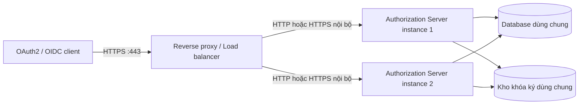

# Reverse proxy, load balancer và xác định public issuer ổn định

Khi triển khai Spring Authorization Server phía sau reverse proxy hoặc load balancer, ứng dụng thường chỉ nhìn thấy kết nối nội bộ, chẳng hạn `http://authorization-server:9000`. Trong khi đó, client và resource server truy cập authorization server bằng địa chỉ công khai như `https://auth.example.com`. Nếu ứng dụng không nhận diện đúng thông tin của request bên ngoài, nó có thể tạo URL dùng sai scheme hoặc host, phát hành token có claim `iss` không ổn định, hoặc trả về metadata OIDC trỏ đến địa chỉ nội bộ.

Mục tiêu của cấu hình triển khai là giữ một issuer công khai duy nhất cho toàn bộ cụm máy chủ, chuyển tiếp thông tin proxy qua một ranh giới tin cậy, và bảo đảm mọi instance dùng chung trạng thái cấp quyền cùng khóa ký. Đây là các điều kiện nền tảng để client có thể khám phá endpoint, đổi authorization code, làm mới token và xác minh chữ ký một cách nhất quán khi request được định tuyến đến bất kỳ instance nào.

## 1. Nhìn đúng topology bên ngoài và bên trong

Một topology phổ biến có dạng:



Client chỉ nên biết địa chỉ công khai `https://auth.example.com`. Tên DNS nội bộ, cổng `9000`, địa chỉ pod hoặc hostname của từng instance là chi tiết triển khai. Khi request đi qua proxy, ứng dụng cần biết các thuộc tính công khai mà proxy đã xác nhận, thường gồm:

- Scheme bên ngoài: `https`.
- Host bên ngoài: `auth.example.com`.
- Port bên ngoài: `443`.
- Prefix hoặc context path công khai, nếu authorization server được đặt dưới một đường dẫn như `/auth`.
- Địa chỉ IP client theo chuỗi proxy tin cậy, nếu ứng dụng thực sự cần thông tin này.

Reverse proxy thường kết thúc TLS, kiểm tra kết nối và chuyển tiếp HTTP đến ứng dụng trong mạng riêng. Load balancer phân phối request đến một trong nhiều instance khỏe mạnh. Hai vai trò có thể nằm trong cùng một thành phần hoặc ở nhiều tầng khác nhau. Dù topology có bao nhiêu tầng, chỉ những proxy nằm trong ranh giới tin cậy mới được phép quyết định các header chuyển tiếp.

## 2. Public issuer là định danh ổn định của authorization server

Issuer là URI định danh authorization server. Với OpenID Connect, claim `iss` trong ID Token phải khớp chính xác issuer mà client đã tin cậy. Metadata discovery cũng công bố issuer này cùng các endpoint như authorization, token và JWKS. Vì vậy, issuer phải đại diện cho địa chỉ công khai chuẩn của dịch vụ, không phải địa chỉ mà một instance tình cờ nhìn thấy trong request.

Ví dụ, cụm authorization server có thể chạy trên nhiều máy chủ nội bộ, nhưng tất cả phải dùng cùng issuer:

```text
https://auth.example.com
```

Giá trị này cần nhất quán giữa các instance, môi trường và cấu hình client tương ứng. Không dùng các địa chỉ sau làm issuer trong môi trường production:

- `http://localhost:9000` hoặc hostname của container.
- IP riêng của một instance.
- Host header do client tùy ý gửi lên.
- Một URL thay đổi theo từng request hoặc từng node.

Nếu không cấu hình issuer cố định, Spring Authorization Server có thể xác định issuer dựa trên request hiện tại. Phía sau proxy, request nội bộ có thể mang scheme `http`, host nội bộ hoặc port khác với địa chỉ public. Khi đó, metadata và token có nguy cơ phản ánh thông tin sai hoặc không nhất quán. Cấu hình issuer tĩnh giúp loại bỏ sự phụ thuộc này.

### 2.1. Khai báo issuer trong Spring Authorization Server

Đặt issuer theo môi trường trong cấu hình ứng dụng. `app.security.issuer` dưới đây là property do ứng dụng tự định nghĩa:

```yaml
app:
  security:
    issuer: https://auth.example.com

server:
  forward-headers-strategy: framework
```

Đăng ký một bean `AuthorizationServerSettings` dùng property đó:

```java
import org.springframework.beans.factory.annotation.Value;
import org.springframework.context.annotation.Bean;
import org.springframework.context.annotation.Configuration;
import org.springframework.security.oauth2.server.authorization.settings.AuthorizationServerSettings;

@Configuration
public class AuthorizationServerDeploymentConfiguration {

    @Bean
    AuthorizationServerSettings authorizationServerSettings(
            @Value("${app.security.issuer}") String issuer) {
        return AuthorizationServerSettings.builder()
                .issuer(issuer)
                .build();
    }
}
```

Spring Authorization Server sử dụng `AuthorizationServerSettings` để xác định issuer và các đường dẫn endpoint. Hãy bảo đảm ứng dụng chỉ có một bean cấu hình này và mọi instance nhận cùng giá trị từ cấu hình triển khai. Có thể cấp giá trị qua biến môi trường hoặc secret/configuration manager; không nên hard-code hostname của một node trong mã nguồn.

Trong ví dụ trên, issuer không có dấu `/` ở cuối. Nếu hệ thống chọn một dạng URI khác, hãy giữ nguyên một dạng chuẩn trong cấu hình server, metadata, cấu hình client và quy trình kiểm thử. So khớp issuer là so khớp URI chính xác, nên khác scheme, host, port hoặc path đều có ý nghĩa.

Mỗi môi trường có thể có issuer riêng, ví dụ `https://auth.dev.example.com` và `https://auth.example.com`. Không trộn token của môi trường này với issuer được tin cậy ở môi trường khác.

### 2.2. Kiểm tra discovery metadata

Khi OIDC được bật, endpoint discovery thường có dạng:

```text
https://auth.example.com/.well-known/openid-configuration
```

Authorization server cũng có thể công bố OAuth 2.0 Authorization Server Metadata theo RFC 8414 tại endpoint well-known tương ứng. Đường dẫn cụ thể phụ thuộc issuer và phiên bản/cấu hình server.

Metadata công khai phải chứa issuer đã cấu hình và các endpoint có thể truy cập từ mạng của client. Ví dụ, các URL như `authorization_endpoint`, `token_endpoint` và `jwks_uri` không được trỏ đến hostname nội bộ như `authorization-server:9000`. Không chỉ kiểm tra trường `issuer`; hãy kiểm tra toàn bộ URL endpoint và thử truy cập chúng từ một mạng bên ngoài cụm.

## 3. Reverse proxy phải chuyển tiếp đúng thông tin public

Proxy cần tạo hoặc ghi đè các header chuyển tiếp dựa trên kết nối mà nó thực sự tiếp nhận. Hai nhóm header thường gặp là:

| Header | Ý nghĩa |
|---|---|
| `Forwarded` | Header chuẩn theo RFC 7239, có thể mang `proto`, `host` và `for` |
| `X-Forwarded-Proto` | Scheme bên ngoài, ví dụ `https` |
| `X-Forwarded-Host` | Host bên ngoài, ví dụ `auth.example.com` |
| `X-Forwarded-Port` | Port bên ngoài, ví dụ `443` |
| `X-Forwarded-For` | Chuỗi địa chỉ IP qua các proxy |
| `X-Forwarded-Prefix` | Prefix public nếu proxy có ánh xạ path |

Chọn một cách chuyển tiếp nhất quán. Tránh để `Forwarded` và các header `X-Forwarded-*` chứa những giá trị mâu thuẫn, vì kết quả xử lý có thể phụ thuộc framework hoặc cấu hình server.

### 3.1. Ví dụ Nginx khi Nginx kết thúc TLS

Ví dụ sau giả định Nginx trực tiếp nhận HTTPS từ client, còn các instance Spring chạy trong mạng riêng:

```nginx
upstream authorization_servers {
    least_conn;
    server authorization-server-1:9000 max_fails=3 fail_timeout=10s;
    server authorization-server-2:9000 max_fails=3 fail_timeout=10s;
}

server {
    listen 443 ssl;
    server_name auth.example.com;

    # ssl_certificate và ssl_certificate_key được cấu hình tại đây.

    location / {
        proxy_pass http://authorization_servers;
        proxy_http_version 1.1;

        proxy_set_header Host $host;
        proxy_set_header X-Forwarded-Host $host;
        proxy_set_header X-Forwarded-Proto https;
        proxy_set_header X-Forwarded-Port 443;
        proxy_set_header X-Forwarded-For $remote_addr;
        proxy_set_header X-Real-IP $remote_addr;
    }
}
```

Trong cấu hình này, Nginx ghi đè các header public thay vì chuyển nguyên giá trị do client gửi lên. `X-Forwarded-For` được đặt thành địa chỉ mà Nginx quan sát ở kết nối trực tiếp. Nếu có một load balancer tin cậy đứng trước Nginx, cần cấu hình nhận diện địa chỉ client từ đúng dải proxy đó rồi mới chuyển tiếp chuỗi IP đã được làm sạch. Không sử dụng giá trị `X-Forwarded-For` tùy ý từ Internet làm căn cứ phân quyền.

Ở tầng public, cấu hình virtual host mặc định để từ chối hostname không được công bố và chỉ phục vụ domain chuẩn `auth.example.com`. Điều này giúp tránh để một `Host` tùy ý đi vào ứng dụng qua cùng proxy.

Nếu TLS kết thúc tại một load balancer ở tầng trước, Nginx có thể chỉ nhận HTTP nội bộ. Khi đó `$scheme` tại Nginx là `http`, không phản ánh scheme public. Hãy chỉ lấy scheme public từ header mà load balancer tin cậy đã ghi đè, đồng thời giới hạn kết nối đến Nginx chỉ từ load balancer đó. Ví dụ, có thể chuyển tiếp `$http_x_forwarded_proto` sau khi đã thiết lập ranh giới tin cậy ở tầng trước. Không áp dụng cách này nếu client Internet vẫn có thể gửi trực tiếp header đó đến Nginx.

### 3.2. Bảo vệ ranh giới tin cậy của forwarded headers

Forwarded headers là dữ liệu đầu vào có thể ảnh hưởng đến cách ứng dụng tạo URL, redirect và ghi nhận địa chỉ client. Nếu ứng dụng tin header do client tự đặt, kẻ tấn công có thể giả mạo host hoặc scheme, gây ra URL độc hại, redirect sai hoặc làm sai lệch log.

Các nguyên tắc triển khai:

1. Proxy biên phải xóa hoặc ghi đè header `Forwarded` và `X-Forwarded-*` đến từ request Internet trước khi gửi vào backend.
2. Chỉ cho phép backend nhận traffic từ proxy/load balancer đã xác định; dùng firewall, security group, network policy hoặc mTLS tùy kiến trúc.
3. Mỗi tầng proxy phải có quy ước rõ ràng về việc thêm, ghi đè và tin cậy từng phần tử trong chuỗi forwarded headers.
4. Không bật xử lý forwarded headers trên một backend có thể bị truy cập trực tiếp từ mạng không tin cậy.
5. Không dùng `X-Forwarded-For` chưa được làm sạch để quyết định quyền truy cập hoặc danh tính người dùng.

Việc cấu hình `server.forward-headers-strategy` chỉ làm cho Spring xử lý các header này; nó không tự tạo ra ranh giới tin cậy cho hạ tầng mạng.

## 4. Để Spring nhận diện request bên ngoài

Spring Boot hỗ trợ property `server.forward-headers-strategy` để chọn cách xử lý thông tin từ proxy:

| Giá trị | Cách hoạt động |
|---|---|
| `NONE` | Không xử lý forwarded headers |
| `NATIVE` | Dùng khả năng hỗ trợ của web server/container |
| `FRAMEWORK` | Dùng cơ chế của Spring Framework, thường thông qua `ForwardedHeaderFilter` |

Ví dụ cấu hình `FRAMEWORK` đã được đặt trong `application.yml` ở phần issuer. Khi dùng lựa chọn này, Spring có thể điều chỉnh thông tin request như scheme, host, port và prefix dựa trên forwarded headers. Vì vậy, các thành phần tạo URL từ request có cơ hội tạo URL phù hợp với địa chỉ public.

Chỉ chọn một chiến lược phù hợp với container và topology thực tế. `NATIVE` có thể thích hợp khi container đã được cấu hình để xử lý proxy headers; `FRAMEWORK` hữu ích khi muốn dùng filter của Spring. Đừng bật nhiều cơ chế xử lý chồng lấn nếu chưa xác minh thứ tự và kết quả. Với Tomcat hoặc container cụ thể, kiểm tra tài liệu phiên bản Spring Boot đang dùng để biết các tùy chọn bổ sung cần thiết.

Issuer tĩnh vẫn là nguồn định danh chuẩn của authorization server. Forwarded headers bổ sung thông tin về request public để ứng dụng xử lý redirect và URL đúng cách; chúng không nên trở thành cơ chế để mỗi request tự thay đổi issuer.

## 5. Xử lý context path và URL được rewrite

Một số hệ thống công bố authorization server ở root domain:

```text
https://auth.example.com/oauth2/authorize
```

Một số hệ thống đặt server dưới prefix:

```text
https://example.com/auth/oauth2/authorize
```

Trong trường hợp thứ hai, issuer thường phải phản ánh prefix public, ví dụ:

```text
https://example.com/auth
```

Điều quan trọng là cách proxy ánh xạ path phải khớp với cách ứng dụng hiểu context path. Có hai hướng thường dùng:

- Giữ nguyên prefix khi chuyển tiếp và cấu hình ứng dụng chạy dưới context path tương ứng.
- Proxy loại bỏ prefix trước khi chuyển tiếp; khi đó phải cấu hình cơ chế forwarded prefix mà framework hỗ trợ và xác minh các URL được tạo ra.

Không cấu hình issuer có `/auth` trong khi proxy bỏ prefix và ứng dụng không biết prefix public; cũng không để ứng dụng tạo endpoint lặp `/auth/auth`. Khi thay đổi path mapping, kiểm tra discovery metadata, redirect đăng nhập, callback URI và các endpoint OAuth2/OIDC thực tế.

Nếu không có yêu cầu đặc biệt, đặt authorization server tại một hostname riêng và phục vụ từ root thường giúp giảm độ phức tạp của path rewrite.

## 6. Chạy nhiều instance sau load balancer

Load balancer có thể gửi hai request liên tiếp của cùng một luồng đến hai instance khác nhau. Vì vậy, mọi instance phải cùng hiểu một authorization server và có thể truy cập dữ liệu cần thiết để tiếp tục luồng OAuth2/OIDC.

### 6.1. Chia sẻ dữ liệu cấp quyền

Các implementation in-memory hữu ích cho phát triển hoặc kiểm thử đơn instance, nhưng không đủ cho cụm production. Ví dụ, `InMemoryRegisteredClientRepository`, `InMemoryOAuth2AuthorizationService` và `InMemoryOAuth2AuthorizationConsentService` lưu dữ liệu trong bộ nhớ riêng của từng tiến trình. Nếu request tiếp theo đến node khác, node đó có thể không tìm thấy client, authorization code, refresh token hoặc consent vừa được tạo.

Với Spring Authorization Server, có thể dùng các JDBC implementation cùng một database dùng chung:

```java
import org.springframework.context.annotation.Bean;
import org.springframework.jdbc.core.JdbcTemplate;
import org.springframework.security.oauth2.server.authorization.JdbcOAuth2AuthorizationConsentService;
import org.springframework.security.oauth2.server.authorization.JdbcOAuth2AuthorizationService;
import org.springframework.security.oauth2.server.authorization.OAuth2AuthorizationConsentService;
import org.springframework.security.oauth2.server.authorization.OAuth2AuthorizationService;
import org.springframework.security.oauth2.server.authorization.client.JdbcRegisteredClientRepository;
import org.springframework.security.oauth2.server.authorization.client.RegisteredClientRepository;

@Bean
RegisteredClientRepository registeredClientRepository(JdbcTemplate jdbcTemplate) {
    return new JdbcRegisteredClientRepository(jdbcTemplate);
}

@Bean
OAuth2AuthorizationService authorizationService(
        JdbcTemplate jdbcTemplate,
        RegisteredClientRepository registeredClientRepository) {
    return new JdbcOAuth2AuthorizationService(jdbcTemplate, registeredClientRepository);
}

@Bean
OAuth2AuthorizationConsentService authorizationConsentService(
        JdbcTemplate jdbcTemplate,
        RegisteredClientRepository registeredClientRepository) {
    return new JdbcOAuth2AuthorizationConsentService(
            jdbcTemplate, registeredClientRepository);
}
```

Các import tương ứng nằm trong package `org.springframework.security.oauth2.server.authorization`. `JdbcRegisteredClientRepository` nằm trong package con `client`. Hãy dùng schema SQL đi kèm đúng phiên bản Spring Authorization Server cho các bảng registered client, authorization và consent; quản lý thay đổi schema bằng migration có kiểm soát.

Database dùng chung cần đáp ứng độ bền dữ liệu, backup, giám sát connection pool và khả năng chịu lỗi phù hợp. Những thao tác như sử dụng authorization code hoặc cập nhật refresh token cần có tính nhất quán và cập nhật nguyên tử theo yêu cầu của luồng OAuth2. Tránh đọc trạng thái authorization từ replica có độ trễ nếu điều đó có thể khiến một token vừa tạo hoặc vừa thu hồi chưa xuất hiện ở node xử lý request tiếp theo.

### 6.2. Phân biệt authorization state và HTTP session

Database của `OAuth2AuthorizationService` lưu trạng thái OAuth2 như authorization code, access token, refresh token và các thuộc tính liên quan. HTTP session lại giữ trạng thái phiên đăng nhập của người dùng, chẳng hạn `SecurityContext`, request cần tiếp tục sau đăng nhập hoặc dữ liệu CSRF.

Chia sẻ authorization state không tự động chia sẻ HTTP session. Nếu người dùng bắt đầu đăng nhập ở node A nhưng request tiếp theo đến node B, node B cần đọc được session tương ứng. Có thể dùng Spring Session với Redis hoặc một kho session phân tán tương thích. Sticky session ở load balancer có thể giảm việc đổi node trong một phiên, nhưng không thay thế việc chia sẻ dữ liệu cấp quyền, session khi cần failover, hay khóa ký.

Cookie session cần được cấu hình phù hợp với HTTPS, `Secure`, `HttpOnly` và chính sách `SameSite` theo luồng đăng nhập thực tế. Khi thay đổi domain hoặc context path, kiểm tra lại phạm vi cookie và hành vi redirect.

### 6.3. Dùng chung khóa ký và JWK Set

Các instance phải ký token bằng tập khóa nhất quán và công bố JWK Set tương ứng. Nếu mỗi instance tự sinh một RSA/EC key khi khởi động, node A có thể phát hành token bằng private key mà JWKS của node B không có public key tương ứng. Client hoặc resource server khi lấy JWKS qua load balancer có thể xác minh token lúc được, lúc không.

Trong production, lưu private key tại một kho quản lý khóa dùng chung hoặc cơ chế ký tập trung phù hợp, chẳng hạn secret manager, KMS hoặc HSM. Mọi instance phải dùng cùng key material đang hoạt động và công bố các public key cần thiết với `kid` ổn định. Không đưa private key vào repository hoặc log.

Với Spring Authorization Server, `JWKSource<SecurityContext>` là điểm tích hợp để cung cấp JWK cho quá trình ký và endpoint JWKS. Có thể nạp một `JWKSet` từ kho khóa được bảo vệ rồi cung cấp cho selector:

```java
import com.nimbusds.jose.jwk.JWKSet;
import com.nimbusds.jose.jwk.source.JWKSource;
import com.nimbusds.jose.proc.SecurityContext;
import org.springframework.context.annotation.Bean;

@Bean
JWKSource<SecurityContext> jwkSource(KeySetProvider keySetProvider) {
    // KeySetProvider là thành phần của ứng dụng, đọc key set từ kho khóa tin cậy.
    JWKSet jwkSet = keySetProvider.loadCurrentKeySet();
    return (selector, context) -> selector.select(jwkSet);
}
```

`KeySetProvider` ở đây là abstraction minh họa cho tích hợp kho khóa của hệ thống; cần triển khai việc đọc, phân quyền truy cập, cache và làm mới key set theo hạ tầng thực tế. Không tạo một key ngẫu nhiên mới độc lập trên từng node trong mỗi lần khởi động.

Khi xoay vòng khóa, phát hành key mới với `kid` mới, công bố public key mới trên JWKS, rồi chuyển các instance sang ký bằng key mới. Giữ public key cũ đủ lâu để resource server xác minh các token đã phát hành trước đó, ít nhất đến khi token tương ứng hết hạn và hết khoảng đệm vận hành. Sau đó mới loại bỏ key cũ. Tất cả node cần chuyển đổi theo cùng một kế hoạch.

## 7. Cấu hình load balancer cho vận hành an toàn

Load balancer nên phân phối request đến các instance sẵn sàng, đồng thời ngừng gửi traffic đến instance đang dừng hoặc lỗi. Một số điểm cần thiết:

- Health check readiness phải phản ánh khả năng nhận traffic, gồm kết nối tới các phụ thuộc thiết yếu theo chính sách của hệ thống.
- Khi deploy hoặc scale down, đưa instance ra khỏi pool, chờ request đang xử lý hoàn tất rồi mới dừng tiến trình.
- Giữ cấu hình issuer, endpoint path, forwarded-header strategy và key set nhất quán giữa các instance.
- Cấu hình timeout ở proxy/load balancer phù hợp với thời gian xử lý và các kết nối cần thiết; tránh cắt request token endpoint giữa chừng.
- Theo dõi tỷ lệ lỗi, độ trễ, số request theo node, kết nối database, lỗi đọc khóa và lỗi xác minh token.
- Bảo đảm các instance có phiên bản schema và cấu hình tương thích trong suốt rolling deployment.

Không nên dùng một health check chỉ kiểm tra tiến trình còn sống để kết luận instance đã sẵn sàng nhận traffic. Ngược lại, health check cũng không nên biến một phụ thuộc tùy chọn thành lý do loại bỏ toàn bộ cụm nếu chính sách availability không yêu cầu điều đó.

## 8. Kiểm thử issuer và proxy trước khi đưa vào production

Kiểm thử từ góc nhìn client bên ngoài cụm, vì gọi trực tiếp hostname nội bộ không chứng minh URL public đã đúng.

### 8.1. Kiểm tra metadata

```bash
curl --fail --silent --show-error \
  https://auth.example.com/.well-known/openid-configuration
```

Kiểm tra các trường `issuer`, `authorization_endpoint`, `token_endpoint` và `jwks_uri`. Chúng phải sử dụng scheme, host và path công khai đã công bố. Nếu hệ thống dùng path prefix, xác nhận prefix xuất hiện đúng một lần.

### 8.2. Kiểm tra issuer trong token

Thực hiện một luồng OIDC hợp lệ, nhận ID Token và giải mã phần payload để kiểm tra `iss`. Giá trị phải trùng chính xác với issuer đã cấu hình. Giải mã payload chỉ để kiểm tra nội dung; việc giải mã không thay thế xác minh chữ ký, `aud`, `exp`, `nonce` và các kiểm tra bảo mật khác của client.

### 8.3. Kiểm tra tính nhất quán giữa các node

Trong môi trường kiểm thử, lần lượt gửi request qua load balancer và xác nhận:

1. Discovery metadata luôn công bố cùng issuer và cùng endpoint public.
2. Token do node A phát hành có thể được xác minh bằng public key được lấy qua node B.
3. Authorization code được tạo khi request đến node A có thể được đổi thành token khi request tiếp theo đến node B.
4. Refresh token và consent được đọc/cập nhật nhất quán khi request đi qua nhiều node.
5. Phiên đăng nhập tiếp tục hoạt động khi load balancer chuyển request đến node khác, theo thiết kế session đã chọn.
6. Sau khi xoay vòng khóa, token cũ vẫn được xác minh trong khoảng thời gian dự kiến và token mới được xác minh trên mọi node.

### 8.4. Kiểm tra giả mạo forwarded headers

Gửi request thử nghiệm với `Host`, `Forwarded` hoặc `X-Forwarded-Host` giả mạo từ phía client. Proxy biên phải ghi đè hoặc loại bỏ giá trị không tin cậy. Issuer công bố vẫn phải là giá trị cấu hình chuẩn. Đồng thời, thử truy cập trực tiếp backend từ một mạng không được phép; kết nối phải bị chặn ở tầng mạng hoặc tầng bảo vệ tương ứng.

Không đưa authorization code, access token, refresh token, ID Token, client secret hoặc private key vào log khi thực hiện kiểm thử. Có thể ghi request ID, node xử lý, trạng thái endpoint và mã lỗi để truy vết.

## 9. Lỗi thường gặp và hướng điều tra

| Triệu chứng | Nguyên nhân có thể | Hướng xử lý |
|---|---|---|
| Discovery trả URL `http://` dù client dùng HTTPS | Proxy không gửi đúng proto hoặc ứng dụng chưa xử lý forwarded headers | Kiểm tra header tại từng tầng, `server.forward-headers-strategy` và ranh giới proxy |
| Metadata trỏ đến hostname nội bộ | Issuer chưa được cấu hình cố định hoặc URL được tạo từ request nội bộ | Cấu hình `AuthorizationServerSettings.issuer` bằng public issuer và kiểm tra metadata |
| Claim `iss` thay đổi giữa các request | Các node nhận cấu hình khác nhau hoặc issuer được suy ra từ request | Đồng bộ cấu hình issuer và kiểm thử request qua từng node |
| Một số token không xác minh được chữ ký | Các node dùng key set khác nhau hoặc JWKS bị cache/đổi khóa không đúng trình tự | Chia sẻ key set, kiểm tra `kid`, giữ public key cũ trong giai đoạn chuyển tiếp |
| Authorization code không tìm thấy khi đổi token | Dữ liệu authorization đang lưu trong bộ nhớ riêng của node | Dùng `OAuth2AuthorizationService` có lưu trữ dùng chung |
| Người dùng bị yêu cầu đăng nhập lại khi request đổi node | HTTP session không được chia sẻ hoặc sticky session không còn hiệu lực | Thiết kế session phân tán hoặc điều chỉnh chiến lược định tuyến có chủ đích |
| URL có prefix bị lặp hoặc mất prefix | Proxy rewrite path và context path của ứng dụng không khớp | Chuẩn hóa mapping path và kiểm tra metadata cùng redirect |
| Redirect hoặc log ghi nhận host lạ | Backend tin forwarded headers do client gửi trực tiếp | Chặn truy cập trực tiếp, ghi đè header tại proxy biên và chỉ tin proxy đã xác định |

## 10. Checklist triển khai

- [ ] Public issuer là URI HTTPS chuẩn, ổn định và được cấu hình rõ ràng trong `AuthorizationServerSettings`.
- [ ] Tất cả instance dùng cùng issuer, endpoint path và cấu hình môi trường.
- [ ] Reverse proxy ghi đè forwarded headers từ kết nối public; backend chỉ nhận traffic từ proxy tin cậy.
- [ ] Spring xử lý forwarded headers bằng chiến lược phù hợp với container.
- [ ] Context path và quy tắc rewrite của proxy khớp với URL public.
- [ ] Registered clients, authorizations và consents được lưu trong kho dữ liệu dùng chung, có schema và backup phù hợp.
- [ ] HTTP session được chia sẻ hoặc được định tuyến theo một thiết kế đã kiểm thử.
- [ ] Các instance dùng chung khóa ký; JWKS công bố đầy đủ public key cần thiết cho giai đoạn xoay vòng.
- [ ] Readiness, draining, rolling deployment và giám sát được cấu hình cho load balancer.
- [ ] Discovery metadata, claim `iss`, JWKS, authorization code, refresh token và failover giữa các node đã được kiểm thử từ bên ngoài cụm.

Một cụm Spring Authorization Server có thể mở rộng an toàn khi địa chỉ public được xác định một cách nhất quán, proxy chỉ chuyển tiếp dữ liệu đã được tin cậy, và mọi instance cùng truy cập trạng thái cấp quyền cũng như khóa ký cần thiết. Load balancer khi đó có thể phân phối request giữa các node mà không làm thay đổi danh tính của authorization server hoặc phá vỡ luồng OAuth2/OIDC.
