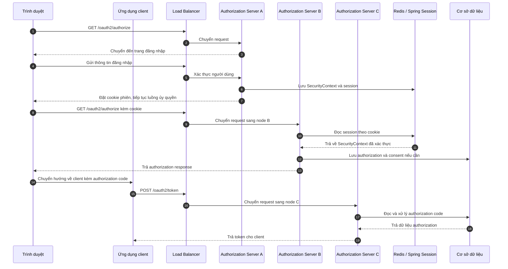

# Quản lý session phân tán và tính nhất quán trải nghiệm SSO

Khi triển khai Spring Authorization Server trên nhiều instance, người dùng cần đăng nhập một lần và tiếp tục đi qua các yêu cầu ủy quyền mà không bị yêu cầu đăng nhập lại chỉ vì load balancer chuyển request sang máy chủ khác. Để đạt được điều đó, các instance phải nhìn thấy cùng trạng thái đăng nhập, cùng dữ liệu OAuth 2.0/OIDC và cùng cấu hình tin cậy. Đây là ba lớp trạng thái có vòng đời khác nhau; gom chúng thành một khái niệm “session” dễ dẫn đến cấu hình sai.

Bài này trình bày cách thiết kế session phân tán, lưu trữ trạng thái cấp quyền dùng chung và kiểm soát đăng xuất trong một cụm Spring Authorization Server. Mục tiêu là giữ trải nghiệm SSO nhất quán khi mở rộng số instance, triển khai phiên bản mới hoặc chuyển request giữa các node.

## 1. Phân biệt các loại trạng thái trong luồng SSO

Một hệ thống Authorization Server thường có nhiều loại trạng thái cùng tham gia vào một luồng đăng nhập:

| Trạng thái | Nội dung | Nơi lưu phù hợp | Ảnh hưởng khi chuyển node |
|---|---|---|---|
| Phiên trình duyệt tại Authorization Server | Cookie phiên, `SecurityContext`, thông tin xác thực và dữ liệu phiên đăng nhập | Kho session dùng chung, thường là Redis qua Spring Session | Node nhận request tiếp theo phải khôi phục được người dùng đã đăng nhập |
| Authorization và consent | Authorization code, access token, refresh token, ID token, trạng thái cấp quyền và consent | Cơ sở dữ liệu dùng chung qua `OAuth2AuthorizationService` và `OAuth2AuthorizationConsentService` | Node xử lý token phải đọc được authorization đã tạo ở node khác |
| Đăng ký OAuth client | Client ID, secret, redirect URI, grant type, scope và cấu hình client | Cơ sở dữ liệu hoặc kho cấu hình dùng chung qua `RegisteredClientRepository` | Mọi node phải áp dụng cùng chính sách cho một client |
| Khóa ký token và metadata nhà cung cấp | Khóa riêng, khóa công khai, `kid`, issuer và cấu hình endpoint | KMS/HSM hoặc kho bí mật được quản lý tập trung; cấu hình nhất quán trên mọi node | Token do node này ký phải được các node và bên nhận token xác minh đúng |
| Phiên tại ứng dụng client | Cookie và trạng thái đăng nhập của người dùng ở từng ứng dụng | Kho session riêng của từng ứng dụng hoặc cơ chế xác thực riêng | Đăng xuất khỏi Authorization Server không tự động xóa phiên của mọi ứng dụng client |

`HttpSession` và `SecurityContext` trả lời câu hỏi “trình duyệt này đã đăng nhập với Authorization Server chưa?”. `OAuth2AuthorizationService` trả lời câu hỏi “mã cấp quyền hoặc token này thuộc authorization nào và đang ở trạng thái nào?”. Hai câu hỏi liên quan nhưng không thể thay thế cho nhau.

Ví dụ, người dùng đăng nhập thành công ở node A. Nếu node B không đọc được session của node A, node B có thể chuyển người dùng về trang đăng nhập lần nữa. Ngược lại, nếu session đã được chia sẻ nhưng authorization code chỉ nằm trong bộ nhớ node A, request đổi code tại node C vẫn có thể thất bại. Vì vậy, chỉ đưa `HttpSession` vào Redis chưa đủ để tạo một cụm Authorization Server nhất quán.

## 2. Điều gì xảy ra khi một luồng SSO đi qua nhiều node?

Giả sử load balancer phân phối request đến ba instance. Trình duyệt giữ cookie phiên của Authorization Server; các instance đọc và ghi dữ liệu session vào Redis. Authorization, consent và thông tin client được lưu trong cơ sở dữ liệu dùng chung.



Điểm cần chú ý là cookie chỉ mang định danh session. Dữ liệu xác thực thực tế được tải từ Redis. Authorization code được xử lý dựa trên dữ liệu authorization trong cơ sở dữ liệu. Request đến token endpoint thường được gửi từ backend của client và không cần dựa vào cookie đăng nhập của trình duyệt.

## 3. Chia sẻ session bằng Spring Session và Redis

Trong triển khai mặc định, session có thể nằm trong bộ nhớ của servlet container. Cách này phù hợp cho phát triển đơn instance, nhưng không bảo đảm node khác đọc được session. Có hai lựa chọn phổ biến khi chạy nhiều node:

- **Session affinity (sticky session):** load balancer cố gắng gửi các request của một trình duyệt về cùng node. Cách này giảm việc chuyển session giữa node, nhưng không giải quyết đầy đủ tình huống node khởi động lại, scale in, bảo trì hoặc lỗi đột ngột. Nó cũng không chia sẻ authorization và consent.
- **Session store dùng chung:** Spring Session thay thế phần lưu `HttpSession` cục bộ bằng kho dùng chung như Redis hoặc JDBC. Với Redis, mọi node có thể tải cùng session theo cookie. Đây thường là lựa chọn phù hợp hơn cho cụm Authorization Server cần tính sẵn sàng.

Sticky session có thể được giữ lại như một tối ưu định tuyến, nhưng tính đúng đắn của hệ thống nên dựa trên kho session dùng chung. Khi session đã được chia sẻ, load balancer có thể phân phối request đến bất kỳ node khỏe mạnh nào.

### Cấu hình Spring Session Redis

Với Spring Boot, thêm các dependency tương ứng cho Redis và Spring Session, ví dụ `spring-boot-starter-data-redis` và `spring-session-data-redis` theo phiên bản Spring Boot đang dùng. Khi Spring Session Redis có trên classpath và Redis được cấu hình, Spring Boot có thể tự cấu hình repository session. Ứng dụng không cần khai báo thêm `@EnableRedisHttpSession` nếu đang dùng cơ chế auto-configuration này. Với ứng dụng không dùng auto-configuration, có thể cấu hình Spring Session tường minh theo hướng dẫn của phiên bản tương ứng.

Ví dụ cấu hình minh họa trong `application.yml`:

```yaml
spring:
  data:
    redis:
      host: redis.internal.example
      port: 6379
      username: authorization-server
      password: ${REDIS_PASSWORD}
      ssl:
        enabled: true
  session:
    redis:
      namespace: "auth-server:prod:sessions"
      flush-mode: on-save

server:
  servlet:
    session:
      timeout: 30m
      cookie:
        name: AUTH_SESSION
        http-only: true
        secure: true
        same-site: lax
```

Các giá trị host, thông tin xác thực và thời hạn trong ví dụ cần được điều chỉnh theo môi trường. Không lưu mật khẩu Redis trực tiếp trong repository; cấp nó qua secret manager hoặc biến môi trường được quản lý. Dùng TLS, ACL riêng cho ứng dụng và giới hạn mạng truy cập Redis. Namespace giúp tách session giữa các ứng dụng hoặc môi trường, tránh việc một cụm staging vô tình đọc session của production.

Cookie phiên nên được cấu hình có chủ đích:

- `HttpOnly` ngăn JavaScript phía trình duyệt đọc cookie phiên.
- `Secure` yêu cầu trình duyệt chỉ gửi cookie qua HTTPS.
- `SameSite=Lax` thường phù hợp với luồng authorization code dùng chuyển hướng điều hướng cấp cao qua GET. Nếu hệ thống dùng callback POST xuyên site, chẳng hạn một cách triển khai `form_post`, cần đánh giá lại chính sách cookie; `SameSite=None` yêu cầu `Secure` và chỉ nên bật khi luồng thực sự cần.
- Giữ cookie ở dạng host-only nếu không có yêu cầu chia sẻ cookie giữa các subdomain. Không đặt domain rộng chỉ để các ứng dụng client dùng chung cookie của Authorization Server.

Tên thuộc tính cấu hình có thể khác giữa các phiên bản Spring Boot. Hãy đối chiếu với tài liệu của phiên bản đang chạy và kiểm tra cookie thực tế trên trình duyệt sau khi đi qua reverse proxy.

### Thời hạn và vòng đời session

Thời hạn session điều khiển khoảng thời gian người dùng có thể tiếp tục phiên đăng nhập mà không cần xác thực lại. Nó không phải thời hạn của access token hay refresh token. Redis cần áp dụng TTL phù hợp với thời hạn session; thao tác gia hạn session phải được phản ánh trên kho dùng chung.

Chọn thời hạn theo chính sách bảo mật và trải nghiệm sản phẩm. Hệ thống có thể cần thời gian không hoạt động tối đa, thời hạn tuyệt đối của phiên đăng nhập và chính sách yêu cầu xác thực lại cho thao tác nhạy cảm. Nếu chỉ dùng một TTL dài, phiên bị bỏ quên có thể tồn tại lâu hơn mong muốn. Nếu TTL quá ngắn, người dùng có thể bị yêu cầu đăng nhập lại giữa quy trình SSO.

## 4. Lưu authorization, consent và client ở nơi dùng chung

Spring Authorization Server cung cấp các abstraction để quản lý dữ liệu OAuth 2.0/OIDC. Trong cấu hình mẫu hoặc phát triển, các implementation lưu trong bộ nhớ có thể giúp khởi chạy nhanh. Trong cụm nhiều instance, implementation trong bộ nhớ của từng node tạo ra các tập dữ liệu tách biệt và mất dữ liệu khi tiến trình khởi động lại.

Các thành phần cần được chia sẻ gồm:

- `RegisteredClientRepository`: lưu đăng ký client, redirect URI, grant type, scope và chính sách liên quan.
- `OAuth2AuthorizationService`: lưu authorization và các credential/token liên quan đến authorization.
- `OAuth2AuthorizationConsentService`: lưu consent mà người dùng đã cấp cho client.

Với cơ sở dữ liệu quan hệ, Spring Authorization Server cung cấp các implementation JDBC. Ví dụ cấu hình bean tối giản:

```java
@Configuration
public class AuthorizationPersistenceConfiguration {

    @Bean
    RegisteredClientRepository registeredClientRepository(JdbcTemplate jdbcTemplate) {
        return new JdbcRegisteredClientRepository(jdbcTemplate);
    }

    @Bean
    OAuth2AuthorizationService authorizationService(
            JdbcTemplate jdbcTemplate,
            RegisteredClientRepository registeredClientRepository) {
        return new JdbcOAuth2AuthorizationService(
                jdbcTemplate, registeredClientRepository);
    }

    @Bean
    OAuth2AuthorizationConsentService authorizationConsentService(
            JdbcTemplate jdbcTemplate,
            RegisteredClientRepository registeredClientRepository) {
        return new JdbcOAuth2AuthorizationConsentService(
                jdbcTemplate, registeredClientRepository);
    }
}
```

Các class JDBC cần được import từ Spring Authorization Server và cơ sở dữ liệu phải có schema tương ứng với phiên bản thư viện. Quản lý schema bằng migration có kiểm soát, chẳng hạn Flyway hoặc Liquibase; không để mọi instance tự chạy migration đồng thời khi khởi động production. Cấu hình connection pool, transaction và quyền truy cập database riêng cho dịch vụ.

Authorization code là credential dùng một lần. Khi xử lý code đồng thời, hệ thống phải bảo đảm việc kiểm tra và đánh dấu code đã sử dụng có tính nhất quán để hai request không cùng đổi được một code. Dùng implementation persistence được hỗ trợ, transaction và cơ chế cập nhật phù hợp; không tự xây một cache cục bộ làm nguồn sự thật cho authorization.

Session Redis và authorization database có nhiệm vụ riêng. Nếu Redis hoạt động nhưng database không truy cập được, người dùng có thể vẫn có session đăng nhập nhưng Authorization Server không thể hoàn tất việc tạo hoặc đọc authorization. Nếu database hoạt động nhưng Redis lỗi, node có thể không khôi phục được đăng nhập từ cookie. Cần giám sát và xử lý lỗi của cả hai kho.

## 5. Giữ issuer và khóa ký nhất quán giữa các instance

Mọi instance trong một cụm phải đại diện cho cùng một Authorization Server. Giá trị issuer công khai phải thống nhất, ví dụ `https://identity.example.com`, bất kể request nội bộ được load balancer chuyển đến node nào. Các URL endpoint được công bố trong metadata OIDC cũng phải nhất quán.

Khóa ký token cần được quản lý tập trung hoặc phân phối an toàn đến các instance. Nếu mỗi node tự tạo một cặp khóa tạm thời khi khởi động, token do node A ký có thể không được xác minh khi khóa công khai của node B được công bố, hoặc token mới phát hành trở nên khó xác minh sau khi node khởi động lại. Cấu hình `JWKSource`/JWK Set phải cung cấp cùng tập khóa phù hợp cho cụm và bảo đảm `kid` trỏ đến đúng khóa.

Khi xoay khóa, công bố khóa công khai mới trước khi dùng khóa riêng mới để ký; giữ khóa công khai cũ trong JWK Set đủ lâu để các token đã phát hành còn hạn vẫn được xác minh. Chỉ gỡ khóa cũ khi không còn token hợp lệ cần nó theo chính sách của hệ thống. Khóa riêng nên nằm trong KMS, HSM hoặc secret store có kiểm soát truy cập; không đóng gói trực tiếp trong image container.

Nếu Authorization Server chạy sau reverse proxy, cấu hình xử lý forwarded headers và URL bên ngoài chính xác. Sai lệch giữa HTTP nội bộ và HTTPS công khai có thể làm sai issuer, redirect URI hoặc cookie `Secure`, gây lỗi đăng nhập khó tái hiện. Chỉ tin forwarded headers từ proxy đáng tin cậy.

## 6. Đăng xuất và thu hồi quyền là hai thao tác liên quan

Đăng xuất khỏi Authorization Server thường bắt đầu bằng việc xóa `SecurityContext` và vô hiệu hóa `HttpSession`. Với Spring Security, cấu hình logout có thể dùng các thao tác sau:

```java
http.logout(logout -> logout
    .invalidateHttpSession(true)
    .clearAuthentication(true)
    .deleteCookies("AUTH_SESSION"));
```

Khi session được quản lý bởi Spring Session Redis, việc vô hiệu hóa session phải được ghi nhận trong repository dùng chung. Request tiếp theo từ cùng trình duyệt sẽ không còn khôi phục được phiên đăng nhập cũ. Cần kiểm tra tên cookie thực tế và cấu hình logout phù hợp với filter chain của ứng dụng.

Tuy nhiên, xóa session đăng nhập không tự động làm mất hiệu lực mọi token đã phát hành. Một access token dạng JWT có thể tiếp tục được resource server chấp nhận đến khi hết hạn nếu resource server chỉ kiểm tra chữ ký và claim. Refresh token cũng có vòng đời riêng. Khi nghiệp vụ yêu cầu đăng xuất đồng thời thu hồi quyền, cần xác định rõ authorization hoặc refresh token phải bị revoke, cách resource server nhận biết trạng thái thu hồi và thời gian tối đa token còn hiệu lực.

Tương tự, mỗi ứng dụng client thường có session cục bộ riêng. Đăng xuất khỏi Authorization Server không tự động xóa cookie session tại tất cả client. Nếu cần đăng xuất SSO trên nhiều ứng dụng, hãy thiết kế luồng OIDC logout phù hợp, chẳng hạn RP-Initiated Logout hoặc cơ chế front-channel/back-channel logout khi phiên bản thư viện và kiến trúc đang dùng hỗ trợ. Phải có ánh xạ giữa người dùng, phiên tại nhà cung cấp danh tính và phiên tại client để truyền thông tin đăng xuất đúng đích.

Một người dùng cũng có thể đăng nhập trên nhiều trình duyệt hoặc thiết bị, tương ứng với nhiều session khác nhau. Nếu có chức năng “đăng xuất mọi thiết bị”, cần một cách tra cứu và thu hồi toàn bộ session của người dùng, chẳng hạn repository có hỗ trợ index theo principal hoặc một bảng ánh xạ riêng. Vô hiệu hóa một session ID chỉ đăng xuất phiên hiện tại.

## 7. Kiểm soát nhất quán khi chạy nhiều instance

Một cụm có thể vẫn gặp lỗi SSO dù đã dùng Redis và database chung nếu các node không tuân theo cùng quy tắc vận hành:

**Tránh cache cục bộ làm nguồn dữ liệu chính.** Nếu client registration, consent, authorization hoặc trạng thái thu hồi được cache riêng trên từng node, một node có thể tiếp tục dùng dữ liệu cũ sau khi node khác cập nhật. Nếu cần cache để tăng hiệu năng, phải có chính sách hết hạn và vô hiệu hóa đồng bộ; dữ liệu bảo mật quan trọng vẫn phải được kiểm tra theo nguồn dùng chung.

**Giữ phiên bản dữ liệu tương thích khi rolling deployment.** Trong thời gian triển khai cuốn chiếu, các phiên bản ứng dụng có thể cùng đọc và ghi session Redis. Thay đổi cấu trúc principal, custom session attribute hoặc kiểu dữ liệu serialize cần tương thích ngược trong khoảng thời gian hai phiên bản cùng tồn tại. Không lưu object tùy biến không thể serialize hoặc không có chiến lược nâng cấp rõ ràng vào session.

**Đồng bộ thời gian giữa các node.** JWT có `iat`, `nbf` và `exp`; sai lệch đồng hồ có thể làm token bị coi là chưa hợp lệ hoặc hết hạn sớm. Đồng bộ thời gian hệ điều hành bằng dịch vụ NTP đáng tin cậy và chỉ cấu hình clock skew trong phạm vi cần thiết.

**Xử lý lỗi kho dùng chung có chủ đích.** Redis hoặc database mất kết nối không nên khiến mỗi node âm thầm quay về session hoặc authorization trong bộ nhớ riêng, vì điều đó tạo ra các trạng thái đăng nhập khác nhau. Thiết kế readiness/liveness, timeout, retry có giới hạn và phản hồi lỗi rõ ràng. Với thao tác xác thực hoặc cấp token, ưu tiên từ chối an toàn khi không thể xác minh trạng thái cần thiết.

**Bảo vệ dữ liệu session.** Session chứa thông tin xác thực và có thể chứa dữ liệu cá nhân. Hạn chế attribute được lưu, đặt TTL, mã hóa kết nối, giới hạn quyền truy cập và không ghi cookie, session ID, authorization code, access token hoặc refresh token vào log. Nếu cần truy vết, dùng correlation ID không mang bí mật.

## 8. Các tình huống kiểm thử cần có

Kiểm thử chỉ trên một instance không phát hiện được phần lớn lỗi phân tán. Hãy chạy ít nhất hai instance có cấu hình giống production và cùng kết nối đến Redis, database và kho khóa dùng chung.

| Tình huống | Cách thực hiện | Kết quả mong đợi |
|---|---|---|
| Đăng nhập ở node A, tiếp tục ở node B | Ép load balancer chuyển request authorize tiếp theo sang node khác nhưng giữ cookie | Node B tải được session; người dùng không phải đăng nhập lại |
| Đổi authorization code ở node C | Tạo code qua node A/B rồi gửi token request đến node C | Node C đọc được authorization và xử lý code đúng một lần |
| Hai request đổi cùng một code | Gửi đồng thời hai token request dùng cùng code | Chỉ một request thành công; request còn lại bị từ chối |
| Đăng xuất ở một node | Tạo session ở node A, logout qua node B rồi gửi request authorize qua node C | Session cũ không còn được khôi phục |
| Session hết hạn | Để session vượt TTL rồi gửi lại cookie cũ | Người dùng cần xác thực lại theo chính sách |
| Redis tạm thời không khả dụng | Ngắt kết nối Redis trong môi trường kiểm thử | Request phụ thuộc session lỗi có kiểm soát; không tạo session cục bộ gây lệch trạng thái |
| Database không khả dụng | Ngắt database khi đọc hoặc ghi authorization | Authorization/token request thất bại an toàn và có log/metric phù hợp |
| Xoay khóa ký | Phát hành token trước và sau khi đổi khóa | Token còn hạn vẫn được xác minh trong giai đoạn chuyển tiếp |
| Callback qua HTTPS proxy | Kiểm thử redirect và cookie qua hostname công khai | Issuer, redirect URL và thuộc tính cookie đúng với endpoint công khai |
| Triển khai cuốn chiếu | Cho hai phiên bản ứng dụng cùng đọc session trong thời gian nâng cấp | Session cũ vẫn đọc được; không phát sinh lỗi deserialize hoặc mất đăng nhập ngoài dự kiến |

Ngoài kiểm thử tích hợp, cần kiểm tra bằng trình duyệt thật các luồng redirect và thuộc tính cookie. Một bài kiểm thử HTTP không mô phỏng đầy đủ quy tắc `SameSite`, chính sách cookie và hành vi chuyển hướng của trình duyệt.

## 9. Vận hành và quan sát cụm Authorization Server

Theo dõi số session đang hoạt động, session được tạo/xóa/hết hạn, lỗi đọc ghi Redis, độ trễ Redis, kết nối database, connection pool và tỷ lệ lỗi ở authorization endpoint/token endpoint. Các chỉ số này giúp phân biệt lỗi đăng nhập do session store với lỗi cấp token do authorization persistence.

Log nên ghi node xử lý, endpoint, kết quả và correlation ID. Không log cookie phiên, session ID, mật khẩu, authorization code hoặc token. Khi cần điều tra một phiên, dùng định danh nội bộ đã được bảo vệ và có thời hạn lưu log phù hợp.

Health check nên phản ánh khả năng phục vụ thực tế. Một node có thể trả lời HTTP nhưng không thể hoàn tất đăng nhập nếu Redis hoặc database không sẵn sàng. Readiness cần cân nhắc các dependency bắt buộc cho luồng xác thực và cấp token; liveness không nên khiến toàn bộ cụm liên tục restart chỉ vì một dependency dùng chung đang gián đoạn.

Khi triển khai production, cần có kế hoạch phục hồi Redis và database, giới hạn tải khi dependency chậm, kiểm thử failover và xác minh lại luồng đăng nhập sau khi khôi phục. Session thường là trạng thái ngắn hạn nên có thể chấp nhận người dùng đăng nhập lại sau một sự cố nghiêm trọng theo chính sách sản phẩm; dữ liệu authorization, client và consent cần chiến lược backup/restore rõ ràng hơn.

## 10. Checklist thiết kế

- [ ] Tất cả instance dùng chung Spring Session store và cùng namespace theo môi trường.
- [ ] Cookie phiên có `HttpOnly`, `Secure`, `SameSite` và domain/path phù hợp với luồng redirect thực tế.
- [ ] `RegisteredClientRepository`, `OAuth2AuthorizationService` và `OAuth2AuthorizationConsentService` dùng dữ liệu bền vững, chia sẻ giữa các node.
- [ ] Authorization code được xử lý theo cơ chế dùng một lần khi có request đồng thời.
- [ ] Các node dùng cùng issuer, endpoint công khai và nguồn khóa ký; quy trình xoay khóa giữ khả năng xác minh token cũ.
- [ ] Logout vô hiệu hóa session dùng chung; chính sách thu hồi token và đăng xuất khỏi các client được xác định riêng.
- [ ] Không có fallback âm thầm sang trạng thái session/authorization cục bộ khi kho dùng chung lỗi.
- [ ] Rolling deployment tương thích với dữ liệu session đang tồn tại.
- [ ] Có kiểm thử chuyển node, logout, hết hạn, lỗi Redis/database và xoay khóa.
- [ ] Có metric và log đủ để điều tra sự cố mà không làm lộ session ID hoặc token.

Một cụm Spring Authorization Server có trải nghiệm SSO nhất quán khi mọi node cùng khôi phục được phiên đăng nhập của trình duyệt, cùng đọc và cập nhật trạng thái OAuth 2.0/OIDC, đồng thời phát hành token dưới một issuer và hệ thống khóa thống nhất. Thiết kế rõ ranh giới giữa session, authorization, client session và khóa ký giúp việc scale, failover và triển khai cuốn chiếu dễ dự đoán hơn.
