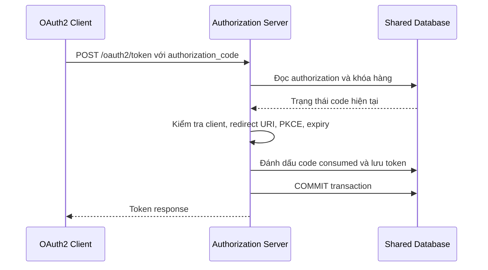

# Xử lý cạnh tranh khi redeem code, rotate refresh token và thu hồi token

Trong một Authorization Server chạy trên nhiều instance, cùng một authorization code hoặc refresh token có thể được gửi đến nhiều request gần như đồng thời. Nếu mỗi request đều đọc được trạng thái còn hiệu lực trước khi request khác ghi nhận việc sử dụng, nhiều request có thể cùng nhận được token mới. Đây là lỗi cạnh tranh ở tầng lưu trữ và giao dịch; việc bật HTTPS, dùng JWT hay tăng số instance không tự giải quyết được.

Bài học này tập trung vào ba chuyển đổi trạng thái cần được bảo vệ nguyên tử trong Spring Authorization Server: đổi authorization code lấy token, xoay vòng refresh token và thu hồi token. Mục tiêu là bảo đảm chỉ một request thắng khi sử dụng một credential dùng một lần, mọi instance nhìn thấy cùng một trạng thái có thẩm quyền, và thao tác thu hồi không bị một request refresh đang chạy ghi đè.

## 1. Các bất biến bảo mật cần giữ

Authorization Server cần duy trì các bất biến sau ở mọi instance và trong mọi tình huống retry:

| Đối tượng | Chuyển đổi hợp lệ | Bất biến |
|---|---|---|
| Authorization code | `ACTIVE → CONSUMED` | Một code chỉ được đổi thành công một lần. |
| Refresh token | `ACTIVE → CONSUMED`, sau đó phát hành token thế hệ kế tiếp | Một refresh token chỉ có một lần sử dụng thành công; token cũ không được kích hoạt lại. |
| Refresh-token family | `ACTIVE → REVOKED` | Khi phát hiện replay theo chính sách nghiêm ngặt, các refresh token còn hiệu lực trong cùng family phải bị vô hiệu hóa. |
| Authorization/grant | `ACTIVE → REVOKED` | Không được phát hành refresh token mới sau khi grant đã bị thu hồi. |
| Access token | `ACTIVE → REVOKED/INVALIDATED` | Resource Server phải có cơ chế nhận biết trạng thái thu hồi nếu cần hiệu lực tức thời. |

Các trạng thái này phải được lưu ở nơi dùng chung giữa các instance. Một biến `synchronized`, `ConcurrentHashMap`, session affinity hoặc lock trong bộ nhớ chỉ điều phối được request trong một tiến trình. Khi request thứ hai đến instance khác, nó không nhìn thấy lock hoặc dữ liệu đó.

## 2. Vì sao hai request có thể cùng đổi một authorization code?

Giả sử trình duyệt gửi cùng một authorization code hai lần do người dùng double-click, proxy retry hoặc client gửi request trùng. Hai instance có thể thực hiện trình tự sau:

1. Instance A đọc authorization và thấy code chưa hết hạn, chưa bị invalidated.
2. Instance B đọc cùng authorization trước khi A lưu thay đổi và cũng thấy code còn hợp lệ.
3. Cả hai kiểm tra client, redirect URI và PKCE thành công.
4. Cả hai tạo access token, có thể cả refresh token, rồi lưu authorization.
5. Hai response đều có thể trả token cho cùng một code.

Đây là lỗi kiểu *check-then-act*. Một lần đọc hợp lệ không bảo đảm request vẫn sở hữu quyền sử dụng token tại thời điểm ghi. Tăng isolation ở mức cấu hình chung cũng không đủ nếu thao tác đọc và cập nhật không nằm trong cùng transaction hoặc không có điều kiện cập nhật loại trừ request cạnh tranh.

Với authorization code, cần phân biệt hai thời điểm: **xác thực yêu cầu** và **nhận quyền tiêu thụ code**. Chỉ đánh dấu code đã dùng sau khi đã kiểm tra các dữ liệu cần thiết như client, redirect URI, grant type và PKCE. Nếu tiêu thụ code quá sớm, một request sai có thể làm người dùng mất code hợp lệ. Sau khi xác thực xong, thao tác nhận quyền tiêu thụ phải là thao tác nguyên tử.

## 3. Bảo vệ việc redeem authorization code

### 3.1. Dùng transaction và khóa hàng dữ liệu

Một cách triển khai là đọc authorization bằng khóa hàng trong transaction, xác thực code, đánh dấu code invalidated và lưu authorization trong cùng transaction. Với cơ sở dữ liệu hỗ trợ, thao tác đọc có thể dùng `SELECT ... FOR UPDATE` trên hàng đại diện cho authorization. Request thứ hai phải đợi request thứ nhất kết thúc; sau khi lấy được khóa, nó đọc trạng thái mới và bị từ chối nếu code đã được tiêu thụ.

```sql
-- SQL minh họa; tên bảng và cột phụ thuộc schema lưu trữ thực tế.
BEGIN;

SELECT id, authorization_code_value, authorization_code_expires_at,
       authorization_code_metadata
  FROM oauth2_authorization
 WHERE id = :authorization_id
 FOR UPDATE;

-- Trong cùng transaction:
-- 1. Kiểm tra code, client, redirect URI, PKCE và thời hạn.
-- 2. Đánh dấu authorization code đã invalidated.
-- 3. Lưu authorization cùng access token/refresh token mới.
-- 4. COMMIT trước khi response token được gửi cho client.

COMMIT;
```

Đây là ví dụ về cơ chế khóa, không phải câu lệnh có thể sao chép nguyên trạng cho mọi phiên bản schema của Spring Authorization Server. `SELECT ... FOR UPDATE` chỉ có tác dụng khi transaction thực sự bao quanh cả quá trình đọc, kiểm tra và ghi. Nếu mỗi thao tác chạy trong một transaction riêng, khóa đã được nhả trước khi trạng thái được cập nhật và race condition vẫn còn.

### 3.2. Dùng compare-and-set hoặc unique constraint

Một lựa chọn khác là cập nhật có điều kiện: chỉ request nhìn thấy trạng thái `ACTIVE` mới được đổi nó thành `CONSUMED`. Cần kiểm tra số hàng được cập nhật; đúng một hàng nghĩa là request thắng, không hàng nào nghĩa là code đã được dùng, hết hạn hoặc không còn hợp lệ.

```sql
UPDATE authorization_code_state
   SET state = 'CONSUMED', consumed_at = CURRENT_TIMESTAMP,
       version = version + 1
 WHERE code_fingerprint = :fingerprint
   AND state = 'ACTIVE'
   AND expires_at > CURRENT_TIMESTAMP;
```

`authorization_code_state` ở ví dụ trên là bảng mở rộng do ứng dụng quản lý, không phải tên bảng mặc định bắt buộc của Spring Authorization Server. Có thể thay bằng cột `version` và câu lệnh cập nhật có điều kiện trên bảng authorization hiện có. Điều quan trọng là điều kiện trạng thái phải nằm ngay trong câu lệnh ghi, và ứng dụng chỉ tiếp tục cấp token khi `rowsUpdated == 1`.

Một thiết kế khác dùng bảng claim với khóa duy nhất để ghi nhận code đã tiêu thụ:

```sql
CREATE TABLE oauth2_code_redemption (
    authorization_id VARCHAR(100) NOT NULL PRIMARY KEY,
    code_fingerprint CHAR(64) NOT NULL UNIQUE,
    consumed_at TIMESTAMP NOT NULL
);
```

Sau khi xác thực yêu cầu, ứng dụng insert một claim cho authorization code. Hai request cùng insert sẽ tranh chấp trên unique constraint và chỉ một request thành công. Việc insert claim, đánh dấu code invalidated và lưu authorization/token mới phải nằm trong cùng transaction. Nếu một bước sau đó lỗi, transaction rollback toàn bộ claim và trạng thái liên quan. Nếu lưu claim ở transaction độc lập, lỗi giữa chừng có thể làm code bị khóa vĩnh viễn dù chưa có token nào được phát hành.

Không lưu authorization code thô trong bảng claim hoặc log. Có thể lưu fingerprint được tạo bằng HMAC-SHA-256 với khóa bí mật của server; dùng fingerprint để tra cứu và đối chiếu mà không làm lộ bearer credential. Khóa HMAC cần được quản lý như secret và có kế hoạch luân chuyển.

### 3.3. Ranh giới transaction trong Spring Authorization Server

Spring Authorization Server sử dụng `OAuth2AuthorizationService` để tìm và lưu `OAuth2Authorization`. `JdbcOAuth2AuthorizationService` phù hợp để lưu trạng thái dùng chung trong môi trường nhiều instance; `InMemoryOAuth2AuthorizationService` chỉ phù hợp cho thử nghiệm hoặc môi trường đơn giản không cần chia sẻ trạng thái bền vững.

Việc dùng JDBC giúp các instance cùng đọc một kho dữ liệu, nhưng không nên mặc định rằng thao tác `findByToken` rồi `save` tự tạo thành một lần tiêu thụ nguyên tử. Cần kiểm tra đường đi của token endpoint ở phiên bản đang triển khai và bổ sung ranh giới transaction cùng cơ chế khóa hoặc compare-and-set cho bước redeem. Có thể thực hiện điều này bằng provider tùy chỉnh hoặc lớp dịch vụ giao dịch được tích hợp vào luồng xác thực token. Không đặt transaction ở một hàm chỉ bao quanh câu lệnh đọc trong khi phần đánh dấu invalidated và lưu token chạy ngoài transaction.

Trong luồng xử lý, thứ tự mong muốn là:



Transaction phải commit thành công trước khi response token được gửi. Nếu lưu trạng thái thất bại hoặc database không xác định được kết quả commit, server không được trả về một response thành công dựa trên dữ liệu chưa được xác nhận. Với client, lỗi timeout sau khi server đã commit có thể khiến lần retry nhận `invalid_grant`; đây là hệ quả của credential dùng một lần. Client cần khởi động lại authorization flow khi không thể khôi phục response gốc.

## 4. Rotate refresh token an toàn

### 4.1. Bật rotation trong cấu hình client

Khi refresh token được tái sử dụng qua nhiều lần refresh, một token bị đánh cắp có thể tiếp tục được dùng trong suốt thời hạn của nó. Rotation thay refresh token cũ bằng token mới sau mỗi lần refresh thành công. Trong Spring Authorization Server, có thể cấu hình rõ hành vi này bằng `reuseRefreshTokens(false)` trong `TokenSettings`:

```java
TokenSettings tokenSettings = TokenSettings.builder()
        .reuseRefreshTokens(false)
        .accessTokenTimeToLive(Duration.ofMinutes(5))
        .refreshTokenTimeToLive(Duration.ofDays(30))
        .build();

RegisteredClient registeredClient = RegisteredClient.withId(UUID.randomUUID().toString())
        .clientId("web-client")
        .clientAuthenticationMethod(ClientAuthenticationMethod.CLIENT_SECRET_BASIC)
        .authorizationGrantType(AuthorizationGrantType.AUTHORIZATION_CODE)
        .authorizationGrantType(AuthorizationGrantType.REFRESH_TOKEN)
        .redirectUri("https://client.example.com/login/oauth2/code/app")
        .scope(OidcScopes.OPENID)
        .scope("profile")
        .tokenSettings(tokenSettings)
        .build();
```

Đây là đoạn cấu hình minh họa; ứng dụng cần bổ sung các redirect URI, scope, phương thức xác thực và grant type đúng với client thực tế. `reuseRefreshTokens(false)` yêu cầu phát hành refresh token mới trong luồng refresh. Nó không thay thế việc đồng bộ trạng thái giữa nhiều request hoặc nhiều instance.

### 4.2. Race condition khi refresh đồng thời

Giả sử hai request cùng gửi refresh token `R1`:

| Thời điểm | Request A | Request B |
|---|---|---|
| T1 | Đọc `R1`, thấy active | |
| T2 | | Đọc `R1`, cũng thấy active |
| T3 | Tạo access token và `R2` | Tạo access token và `R3` |
| T4 | Lưu `R1` invalidated, `R2` active | Lưu `R1` invalidated, `R3` active |

Nếu cả hai request cùng hoàn tất, client có thể nhận hai refresh token kế tiếp. Trạng thái cuối cùng còn phụ thuộc thứ tự ghi và cách lưu authorization; một token có thể bị mất dấu hoặc cả hai response có thể được chấp nhận. Vì vậy, refresh token rotation cũng cần thao tác tiêu thụ nguyên tử.

Với kho trạng thái refresh token riêng, có thể dùng compare-and-set:

```sql
UPDATE oauth2_refresh_token
   SET state = 'CONSUMED', consumed_at = CURRENT_TIMESTAMP
 WHERE token_fingerprint = :fingerprint
   AND state = 'ACTIVE'
   AND expires_at > CURRENT_TIMESTAMP;
```

Chỉ request cập nhật đúng một hàng mới được tạo refresh token thế hệ kế tiếp. Việc đánh dấu token cũ đã dùng, thêm token mới, cập nhật `OAuth2Authorization` và kiểm tra grant còn active phải cùng một transaction. Nếu cập nhật không có hàng nào, server không được phát hành token mới.

### 4.3. Theo dõi refresh-token family và phát hiện replay

Mỗi lần rotation nên liên kết token mới với cùng một `family_id` và tăng `generation`. Có thể lưu fingerprint thay cho token thô, cùng các trường như `authorization_id`, `family_id`, `generation`, `state`, `issued_at`, `expires_at` và `consumed_at`.

Khi một fingerprint đã ở trạng thái `CONSUMED` được gửi lại, server có bằng chứng refresh token cũ đã bị replay. Với chính sách phát hiện replay nghiêm ngặt, server thu hồi toàn bộ refresh token còn active trong family và đánh dấu authorization tương ứng đã bị thu hồi. Client nhận lỗi `invalid_grant` và cần thực hiện lại authorization flow.

Chính sách này có một hệ quả vận hành: hai request refresh hợp lệ gửi đồng thời từ cùng một client cũng có thể khiến request thứ hai bị nhận diện là replay. Vì vậy, client nên điều phối refresh theo cơ chế *single-flight*: tại một thời điểm chỉ có một request refresh cho mỗi phiên hoặc grant; các request cần access token mới chờ kết quả refresh đó. Khi nhận refresh token mới, client phải cập nhật kho lưu trữ an toàn một cách nguyên tử trước khi cho các request tiếp theo sử dụng nó.

Một số hệ thống chọn khoảng thời gian ân hạn để xử lý retry do mạng. Cách này cần được thiết kế cẩn thận vì chấp nhận lại token cũ làm giảm khả năng phát hiện kẻ tấn công đang replay token. Chỉ dùng grace period khi có cơ chế ràng buộc client hoặc nhận diện retry đủ tin cậy, và quy định rõ token nào được trả lại. Không tự động phát hành nhiều successor độc lập từ cùng một refresh token.

## 5. Thu hồi token và xử lý race với refresh

Spring Authorization Server hỗ trợ token revocation endpoint theo OAuth 2.0 Token Revocation. Luồng revocation tìm authorization chứa token, đánh dấu token tương ứng invalidated và lưu thay đổi thông qua `OAuth2AuthorizationService`. Ứng dụng cần xác định rõ phạm vi thu hồi: chỉ token được gửi lên, toàn bộ refresh-token family hay toàn bộ authorization grant.

Khi thu hồi refresh token, chính sách thường cần vô hiệu hóa các refresh token còn lại trong family hoặc grant để không thể dùng một token kế tiếp tiếp tục cấp quyền. Khi thu hồi grant, mọi thao tác refresh đang chạy phải kiểm tra trạng thái grant trong cùng transaction và cùng cơ chế khóa/CAS. Nếu refresh và revoke chỉ cập nhật hai bản ghi độc lập, có thể xảy ra trình tự revoke hoàn tất trước nhưng request refresh sau đó vẫn ghi một refresh token mới.

Một cách bảo vệ là để refresh và revoke cùng khóa hàng đại diện cho authorization hoặc family. Refresh chỉ được phát hành token kế tiếp nếu trạng thái cha vẫn `ACTIVE`. Revoke chuyển trạng thái cha sang `REVOKED` và vô hiệu hóa các token con trong transaction. Khi hai thao tác cạnh tranh, thứ tự commit quyết định kết quả; sau khi revoke commit, không request refresh nào được phép tạo token còn hiệu lực cho grant đó.

### 5.1. Thu hồi JWT và khả năng nhận biết ở Resource Server

Lưu trạng thái invalidated trong Authorization Server không làm JWT đã phát hành tự biến mất. Resource Server đang xác minh JWT cục bộ bằng chữ ký và các claim có thể tiếp tục chấp nhận token cho đến khi `exp` hết hạn, vì nó không truy vấn trạng thái thu hồi ở Authorization Server.

Nếu cần thu hồi có hiệu lực gần như tức thời, chọn một cơ chế mà Resource Server thực sự kiểm tra được:

- Dùng opaque access token và introspection endpoint; Resource Server kiểm tra `active` trước khi chấp nhận token, có cân nhắc thời gian cache.
- Với JWT, thêm bước kiểm tra trạng thái trực tuyến hoặc denylist theo `jti`/authorization ID. Cần kiểm soát độ trễ đồng bộ và thời gian cache ở mọi Resource Server.
- Dùng access token có thời hạn ngắn để giới hạn khoảng thời gian token còn được chấp nhận khi chưa có kiểm tra trực tuyến.

Không nên tuyên bố token JWT đã bị thu hồi tức thời nếu Resource Server chỉ kiểm tra chữ ký và thời hạn. Thời gian cache introspection hoặc denylist cũng chính là giới hạn trên của độ trễ thu hồi thực tế.

Theo giao thức revocation, client có thể nhận phản hồi thành công ngay cả khi token gửi lên không còn được nhận diện; điều này giúp endpoint không tiết lộ token có tồn tại hay không. Việc xác thực client và kiểm tra quyền gọi endpoint vẫn phải được thực hiện. Phản hồi thành công từ endpoint cũng không chứng minh mọi Resource Server đã nhận được sự kiện thu hồi; cần theo dõi đường truyền trạng thái đến nơi thực thi quyền truy cập.

## 6. Thiết kế cho triển khai nhiều instance và nhiều vùng

Các instance Authorization Server cần dùng chung kho lưu trữ có tính nhất quán đủ mạnh cho thao tác tiêu thụ code, refresh và revoke. Một số nguyên tắc triển khai:

1. **Dùng nguồn dữ liệu có thẩm quyền duy nhất cho mỗi giao dịch.** Các thao tác kiểm tra và tiêu thụ credential phải đi tới primary hoặc kho dữ liệu có bảo đảm nhất quán tương đương. Đọc từ replica bất đồng bộ có thể trả về trạng thái cũ sau khi instance khác đã tiêu thụ token.
2. **Không dựa vào sticky session.** Request tiếp theo có thể đến instance khác vì retry, failover hoặc thay đổi cân bằng tải. Mọi instance phải áp dụng cùng luật trạng thái trong database.
3. **Giữ transaction ngắn.** Không gọi dịch vụ bên ngoài hoặc chờ thao tác mạng trong lúc giữ row lock. Chuẩn bị dữ liệu cần thiết, thực hiện thay đổi trạng thái và commit nhanh.
4. **Dùng thời gian nhất quán.** Ưu tiên thời gian của database cho điều kiện hết hạn trong câu lệnh cập nhật; đồng bộ đồng hồ hệ thống bằng NTP để log và token timestamp có thể đối chiếu.
5. **Fail closed khi không thể xác nhận trạng thái.** Nếu database không sẵn sàng, lock timeout hoặc commit không rõ kết quả, không cấp token dựa trên cache cũ. Client có thể phải khởi động lại authorization flow sau một lần timeout không xác định.
6. **Thiết kế failover và đa vùng có chủ đích.** Hai vùng dùng replica bất đồng bộ độc lập có thể cùng chấp nhận một token. Nếu cần active-active, phải có cơ chế ghi nhất quán toàn cục hoặc phân vùng quyền sở hữu authorization sao cho chỉ một vùng có quyền tiêu thụ mỗi credential.

Distributed lock có thể hỗ trợ điều phối, nhưng không nên là lớp bảo vệ duy nhất nếu database vẫn cho phép hai request cùng cập nhật. Nếu dùng lock ngoài database, cần lease, fencing token và xử lý trường hợp tiến trình mất lock nhưng vẫn tiếp tục ghi. Conditional update hoặc unique constraint trong kho dữ liệu có thẩm quyền thường tạo ra hàng rào cuối cùng rõ ràng hơn.

## 7. Tích hợp với mô hình lưu trữ của Spring Authorization Server

`OAuth2Authorization` gom trạng thái authorization và các token liên quan như authorization code, access token, refresh token và metadata. `OAuth2AuthorizationService` cung cấp các thao tác tìm, lưu và xóa authorization. Trong triển khai nhiều instance:

- Dùng một implementation bền vững, thường là `JdbcOAuth2AuthorizationService`, cùng schema được quản lý migration và backup.
- Dùng chung `RegisteredClientRepository` và cấu hình token giữa các instance để cùng client có cùng chính sách grant, thời hạn và rotation.
- Xác định điểm mở rộng nơi token endpoint xác thực và tiêu thụ code/refresh token. Bổ sung transaction, row lock hoặc CAS ở chính điểm chuyển trạng thái.
- Khi cập nhật metadata invalidated, giữ nguyên các token và metadata khác của authorization; tránh ghi một object cũ lên bản ghi mới hơn do request cạnh tranh.
- Đảm bảo việc phát hành token và lưu authorization nằm trong cùng ranh giới giao dịch. Nếu token được tạo nhưng không lưu được, không trả response thành công.

Không nên dùng `InMemoryOAuth2AuthorizationService` cho cụm nhiều instance: mỗi instance có trạng thái riêng, restart làm mất dữ liệu và request có thể được xác thực theo những trạng thái khác nhau. Cũng không nên coi việc chuyển sang JDBC là hoàn tất kiểm soát concurrency; cần xác minh implementation, transaction manager, mức isolation và câu lệnh ghi của phiên bản đang chạy.

## 8. Quan sát và ghi log an toàn

Log và metric cần giúp phát hiện race, replay và độ trễ thu hồi mà không làm lộ bearer credential. Không ghi authorization code, access token, refresh token, client secret hoặc nguyên request token endpoint vào log. Thay vào đó, ghi các thông tin sau:

- `authorization_id`, `client_id`, `family_id` và fingerprint đã được bảo vệ;
- loại thao tác: `code_redeem`, `refresh`, `refresh_reuse`, `revoke`;
- kết quả CAS hoặc số hàng cập nhật, trạng thái trước/sau và lý do từ chối;
- instance, vùng, transaction/trace ID, thời gian chờ lock và thời gian commit;
- thời điểm phát sự kiện revoke và thời điểm Resource Server áp dụng sự kiện.

Theo dõi tỷ lệ `invalid_grant`, số lần refresh token đã dùng bị gửi lại, số lần unique constraint/CAS thất bại, lock wait/deadlock, lỗi commit và độ trễ truyền trạng thái revoke. Tăng đột biến có thể chỉ ra client gửi refresh song song, retry ở proxy, đồng bộ trạng thái lỗi hoặc hành vi đánh cắp token. Cần phân tích theo client và family trước khi kết luận có tấn công.

## 9. Kiểm thử các tình huống cạnh tranh

Kiểm thử tuần tự một request không chứng minh được tính nguyên tử. Cần tạo các request đồng thời thật, tốt nhất chạy trên nhiều instance dùng chung loại database và schema gần với production. Có thể dùng barrier để các luồng bắt đầu cùng lúc, sau đó kiểm tra cả HTTP response lẫn trạng thái đã lưu.

| Tình huống | Kết quả mong đợi |
|---|---|
| N request đồng thời redeem cùng authorization code | Chính xác một request thành công; các request còn lại nhận lỗi grant không hợp lệ; chỉ một bộ token được lưu. |
| Hai instance redeem cùng code | Kết quả giống kiểm thử một instance; không phụ thuộc request đến node nào. |
| N request đồng thời refresh cùng refresh token | Chỉ một request tiêu thụ token cũ; các request khác bị từ chối hoặc kích hoạt chính sách replay đã định nghĩa; không có nhiều successor active ngoài chính sách. |
| Gửi lại refresh token đã consumed | Server nhận diện trạng thái đã dùng; nếu bật replay detection nghiêm ngặt thì family bị thu hồi. |
| Refresh cạnh tranh với revoke grant | Sau khi revoke commit, không refresh nào có thể phát hành token còn hiệu lực cho grant. |
| Database lỗi trước hoặc trong commit | Không có response thành công dựa trên trạng thái chưa commit; client nhận lỗi có thể xử lý. |
| Sai redirect URI hoặc PKCE | Request bị từ chối và code hợp lệ không bị tiêu thụ ngoài ý muốn. |
| Resource Server kiểm tra access token đã revoke | Kết quả phù hợp với cơ chế đã chọn: introspection/denylist cập nhật hoặc token chỉ hết hiệu lực khi hết hạn. |

Nên kiểm thử bằng đúng engine database production hoặc Testcontainers cho engine đó. Một H2 test đơn giản có thể không tái hiện được locking, isolation, unique constraint và hành vi deadlock của PostgreSQL, MySQL hoặc database đang dùng. Bổ sung kiểm thử rollback: cố ý làm lỗi bước lưu authorization sau khi claim code/refresh token, rồi xác nhận toàn bộ transaction được rollback hoặc trạng thái được xử lý theo chính sách an toàn đã thiết kế.

## 10. Checklist triển khai

- [ ] Authorization code chỉ được tiêu thụ sau khi kiểm tra client, redirect URI, PKCE và thời hạn.
- [ ] Việc tiêu thụ code dùng row lock, CAS hoặc unique constraint trong transaction dùng chung.
- [ ] Refresh token rotation được cấu hình rõ ràng bằng `reuseRefreshTokens(false)` khi chính sách yêu cầu.
- [ ] Refresh token cũ được tiêu thụ nguyên tử trước khi token kế tiếp được phát hành.
- [ ] Có định danh family/generation và chính sách rõ ràng cho refresh token replay.
- [ ] Client chỉ thực hiện một refresh request đồng thời cho mỗi grant và cập nhật token mới an toàn.
- [ ] Revoke và refresh khóa hoặc cập nhật cùng trạng thái authorization/family để tránh phát hành token sau revoke.
- [ ] Resource Server có cơ chế thực thi thu hồi phù hợp với loại access token và yêu cầu độ trễ.
- [ ] Tất cả instance dùng cùng nguồn trạng thái có thẩm quyền; không xác thực token dùng một lần từ replica có thể stale.
- [ ] Log không chứa token thô; metric bao phủ CAS conflict, replay, lock wait và độ trễ revoke.
- [ ] Có kiểm thử đồng thời nhiều request, nhiều instance, rollback và race giữa refresh với revoke.

Khi các bất biến trên được bảo đảm, việc tăng số instance không làm suy yếu tính dùng một lần của authorization code hoặc refresh token. Cơ sở dữ liệu và ranh giới transaction trở thành nơi quyết định duy nhất request nào được phép chuyển trạng thái; các instance chỉ phát hành token sau khi thay đổi đó được xác nhận.
