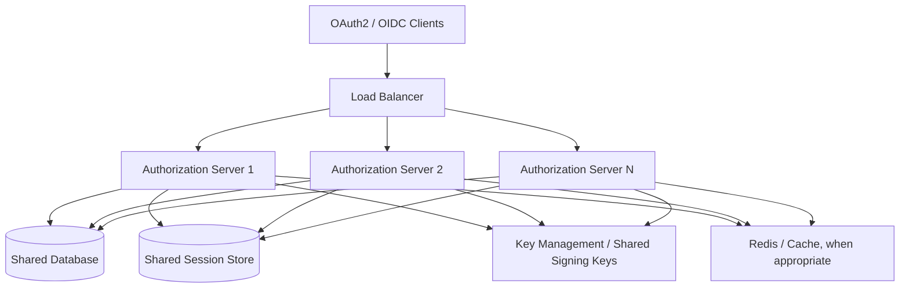

# Scaling, connection pool, cache và giới hạn tài nguyên

Một OAuth 2.0/OpenID Connect Authorization Server thường xử lý các thao tác có yêu cầu khác nhau về tài nguyên: đăng nhập và cấp authorization code, đổi code lấy token, làm mới token, introspection, revocation, đọc metadata và công bố khóa qua JWKS. Khi số lượng client, người dùng hoặc request tăng lên, chỉ tăng số instance ứng dụng chưa chắc làm hệ thống nhanh hơn. Các instance có thể tranh chấp connection đến cơ sở dữ liệu, dùng bộ nhớ phiên riêng, ký token bằng các khóa không đồng nhất hoặc làm quá tải dịch vụ quản lý khóa.

Trong Spring Authorization Server, triển khai có khả năng mở rộng cần phối hợp bốn phần: ứng dụng có thể chạy trên nhiều instance, trạng thái nghiệp vụ được lưu ở nơi dùng chung, tài nguyên kết nối và xử lý được giới hạn có chủ đích, và dữ liệu có thể cache được chọn theo yêu cầu nhất quán của từng loại dữ liệu.

Sau bài học này, bạn có thể:

- Phân tích các điểm nghẽn thường gặp ở luồng cấp và quản lý token.
- Thiết kế nhiều instance Authorization Server dùng chung dữ liệu và khóa ký.
- Ước lượng kích thước connection pool theo ngân sách kết nối của database.
- Chọn dữ liệu phù hợp để cache và xác định dữ liệu cần đọc từ nguồn có thẩm quyền.
- Thiết lập giới hạn tài nguyên, health check, graceful shutdown và giám sát khi triển khai.

## 1. Hiểu tải của Authorization Server

Không phải mọi endpoint đều tiêu thụ cùng một loại tài nguyên. Một request token có thể đọc client, kiểm tra authorization code hoặc refresh token, ghi trạng thái authorization và ký access token. Luồng authorization code còn phụ thuộc vào đăng nhập người dùng, session và consent. Endpoint JWKS chủ yếu phục vụ đọc khóa công khai, trong khi introspection và revocation có thể tạo tải đáng kể lên kho authorization.

| Hoạt động | Thành phần thường chịu tải | Điều cần quan sát |
|---|---|---|
| Authorization endpoint và đăng nhập | CPU ứng dụng, session store, hệ thống xác thực người dùng | Thời gian đăng nhập, số session, lỗi xác thực |
| Token endpoint | CPU ký token, database, connection pool | Throughput, độ trễ p95/p99, pool đang chờ |
| Refresh token | Database và kiểm tra trạng thái token | Độ trễ truy vấn, xung đột cập nhật, tỷ lệ refresh lỗi |
| Introspection và revocation | Database hoặc kho trạng thái token | Số truy vấn, độ trễ và độ trễ lan truyền trạng thái |
| Discovery và JWKS | Ứng dụng, cache HTTP, hệ thống phân phối nội dung | Tỷ lệ cache hit, thời gian phản hồi, lỗi tải khóa |

Hãy đo riêng các luồng quan trọng. Một con số tổng request mỗi giây có thể che khuất tình trạng token endpoint bị nghẽn database trong khi endpoint JWKS vẫn phản hồi nhanh.

## 2. Kiến trúc nhiều instance

Một mô hình triển khai phổ biến đặt nhiều instance Spring Authorization Server sau load balancer. Các instance cùng dùng một issuer công khai, một kho dữ liệu nghiệp vụ dùng chung và một nguồn khóa ký nhất quán.



Load balancer phân phối request đến các instance khỏe mạnh. Mỗi instance có thể được tạo mới hoặc thay thế mà không làm mất dữ liệu authorization đã lưu. Điều này đòi hỏi dữ liệu cần tồn tại qua nhiều request phải được lưu ở một kho dùng chung hoặc một hệ thống có cơ chế đồng bộ rõ ràng.

### 2.1. Phân biệt trạng thái nghiệp vụ và trạng thái phiên

Spring Authorization Server cung cấp các abstraction để lưu thông tin client, authorization và consent. Trong triển khai dùng JDBC, những thành phần thường gặp là:

- `JdbcRegisteredClientRepository`: lưu cấu hình client đã đăng ký.
- `JdbcOAuth2AuthorizationService`: lưu authorization, authorization code, access token, refresh token và metadata liên quan.
- `JdbcOAuth2AuthorizationConsentService`: lưu consent mà người dùng đã cấp cho client.

Các repository JDBC dùng chung một database giúp mọi instance đọc được cùng trạng thái. Nếu dùng implementation tùy chỉnh, cần bảo đảm mọi instance tuân thủ cùng hợp đồng lưu trữ, cập nhật nguyên tử và quy tắc truy vấn. Không để mỗi pod giữ một bản `InMemory` riêng cho dữ liệu cần tồn tại xuyên request: request tiếp theo có thể đến pod khác và không tìm thấy client hoặc authorization vừa tạo.

Session đăng nhập là một loại trạng thái khác. Authorization Server có thể dựa vào Spring Security session để giữ thông tin đăng nhập, saved request, CSRF và trạng thái tương tác consent. Nếu session chỉ nằm trong bộ nhớ của một instance, request tiếp theo cần cùng session có thể thất bại khi load balancer chuyển request sang instance khác. Có hai hướng xử lý:

1. Dùng Spring Session với kho session dùng chung, chẳng hạn Redis, để các instance đọc và cập nhật cùng session.
2. Dùng session affinity ở load balancer khi có lý do vận hành phù hợp, đồng thời chấp nhận rằng session có thể mất khi instance gặp sự cố.

Với hệ thống cần khả năng chịu lỗi, session dùng chung thường dễ dự đoán hơn. Dù chọn cách nào, hãy kiểm thử toàn bộ luồng đăng nhập, consent, callback và logout khi request được xử lý bởi nhiều instance.

### 2.2. Đồng nhất cấu hình và danh tính máy chủ

Tất cả instance phải công bố cùng issuer, ví dụ `https://auth.example.com`. Issuer phải khớp với giá trị mà client và resource server sử dụng để kiểm tra token. Không để mỗi pod tự suy ra issuer từ hostname nội bộ hoặc địa chỉ IP riêng.

Khi chạy sau reverse proxy, cấu hình ứng dụng để xử lý forwarded headers từ proxy đáng tin cậy. Chỉ tin các header như `Forwarded` hoặc `X-Forwarded-*` khi request thực sự đi qua proxy đã kiểm soát; nếu tin header tùy ý từ Internet, kẻ tấn công có thể làm sai lệch URL mà ứng dụng tạo ra.

Các instance cũng cần dùng cùng cấu hình client, thuật toán ký, thời gian sống token và chính sách authorization. Thay đổi cấu hình nên được phát hành đồng bộ hoặc theo cách tương thích trong giai đoạn chuyển tiếp.

## 3. Thiết kế và điều chỉnh connection pool

Khi dùng repository JDBC, mỗi instance cần connection đến database. Tạo connection mới cho từng thao tác thường tốn kém, vì vậy ứng dụng dùng connection pool để tái sử dụng kết nối. Spring Boot mặc định thường tích hợp HikariCP khi thư viện này có mặt trên classpath.

Connection pool là một ngân sách tài nguyên. Nếu pool quá nhỏ, request phải chờ connection dù database còn khả năng xử lý. Nếu pool quá lớn, nhiều instance có thể mở quá nhiều connection, làm database cạn tài nguyên hoặc tăng tranh chấp CPU và I/O.

### 3.1. Tính ngân sách theo số instance tối đa

Hãy tính theo số replica lớn nhất mà autoscaler có thể tạo ra, không chỉ theo số replica đang chạy lúc triển khai.

Một cách ước lượng ban đầu:

\[
P_{instance} \leq
\left\lfloor
\frac{C_{database} - C_{reserve} - C_{other}}{N_{replicas,max}}
\right\rfloor
\]

Trong đó:

- `C_database`: giới hạn connection của database.
- `C_reserve`: số connection dành cho quản trị, migration, giám sát và tình huống khẩn cấp.
- `C_other`: connection dự kiến từ các ứng dụng hoặc worker khác.
- `N_replicas,max`: số instance Authorization Server tối đa.
- `P_instance`: `maximumPoolSize` tối đa cho mỗi instance.

Ví dụ: database cho phép 240 connection; dành 40 connection cho quản trị và dự phòng; các workload khác cần 40 connection; Authorization Server được phép mở rộng tối đa 8 replica. Ngân sách còn lại là 160 connection, do đó giới hạn ban đầu là 20 connection mỗi replica. Nếu tăng số replica tối đa lên 10, pool mỗi replica phải được tính lại theo ngân sách mới.

Đây là giới hạn trên để bắt đầu thiết kế, không phải bằng chứng rằng 20 connection là tối ưu. Đo tải thực tế để biết số connection đồng thời cần thiết. Có thể ước lượng mức đồng thời trung bình từ throughput nhân với thời gian một thao tác giữ connection, sau đó kiểm chứng bằng thử tải và metric của pool.

### 3.2. Cấu hình HikariCP

Ví dụ cấu hình trong `application.yml`:

```yaml
spring:
  datasource:
    url: ${AUTH_DB_URL}
    username: ${AUTH_DB_USERNAME}
    password: ${AUTH_DB_PASSWORD}
    hikari:
      pool-name: authorization-server-pool
      maximum-pool-size: 20
      minimum-idle: 5
      connection-timeout: 3000
      validation-timeout: 1000
      idle-timeout: 600000
      max-lifetime: 1500000
      keepalive-time: 300000
  lifecycle:
    timeout-per-shutdown-phase: 30s

server:
  shutdown: graceful
```

Các giá trị trên chỉ là ví dụ để minh họa cách đặt giới hạn. Cần điều chỉnh theo database, hạ tầng mạng, số replica và kết quả thử tải. Ý nghĩa của các tham số chính:

| Tham số | Tác dụng | Cách chọn |
|---|---|---|
| `maximum-pool-size` | Giới hạn số connection trong pool của một instance | Tính từ ngân sách connection toàn hệ thống và thử tải |
| `minimum-idle` | Số connection nhàn rỗi pool cố gắng duy trì | Chọn theo tải nền và thời gian tạo connection |
| `connection-timeout` | Thời gian tối đa chờ lấy connection từ pool | Đặt hữu hạn để request không xếp hàng vô thời hạn |
| `validation-timeout` | Thời gian tối đa kiểm tra connection hợp lệ | Nhỏ hơn `connection-timeout` |
| `idle-timeout` | Thời gian connection nhàn rỗi có thể bị loại bỏ khi pool có nhiều hơn mức tối thiểu | Phù hợp với tải dao động và chính sách database |
| `max-lifetime` | Tuổi thọ tối đa của connection trong pool | Ngắn hơn giới hạn tuổi thọ do database hoặc network áp đặt |
| `keepalive-time` | Chu kỳ kiểm tra/giữ connection nhàn rỗi khỏi bị hạ tầng đóng | Chỉ bật khi cần và chọn nhỏ hơn `max-lifetime` |

Một số lưu ý khi tinh chỉnh:

- `connection-timeout` quá dài khiến request giữ thread trong lúc chờ; quá ngắn có thể biến một đợt tăng tải ngắn thành nhiều lỗi lấy connection. Chọn timeout phù hợp với ngân sách độ trễ của endpoint.
- `max-lifetime` cần thấp hơn timeout do database, proxy hoặc firewall đặt ra để pool chủ động thay connection trước khi hạ tầng đóng nó. Không nên chọn một con số chỉ dựa trên ví dụ.
- Không đặt `maximum-pool-size` bằng số thread HTTP. Nhiều request có thể không cần database cùng lúc, và database có giới hạn xử lý riêng.
- Giữ transaction ngắn. Tránh gọi dịch vụ HTTP, KMS hoặc hệ thống bên ngoài trong khi đang giữ transaction database nếu không cần thiết.
- Đặt timeout cho truy vấn và transaction phù hợp. Một câu SQL bị treo có thể chiếm connection lâu và làm cạn pool.
- Chỉ bật `leakDetectionThreshold` như công cụ chẩn đoán khi nghi ngờ rò rỉ connection; ngưỡng quá thấp có thể tạo cảnh báo giả cho truy vấn hợp lệ.

### 3.3. Theo dõi pool và database

Theo dõi ít nhất các chỉ số sau cho từng instance:

- Số connection active, idle và tổng số connection.
- Số thread đang chờ connection (`pending`).
- Thời gian lấy connection và số lần timeout.
- Thời gian truy vấn, số transaction và tỷ lệ lỗi database.
- Số connection đang mở trên database theo từng ứng dụng.

Nếu `active` thường xuyên chạm `maximumPoolSize` và `pending` tăng, hãy tìm nguyên nhân truy vấn chậm hoặc pool thiếu trước khi tăng pool. Nếu database đã gần giới hạn connection hoặc CPU database cao, tăng pool có thể làm tình trạng xấu hơn. Nếu pool hiếm khi dùng hết nhưng endpoint vẫn chậm, điểm nghẽn có thể nằm ở ký token, KMS, đăng nhập, network hoặc một dịch vụ phụ thuộc khác.

## 4. Cache và yêu cầu nhất quán

Cache giảm số lần đọc dữ liệu và thời gian phản hồi, nhưng cache cũng tạo ra bản sao có thể cũ. Với Authorization Server, dữ liệu cũ có thể gây ra lỗi bảo mật hoặc hành vi cấp quyền sai. Vì vậy cần phân loại dữ liệu theo mức độ thay đổi và hậu quả khi đọc dữ liệu cũ.

### 4.1. Dữ liệu có thể cache

Những dữ liệu tương đối ổn định và có thể công bố rộng thường phù hợp hơn:

- OIDC discovery metadata, chẳng hạn danh sách endpoint và thuật toán được hỗ trợ.
- JWKS công khai dùng để xác minh chữ ký token.
- Cấu hình bất biến hoặc ít thay đổi, nếu có cơ chế làm mới và vô hiệu hóa cache rõ ràng.

Discovery metadata và JWKS có thể được phân phối qua HTTP cache hoặc CDN nếu header cache được thiết lập đúng. Khi xoay khóa, phải công bố khóa công khai mới trước khi phát hành token dùng khóa đó và giữ khóa công khai cũ đủ lâu để xác minh các token còn hiệu lực. Không để cache giữ JWKS cũ lâu hơn khoảng thời gian hệ thống cho phép.

Cấu hình client có thể được cache trong một số hệ thống có tần suất đọc cao, nhưng cần quy trình invalidation khi client bị khóa, secret thay đổi, redirect URI được cập nhật hoặc chính sách được điều chỉnh. TTL ngắn chỉ giảm thời gian dữ liệu cũ tồn tại; nó không thay thế cơ chế vô hiệu hóa khi thay đổi cần có hiệu lực ngay.

### 4.2. Dữ liệu cần nguồn có thẩm quyền

Không nên cache cục bộ theo kiểu best-effort các trạng thái có thể thay đổi trong quá trình cấp hoặc thu hồi quyền:

- Authorization code, refresh token và trạng thái sử dụng của chúng.
- Trạng thái revocation hoặc trạng thái token được dùng cho introspection.
- Consent có thể bị người dùng thu hồi hoặc cập nhật.
- Authorization đang được cập nhật bởi một instance khác.

Ví dụ, nếu một instance tiếp tục đọc bản cache cho biết refresh token còn hợp lệ sau khi instance khác đã thu hồi token, hệ thống có thể chấp nhận một thao tác mà chính sách yêu cầu từ chối. Tương tự, authorization code là dữ liệu dùng một lần; việc xử lý đồng thời phải dựa trên cập nhật nguyên tử ở kho dữ liệu có thẩm quyền để tránh sử dụng lại code.

Với các dữ liệu này, ưu tiên đọc/ghi qua `OAuth2AuthorizationService` và `OAuth2AuthorizationConsentService` dùng chung. Nếu có nhu cầu tối ưu đặc biệt, phải thiết kế cache phân tán với invalidation, đồng bộ, xử lý race condition và quy tắc fail-closed rõ ràng; đồng thời kiểm thử tình huống hai instance xử lý cùng một token. Không giả định Redis tự động biến một cache thành kho authorization an toàn.

### 4.3. Phân biệt JWT tự xác minh và trạng thái thu hồi

Resource server có thể xác minh chữ ký JWT cục bộ bằng khóa công khai đã lấy từ JWKS. Cách này giảm request introspection, nhưng một JWT đã phát hành thường vẫn được xác minh thành công cho đến khi hết hạn nếu resource server không kiểm tra trạng thái thu hồi ở nơi khác.

Nếu yêu cầu thu hồi có hiệu lực gần như tức thời, cần chọn cơ chế phù hợp, chẳng hạn token opaque kết hợp introspection, denylist có đồng bộ hoặc một chính sách thời hạn access token ngắn. Cơ chế nào cũng có đánh đổi về độ trễ, tải database, tính sẵn sàng và thời gian lan truyền. Hãy quyết định rõ độ trễ thu hồi tối đa mà sản phẩm chấp nhận, rồi thiết kế cache và TTL theo yêu cầu đó.

## 5. Giới hạn tài nguyên ứng dụng

Tăng replica chỉ có ích khi từng instance và các dịch vụ phụ thuộc vẫn còn đủ tài nguyên. Hãy đặt ngân sách cho CPU, bộ nhớ, thread, connection, request queue và các cuộc gọi bên ngoài.

### 5.1. CPU và ký token

Ký JWT tiêu thụ CPU và có thể dùng dịch vụ KMS/HSM qua network. Tải tăng khi số token được phát hành tăng, thuật toán ký hoặc kích thước khóa thay đổi, hay KMS phản hồi chậm. Theo dõi thời gian ký, CPU, garbage collection và độ trễ KMS. Nếu dùng KMS, đặt timeout, giới hạn concurrency và chính sách retry có kiểm soát; retry không giới hạn có thể nhân tải khi KMS đang lỗi.

Không tạo một khóa ký mới độc lập cho mỗi instance. Tất cả instance phải ký token bằng khóa thuộc cùng bộ khóa được quản lý và công bố qua JWKS. Việc phân phối private key cần tuân thủ quy trình quản lý bí mật; tránh nhúng private key vào image hoặc log.

### 5.2. Bộ nhớ và thread

Đặt giới hạn heap theo memory limit của container và dành chỗ cho metaspace, thread stack, direct buffer, thư viện native và agent giám sát. Container có thể bị OOM kill dù heap chưa chạm `-Xmx` nếu tổng bộ nhớ tiến trình vượt giới hạn.

Thread HTTP quá nhiều không làm database hoặc KMS xử lý nhanh hơn. Khi downstream chậm, nhiều thread chỉ làm số request đang chờ tăng và tiêu thụ thêm bộ nhớ. Hãy đặt giới hạn thread và queue theo khả năng chịu tải của các dependency, sau đó trả lỗi có kiểm soát khi vượt ngưỡng.

### 5.3. Timeout và giới hạn request

Thiết lập timeout ở các lớp có liên quan: load balancer, reverse proxy, server HTTP, JDBC, transaction và client gọi dịch vụ bên ngoài. Timeout cần nhất quán để request không bị giữ ở một lớp lâu hơn thời gian lớp phía trên cho phép.

Giới hạn kích thước request và header để tránh tiêu thụ bộ nhớ không cần thiết. Áp dụng rate limit theo client hoặc theo endpoint khi phù hợp, đặc biệt với token, introspection và các endpoint có nguy cơ bị dò mật khẩu hoặc lạm dụng. Rate limit cần tính đến lưu lượng hợp lệ theo từng client và nên dùng bộ đếm dùng chung nếu request được phân phối qua nhiều instance.

## 6. Autoscaling, health check và graceful shutdown

Autoscaling nên dựa trên các chỉ số phản ánh khả năng xử lý request, chẳng hạn CPU, độ trễ p95/p99, số request đang chờ và mức sử dụng thread. Với Authorization Server, cần xem thêm trạng thái connection pool và tải database. Nếu database đã nghẽn, tăng replica có thể làm số connection và truy vấn tăng thêm, khiến toàn hệ thống suy giảm.

Đặt `maxReplicas` dựa trên cả năng lực database và giới hạn KMS/session store. Khi thay đổi số replica tối đa, tính lại ngân sách connection trước khi triển khai. Có thể đặt ngưỡng scale-out và scale-in khác nhau để tránh dao động replica liên tục.

Health check cần phân biệt:

- **Liveness:** tiến trình còn hoạt động và có thể tiếp tục chạy hay không. Không nên làm liveness thất bại chỉ vì một dependency tạm thời chậm, nếu restart instance không thể giải quyết vấn đề.
- **Readiness:** instance có sẵn sàng nhận request hay không. Instance đang khởi động, đang drain hoặc không thể phục vụ yêu cầu cốt lõi có thể bị loại khỏi load balancer.
- **Startup probe:** dành thời gian đủ cho ứng dụng khởi động, tải cấu hình và khởi tạo thành phần cần thiết trước khi áp dụng các probe còn lại.

Khi triển khai phiên bản mới hoặc scale-in, graceful shutdown cho phép instance ngừng nhận request mới và hoàn tất request đang xử lý trong một khoảng thời gian giới hạn. Ví dụ cấu hình Spring Boot:

```yaml
server:
  shutdown: graceful

spring:
  lifecycle:
    timeout-per-shutdown-phase: 30s
```

Thời gian drain của load balancer và thời gian chờ kết thúc pod phải tương thích với thời gian graceful shutdown. Hãy thử nghiệm khi có request token đang chạy và khi một instance bị loại khỏi cụm. Không để quá trình shutdown đóng connection hoặc session store trước khi request đang xử lý hoàn tất.

## 7. Khả năng sẵn sàng cao và vận hành khóa

Nhiều instance chỉ tăng khả năng sẵn sàng nếu các dependency dùng chung cũng có phương án chịu lỗi. Database cần backup, phục hồi, giám sát replication và quy trình failover. Redis dùng cho session hoặc cache cần cấu hình persistence/replication phù hợp với mức độ mất dữ liệu có thể chấp nhận. KMS/HSM cần có giới hạn tải và phương án xử lý khi không truy cập được.

### 7.1. Đồng nhất khóa ký giữa các instance

Mọi instance phải truy cập cùng bộ khóa ký đang hoạt động hoặc cùng dịch vụ ký. Nếu instance A ký token bằng khóa `K1` nhưng instance B chỉ công bố khóa `K2`, resource server có thể không xác minh được token tùy theo JWKS mà nó nhận.

Quy trình xoay khóa an toàn thường gồm các bước:

1. Tạo khóa mới trong hệ thống quản lý khóa.
2. Công bố public key mới trong JWKS trên tất cả instance.
3. Chờ cache JWKS của client và resource server có cơ hội cập nhật.
4. Chuyển các instance sang ký bằng khóa mới.
5. Giữ public key cũ trong JWKS cho đến khi token ký bằng khóa cũ đã hết hạn và hết khoảng thời gian dự phòng cần thiết.
6. Gỡ khóa cũ khỏi bộ khóa công khai khi không còn token hợp lệ cần xác minh.

Thời điểm chuyển khóa phải nhất quán giữa các instance. Dùng `kid` ổn định và duy nhất để resource server chọn đúng khóa. Không xóa private key cũ quá sớm nếu vẫn cần xử lý hoặc kiểm tra các dữ liệu được ký trước đó theo chính sách của hệ thống.

### 7.2. Database migration và triển khai cuốn chiếu

Khi nhiều phiên bản ứng dụng cùng chạy trong một đợt rolling deployment, chúng có thể cùng truy cập một schema. Dùng chiến lược migration tương thích ngược:

- Giai đoạn mở rộng: thêm cột hoặc bảng mới theo cách phiên bản cũ vẫn hoạt động.
- Triển khai ứng dụng mới và chuyển dần traffic.
- Giai đoạn thu hẹp: chỉ xóa cột hoặc cấu trúc cũ sau khi không còn phiên bản nào sử dụng.

Không thực hiện thay đổi schema phá vỡ phiên bản đang chạy trong cùng thời điểm. Migration cần được kiểm soát riêng, có backup và có kế hoạch rollback hoặc roll-forward. Tránh để tất cả replica cùng chạy một migration không được thiết kế cho thực thi đồng thời.

## 8. Ví dụ kiểm tra các tình huống mở rộng

Giả sử một Authorization Server có 3 replica, dùng JDBC để lưu client và authorization, Redis để chia sẻ session và database có giới hạn connection hữu hạn. Trước khi tăng lên 8 replica, nhóm vận hành nên kiểm tra:

| Tình huống | Kết quả mong đợi |
|---|---|
| Authorization request đến instance A, bước tiếp theo đến instance B | Session và dữ liệu authorization cần thiết vẫn được tìm thấy |
| Instance A dừng sau khi tạo authorization code | Instance B có thể xử lý code theo trạng thái đã lưu trong kho dùng chung |
| Hai request đồng thời cố dùng cùng authorization code | Chỉ một thao tác được chấp nhận theo quy tắc sử dụng một lần |
| Refresh token bị thu hồi ở instance A, request tiếp theo đến B | Instance B đọc trạng thái mới và từ chối refresh theo chính sách |
| Một pod mới khởi động trong lúc tải tăng | Readiness chỉ thành công sau khi pod có thể phục vụ request |
| Rolling deployment diễn ra khi có request token | Request đang chạy được drain trong giới hạn shutdown đã đặt |
| Khóa ký được xoay | Mọi instance công bố JWKS nhất quán và resource server xác minh được token cũ lẫn mới trong giai đoạn chuyển tiếp |
| Autoscaler tăng đến số replica tối đa | Tổng connection vẫn nằm trong ngân sách database |

Khi thử tải, mô phỏng cả tải bình thường và tình huống lỗi: database tăng độ trễ, Redis mất kết nối, KMS chậm, một instance bị dừng đột ngột và cache JWKS chưa kịp cập nhật. Ghi nhận tỷ lệ thành công, độ trễ p95/p99, số connection đang chờ, CPU, bộ nhớ và thời gian phục hồi. Một bài thử chỉ tăng request đều đặn sẽ không cho biết hệ thống xử lý ra sao khi dependency suy giảm.

## 9. Checklist trước khi đưa vào production

- [ ] Các instance dùng cùng issuer, cấu hình endpoint và chính sách token.
- [ ] Client, authorization và consent được lưu ở kho dùng chung có độ bền phù hợp.
- [ ] Session đăng nhập và consent có thể được tiếp tục khi request chuyển sang instance khác.
- [ ] Tất cả instance dùng bộ khóa ký thống nhất; JWKS công bố đúng khóa đang hoạt động và khóa còn cần xác minh.
- [ ] `maximumPoolSize` được tính theo số replica tối đa và ngân sách connection của database.
- [ ] Có metric active/idle/pending của pool, query latency và timeout.
- [ ] Cache chỉ chứa dữ liệu phù hợp; trạng thái authorization, refresh và revocation có nguồn có thẩm quyền.
- [ ] Có timeout, giới hạn request, rate limit và giới hạn thread/queue phù hợp.
- [ ] Liveness, readiness, startup probe và graceful shutdown đã được kiểm thử.
- [ ] Migration tương thích với rolling deployment và có quy trình backup/khôi phục.
- [ ] Thử tải bao gồm tình huống dependency chậm hoặc mất kết nối.

## Kết luận

Khả năng mở rộng của Spring Authorization Server phụ thuộc vào toàn bộ đường đi của request: instance ứng dụng, session, database, connection pool, cache và hệ thống ký khóa. Hãy bắt đầu bằng số liệu tải thực tế, đặt ngân sách rõ ràng cho từng dependency, giữ trạng thái authorization nhất quán giữa các instance và chỉ cache dữ liệu có thể chấp nhận độ trễ cập nhật. Khi đó, việc tăng replica mới giúp tăng năng lực xử lý mà không làm suy giảm độ tin cậy của các luồng OAuth 2.0 và OpenID Connect.
