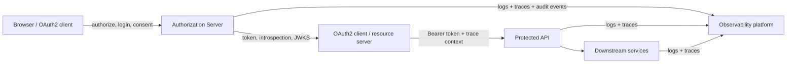
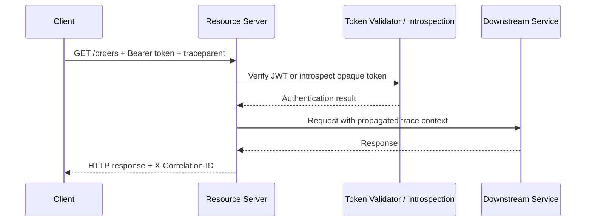

# Correlation ID và truy vết xuyên Authorization Server, client, API

Một luồng OAuth 2.0/OpenID Connect thường đi qua nhiều request và nhiều hệ thống: client chuyển trình duyệt đến Authorization Server, người dùng đăng nhập và consent, client đổi authorization code lấy token, rồi gọi resource server. Mỗi request có thể chạy trên một instance khác nhau. Khi xảy ra lỗi, chỉ xem log của một service thường không đủ để biết request bắt đầu ở đâu, đã đi qua thành phần nào và thất bại tại bước nào.

Correlation ID và distributed tracing giúp nối các sự kiện này thành một hành trình có thể điều tra. Correlation ID cung cấp mã tham chiếu ổn định cho một request hoặc một luồng nghiệp vụ; trace ID và span ID mô tả quan hệ giữa các thao tác phân tán. Với Spring Authorization Server, cần thiết kế cách truyền và ghi nhận các định danh này sao cho hỗ trợ vận hành mà không làm lộ authorization code, token, client secret, session hoặc dữ liệu người dùng.

Bài học thuộc module `SPRING_SECURITY_OAUTH2_OIDC_AUTHORIZATION_SERVER`, tập trung vào thiết kế và vận hành OAuth 2.0/OpenID Connect Authorization Server bằng Spring Authorization Server, gồm quản lý client và consent, cấp token, PKCE, bảo vệ endpoint và kiểm thử luồng bảo mật.

## 1. Phân biệt correlation ID, trace ID và span ID

Ba định danh này có mục đích gần nhau nhưng không thay thế cho nhau:

| Định danh | Phạm vi | Công dụng |
|---|---|---|
| Correlation ID / Request ID | Một request hoặc một luồng nghiệp vụ theo quy ước của ứng dụng | Tìm các log và audit event có liên quan bằng một mã dễ truyền qua hệ thống |
| Trace ID | Một distributed trace | Gom các span thuộc cùng một hành trình phân tán |
| Span ID | Một thao tác trong trace | Xác định service hoặc operation cụ thể, đồng thời thể hiện quan hệ cha/con với span khác |

Ví dụ, một request gọi API có thể tạo trace gồm span tại API gateway, resource server, service nghiệp vụ và database. Mỗi span có span ID riêng nhưng cùng trace ID. Correlation ID có thể được giữ nguyên qua các service để tìm log nhanh, hoặc được gắn với một authorization flow dài hơn trace HTTP riêng lẻ.

Không giả định một correlation ID luôn bằng trace ID. Một trace có thể chỉ tồn tại trong thời gian một request; một luồng đăng nhập có thể bao gồm nhiều trace tách biệt bởi redirect trình duyệt. Ngược lại, một request retry có thể tạo trace mới nhưng vẫn thuộc cùng correlation ID của thao tác nghiệp vụ.

## 2. Kiến trúc truy vết cho luồng OAuth2/OIDC

Một hệ thống điển hình có các thành phần:



Trong các request service-to-service, W3C Trace Context thường được truyền qua header `traceparent` và tùy chọn `tracestate`. Các thư viện tracing có thể tự tạo span và truyền context khi HTTP client được cấu hình đúng. Correlation ID tùy chỉnh, ví dụ `X-Correlation-ID`, có thể được truyền song song để tìm log hoặc liên kết audit event.

Luồng OAuth2 có một đặc điểm cần chú ý: redirect qua trình duyệt tạo ra các HTTP request riêng biệt. Trình duyệt không tự động giữ distributed trace context từ request `/oauth2/authorize` sang trang login, consent, callback của client và request `/oauth2/token`. Vì vậy, không nên giả định một trace ID duy nhất sẽ tự chạy xuyên suốt authorization flow.

Để nối các bước này, có thể tạo một mã luồng nội bộ và lưu cùng trạng thái authorization hoặc bản ghi audit. Mỗi request vẫn có trace riêng; các sự kiện được liên kết bằng `authorization_flow_id` hoặc correlation ID đã được quản lý phía server. Không đưa trace ID, span ID hoặc mã nội bộ vào query string redirect chỉ để tiện truy vết.

## 3. Thiết lập distributed tracing trong Spring Boot

Với Spring Boot 3 và Micrometer Observation/Tracing, có thể dùng Actuator, Micrometer Tracing bridge và exporter tương ứng. Ví dụ các dependency khi chọn OpenTelemetry:

```gradle
dependencies {
    implementation("org.springframework.boot:spring-boot-starter-actuator")
    implementation("io.micrometer:micrometer-tracing-bridge-otel")
    runtimeOnly("io.opentelemetry:opentelemetry-exporter-otlp")
}
```

Để Spring Boot quản lý phiên bản qua dependency management/BOM của dự án. Nếu hệ thống đang dùng Brave, chọn bridge Brave tương ứng thay vì cài đồng thời hai bridge. Exporter cần được cấu hình đến collector hoặc backend tracing của tổ chức.

Một cấu hình minh họa:

```yaml
spring:
  application:
    name: authorization-server

management:
  tracing:
    sampling:
      probability: 0.1
```

Sampling `0.1` chỉ là ví dụ cho môi trường có lưu lượng đáng kể. Môi trường development có thể lấy mẫu toàn bộ để điều tra; production cần chọn tỷ lệ dựa trên lưu lượng, chi phí, chính sách dữ liệu và khả năng thu thập. Không dùng sampling của trace làm cơ chế lưu audit: các sự kiện audit bắt buộc phải được ghi theo chính sách lưu trữ độc lập.

Khi Spring Boot tự cấu hình Micrometer Tracing, các HTTP server observation có thể tạo span cho request đến và các HTTP client được cấu hình qua builder do Spring quản lý có thể truyền trace context. Cần xác minh phiên bản Spring Boot, thư viện HTTP và cách tạo client của ứng dụng để biết instrumentation nào đang hoạt động.

### 3.1. Dùng HTTP client được Spring cấu hình

Ví dụ dùng `RestClient.Builder` được inject từ Spring Boot:

```java
import org.springframework.context.annotation.Bean;
import org.springframework.context.annotation.Configuration;
import org.springframework.web.client.RestClient;

@Configuration
class DownstreamClientConfiguration {

    @Bean
    RestClient inventoryClient(RestClient.Builder builder) {
        return builder
                .baseUrl("https://inventory.internal")
                .build();
    }
}
```

Builder được auto-configure có thể được tích hợp với observation và propagation theo cấu hình Boot. Nếu tự tạo `new RestTemplate()`, `RestClient.create()` hoặc `WebClient.create()` ngoài cơ chế auto-configuration, không mặc định rằng tracing interceptor/filter đã được gắn. Hãy dùng builder được inject hoặc cấu hình instrumentation rõ ràng.

Với WebClient trong ứng dụng reactive, dùng `WebClient.Builder` được inject và giữ context trong Reactor pipeline. MDC dựa trên ThreadLocal không phải nguồn context đáng tin cậy trong mọi thread hoặc scheduler của reactive flow.

### 3.2. Đọc trace hiện tại

Micrometer Tracing cung cấp `Tracer` để lấy span hiện tại khi cần bổ sung thông tin vào log hoặc audit event:

```java
import io.micrometer.tracing.Span;
import io.micrometer.tracing.Tracer;

void recordOperation(Tracer tracer) {
    Span currentSpan = tracer.currentSpan();
    if (currentSpan != null) {
        String traceId = currentSpan.context().traceId();
        String spanId = currentSpan.context().spanId();
        // Đưa traceId/spanId vào event metadata hoặc log đã cấu trúc.
    }
}
```

Khi không có span hiện tại, có thể request chưa được instrument, trace bị tắt hoặc đoạn code chạy ngoài request. Không tự tạo trace ID ngẫu nhiên rồi gọi nó là trace hiện tại. Hãy để tracing system quản lý trace context; correlation ID có thể tồn tại độc lập.

## 4. Tạo và truyền correlation ID

Một correlation ID cần có định dạng giới hạn, độ dài hợp lý và không mang dữ liệu nghiệp vụ nhạy cảm. UUID ngẫu nhiên là lựa chọn đơn giản. Không dùng email, username, số điện thoại, session ID hoặc authorization code làm correlation ID.

### 4.1. Chọn nơi tạo ID và ranh giới tin cậy

Nếu ứng dụng là điểm vào từ Internet, ứng dụng có thể tự sinh correlation ID cho mỗi request. Nếu có API gateway hoặc ingress đáng tin cậy, gateway có thể xóa header cùng tên do client gửi lên, sinh ID mới rồi chuyển ID đó vào backend. Backend chỉ nên giữ ID từ header khi request đến từ gateway đã được xác thực và đường mạng backend được giới hạn phù hợp.

Kiểm tra cú pháp của header không làm cho giá trị đó trở nên đáng tin cậy. Client Internet có thể gửi một chuỗi hợp lệ nhưng cố ý trùng với ID của request khác. Vì vậy, chính sách trust phải được thực thi ở ingress hoặc tại ứng dụng dựa trên nguồn request; không dùng correlation ID làm dữ liệu xác thực hay phân quyền.

### 4.2. Filter cho servlet application

Ví dụ sau minh họa filter ở ứng dụng nằm sau gateway tin cậy. Gateway được cấu hình ghi đè `X-Correlation-ID`; filter kiểm tra định dạng và tạo ID mới nếu thiếu hoặc không hợp lệ:

```java
import java.io.IOException;
import java.util.UUID;
import java.util.regex.Pattern;

import jakarta.servlet.FilterChain;
import jakarta.servlet.ServletException;
import jakarta.servlet.http.HttpServletRequest;
import jakarta.servlet.http.HttpServletResponse;
import org.slf4j.MDC;
import org.springframework.core.Ordered;
import org.springframework.core.annotation.Order;
import org.springframework.stereotype.Component;
import org.springframework.web.filter.OncePerRequestFilter;

@Component
@Order(Ordered.HIGHEST_PRECEDENCE)
public class CorrelationIdFilter extends OncePerRequestFilter {

    private static final String HEADER = "X-Correlation-ID";
    private static final String MDC_KEY = "correlationId";
    private static final Pattern SAFE_ID =
            Pattern.compile("[A-Za-z0-9][A-Za-z0-9._-]{0,63}");

    @Override
    protected void doFilterInternal(
            HttpServletRequest request,
            HttpServletResponse response,
            FilterChain filterChain) throws ServletException, IOException {

        String incoming = request.getHeader(HEADER);
        String correlationId = incoming != null && SAFE_ID.matcher(incoming).matches()
                ? incoming
                : UUID.randomUUID().toString();

        MDC.put(MDC_KEY, correlationId);
        response.setHeader(HEADER, correlationId);
        try {
            filterChain.doFilter(request, response);
        } finally {
            MDC.remove(MDC_KEY);
        }
    }
}
```

Filter này chỉ an toàn khi ingress đã làm sạch header từ Internet và backend không thể bị gọi trực tiếp từ nguồn không tin cậy. Nếu ứng dụng nhận traffic trực tiếp từ Internet, hãy sinh ID mới thay vì chấp nhận header tùy ý. Đăng ký filter đúng một lần trước các filter cần log correlation ID; tránh vừa đăng ký như servlet filter vừa thêm cùng instance vào `SecurityFilterChain`.

`MDC` là ThreadLocal. Đoạn `finally` luôn xóa giá trị để tránh request tiếp theo trên cùng thread kế thừa ID sai. Với async servlet, executor, scheduler hoặc Reactor, cần cơ chế context propagation tương ứng; không kỳ vọng MDC tự truyền qua mọi thread.

### 4.3. Ghi correlation ID vào response

Trả `X-Correlation-ID` trong response giúp người gọi cung cấp mã tham chiếu khi báo lỗi. Chỉ trả mã ngẫu nhiên không chứa dữ liệu nội bộ. Không trả stack trace, trace sampling decision, tên node nhạy cảm hoặc thông tin cấu hình cùng header này.

Nếu gateway đã tạo ID, gateway và backend cần thống nhất ai chịu trách nhiệm ghi response header để tránh ghi đè bằng hai giá trị khác nhau. Kiểm thử cả request thành công và lỗi để xác nhận header vẫn xuất hiện khi exception handler tạo response.

## 5. Truyền correlation ID qua các service

Distributed tracing nên truyền `traceparent` và `tracestate` bằng instrumentation của thư viện. Nếu tổ chức cần thêm correlation ID tùy chỉnh, truyền header riêng qua HTTP client interceptor. Ví dụ với `RestClient` đồng bộ:

```java
import org.slf4j.MDC;
import org.springframework.context.annotation.Bean;
import org.springframework.web.client.RestClient;

@Bean
RestClient accountClient(RestClient.Builder builder) {
    return builder
            .baseUrl("https://account.internal")
            .requestInterceptor((request, body, execution) -> {
                String correlationId = MDC.get("correlationId");
                if (correlationId != null) {
                    request.getHeaders().set("X-Correlation-ID", correlationId);
                }
                return execution.execute(request, body);
            })
            .build();
}
```

Đoạn interceptor này chỉ đọc MDC trong cùng execution thread. Với async/reactive client, lấy correlation ID từ context đã được propagate thay vì đọc ThreadLocal tùy tiện. Không tự tạo một correlation ID mới ở mỗi downstream service nếu mục tiêu là giữ một mã xuyên suốt; mỗi service vẫn có trace/span ID riêng.

Các service nhận header cần xác thực định dạng và giới hạn độ dài trước khi đưa vào log. Nếu request đi qua nhiều trust boundary, gateway ở mỗi ranh giới cần quyết định có giữ hay thay correlation ID. Một header do nguồn không tin cậy cung cấp không được dùng làm bằng chứng rằng hai request thuộc cùng một người dùng.

## 6. Liên kết các bước của Authorization Code flow

Một authorization flow gồm nhiều HTTP request độc lập:

1. Client bắt đầu `/oauth2/authorize`.
2. Authorization Server chuyển trình duyệt đến login.
3. Người dùng gửi thông tin đăng nhập.
4. Server hiển thị và nhận quyết định consent.
5. Server redirect trình duyệt về callback của client với authorization code và state.
6. Client gửi code đến `/oauth2/token`.
7. Client gọi API bằng access token.

Mỗi bước có thể tạo trace khác nhau. Để liên kết các sự kiện, có thể tạo `authorization_flow_id` nội bộ khi nhận authorization request hợp lệ và lưu nó trong dữ liệu authorization hoặc audit record. Khi code được đổi, đọc lại flow ID từ authorization state để gắn vào sự kiện token exchange. Khi client gọi API, client có thể giữ correlation ID của nghiệp vụ trong context server-side của nó, nhưng không nên đưa định danh nội bộ vào access token nếu resource server không có nhu cầu rõ ràng.

Spring Authorization Server cho phép lưu các thuộc tính tùy chỉnh trong `OAuth2Authorization` bằng builder và metadata. Ví dụ ý tưởng:

```java
import java.util.UUID;

import org.springframework.security.oauth2.core.AuthorizationGrantType;
import org.springframework.security.oauth2.server.authorization.OAuth2Authorization;

OAuth2Authorization authorization = OAuth2Authorization
        .withRegisteredClient(registeredClient)
        .id(UUID.randomUUID().toString())
        .principalName(principalName)
        .authorizationGrantType(AuthorizationGrantType.AUTHORIZATION_CODE)
        .attribute("authorization_flow_id", authorizationFlowId)
        .build();
```

Đây là ví dụ về metadata gắn với authorization; trong luồng thật, authorization được tạo bởi provider và chứa thêm request, principal, code cùng token metadata. Nếu cần thêm thuộc tính, dùng cơ chế tùy biến phù hợp với phiên bản Spring Authorization Server đang dùng và bảo đảm repository JDBC có thể serialize/deserialize metadata đó. Không thay thế hoặc tự dựng toàn bộ `OAuth2Authorization` trong luồng production chỉ để ghi correlation ID.

Không truyền trace context bằng cách nối `traceparent`, trace ID hoặc correlation ID vào `redirect_uri`, `state` hay `nonce`. `state` phải là giá trị ngẫu nhiên do client quản lý để chống CSRF và liên kết callback; `nonce` phục vụ kiểm tra ID Token. Không biến chúng thành kênh mang dữ liệu quan sát. Nếu cần nối trace qua redirect, lưu liên kết ở phía server bằng authorization flow record hoặc audit record.

## 7. Gắn trace context với log và audit event

Log nên có các trường có cấu trúc để tìm kiếm, lọc và tổng hợp. Một log event có thể bao gồm:

| Trường | Mục đích |
|---|---|
| `timestamp` | Thời điểm phát sinh, chuẩn hóa UTC |
| `service.name` | Tên service phát event |
| `event.name` | Sự kiện, ví dụ `oauth2.authorization.denied` |
| `correlation_id` | Mã tham chiếu request hoặc authorization flow |
| `trace_id`, `span_id` | Liên kết đến distributed trace hiện tại nếu có |
| `client_id` | Client đã được xác thực hoặc định danh client an toàn |
| `grant_type` | Loại grant liên quan |
| `endpoint` | Endpoint hoặc operation đã xử lý |
| `outcome` | `success`, `denied`, `failure` hoặc trạng thái nghiệp vụ rõ ràng |
| `error_code` | OAuth2 error code đã chuẩn hóa, nếu có |
| `principal_ref` | Mã tham chiếu nội bộ đã giả danh hóa nếu cần |

Ví dụ event đã loại bỏ dữ liệu nhạy cảm:

```json
{
  "timestamp": "2026-11-16T10:15:30Z",
  "service.name": "authorization-server",
  "event.name": "oauth2.token.issued",
  "correlation_id": "req-8f1c2d",
  "trace_id": "4bf92f3577b34da6a3ce929d0e0e4736",
  "span_id": "00f067aa0ba902b7",
  "client_id": "orders-service",
  "grant_type": "client_credentials",
  "endpoint": "/oauth2/token",
  "outcome": "success"
}
```

Log vận hành và audit trail có mục tiêu khác nhau. Log hỗ trợ debug và có thể được sampling/rotation theo dung lượng; audit trail là bằng chứng về các sự kiện bảo mật cần lưu theo chính sách, có kiểm soát truy cập, tính toàn vẹn và thời hạn lưu riêng. Không phụ thuộc vào việc trace có được sample hay không để quyết định có ghi audit event.

Các sự kiện audit hữu ích gồm client đăng ký/cập nhật, login thành công/thất bại, consent được cấp/thu hồi, authorization request bị từ chối, code/token được phát hành, refresh token rotation, token revocation, client authentication thất bại và thay đổi khóa ký. Chỉ ghi thông tin cần thiết để chứng minh sự kiện đã xảy ra.

## 8. Bảo vệ dữ liệu nhạy cảm trong trace và log

OAuth2/OIDC request chứa nhiều dữ liệu có thể trở thành bearer credential hoặc giúp chiếm phiên. Không ghi các giá trị sau vào log, span attribute, baggage, metric label hoặc error message:

- Authorization code, access token, refresh token, ID Token và token exchange subject token.
- Client secret, private key, client assertion, mTLS private key hoặc DPoP proof.
- `code_verifier`, cookie session, CSRF token và toàn bộ `Authorization` header.
- Password, dữ liệu đăng nhập, email/điện thoại hoặc thông tin định danh trực tiếp không cần thiết.
- Query string đầy đủ của callback nếu có `code`, `state`, `error_description` hoặc dữ liệu người dùng.

Không ghi toàn bộ URL của `/oauth2/authorize` hoặc callback vào span attribute nếu URL chứa query parameter. Có thể ghi route template, endpoint name và các tham số không nhạy cảm đã được allowlist, ví dụ grant type, outcome và scope sau khi đã đánh giá chính sách dữ liệu.

`baggage` được propagate qua nhiều service và có thể được ghi vào telemetry backend. Chỉ đưa vào baggage những thuộc tính không nhạy cảm, ít thay đổi và thật sự cần cho điều tra; không đưa token, email, subject trực tiếp hoặc dữ liệu authorization chi tiết vào đó. Giới hạn số lượng và độ dài baggage để tránh tăng payload và chi phí.

Trace context từ bên ngoài cũng là dữ liệu đầu vào. Không tin `traceparent`, `tracestate` hoặc correlation ID như danh tính người gọi. Nếu có yêu cầu chống giả mạo hoặc giảm rủi ro theo dõi chéo, cấu hình ingress xử lý trace context theo trust policy của tổ chức. Xác thực request vẫn dựa trên TLS, client authentication, bearer token, mTLS hoặc cơ chế bảo vệ endpoint tương ứng.

## 9. Truy vết tại Resource Server và API

Resource server thường nhận request có `Authorization: Bearer ...`. Spring Security xác thực access token qua JWT decoder hoặc opaque token introspector. Distributed tracing theo dõi thời gian xử lý request và các lời gọi downstream; security audit ghi nhận quyết định xác thực/ủy quyền cần thiết.

Ví dụ luồng request:



Nếu API dùng JWT local validation, request không nhất thiết gọi Authorization Server ở mỗi lần truy cập. Trace sẽ thể hiện validation nằm trong resource server. Nếu dùng opaque token introspection, có thể xuất hiện span gọi introspection endpoint. Không kết luận token đã được xác minh chỉ vì trace có request đến API; kiểm tra authentication result và authorization decision ở security event.

Không gắn access token hoặc claim nhạy cảm vào span. Nếu cần điều tra token cụ thể, có thể dùng một fingerprint một chiều được tạo theo quy trình bảo mật và chỉ lưu trong audit system được kiểm soát; không dùng hash yếu hoặc log một phần token có thể giúp dò đoán. Phần lớn trường hợp correlation ID, client ID, grant type, thời gian và outcome là đủ.

## 10. Quan sát hiệu năng mà không làm tăng cardinality

Trace và log phù hợp để điều tra từng request; metrics phù hợp để theo dõi xu hướng. Không dùng các giá trị có số lượng lớn hoặc thay đổi liên tục làm metric label, ví dụ:

- Trace ID, span ID, correlation ID.
- User ID, session ID, authorization code hoặc token.
- URL callback đầy đủ, query string hoặc lỗi tùy biến có nội dung tự do.

Các label có thể dùng gồm service, endpoint template, grant type, HTTP status class và outcome đã chuẩn hóa. `client_id` chỉ nên dùng làm label khi số client được kiểm soát và cardinality được đánh giá; nếu số client lớn, hãy tổng hợp theo loại client hoặc lưu client ID trong log/traces thay vì metrics.

Các chỉ số hữu ích cho Authorization Server gồm:

- Số request authorize/token/introspection/JWKS theo endpoint và kết quả.
- Tỷ lệ `invalid_client`, `invalid_grant`, `invalid_scope` và lỗi server.
- Độ trễ p50/p95/p99 của token endpoint và introspection.
- Số lần login/consent thành công, bị từ chối hoặc thất bại.
- Lỗi kết nối database, connection pool, kho khóa và exporter telemetry.
- Tỷ lệ trace được sample và tình trạng queue/export đến collector.

Metrics cần có label giới hạn, đơn giản và ổn định. Không tạo một metric time series mới cho từng request.

## 11. Kiểm thử correlation ID và distributed trace

Test cần xác nhận cả việc tạo ID, truyền ID, dọn context và xử lý lỗi. Các ca cơ bản:

1. Request không có `X-Correlation-ID`: server tạo ID hợp lệ và trả lại trong response.
2. Request có ID hợp lệ từ gateway tin cậy: server giữ nguyên ID theo chính sách.
3. Header sai định dạng hoặc quá dài: server thay bằng ID mới và không đưa giá trị độc hại vào log.
4. Request lỗi trong controller/filter: ID vẫn có mặt trong log/error response và MDC được dọn trong `finally`.
5. Hai request liên tiếp dùng chung thread: request thứ hai không kế thừa correlation ID của request thứ nhất.
6. Downstream call: `traceparent` được truyền tự động và correlation header được truyền nếu đã cấu hình.
7. Authorization redirect: flow ID được nối bằng server-side state/audit record, không xuất hiện trong query string hoặc token.
8. Resource server: trace tiếp tục qua API và downstream service, còn quyết định xác thực token được ghi nhận riêng.

Ví dụ kiểm tra response header với MockMvc:

```java
import static org.springframework.test.web.servlet.request.MockMvcRequestBuilders.get;
import static org.springframework.test.web.servlet.result.MockMvcResultMatchers.header;
import static org.springframework.test.web.servlet.result.MockMvcResultMatchers.status;

mockMvc.perform(get("/actuator/health"))
        .andExpect(status().isOk())
        .andExpect(header().exists("X-Correlation-ID"));
```

Test này giả định filter áp dụng cho actuator health endpoint. Nếu health endpoint được loại khỏi filter theo chính sách triển khai, hãy kiểm tra một endpoint ứng dụng nằm trong phạm vi filter.

Với trace propagation, dùng test server hoặc mock HTTP server để ghi nhận request header từ `RestClient`/`WebClient`. Xác nhận `traceparent` có định dạng W3C hợp lệ và trace ID liên kết với span đang hoạt động. Không hard-code trace ID trong production test; có thể tạo parent span test và kiểm tra child request kế thừa đúng trace context.

## 12. Sự cố thường gặp và hướng xử lý

| Triệu chứng | Nguyên nhân có thể | Hướng xử lý |
|---|---|---|
| Mỗi service có correlation ID khác nhau | Header không được truyền hoặc service tự tạo ID mới | Cấu hình gateway và HTTP client giữ cùng ID qua trust boundary |
| Trace bị đứt khi gọi downstream | Dùng HTTP client tự tạo, thiếu instrumentation hoặc mất Reactor context | Dùng builder auto-configured và kiểm tra propagation instrumentation |
| Log không có `traceId`/`spanId` | Không có span, sampling/export bị tắt hoặc pattern log thiếu MDC field | Kiểm tra tracer, sampling, instrumentation và log pattern |
| Log request sau chứa ID của request trước | MDC không được xóa hoặc context không được khôi phục đúng | Dùng `try/finally`, context propagation và test thread reuse |
| Correlation ID do client tùy ý điều khiển | Ingress chuyển tiếp header Internet mà không ghi đè | Xóa/ghi đè header tại gateway hoặc tạo ID mới tại ứng dụng |
| Authorization trace không nối qua callback | Redirect tạo HTTP request/trace độc lập | Liên kết bằng authorization flow record/audit metadata phía server |
| Không thấy một số request trong tracing backend | Sampling hoặc exporter queue/drop | Điều chỉnh sampling, kiểm tra exporter và giữ audit trail độc lập |
| Trace backend chứa token hoặc dữ liệu người dùng | Ghi URL/header/claim/baggage quá rộng | Redact dữ liệu, allowlist span attributes và giới hạn baggage |
| Metrics tăng cardinality nhanh | Dùng ID hoặc URL đầy đủ làm label | Chuyển ID sang log/trace và dùng label tổng hợp |
| Client báo lỗi nhưng không tìm được log | Correlation ID không được trả về hoặc không được giữ ở client | Trả response header, ghi log có cấu trúc và lưu mã ở client theo chính sách |

## 13. Checklist triển khai

- [ ] Phân biệt rõ correlation ID, trace ID và span ID trong tài liệu vận hành.
- [ ] Chọn một điểm tạo correlation ID và quy định trust boundary cho header đầu vào.
- [ ] Giới hạn định dạng/độ dài ID; không dùng ID làm thông tin xác thực hoặc phân quyền.
- [ ] Trả correlation ID trong response để hỗ trợ người gọi tra cứu.
- [ ] Cấu hình Micrometer Tracing/OpenTelemetry và exporter đến collector được quản lý.
- [ ] Dùng HTTP client builder được instrument để truyền W3C trace context.
- [ ] Dùng cơ chế context propagation cho async/reactive flow; dọn MDC đúng cách.
- [ ] Liên kết authorization flow qua metadata/audit phía server thay vì query parameter.
- [ ] Log có cấu trúc, có correlation ID và trace/span ID khi có span.
- [ ] Audit trail được lưu độc lập với sampling và log retention.
- [ ] Không ghi token, authorization code, verifier, secret, cookie hoặc dữ liệu định danh không cần thiết.
- [ ] Không đưa trace/correlation ID vào metric label; kiểm soát cardinality.
- [ ] Kiểm thử request lỗi, downstream propagation, browser redirect và nhiều instance.
- [ ] Phân quyền truy cập, thời hạn lưu và chính sách redaction cho log/trace/audit backend.

Correlation ID giúp nhóm vận hành tìm các sự kiện liên quan; distributed tracing cho thấy thời gian và quan hệ giữa các thao tác; audit trail lưu bằng chứng bảo mật theo chính sách. Khi ba cơ chế được thiết kế đúng ranh giới, nhóm có thể lần theo luồng từ Authorization Server đến client và API mà không biến telemetry thành nơi lưu trữ credential hoặc dữ liệu nhạy cảm.
