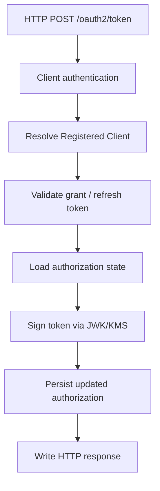

# Theo dõi độ trễ, lỗi xác thực và tỷ lệ refresh token thất bại

Authorization Server nằm trên đường đi của đăng nhập, cấp token và gia hạn phiên làm việc. Khi token endpoint chậm hoặc refresh token liên tục thất bại, người dùng có thể bị yêu cầu đăng nhập lại, ứng dụng có thể mất quyền truy cập API và các dịch vụ phụ thuộc có thể tăng tải đột biến. Đội vận hành cần nhận biết sự cố sớm, phân biệt lỗi do client với lỗi hạ tầng và xác định nguyên nhân mà không ghi lộ token hoặc credential.

Bài học này hướng dẫn xây dựng khả năng quan sát cho Spring Authorization Server bằng Spring Boot Actuator, Micrometer và hệ thống thu thập metric/tracing. Trọng tâm là độ trễ endpoint, lỗi xác thực client và người dùng, cùng tỷ lệ refresh token thất bại. Các ví dụ dùng tên metric minh họa; hãy thống nhất naming convention với hệ thống monitoring của tổ chức.

## 1. Xác định tín hiệu cần theo dõi

Không nên chỉ đếm HTTP 200 hoặc HTTP 400. Một token endpoint có thể trả HTTP 400 cho lỗi OAuth hợp lệ như `invalid_grant`, `invalid_client` hoặc `invalid_scope`; các lỗi này có ý nghĩa vận hành khác nhau. Ngược lại, HTTP 500, timeout database hoặc lỗi KMS thường cho thấy sự cố phía dịch vụ.

Nhóm tín hiệu nên được theo dõi:

| Nhóm | Chỉ số | Câu hỏi cần trả lời |
|---|---|---|
| Traffic | Số request token endpoint theo thời gian | Lưu lượng có tăng/giảm bất thường không? |
| Latency | p50, p95, p99 và max của thời gian xử lý | Client phải chờ bao lâu để nhận kết quả? |
| Availability | Tỷ lệ request thành công và lỗi hệ thống | Authorization Server có đang phục vụ được không? |
| Authentication | Số lỗi theo loại grant, phương thức xác thực và nhóm lỗi | Lỗi đến từ client credentials, assertion, redirect hay người dùng? |
| Refresh token | Tổng lần refresh, lần refresh thành công và thất bại | Bao nhiêu phiên đang không thể gia hạn? |
| Dependency | Database, KMS/HSM, LDAP/IdP, cache, introspection | Thành phần phụ thuộc nào làm tăng độ trễ hoặc gây lỗi? |
| Runtime | CPU, heap, GC, thread, connection pool | Có cạn tài nguyên hoặc nghẽn xử lý không? |

Đặt mục tiêu dịch vụ (SLO) trước khi tạo alert. Ví dụ, nhóm vận hành có thể đặt mục tiêu p95 token endpoint dưới 500 ms và tỷ lệ lỗi hệ thống dưới 0,5% trong cửa sổ 5 phút. Đây chỉ là giá trị minh họa; cần chọn ngưỡng theo tải, độ trễ dependency, yêu cầu sản phẩm và mức độ quan trọng của luồng đăng nhập.

## 2. Phân biệt các loại lỗi

### 2.1. Lỗi xác thực client

Client authentication xảy ra trước khi Authorization Server cấp token. Các lỗi thường gặp:

- `invalid_client`: sai client ID/secret, secret hết hạn, client bị vô hiệu hóa hoặc phương thức xác thực không đúng.
- `invalid_client` với `private_key_jwt`: assertion sai chữ ký, `iss`/`sub`/`aud` không đúng, assertion hết hạn hoặc `jti` bị replay.
- mTLS thất bại: chứng thư không được tin cậy, hết hạn, không khớp client đã đăng ký hoặc TLS proxy không truyền danh tính chứng thư đúng cách.
- Sai phương thức xác thực: client gửi Basic trong khi đăng ký `private_key_jwt`, hoặc gửi body credential khi server yêu cầu phương thức khác.

Một đợt tăng `invalid_client` có thể do client triển khai sai secret mới, đồng hồ client lệch, JWKS client không cập nhật hoặc có hoạt động dò credential. Cần phân biệt các nguyên nhân này bằng nhóm lỗi đã chuẩn hóa và log có correlation ID.

### 2.2. Lỗi authorization và token request

Các lỗi như `invalid_grant`, `invalid_scope`, `unauthorized_client`, `unsupported_grant_type` hoặc `invalid_request` thường phản ánh request hoặc trạng thái authorization:

- Authorization code hết hạn, đã sử dụng hoặc không khớp client/redirect URI.
- Refresh token hết hạn, bị thu hồi, không thuộc client hiện tại hoặc đã bị dùng lại sau rotation.
- Client không được cấp grant type hoặc scope được yêu cầu.
- Request thiếu tham số bắt buộc hoặc có nhiều phương thức xác thực client cùng lúc.

Đây là lỗi cần theo dõi, nhưng không nên tự động coi mọi lỗi OAuth 4xx là sự cố hạ tầng. Tỷ lệ tăng đột ngột hoặc một nhóm client gặp lỗi đồng thời mới là dấu hiệu cần điều tra.

### 2.3. Lỗi hệ thống

Các lỗi timeout, HTTP 5xx, connection pool cạn, database deadlock, lỗi KMS/HSM hoặc lỗi nội bộ khi ký token thường phản ánh sự cố phía server. Theo dõi riêng nhóm này để tính availability và kích hoạt alert vận hành.

Không suy luận nguyên nhân chỉ từ HTTP status. Một lỗi cấu hình có thể được ánh xạ thành 500; một request OAuth không hợp lệ có thể được ánh xạ thành 400 theo đặc tả. Hãy phân loại dựa trên OAuth error code, exception category và kết quả xử lý ở server.

## 3. Định nghĩa metric và công thức

### 3.1. Độ trễ token endpoint

Đo thời gian từ khi server bắt đầu xử lý request đến khi hoàn thành response. Dùng histogram để tính percentile ở hệ thống monitoring; không tính percentile bằng cách lấy trung bình các percentile của từng instance.

Các metric gợi ý:

| Metric | Kiểu | Ý nghĩa |
|---|---|---|
| `oauth2.token.requests` | Counter | Tổng request token endpoint đã xử lý |
| `oauth2.token.duration` | Timer/Histogram | Thời gian xử lý request token endpoint |
| `oauth2.token.failures` | Counter | Request token thất bại theo nhóm lỗi |
| `oauth2.auth.failures` | Counter | Lỗi xác thực client hoặc người dùng |
| `oauth2.refresh.requests` | Counter | Tổng lần refresh token |
| `oauth2.refresh.failures` | Counter | Lần refresh token thất bại |
| `oauth2.refresh.duration` | Timer/Histogram | Thời gian xử lý refresh token |

Nếu dùng Micrometer, `Timer` đã ghi số lần và tổng thời gian; histogram có thể được bật để tính percentile/quantile theo backend. Tránh tạo thêm Counter trùng lặp với cùng ý nghĩa nếu timer đã cung cấp số lượng request.

### 3.2. Tỷ lệ refresh token thất bại

Định nghĩa rõ mẫu số trước khi tạo dashboard. Một định nghĩa phổ biến:

\[
\text{Refresh failure rate} =
\frac{\text{refresh attempts thất bại}}{\text{tổng refresh attempts}} \times 100\%
\]

Trong đó, `total refresh attempts` gồm cả thành công và thất bại đã được xử lý tại token endpoint. Không dùng tổng số token endpoint request làm mẫu số vì client credentials và authorization code không phải refresh attempt.

Nên hiển thị thêm tỷ lệ lỗi hệ thống của refresh riêng với lỗi nghiệp vụ:

- `invalid_grant`: token hết hạn, bị thu hồi, sai client hoặc bị replay theo policy.
- `invalid_client`: client không xác thực được khi refresh.
- `server_error`/5xx/timeout: lỗi hạ tầng hoặc xử lý nội bộ.
- Lỗi validation khác: request không đáp ứng điều kiện của grant.

Khi cần so sánh chất lượng dịch vụ, có thể tính cả mọi lần refresh thất bại. Khi cần phát hiện sự cố hạ tầng, dùng tỷ lệ lỗi server riêng để tránh alert do client gửi refresh token hết hạn theo hành vi bình thường.

### 3.3. Cardinality và nhãn metric

Nhãn metric cần có số lượng giá trị hữu hạn. Các nhãn an toàn thường gồm:

- `grant_type`: `authorization_code`, `client_credentials`, `refresh_token`, `device_code` nếu được hỗ trợ.
- `outcome`: `success`, `oauth_error`, `server_error`.
- `error_class`: một tập mã đã chuẩn hóa như `invalid_client`, `invalid_grant`, `invalid_scope`, `timeout`, `dependency_error`, `other`.
- `client_auth_method`: `client_secret_basic`, `client_secret_post`, `private_key_jwt`, `tls_client_auth`, `none`, `other`.
- `endpoint`: tên endpoint tĩnh như `token`, `introspect`, `revoke`, không phải URL có path parameter.

Không đưa access token, refresh token, authorization code, client secret, username, subject, email, `jti`, request ID hoặc raw client ID vào metric label. Các giá trị này tạo cardinality rất lớn và có thể làm lộ dữ liệu. Với tenant hoặc client cần phân tích riêng, dùng log/tracing có kiểm soát hoặc nhóm theo tier/segment đã giới hạn số lượng; không gắn mọi ID làm label mặc định.

## 4. Bật Spring Boot Actuator và Micrometer

Thêm Actuator và registry phù hợp với hệ thống metrics. Ví dụ với Prometheus:

```xml
<dependency>
    <groupId>org.springframework.boot</groupId>
    <artifactId>spring-boot-starter-actuator</artifactId>
</dependency>
<dependency>
    <groupId>io.micrometer</groupId>
    <artifactId>micrometer-registry-prometheus</artifactId>
</dependency>
```

Với Gradle, khai báo các dependency tương ứng. Phiên bản dependency nên được quản lý bằng Spring Boot dependency management/BOM để tránh lệch phiên bản Micrometer.

Một cấu hình cơ bản:

```yaml
management:
  endpoints:
    web:
      exposure:
        include: health,info,prometheus
  endpoint:
    health:
      probes:
        enabled: true
      show-details: never
  metrics:
    distribution:
      percentiles-histogram:
        http.server.requests: true
        oauth2.operation.duration: true
      slo:
        oauth2.operation.duration: 100ms,250ms,500ms,1s,2s
```

Đây là ví dụ cấu hình; cú pháp histogram/SLO có thể khác theo phiên bản Spring Boot/Micrometer. Chỉ expose Prometheus endpoint trên mạng monitoring được kiểm soát. Không công khai actuator toàn bộ ra internet và không bật `show-details: always` trên endpoint health công khai.

Spring Boot thường tự tạo metric HTTP như `http.server.requests`. Dùng metric này để xem latency theo route/status; bổ sung metric OAuth nghiệp vụ cho grant type, kết quả và loại lỗi. Tránh đo hai lần cùng một khoảng xử lý rồi cộng hai timer như thể đó là hai request khác nhau.

## 5. Instrument độ trễ và kết quả xử lý

### 5.1. Component ghi nhận metric

Tạo một component dùng chung để ghi counter và timer. Tất cả tag phải đến từ enum hoặc danh sách giá trị được kiểm soát:

```java
@Component
public class OAuth2Metrics {

    private final MeterRegistry registry;

    public OAuth2Metrics(MeterRegistry registry) {
        this.registry = registry;
    }

    public Timer.Sample start() {
        return Timer.start(registry);
    }

    public void finish(
            Timer.Sample sample,
            String operation,
            String grantType,
            String outcome,
            String errorClass) {

        String safeOperation = allow(operation,
                Set.of("token", "refresh", "introspect", "revoke"), "other");
        String safeGrant = allow(grantType,
                Set.of("authorization_code", "client_credentials",
                       "refresh_token", "device_code"), "other");
        String safeOutcome = allow(outcome,
                Set.of("success", "oauth_error", "server_error"), "other");
        String safeError = allow(errorClass,
                Set.of("none", "invalid_client", "invalid_grant",
                       "invalid_scope", "unauthorized_client", "timeout",
                       "dependency_error", "other"), "other");

        Timer timer = Timer.builder("oauth2.operation.duration")
                .tag("operation", safeOperation)
                .tag("grant_type", safeGrant)
                .tag("outcome", safeOutcome)
                .register(registry);
        sample.stop(timer);

        registry.counter("oauth2.operation.requests",
                "operation", safeOperation,
                "grant_type", safeGrant,
                "outcome", safeOutcome,
                "error_class", safeError).increment();
    }

    private String allow(String value, Set<String> allowed, String fallback) {
        return value != null && allowed.contains(value) ? value : fallback;
    }
}
```

Đây là component minh họa cho instrumentation tại lớp xử lý. Trong ứng dụng thực tế, chỉ gọi `finish` một lần cho mỗi request; dùng `finally` để bảo đảm timer được dừng cả khi có exception. Có thể thay `Set` được tạo mỗi lần bằng constant bất biến hoặc enum. Nếu dùng timer đã có count, có thể bỏ Counter `oauth2.operation.requests` để tránh dữ liệu trùng; ví dụ giữ Counter riêng nhằm minh họa cách gắn `error_class` vào số lần lỗi.

### 5.2. Đặt instrumentation đúng vị trí

Để đo toàn bộ token endpoint, đặt instrumentation tại ranh giới xử lý request hoặc tại các success/failure handler của token endpoint. Để phân loại refresh token chính xác, cần quan sát kết quả của luồng `refresh_token` tại provider/handler tương ứng. Tên API mở rộng và cách cài đặt filter có thể thay đổi theo phiên bản Spring Authorization Server; hãy tích hợp với đúng extension point của phiên bản đang dùng.

Không chỉ bọc `OAuth2AuthorizationService` rồi coi mọi lỗi refresh đã được đếm: một số lỗi như client authentication, request validation hoặc grant validation có thể xảy ra trước khi service được gọi. Ngược lại, không chỉ đo ở controller nếu token endpoint được xử lý trong security filter chain. Hãy kiểm tra rằng cả thành công lẫn mọi nhánh thất bại đều đi qua recorder đúng một lần.

Một cách tổ chức là tạo adapter/recorder với API nghiệp vụ:

```java
public <T> T recordTokenOperation(
        String grantType,
        Supplier<T> operation) {
    Timer.Sample sample = metrics.start();
    String outcome = "success";
    String errorClass = "none";
    try {
        return operation.get();
    } catch (OAuth2AuthenticationException ex) {
        outcome = "oauth_error";
        errorClass = classifyOAuthError(ex.getError().getErrorCode());
        throw ex;
    } catch (RuntimeException ex) {
        outcome = "server_error";
        errorClass = classifyException(ex);
        throw ex;
    } finally {
        metrics.finish(sample, "token", grantType, outcome, errorClass);
    }
}
```

Đoạn mã là mẫu logic; `classifyOAuthError` và `classifyException` phải ánh xạ vào danh sách hữu hạn, không dùng exception message làm tag. Nếu exception được xử lý ở filter/handler và không được ném ra ngoài, hãy ghi outcome tại handler đó thay vì bắt exception ở lớp ngoài rồi ghi sai thành success.

### 5.3. Đo latency theo từng dependency

Timer tổng token endpoint cho biết người gọi phải chờ bao lâu, nhưng không tự giải thích vì sao. Tạo span/timer riêng cho các dependency quan trọng:

- Đọc `RegisteredClientRepository`.
- Đọc/ghi `OAuth2AuthorizationService` và consent store.
- Truy cập database connection pool và query.
- Gọi KMS/HSM để ký JWT hoặc giải mã credential.
- Xác minh `private_key_jwt`, chứng thư mTLS hoặc gọi IdP phụ trợ nếu có.
- Gọi introspection hoặc dịch vụ policy bên ngoài nếu kiến trúc sử dụng.

Không tạo metric cho từng câu SQL với tag động. Dùng tracing/APM để tìm span chậm và metric tổng hợp cho dashboard. So sánh p95 endpoint với p95 database/KMS để biết phần thời gian nằm ở đâu.

## 6. Đếm chính xác refresh token thành công và thất bại

### 6.1. Chọn điểm ghi nhận

Refresh token được xử lý tại token endpoint với `grant_type=refresh_token`. Điểm đo cần bao trùm:

1. Client authentication.
2. Kiểm tra refresh token và authorization tương ứng.
3. Kiểm tra client, scope, trạng thái thu hồi, thời hạn và refresh token reuse policy.
4. Tạo access token mới và refresh token mới nếu rotation được bật.
5. Lưu trạng thái authorization và trả response.

Nếu chỉ đếm ở client SDK, không biết request có đến Authorization Server hay không. Nếu chỉ đếm ở `OAuth2AuthorizationService`, sẽ bỏ sót các lỗi xảy ra trước khi repository được gọi. Điểm quan sát tốt nhất là token endpoint failure/success handling, kết hợp span chi tiết ở provider và persistence.

### 6.2. Phân loại lỗi refresh

Một bảng phân loại hữu ích:

| Nhóm | Ví dụ | Cách diễn giải |
|---|---|---|
| `invalid_grant` | Refresh token hết hạn, revoked, không khớp client, replay | Lỗi trạng thái/credential; theo dõi theo xu hướng |
| `invalid_client` | Client secret sai hoặc assertion/certificate không hợp lệ | Lỗi cấu hình client hoặc credential |
| `unauthorized_client` | Client không được phép dùng grant | Lỗi policy/client registration |
| `invalid_request` | Thiếu refresh token hoặc request không hợp lệ | Lỗi tích hợp client |
| `timeout` | Database/KMS/IdP timeout | Sự cố dependency hoặc tải |
| `server_error` | Exception nội bộ | Sự cố phía Authorization Server |

OAuth error code không phải lúc nào cũng cho biết nguyên nhân cuối cùng. Ví dụ `invalid_grant` có thể là token hết hạn bình thường, token bị thu hồi hoặc reuse attack. Nếu cần phân biệt, ghi thêm reason nội bộ đã chuẩn hóa tại nơi quyết định từ chối, nhưng không đưa chi tiết nhạy cảm vào response OAuth hoặc metric label có cardinality cao.

### 6.3. Công thức dashboard

Ví dụ với Counter `oauth2.refresh.attempts` có tag `outcome`:

```text
refresh_failure_rate =
  rate(refresh_attempts{outcome="failure"}[5m])
  /
  rate(refresh_attempts[5m])
```

Nếu mẫu số bằng 0, dashboard nên hiển thị `N/A` thay vì 0% để tránh hiểu nhầm không có traffic là không có lỗi. Tính thêm:

- Refresh success rate.
- Refresh failure rate theo error class.
- Số refresh attempts tuyệt đối.
- Tỷ lệ refresh server errors riêng.
- p95/p99 latency của refresh.

Không chỉ nhìn tỷ lệ. Nếu chỉ có một request và nó thất bại, tỷ lệ là 100% nhưng có thể chưa phải sự cố diện rộng. Alert nên kết hợp tỷ lệ, số lượng tối thiểu và cửa sổ thời gian.

## 7. Structured logging an toàn

Metric cho biết xu hướng; log có cấu trúc giúp điều tra một request. Một log event có thể chứa:

```json
{
  "event": "oauth2.token.request",
  "timestamp": "2026-11-16T10:15:30Z",
  "outcome": "oauth_error",
  "grant_type": "refresh_token",
  "client_auth_method": "private_key_jwt",
  "error_class": "invalid_grant",
  "http_status": 400,
  "duration_ms": 42,
  "service_instance": "auth-server-2",
  "trace_id": "4bf92f3577b34da6a3ce929d0e0e4736"
}
```

Ví dụ không chứa client ID, subject hoặc token. Nếu điều tra cần xác định client cụ thể, dùng một mã tham chiếu giả danh đã được kiểm soát hoặc tra cứu audit ở hệ thống có quyền truy cập hạn chế. Không dùng hash đơn giản của client secret/token làm định danh vì vẫn có thể tạo rủi ro suy đoán hoặc liên kết dữ liệu.

Tuyệt đối không ghi:

- `Authorization` header, access token, refresh token, ID token hoặc authorization code.
- Client secret, client assertion JWT, private key, password hoặc cookie phiên.
- Toàn bộ request/response body của token endpoint.
- Raw exception message nếu có khả năng chứa SQL, credential hoặc dữ liệu người dùng.

Với OAuth error, ghi `error_class` đã chuẩn hóa và correlation ID. Nếu cần debug chi tiết, bật log tạm thời ở phạm vi nhỏ, giới hạn người đọc và thời gian; kiểm tra cả reverse proxy, APM và HTTP client để tránh log rò ở lớp khác.

## 8. Distributed tracing và correlation

Dùng Micrometer Observation/Tracing hoặc OpenTelemetry để liên kết request từ ingress đến token endpoint, database, KMS và các dependency. Trace nên cho thấy:



Tên span cần ổn định và không chứa ID người dùng/client/token. Không đặt raw `client_id`, `sub`, `jti`, scope tùy ý hoặc URL có query string làm span name hay metric tag. Có thể thêm thuộc tính phân loại như `oauth.grant_type`, `oauth.client_auth_method`, `oauth.outcome` và `oauth.error_class` nếu đã chuẩn hóa và policy dữ liệu cho phép.

Trace ID có thể xuất hiện trong log để liên kết các lớp. Trace backend cần kiểm soát quyền truy cập, sampling và thời hạn lưu giữ; không phải mọi request lỗi đều cần lưu payload hoặc span chi tiết. Với lỗi xác thực nhạy cảm, ghi outcome và loại lỗi là đủ.

## 9. Dashboard vận hành

Một dashboard cho Authorization Server nên có các hàng thông tin:

### 9.1. Sức khỏe token endpoint

- Request rate theo grant type.
- p50/p95/p99 latency.
- Success rate và server error rate.
- HTTP status và OAuth error class.
- So sánh từng instance để tìm replica bất thường.

### 9.2. Xác thực client

- Số `invalid_client` theo phương thức xác thực đã chuẩn hóa.
- Lỗi `private_key_jwt`, mTLS hoặc client secret theo error class.
- Số client bị disable/credential rotation nếu có metric nghiệp vụ phù hợp.
- Xu hướng lỗi theo deployment version.

### 9.3. Refresh token

- Tổng refresh attempts và số lượng tuyệt đối thất bại.
- Refresh failure rate, success rate và server failure rate.
- Phân bố `invalid_grant`, `invalid_client`, timeout và dependency error.
- p95/p99 refresh latency.
- Tỷ lệ reuse bị phát hiện nếu refresh token rotation policy có hỗ trợ.

### 9.4. Dependency và runtime

- Database pool active/idle/pending, query latency và error.
- KMS/HSM signing latency và error.
- Heap, GC pause, CPU, thread pool và request queue.
- Cache hit/miss và timeout nếu authorization state hoặc client được cache.

Dashboard phải có bộ lọc thời gian và phiên bản triển khai. Dùng biến lọc có cardinality giới hạn; tránh cho phép truy vấn dashboard mặc định theo hàng triệu client ID.

## 10. Alert và ngưỡng cảnh báo

Alert nên phát hiện tác động người dùng và có hướng điều tra rõ ràng. Một số quy tắc tham khảo:

| Alert | Điều kiện minh họa | Hành động ban đầu |
|---|---|---|
| Token endpoint latency cao | p95 vượt SLO liên tục 5 phút và có đủ traffic | Kiểm tra DB, KMS, CPU, thread và deployment |
| Server error tăng | Tỷ lệ 5xx vượt ngưỡng trong 5 phút | Kiểm tra exception, dependency và log theo trace ID |
| Client authentication failures tăng | `invalid_client` tăng mạnh so với baseline | Kiểm tra secret/key rotation, certificate, client rollout và dấu hiệu dò credential |
| Refresh failure rate tăng | Tỷ lệ vượt ngưỡng cùng số lượng lỗi tối thiểu | Phân loại invalid_grant, invalid_client và server errors |
| Refresh server failures | Timeout/5xx tăng ở refresh endpoint | Kiểm tra database authorization store và KMS |
| Một instance bất thường | p99 hoặc lỗi của một replica cao hơn phần còn lại | Kiểm tra config, key ring, connection pool và node |
| Dependency saturation | DB pending connections hoặc KMS latency vượt ngưỡng | Giảm tải có kiểm soát và xử lý dependency |

Không gửi alert chỉ vì một refresh token hết hạn. Dùng baseline, số request tối thiểu và phân loại lỗi. Với `invalid_grant`, xem xét tỷ lệ trên tổng refresh và xu hướng theo phiên bản client; một đợt tăng sau deploy có thể chỉ ra client vẫn dùng refresh token cũ sau rotation.

Alert nên có owner, severity, runbook link, metric query và khoảng thời gian. Dùng multi-window/multi-burn-rate alert nếu tổ chức quản lý SLO; tránh alert chỉ dựa trên một điểm dữ liệu ngắn gây nhiễu.

## 11. Ví dụ truy vấn Prometheus

Các truy vấn sau giả định metric được export với tên Prometheus tương ứng. Micrometer có thể thêm hậu tố `_count`, `_sum` hoặc `_bucket` cho Timer/Histogram; xác nhận tên thực tế tại `/actuator/prometheus` trước khi dùng.

### 11.1. Request rate token endpoint

```promql
sum by (grant_type) (
  rate(oauth2_operation_requests_total{operation="token"}[5m])
)
```

### 11.2. p95 token latency

```promql
histogram_quantile(
  0.95,
  sum by (le) (
    rate(oauth2_operation_duration_seconds_bucket{
      operation="token"
    }[5m])
  )
)
```

### 11.3. Refresh failure rate

```promql
sum(rate(oauth2_operation_requests_total{
  operation="token",
  grant_type="refresh_token",
  outcome!="success"
}[5m]))
/
sum(rate(oauth2_operation_requests_total{
  operation="token",
  grant_type="refresh_token"
}[5m]))
```

Trong thực tế, nếu metric được thiết kế theo `operation="refresh"`, hãy dùng giá trị đó nhất quán. Dùng `clamp_min` hoặc biểu thức có điều kiện ở dashboard để tránh chia cho 0; khi không có traffic, hiển thị N/A. Với hệ thống có nhiều instance, tổng hợp tử số và mẫu số trước khi chia.

### 11.4. Nhóm lỗi refresh

```promql
sum by (error_class) (
  rate(oauth2_operation_requests_total{
    operation="token",
    grant_type="refresh_token",
    outcome!="success"
  }[5m])
)
```

Không nhóm theo client ID hoặc username trong metric. Nếu cần điều tra một client, dùng trace/log đã kiểm soát hoặc audit record có quyền truy cập giới hạn.

## 12. Kiểm thử khả năng quan sát

Không chỉ kiểm tra endpoint `/actuator/prometheus` trả HTTP 200. Hãy xác minh metric được tăng đúng trong từng tình huống và không có dữ liệu nhạy cảm.

| Tình huống | Metric/log mong đợi |
|---|---|
| Client credentials thành công | Token request count tăng; timer ghi outcome success |
| Client authentication sai | Counter lỗi xác thực tăng với error class `invalid_client` |
| Authorization code sai/hết hạn | OAuth error được phân loại; không ghi code vào log |
| Refresh token hợp lệ | Refresh attempts và success tăng; duration được ghi |
| Refresh token hết hạn/revoked | Failure tăng với `invalid_grant` hoặc nhóm reason đã chuẩn hóa |
| Refresh token reuse | Ghi nhận reuse theo policy; không lộ token |
| Database timeout khi refresh | Server/dependency error tăng; trace chỉ ra span database |
| KMS signing chậm | Token latency và span KMS tăng; có thể phân biệt với DB |
| Không có traffic | Dashboard hiển thị N/A cho failure rate |
| Nhiều replica | Metric tổng hợp đúng; không đếm trùng cùng request |
| Log scan | Không có token, secret, assertion hoặc Authorization header |
| Cardinality test | Số time series không tăng theo số lượng user/client/request ID |

Thực hiện load test ở staging với các tỷ lệ thành công/thất bại được kiểm soát. Tạo baseline cho p50/p95/p99, throughput, CPU, database pool và KMS latency. Sau đó mô phỏng dependency chậm hoặc mất kết nối để xác nhận alert và runbook hoạt động.

## 13. Quy trình điều tra khi chỉ số xấu đi

Khi p95 token latency hoặc refresh failure rate vượt SLO:

1. Xác định thời điểm bắt đầu và so sánh với deployment, credential rotation, thay đổi policy hoặc sự cố dependency.
2. Xác định phạm vi: tất cả grant type hay chỉ refresh; tất cả client hay một nhóm; tất cả replica hay một instance.
3. Phân loại lỗi OAuth, lỗi hệ thống và lỗi dependency; không gộp 4xx và 5xx thành một tỷ lệ duy nhất.
4. Mở trace mẫu để xem thời gian ở client authentication, authorization store, KMS, database và response.
5. Kiểm tra log cấu trúc bằng trace ID; không tìm kiếm bằng cách dump token hoặc request body.
6. Đối chiếu client rollout, refresh token rotation và trạng thái authorization store.
7. Khắc phục nguyên nhân, theo dõi metric sau thay đổi và ghi lại timeline/sự cố.

Một số dấu hiệu định hướng:

- p95 tăng cùng DB pending connection: có thể pool hoặc database đang nghẽn.
- p95 tăng nhưng DB bình thường, KMS span tăng: kiểm tra signing service, quota hoặc network KMS.
- Refresh failure tăng `invalid_grant` sau khi client deploy: kiểm tra client có lưu refresh token mới sau rotation không.
- `invalid_client` tăng sau credential rotation: kiểm tra thời gian overlap và phương thức xác thực client.
- Chỉ một replica có latency cao: kiểm tra cấu hình, node, cache, connection pool và key ring của instance đó.
- Tỷ lệ lỗi tăng nhưng traffic thấp: xem số lượng tuyệt đối trước khi kết luận sự cố diện rộng.

## 14. Các lỗi triển khai thường gặp

| Lỗi | Hậu quả | Cách khắc phục |
|---|---|---|
| Chỉ theo dõi HTTP 5xx | Bỏ sót `invalid_client`, `invalid_grant` và latency cao | Theo dõi OAuth error class và timer nghiệp vụ |
| Gộp mọi 4xx thành sự cố server | Alert nhiễu, không xác định được lỗi client hay policy | Phân loại OAuth error và lỗi hệ thống riêng |
| Tính refresh failure trên mọi token request | Mẫu số sai, tỷ lệ không có ý nghĩa | Chỉ tính request `grant_type=refresh_token` |
| Không đo thất bại ở token endpoint filter | Bỏ sót lỗi trước khi gọi authorization service | Instrument success/failure handler hoặc provider phù hợp |
| Ghi raw client ID/user/token làm metric tag | Cardinality tăng mạnh và rò dữ liệu | Dùng tag hữu hạn, log/tracing có kiểm soát |
| Chỉ đo latency tổng | Không biết dependency nào gây chậm | Thêm span/timer cho DB, KMS và authorization store |
| Ghi request body hoặc Authorization header | Lộ credential và token | Structured log allowlist, redaction và log scan |
| Alert theo một lỗi refresh đơn lẻ | Cảnh báo giả khi token hết hạn bình thường | Kết hợp tỷ lệ, số lượng tối thiểu và baseline |
| Không kiểm thử metric | Dashboard có thể hiển thị sai hoặc đếm trùng | Integration test cho success/failure và multi-instance |

## Kết luận

Khả năng quan sát tốt cho Authorization Server cần kết hợp latency, traffic, kết quả xác thực, lỗi OAuth và trạng thái dependency. Đo refresh token riêng với các grant type khác, phân loại `invalid_grant`/`invalid_client`/lỗi hệ thống và dùng mẫu số đúng giúp dashboard phản ánh đúng trải nghiệm gia hạn phiên. Micrometer, Actuator và tracing cung cấp tín hiệu cần thiết khi được đặt đúng điểm xử lý, dùng tag có cardinality giới hạn và không ghi token hay credential. Khi dashboard, alert và runbook cùng dựa trên các tín hiệu này, đội vận hành có thể phát hiện sự cố sớm và xác định nguyên nhân mà không làm lộ dữ liệu xác thực.
