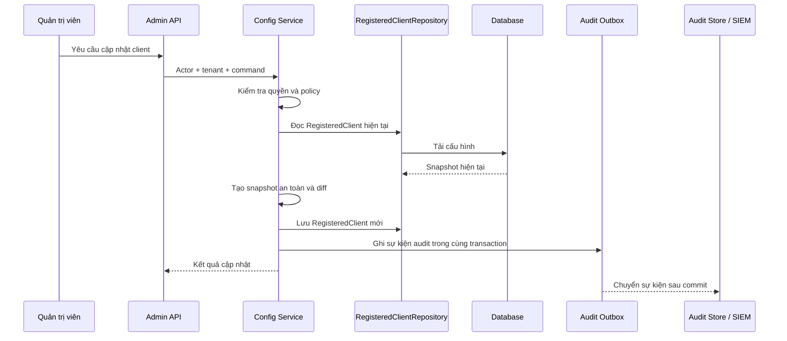

# Audit thay đổi cấu hình client, tenant và chính sách token

Một thay đổi nhỏ trong cấu hình OAuth 2.0/OIDC có thể làm thay đổi quyền truy cập của nhiều ứng dụng. Thêm một redirect URI, mở rộng scope, bật một grant type, kéo dài thời hạn access token hoặc thay đổi khóa ký đều có thể ảnh hưởng đến ranh giới bảo mật của Authorization Server. Khi sự cố xảy ra, đội vận hành cần trả lời được ai đã thay đổi điều gì, thay đổi cho tenant hoặc client nào, vào thời điểm nào, thay đổi có thành công không và cấu hình nào đang có hiệu lực.

Audit cấu hình ghi lại lịch sử những thay đổi có ý nghĩa bảo mật đối với client, tenant và chính sách token. Trong Spring Authorization Server, các đối tượng như `RegisteredClient`, `ClientSettings` và `TokenSettings` cung cấp một phần cấu hình client; mô hình tenant, quy trình quản trị và chính sách dùng chung thường do ứng dụng xây dựng thêm. Vì vậy, cần thiết kế audit ở lớp nghiệp vụ quản lý cấu hình và kết nối nó với các repository của Authorization Server.

Bài học này tập trung vào lịch sử thay đổi cấu hình. Nhật ký phát hành token, xác thực người dùng và truy cập endpoint là các nhóm sự kiện vận hành khác; chúng có thể dùng chung hạ tầng thu thập nhưng cần taxonomy, lưu lượng và chính sách lưu giữ riêng.

## 1. Vì sao phải audit thay đổi cấu hình

Authorization Server là nguồn tin cậy phát hành token cho các client. Nếu một client được cấp thêm scope nhạy cảm hoặc được phép dùng grant type không phù hợp, tác động có thể lan đến API và dữ liệu phía sau. Nếu một tenant bị đổi issuer hoặc cấu hình domain, client có thể xác thực sai máy chủ. Nếu thời hạn refresh token bị kéo dài, một credential bị đánh cắp có thể duy trì quyền truy cập lâu hơn dự kiến.

Audit cấu hình giúp đạt các mục tiêu sau:

- **Truy nguyên:** xác định actor là người quản trị, service account hay pipeline; biết đối tượng và trường nào đã thay đổi.
- **Điều tra sự cố:** dựng lại trạng thái trước và sau thay đổi, thời điểm thay đổi có hiệu lực và các request liên quan.
- **Kiểm soát thay đổi:** hỗ trợ quy trình phê duyệt, phân tách nhiệm vụ và kiểm tra thay đổi ngoài quy trình.
- **Phát hiện hành vi bất thường:** cảnh báo khi scope được mở rộng, PKCE bị tắt, redirect URI thay đổi hoặc chính sách token được nới lỏng.
- **Đáp ứng kiểm toán:** cung cấp lịch sử có thể tìm kiếm, bảo vệ khỏi sửa xóa trái phép và lưu giữ theo chính sách của tổ chức.

Một bản ghi audit có giá trị khi trả lời được năm câu hỏi: **ai** thực hiện, **đã làm gì**, **đối tượng nào** bị tác động, **khi nào và từ đâu** thao tác diễn ra, và **kết quả** là gì. Với thay đổi được phê duyệt, cần thêm lý do, mã yêu cầu hoặc dấu vết phê duyệt nếu quy trình của tổ chức yêu cầu.

## 2. Xác định những thay đổi cần ghi nhận

Không nên chỉ ghi một sự kiện chung như `CONFIG_UPDATED`. Hãy dùng tên sự kiện mô tả hành động nghiệp vụ và giữ đủ chi tiết để người điều tra hiểu được tác động.

### 2.1. Thay đổi Registered Client

`RegisteredClient` đại diện cho một client được đăng ký với Authorization Server. Các thay đổi thường cần audit gồm:

- Tạo, cập nhật, vô hiệu hóa, kích hoạt lại hoặc xóa client.
- Thay đổi `clientName`, phương thức xác thực tại token endpoint hoặc các grant type được phép.
- Thêm, sửa hoặc xóa redirect URI và post-logout redirect URI.
- Thêm hoặc loại bỏ scope.
- Thay đổi yêu cầu PKCE, yêu cầu consent hoặc các thiết lập client khác.
- Thay đổi thời hạn authorization code, access token, refresh token, định dạng access token hoặc cách xử lý refresh token.
- Xoay vòng client secret hoặc thay đổi thông tin khóa/JWK mà client sử dụng.

Spring Authorization Server cung cấp `RegisteredClientRepository` với các thao tác lưu và tìm `RegisteredClient`. `RegisteredClient` có `ClientSettings` và `TokenSettings`, do đó lớp quản trị có thể tạo snapshot an toàn từ các giá trị này trước và sau khi cập nhật.

### 2.2. Thay đổi tenant

Spring Authorization Server không cung cấp một mô hình tenant quản trị hoàn chỉnh có sẵn. Tenant thường là khái niệm thuộc domain của ứng dụng hoặc nền tảng. Nếu hệ thống hỗ trợ nhiều tenant, hãy audit các thay đổi như:

- Tạo, kích hoạt, tạm khóa, mở khóa hoặc đóng tenant.
- Thay đổi tên định danh, domain, issuer hoặc ánh xạ host đến tenant.
- Thay đổi danh sách client được phép hoạt động trong tenant.
- Thay đổi chính sách đăng nhập, consent, MFA, federation hoặc giới hạn truy cập.
- Thay đổi scope mặc định, grant type được phép, giới hạn token hoặc chính sách ký riêng của tenant.
- Thay đổi liên kết tenant với kho khóa, IdP hoặc hệ thống quản lý người dùng.

Audit phải dùng một `tenant_id` ổn định, không dùng tên hiển thị có thể đổi làm định danh chính. Khi một thay đổi tác động đến toàn hệ thống, ghi rõ phạm vi `GLOBAL`; khi thay đổi tác động đến một tenant, ghi `tenant_id` cụ thể. Nếu một chính sách toàn cục ảnh hưởng đến nhiều tenant, lưu phiên bản chính sách và phạm vi áp dụng để có thể xác định các tenant chịu ảnh hưởng.

### 2.3. Thay đổi chính sách token

Chính sách token có thể nằm ở nhiều lớp. Một phần thuộc `TokenSettings` của client; một phần thuộc `ClientSettings`; một phần khác nằm trong cấu hình Authorization Server hoặc policy engine do ứng dụng xây dựng. Hãy audit cả giá trị cấu hình và nguồn chính sách tạo ra giá trị hiệu lực.

Các thay đổi có ý nghĩa bảo mật gồm:

- Thời hạn authorization code, access token và refresh token.
- Cho phép tái sử dụng refresh token hay yêu cầu rotation sau mỗi lần refresh.
- Định dạng access token, chẳng hạn JWT hay reference token.
- Thuật toán ký ID token và tham số ký JWT do ứng dụng quản lý.
- Grant type, scope, audience và claim mapping được phép.
- Yêu cầu PKCE, consent, xác thực client hoặc ràng buộc token với chứng thư.
- Quy tắc thu hồi token, giới hạn tốc độ và chính sách phát hành token theo tenant hoặc client.

Không phải mọi thuộc tính đều có trong `TokenSettings`. Những chính sách tùy chỉnh cần có định danh, phiên bản và schema riêng; không nên ghi một chuỗi cấu hình không có cấu trúc rồi kỳ vọng có thể truy vấn chính xác về sau.

## 3. Phân loại sự kiện và thiết kế bản ghi audit

Một taxonomy nhỏ, nhất quán sẽ giúp tìm kiếm và cảnh báo dễ hơn. Ví dụ:

| Nhóm | Tên sự kiện gợi ý | Khi nào ghi |
|---|---|---|
| Client | `CLIENT_CREATED`, `CLIENT_UPDATED`, `CLIENT_DISABLED`, `CLIENT_DELETED` | Khi trạng thái hoặc cấu hình Registered Client thay đổi |
| Credential client | `CLIENT_SECRET_ROTATED`, `CLIENT_KEY_UPDATED` | Khi secret hoặc thông tin khóa của client được thay mới |
| Tenant | `TENANT_CREATED`, `TENANT_SUSPENDED`, `TENANT_SETTINGS_UPDATED` | Khi tenant hoặc cấu hình tenant thay đổi |
| Chính sách | `TOKEN_POLICY_CREATED`, `TOKEN_POLICY_UPDATED`, `TOKEN_POLICY_ASSIGNED` | Khi chính sách được tạo, sửa hoặc gán cho phạm vi áp dụng |
| Quản trị | `CONFIG_CHANGE_DENIED`, `CONFIG_CHANGE_APPROVAL_REJECTED` | Khi thao tác bị từ chối hoặc phê duyệt không thành công |

Tên sự kiện là hợp đồng dữ liệu giữa dịch vụ quản trị, hệ thống audit, dashboard và SIEM. Khi thay đổi taxonomy, hãy quản lý phiên bản schema và duy trì khả năng đọc các sự kiện cũ.

### 3.1. Các trường nên có

Một bản ghi audit cấu hình nên chứa tối thiểu:

| Trường | Ý nghĩa |
|---|---|
| `event_id` | ID duy nhất để chống xử lý trùng và tra cứu |
| `occurred_at` | Thời điểm UTC khi thay đổi được ghi nhận |
| `event_type` | Loại hành động nghiệp vụ |
| `actor_type`, `actor_id` | Người dùng, service account hoặc pipeline thực hiện |
| `tenant_id` | Tenant chịu tác động hoặc `GLOBAL` |
| `target_type`, `target_id` | Client, tenant hoặc policy bị thay đổi |
| `outcome` | `SUCCESS`, `DENIED` hoặc `FAILED` |
| `changed_fields` | Danh sách trường đã thay đổi |
| `before_snapshot`, `after_snapshot` | Snapshot an toàn trước và sau thay đổi |
| `request_id`, `correlation_id` | Liên kết với request hoặc trace liên quan |
| `source` | Admin API, console, automation hoặc pipeline |
| `reason`, `change_reference` | Lý do hoặc mã ticket/phê duyệt nếu có |
| `before_version`, `after_version` | Phiên bản cấu hình trước và sau |

Có thể bổ sung địa chỉ IP, user agent, phương thức xác thực và trạng thái step-up/MFA khi chính sách cho phép. Chỉ thu thập thông tin cần thiết; dữ liệu nhận dạng và thông tin mạng cũng cần thời hạn lưu giữ và quyền truy cập phù hợp.

### 3.2. Snapshot phải loại bỏ dữ liệu nhạy cảm

Audit cần đủ thông tin để giải thích thay đổi, nhưng không được trở thành một kho lưu trữ credential thứ hai. Không ghi các giá trị sau vào snapshot hoặc diff:

- Client secret, mật khẩu, access token, refresh token, authorization code hoặc ID token.
- Private key, khóa mã hóa, nội dung secret manager hoặc credential truy cập KMS/HSM.
- Header `Authorization`, cookie phiên hoặc toàn bộ request body quản trị chưa được lọc.

Với thao tác xoay client secret, chỉ ghi `secret_changed: true`, thời điểm, credential version hoặc thời hạn mới. Không ghi secret cũ, secret mới hay hash của secret. Với thay đổi khóa ký, ghi `kid`, thuật toán, key reference và fingerprint của public key nếu cần; tuyệt đối không ghi private key.

Hãy tạo một allowlist các trường được phép xuất hiện trong snapshot. Cách này an toàn hơn việc ghi toàn bộ object rồi cố gắng xóa các thuộc tính nhạy cảm sau đó. Cần kiểm tra cả nested object, exception, log framework và telemetry để tránh lộ dữ liệu ngoài bản ghi audit chính.

## 4. Ví dụ một sự kiện thay đổi client

Giả sử quản trị viên thêm scope `orders.read` và một redirect URI đã được phê duyệt cho client `web-portal`. Một sự kiện audit có thể có cấu trúc như sau:

```json
{
  "eventId": "8d58e4de-85d1-4b88-9a82-97c1f8a10e51",
  "occurredAt": "2026-11-16T09:30:00Z",
  "schemaVersion": 1,
  "eventType": "CLIENT_UPDATED",
  "outcome": "SUCCESS",
  "actor": {
    "type": "USER",
    "id": "admin-17"
  },
  "tenantId": "tenant-42",
  "target": {
    "type": "REGISTERED_CLIENT",
    "id": "client-portal-01",
    "clientId": "web-portal"
  },
  "change": {
    "beforeVersion": 12,
    "afterVersion": 13,
    "changedFields": ["redirectUris", "scopes"],
    "before": {
      "redirectUris": ["https://portal.example.com/login/oauth2/code/app"],
      "scopes": ["openid", "profile"]
    },
    "after": {
      "redirectUris": [
        "https://portal.example.com/login/oauth2/code/app",
        "https://portal.example.com/alternate/callback"
      ],
      "scopes": ["openid", "profile", "orders.read"]
    }
  },
  "source": "admin-api",
  "requestId": "req-71d0f3",
  "reason": "Approved client integration change"
}
```

Đây là ví dụ minh họa schema. ID, tenant, URI và lý do trong môi trường thực tế phải đến từ dữ liệu đã xác thực. Snapshot chỉ chứa các thuộc tính đã được allowlist; không có client secret hoặc token.

Với thao tác bị từ chối, ghi `outcome: DENIED`, actor, tenant, target, hành động được yêu cầu và lý do từ chối phù hợp. Không ghi toàn bộ payload chưa được xác thực vì payload có thể chứa credential hoặc dữ liệu do người gọi kiểm soát.

## 5. Bảo đảm ranh giới tenant

Audit đa tenant phải bảo vệ cả dữ liệu cấu hình lẫn dữ liệu audit. Một bản ghi sai `tenant_id` có thể khiến điều tra nhầm tenant hoặc làm lộ hoạt động quản trị của khách hàng khác.

### 5.1. Xác định tenant từ nguồn tin cậy

Không lấy `tenant_id` do client gửi trong body hoặc query parameter làm bằng chứng về quyền truy cập. Tenant cần được xác định từ ngữ cảnh đã xác thực, chẳng hạn ánh xạ host/issuer đã được quản trị, danh tính của admin và quyền quản trị tenant. Sau đó kiểm tra actor có quyền thao tác trên tenant đó trước khi đọc hoặc sửa cấu hình.

Spring Authorization Server không tự cung cấp một tenant context dùng chung cho mọi repository. Ứng dụng phải quyết định cách phân vùng dữ liệu và cách phân giải client. Các mô hình thường gặp gồm:

- **Client ID duy nhất toàn hệ thống:** dùng `client_id` toàn cục và lưu ánh xạ tenant rõ ràng. Cách này phù hợp khi các luồng chuẩn cần tìm client bằng `findByClientId` mà không có tham số tenant.
- **Kho hoặc Authorization Server tách biệt theo tenant:** mỗi tenant có repository hoặc instance riêng, giúp ranh giới dữ liệu rõ ràng hơn nhưng tăng chi phí vận hành.
- **Phân giải tenant tùy chỉnh:** mở rộng repository hoặc lớp phân giải client để đưa tenant đã xác thực vào mọi lần tìm kiếm. Cách này cần tích hợp nhất quán với authorization request, token endpoint, introspection và các luồng liên quan.

Nếu cho phép hai tenant dùng cùng một `client_id`, cần có cơ chế phân giải tenant rõ ràng trong toàn bộ luồng. Chỉ thêm `tenant_id` vào bảng dữ liệu nhưng vẫn gọi một truy vấn `findByClientId` không phân biệt tenant là chưa đủ. Không dựa vào `ThreadLocal` tự phát mà không quản lý vòng đời request, async execution và cleanup; tenant context phải được truyền hoặc khôi phục có kiểm soát.

### 5.2. Lưu tenant ID trên mọi sự kiện liên quan

Sự kiện client phải mang tenant sở hữu client. Sự kiện policy phải thể hiện phạm vi áp dụng: toàn cục, tenant hay client. Nếu thao tác chuyển client từ tenant này sang tenant khác, ghi nhận cả tenant nguồn và tenant đích trong một sự kiện chuyển quyền riêng, kèm kiểm tra quyền và phê duyệt cần thiết.

Khi truy vấn audit, áp dụng kiểm soát truy cập ở phía server. Không chỉ lọc theo tenant trong giao diện người dùng. Tài khoản quản trị tenant A không được truy vấn sự kiện của tenant B bằng cách sửa URL hoặc tham số API.

## 6. Nối audit với Spring Authorization Server

Audit nên được đặt ở service quản trị cấu hình, nơi hệ thống biết rõ actor, tenant, lý do và ý nghĩa của thay đổi. Không nên rải logic audit trong controller hoặc chỉ dựa vào log SQL, vì log SQL khó biểu đạt ý nghĩa nghiệp vụ và có thể không biết ai là người yêu cầu thay đổi.

Một luồng cập nhật client có thể đi theo trình tự:



`RegisteredClientRepository` là nơi lưu client theo hợp đồng của Spring Authorization Server. Dịch vụ quản trị nên gọi repository này thông qua một lớp domain có trách nhiệm xác minh tenant và quyền thay đổi. Khi lưu client, lớp domain đồng thời ghi sự kiện audit hoặc bản ghi outbox.

### 6.1. Audit các nguồn cấu hình khác nhau

Không phải mọi thay đổi đều đi qua `RegisteredClientRepository`:

- Cấu hình client trong database cần được audit tại service quản trị client.
- Chính sách tenant lưu trong bảng riêng cần được audit tại service quản trị tenant.
- Chính sách token toàn cục được đóng gói trong cấu hình ứng dụng cần liên kết với commit, artifact digest, pipeline, người phê duyệt và deployment ID.
- Thay đổi trong secret manager hoặc KMS cần lấy audit log từ hệ thống quản lý khóa/secret và liên kết với `kid`, key reference hoặc credential version.

Nếu cấu hình được nạp lại từ file hoặc hệ thống ngoài, hãy ghi nhận phiên bản cấu hình thực sự được áp dụng sau khi reload. Chỉ ghi nhận một lần commit là chưa đủ nếu deployment thất bại hoặc ứng dụng không nạp được phiên bản đó.

### 6.2. Không nhầm audit cấu hình với sự kiện phát hành token

Một token được phát hành không có nghĩa cấu hình client đã thay đổi. Sự kiện `CLIENT_UPDATED` hoặc `TOKEN_POLICY_UPDATED` thuộc control plane quản trị; sự kiện cấp token thuộc runtime data plane. Hai nhóm có thể liên kết bằng `client_id`, `tenant_id`, policy version và correlation ID, nhưng không nên trộn thành một loại sự kiện duy nhất.

Ghi mọi lần phát hành token vào cùng một bảng audit cấu hình có thể tạo lưu lượng lớn và làm khó truy vấn thay đổi quản trị. Hãy chọn hệ thống telemetry riêng cho token endpoint và chỉ liên kết khi điều tra cần thiết. Không đưa giá trị token vào bất kỳ nhóm log nào.

## 7. Ghi cấu hình và audit một cách nguyên tử

Một lỗi phổ biến là lưu client thành công nhưng ghi audit thất bại, hoặc ghi audit thành công trong khi cập nhật client rollback. Khi cả cấu hình và audit cùng nằm trong một database, hãy ghi chúng trong cùng transaction. Nếu audit được chuyển sang hệ thống bên ngoài, dùng transactional outbox để không phụ thuộc vào một lời gọi mạng đồng bộ bên trong transaction.

### 7.1. Transactional outbox

Trong một transaction:

1. Đọc phiên bản cấu hình hiện tại.
2. Kiểm tra quyền, tenant và quy tắc thay đổi.
3. Tạo cấu hình mới và snapshot an toàn trước/sau.
4. Lưu cấu hình mới.
5. Ghi một bản ghi outbox có `event_id` duy nhất.
6. Commit transaction.

Một worker đọc outbox, gửi sự kiện đến audit store hoặc SIEM rồi đánh dấu đã chuyển. Consumer cần xử lý idempotent theo `event_id`, có retry và dead-letter handling. Không gọi SIEM trực tiếp rồi mới lưu client; lỗi mạng của SIEM không nên tạo ra trạng thái cập nhật nửa chừng.

Nếu cấu hình và audit nằm trong cùng database, có thể ghi thẳng bảng audit append-only trong cùng transaction. Nếu audit store tách biệt, outbox trong database cấu hình là cầu nối đáng tin cậy. Cần giám sát độ trễ outbox, số bản ghi chờ và lỗi gửi để phát hiện audit bị ngừng chuyển.

### 7.2. Thao tác thất bại và bị từ chối

Một transaction cập nhật bị rollback sẽ không giữ lại bản ghi audit nằm trong transaction đó. Với thao tác bị từ chối hoặc thất bại, cần một đường ghi nhận riêng có thể lưu được kết quả thất bại mà không làm lộ payload. Ghi các trường cần thiết như actor, tenant, target, action, outcome, request ID và mã lý do; không ghi secret hoặc nội dung request thô.

Nếu audit store tạm thời không khả dụng, chính sách xử lý phải được xác định theo mức độ nhạy cảm của thao tác. Với thay đổi đặc quyền cao, có thể yêu cầu audit bền vững trước khi cho phép thay đổi. Với sự kiện thất bại có lưu lượng lớn, có thể dùng buffer bền vững và cảnh báo. Không âm thầm bỏ sự kiện mà không có chỉ số hoặc cảnh báo.

## 8. Ví dụ mô hình Java cho snapshot và outbox

Ví dụ sau minh họa cách tổ chức lớp domain. `TenantAwareClientStore`, `ClientSnapshotFactory`, `ClientUpdater` và `AuditOutboxRepository` là các abstraction do ứng dụng xây dựng; chúng không phải class có sẵn của Spring Authorization Server.

```java
public record SafeClientSnapshot(
        String clientName,
        Set<String> redirectUris,
        Set<String> postLogoutRedirectUris,
        Set<String> scopes,
        Set<String> grantTypes,
        Set<String> authenticationMethods,
        boolean requireProofKey,
        boolean requireAuthorizationConsent,
        Duration accessTokenTtl,
        Duration refreshTokenTtl,
        boolean reuseRefreshTokens,
        String accessTokenFormat) {
}
```

Snapshot chỉ gồm những trường được phép audit. Factory tạo snapshot từ `RegisteredClient`, `ClientSettings` và `TokenSettings`; nếu có trường tùy chỉnh, factory cần áp dụng allowlist tương tự.

```java
@Service
public class ClientConfigurationService {

    private final TenantAwareClientStore clients;
    private final ClientUpdater updater;
    private final ClientSnapshotFactory snapshots;
    private final AuditOutboxRepository outbox;

    public ClientConfigurationService(
            TenantAwareClientStore clients,
            ClientUpdater updater,
            ClientSnapshotFactory snapshots,
            AuditOutboxRepository outbox) {
        this.clients = clients;
        this.updater = updater;
        this.snapshots = snapshots;
        this.outbox = outbox;
    }

    @Transactional
    public void updateClient(
            TenantId tenantId,
            Actor actor,
            String clientId,
            UpdateClientCommand command,
            String correlationId) {

        RegisteredClient current = clients.requireForTenant(tenantId, clientId);
        SafeClientSnapshot before = snapshots.from(current);

        RegisteredClient updated = updater.apply(current, command);
        clients.validateChange(tenantId, actor, current, updated);

        SafeClientSnapshot after = snapshots.from(updated);
        Set<String> changedFields = snapshots.diff(before, after);

        if (changedFields.isEmpty()) {
            return;
        }

        clients.save(tenantId, updated);
        outbox.append(AuditEvent.clientUpdated(
                tenantId,
                actor,
                current.getId(),
                before,
                after,
                changedFields,
                correlationId,
                command.reason()));
    }
}
```

Ví dụ giả định việc lưu client và outbox dùng cùng transaction manager và cùng cơ sở dữ liệu. Trong hệ thống thực tế, `TenantAwareClientStore` phải kiểm tra tenant ownership, còn `ClientUpdater` phải chỉ cho phép các trường đã được phép thay đổi. Cần thêm xử lý phiên bản để tránh hai quản trị viên ghi đè thay đổi của nhau. Có thể dùng optimistic locking hoặc version riêng trong bảng cấu hình; không giả định mọi schema JDBC mặc định đều đã có version column.

Không gọi `outbox.append` với object request đầy đủ. Hãy truyền snapshot an toàn đã được tạo sau khi lọc trường. Với thao tác xoay secret, snapshot chỉ phản ánh trạng thái credential đã thay đổi, không chứa credential.

## 9. Audit chính sách token theo phạm vi và phiên bản

Một hệ thống có thể áp dụng chính sách theo thứ tự global, tenant rồi client. Khi đó, chỉ ghi giá trị override là chưa đủ để giải thích chính sách thực sự được dùng.

Ví dụ:

| Phạm vi | Access token TTL | Refresh token TTL | PKCE |
|---|---:|---:|---|
| Global mặc định | 10 phút | 8 giờ | Bắt buộc |
| Tenant `tenant-42` | 5 phút | 4 giờ | Bắt buộc |
| Client `web-portal` | 5 phút | 2 giờ | Bắt buộc |

Khi tenant đổi refresh token TTL từ 4 giờ thành 6 giờ, sự kiện cần chỉ ra policy ID, phạm vi tenant, phiên bản trước/sau và giá trị hiệu lực của client chịu tác động. Nếu một client có override riêng, giá trị hiệu lực của client đó có thể không đổi; điều này cần được thể hiện rõ.

Mỗi policy nên có:

- `policy_id` ổn định và `policy_version` tăng theo mỗi lần cập nhật.
- `scope_type` và `scope_id`, ví dụ `GLOBAL`, `TENANT` hoặc `CLIENT`.
- Nội dung chính sách đã chuẩn hóa theo schema có version.
- Actor, thời điểm, lý do, trạng thái phê duyệt và nguồn cấu hình.
- Danh sách đối tượng hoặc phạm vi bị ảnh hưởng, hoặc cách truy vấn để tái dựng phạm vi đó.

Khi cần điều tra một token cụ thể, có thể lưu policy version đã áp dụng vào metadata của authorization hoặc trace tương ứng. Nhờ vậy, đội vận hành biết token được phát hành theo chính sách nào tại thời điểm đó, ngay cả khi policy hiện tại đã thay đổi.

### 9.1. Hiểu đúng hiệu lực của thay đổi

Thay đổi policy thường tác động đến các lần cấp token mới. Một JWT đã phát hành vẫn mang claim và `exp` được ký trước đó; giảm access token TTL trong cấu hình không tự sửa thời hạn của JWT đang tồn tại. Nếu cần vô hiệu hóa token đã cấp, phải dùng cơ chế thu hồi, denylist, introspection hoặc chính sách kiểm tra bổ sung phù hợp với loại token và kiến trúc resource server.

Tương tự, thay đổi scope được phép không tự xóa scope đã nằm trong access token cũ. Thay đổi refresh token policy cũng cần xác định rõ có áp dụng cho refresh token đã phát hành hay chỉ cho token mới. Nếu muốn áp dụng policy mới cho token cũ, phải có quy tắc runtime rõ ràng và kiểm thử hành vi đó.

Khi xoay khóa ký, public key cũ cần được duy trì trong JWKS đủ lâu để xác minh token còn hiệu lực đã ký bằng khóa cũ. Sự kiện audit nên ghi `kid` cũ, `kid` mới, thuật toán, thời điểm chuyển ký và thời điểm dự kiến có thể gỡ public key cũ.

## 10. Bảo vệ tính toàn vẹn và quyền truy cập audit

Audit mất giá trị nếu người có quyền sửa cấu hình cũng có thể xóa dấu vết của mình. Hãy tách quyền quản trị cấu hình khỏi quyền quản trị audit.

- Ứng dụng chỉ được insert sự kiện; tài khoản ứng dụng không có quyền update hoặc delete bản ghi audit đã ghi.
- Chỉ một nhóm nhỏ được phép truy vấn hoặc export dữ liệu audit; truy cập audit cũng cần được ghi nhận.
- Đồng bộ thời gian hệ thống để timestamp có thể so sánh giữa API, database, worker và SIEM.
- Chuyển bản sao sự kiện đến kho log tập trung có quyền ghi hạn chế và cơ chế lưu trữ bất biến/WORM nếu yêu cầu kiểm toán cần.
- Có thể bổ sung chữ ký sự kiện hoặc hash chain theo lô để phát hiện sửa đổi. Nếu dùng hash chain, cần quản lý checkpoint và khóa xác minh ở miền quyền độc lập.
- Mã hóa khi truyền và khi lưu; kiểm soát backup, export và thời hạn lưu giữ.
- Không cho phép người quản trị tenant tự sửa hoặc xóa sự kiện của tenant mình.

Hash chain không thay thế phân quyền, backup hay kho lưu trữ bất biến. Nếu một actor có thể sửa cả sự kiện và checkpoint, cơ chế kiểm tra tính toàn vẹn sẽ không còn ý nghĩa. Hãy đặt thành phần xác minh ở miền quyền độc lập và định kỳ kiểm tra kết quả.

## 11. Cảnh báo cho những thay đổi có rủi ro cao

Không phải mọi thay đổi cấu hình đều cần cảnh báo tức thời. Xác định các điều kiện có thể làm tăng quyền hoặc mở rộng bề mặt tấn công, chẳng hạn:

- Thêm redirect URI đến domain mới hoặc domain chưa nằm trong danh sách tin cậy.
- Thêm scope nhạy cảm, audience mới hoặc grant type có quyền rộng hơn.
- Tắt PKCE, bỏ yêu cầu consent hoặc giảm yêu cầu xác thực client.
- Tăng access token/refresh token TTL vượt ngưỡng đã phê duyệt.
- Bật lại client đã bị vô hiệu hóa hoặc thay đổi client từ public sang confidential hay ngược lại.
- Thay đổi issuer, domain hoặc ánh xạ tenant.
- Thay đổi thuật toán ký, key reference hoặc cấu hình JWKS.
- Thay đổi chính sách toàn cục ảnh hưởng đến nhiều tenant.
- Thao tác đặc quyền được thực hiện ngoài giờ, từ nguồn lạ hoặc bởi service account không thường dùng.

Một cảnh báo tốt có actor, tenant, target, trường thay đổi, giá trị trước/sau đã lọc, mức độ, correlation ID và liên kết đến bản ghi audit. Không đưa secret hoặc token vào nội dung cảnh báo. Với thay đổi diện rộng, có thể yêu cầu phê duyệt hai người hoặc step-up authentication trước khi thực thi.

## 12. Tra cứu, báo cáo và vận hành

Audit store cần hỗ trợ các truy vấn thường dùng:

- Lịch sử thay đổi của một client hoặc tenant.
- Mọi thay đổi do một actor hoặc service account thực hiện trong khoảng thời gian.
- Các thay đổi scope, redirect URI, grant type hoặc token TTL.
- Các lần thay đổi bị từ chối và các thao tác quản trị thất bại.
- Các phiên bản policy đã áp dụng tại thời điểm phát hành token.
- Các sự kiện chưa được chuyển từ outbox sang SIEM.

Tạo index theo `occurred_at`, `tenant_id`, `target_type`, `target_id`, `actor_id` và `event_type` theo mẫu truy vấn thực tế. Với snapshot JSON lớn, chỉ index các trường cần lọc; tránh index toàn bộ payload gây tăng chi phí ghi. Phân trang theo cursor hoặc cặp `(occurred_at, event_id)` để kết quả ổn định khi có nhiều sự kiện cùng thời điểm.

Dashboard có thể hiển thị số thay đổi theo tenant, actor, loại sự kiện và outcome; số lần xoay secret; thay đổi policy có rủi ro cao; độ trễ outbox; tỷ lệ gửi thất bại; và tuổi của sự kiện mới nhất. Không dùng dashboard làm nơi lưu trữ duy nhất. Bản ghi gốc phải nằm trong kho audit có kiểm soát truy cập và backup.

Định nghĩa thời hạn lưu giữ theo yêu cầu bảo mật, hợp đồng và quy định áp dụng. Khi hết thời hạn, xóa hoặc ẩn danh theo quy trình đã được phê duyệt. Cần tính cả bản sao ở SIEM, backup, export và môi trường phân tích; xóa ở database chính nhưng giữ bản sao không kiểm soát vẫn tạo rủi ro.

## 13. Kiểm thử audit

Kiểm thử cần xác minh cả tính đầy đủ, độ chính xác và khả năng bảo vệ dữ liệu:

| Tình huống | Điều cần xác minh |
|---|---|
| Tạo client | Có sự kiện `CLIENT_CREATED` với actor, tenant và snapshot sau |
| Cập nhật redirect URI hoặc scope | Diff thể hiện đúng trường và giá trị an toàn trước/sau |
| Xoay client secret | Có sự kiện credential rotation nhưng không có secret hoặc hash secret |
| Cập nhật TokenSettings | Ghi đúng policy version và giá trị TTL/format/reuse đã thay đổi |
| Thay đổi tenant | Sự kiện mang đúng tenant và phạm vi cấu hình bị tác động |
| Tenant không có quyền | Thao tác bị từ chối; không đọc hoặc sửa dữ liệu tenant khác |
| Cập nhật thất bại | Không có trạng thái cấu hình nửa chừng; có sự kiện thất bại theo chính sách |
| Outbox gửi lặp | Consumer xử lý idempotent, không tạo bản ghi trùng |
| SIEM tạm thời lỗi | Outbox giữ sự kiện, retry và cảnh báo khi backlog tăng |
| Transaction rollback | Cấu hình và outbox cùng rollback nếu dùng chung transaction |
| Truy vấn audit | Người quản trị chỉ đọc được phạm vi tenant được cấp quyền |
| Tamper check | Sửa/xóa trái phép bị chặn hoặc được phát hiện |
| Policy thay đổi | Token cũ và token mới có hành vi đúng theo quy tắc hiệu lực đã định nghĩa |

Ngoài unit test cho snapshot/diff, cần integration test với database thực tế của môi trường kiểm thử để xác nhận transaction, unique constraint, outbox và quyền truy cập. Kiểm thử các luồng quản trị đồng thời để phát hiện ghi đè cấu hình; nếu dùng version, yêu cầu cập nhật phải thất bại rõ ràng khi version cũ đã hết hiệu lực.

## 14. Những lỗi thiết kế thường gặp

| Lỗi | Hậu quả | Cách khắc phục |
|---|---|---|
| Chỉ ghi `CONFIG_UPDATED` | Không biết trường nào thay đổi và đối tượng chịu tác động | Dùng event type nghiệp vụ, target và diff có cấu trúc |
| Ghi toàn bộ `RegisteredClient` | Có nguy cơ lưu client secret hoặc dữ liệu nhạy cảm | Dùng snapshot allowlist và kiểm thử redaction |
| Chỉ log ở controller | Thay đổi từ job, pipeline hoặc service khác bị bỏ sót | Đặt audit ở domain service và mọi đường ghi cấu hình |
| Gửi log đến SIEM trước khi commit | Có thể tồn tại audit cho thay đổi đã rollback | Dùng transaction và transactional outbox |
| Ghi audit sau commit nhưng không có outbox | Process có thể dừng giữa commit và gửi log | Ghi outbox trong cùng transaction |
| Tin `tenant_id` do request tự khai báo | Có thể sửa cấu hình hoặc đọc audit tenant khác | Xác định tenant từ context tin cậy và kiểm tra quyền phía server |
| Chỉ lưu policy override | Không dựng lại được policy hiệu lực | Ghi scope, version, nguồn và giá trị hiệu lực |
| Nghĩ giảm TTL sẽ vô hiệu JWT cũ | Token cũ vẫn có thể hợp lệ đến `exp` | Dùng cơ chế thu hồi hoặc kiểm tra bổ sung khi cần |
| Cho admin sửa hoặc xóa audit | Mất khả năng truy nguyên | Tách quyền và dùng kho append-only/bất biến |
| Không xử lý cập nhật đồng thời | Một thay đổi có thể âm thầm ghi đè thay đổi khác | Dùng version hoặc optimistic locking |

## Kết luận

Audit thay đổi cấu hình cần phản ánh đúng ý nghĩa bảo mật của thao tác quản trị. Hãy ghi nhận actor, tenant, target, outcome, phiên bản và diff an toàn; nối audit với các service quản lý `RegisteredClient`, tenant và policy; dùng transaction/outbox để bảo đảm sự kiện không bị mất; đồng thời tách quyền ghi cấu hình khỏi quyền sửa lịch sử audit. Khi các sự kiện có cấu trúc và gắn được với policy version, đội vận hành có thể điều tra thay đổi, phát hiện mở rộng quyền bất thường và giải thích chính xác chính sách nào đã áp dụng cho client tại một thời điểm.
