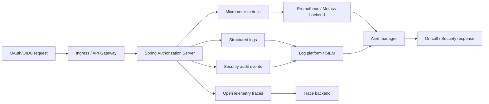

# Phát hiện bất thường và thiết lập cảnh báo lạm dụng endpoint

Authorization Server là điểm tập trung xử lý đăng nhập, cấp authorization code, phát hành token, introspection, revocation và các luồng OIDC. Vì vậy, một endpoint có thể chịu cả lưu lượng hợp lệ lẫn hành vi dò credential, thử code, polling quá mức hoặc khai thác cấu hình client. Nếu chỉ theo dõi CPU, bộ nhớ và HTTP 5xx, đội vận hành có thể bỏ lỡ một cuộc tấn công đang trả về các lỗi OAuth 4xx hoàn toàn bình thường về mặt HTTP.

Bài này xây dựng cách quan sát và phát hiện bất thường cho Spring Authorization Server: xác định tín hiệu theo endpoint, phát metric và audit event có cấu trúc, thiết lập baseline, viết cảnh báo có thể hành động và kết hợp rate limiting. Mục tiêu là phát hiện sớm hành vi lạm dụng mà vẫn giữ trải nghiệm SSO và các client hợp lệ ổn định.

## 1. Xác định bề mặt cần quan sát

Không phải mọi request thất bại đều là tấn công. Một authorization code hết hạn, người dùng từ chối consent hoặc refresh token bị gửi lại do retry có thể tạo OAuth error hợp lệ. Cần phân loại theo endpoint, client, loại grant, kết quả và nhịp thời gian trước khi đặt cảnh báo.

| Endpoint/luồng | Tín hiệu cần quan sát | Hành vi bất thường có thể gặp |
|---|---|---|
| `/login` và form xác thực | Tỷ lệ đăng nhập thất bại, số tài khoản bị thử, phân bố IP/ASN, user-agent | Password guessing, credential stuffing, password spraying |
| `/oauth2/authorize` | Request theo client, response type, redirect URI validation, lỗi authorization, consent denial | Dò client ID, redirect URI sai liên tục, tạo authorization request hàng loạt |
| `/oauth2/token` | Grant type, kết quả xác thực client, lỗi code/PKCE/refresh token, latency | Client secret guessing, code replay, refresh token replay, token request burst |
| `/oauth2/device_authorization` | Số device code được tạo, client, scope, expiry | Tạo giao dịch hàng loạt để spam hoặc làm cạn kho pending device authorization |
| Device verification | User code sai, số lần thử, thời gian từ tạo đến xác minh | Brute force user code, dò giao dịch, xác minh nhầm thiết bị |
| `/oauth2/introspect` | Request rate, client gọi, token active/inactive, latency | Dò token, lạm dụng quyền introspection, tạo tải tra cứu bất thường |
| `/oauth2/revoke` | Request rate, client gọi, kết quả xử lý | Thu hồi hàng loạt hoặc hành vi phá hoại từ client bị lộ credential |
| PAR endpoint | Request rate, client, kích thước request, lỗi redirect/scope/PKCE, request URI hết hạn | Tạo pushed request hàng loạt, thử cấu hình client hoặc làm đầy storage |
| JWKS và discovery | Tỷ lệ truy cập, status, latency, cache behavior | Quét endpoint hoặc lưu lượng scraping bất thường; thường cũng có traffic hợp lệ từ cache refresh |
| OIDC logout | Logout request, client, redirect URI validation, lỗi session | Logout spam, thử redirect URI không đăng ký |

Endpoint cụ thể có thể được đổi trong `AuthorizationServerSettings`, cấu hình OIDC hoặc ứng dụng. Hãy phân loại theo endpoint logic và grant type thực tế, không dựa duy nhất vào URL mặc định.

## 2. Thiết kế mô hình tín hiệu: metric, log, audit và trace

Mỗi loại telemetry trả lời một câu hỏi khác nhau:

| Loại dữ liệu | Câu hỏi chính | Dùng cho |
|---|---|---|
| Metric | Lưu lượng, tỷ lệ lỗi và độ trễ thay đổi ra sao? | Dashboard, alert, capacity planning |
| Structured application log | Request cụ thể thất bại ở bước nào? | Điều tra và liên kết sự kiện |
| Security audit event | Ai/client nào đã thực hiện hành động bảo mật nào và kết quả ra sao? | Điều tra, tuân thủ, truy vết thay đổi quyền |
| Distributed trace | Request đi qua proxy, Authorization Server và dependency nào? | Khoanh vùng latency hoặc lỗi liên dịch vụ |

Không dùng một loại dữ liệu thay cho tất cả. Metric nên gọn, có nhãn hữu hạn và không chứa định danh người dùng. Audit event cần đủ chi tiết để điều tra nhưng phải bảo vệ dữ liệu. Trace giúp nối các thành phần kỹ thuật; không đưa access token hoặc authorization code vào span attribute.

Một luồng quan sát có thể triển khai như sau:



Metric giúp phát hiện mẫu lưu lượng; audit/log cung cấp bằng chứng để xác định client, subject đã được giả danh hoặc nguồn request; trace xác định dependency gây lỗi. Các hệ thống này cần dùng chung correlation ID hoặc trace ID nhưng không chia sẻ credential.

## 3. Đặt tên và phân loại kết quả nhất quán

Trước khi viết dashboard, thống nhất taxonomy cho endpoint và outcome. Ví dụ:

| Trường phân loại | Giá trị mẫu |
|---|---|
| `endpoint` | `authorize`, `token`, `device_authorization`, `device_verification`, `introspect`, `revoke`, `par`, `login`, `logout`, `jwks`, `discovery` |
| `result` | `success`, `invalid_client`, `invalid_grant`, `invalid_request`, `access_denied`, `rate_limited`, `server_error`, `other_error` |
| `grant_type` | `authorization_code`, `refresh_token`, `client_credentials`, `device_code`, `token_exchange`, `unknown` |
| `client_class` | `confidential`, `public`, `first_party`, `partner`, `unknown` |
| `environment` | `production`, `staging`, `development` |

Giá trị phải được ánh xạ từ allowlist hoặc enum nội bộ. Không dùng raw path, query string, exception message hay OAuth error description làm label metric vì chúng có thể tạo cardinality rất lớn và chứa dữ liệu không mong muốn.

Phân biệt các nhóm lỗi:

- **Lỗi nghiệp vụ có thể dự đoán:** `invalid_grant` do code hết hạn, `access_denied` do người dùng từ chối, refresh token không còn hợp lệ.
- **Lỗi client/protocol:** `invalid_client`, `invalid_request`, `unsupported_grant_type`, redirect URI không khớp, PKCE verifier sai.
- **Tín hiệu bảo vệ:** rate limit, account/client lockout, device verification bị throttle.
- **Lỗi hệ thống:** database, Redis, KMS, introspection dependency hoặc token generator lỗi; HTTP 5xx và timeout.

Một `invalid_grant` đơn lẻ thường không cần paging. Một burst `invalid_client` từ nhiều nguồn, hoặc một client tạo hàng nghìn token request trong vài phút, cần được điều tra. Cảnh báo dựa trên xu hướng và ngữ cảnh sẽ hữu ích hơn việc báo động với mọi HTTP 400.

## 4. Thu thập metric bằng Micrometer

Spring Boot Actuator/Micrometer có thể cung cấp metric HTTP như `http.server.requests`. Bật endpoint metrics nội bộ và scrape bằng hệ thống metrics phù hợp; không công khai management endpoint ra Internet. Các tag HTTP phổ biến như method, URI template, status và outcome hữu ích để theo dõi tổng quan, nhưng cần kiểm tra cấu hình để không dùng raw URI có ID hoặc query string làm nhãn.

Với tín hiệu OAuth riêng, tạo metric có nhãn hữu hạn. Ví dụ một recorder đơn giản:

```java
@Component
public class OAuthEndpointMetrics {

    private final MeterRegistry meterRegistry;

    public OAuthEndpointMetrics(MeterRegistry meterRegistry) {
        this.meterRegistry = meterRegistry;
    }

    public void record(String endpoint, String result, Duration elapsed) {
        Counter.builder("oauth.endpoint.requests")
                .description("OAuth endpoint requests by bounded outcome")
                .tag("endpoint", endpoint)
                .tag("result", result)
                .register(meterRegistry)
                .increment();

        Timer.builder("oauth.endpoint.duration")
                .description("OAuth endpoint request duration")
                .tag("endpoint", endpoint)
                .tag("result", result)
                .register(meterRegistry)
                .record(elapsed);
    }
}
```

`endpoint` và `result` phải được chuẩn hóa từ danh sách hữu hạn ở phần trước. Gọi recorder từ filter hoặc handler/provider tại điểm đã xác định kết quả. Không truyền `client_id`, username, subject, IP, token, code, session ID hoặc URL có query vào metric tag. Những thuộc tính cần điều tra theo từng client nên được lưu trong audit event/log có kiểm soát rồi truy vấn ở log platform.

Metric cần có tối thiểu:

- Tổng request theo endpoint và outcome.
- Tỷ lệ lỗi client/protocol và tỷ lệ HTTP 5xx.
- Latency p50/p95/p99 theo endpoint.
- Số request bị rate limit.
- Số lần đăng nhập thất bại và device verification thất bại.
- Số token được phát hành theo grant type và token format.
- Số introspection active/inactive, cùng latency và lỗi dependency.
- Số authorization pending, device flow hết hạn hoặc polling bị `slow_down` nếu luồng device được bật.
- Trạng thái dependency: database, Redis, KMS/HSM, message broker và audit sink.

Không tạo metric cho mỗi `sub`, IP, `jti`, authorization code hoặc token. High-cardinality label làm hệ thống metrics tăng chi phí và có thể gây sự cố ingestion ngay khi lưu lượng tấn công tăng.

## 5. Phát security audit event có cấu trúc

Audit event nên ghi lại hành động bảo mật với kết quả và ngữ cảnh đủ để điều tra. Ví dụ schema:

```json
{
  "event_time": "2026-11-16T10:15:30.125Z",
  "event_type": "oauth.token.request.failed",
  "service": "authorization-server",
  "environment": "production",
  "endpoint": "token",
  "grant_type": "refresh_token",
  "client_id": "mobile-app",
  "client_class": "public",
  "result": "invalid_grant",
  "error_code": "invalid_grant",
  "subject_ref": "hmac:v2:7a4...",
  "source_ip_prefix": "203.0.113.0/24",
  "trace_id": "4bf92f3577b34da6a3ce929d0e0e4736",
  "correlation_id": "req-8f1c..."
}
```

Đây là schema minh họa. `subject_ref` có thể là định danh giả danh bằng HMAC với khóa quản lý riêng để liên kết sự kiện mà không lưu username hoặc subject thô. IP chỉ nên được lưu theo mục đích, thời hạn và quyền truy cập được phê duyệt; có thể mask hoặc rút gọn prefix khi độ chính xác không cần thiết. `client_id` thường không phải secret nhưng vẫn có thể là metadata nhạy cảm trong hệ thống nhiều tenant.

Không ghi các giá trị sau vào log hoặc audit event:

- Access token, refresh token, ID token, subject token hoặc actor token.
- Authorization code, device code, user code, PAR `request_uri` hoặc PKCE verifier.
- Client secret, mật khẩu, HTTP Authorization header, cookie hoặc session ID.
- Toàn bộ request body, query string hoặc exception message chưa được lọc.

Có thể ghi `token_id`/`jti` đã được băm nếu thực sự cần liên kết vòng đời token, nhưng phải xác định retention và quyền truy cập. Không ghi token thô để dễ tìm kiếm.

### Gắn event vào Spring Security và Spring Authorization Server

Spring Security phát các authentication event như success/failure; Spring Authorization Server cũng cung cấp các event liên quan đến xác thực tại endpoint trong những phiên bản tương ứng. Có thể dùng listener để chuyển event thành audit record:

```java
@Component
public class AuthorizationAuditListener {

    private final SecurityAuditWriter auditWriter;

    public AuthorizationAuditListener(SecurityAuditWriter auditWriter) {
        this.auditWriter = auditWriter;
    }

    @EventListener
    public void onAuthenticationFailure(
            AbstractAuthenticationFailureEvent event) {
        auditWriter.writeAuthenticationFailure(
                classifyAuthentication(event.getAuthentication()),
                classifyFailure(event.getException()));
    }

    @EventListener
    public void onAuthenticationSuccess(AuthenticationSuccessEvent event) {
        auditWriter.writeAuthenticationSuccess(
                classifyAuthentication(event.getAuthentication()));
    }
}
```

Đây là ví dụ tích hợp ở mức Spring Security. Với event riêng của Spring Authorization Server, đăng ký listener cho các success/failure event mà phiên bản đang dùng phát ra để phân biệt token endpoint, grant type và client. Tên class/package event và nội dung authentication có thể thay đổi theo phiên bản; kiểm tra API của dependency thực tế. Không serialize toàn bộ `Authentication`, `OAuth2Authorization` hoặc exception vào log. Chỉ trích xuất trường đã allowlist và loại bỏ credential trước khi ghi.

Một số thao tác như consent được chấp thuận, client registration thay đổi, key rotation, token revoke hoặc logout có thể cần audit nghiệp vụ riêng. Đừng dựa vào một event đăng nhập tổng quát để bao phủ mọi thay đổi trạng thái OAuth.

### Đảm bảo audit không bị mất

Security audit có yêu cầu độ tin cậy khác debug log. Với sự kiện quan trọng như cấp/revoke token, thay đổi client hoặc key rotation, dùng writer có hàng đợi bền vững, transactional outbox hoặc message broker đã cấu hình durability. Có metric cho queue depth, publish failure, retry và tuổi event cũ nhất. Không bỏ qua lỗi ghi audit mà không có cảnh báo.

Chính sách khi audit sink không khả dụng cần được quyết định theo mức độ rủi ro: có thể buffer bền vững trong giới hạn, tạm từ chối thao tác quản trị nhạy cảm hoặc áp dụng chế độ suy giảm đã phê duyệt. Không mặc định block mọi request đăng nhập vì một log sink tạm thời lỗi, cũng không âm thầm bỏ mất sự kiện bảo mật quan trọng.

## 6. Phát hiện các mẫu lạm dụng thường gặp

### 6.1. Password guessing và credential stuffing

Tín hiệu gồm tỷ lệ login failure tăng nhanh, nhiều username khác nhau từ một nguồn, một username bị thử từ nhiều nguồn hoặc một số credential thành công sau chuỗi thất bại. Kết hợp IP/ASN, user-agent, client, thời gian và kết quả xác thực; không lưu mật khẩu hoặc password hash vào log.

Phân biệt password spraying với người dùng gõ sai: spraying thường có ít lần thử trên nhiều tài khoản và phân bố nguồn rộng. Credential stuffing có thể tạo nhiều lần thử theo danh sách tài khoản đã biết và user-agent tự động. Dùng rate limit theo IP, account identifier đã giả danh, client và tín hiệu rủi ro; tránh khóa hàng loạt tài khoản chỉ dựa trên một IP dùng chung như NAT văn phòng.

### 6.2. Lạm dụng token endpoint

Quan sát burst `invalid_client`, `invalid_grant`, refresh token reuse, PKCE mismatch và tỷ lệ token request theo client. `invalid_grant` có thể do authorization code hết hạn hoặc client retry hợp lệ; cần xem grant type, client, thời điểm và tỷ lệ thành công trước/sau lỗi.

Các tín hiệu đáng chú ý:

- Một client có tốc độ token request tăng nhiều lần so với baseline.
- Tỷ lệ `invalid_client` tăng đồng thời từ nhiều IP hoặc ASN.
- Nhiều authorization code đổi thất bại, sau đó một code hoặc client tạo token thành công bất thường.
- Refresh token cũ bị dùng lại sau rotation; kiểm tra family/reuse detection nếu ứng dụng triển khai.
- Nhiều request dùng PKCE verifier sai hoặc grant type không được client đăng ký.

### 6.3. Dò authorization request và redirect URI

Theo dõi số `invalid_request`, `unauthorized_client`, redirect URI mismatch và response type không được phép theo client. Một client hợp lệ có thể gửi request sai do lỗi cấu hình; nhiều redirect URI khác nhau hoặc nhiều client ID được thử từ cùng nguồn có thể là hoạt động dò tìm.

Không cảnh báo mỗi redirect URI mismatch như một sự cố nghiêm trọng. Tạo cảnh báo khi có burst, nhiều client hoặc nhiều hostname không liên quan, đặc biệt nếu đi kèm các request đến endpoint khác.

### 6.4. Lạm dụng Device Flow

Theo dõi số device authorization request theo client, pending transaction, user code verification failure, `slow_down`, expiry và tỷ lệ approval/denial. Một thiết bị có thể polling đúng interval trong khi người dùng chưa hoàn tất; đó không phải tấn công. Tín hiệu đáng ngờ hơn là tạo device code hàng loạt, thử user code ngẫu nhiên hoặc nhiều lần xác minh thất bại trên cùng nguồn.

Giới hạn số giao dịch pending theo client và nguồn; áp dụng TTL cho device code; tăng thời gian chờ khi polling quá nhanh. Không log `device_code` hoặc `user_code`.

### 6.5. Lạm dụng introspection và revocation

Introspection có thể tạo tải lớn vì Resource Server gọi theo mỗi request hoặc theo cache miss. Phân biệt lưu lượng hợp lệ từ resource server với token enumeration: một client gọi introspection trên số lượng token lớn, tỷ lệ `active=false` cao hoặc pattern token ngẫu nhiên có thể đáng ngờ. Theo dõi riêng client credentials, request rate, active ratio và latency.

Revocation burst có thể xuất phát từ logout, incident response hoặc một client bị xâm phạm. So sánh số token revoke theo client, grant, thời gian và thay đổi trước đó. Không dùng response revocation để xác định token có tồn tại hay không; theo RFC 7009, endpoint được thiết kế để không tạo oracle cho token enumeration.

### 6.6. Lạm dụng PAR, discovery và JWKS

PAR request có thể lớn hơn authorization request thông thường và tạo dữ liệu tạm thời trong kho dùng chung. Theo dõi kích thước request, số request URI đang tồn tại, expiry, lỗi xác thực client và request URI được dùng sai client. Giới hạn kích thước body và TTL.

Discovery/JWKS thường có traffic nền từ client cache key hoặc refresh metadata. Chỉ cảnh báo khi lưu lượng tăng mạnh, có pattern quét nhiều đường dẫn hoặc tạo áp lực đáng kể lên ứng dụng. Cấu hình cache header và CDN/reverse proxy phù hợp cho metadata/JWKS công khai; bảo đảm cache không làm chậm việc phân phối key rotation ngoài chính sách.

## 7. Thiết lập baseline và ngưỡng cảnh báo

Không có một ngưỡng cố định phù hợp cho mọi Authorization Server. Baseline phụ thuộc số client, số người dùng, giờ cao điểm, batch job, retry behavior, token lifetime và cách Resource Server dùng introspection. Thu thập dữ liệu đủ dài để thấy ngày làm việc, cuối tuần, chu kỳ batch và các đợt triển khai.

Một cách đặt ngưỡng:

1. Đo request rate, failure ratio và p95/p99 theo endpoint trong điều kiện bình thường.
2. Tách theo grant type và client class nếu dữ liệu có thể được nhóm ở log/SIEM.
3. Xác định ngưỡng tuyệt đối tối thiểu để tránh alert do vài request lẻ.
4. So sánh với baseline cùng khung giờ hoặc rolling window.
5. Thêm điều kiện duy trì trong một khoảng thời gian để loại bỏ spike ngắn.
6. Kiểm tra ngưỡng với traffic test và các đợt tải hợp lệ trước khi bật paging.

Nên dùng cả số lượng và tỷ lệ. Ví dụ 5 lần `invalid_client` trong một phút có thể đáng chú ý với một client nhỏ, nhưng không đáng chú ý ở một cụm có hàng triệu token request mỗi phút. Ngược lại, failure ratio cao trên endpoint ít traffic vẫn có thể là dấu hiệu quan trọng.

## 8. Ví dụ Prometheus alert rules

Giả sử ứng dụng xuất counter `oauth_endpoint_requests_total` với hai label hữu hạn `endpoint` và `result`. Các rule dưới đây chỉ minh họa cú pháp và cách kết hợp điều kiện; cần hiệu chỉnh theo baseline production:

```yaml
groups:
  - name: authorization-server-security
    rules:
      - alert: OAuthTokenInvalidClientBurst
        expr: sum(rate(oauth_endpoint_requests_total{endpoint="token",result="invalid_client"}[5m])) > 1
        for: 3m
        labels:
          severity: warning
        annotations:
          summary: "Tăng đột biến invalid_client tại token endpoint"
          description: "Kiểm tra client, nguồn request và phân bố lỗi trong log bảo mật."

      - alert: OAuthDeviceVerificationFailures
        expr: sum(increase(oauth_endpoint_requests_total{endpoint="device_verification",result="invalid_request"}[5m])) > 30
        for: 2m
        labels:
          severity: warning
        annotations:
          summary: "Nhiều lần xác minh device code thất bại"
          description: "Kiểm tra user-code guessing, nguồn request và giao dịch pending."

      - alert: OAuthEndpointServerErrors
        expr: sum(rate(oauth_endpoint_requests_total{result="server_error"}[5m])) > 0.5
        for: 5m
        labels:
          severity: critical
        annotations:
          summary: "Authorization Server có tỷ lệ lỗi hệ thống tăng"
          description: "Kiểm tra database, Redis, KMS, thread pool và dependency."
```

Các ngưỡng `1`, `30` và `0.5` ở trên là giá trị minh họa, không phải khuyến nghị production. Nếu metric của bạn phân loại device verification failure thành outcome khác, đổi selector theo taxonomy thực tế. Không tạo alert dựa trên metric chưa được kiểm chứng hoặc chưa có traffic bình thường làm baseline.

Có thể theo dõi failure ratio bằng PromQL:

```promql
sum(rate(oauth_endpoint_requests_total{endpoint="token",result=~"invalid_client|invalid_grant"}[5m]))
/
clamp_min(sum(rate(oauth_endpoint_requests_total{endpoint="token"}[5m])), 0.001)
```

Tỷ lệ cần được kết hợp với số request tối thiểu; nếu tổng traffic gần 0, một lỗi có thể tạo tỷ lệ 100%. Đặt ngưỡng tuyệt đối và thời gian `for` để giảm cảnh báo giả.

Không đưa `client_id`, username, IP hoặc `jti` vào label của counter chỉ để tạo alert riêng cho từng thực thể. Dùng log/SIEM query hoặc hệ thống analytics có giới hạn cardinality để nhóm theo client/nguồn khi điều tra. Với client quan trọng có SLA riêng, có thể tạo metric riêng theo danh sách client được quản lý chặt, sau khi đánh giá cardinality.

## 9. Cảnh báo từ log/SIEM

Một số phát hiện cần kết hợp nhiều thuộc tính mà metric không nên mang theo. Ví dụ truy vấn ở mức ý tưởng:

```text
event_type = "oauth.token.request.failed"
AND error_code = "invalid_client"
GROUP BY client_id, source_ip, 5m
HAVING count() > threshold
```

Hoặc phát hiện một nguồn thử nhiều tài khoản:

```text
event_type = "authentication.failure"
GROUP BY source_ip, 10m
HAVING distinct_count(subject_ref) > threshold
```

Đây là pseudo-query; cú pháp thực tế tùy SIEM. Hạn chế truy cập các trường có thể nhận diện người dùng hoặc địa chỉ IP. Khi cần liên kết cùng subject, dùng pseudonymous identifier có khóa HMAC được quản lý và xoay vòng theo chính sách. Tránh query chứa token, password hoặc authorization code.

Kết hợp nhiều tín hiệu làm giảm false positive: ví dụ `invalid_client` burst + nhiều IP mới + client chưa từng có traffic từ vùng đó có độ tin cậy cao hơn chỉ một điều kiện đơn lẻ. Cũng nên thêm allowlist có thời hạn cho job kiểm thử hoặc synthetic monitor, không tạo miễn trừ vô thời hạn.

## 10. Kết hợp cảnh báo với rate limiting và bảo vệ endpoint

Alert giúp phát hiện; rate limiting giảm tác động trong khi điều tra. Nên đặt giới hạn ở edge/API gateway để chặn trước khi request tốn tài nguyên trong Authorization Server, đồng thời có giới hạn trong ứng dụng cho các thao tác nhạy cảm cần ngữ cảnh đã xác thực.

| Endpoint | Khóa giới hạn phù hợp | Biện pháp bổ sung |
|---|---|---|
| Login | IP/network + account pseudonym + client | Progressive delay, MFA/step-up, account protection |
| Device authorization | Client + IP/network + số pending transaction | TTL, giới hạn pending, CAPTCHA/step-up ở verification nếu phù hợp |
| Device verification | IP/network + user-code attempt + transaction | Giới hạn số lần thử, mã ngắn có entropy đủ, thông báo lỗi không tiết lộ trạng thái |
| Token | Client đã xác thực + IP/network; theo grant | Client credential protection, PKCE cho authorization code, reuse detection cho refresh token rotation |
| Introspection | Client resource server đã xác thực | Quota theo client, connection pool và cache có TTL |
| PAR | Client đã xác thực + IP/network | Giới hạn body size, TTL request URI và quota request |
| Revocation | Client đã xác thực | Audit burst, giới hạn theo client, không tạo token-existence oracle |

Với nhiều instance, bộ đếm rate limit cần dùng kho chia sẻ hoặc API gateway có trạng thái phân tán. Giới hạn chỉ lưu trong bộ nhớ từng pod có thể bị vượt bằng cách phân phối request qua nhiều instance. Dùng thuật toán token bucket hoặc leaky bucket để cho phép burst ngắn hợp lệ nhưng giới hạn tốc độ dài hạn.

Khi từ chối do rate limit, trả HTTP 429 và `Retry-After` nếu phù hợp với endpoint/client protocol. Không làm thay đổi OAuth error semantics một cách tùy tiện. Không khóa toàn bộ client chỉ vì một IP dùng chung vượt ngưỡng; chọn khóa, thời gian khóa và cơ chế mở khóa dựa trên rủi ro. Rate limit cần có dashboard về số request bị chặn để phát hiện cấu hình quá chặt.

## 11. Mức độ cảnh báo và quy trình phản ứng

Phân loại mức độ theo tác động và độ tin cậy của tín hiệu:

| Mức | Ví dụ | Hành động |
|---|---|---|
| Info | Spike ngắn trong giờ cao điểm, failure ratio tăng nhẹ nhưng không kéo dài | Ghi nhận dashboard, chưa paging |
| Warning | `invalid_client` burst, device verification failures tăng, một client vượt baseline | Tạo ticket hoặc thông báo nhóm vận hành/security, xem log theo client/nguồn |
| Critical | Token endpoint 5xx kéo dài, introspection dependency mất, nhiều client bị credential attack hoặc có dấu hiệu token abuse thành công | Paging on-call, áp dụng mitigation theo runbook và đánh giá phạm vi ảnh hưởng |

Một runbook cảnh báo nên ghi rõ:

1. Endpoint, metric/log query và khoảng thời gian phát hiện.
2. Client, grant type, nguồn request và các thay đổi triển khai gần thời điểm đó.
3. Cách phân biệt retry hợp lệ, traffic batch và hành vi dò credential.
4. Biện pháp tạm thời: rate limit, block nguồn có độ tin cậy cao, rotate client secret bị lộ, revoke token/family theo policy hoặc tạm vô hiệu hóa client.
5. Cách xác minh mitigation không làm gián đoạn SSO hoặc client hợp lệ.
6. Cách lưu evidence, correlation ID, audit event và thời điểm xử lý.
7. Điều kiện gỡ mitigation và người có quyền phê duyệt thay đổi client/key.

Không tự động revoke mọi token hoặc disable client chỉ vì một cảnh báo đơn lẻ. Với hành động có ảnh hưởng rộng, yêu cầu xác minh nhiều tín hiệu và quy trình phê duyệt phù hợp. Có thể tự động throttle theo ngưỡng đã kiểm chứng, nhưng phải có giới hạn, thời hạn và cơ chế rollback.

## 12. Dashboard vận hành và bảo mật

Một dashboard tổng hợp nên chia thành các nhóm:

- **Traffic:** request rate theo endpoint, grant type và client class; tỷ lệ success/failure.
- **Authentication abuse:** login failures, `invalid_client`, device verification failures, rate-limited requests.
- **Token lifecycle:** token issued, refresh, revoke, introspection active/inactive và refresh token reuse nếu có.
- **Performance:** p50/p95/p99 latency, 4xx/5xx, timeout và saturation của thread/connection pool.
- **Dependencies:** database, Redis, KMS/HSM, message broker, audit sink và log pipeline.
- **Security posture:** client mới/thay đổi, key rotation, redirect URI changes, scope/consent changes và admin actions.

Cho phép drill-down từ metric sang log bằng trace ID hoặc correlation ID. Dashboard không hiển thị access token, refresh token, username thô hoặc session ID. Các panel có dữ liệu client/subject cụ thể cần kiểm soát quyền truy cập.

## 13. Kiểm thử khả năng phát hiện

Không chỉ kiểm tra ứng dụng trả lỗi đúng; cần kiểm tra telemetry và alert cũng phát hiện được tình huống mô phỏng. Trong staging, tạo các kịch bản an toàn với client và user giả lập:

1. Gửi một số lượng nhỏ login sai dưới ngưỡng: metric tăng nhưng không paging.
2. Tạo burst `invalid_client` vượt ngưỡng: alert warning xuất hiện sau thời gian `for`.
3. Tạo device verification thất bại nhiều lần: metric, audit và alert phân loại đúng endpoint.
4. Gọi introspection bằng token không tồn tại: response `active=false`, không bị ghi nhận như server error.
5. Gọi token endpoint bằng client hợp lệ và grant hợp lệ: không kích hoạt alert lạm dụng.
6. Tạo HTTP 5xx có kiểm soát ở dependency test: alert availability xuất hiện và chỉ đúng dependency.
7. Tắt tạm audit sink trong staging: queue/error metric tăng và cảnh báo audit pipeline được phát.
8. Gửi header/query chứa chuỗi giả dạng token: log sanitizer không ghi giá trị nhạy cảm.
9. Phân phối traffic qua nhiều instance: rate limit vẫn áp dụng ở mức cụm.
10. Khôi phục sau mitigation: alert đóng, traffic hợp lệ hoạt động và evidence được giữ lại.

Test cảnh báo cần xác minh cả false positive. Ví dụ, một batch job introspection chạy theo lịch có thể tạo spike hợp lệ; synthetic monitor cũng có thể gây login failure có chủ đích. Đăng ký chúng bằng client riêng, tag môi trường và lịch chạy rõ ràng thay vì tắt cảnh báo toàn cục.

## 14. Checklist triển khai

- [ ] Có danh sách endpoint logic và grant type được quan sát.
- [ ] Metric có nhãn hữu hạn; không dùng token, subject, username, IP hoặc raw URL làm label.
- [ ] Có metric traffic, outcome, latency, rate limit và dependency health.
- [ ] Audit event có cấu trúc, correlation ID và trường dữ liệu được allowlist.
- [ ] Token, code, secret, cookie, session ID và password không xuất hiện trong log/trace.
- [ ] Audit event quan trọng có cơ chế buffer/retry bền vững và cảnh báo khi sink lỗi.
- [ ] Baseline phản ánh giờ cao điểm, batch job và hành vi client hợp lệ.
- [ ] Alert kết hợp ngưỡng tuyệt đối, failure ratio và thời gian duy trì.
- [ ] Có cảnh báo cho `invalid_client` burst, device verification abuse, token endpoint 5xx và dependency failure.
- [ ] Rate limit được áp dụng phân tán cho nhiều instance và có `Retry-After` khi phù hợp.
- [ ] Có runbook nêu cách xác minh, mitigation, rollback và lưu evidence.
- [ ] Đã diễn tập alert, false positive, audit sink outage và phục hồi trong staging.

Phát hiện lạm dụng endpoint hiệu quả cần kết hợp tín hiệu lưu lượng, kết quả OAuth, audit event và ngữ cảnh client. Metric cho biết điều gì đang thay đổi; audit/log giải thích request nào tạo ra thay đổi; alert và rate limit giúp đội vận hành phản ứng có kiểm soát. Khi taxonomy, baseline, bảo vệ dữ liệu và runbook được thiết kế đồng bộ, Authorization Server có thể phát hiện hành vi bất thường mà không biến các lỗi giao thức bình thường thành cảnh báo liên tục.
