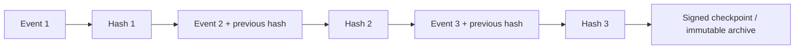
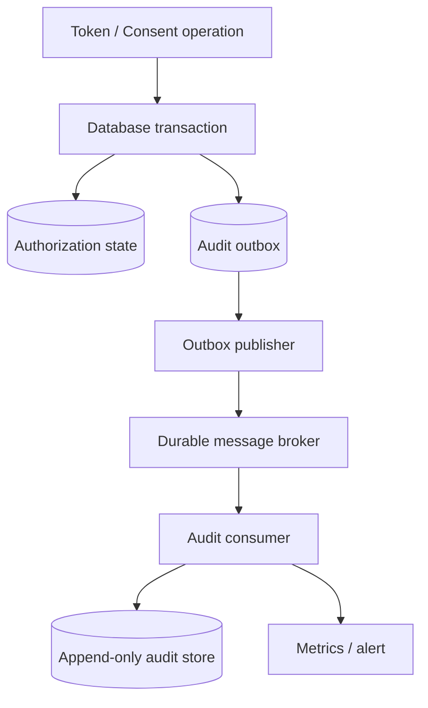

# Chính sách lưu trữ, phân quyền truy cập và bảo toàn audit trail

Authorization Server xử lý dữ liệu có giá trị bảo mật cao: danh tính người dùng, client đã đăng ký, consent, authorization code, access token, refresh token, ID token, sự kiện đăng nhập và quyết định cấp quyền. Audit trail giúp đội vận hành điều tra sự cố, xác minh hành động quản trị và chứng minh hệ thống đã thực thi chính sách. Tuy nhiên, nếu lưu quá nhiều dữ liệu hoặc cho quá nhiều người truy cập log, chính hệ thống kiểm toán có thể trở thành nơi rò rỉ credential và thông tin cá nhân.

Một chính sách audit tốt cần xác định rõ **ghi điều gì, giữ trong bao lâu, ai được xem, ai được thay đổi, cách phát hiện sửa/xóa và cách xử lý khi hết hạn lưu trữ**. Với Spring Authorization Server, cần phân biệt audit record với dữ liệu nghiệp vụ đang được dùng để cấp quyền. Audit trail ghi lại sự kiện và bằng chứng vận hành; kho authorization giữ trạng thái cần thiết để xử lý OAuth/OIDC. Hai kho có thể liên kết bằng ID tương quan nhưng không nên biến log thành bản sao của token store.

Sau bài học này, bạn có thể:

- Thiết kế retention policy theo loại sự kiện và mục đích sử dụng.
- Giới hạn quyền đọc, xuất, quản trị và xóa audit record theo least privilege.
- Bảo vệ audit trail bằng append-only storage, hash chain, chữ ký hoặc WORM.
- Ghi sự kiện cấp token, refresh, revoke, consent và thao tác quản trị mà không làm lộ credential.
- Dùng transactional outbox để giảm nguy cơ mất audit event khi cập nhật nghiệp vụ.
- Thiết kế archive, backup, legal hold và xóa dữ liệu hết hạn có thể kiểm chứng.

## 1. Phân biệt audit trail và dữ liệu authorization

Audit trail là bản ghi về một hành động hoặc sự kiện: ai thực hiện, hành động gì, với đối tượng nào, khi nào, kết quả ra sao và được xử lý ở thành phần nào. Dữ liệu authorization là trạng thái cần thiết để Authorization Server xử lý request tiếp theo, chẳng hạn authorization code chưa dùng, refresh token còn hiệu lực hoặc consent đã cấp.

| Dữ liệu | Mục đích | Vòng đời thường gặp |
|---|---|---|
| Registered client | Xác định client, redirect URI, grant và policy | Tồn tại đến khi client bị thay đổi hoặc ngừng hoạt động |
| Authorization/consent | Xử lý cấp token, refresh, revoke và consent | Theo thời hạn token, trạng thái authorization và policy nghiệp vụ |
| Access/refresh token | Credential để truy cập hoặc xin token mới | Theo expiry, revoke và yêu cầu lưu trạng thái |
| Audit event | Điều tra, giám sát, chứng minh hành động | Theo retention policy và yêu cầu pháp lý/nghiệp vụ |
| Application/security log | Chẩn đoán lỗi và vận hành | Thường ngắn hơn audit record, tùy mức độ cần thiết |
| Metrics/traces | Theo dõi xu hướng, độ trễ và luồng request | Theo chu kỳ lưu telemetry, thường không giữ payload nhạy cảm |

Không dùng audit log làm kho khôi phục token. Khi một refresh token bị thu hồi, trạng thái thu hồi phải được cập nhật trong kho authorization có thẩm quyền. Audit event chỉ ghi nhận việc thu hồi đã xảy ra, kết quả và thông tin tương quan.

## 2. Xác định sự kiện cần ghi

Hãy bắt đầu từ các hành động có ý nghĩa bảo mật hoặc tác động đến quyền truy cập. Với Authorization Server, có thể chia sự kiện thành các nhóm:

| Nhóm | Ví dụ sự kiện | Trường thông tin hữu ích |
|---|---|---|
| Client lifecycle | Tạo, sửa, vô hiệu hóa hoặc xóa RegisteredClient | Client ID, actor, thay đổi policy, kết quả |
| Client authentication | Thành công/thất bại, phương thức xác thực | Client ID nếu đã xác định, auth method, lý do tổng quát |
| Authorization | Bắt đầu authorization, cấp code, từ chối request | Client ID, subject nội bộ dạng định danh/pseudonym, redirect URI đã chuẩn hóa, scope |
| Consent | Cấp, cập nhật hoặc thu hồi consent | Subject, client ID, scope trước/sau, actor và kết quả |
| Token lifecycle | Cấp access token, refresh, revoke, introspection decision | Token ID/hash tham chiếu, loại token, scope, expiry, kết quả |
| Security policy | Sai redirect URI, scope không hợp lệ, PKCE thất bại | Error category, client ID nếu có, correlation ID |
| Key management | Tạo, kích hoạt, xoay hoặc loại khóa ký | `kid`, thuật toán, actor, thời điểm, kết quả; không ghi private key |
| Administration | Thay đổi cấu hình, quyền operator, retention policy | Actor, resource, before/after đã lọc, approval/reference |
| Operations | Database/KMS/replay store lỗi ảnh hưởng request | Dependency, trạng thái, duration, impact và correlation ID |

Không nhất thiết ghi mọi request đọc metadata hoặc JWKS thành audit event riêng. Các endpoint công khai có lưu lượng cao thường phù hợp với access log và metric tổng hợp. Chỉ tạo audit record khi sự kiện có giá trị điều tra hoặc chứng minh chính sách.

### 2.1. Thiết kế schema audit event

Một audit record nên có cấu trúc ổn định, có version để có thể mở rộng schema:

```json
{
  "eventId": "01J...",
  "schemaVersion": 1,
  "occurredAt": "2026-11-16T09:30:00Z",
  "recordedAt": "2026-11-16T09:30:00.120Z",
  "eventType": "oauth.token.issued",
  "outcome": "SUCCESS",
  "actor": {
    "type": "CLIENT",
    "id": "orders-service"
  },
  "subjectRef": "sub-hmac:...",
  "resource": {
    "type": "ACCESS_TOKEN",
    "ref": "token-ref:..."
  },
  "attributes": {
    "grantType": "client_credentials",
    "scopes": ["orders.read"],
    "expiresAt": "2026-11-16T09:45:00Z"
  },
  "correlationId": "req-...",
  "source": "authorization-server-2"
}
```

Đây là ví dụ cấu trúc, không phải schema bắt buộc của Spring. `subjectRef` và `resource.ref` nên là định danh tham chiếu hoặc pseudonym phù hợp với mục tiêu điều tra. Không đưa access token, refresh token, authorization code, client secret, private key, password, session cookie hoặc toàn bộ JWT vào `attributes`.

Nên có tối thiểu:

- `eventId`: định danh duy nhất để chống ghi trùng và truy vấn.
- `schemaVersion`: phiên bản schema của event.
- `occurredAt`: thời điểm sự kiện xảy ra theo đồng hồ nguồn.
- `recordedAt`: thời điểm hệ thống audit nhận và ghi event.
- `eventType` và `outcome`: tên sự kiện và kết quả chuẩn hóa.
- `actor`/`subject`: bên thực hiện và đối tượng bị tác động, đã giảm thiểu dữ liệu.
- `correlationId`/`traceId`: liên kết với request và telemetry liên quan.
- `source`: instance hoặc thành phần phát sinh event.
- `integrity metadata`: sequence, previous hash hoặc chữ ký nếu cơ chế bảo toàn được bật.

Giữ tên event ổn định, chẳng hạn `oauth.authorization.denied`, `oauth.token.issued`, `oauth.token.revoked`, `oidc.consent.updated` và `admin.client.updated`. Tránh đưa dữ liệu động hoặc PII vào tên event.

## 3. Chính sách lưu trữ và thời hạn retention

Retention policy phải được xác định theo mục đích, mức độ nhạy cảm, tần suất truy cập, yêu cầu điều tra và quy định áp dụng. Không có một thời hạn phù hợp cho mọi hệ thống hoặc mọi quốc gia. Đội sản phẩm, bảo mật, pháp chế và vận hành cần phê duyệt thời hạn cụ thể trước khi triển khai.

### 3.1. Phân loại dữ liệu

| Nhóm dữ liệu | Ví dụ | Nguyên tắc retention |
|---|---|---|
| Credential và token | Access token, refresh token, client secret | Không lưu trong audit log; kho nghiệp vụ giữ theo vòng đời và policy token |
| Dữ liệu nhận dạng | Subject, email, IP, user agent | Chỉ lưu khi có mục đích rõ; pseudonymize hoặc rút gọn khi đủ dùng |
| Audit security event | Client auth failure, revoke, consent change | Giữ theo cửa sổ điều tra và yêu cầu tuân thủ đã phê duyệt |
| Admin change record | Thay đổi client, khóa, policy và operator role | Giữ theo yêu cầu kiểm soát thay đổi và audit nội bộ |
| Diagnostic log | Stack trace, debug detail, request timing | Retention ngắn; loại bỏ secret và dữ liệu người dùng không cần thiết |
| Metrics/traces | Latency, error rate, dependency state | Lưu theo nhu cầu phân tích vận hành, tránh payload nhạy cảm |
| Archive/WORM | Audit record đã đóng kỳ | Theo retention dài hạn hoặc legal hold đã được phê duyệt |

### 3.2. Đặt retention theo mục đích

Với mỗi loại event, ghi rõ:

1. Mục đích: phát hiện gian lận, điều tra truy cập trái phép, chứng minh thay đổi cấu hình hay đáp ứng yêu cầu pháp lý.
2. Chủ sở hữu dữ liệu: nhóm chịu trách nhiệm phê duyệt và xem xét retention.
3. Thời hạn online: khoảng thời gian cần truy vấn nhanh.
4. Thời hạn archive: khoảng thời gian cần giữ nhưng ít truy cập.
5. Sự kiện bắt đầu tính hạn: `occurredAt`, `recordedAt`, thời điểm kết thúc hợp đồng hoặc mốc khác đã được phê duyệt.
6. Quy tắc legal hold: ai có thể đặt, phê duyệt, rà soát và gỡ hold.
7. Quy trình hết hạn: xóa, ẩn danh hoặc hủy khóa mã hóa; cần lưu bằng chứng hoàn tất.

Ví dụ một policy minh họa:

| Loại record | Online | Archive | Điều kiện xóa |
|---|---:|---:|---|
| Security event mức cao | 90 ngày | Theo policy điều tra đã phê duyệt | Hết retention và không có legal hold |
| Thay đổi client/role/key | 180 ngày | Theo lịch audit nội bộ | Hết thời hạn kiểm soát thay đổi |
| Diagnostic log | 14 ngày | Không archive mặc định | Tự động hết hạn |
| Metric tổng hợp | 30 ngày chi tiết | 12 tháng dạng tổng hợp | Hết nhu cầu phân tích |

Các con số trên chỉ là ví dụ để thiết kế cơ chế. Không áp dụng như khuyến nghị pháp lý hoặc thời hạn mặc định. Thời hạn thật phải phù hợp với yêu cầu tổ chức, hợp đồng và quy định có liên quan.

### 3.3. Xóa và ẩn danh có thể kiểm chứng

Khi hết hạn, hệ thống cần thực hiện đúng policy trên cả storage chính, index tìm kiếm, replica, cache và bản sao backup theo lịch vòng đời đã công bố. Xóa một record khỏi bảng chính nhưng giữ nguyên trong search index hoặc bản export sẽ không hoàn tất yêu cầu xóa.

Một số cách giảm dữ liệu nhận dạng:

- Pseudonymize subject bằng HMAC với khóa riêng được quản lý, thay vì hash trực tiếp email hoặc username dễ đoán.
- Chỉ giữ subnet hoặc vùng địa lý suy rộng nếu không cần IP đầy đủ.
- Loại bỏ query parameter và header có thể chứa token hoặc PII khỏi access log.
- Giữ mapping từ pseudonym về danh tính trong kho riêng có quyền truy cập hạn chế nếu điều tra thực sự cần khả năng đảo ngược.
- Khi hết mục đích, xóa mapping hoặc hủy encryption key theo chính sách đã phê duyệt.

Không dùng hash không khóa cho dữ liệu có entropy thấp như email hoặc username nếu mục tiêu là ẩn danh; dữ liệu có thể bị dò từ điển. Pseudonymization cũng không đồng nghĩa với anonymization nếu tổ chức vẫn giữ khả năng liên kết về một cá nhân.

## 4. Phân quyền truy cập audit trail

Audit data có thể chứa thông tin nhạy cảm về người dùng, client, địa chỉ mạng và hoạt động bảo mật. Quyền truy cập cần tách theo nhiệm vụ và giới hạn ở mức tối thiểu cần thiết.

### 4.1. Vai trò và quyền

| Vai trò | Quyền phù hợp |
|---|---|
| Application service | Ghi event theo schema được phép; không đọc/xóa audit history |
| Security analyst | Tìm kiếm và đọc event trong phạm vi được giao; không sửa hoặc xóa |
| Incident responder | Đọc event nhạy cảm hơn khi có incident và ticket/approval hợp lệ |
| Auditor | Đọc bản ghi và bằng chứng integrity; không thay đổi nguồn dữ liệu |
| Retention operator | Chạy job archive/expiry đã phê duyệt; không tự thay đổi policy |
| Security administrator | Quản lý quyền và cấu hình audit; thao tác nhạy cảm cần dual control |
| Storage administrator | Quản trị hạ tầng lưu trữ; không mặc định được đọc nội dung đã mã hóa |

Không dùng một tài khoản quản trị chung cho ứng dụng, người phân tích và người vận hành storage. Tách quyền ghi event khỏi quyền đọc/xuất và quyền quản trị retention. Người có thể thay đổi audit configuration không nên có khả năng âm thầm xóa lịch sử của chính thay đổi đó.

### 4.2. Áp dụng least privilege

Thiết kế quyền theo hành động cụ thể:

- `audit:write`: ghi event qua API/queue; chỉ service identity được cấp.
- `audit:read`: tìm kiếm và đọc event trong phạm vi tenant hoặc hệ thống.
- `audit:read-sensitive`: xem các field nhạy cảm đã được phê duyệt.
- `audit:export`: xuất dữ liệu; cần giới hạn số bản ghi, định dạng và ghi nhận hành động export.
- `audit:manage-retention`: chạy hoặc thay đổi policy retention theo quy trình phê duyệt.
- `audit:integrity-verify`: đọc hash/signature và chạy xác minh integrity.

Các quyền này là ví dụ policy. Có thể ánh xạ thành role, authority, scope hoặc policy engine hiện có. Với Spring Security, bảo vệ endpoint quản trị bằng authorization rule cụ thể và kiểm tra cả quyền ở tầng service để tránh bỏ qua kiểm soát khi gọi nội bộ.

Ví dụ method security:

```java
@PreAuthorize("hasAuthority('audit:read')")
public Page<AuditEventView> search(AuditSearchCriteria criteria) {
    return auditRepository.search(criteria);
}

@PreAuthorize("hasAuthority('audit:export')")
public ExportReceipt export(AuditExportRequest request) {
    return auditExportService.export(request);
}
```

Ví dụ giả định ứng dụng đã bật method security và cấu hình authority mapping. Không nhận role hoặc authority từ request parameter; danh tính và quyền phải đến từ SecurityContext đã xác thực.

### 4.3. Kiểm soát truy vấn và export

Một tài khoản có quyền đọc audit không có nghĩa có quyền tải toàn bộ lịch sử. Hãy giới hạn:

- Khoảng thời gian truy vấn và số record mỗi trang.
- Tenant, client hoặc domain dữ liệu mà người dùng được phép xem.
- Field nhạy cảm được hiển thị; che subject, IP hoặc metadata nếu không cần thiết.
- Kích thước export và định dạng cho phép.
- Thời gian tồn tại của file export và quyền tải file.
- Ghi lại actor, lý do, filter và số record của mỗi lần export.

Không cho phép filter tùy ý truy vấn các trường bí mật hoặc dùng truy vấn không giới hạn gây quá tải kho audit. File export cũng phải được mã hóa, có thời hạn và quyền truy cập tương đương hoặc chặt hơn dữ liệu nguồn.

## 5. Bảo toàn tính toàn vẹn của audit trail

Quyền chỉ đọc giúp giảm nguy cơ sửa log qua giao diện, nhưng chưa đủ để ngăn administrator của storage thay đổi dữ liệu trực tiếp. Cần một hoặc nhiều lớp phát hiện sửa/xóa và một bản lưu độc lập.

### 5.1. Append-only và tách quyền

Audit writer chỉ được append event. Tài khoản writer không được update hoặc delete record cũ. Retention job dùng identity riêng, chỉ được xóa partition hoặc object đã hết hạn theo policy. Auditor có quyền đọc và xác minh, không có quyền ghi.

Ở tầng database, có thể dùng quyền SQL chỉ `INSERT` cho writer và `SELECT` cho reader; hạn chế `UPDATE`/`DELETE` trên bảng audit. Có thể thêm trigger hoặc stored procedure để bảo vệ schema, nhưng database administrator vẫn có thể thay đổi cấu hình. Vì vậy cần xuất bản snapshot/hash định kỳ sang storage độc lập mà operator của database nguồn không thể sửa.

### 5.2. Hash chain

Hash chain liên kết record hiện tại với hash của record trước. Nếu một record bị thay đổi hoặc bị xóa ở giữa chuỗi, việc tính lại hash sẽ không khớp với hash kế tiếp.



Một công thức đơn giản:

\[
H_i = SHA256(H_{i-1} \parallel Canonical(E_i))
\]

Trong đó `E_i` là event thứ `i`, `Canonical` là cách serialize có thứ tự field ổn định, `H_0` là giá trị khởi tạo đã xác định và `\parallel` là phép nối byte. Không hash trực tiếp JSON tùy ý nếu thứ tự field, encoding hoặc cách biểu diễn timestamp có thể thay đổi giữa các lần serialize.

Hash chain cần sequence tăng đơn điệu và một cơ chế checkpoint. Nếu attacker có thể sửa toàn bộ chain và tính lại hash từ đầu, hash chain đơn thuần không chứng minh được lịch sử chưa bị thay đổi. Hãy định kỳ ký checkpoint bằng khóa được quản lý độc lập và lưu checkpoint ở hệ thống immutable hoặc tài khoản quản trị tách biệt.

### 5.3. Chữ ký và checkpoint

Một checkpoint có thể chứa:

- ID stream/partition và khoảng sequence.
- Hash đầu và cuối của batch.
- Thời gian tạo checkpoint.
- Thuật toán hash và phiên bản canonicalization.
- Key ID dùng để ký checkpoint.
- Chữ ký số hoặc MAC theo mô hình trust đã chọn.

Private key ký checkpoint cần được quản lý trong KMS/HSM hoặc secret boundary riêng, có audit truy cập và quy trình xoay khóa. Không dùng cùng khóa ký access token nếu có thể tách mục đích và quyền sử dụng. Auditor cần public key hoặc cơ chế xác minh độc lập và lịch sử key rotation để xác minh checkpoint cũ.

### 5.4. WORM và immutable storage

Write Once Read Many (WORM) hoặc object lock giúp ngăn sửa/xóa object trong thời gian retention đã đặt. Một quy trình phổ biến:

1. Gom audit event thành batch có manifest và hash.
2. Ký manifest/checkpoint.
3. Ghi batch và manifest sang object storage có retention lock.
4. Xác minh object version, lock mode và thời hạn retention.
5. Định kỳ đọc lại và kiểm tra hash/chữ ký.

WORM không thay thế kiểm soát truy cập. Cần khóa quyền ghi object, quyền thay đổi retention, quyền xóa bucket và quyền quản trị account. Nếu dùng compliance mode hoặc governance mode, hiểu rõ quyền bypass và quy trình legal hold của nhà cung cấp.

## 6. Ghi audit event trong Spring Authorization Server

Spring Security có các event xác thực và Spring Authorization Server cung cấp các abstraction xử lý authorization/token. Tuy nhiên, không nên giả định mọi sự kiện OAuth/OIDC nghiệp vụ đều tự động được phát ra dưới một tập application event đầy đủ cho audit. Hãy xác định điểm phát sinh sự kiện trong ứng dụng và chủ động publish event tại service/provider hoặc boundary đã kiểm soát.

### 6.1. Tạo audit event nội bộ

Ví dụ một event bất biến:

```java
public record AuditEvent(
        String eventId,
        Instant occurredAt,
        String eventType,
        String outcome,
        String actorType,
        String actorId,
        String subjectRef,
        String correlationId,
        Map<String, Object> attributes) {
}
```

Khi phát hành token, chỉ ghi thông tin cần thiết như client ID, grant type, scopes, token type, thời điểm hết hạn, outcome và một tham chiếu token không thể dùng làm credential. Không ghi token value hoặc toàn bộ claims nếu không có mục đích được phê duyệt.

Một cách tạo reference là HMAC token value bằng khóa audit riêng. Cách này hỗ trợ liên kết các sự kiện liên quan đến cùng token mà không lưu bearer credential. Không dùng token value thô làm primary key hoặc đưa vào URL truy vấn.

### 6.2. Publish event tại service boundary

Ví dụ service nghiệp vụ phát hành token có thể gọi audit publisher sau khi xác định kết quả:

```java
public OAuth2AccessToken issueToken(TokenCommand command) {
    try {
        OAuth2AccessToken token = tokenIssuer.issue(command);
        auditPublisher.publish(AuditEventFactory.tokenIssued(command, token));
        return token;
    } catch (OAuth2AuthenticationException ex) {
        auditPublisher.publish(AuditEventFactory.tokenDenied(command, ex));
        throw ex;
    }
}
```

Đây là ví dụ ở tầng service của ứng dụng; tên `TokenCommand`, `tokenIssuer` và `auditPublisher` là thành phần do ứng dụng định nghĩa. Với token endpoint chuẩn của Spring Authorization Server, chọn provider hoặc service extension phù hợp để ghi event, tránh thêm một filter ghi body request/response vì body có thể chứa credential.

Spring Security authentication event có thể hữu ích cho authentication success/failure, nhưng cần cấu hình publisher/listener phù hợp và kiểm tra event nào thực sự được phát ra trong phiên bản ứng dụng. Sự kiện authentication của người dùng không tự động thay thế audit event cho token issue, consent change, revocation hoặc client administration.

### 6.3. Không để audit làm lộ credential

Không ghi các dữ liệu sau vào audit event hoặc log thông thường:

- `Authorization` header, Bearer access token hoặc refresh token.
- Authorization code, PKCE verifier, client secret hoặc client assertion JWT.
- Password, OTP, recovery code, private key hoặc nội dung secret store.
- Cookie session đầy đủ hoặc CSRF token.
- Toàn bộ request/response body của token endpoint.
- Claim PII không cần thiết cho mục đích kiểm toán.

Thay thế bằng thông tin có thể điều tra nhưng không dùng lại được: event ID, client ID, token type, scope, `kid`, error category, correlation ID và token fingerprint HMAC. Với lỗi xác thực, ghi lý do tổng quát như `CLIENT_AUTHENTICATION_FAILED`; chi tiết exception chỉ nên nằm trong diagnostic log đã lọc và quyền truy cập chặt hơn.

## 7. Đảm bảo không mất audit event: transactional outbox

Nếu ứng dụng cập nhật authorization trong database rồi publish audit event trực tiếp đến message broker, có thể xảy ra hai tình huống lỗi:

- Database commit thành công nhưng publish event thất bại: hành động nghiệp vụ xảy ra nhưng audit event bị mất.
- Publish event thành công nhưng database rollback: audit trail ghi nhận một hành động chưa thực sự được commit.

Transactional outbox giảm khoảng trống này bằng cách ghi thay đổi nghiệp vụ và outbox record trong cùng transaction database. Một publisher riêng đọc outbox và chuyển event đến audit pipeline. Consumer cần idempotent vì message có thể được gửi lại.



Các điểm cần thiết kế:

- Outbox row có event ID duy nhất, payload đã lọc, thời gian và trạng thái gửi.
- Ghi authorization state và outbox trong cùng transaction nếu chúng dùng chung transaction manager.
- Publisher gửi ít nhất một lần; consumer khử trùng lặp theo event ID.
- Retry có backoff và giới hạn; event lỗi được đưa vào dead-letter queue có giám sát.
- Có metric cho số outbox pending, tuổi event cũ nhất, publish failure và consumer lag.
- Không xóa outbox trước khi broker xác nhận theo delivery contract.

Nếu authorization store và audit outbox ở hai hệ thống không có transaction chung, cần dùng cơ chế đồng bộ/đối soát rõ ràng, chẳng hạn event sourcing, CDC hoặc workflow idempotent. Không tuyên bố có tính nguyên tử xuyên hệ thống chỉ vì hai thao tác nằm trong cùng một method Java.

## 8. Archive, backup và khôi phục

Audit trail chỉ có giá trị khi có thể đọc và xác minh sau sự cố. Backup cần giữ cả dữ liệu, schema/version, metadata integrity, encryption key reference và tài liệu quy trình phục hồi.

### 8.1. Phân tầng lưu trữ

Một kiến trúc có thể chia thành:

- **Hot store:** dữ liệu gần đây, truy vấn thường xuyên, index phù hợp.
- **Warm archive:** dữ liệu ít truy cập, chi phí thấp hơn, vẫn có thể truy vấn theo quy trình.
- **Immutable archive:** batch đã ký và được retention lock.
- **Backup:** bản sao phục hồi độc lập, có kiểm soát quyền và encryption.

Chuyển tầng phải bảo toàn event ID, sequence, timestamp, schema version và hash/checkpoint. Sau khi archive, kiểm tra có thể truy xuất và xác minh một record cũ mà không cần dựa vào index của hot store.

### 8.2. Kiểm thử khôi phục

Định kỳ diễn tập:

1. Khôi phục một batch audit từ backup vào môi trường cô lập.
2. Kiểm tra số lượng record, sequence và event ID.
3. Xác minh hash chain và chữ ký checkpoint.
4. Xác minh public key/certificate dùng để kiểm tra chữ ký vẫn có sẵn.
5. Đối chiếu sample event với nguồn outbox hoặc manifest đã ký.
6. Ghi thời gian khôi phục và các sai lệch.

Không chỉ kiểm tra backup job báo thành công. Cần chứng minh dữ liệu thực sự đọc được và integrity verification thành công sau restore. Backup cũng phải được bảo vệ khỏi tài khoản có quyền xóa audit source.

## 9. Legal hold và quy trình xóa dữ liệu

Legal hold là trạng thái tạm dừng xóa một tập dữ liệu vì yêu cầu điều tra, tranh chấp hoặc nghĩa vụ được phê duyệt. Chỉ người có thẩm quyền mới được đặt hoặc gỡ hold. Mọi thao tác phải có ticket/reference, actor, thời gian, phạm vi dữ liệu và lý do.

Retention job cần:

- Chạy theo policy version đã phê duyệt.
- Chỉ xử lý record đã quá hạn và không nằm trong legal hold.
- Có dry-run hoặc preview số lượng record trước khi xóa hàng loạt.
- Ghi lại số record đủ điều kiện, số record đã xóa và lỗi.
- Có cơ chế retry an toàn và không xóa nhầm partition chưa hết hạn.
- Đồng bộ xóa/expiry sang index, replica và export theo quy trình đã định.
- Giữ deletion receipt hoặc audit event về việc thực thi policy, không giữ lại payload đã bị yêu cầu xóa.

Không để người vận hành vừa tự phê duyệt thay đổi retention vừa tự chạy xóa dữ liệu mà không có kiểm soát độc lập. Với dữ liệu immutable/WORM, cần thiết kế retention ngay từ lúc ghi; không thể giả định có thể xóa tùy ý trước khi object lock hết hạn.

## 10. Giám sát chất lượng audit pipeline

Audit pipeline cũng cần được quan sát như một dependency quan trọng. Các metric nên có:

| Metric | Ý nghĩa | Tín hiệu cần điều tra |
|---|---|---|
| `audit_events_created_total` | Số event được tạo theo loại/kết quả | Tăng/giảm bất thường so với lưu lượng nghiệp vụ |
| `audit_outbox_pending` | Event đang chờ publish | Tăng liên tục hoặc không giảm |
| `audit_oldest_pending_seconds` | Tuổi event cũ nhất chưa gửi | Vượt SLO giao nhận |
| `audit_publish_failures_total` | Lỗi publish | Tăng đột ngột hoặc kéo dài |
| `audit_consumer_lag_seconds` | Độ trễ consumer | Event đến audit store quá muộn |
| `audit_integrity_verification_failures_total` | Lỗi hash/chữ ký | Bất kỳ lần tăng nào đều cần điều tra |
| `audit_retention_failures_total` | Job retention thất bại | Dữ liệu quá hạn tiếp tục tồn tại ngoài policy |
| `audit_export_total` | Số lần xuất dữ liệu | Hoạt động export bất thường |

Metric label không nên chứa `client_id`, subject, token reference hoặc IP có cardinality cao. Dùng event type và outcome làm label; chi tiết định danh nằm trong audit store có kiểm soát.

Đặt alert cho outbox backlog kéo dài, audit store không ghi được, integrity verification thất bại, retention job bị bỏ lỡ và export vượt ngưỡng. Nếu audit pipeline là yêu cầu bắt buộc để cấp token, cần xác định hành vi khi pipeline gián đoạn: chặn cấp token, ghi vào durable outbox cục bộ hay chấp nhận khoảng trễ. Quyết định này phải dựa trên mức độ rủi ro và SLO đã được phê duyệt; không để request path tự âm thầm bỏ event.

## 11. Checklist triển khai production

- [ ] Có danh mục event và chủ sở hữu dữ liệu.
- [ ] Audit event có schema version, event ID, timestamp, actor, outcome và correlation ID.
- [ ] Không ghi access token, refresh token, authorization code, secret, password hoặc private key.
- [ ] Có retention policy riêng theo loại dữ liệu và mục đích.
- [ ] Thời hạn online, archive, legal hold và xóa đã được phê duyệt.
- [ ] Subject/IP/PII được giảm thiểu hoặc pseudonymize khi phù hợp.
- [ ] Application writer chỉ được append; reader, exporter và retention operator có quyền riêng.
- [ ] Export bị giới hạn, mã hóa và được audit.
- [ ] Có hash chain hoặc integrity mechanism phù hợp với threat model.
- [ ] Checkpoint được ký và lưu ở miền quản trị độc lập.
- [ ] WORM/object lock và quyền bypass được cấu hình, kiểm tra.
- [ ] Token/consent state và audit trail được lưu theo vai trò riêng.
- [ ] Outbox hoặc cơ chế giao nhận bền vững được kiểm thử khi broker lỗi.
- [ ] Consumer idempotent và có dead-letter handling.
- [ ] Backup được khôi phục thử và integrity được xác minh.
- [ ] Retention job có dry-run, legal hold và deletion receipt.
- [ ] Có metric/alert cho backlog, lỗi ghi, integrity và retention.
- [ ] Quy trình incident response và quyền truy cập khẩn cấp được diễn tập.

## Kết luận

Audit trail của Authorization Server cần đủ thông tin để điều tra và chứng minh hành động, đồng thời không trở thành nơi lưu credential hoặc dữ liệu cá nhân dư thừa. Hãy phân loại dữ liệu, đặt retention theo mục đích, tách quyền ghi/đọc/xuất/xóa và bảo vệ tính toàn vẹn bằng append-only storage cùng checkpoint độc lập. Transactional outbox, backup restore test và giám sát pipeline giúp audit event có thể truy xuất và kiểm chứng khi hệ thống gặp sự cố.
