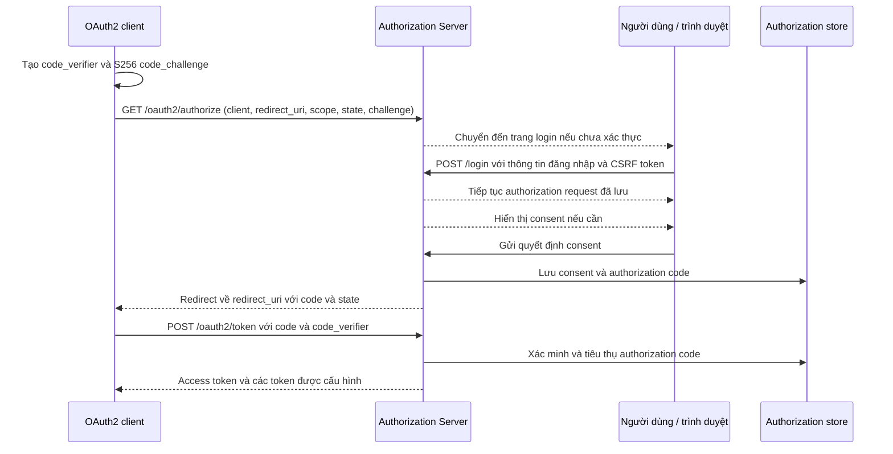

# Kiểm thử Authorization Code, PKCE, login và consent

Luồng Authorization Code chỉ hoàn tất khi Authorization Server xác thực request, người dùng đăng nhập, người dùng quyết định consent khi cần, server phát hành authorization code và client đổi code thành token. Với PKCE, code chỉ được đổi khi client cung cấp đúng `code_verifier` tương ứng với `code_challenge` đã gửi ở bước authorize. Kiểm thử chức năng cần đi qua toàn bộ chuỗi này để phát hiện lỗi nằm ở cấu hình client, session đăng nhập, trang consent, redirect URI, xử lý CSRF hay token endpoint.

Bài học này thuộc module `SPRING_SECURITY_OAUTH2_OIDC_AUTHORIZATION_SERVER`, tập trung vào thiết kế và vận hành OAuth 2.0/OpenID Connect Authorization Server bằng Spring Authorization Server. Các ví dụ sử dụng Spring Security Test và MockMvc; có thể áp dụng cùng nguyên tắc cho kiểm thử browser hoặc test môi trường tích hợp.

## 1. Phân rã luồng cần kiểm thử

Một luồng Authorization Code có PKCE và consent thường diễn ra như sau:



Mỗi bước có một hợp đồng riêng. Authorization endpoint xác thực client, response type, redirect URI, scope và tham số PKCE. Login xác thực người dùng và duy trì session. Consent ghi nhận các scope mà người dùng chấp thuận. Token endpoint xác minh code, client, redirect URI và PKCE trước khi phát hành token.

Nên phân chia test thành ba lớp:

- **Test đơn vị:** kiểm tra helper tạo PKCE challenge, quy tắc chọn scope và logic tùy biến của ứng dụng.
- **Test tích hợp:** khởi động Spring Security filter chain và Spring Authorization Server thật, dùng MockMvc để gọi login, authorize, consent và token endpoint.
- **Test đầu cuối:** chạy browser hoặc client thử nghiệm qua URL public, xác nhận redirect, cookie, CSRF và giao diện consent thực tế.

MockMvc kiểm tra được HTTP contract và SecurityContext trong ứng dụng, nhưng không thay thế kiểm thử browser đối với JavaScript, cookie của trình duyệt, SameSite hoặc reverse proxy production.

## 2. Đăng ký client dành cho kiểm thử

Một public client thường không giữ được client secret an toàn, vì vậy cần dùng PKCE. Có thể cấu hình `RegisteredClient` như sau:

```java
import org.springframework.security.oauth2.core.AuthorizationGrantType;
import org.springframework.security.oauth2.server.authorization.client.ClientAuthenticationMethod;
import org.springframework.security.oauth2.server.authorization.client.RegisteredClient;
import org.springframework.security.oauth2.server.authorization.settings.ClientSettings;

RegisteredClient webClient = RegisteredClient.withId("web-client-row-1")
        .clientId("web-client")
        .clientAuthenticationMethod(ClientAuthenticationMethod.NONE)
        .authorizationGrantType(AuthorizationGrantType.AUTHORIZATION_CODE)
        .redirectUri("https://client.example.test/callback")
        .scope("openid")
        .scope("profile")
        .scope("orders.read")
        .clientSettings(ClientSettings.builder()
                .requireProofKey(true)
                .requireAuthorizationConsent(true)
                .build())
        .build();
```

`requireProofKey(true)` yêu cầu PKCE đối với authorization request của client. `requireAuthorizationConsent(true)` yêu cầu người dùng chấp thuận scope khi consent tương ứng chưa có. Đặt cả hai trong fixture giúp test kiểm tra được chính sách mà ứng dụng muốn bảo vệ.

Nếu cần kiểm thử confidential client, đăng ký thêm client có `ClientAuthenticationMethod.CLIENT_SECRET_BASIC`, lưu secret đã mã hóa bằng `PasswordEncoder`, và vẫn bật PKCE nếu chính sách yêu cầu. Khi gọi token endpoint, confidential client phải xác thực theo phương thức đã đăng ký, ví dụ HTTP Basic. Public client dùng `ClientAuthenticationMethod.NONE` và gửi `client_id` trong token request theo profile OAuth2.

Không dùng cùng một client cho mọi ca kiểm thử nếu các test cần chính sách khác nhau. Tạo fixture riêng cho client bắt buộc PKCE, client không yêu cầu consent, confidential client hoặc client có tập redirect URI khác nhau. Cách này giúp mỗi test thể hiện một điều kiện rõ ràng.

## 3. Tạo và xác minh PKCE S256

PKCE tạo một bí mật ngẫu nhiên `code_verifier` ở phía client. Client gửi giá trị băm của verifier dưới dạng `code_challenge` trong authorization request, rồi gửi verifier gốc ở token request. Authorization Server tính lại challenge và so sánh hai giá trị.

Với phương thức `S256`:

\[
\text{code\_challenge} = \text{BASE64URL\_NO\_PADDING}(\text{SHA256}(\text{code\_verifier}))
\]

Một helper Java dùng trong test:

```java
import java.nio.charset.StandardCharsets;
import java.security.MessageDigest;
import java.security.NoSuchAlgorithmException;
import java.util.Base64;

static String s256(String verifier) throws NoSuchAlgorithmException {
    byte[] digest = MessageDigest.getInstance("SHA-256")
            .digest(verifier.getBytes(StandardCharsets.US_ASCII));
    return Base64.getUrlEncoder().withoutPadding().encodeToString(digest);
}
```

Verifier phải được sinh ngẫu nhiên bằng bộ sinh số ngẫu nhiên mật mã ở client thực tế và tuân theo độ dài, tập ký tự của RFC 7636. Trong test có thể dùng một chuỗi cố định hợp lệ để tái lập kết quả, nhưng không dùng một verifier cố định trong production.

```java
String codeVerifier = "dBjftJeZ4CVP-mB92K27uhbUJU1p1r_wW1gFWFOEjXk";
String codeChallenge = s256(codeVerifier);
```

Không gửi `code_verifier` ở authorization request. Không gửi `code_challenge` thay cho verifier ở token request. Nếu test dùng cùng một chuỗi cho cả hai tham số, nó không còn kiểm tra đúng quy trình S256.

## 4. Kiểm thử authorization request và redirect URI

Authorization request cơ bản chứa các tham số:

| Tham số | Vai trò |
|---|---|
| `response_type=code` | Yêu cầu authorization code |
| `client_id` | Định danh client đã đăng ký |
| `redirect_uri` | URI callback đã đăng ký chính xác |
| `scope` | Quyền client yêu cầu |
| `state` | Giá trị client dùng liên kết request và callback, chống CSRF ở phía client |
| `code_challenge` | Challenge PKCE |
| `code_challenge_method=S256` | Phương thức băm challenge |

Ví dụ request qua MockMvc sau khi người dùng đã được xác thực:

```java
import static org.springframework.security.test.web.servlet.request.SecurityMockMvcRequestPostProcessors.user;
import static org.springframework.test.web.servlet.request.MockMvcRequestBuilders.get;
import static org.springframework.test.web.servlet.result.MockMvcResultMatchers.status;

MvcResult result = mockMvc.perform(get("/oauth2/authorize")
        .with(user("alice").roles("USER"))
        .param("response_type", "code")
        .param("client_id", "web-client")
        .param("redirect_uri", "https://client.example.test/callback")
        .param("scope", "openid profile")
        .param("state", "state-test-123")
        .param("code_challenge", codeChallenge)
        .param("code_challenge_method", "S256"))
    .andExpect(status().is3xxRedirection())
    .andReturn();
```

Vì client yêu cầu consent, redirect đầu tiên có thể dẫn đến trang consent đã cấu hình. Sau khi consent hoàn tất, response mới chuyển về redirect URI của client với `code` và `state`. Với test không tập trung vào consent, có thể dùng client fixture đặt `requireAuthorizationConsent(false)` hoặc tạo consent trước trong test setup.

Các ca âm cần bao gồm:

- `client_id` không tồn tại: authorization request bị từ chối.
- `response_type` không được hỗ trợ: server trả lỗi giao thức.
- `redirect_uri` không khớp chính xác URI đã đăng ký: server không redirect code đến URI không tin cậy.
- Scope không được đăng ký hoặc không được phép: server từ chối hoặc xử lý theo chính sách scope của ứng dụng.
- Thiếu `state` trong client flow cần state: client không nên chấp nhận callback không có state tương ứng.
- Thiếu `code_challenge` khi client bắt buộc PKCE: không phát hành authorization code.
- `code_challenge_method` không được hỗ trợ hoặc challenge sai định dạng: request bị từ chối.

Khi kiểm thử redirect URI không hợp lệ, không chỉ khẳng định status code. Hãy kiểm tra response không chứa redirect đến URI do request tùy ý cung cấp và không có authorization code được phát hành. Server không được dùng redirect URI chưa được xác thực để trả lỗi OAuth2.

## 5. Kiểm thử đăng nhập và session

Authorization request thường đến khi người dùng chưa đăng nhập. Spring Security lưu request cần tiếp tục, chuyển trình duyệt đến login page và tiếp tục authorization sau khi đăng nhập thành công.

### 5.1. Xác nhận yêu cầu đăng nhập

Gửi GET đến `/oauth2/authorize` mà không có người dùng đã xác thực. Kết quả thường là redirect đến trang login, và session lưu request cần tiếp tục. Kiểm tra `Location` trỏ đến login endpoint do ứng dụng cấu hình và session được tạo khi cần.

Không dùng `.with(user("alice"))` trong test này, vì request post-processor đó đặt principal trực tiếp vào SecurityContext và bỏ qua form login thực tế. `.with(user(...))` phù hợp cho test authorization logic sau khi đăng nhập, còn login flow cần gửi HTTP request đến endpoint đăng nhập.

### 5.2. Đăng nhập thành công

Ví dụ kiểm tra form login với MockMvc:

```java
import static org.springframework.security.test.web.servlet.request.SecurityMockMvcRequestPostProcessors.csrf;
import static org.springframework.test.web.servlet.request.MockMvcRequestBuilders.get;
import static org.springframework.test.web.servlet.request.MockMvcRequestBuilders.post;
import static org.springframework.test.web.servlet.result.MockMvcResultMatchers.status;

MvcResult loginPage = mockMvc.perform(get("/login"))
        .andExpect(status().isOk())
        .andReturn();

MockHttpSession session = (MockHttpSession) loginPage.getRequest().getSession(false);

MvcResult loginResult = mockMvc.perform(post("/login")
        .session(session)
        .with(csrf())
        .param("username", "alice")
        .param("password", "correct-password"))
    .andExpect(status().is3xxRedirection())
    .andReturn();
```

Sau login thành công, kiểm tra response chuyển về authorization request đã lưu hoặc trang mặc định theo cấu hình success handler. Tiếp tục request authorize với cùng session để xác nhận người dùng được nhận diện và luồng đi đến bước consent hoặc callback. MockMvc không tự động theo redirect; test cần đọc `Location` rồi gửi request kế tiếp bằng session đó.

### 5.3. Đăng nhập thất bại

Gửi password sai và xác nhận server chuyển đến trang login với trạng thái lỗi theo cấu hình. Không có authorization code được tạo, không có consent được ghi nhận và session không chứa SecurityContext đã xác thực của người dùng. Nếu ứng dụng có rate limiting hoặc khóa tài khoản, kiểm thử chính sách đó riêng để test login không phụ thuộc vào số lần chạy test trước.

### 5.4. CSRF và cookie session

Form login thường được bảo vệ bằng CSRF. Test POST login cần gửi CSRF token hợp lệ; test thiếu hoặc token sai phải bị từ chối theo cấu hình Spring Security. Form consent tùy biến cũng phải có CSRF token nếu endpoint xử lý POST nằm trong phạm vi CSRF protection.

Khi chạy browser test, kiểm tra session cookie có thuộc tính `HttpOnly`, `Secure` trong HTTPS và `SameSite` phù hợp với cách client mở authorization flow. Một số luồng đăng nhập qua nhiều domain có thể bị ảnh hưởng bởi chính sách cookie của trình duyệt. MockMvc chỉ kiểm tra header cookie do ứng dụng phát ra; cần test browser trên môi trường HTTPS để xác nhận hành vi thực tế.

## 6. Kiểm thử consent và scope được chấp thuận

Consent là quyết định của người dùng cho phép client truy cập một tập scope. Consent page cần hiển thị tên client, mô tả ứng dụng và các quyền được yêu cầu bằng nội dung dễ hiểu. Người dùng có thể chấp thuận toàn bộ, chấp thuận một phần nếu ứng dụng hỗ trợ, hoặc từ chối.

Với Spring Authorization Server, client có thể bật `requireAuthorizationConsent(true)`. Ứng dụng thường cấu hình consent page riêng trong authorization endpoint:

```java
http.oauth2AuthorizationServer(authorizationServer ->
        authorizationServer.authorizationEndpoint(authorizationEndpoint ->
                authorizationEndpoint.consentPage("/oauth2/consent")));
```

Đường dẫn và giao diện consent là phần ứng dụng triển khai. Test cần sử dụng đúng route và form contract của ứng dụng. Với consent page mẫu, form thường gửi quyết định người dùng và danh sách scope đã chọn về authorization endpoint; tên field và cách dựng view phải khớp với implementation thực tế.

### 6.1. Consent lần đầu

Với một principal chưa có consent cho client, gửi authorization request yêu cầu `openid profile orders.read`. Xác nhận server đưa người dùng đến consent page. Nội dung page cần thể hiện đúng client, scope yêu cầu và hành động chấp thuận/từ chối. Không hiển thị scope ngoài request hoặc thông tin client lấy từ tham số không được xác minh.

Sau khi người dùng chấp thuận, kiểm tra:

1. Authorization response chuyển về redirect URI đã đăng ký.
2. Callback chứa authorization code và giữ nguyên `state` từ request.
3. Consent được lưu qua `OAuth2AuthorizationConsentService` cho đúng client và principal.
4. Tập authority đã lưu chỉ gồm các scope được người dùng chấp thuận.
5. Token được cấp theo scope đã được chấp thuận và chính sách của client.

### 6.2. Từ chối consent

Gửi quyết định từ chối bằng form consent của ứng dụng. Authorization Server phải trả lỗi `access_denied` qua redirect URI hợp lệ, giữ `state` để client liên kết response và không phát hành authorization code. Không ghi consent thành công cho request bị từ chối.

### 6.3. Chấp thuận một phần scope

Nếu UI cho phép chọn từng scope, yêu cầu nhiều scope nhưng chỉ chấp thuận một phần. Xác nhận authorization response và token chỉ bao gồm scope được phép theo hành vi đã định nghĩa. Với lần authorize sau, server có thể yêu cầu consent bổ sung cho các scope chưa được chấp thuận.

Không giả định mọi ứng dụng phải cho phép partial consent. Nếu UI của ứng dụng chỉ hỗ trợ chấp thuận toàn bộ hoặc từ chối, test phải xác nhận đúng chính sách đó.

### 6.4. Consent được tái sử dụng và thu hồi

Sau khi consent được lưu, gửi lại authorization request với cùng client, principal và tập scope đã được chấp thuận. Nếu consent vẫn hợp lệ và đủ scope, trang consent có thể được bỏ qua. Kiểm tra rằng consent của user A không được dùng cho user B và consent của client A không được dùng cho client B.

Nếu ứng dụng hỗ trợ thu hồi consent, xóa consent bằng `OAuth2AuthorizationConsentService` hoặc luồng UI tương ứng, rồi gửi lại authorization request. Server cần yêu cầu consent trở lại đối với quyền đã bị thu hồi. Kiểm thử persistence qua restart hoặc qua node khác nếu consent được lưu trong database dùng chung.

## 7. Đổi authorization code tại token endpoint

Sau khi nhận callback, client gửi authorization code cùng redirect URI và PKCE verifier đến token endpoint. Với public client, request có `client_id`; với confidential client, request còn xác thực bằng phương thức client đã đăng ký.

Ví dụ đổi code cho public client:

```java
import static org.springframework.test.web.servlet.request.MockMvcRequestBuilders.post;
import static org.springframework.test.web.servlet.result.MockMvcResultMatchers.jsonPath;
import static org.springframework.test.web.servlet.result.MockMvcResultMatchers.status;

import org.springframework.http.MediaType;

mockMvc.perform(post("/oauth2/token")
        .contentType(MediaType.APPLICATION_FORM_URLENCODED)
        .param("grant_type", "authorization_code")
        .param("client_id", "web-client")
        .param("code", authorizationCode)
        .param("redirect_uri", "https://client.example.test/callback")
        .param("code_verifier", codeVerifier))
    .andExpect(status().isOk())
    .andExpect(jsonPath("$.access_token").isNotEmpty())
    .andExpect(jsonPath("$.token_type").value("Bearer"));
```

Nếu scope `openid` được yêu cầu và OIDC được bật, response có thể bao gồm ID Token. Kiểm tra chữ ký, issuer, audience, thời hạn và `nonce` nếu request có nonce bằng một OIDC client hoặc verifier phù hợp; chỉ kiểm tra chuỗi `id_token` khác rỗng chưa chứng minh token hợp lệ.

Với confidential client dùng HTTP Basic, bổ sung `.with(httpBasic("confidential-client", "client-secret"))` và bỏ `client_id` nếu phương thức client authentication yêu cầu định danh qua Basic. Không gửi đồng thời nhiều phương thức xác thực client trong cùng request.

### 7.1. PKCE sai hoặc thiếu verifier

Mỗi ca âm cần tạo authorization code mới, bởi code chỉ được sử dụng một lần. Kiểm thử các trường hợp:

- `code_verifier` khớp challenge: token endpoint phát hành token.
- Verifier không khớp challenge: token endpoint trả `invalid_grant`.
- Thiếu verifier khi code được phát hành cho client bắt buộc PKCE: token endpoint từ chối.
- Code được tạo với challenge S256 nhưng client gửi verifier của một luồng khác: token endpoint từ chối.
- Code đã được đổi trước đó: request tiếp theo bị từ chối, kể cả khi verifier đúng.

Đảm bảo client xác thực thành công và code còn hạn trong các test verifier sai. Nếu cả client secret sai hoặc code hết hạn, kết quả `invalid_client`/`invalid_grant` không chỉ ra được PKCE validator đã chạy.

### 7.2. Redirect URI và client không khớp

Đổi code bằng redirect URI khác URI đã dùng ở authorization request phải bị từ chối. Đổi code bằng client khác cũng phải bị từ chối. Không phát hành token khi một trong các điều kiện ràng buộc code không khớp.

Authorization code được ràng buộc với client và redirect URI ban đầu. Không dùng redirect URI mới do request token endpoint tự cung cấp để thay đổi callback sau khi code đã được cấp.

## 8. Kiểm tra state, nonce và callback phía client

Authorization Server trả lại `state` nguyên vẹn nếu client đã gửi state hợp lệ. Client chịu trách nhiệm so sánh state callback với state đã lưu cho request ban đầu; Authorization Server không thể tự xác nhận trình duyệt đã quay về đúng phiên client.

Với OIDC, client có thể gửi `nonce` trong authorization request. Nếu có nonce, ID Token phải chứa cùng nonce theo quy tắc OIDC. Kiểm thử callback cần xác nhận:

- `state` trong callback khớp với request client đã khởi tạo.
- `nonce` trong ID Token khớp với nonce client đã lưu.
- Authorization code chỉ được đổi trong đúng phiên và đúng redirect URI.
- Callback lỗi hoặc state không khớp không tạo phiên đăng nhập client.

Không dùng `state` thay cho PKCE. PKCE ràng buộc authorization code với client giữ verifier; state giúp client liên kết response với request và chống CSRF trong luồng redirect. Hai cơ chế bổ trợ nhau.

## 9. Bộ test tích hợp với MockMvc

Một lớp test tích hợp thường khởi động ứng dụng thật cùng SecurityFilterChain, AuthorizationServerSettings, RegisteredClientRepository, OAuth2AuthorizationService và OAuth2AuthorizationConsentService:

```java
@SpringBootTest
@AutoConfigureMockMvc
class AuthorizationCodeFlowIntegrationTest {

    @Autowired
    MockMvc mockMvc;

    @Autowired
    RegisteredClientRepository registeredClientRepository;

    @Autowired
    OAuth2AuthorizationService authorizationService;

    @Autowired
    OAuth2AuthorizationConsentService consentService;

    // Tạo client và dữ liệu test trước mỗi test.
    // Thực hiện authorize -> login/consent -> callback -> token exchange.
    // Dọn authorization, consent và client sau test.
}
```

Đây là skeleton để định hướng fixture, không phải một lớp test hoàn chỉnh có thể biên dịch độc lập. Ứng dụng cần cung cấp test user, password encoder, security chain, consent controller/page và cấu hình endpoint tương ứng. Nếu dùng database, khởi tạo schema test bằng migration hoặc schema SQL tương thích với phiên bản Spring Authorization Server.

Khi dọn dữ liệu, xóa authorization và consent theo client/principal của test, đồng thời loại bỏ registered client fixture. Không dùng client ID hoặc principal chung giữa các test chạy song song nếu dữ liệu dùng chung có thể bị xóa chéo. Với test database, cân nhắc transaction rollback hoặc database riêng theo test suite; xác nhận các request MockMvc và persistence layer tham gia cùng transaction như dự định.

## 10. Ma trận kiểm thử chức năng

| Nhóm | Tình huống | Kết quả cần xác nhận |
|---|---|---|
| Authorization request | Client, redirect URI và response type hợp lệ | Request được tiếp tục đến login, consent hoặc callback |
| Authorization request | Client không tồn tại hoặc redirect URI sai | Request bị từ chối, không redirect code đến URI lạ |
| PKCE | Challenge S256 và verifier khớp | Đổi code thành công |
| PKCE | Thiếu challenge khi client bắt buộc PKCE | Không phát hành code |
| PKCE | Verifier sai hoặc thiếu | Token endpoint từ chối với `invalid_grant` |
| Login | Người dùng chưa đăng nhập | Chuyển đến login và lưu request tiếp tục |
| Login | Username/password đúng | Session được xác thực và authorization tiếp tục |
| Login | Password sai hoặc thiếu CSRF | Login thất bại, không phát hành code |
| Consent | Chưa có consent | Hiển thị consent page với đúng client và scope |
| Consent | Người dùng chấp thuận | Lưu consent và trả code cùng state |
| Consent | Người dùng từ chối | Trả `access_denied`, không cấp code |
| Consent | Consent đã tồn tại và đủ scope | Có thể bỏ qua consent page |
| Token endpoint | Code còn hạn, đúng client, redirect và verifier | Phát hành token |
| Token endpoint | Code replay, client khác hoặc redirect khác | Từ chối, không phát hành token |
| OIDC | Có scope `openid` và nonce | ID Token hợp lệ, nonce được giữ nguyên |
| Multi-instance | Authorization/consent tạo ở node A, tiếp tục ở node B | Trạng thái được đọc nhất quán |

## 11. Lỗi thường gặp khi viết test

| Biểu hiện | Nguyên nhân thường gặp | Cách xử lý |
|---|---|---|
| Authorization request trả `invalid_client` | Client fixture chưa lưu hoặc `client_id` sai | Xác nhận repository và cấu hình client trước khi gửi request |
| Request chuyển thẳng đến consent nhưng test mong login | MockMvc đã gắn user hoặc session còn đăng nhập | Tách test login khỏi test authorize đã xác thực; tạo session mới |
| Không quay lại authorization request sau login | Không giữ session giữa GET authorize và POST login | Dùng cùng `MockHttpSession`, kiểm tra saved request và success handler |
| POST login nhận 403 | Thiếu hoặc sai CSRF token | Gửi `.with(csrf())` và giữ session phù hợp |
| Consent page không xuất hiện | Consent đã được lưu từ test trước hoặc client không yêu cầu consent | Dọn `OAuth2AuthorizationConsentService` và kiểm tra `requireAuthorizationConsent` |
| Callback không có code | Consent chưa hoàn tất, scope bị từ chối hoặc authorization request lỗi | Kiểm tra consent decision và error query parameter |
| Token endpoint trả `invalid_grant` với verifier đúng | Code đã dùng, hết hạn, redirect URI sai hoặc authorization state thiếu | Tạo code mới và xác minh từng ràng buộc trước khi kiểm tra PKCE |
| PKCE test sai vẫn thành công | Client không bật `requireProofKey` hoặc test đang dùng client khác | Xác nhận client fixture và challenge đã lưu trong authorization state |
| State không khớp trong callback | Test đọc nhầm redirect hoặc client không giữ state theo request | Trích `state` từ đúng callback và kiểm tra phía client |
| Test consent bị ảnh hưởng bởi test khác | Consent tồn tại trong database hoặc context dùng chung | Dọn dữ liệu theo principal/client và cô lập test chạy song song |
| MockMvc pass nhưng browser fail | Cookie, SameSite, HTTPS, JavaScript hoặc proxy chưa được kiểm tra | Bổ sung browser test trên môi trường HTTPS gần production |

## 12. Checklist trước khi phát hành

- [ ] Public client bắt buộc PKCE và sử dụng phương thức `S256`.
- [ ] Authorization request kiểm tra client, response type, redirect URI và scope.
- [ ] Redirect URI không hợp lệ không nhận được code hoặc error redirect tùy ý.
- [ ] Người dùng chưa đăng nhập được chuyển đến login và request ban đầu được lưu.
- [ ] Login thành công tiếp tục đúng authorization request; login thất bại không cấp code.
- [ ] Login form và consent form tuân thủ CSRF protection.
- [ ] Consent page hiển thị đúng client và scope đang yêu cầu.
- [ ] Consent được lưu theo đúng client và principal; từ chối trả `access_denied`.
- [ ] Consent đã có chỉ bỏ qua màn hình khi vẫn bao phủ các scope được yêu cầu.
- [ ] Callback giữ nguyên `state`; OIDC ID Token giữ đúng `nonce` khi được yêu cầu.
- [ ] Token endpoint chỉ đổi code khi client, redirect URI và PKCE verifier hợp lệ.
- [ ] Code replay, verifier sai, verifier thiếu và redirect URI không khớp đều bị từ chối.
- [ ] Authorization và consent được lưu bền vững, nhất quán khi request đi qua nhiều instance.
- [ ] Browser test xác nhận cookie, redirect và consent UI trên HTTPS.
- [ ] Authorization code, token, password và client secret không xuất hiện trong log/test report.

Một luồng Authorization Code đáng tin cậy phải giữ được mối liên kết từ authorization request đến callback và token exchange. Khi test xác nhận login, consent, state, redirect URI và PKCE trong cùng một luồng, nhóm phát triển có thể phát hiện lỗi tích hợp trước khi client thực sự sử dụng Authorization Server.
