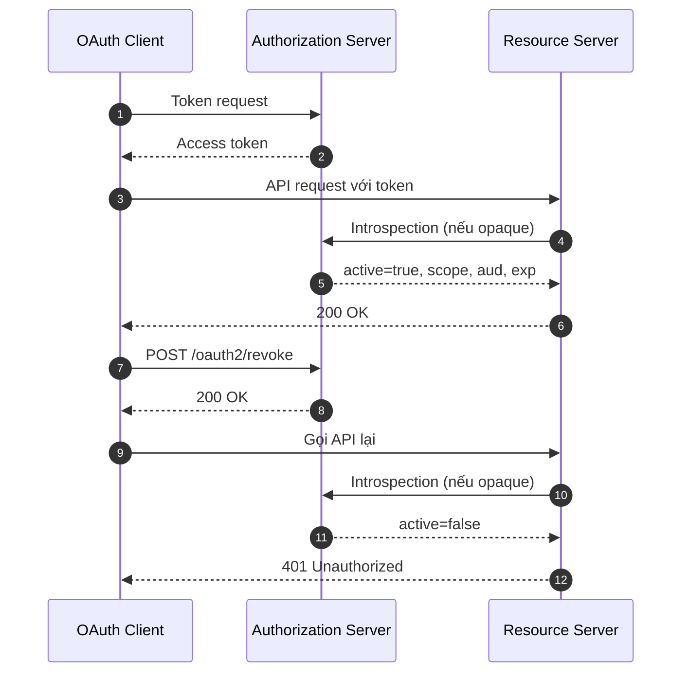

# Kiểm thử JWT claims, reference token, introspection và revocation

Spring Authorization Server có thể phát hành access token dưới dạng JWT tự chứa hoặc reference token (opaque token). Hai định dạng này tạo ra cách kiểm tra và thu hồi quyền khác nhau ở Resource Server. JWT mang claims để Resource Server xác minh cục bộ bằng chữ ký và policy; reference token là một định danh khó đoán, cần được introspect để biết trạng thái và quyền hiện tại. Cả hai đều cần kiểm tra issuer, audience, scope, thời hạn và vòng đời token.

Bài học này hướng dẫn xây dựng bộ kiểm thử chức năng cho token claims, chọn định dạng access token theo client, kiểm tra introspection và revocation, rồi xác minh hành vi tại Resource Server. Mục tiêu là chứng minh token được phát hành đúng hợp đồng, token bị thu hồi không còn được chấp nhận theo cơ chế đã chọn, và API chỉ cho phép đúng audience cùng scope.

## 1. Phân biệt JWT và reference token

| Đặc điểm | JWT access token | Reference/opaque access token |
|---|---|---|
| Nội dung client nhìn thấy | Claims được mã hóa Base64URL và ký; không mặc nhiên được mã hóa bí mật | Chuỗi định danh ngẫu nhiên/opaque, không mang claims đọc được |
| Xác minh tại Resource Server | Có thể xác minh chữ ký và claims cục bộ | Gọi introspection endpoint hoặc dùng cơ chế tra cứu tin cậy |
| Phụ thuộc mạng khi xác minh | Không cần gọi Authorization Server cho mỗi request nếu dùng xác minh cục bộ | Cần truy vấn trạng thái token, thường qua introspection; có thể cache có TTL |
| Thay đổi trạng thái/thu hồi | Resource Server xác minh chữ ký đơn thuần không biết token đã bị revoke | Introspection có thể trả `active=false` sau khi trạng thái được cập nhật |
| Chi phí request | Thấp hơn ở mỗi lần xác minh, đổi lại cần quản lý khóa và cache JWKS | Có thêm độ trễ và tải lên introspection endpoint |
| Thời điểm phù hợp | API cần xác minh phân tán, chấp nhận thời gian sống ngắn và chiến lược revoke có giới hạn | Quyền cần kiểm tra trạng thái gần thời gian thực hoặc muốn giữ claims ở server |

JWT chỉ được ký, không phải mã hóa. Bất kỳ ai có token đều có thể đọc phần header và payload. Không đưa mật khẩu, secret, dữ liệu nhạy cảm hoặc thông tin cá nhân không cần thiết vào claims. Reference token cũng là credential bearer; phải bảo vệ như access token và không ghi vào log.

Không nhầm access token với ID token. ID token dành cho OIDC client, `aud` thường là client ID và mô tả kết quả xác thực người dùng. Access token dành cho Resource Server, `aud` phải xác định API/resource đích theo policy. Resource Server không được chấp nhận ID token thay cho access token chỉ vì cả hai đều là JWT.

## 2. Xác định hợp đồng claims cần kiểm thử

Với JWT access token, một hợp đồng điển hình có các thuộc tính:

| Claim | Ý nghĩa | Điều kiện cần kiểm tra |
|---|---|---|
| `iss` | Issuer phát hành token | Khớp chính xác issuer tin cậy đã cấu hình |
| `sub` | Subject của token | Đúng người dùng hoặc workload theo grant và policy |
| `aud` | Resource nhận token | Chứa audience của API đích; không chấp nhận token dành cho API khác |
| `exp` | Thời điểm hết hạn | Token bị từ chối sau thời điểm này, có xét clock skew được cấu hình |
| `iat` | Thời điểm phát hành | Không nằm trong tương lai ngoài sai lệch đồng hồ cho phép |
| `nbf` | Thời điểm bắt đầu có hiệu lực, nếu có | Token chưa đến thời điểm hiệu lực phải bị từ chối |
| `jti` | Định danh token, nếu được phát hành | Duy nhất theo chính sách và hữu ích cho audit/denylist |
| `scope` hoặc `scp` | Quyền được cấp | Chỉ chứa scope đã chấp thuận và được client/resource cho phép |
| `client_id` | Client được gắn với token | Khớp client đã thực hiện grant |
| `token_use` hoặc claim phân loại nội bộ | Phân biệt mục đích token nếu ứng dụng dùng | Resource Server kiểm tra đúng loại token |

Tên và kiểu claim có thể khác theo token customizer. Scope có thể được biểu diễn dưới dạng chuỗi phân tách bằng khoảng trắng hoặc danh sách; viết assertion theo định dạng thực tế. `aud` của JWT có thể là một chuỗi hoặc mảng chuỗi. Không giả định mọi token đều có đủ mọi claim trong bảng; định nghĩa rõ claim bắt buộc cho từng grant và token format.

Đối với ID token, kiểm tra thêm các claim OIDC như `aud`, `azp` khi có nhiều audience, `nonce` nếu client gửi nonce và `auth_time` khi yêu cầu `max_age`. Các claim này không thay thế kiểm tra access token ở Resource Server.

## 3. Cấu hình và kiểm thử custom JWT claims

Spring Authorization Server dùng `OAuth2TokenGenerator` để tạo token. Với JWT access token, có thể dùng `OAuth2TokenCustomizer<JwtEncodingContext>` để thêm claims theo chính sách phía server:

```java
@Bean
OAuth2TokenCustomizer<JwtEncodingContext> jwtTokenCustomizer() {
    return context -> {
        if (OAuth2TokenType.ACCESS_TOKEN.equals(context.getTokenType())) {
            context.getClaims().claim(
                    "client_id", context.getRegisteredClient().getClientId());
            context.getClaims().claim("token_use", "access_token");
        }
    };
}
```

Đây là ví dụ tối giản. Không thêm claim chỉ vì client gửi một parameter cùng tên. Nếu cần `tenant`, `roles`, `aud` hoặc quyền nghiệp vụ, lấy dữ liệu từ principal đã xác thực, client registration hoặc policy store phía server. Nếu dùng audience riêng cho từng API, xác định audience từ resource policy đã kiểm tra; không sao chép `audience` request vào token một cách mù quáng.

Nếu dùng một customizer để tạo cả access token và ID token, phải phân biệt `context.getTokenType()` và chỉ thêm claim đúng loại. Không đưa `token_use=access_token` vào ID token hoặc đưa claim xác thực OIDC vào access token nếu không có lý do rõ ràng.

Test phát hành token cần xác minh claims sau khi xác minh chữ ký bằng decoder tin cậy:

```java
Jwt jwt = jwtDecoder.decode(accessToken);

assertThat(jwt.getIssuer())
        .isEqualTo(URI.create("https://identity.example.com"));
assertThat(jwt.getSubject()).isEqualTo("user-123");
assertThat(jwt.getAudience()).contains("orders-api");
assertThat(jwt.getClaimAsString("token_use")).isEqualTo("access_token");
assertThat(jwt.getExpiresAt()).isAfter(Instant.now());
```

Nếu scope được lưu trong claim `scope` dạng chuỗi:

```java
String scopeClaim = jwt.getClaimAsString("scope");
assertThat(Arrays.asList(scopeClaim.split("\\s+")))
        .containsExactlyInAnyOrder("orders.read", "orders.write");
```

Nếu ứng dụng lưu scope dưới dạng list hoặc claim `scp`, dùng accessor tương ứng. Test cũng cần xác minh token không chứa scope ngoài yêu cầu, audience ngoài policy, claim nhạy cảm hoặc dữ liệu từ request chưa được xác thực.

## 4. Cấu hình reference token theo client

Spring Authorization Server hỗ trợ access token format qua `TokenSettings`. Ví dụ đăng ký một client dùng reference token:

```java
RegisteredClient reportingClient = RegisteredClient
        .withId(UUID.randomUUID().toString())
        .clientId("reporting-service")
        .clientSecret(passwordEncoder.encode(secretFromVault))
        .clientAuthenticationMethod(ClientAuthenticationMethod.CLIENT_SECRET_BASIC)
        .authorizationGrantType(AuthorizationGrantType.CLIENT_CREDENTIALS)
        .scope("reports.read")
        .tokenSettings(TokenSettings.builder()
                .accessTokenFormat(OAuth2TokenFormat.REFERENCE)
                .accessTokenTimeToLive(Duration.ofMinutes(5))
                .build())
        .build();

registeredClientRepository.save(reportingClient);
```

Secret trong ví dụ phải được cấp từ secret manager và mã hóa bằng `PasswordEncoder` tương ứng với cấu hình xác thực client. Không đặt secret thật trong source control.

Client khác có thể tiếp tục dùng JWT:

```java
TokenSettings jwtTokenSettings = TokenSettings.builder()
        .accessTokenFormat(OAuth2TokenFormat.SELF_CONTAINED)
        .accessTokenTimeToLive(Duration.ofMinutes(5))
        .build();
```

Chọn format theo nhu cầu của client/resource server. Reference token không tự động bảo đảm revocation tức thời nếu Resource Server cache kết quả introspection quá lâu. JWT không tự động hỗ trợ revoke tức thời nếu Resource Server chỉ kiểm tra chữ ký. Cả hai format đều cần TTL, scope và audience phù hợp.

## 5. Bật introspection và revocation endpoint

Trong filter chain của Authorization Server, bật các endpoint theo phiên bản Spring Authorization Server đang dùng:

```java
http.with(authorizationServerConfigurer, authorizationServer ->
        authorizationServer
                .tokenIntrospectionEndpoint(Customizer.withDefaults())
                .tokenRevocationEndpoint(Customizer.withDefaults()));
```

Các endpoint mặc định thường là `/oauth2/introspect` và `/oauth2/revoke`; xác minh bằng `AuthorizationServerSettings` hoặc metadata của server nếu ứng dụng đã đổi đường dẫn.

Introspection và revocation là endpoint dành cho client đã xác thực theo cấu hình. Không mở chúng như API public để bất kỳ người dùng nào cũng có thể tra cứu token. Đăng ký client có phương thức xác thực phù hợp, cấp quyền tối thiểu và chỉ cho client cần introspect/revoke truy cập.

Ví dụ introspection request:

```bash
curl -X POST https://identity.example.com/oauth2/introspect \
  -u 'reporting-service:<client-secret>' \
  -H 'Content-Type: application/x-www-form-urlencoded' \
  --data-urlencode 'token=<access-token>' \
  --data-urlencode 'token_type_hint=access_token'
```

Response cho token đang hoạt động có thể chứa:

```json
{
  "active": true,
  "scope": "reports.read",
  "client_id": "reporting-service",
  "token_type": "Bearer",
  "exp": 1790000000,
  "iat": 1789999700,
  "sub": "service-account-reporting",
  "aud": ["reports-api"],
  "iss": "https://identity.example.com"
}
```

Đây là response minh họa; các thuộc tính ngoài `active` có thể phụ thuộc token, provider và cấu hình. Client phải coi `active` là điều kiện cốt lõi. Không suy ra token active chỉ vì introspection trả HTTP 200: response `{"active": false}` cũng là kết quả hợp lệ.

## 6. Kiểm thử introspection

Với token hợp lệ đã được phát hành và lưu trong authorization store, gọi endpoint qua client đã xác thực:

```java
@Test
void introspectionReportsIssuedReferenceTokenAsActive() throws Exception {
    String referenceToken = tokenFixtures.issuedReferenceToken();

    mockMvc.perform(post("/oauth2/introspect")
                    .with(httpBasic("reporting-service", "test-secret"))
                    .contentType(MediaType.APPLICATION_FORM_URLENCODED)
                    .param("token", referenceToken)
                    .param("token_type_hint", "access_token"))
            .andExpect(status().isOk())
            .andExpect(jsonPath("$.active").value(true))
            .andExpect(jsonPath("$.client_id").value("reporting-service"))
            .andExpect(jsonPath("$.scope").value("reports.read"));
}
```

Test fixture phải phát hành token qua luồng thật hoặc lưu authorization theo đúng schema. Không tự tạo một chuỗi token ngẫu nhiên rồi giả định introspection sẽ nhận ra nó.

Các ca introspection quan trọng:

| Tình huống | Kết quả mong đợi |
|---|---|
| Reference token hợp lệ, chưa hết hạn | `active=true` và claims phù hợp |
| Token không tồn tại | HTTP thành công với `active=false` |
| Token hết hạn | `active=false` |
| Token đã revoke | `active=false` sau khi trạng thái được cập nhật |
| Client authentication sai hoặc thiếu | Bị từ chối xác thực client |
| Client không có quyền gọi introspection | Bị từ chối theo policy endpoint |
| Token thuộc client khác | Kết quả theo quy tắc ownership/authorization của provider; không lộ dữ liệu trái phép |
| Token type hint không khớp | Server vẫn phải xác định đúng token hoặc trả inactive theo implementation; không tin hint như bằng chứng token hợp lệ |

Không trả token thô hoặc toàn bộ authorization object trong response. Introspection response chỉ nên công bố claims cần thiết cho Resource Server và theo profile đã thống nhất.

## 7. Kiểm thử revocation

RFC 7009 định nghĩa revocation endpoint. Client gửi token cần thu hồi, có thể kèm `token_type_hint`:

```bash
curl -X POST https://identity.example.com/oauth2/revoke \
  -u 'reporting-service:<client-secret>' \
  -H 'Content-Type: application/x-www-form-urlencoded' \
  --data-urlencode 'token=<access-token>' \
  --data-urlencode 'token_type_hint=access_token'
```

Một request revocation hợp lệ thường trả HTTP 200 kể cả khi token đã không còn active hoặc không tồn tại. Hành vi này tránh tạo oracle để attacker dò xem một chuỗi token có hợp lệ hay không. Vì vậy, không viết test yêu cầu server trả 404 cho token lạ. Hãy kiểm tra trạng thái sau đó bằng introspection hoặc truy cập Resource Server.

Ví dụ kiểm thử chuỗi revoke rồi introspect:

```java
@Test
void revokedReferenceTokenBecomesInactive() throws Exception {
    String referenceToken = tokenFixtures.issuedReferenceToken();

    mockMvc.perform(post("/oauth2/revoke")
                    .with(httpBasic("reporting-service", "test-secret"))
                    .contentType(MediaType.APPLICATION_FORM_URLENCODED)
                    .param("token", referenceToken)
                    .param("token_type_hint", "access_token"))
            .andExpect(status().isOk());

    mockMvc.perform(post("/oauth2/introspect")
                    .with(httpBasic("reporting-service", "test-secret"))
                    .contentType(MediaType.APPLICATION_FORM_URLENCODED)
                    .param("token", referenceToken)
                    .param("token_type_hint", "access_token"))
            .andExpect(status().isOk())
            .andExpect(jsonPath("$.active").value(false));
}
```

Kiểm tra thêm các trường hợp:

- Revoke token hợp lệ do client được phép thu hồi.
- Revoke token đã hết hạn hoặc đã revoke trước đó vẫn xử lý idempotent theo hợp đồng endpoint.
- Token không tồn tại không làm lộ thông tin qua status/body khác biệt.
- Client khác không thể thu hồi token ngoài phạm vi quyền của nó, trừ khi policy cho phép một administrator/relying service cụ thể.
- Thu hồi refresh token có ảnh hưởng đúng đến chuỗi token liên quan theo chính sách của authorization grant.
- Sau revoke, authorization persistence đánh dấu token/authorization không còn hợp lệ; introspection trả inactive.

Không mặc định mọi token trong cùng authorization bị revoke theo cùng cách ở mọi phiên bản hoặc custom implementation. Kiểm tra hành vi thực tế của `OAuth2AuthorizationService`, revocation provider và quan hệ giữa access token/refresh token của ứng dụng.

## 8. JWT revocation và giới hạn của xác minh cục bộ

Đây là điểm khác biệt quan trọng nhất giữa hai format. Khi Resource Server xác minh JWT chỉ bằng chữ ký, issuer, audience và thời hạn, nó không hỏi Authorization Server xem token đã bị revoke hay chưa. Việc revocation endpoint cập nhật authorization store không tự động làm một Resource Server stateless biết token đó đã bị thu hồi.

Ví dụ tình huống:

1. Authorization Server phát hành JWT access token có `exp` sau 5 phút.
2. Client gọi revocation endpoint và server đánh dấu token đã bị revoke trong authorization store.
3. Resource Server chỉ xác minh chữ ký JWT và claims cục bộ.
4. JWT vẫn có thể được chấp nhận đến khi hết hạn vì Resource Server chưa nhận được trạng thái revoke.

Nếu cần hiệu lực thu hồi gần tức thời, có thể chọn một trong các chiến lược:

- Dùng reference token và introspection cho mỗi request hoặc cache với TTL ngắn phù hợp yêu cầu.
- Với JWT, kiểm tra denylist theo `jti` hoặc trạng thái authorization tại Resource Server; phải bảo đảm cập nhật và phân phối trạng thái đáng tin cậy.
- Phát sự kiện revocation để các Resource Server cập nhật cache/denylist; thiết kế retry, replay và khôi phục khi subscriber mất kết nối.
- Dùng access token JWT thời hạn ngắn và chấp nhận cửa sổ revoke tối đa bằng thời gian còn lại của token.

Không tuyên bố “JWT đã revoke là bị từ chối ngay” nếu Resource Server chỉ dùng local signature validation. Test phải phản ánh chiến lược thật: nếu không có kênh trạng thái, kiểm tra token hết hạn bị từ chối và ghi rõ giới hạn revoke; nếu có denylist/event, kiểm tra thời gian lan truyền và failover.

## 9. Cấu hình Resource Server xác minh JWT

Resource Server cần kiểm tra ít nhất chữ ký, issuer, thời hạn và audience. Spring Security cho phép ghép validator mặc định với validator audience:

```java
@Bean
JwtDecoder jwtDecoder() {
    String issuer = "https://identity.example.com";
    NimbusJwtDecoder decoder = (NimbusJwtDecoder)
            JwtDecoders.fromIssuerLocation(issuer);

    OAuth2TokenValidator<Jwt> issuerAndTime =
            JwtValidators.createDefaultWithIssuer(issuer);
    OAuth2TokenValidator<Jwt> audience = jwt ->
            jwt.getAudience().contains("orders-api")
                    ? OAuth2TokenValidatorResult.success()
                    : OAuth2TokenValidatorResult.failure(
                            new OAuth2Error("invalid_token",
                                    "Required audience is missing", null));

    decoder.setJwtValidator(
            new DelegatingOAuth2TokenValidator<>(issuerAndTime, audience));
    return decoder;
}
```

Đây là ví dụ cho JWT access token dành cho `orders-api`. Dùng issuer và audience cấu hình theo môi trường. Nếu Resource Server cần phân biệt access token với ID token, thêm validator cho claim/token profile phù hợp. Không chỉ kiểm tra chữ ký vì một JWT hợp lệ về chữ ký vẫn có thể được phát hành cho API khác.

Kiểm thử Resource Server nên có:

- JWT đúng issuer, audience, thời hạn và scope: được phép truy cập endpoint tương ứng.
- JWT đúng chữ ký nhưng sai audience: trả 401.
- JWT sai issuer hoặc chữ ký: trả 401.
- JWT hết hạn hoặc chưa đến `nbf`: trả 401.
- JWT hợp lệ nhưng thiếu scope: trả 403.
- ID token có chữ ký hợp lệ nhưng không phải access token: bị từ chối theo token profile.

## 10. Cấu hình Resource Server dùng opaque token introspection

Với reference token, Resource Server có thể dùng opaque token support của Spring Security. Cấu hình ví dụ trong `application.yml`:

```yaml
spring:
  security:
    oauth2:
      resourceserver:
        opaquetoken:
          introspection-uri: https://identity.example.com/oauth2/introspect
          client-id: orders-api-resource-server
          client-secret: ${INTROSPECTION_CLIENT_SECRET}
```

Client credentials ở đây là thông tin của Resource Server để gọi introspection, không phải credential của end user. Giữ secret trong secret manager. Cấp cho client chỉ quyền introspection cần thiết và giới hạn mạng tới endpoint.

Spring Security chuyển các thuộc tính active/introspection thành `Authentication` và authorities. Ánh xạ scope sang authority cần nhất quán với `@PreAuthorize`, ví dụ `SCOPE_orders.read`. Nếu dùng custom introspector hoặc authority converter, kiểm thử cả việc token active và mapping scope.

Các ca test cho opaque token:

1. Introspection trả `active=true`, scope đủ: endpoint cho phép.
2. Introspection trả `active=true`, nhưng scope thiếu: endpoint trả 403.
3. Introspection trả `active=false`: Resource Server trả 401.
4. Introspection endpoint không khả dụng hoặc client credentials sai: Resource Server fail closed, không coi token là active.
5. Cache introspection có TTL: sau revoke, token không được chấp nhận quá thời gian cache cho phép; nếu yêu cầu revoke tức thời, không dùng cache dài.

## 11. Kiểm thử vòng đời end-to-end

Một kịch bản tích hợp có thể chạy theo trình tự:



Với JWT local validation, bước introspection không diễn ra. Kịch bản test phải thể hiện đúng cơ chế revocation đã chọn thay vì giả định Resource Server tự biết trạng thái từ Authorization Server.

Nên kiểm tra đồng thời hai loại client nếu hệ thống hỗ trợ cả JWT và reference token. Đảm bảo `TokenSettings` thực sự được áp dụng cho từng `RegisteredClient`; đừng chỉ kiểm tra một client mặc định rồi kết luận mọi client dùng cùng format.

## 12. Ma trận kiểm thử chức năng

| Nhóm | Ca kiểm thử | Kết quả mong đợi |
|---|---|---|
| JWT claims | Issuer, subject, audience, thời hạn, scope hợp lệ | Claims đúng hợp đồng và chữ ký xác minh thành công |
| JWT claims | Sai issuer, audience, signature, `exp` hoặc `nbf` | Resource Server từ chối |
| JWT claims | Claim custom lấy từ input không tin cậy | Không được phản ánh vào token |
| Token format | Client JWT | Access token là self-contained JWT theo cấu hình |
| Token format | Client reference | Access token opaque và introspection tìm được |
| Introspection | Token active | Trả `active=true` và metadata cần thiết |
| Introspection | Token unknown, expired hoặc revoked | Trả `active=false` |
| Introspection | Client authentication sai | Bị từ chối |
| Revocation | Revoke token hợp lệ | Endpoint trả response theo RFC 7009; trạng thái sau đó inactive theo store/introspection |
| Revocation | Token unknown hoặc đã revoke | Không lộ token tồn tại qua response khác biệt |
| JWT revocation | Resource Server chỉ xác minh chữ ký | Token có thể còn hiệu lực đến `exp`; kiểm tra giới hạn đã thiết kế |
| JWT revocation | Có denylist/event | Token bị từ chối sau khi trạng thái revoke lan truyền |
| Resource Server | Token active và scope đủ | 200 hoặc kết quả nghiệp vụ tương ứng |
| Resource Server | Token active nhưng thiếu scope | 403 |
| Resource Server | Token inactive hoặc sai audience | 401 |

## 13. Checklist hoàn thành

- [ ] Đã xác định client nào dùng JWT và client nào dùng reference token.
- [ ] JWT claims có issuer, subject, audience, thời hạn và scope đúng policy.
- [ ] Custom claims lấy từ dữ liệu tin cậy phía server; không chứa secret hoặc dữ liệu nhạy cảm không cần thiết.
- [ ] Resource Server xác minh chữ ký, issuer, audience, thời hạn và authority.
- [ ] Introspection endpoint yêu cầu client authentication và chỉ công bố claims cần thiết.
- [ ] Token active, inactive, expired và revoked được kiểm thử riêng.
- [ ] Revocation endpoint không làm lộ token có tồn tại hay không qua phản hồi khác biệt.
- [ ] Reference token không được chấp nhận sau khi introspection trả inactive, có tính đến TTL cache.
- [ ] Giới hạn JWT revocation được tài liệu hóa; có denylist/event hoặc TTL ngắn nếu cần hiệu lực nhanh.
- [ ] Test end-to-end phân biệt 401 (token không hợp lệ) và 403 (thiếu quyền).
- [ ] Log không chứa access token, refresh token, client secret hoặc authorization header.

Một hệ thống token đáng tin cậy phải kiểm tra được cả nội dung token lẫn trạng thái của nó trong suốt vòng đời. JWT phù hợp khi Resource Server có thể xác minh claims cục bộ và chấp nhận giới hạn thu hồi đã thiết kế; reference token phù hợp khi cần hỏi trạng thái tập trung. Dù chọn cách nào, issuer, audience, scope, thời hạn và quyền gọi introspection/revocation phải được kiểm thử như một hợp đồng thống nhất giữa Authorization Server và Resource Server.
