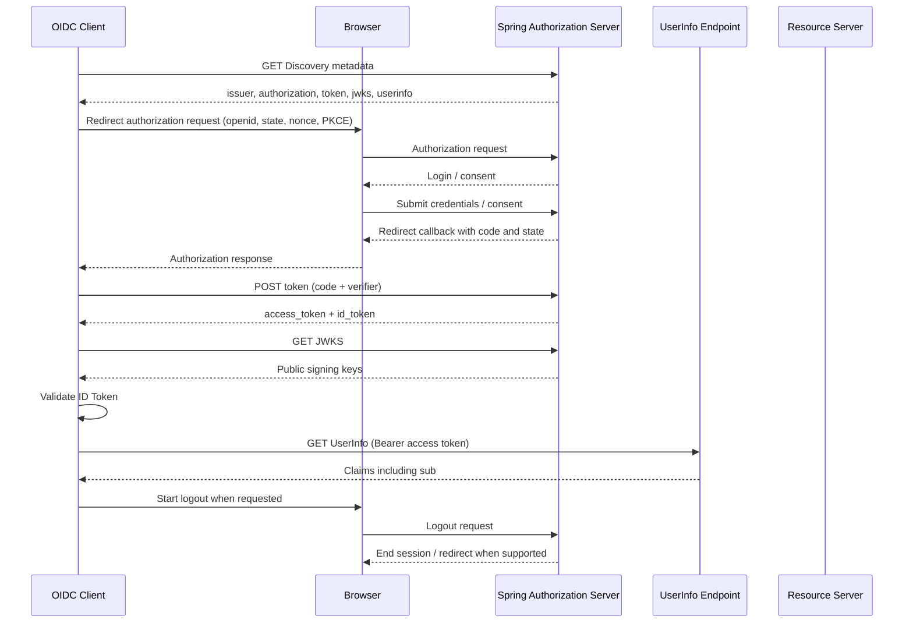

# Kiểm thử OIDC Discovery, ID Token, UserInfo và Logout

Một Authorization Server có thể cấp access token thành công nhưng vẫn chưa đáp ứng đầy đủ OpenID Connect (OIDC). Client cần tìm được cấu hình nhà cung cấp qua Discovery, nhận và xác minh ID Token, gọi UserInfo bằng access token, rồi kết thúc phiên đăng nhập theo cơ chế logout mà hệ thống hỗ trợ. Một lỗi ở bất kỳ bước nào cũng có thể làm ứng dụng không đăng nhập được, hiển thị sai thông tin người dùng hoặc giữ phiên đăng nhập sau khi người dùng đã logout.

Với Spring Authorization Server, kiểm thử chức năng OIDC cần chạy qua các endpoint và cấu hình thực tế của ứng dụng. Bài học này tập trung vào luồng từ Discovery đến ID Token, UserInfo và logout; đồng thời chỉ ra cách kiểm tra response, claim, session và các trường hợp lỗi. Các endpoint tùy chọn chỉ được kiểm thử khi ứng dụng đã cấu hình và công bố capability tương ứng.

Sau bài học này, bạn có thể:

- Kiểm tra OpenID Provider Configuration và các endpoint được công bố.
- Thực hiện authorization code flow có `openid`, `state`, `nonce` và PKCE.
- Xác minh chữ ký, issuer, audience, thời hạn và nonce của ID Token.
- Gọi UserInfo bằng access token và đối chiếu `sub` với ID Token.
- Kiểm thử logout cục bộ và RP-Initiated Logout theo capability của hệ thống.
- Kiểm tra session, cookie, redirect và các trường hợp token hoặc request không hợp lệ.

## 1. Phạm vi và luồng kiểm thử OIDC

OAuth 2.0 tập trung vào ủy quyền truy cập tài nguyên. OIDC bổ sung lớp xác thực người dùng và định dạng ID Token để client biết danh tính subject đã đăng nhập. Vì vậy, một test chỉ kiểm tra access token hoặc gọi API được bảo vệ chưa đủ để chứng minh OIDC hoạt động.

Một luồng OIDC authorization code điển hình gồm các bước:

1. Client tải Discovery metadata để tìm issuer và endpoint.
2. Client tạo `state`, `nonce`, PKCE verifier và challenge.
3. Client chuyển trình duyệt đến authorization endpoint với scope chứa `openid`.
4. Người dùng đăng nhập và cấp consent nếu cần.
5. Authorization Server chuyển trình duyệt về callback đã đăng ký cùng authorization code và `state`.
6. Client đổi code lấy token. Response OIDC có thể chứa access token và ID Token.
7. Client xác minh ID Token, bao gồm chữ ký và các claim bắt buộc.
8. Client có thể gọi UserInfo bằng access token để lấy các claim được phép.
9. Khi người dùng kết thúc phiên, client thực hiện logout theo cơ chế được triển khai.



Các endpoint thực tế được lấy từ Discovery metadata hoặc cấu hình `AuthorizationServerSettings`. Không nên giả định mọi ứng dụng đều dùng cùng đường dẫn mặc định hoặc đã bật mọi tính năng OIDC.

## 2. Chuẩn bị môi trường kiểm thử

Tạo một OIDC client dành riêng cho test với các thuộc tính đã biết:

| Thuộc tính | Ví dụ kiểm thử |
|---|---|
| Client ID | `web-oidc-test` |
| Client type | Confidential web client |
| Grant type | Authorization Code |
| Authentication method | `client_secret_basic` |
| Redirect URI | `https://client.example.test/login/oauth2/code/test` |
| Post-logout redirect URI | `https://client.example.test/logout/callback` nếu được hỗ trợ và đăng ký |
| Scope | `openid profile email` |
| PKCE | `S256` |

Các giá trị trên chỉ là fixture minh họa. Trong test thực tế, dùng đúng redirect URI, authentication method, scope và logout policy của `RegisteredClient` đã cấu hình. Secret chỉ dùng trong test và không ghi vào log hoặc source control.

Chuẩn bị thêm:

- Một tài khoản người dùng test có các claim cần kiểm tra, chẳng hạn subject, tên hiển thị và email.
- Một client test có thể giữ `state`, `nonce` và `code_verifier` giữa các bước.
- Một HTTP client hoặc browser automation để theo redirect và cookie.
- Một Resource Server hoặc JWT decoder để kiểm tra ID Token và access token.
- Database/session store có thể khởi tạo lại để test lặp lại được.

Nên dùng test data riêng cho mỗi lần chạy. Authorization code thường chỉ dùng được một lần; session, consent và refresh token cũng có thể làm thay đổi trạng thái giữa các lần test.

## 3. Kiểm thử OpenID Provider Discovery

Discovery cho phép client tìm issuer, endpoint và các capability mà OpenID Provider công bố. Client thường bắt đầu từ issuer đã cấu hình và tải OpenID Provider Configuration tại vị trí well-known tương ứng. Với issuer có path, phải tuân theo quy tắc xây dựng URL Discovery của OIDC; không nối chuỗi tùy tiện hoặc tự bỏ path của issuer.

### 3.1. Kiểm tra response metadata

Kiểm thử Discovery cần xác minh:

- Response thành công và là JSON hợp lệ.
- `issuer` khớp chính xác issuer mà client tin cậy, bao gồm scheme, host, port và path nếu có.
- `authorization_endpoint`, `token_endpoint` và `jwks_uri` tồn tại và có thể truy cập từ vị trí triển khai client.
- `userinfo_endpoint` được công bố khi UserInfo được bật.
- `end_session_endpoint` được công bố khi provider hỗ trợ RP-Initiated Logout.
- `response_types_supported`, `subject_types_supported` và `id_token_signing_alg_values_supported` phản ánh cấu hình thực tế.
- `scopes_supported` và `claims_supported`, nếu được công bố, không mô tả capability mà hệ thống chưa cung cấp.
- `token_endpoint_auth_methods_supported` phản ánh các phương thức xác thực client được hỗ trợ.

Không yêu cầu một field tùy chọn phải xuất hiện trong mọi deployment. Hãy so sánh metadata với tính năng đã bật và contract mà client cần sử dụng.

Ví dụ với MockMvc, giả sử test đã biết đường dẫn Discovery mà ứng dụng cấu hình:

```java
mockMvc.perform(get(discoveryEndpoint))
        .andExpect(status().isOk())
        .andExpect(content().contentTypeCompatibleWith(MediaType.APPLICATION_JSON))
        .andExpect(jsonPath("$.issuer").value(issuer))
        .andExpect(jsonPath("$.authorization_endpoint").isNotEmpty())
        .andExpect(jsonPath("$.token_endpoint").isNotEmpty())
        .andExpect(jsonPath("$.jwks_uri").isNotEmpty())
        .andExpect(jsonPath("$.response_types_supported").isArray());
```

`discoveryEndpoint` và `issuer` phải lấy từ cấu hình test. Nếu ứng dụng không bật UserInfo hoặc logout endpoint, chỉ assert các field đó khi chúng nằm trong contract của deployment.

### 3.2. Kiểm tra URL và reverse proxy

Một lỗi phổ biến là Discovery trả URL nội bộ như hostname của pod, địa chỉ service trong cluster hoặc HTTP trong khi client truy cập qua HTTPS. Điều này có thể xảy ra khi ứng dụng đứng sau reverse proxy nhưng không xử lý forwarded headers đúng cách.

Trong môi trường tích hợp, xác minh tất cả URL công bố:

1. Dùng scheme và host công khai dự kiến.
2. Không trỏ đến `localhost`, IP nội bộ hoặc hostname chỉ tồn tại trong cluster.
3. Có path prefix chính xác nếu ứng dụng được publish dưới context path.
4. Có thể truy cập từ mạng của client và Resource Server.
5. Issuer trong Discovery trùng với claim `iss` của ID Token.

Chỉ tin `Forwarded` hoặc `X-Forwarded-*` từ reverse proxy được kiểm soát. Không cấu hình để ứng dụng tin header do request Internet tùy ý gửi lên, vì điều đó có thể làm sai URL được tạo trong metadata hoặc redirect.

## 4. Kiểm thử authorization request OIDC

Client yêu cầu OIDC bằng cách đưa scope `openid` vào authorization request. Để kiểm thử liên kết giữa request và response, client cần tự tạo và lưu `state`, `nonce` cùng PKCE verifier.

Ví dụ các tham số quan trọng:

```text
response_type=code
client_id=web-oidc-test
redirect_uri=https://client.example.test/login/oauth2/code/test
scope=openid profile email
state=<random-state>
nonce=<random-nonce>
code_challenge=<base64url-sha256>
code_challenge_method=S256
```

`state` bảo vệ luồng redirect và giúp client liên kết callback với request đã bắt đầu. `nonce` ràng buộc ID Token với authentication request và được client kiểm tra sau khi nhận token. PKCE bảo vệ authorization code khỏi bị dùng bởi bên không có verifier. Những giá trị này do client quản lý; test cần chứng minh client giữ đúng giá trị qua toàn bộ flow.

### 4.1. Kịch bản thành công

1. Client tạo `state`, `nonce`, verifier và challenge bằng bộ sinh ngẫu nhiên phù hợp.
2. Client chuyển browser đến authorization endpoint với scope chứa `openid`.
3. Người dùng đăng nhập bằng tài khoản test.
4. Người dùng cấp consent nếu policy yêu cầu.
5. Authorization Server redirect về đúng callback URI với code và state.
6. Client so sánh state nhận được với state đã lưu.
7. Client đổi code tại token endpoint bằng verifier tương ứng.
8. Client nhận ID Token và xác minh token trước khi tạo phiên đăng nhập.

Không đánh dấu đăng nhập thành công chỉ vì token endpoint trả HTTP 200. Client phải xác minh chữ ký và claim ID Token trước khi tin danh tính người dùng.

### 4.2. Kịch bản lỗi

| Tình huống | Kết quả cần xác minh |
|---|---|
| Thiếu `openid` scope | Không coi response là một luồng OIDC có ID Token |
| Redirect URI không được đăng ký | Authorization Server từ chối request và không redirect đến URI tùy ý |
| Client ID không hợp lệ | Request bị từ chối |
| Người dùng từ chối consent | Client nhận authorization error phù hợp |
| State callback không khớp | Client từ chối callback và không tạo phiên đăng nhập |
| Nonce bị thiếu trong request khi client yêu cầu kiểm tra nonce | Client không thể xác nhận ràng buộc request theo policy |
| PKCE verifier sai | Token endpoint từ chối đổi code |
| Authorization code bị dùng lại | Token endpoint từ chối |

Kiểm tra cả hành vi phía server và phía client. Ví dụ, Authorization Server có thể trả callback hợp lệ nhưng client phải tự từ chối nếu state không khớp. Đây là một lỗi client-side; chỉ test endpoint server không thể chứng minh client đã kiểm tra state.

## 5. Kiểm thử ID Token

ID Token là JWT chứa các claim xác thực về người dùng và authentication event. Client phải xác minh chữ ký và các claim theo OIDC trước khi sử dụng `sub` hoặc các thông tin danh tính.

### 5.1. Các claim cần kiểm tra

| Claim | Ý nghĩa | Assertion chức năng |
|---|---|---|
| `iss` | OpenID Provider phát hành token | Khớp issuer tin cậy và Discovery metadata |
| `sub` | Định danh subject | Không rỗng; dùng làm định danh người dùng theo policy |
| `aud` | Client nhận ID Token | Chứa client ID của ứng dụng |
| `exp` | Thời điểm hết hạn | Token chưa hết hạn, xét clock skew theo policy |
| `iat` | Thời điểm phát hành | Không nằm ngoài khoảng thời gian hợp lệ |
| `nonce` | Ràng buộc request OIDC | Khớp nonce client đã gửi |
| `azp` | Authorized party | Kiểm tra theo quy tắc OIDC khi có nhiều audience hoặc trường hợp cần thiết |
| `auth_time` | Thời điểm xác thực người dùng | Kiểm tra khi request dùng `max_age` hoặc policy yêu cầu |

`aud` có thể là một chuỗi hoặc một mảng audience. Client phải xử lý đúng định dạng và xác minh client ID có trong audience. Khi có nhiều audience, kiểm tra `azp` theo quy tắc OIDC. Không chỉ kiểm tra rằng claim tồn tại; phải kiểm tra giá trị của nó phù hợp với request.

### 5.2. Xác minh chữ ký bằng JWKS

Client hoặc test harness tải public key từ `jwks_uri` trong Discovery, đọc `kid` trong JWT header và chọn khóa tương ứng. Sau đó xác minh chữ ký bằng thuật toán được provider công bố và client cho phép.

Với Spring Security, có thể dùng `NimbusJwtDecoder` để xác minh chữ ký và validator mặc định cho issuer. Cần bổ sung validator cho audience của client:

```java
NimbusJwtDecoder decoder = NimbusJwtDecoder
        .withJwkSetUri(jwkSetUri)
        .build();

OAuth2TokenValidator<Jwt> issuerValidator =
        JwtValidators.createDefaultWithIssuer(issuer);

OAuth2TokenValidator<Jwt> audienceValidator = jwt ->
        jwt.getAudience().contains(clientId)
                ? OAuth2TokenValidatorResult.success()
                : OAuth2TokenValidatorResult.failure(
                        new OAuth2Error("invalid_token", "Invalid audience", null));

decoder.setJwtValidator(new DelegatingOAuth2TokenValidator<>(
        issuerValidator, audienceValidator));
```

Đây là ví dụ minh họa cách kết hợp validator. Client OIDC cần kiểm tra thêm `nonce` trong ngữ cảnh authentication request vì nonce mong đợi thuộc về từng request, không phải một giá trị cấu hình tĩnh dùng chung. Không thay việc xác minh chữ ký bằng cách chỉ decode payload JWT.

### 5.3. Các trường hợp ID Token không hợp lệ

Tạo token test có chữ ký hợp lệ nhưng thay từng claim để bảo đảm client kiểm tra đúng:

- Issuer khác provider đã tin cậy.
- Audience không chứa client ID.
- Token đã hết hạn.
- Chữ ký sai hoặc `kid` không có trong JWKS.
- Thuật toán ký không nằm trong allowlist.
- Nonce không khớp với authorization request.
- `azp` không phù hợp khi có nhiều audience.
- `auth_time` không đáp ứng `max_age` nếu client sử dụng tham số đó.

Mỗi trường hợp phải khiến client từ chối ID Token và không tạo phiên đăng nhập đã xác thực. Dùng JWT có chữ ký thật trong test; một mock `Jwt` đã được xác thực sẽ bỏ qua đường xác minh chữ ký và JWKS.

## 6. Kiểm thử UserInfo Endpoint

UserInfo là endpoint OIDC trả về các claim về subject đã xác thực. Client gọi endpoint bằng access token trong HTTP Bearer header. ID Token không phải credential để gọi UserInfo.

```http
GET /userinfo HTTP/1.1
Host: auth.example.test
Authorization: Bearer <access-token>
```

Đường dẫn `/userinfo` là ví dụ. Hãy lấy URL thực tế từ `userinfo_endpoint` trong Discovery metadata.

### 6.1. Kịch bản thành công

1. Hoàn tất authorization code flow với scope `openid profile email`.
2. Nhận access token và ID Token.
3. Gọi UserInfo bằng access token.
4. Kiểm tra response JSON chứa `sub`.
5. Đối chiếu `sub` của UserInfo với `sub` trong ID Token.
6. Kiểm tra các profile/email claim theo scope, consent và dữ liệu người dùng đã cấu hình.

Ví dụ kiểm thử endpoint bằng MockMvc:

```java
mockMvc.perform(get(userInfoEndpoint)
        .header(HttpHeaders.AUTHORIZATION, "Bearer " + accessToken))
    .andExpect(status().isOk())
    .andExpect(content().contentTypeCompatibleWith(MediaType.APPLICATION_JSON))
    .andExpect(jsonPath("$.sub").value(expectedSubject));
```

Test này giả định `accessToken` là token thật được cấp từ flow test và security filter chain đã cấu hình xác thực access token. Không dùng ID Token ở Bearer header cho request UserInfo.

### 6.2. Quyền truy cập và claim

Các scope OIDC tiêu chuẩn thường liên quan đến nhóm claim:

| Scope | Nhóm claim có thể được yêu cầu |
|---|---|
| `profile` | `name`, `family_name`, `given_name`, `preferred_username`, `picture` và các claim profile khác |
| `email` | `email`, `email_verified` |
| `address` | `address` |
| `phone` | `phone_number`, `phone_number_verified` |

Việc yêu cầu scope không bảo đảm provider phải trả mọi claim trong nhóm. Response còn phụ thuộc dữ liệu người dùng, consent và policy của ứng dụng. Test cần xác định claim nào thực sự được cung cấp trong môi trường test, sau đó kiểm tra đúng contract đó.

### 6.3. Trường hợp lỗi của UserInfo

| Request | Kết quả cần xác minh |
|---|---|
| Không có Bearer token | Từ chối truy cập và trả challenge phù hợp |
| Token không hợp lệ hoặc sai chữ ký | Từ chối |
| Token hết hạn | Từ chối |
| Token bị thu hồi nếu endpoint kiểm tra trạng thái | Từ chối theo policy |
| Access token không có scope cần thiết | Không trả các claim vượt quyền; từ chối nếu policy yêu cầu scope |
| Dùng ID Token thay access token | Từ chối xác thực |
| Subject không còn dữ liệu hoặc không được phép truy cập | Phản hồi theo policy, không làm lộ dữ liệu người dùng khác |

Response UserInfo phải có `sub` nhất quán với subject của ID Token. Nếu `sub` khác nhau, client phải từ chối kết quả vì có thể đã nhận thông tin từ một subject khác.

## 7. Kiểm thử Logout

Logout trong hệ thống OIDC có nhiều lớp. Cần phân biệt logout khỏi phiên đăng nhập cục bộ tại Authorization Server, logout khỏi ứng dụng relying party và RP-Initiated Logout theo OIDC. Một hành động xóa cookie ở client không tự động kết thúc session ở Authorization Server hoặc các ứng dụng khác.

### 7.1. Logout cục bộ tại ứng dụng

Nếu ứng dụng dùng Spring Security form login, endpoint `/logout` thường xử lý logout cục bộ theo cấu hình `LogoutFilter`. Kiểm thử cần xác minh:

- Request logout dùng HTTP method và CSRF token theo cấu hình bảo vệ.
- Session hiện tại bị invalidated.
- Security context được xóa.
- Cookie session được xóa hoặc hết hiệu lực theo cấu hình.
- Người dùng truy cập endpoint cần đăng nhập sau logout sẽ được yêu cầu xác thực lại.
- Redirect sau logout đúng URL đã cấu hình.

Ví dụ với MockMvc:

```java
mockMvc.perform(post("/logout")
        .with(user("alice"))
        .with(csrf()))
    .andExpect(status().is3xxRedirection());
```

Ví dụ chỉ minh họa một ứng dụng dùng form logout với CSRF. Hãy kiểm tra session/cookie và truy cập lại endpoint được bảo vệ trong cùng test flow để chứng minh session đã kết thúc. Không mặc định endpoint logout của ứng dụng relying party chính là OIDC logout endpoint của Authorization Server.

### 7.2. RP-Initiated Logout

Nếu Authorization Server hỗ trợ RP-Initiated Logout, client có thể điều hướng browser đến `end_session_endpoint` được công bố trong Discovery. Request thường sử dụng `id_token_hint` để provider xác định phiên đăng nhập liên quan. `post_logout_redirect_uri` chỉ được chấp nhận nếu đã đăng ký hoặc được cho phép theo policy; client có thể gửi `state` để liên kết response logout với request ban đầu.

Luồng tổng quát:

1. Client lưu ID Token đã nhận trong phiên đăng nhập.
2. Người dùng chọn logout trong ứng dụng relying party.
3. Client điều hướng browser đến `end_session_endpoint` với `id_token_hint` và các tham số logout được hỗ trợ.
4. Authorization Server xác định phiên liên quan và kết thúc session theo cấu hình.
5. Nếu có `post_logout_redirect_uri` hợp lệ, browser được chuyển về URI đó và `state` được trả lại theo contract.
6. Client xóa phiên cục bộ và không tiếp tục coi người dùng đã đăng nhập.

Các tham số và hành vi cụ thể phụ thuộc phiên bản Spring Authorization Server, endpoint configurer và policy của ứng dụng. Chỉ kiểm thử RP-Initiated Logout nếu endpoint được bật và được công bố; không suy ra endpoint tồn tại chỉ vì Discovery hoặc ID Token đang hoạt động.

### 7.3. Kiểm tra sau logout

Sau khi logout thành công, dùng cùng browser session thực hiện các kiểm tra:

- Cookie session cũ không còn giúp truy cập tài nguyên cần đăng nhập.
- Gửi authorization request mới không âm thầm tái sử dụng session đã kết thúc.
- Nếu provider yêu cầu tương tác lại, browser được chuyển đến trang đăng nhập.
- Redirect chỉ đi đến URI được đăng ký hoặc cho phép.
- `state` trả về khớp giá trị client đã gửi.
- Client relying party xóa session cục bộ và không giữ principal đã xác thực.

Không coi access token đã cấp tự động mất hiệu lực chỉ vì người dùng logout khỏi browser. Access token có thể tiếp tục hợp lệ đến khi hết hạn hoặc bị thu hồi theo cơ chế hệ thống triển khai. Nếu yêu cầu logout phải vô hiệu hóa token, cần kiểm thử revocation/introspection hoặc cơ chế session/token binding tương ứng.

### 7.4. Trường hợp lỗi của logout

| Tình huống | Kết quả cần xác minh |
|---|---|
| `post_logout_redirect_uri` không được đăng ký | Từ chối redirect không an toàn |
| `id_token_hint` không hợp lệ hoặc không được chấp nhận | Xử lý theo policy endpoint, không kết thúc nhầm phiên người dùng khác |
| `state` bị thay đổi trên đường redirect | Client từ chối logout response không khớp |
| Session đã hết hạn trước logout | Endpoint xử lý an toàn và không tạo session mới ngoài ý muốn |
| Người dùng logout cục bộ nhưng provider session còn tồn tại | Test ghi nhận hành vi và yêu cầu sản phẩm; không nhầm với RP-Initiated Logout |
| Endpoint logout không được bật | Discovery không được công bố capability không tồn tại; client xử lý theo policy ứng dụng |

Nếu hệ thống triển khai front-channel logout, back-channel logout hoặc session management extension, tạo test riêng cho từng cơ chế. Chúng có hành vi và contract khác nhau; không xem chúng là hệ quả tự động của RP-Initiated Logout.

## 8. Kiểm thử session và hành vi trình duyệt

Một số hành vi OIDC phụ thuộc vào cookie, redirect và session nên không thể được xác minh đầy đủ bằng cách gọi từng endpoint độc lập. Dùng browser automation hoặc HTTP client có cookie jar để kiểm thử chuỗi redirect thực tế.

Các điểm cần kiểm tra:

- Session được giữ qua authorization request, login và consent.
- Cookie có `Secure`, `HttpOnly` và `SameSite` phù hợp với mô hình cross-site redirect.
- Callback của client không nhận nhầm session hoặc state từ lần đăng nhập khác.
- Logout xóa đúng cookie và session trong phạm vi đã cam kết.
- Redirect sau login/logout không dẫn đến host ngoài danh sách tin cậy.
- Reverse proxy tạo đúng scheme và host công khai.
- Browser back không làm khôi phục một phiên đăng nhập đã bị kết thúc.

MockMvc hữu ích để kiểm tra filter chain và response của server. Để xác minh SameSite, cookie thực tế, redirect qua nhiều host và hành vi browser, nên có integration test chạy trên HTTPS trong môi trường staging hoặc browser test chuyên dụng.

## 9. Bộ test chức năng OIDC đề xuất

| Nhóm test | Kịch bản chính | Kết quả mong đợi |
|---|---|---|
| Discovery | Tải metadata từ issuer công khai | Issuer và endpoint đúng, capability phản ánh cấu hình |
| Authorization | Request có `openid`, state, nonce và PKCE | Login/consent và callback đúng |
| ID Token | Xác minh chữ ký và claim | Issuer, audience, nonce và thời hạn hợp lệ |
| ID Token negative | Sai chữ ký, issuer, audience, nonce hoặc hết hạn | Client từ chối đăng nhập |
| UserInfo | Gọi bằng access token | JSON có `sub` khớp ID Token và claim theo policy |
| UserInfo negative | Thiếu token, token sai hoặc dùng ID Token | Từ chối truy cập |
| Local logout | Logout khỏi ứng dụng hoặc session hiện tại | Session cục bộ bị kết thúc |
| RP-Initiated Logout | Điều hướng đến end-session endpoint | Session provider kết thúc và redirect hợp lệ nếu hỗ trợ |
| Logout negative | Redirect URI không hợp lệ hoặc state sai | Không redirect ngoài policy; client từ chối response sai |
| Browser integration | Cookie, redirect, HTTPS và session xuyên luồng | Hành vi phù hợp trên browser thực tế |

Chạy test thành công và âm tính. Một endpoint trả 200 chưa chứng minh response đúng; kiểm tra JSON field, claim, cookie, redirect, session và trạng thái đăng nhập sau thao tác.

## 10. Tổ chức tự động hóa

Có thể chia test suite theo chức năng:

```text
src/test/java/.../oidc/
  DiscoveryMetadataTest.java
  OidcAuthorizationCodeFlowTest.java
  IdTokenValidationTest.java
  UserInfoEndpointTest.java
  LocalLogoutTest.java
  RpInitiatedLogoutTest.java
  OidcBrowserSessionTest.java
```

Tên file chỉ là ví dụ. Giữ test ở package và module phù hợp với ứng dụng thực tế.

Một số gợi ý triển khai:

- Dùng MockMvc hoặc WebTestClient cho contract và filter-chain test.
- Dùng database test hoặc Testcontainers nếu client, consent và authorization được lưu bằng JDBC.
- Dùng JWT có chữ ký thật và JWKS endpoint test để kiểm tra ID Token.
- Dùng HTTP client có cookie jar hoặc browser automation cho redirect và logout.
- Dùng `Clock` có thể điều khiển nếu cần kiểm thử `exp`, `iat`, `auth_time` hoặc thời gian session.
- Dọn session, consent và dữ liệu authorization sau mỗi test để tránh phụ thuộc thứ tự chạy.
- Không log access token, ID Token, authorization code, nonce, verifier hoặc client secret.

Nên phân tầng pipeline: contract test Discovery/JWKS chạy nhanh ở pull request; authorization code, ID Token và UserInfo chạy ở integration build; browser logout, cookie và reverse proxy chạy trong pre-release/staging. Các test dùng chung stateful fixture cần tuần tự hóa hoặc cấp dữ liệu riêng cho từng test.

## 11. Checklist trước khi phát hành OIDC

- [ ] Discovery trả đúng issuer và các endpoint được bật.
- [ ] URL endpoint dùng scheme/host công khai, không lộ địa chỉ nội bộ.
- [ ] Authorization code flow với scope `openid` hoàn tất.
- [ ] Client xác minh `state` và `nonce`.
- [ ] PKCE S256 hoạt động theo policy client.
- [ ] ID Token có chữ ký hợp lệ và claim phù hợp với client.
- [ ] `iss`, `sub`, `aud`, `exp`, `iat` và nonce được kiểm tra.
- [ ] `azp` và `auth_time` được kiểm tra khi tình huống yêu cầu.
- [ ] UserInfo được gọi bằng access token.
- [ ] `sub` của UserInfo khớp `sub` của ID Token.
- [ ] Scope và consent giới hạn các claim được trả về.
- [ ] Token thiếu, sai, hết hạn hoặc không đủ quyền bị từ chối.
- [ ] Logout cục bộ kết thúc session theo cấu hình.
- [ ] RP-Initiated Logout được kiểm thử nếu endpoint được bật.
- [ ] Post-logout redirect và state được xác minh.
- [ ] Cookie, CSRF, HTTPS và reverse proxy được kiểm tra trên môi trường tích hợp.
- [ ] Test không ghi token, code, secret hoặc verifier vào log.

## Kết luận

Kiểm thử chức năng OIDC phải theo dõi toàn bộ hành trình của người dùng: client khám phá provider, bắt đầu authorization, xác minh ID Token, lấy claim từ UserInfo và kết thúc session. Hãy kiểm tra cả dữ liệu trả về lẫn hành vi của client và browser, đặc biệt là issuer, audience, nonce, `sub`, cookie và redirect. Với logout, cần xác định rõ phạm vi session nào được kết thúc và chỉ kiểm thử endpoint RP-Initiated Logout khi provider thực sự hỗ trợ capability đó.
