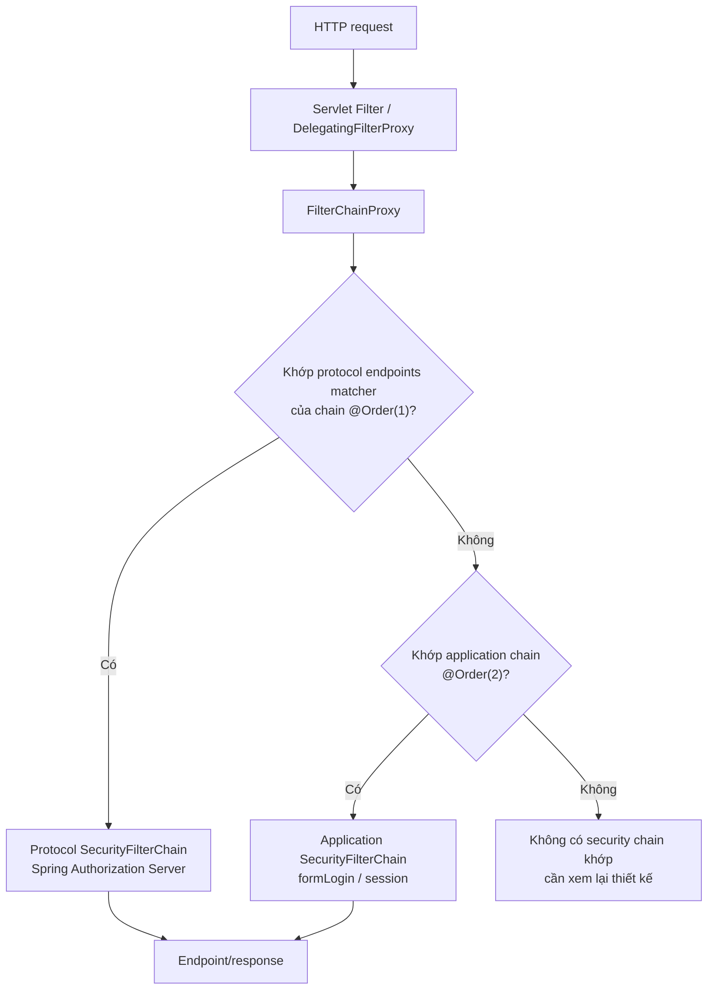
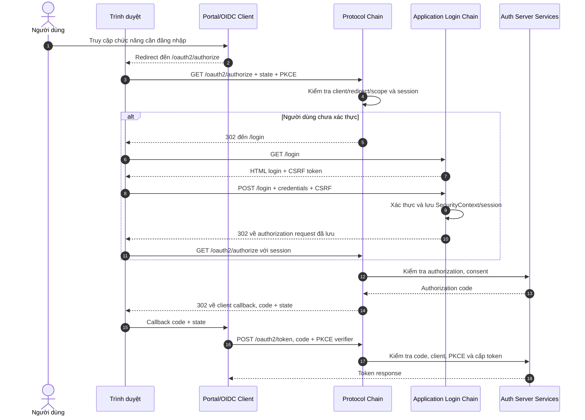

# SecurityFilterChain dành cho giao thức và dành cho đăng nhập ứng dụng

Một ứng dụng Spring Boot đóng vai trò **OAuth 2.0/OpenID Connect Authorization Server** thường phải xử lý hai nhóm HTTP request có tính chất rất khác nhau:

- **Request giao thức OAuth2/OIDC**: cấp authorization code, đổi code thành token, xác thực OAuth client, phân phối JWKS, công bố metadata, introspection, revocation và UserInfo.
- **Request đăng nhập ứng dụng**: hiển thị form đăng nhập, xác thực tài khoản, tạo phiên người dùng, phục vụ trang lỗi/tài nguyên tĩnh và xử lý logout local.

Để hai nhóm này tuân thủ các chính sách tương ứng, Spring Security cho phép cấu hình nhiều `SecurityFilterChain` với matcher và thứ tự rõ ràng. Mục tiêu của bài trong chương **Kiến trúc xử lý** là giải thích cách các chain được chọn, phối hợp và kiểm thử khi thiết kế **SPRING_SECURITY_OAUTH2_OIDC_AUTHORIZATION_SERVER** — hệ thống học cách cấu hình, bảo mật, kiểm thử và vận hành Authorization Server bằng Spring Security và Spring Authorization Server.

Ví dụ xuyên suốt: `login.example.com` chạy Spring Authorization Server; Portal là OIDC client; nhân viên đăng nhập ở trang `/login`, sau đó Portal gọi `/oauth2/token` để lấy token. Các địa chỉ ví dụ là placeholder, không phải endpoint có thể dùng ngay ngoài môi trường đã triển khai.

## 1. Một request đi qua các lớp nào?

Với ứng dụng Servlet, request đi qua filter của servlet container, trong đó `DelegatingFilterProxy` tên `springSecurityFilterChain` chuyển tiếp đến `FilterChainProxy` của Spring Security. `FilterChainProxy` lưu tập hợp các `SecurityFilterChain`. Mỗi chain có **RequestMatcher** quyết định phạm vi request và một tập security filter có thứ tự.



**Nguyên tắc quan trọng:** `FilterChainProxy` duyệt chain theo thứ tự và chạy **chain đầu tiên có matcher khớp**. Request không lần lượt chạy qua cả hai chain. Khi `/oauth2/authorize` chuyển hướng người dùng sang `/login`, trình duyệt phát sinh một HTTP request **mới**; request mới có thể được chain thứ hai xử lý.

### 1.1. Phân biệt hai kiểu request matcher

| Thành phần | Nó quyết định điều gì? | Ví dụ |
|---|---|---|
| `http.securityMatcher(...)` | Request có **đi vào chain** này không? | Chọn protocol chain theo các endpoint SAS |
| `http.authorizeHttpRequests(...requestMatchers(...))` | Request đã vào chain có **đủ quyền** không? | Cho phép `/assets/**` ở application chain |
| `@Order(1)`, `@Order(2)` | Chain nào được **xét trước**? | Protocol chain trước application chain |
| `anyRequest()` trong authorization | Quy tắc cho phần còn lại **trong chain hiện tại** | `anyRequest().authenticated()` |

Một lỗi phổ biến là chỉ khai báo `authorizeHttpRequests(a -> a.requestMatchers("/oauth2/**").authenticated())` rồi nghĩ đã tách chain. Cấu hình này là quy tắc authorization, **không giới hạn matcher của chain**. Nếu một chain ưu tiên cao nhất có matcher mặc định bao phủ mọi URL, nó có thể nuốt luôn `/login` và làm chain phía sau không bao giờ được dùng.

### 1.2. Vì sao không nên tự giới hạn giao thức bằng `"/oauth2/**"`?

Spring Authorization Server không chỉ có các đường dẫn `/oauth2/*`. Nó có thể cung cấp metadata tại `/.well-known/oauth-authorization-server`, OIDC Discovery tại `/.well-known/openid-configuration`, UserInfo tại `/userinfo`, OIDC logout tại `/connect/logout`, cùng các endpoint khác theo tính năng. Các đường dẫn cũng có thể được tùy chỉnh bằng `AuthorizationServerSettings`.

Do đó, cấu hình nên dùng **`OAuth2AuthorizationServerConfigurer.getEndpointsMatcher()`** để xác định các request thuộc giao thức, thay vì tự đoán bằng pattern đường dẫn.

## 2. Hai SecurityFilterChain có nhiệm vụ gì?

### 2.1. Chain dành cho giao thức OAuth2/OIDC

Spring Authorization Server cấu hình các filter và `AuthenticationProvider` chuyên biệt cho protocol: xử lý authorization request, client authentication, token request, grant type, revocation, introspection, authorization consent và các endpoint OpenID Connect đã được bật.

| Request ví dụ | Chức năng | Điều cần kiểm soát |
|---|---|---|
| `GET /oauth2/authorize` | Bắt đầu Authorization Code Flow | Client đăng ký, redirect URI, scope, phiên người dùng, PKCE |
| `POST /oauth2/token` | Đổi code/refresh token hoặc client credentials | Client authentication khi áp dụng, grant type và token policy |
| `GET /oauth2/jwks` | Công bố khóa công khai để xác minh token ký | Chỉ public key, phải có `JWKSource` |
| `GET /.well-known/oauth-authorization-server` | OAuth2 metadata | Issuer/endpoints đúng cấu hình |
| `GET /.well-known/openid-configuration` | OIDC Discovery | OIDC đã kích hoạt, issuer chính xác |
| `GET /userinfo` | OIDC UserInfo | Bearer access token và claims/scope phù hợp |
| `POST /oauth2/introspect` | Tra trạng thái token | OAuth client hợp lệ theo chính sách introspection |
| `POST /oauth2/revoke` | Thu hồi token | Client authentication và ràng buộc giao thức |
| `/connect/logout` | RP-Initiated Logout OIDC khi có hỗ trợ | Cấu hình và kiểm tra id token/redirect theo giao thức |

Không phải mọi endpoint đều sẵn có trong mọi phiên bản hoặc cấu hình. JWKS cần nguồn khóa phù hợp; các endpoint OIDC phải được bật và một số tính năng là tùy chọn. Các endpoint công khai được xử lý theo logic giao thức. Không nên làm `permitAll()` cho **toàn bộ protocol chain** để thử “sửa lỗi” endpoint discovery.

Protocol chain hỗ trợ cả request **front-channel** có browser (`/oauth2/authorize`) và request **back-channel** từ client (`/oauth2/token`). Hai loại yêu cầu này cần hành vi lỗi khác nhau; token endpoint không nên trả trang đăng nhập HTML.

### 2.2. Chain dành cho đăng nhập ứng dụng

Chain ứng dụng nhận các URL phục vụ xác thực người dùng và giao diện:

- `GET /login`: hiển thị trang đăng nhập mặc định hoặc custom.
- `POST /login`: xử lý mật khẩu/cơ chế xác thực do ứng dụng cấu hình.
- `POST /logout`: kết thúc phiên local nếu đăng ký logout kiểu form.
- `/assets/**`, `/error`: tài nguyên giao diện cần chính sách truy cập phù hợp.
- Các route custom cho MFA, xác thực liên kết, báo lỗi và quản lý phiên.

Hai chain có thể thuộc cùng một ứng dụng, **cùng HttpSession và cùng cơ chế lưu SecurityContext**. Application chain xác thực người dùng; khi trình duyệt tiếp tục authorization request, protocol chain có thể đọc danh tính đã được xác thực từ trạng thái phiên. Việc chia chain không có nghĩa bắt buộc phải có hai máy chủ hoặc hai kho tài khoản.

### 2.3. Bảng phân định request

| URL/method | Chain dự kiến | Kết quả thường gặp |
|---|---|---|
| `GET /oauth2/authorize` | Protocol `@Order(1)` | Xác minh request; có thể yêu cầu login |
| `GET /login` | Application `@Order(2)` | HTML login |
| `POST /login` | Application `@Order(2)` | Form authentication, CSRF, session |
| `POST /oauth2/token` | Protocol `@Order(1)` | Token JSON hoặc lỗi OAuth2 |
| `GET /.well-known/openid-configuration` | Protocol `@Order(1)` | Discovery JSON khi bật OIDC |
| `GET /oauth2/jwks` | Protocol `@Order(1)` | Public JWK set khi cấu hình |
| `GET /userinfo` | Protocol `@Order(1)` | OIDC UserInfo khi token hợp lệ |
| `POST /logout` | Application `@Order(2)` | Local logout |
| `GET /assets/login.css` | Application `@Order(2)` | CSS tĩnh được phép |
| `GET /api/orders` cùng process | Nên có chain API riêng | Trả response Bearer/API, tránh redirect HTML |

## 3. Cấu hình Java hai SecurityFilterChain

Ví dụ sử dụng API phổ biến của **Spring Boot 3.x, Spring Security 6.x và Spring Authorization Server 1.x**, đặc biệt `HttpSecurity.with(...)`. Dòng Spring/Authorization Server khác có thể thay đổi package hoặc API; luôn khóa phiên bản dependency khi áp dụng.

```java
package example.authserver.security;

import org.springframework.context.annotation.Bean;
import org.springframework.context.annotation.Configuration;
import org.springframework.core.annotation.Order;
import org.springframework.http.MediaType;
import org.springframework.security.config.Customizer;
import org.springframework.security.config.annotation.web.builders.HttpSecurity;
import org.springframework.security.oauth2.server.authorization.config.annotation.web.configurers.OAuth2AuthorizationServerConfigurer;
import org.springframework.security.web.SecurityFilterChain;
import org.springframework.security.web.authentication.LoginUrlAuthenticationEntryPoint;
import org.springframework.security.web.util.matcher.MediaTypeRequestMatcher;

@Configuration(proxyBeanMethods = false)
public class AuthorizationServerSecurityConfig {

    @Bean
    @Order(1)
    SecurityFilterChain authorizationServerSecurityFilterChain(
            HttpSecurity http) throws Exception {

        OAuth2AuthorizationServerConfigurer authorizationServerConfigurer =
                OAuth2AuthorizationServerConfigurer.authorizationServer();

        http
            .securityMatcher(
                authorizationServerConfigurer.getEndpointsMatcher())
            .with(authorizationServerConfigurer, authorizationServer ->
                authorizationServer.oidc(Customizer.withDefaults()))
            .authorizeHttpRequests(authorize -> authorize
                .anyRequest().authenticated())
            .exceptionHandling(exceptions -> exceptions
                .defaultAuthenticationEntryPointFor(
                    new LoginUrlAuthenticationEntryPoint("/login"),
                    new MediaTypeRequestMatcher(MediaType.TEXT_HTML)))
            .oauth2ResourceServer(oauth2 -> oauth2
                .jwt(Customizer.withDefaults()));

        return http.build();
    }

    @Bean
    @Order(2)
    SecurityFilterChain applicationSecurityFilterChain(
            HttpSecurity http) throws Exception {

        http
            .authorizeHttpRequests(authorize -> authorize
                .requestMatchers("/assets/**", "/error").permitAll()
                .anyRequest().authenticated())
            .formLogin(Customizer.withDefaults());

        return http.build();
    }
}
```

### 3.1. Giải thích các dòng quyết định kiến trúc

1. **`@Order(1)`** bảo đảm protocol chain được xét trước fallback chain. Thứ tự cần đồng bộ với các chain khác nếu ứng dụng có thêm API hoặc actuator.
2. **`getEndpointsMatcher()`** giới hạn chain số 1 ở đúng những endpoint do Authorization Server quản lý. Đây là cách tránh bỏ sót OIDC discovery, UserInfo hoặc endpoint cấu hình đặc biệt.
3. **`with(authorizationServerConfigurer, ...)`** cài bộ filter/handler của Spring Authorization Server và bật chức năng OIDC theo API mẫu.
4. **`anyRequest().authenticated()`** đặt quy tắc tổng quát trong protocol chain. Các endpoint giao thức công khai có cơ chế xử lý thích hợp do Authorization Server cấu hình; quy tắc này **không đồng nghĩa** JWKS/discovery bắt buộc đăng nhập.
5. **`LoginUrlAuthenticationEntryPoint("/login")`** chỉ được áp dụng như entry point cho yêu cầu HTML trong ví dụ, thường là browser đang đi qua Authorization Code Flow. Request token có thể cần OAuth error khác, không được ép mọi request chuyển sang form login.
6. **`oauth2ResourceServer(...jwt(...))`** hỗ trợ xác thực Bearer token cho endpoint như OIDC UserInfo; việc này không biến protocol chain thành Resource Server nghiệp vụ tổng quát.
7. Chain ứng dụng không gọi `securityMatcher(...)` nên làm matcher fallback, chạy form login mặc định. Nếu muốn tùy chỉnh GET `/login`, phải có trang tương ứng.

### 3.2. Những bean vẫn cần ngoài hai chain

Hai bean `SecurityFilterChain` chưa đủ tạo một Authorization Server hoàn chỉnh. Ứng dụng còn cần:

- **`RegisteredClientRepository`** để đăng ký client, redirect URI, grant, authentication method và scope.
- **`OAuth2AuthorizationService`** và **`OAuth2AuthorizationConsentService`** để lưu authorization/code/token và consent theo vòng đời.
- **`AuthorizationServerSettings`** để định nghĩa issuer và endpoint settings.
- **`JWKSource<SecurityContext>`** cung cấp khóa ký; private key cần kho an toàn và kế hoạch rotation.
- **`JwtDecoder`** theo nhu cầu của tính năng OIDC/JWT endpoint.
- **`UserDetailsService`, `AuthenticationProvider`** hoặc tích hợp IdP để xác thực tài khoản người dùng tại application chain.

Mẫu bean decoder thường gặp:

```java
@Bean
JwtDecoder jwtDecoder(JWKSource<SecurityContext> jwkSource) {
    return OAuth2AuthorizationServerConfiguration.jwtDecoder(jwkSource);
}
```

Cần import `JwtDecoder`, `JWKSource`, `SecurityContext` và `OAuth2AuthorizationServerConfiguration` từ đúng thư viện tương ứng. Bean này chỉ hỗ trợ giải mã/xác minh JWT; nó **không thay thế việc tạo và lưu nguồn khóa ký JWK**.

Ví dụ cấu hình issuer:

```java
@Bean
AuthorizationServerSettings authorizationServerSettings() {
    return AuthorizationServerSettings.builder()
            .issuer("https://login.example.com")
            .build();
}
```

`issuer` phải thống nhất với metadata, `iss` trên token và địa chỉ công khai thực tế. Khi ứng dụng đứng sau reverse proxy/load balancer, cần cấu hình forwarded headers theo danh sách proxy tin cậy và giữ redirect URI chính xác.

## 4. Luồng đăng nhập Authorization Code đi qua hai chain như thế nào?

Giả sử Portal đã đăng ký `client_id`, `redirect_uri` và `authorization_code`; người dùng chưa có session tại Authorization Server.



Những chi tiết cần hiểu đúng:

- `GET /oauth2/authorize` chạy ở protocol chain; `GET /login` và `POST /login` là hai request mới chạy ở application chain.
- Sau khi đăng nhập, `SecurityContext` được khôi phục ở protocol chain theo cấu hình lưu trạng thái. Không nên vô tình thiết lập chế độ stateless chung khiến browser mất phiên.
- Cơ chế `RequestCache`/`SavedRequest` giúp quay lại authorization request ban đầu. Một custom login success handler luôn chuyển đến `/home` có thể phá luồng OAuth nếu không giữ thông tin request đã lưu.
- Nếu client phải xin consent, browser có thể còn đi qua trang consent; đây là bước chấp thuận quyền, khác với nhập mật khẩu.
- `state` và PKCE chống các lớp tấn công ở **giao thức OAuth**; CSRF token bảo vệ **form web dựa trên cookie**. Chúng không thay thế nhau.
- Client phải xác minh `state`, ID token (trong OIDC) và điều kiện redirect đúng giao thức; việc người dùng đã đăng nhập tại AS không loại bỏ trách nhiệm phía client.

### 4.1. Ai nhận mật khẩu và ai nhận client secret?

`POST /login` do `UsernamePasswordAuthenticationFilter` (khi sử dụng `formLogin`) xử lý thông tin đăng nhập **của người dùng cuối** qua các `AuthenticationProvider`, chẳng hạn `DaoAuthenticationProvider`. `POST /oauth2/token` do thành phần giao thức xử lý, và có thể yêu cầu **client authentication**.

Ví dụ request token cho dịch vụ nền:

```http
POST /oauth2/token HTTP/1.1
Host: login.example.com
Authorization: Basic <base64(client_id:client_secret)>
Content-Type: application/x-www-form-urlencoded

grant_type=client_credentials&scope=orders.read
```

Giá trị Basic là credential của **OAuth client**, không phải username/password của người dùng cuối. Trong flow `client_credentials` không có request đăng nhập form, bởi tác nhân đang xác thực là dịch vụ. Với public client không có client secret, phương thức xác thực và PKCE phải tuân theo loại client/grant đã đăng ký.

## 5. Vì sao protocol endpoint không được tự chuyển sang trang login?

Một phản hồi “chưa được xác thực” có thể được xử lý bởi `AuthenticationEntryPoint`. Với browser ở `/oauth2/authorize`, việc redirect `302 /login` thường phù hợp. Với `/oauth2/token` hoặc `/userinfo`, OAuth client cần HTTP response/body đúng giao thức, như `invalid_client`, `invalid_grant` hoặc Bearer error. Nếu nhận HTML thay vì JSON/HTTP error mong đợi, client có thể hiểu sai, retry vô hạn hoặc làm rò rỉ thông tin qua redirect không dự kiến.

| Tình huống | Hành vi đúng cần hướng tới |
|---|---|
| Browser chưa đăng nhập vào authorization request hợp lệ | Có thể `302` đến `/login` |
| `GET /login` | Trả form HTML hợp lệ |
| Client secret không đúng tại `/oauth2/token` | Lỗi OAuth2 client authentication, không HTML login |
| Authorization code hết hạn, bị dùng lại hoặc PKCE sai | `invalid_grant`, thường HTTP `400` |
| `GET /userinfo` thiếu token | Phản hồi Bearer/OIDC phù hợp, không render form login |
| Metadata/JWKS | Dữ liệu JSON public theo cấu hình |
| Người dùng đã xác thực nhưng thiếu quyền nghiệp vụ của API | Resource Server tự từ chối, thường `403` |

Không đồng nhất tất cả lỗi thành `401` hoặc `403`: Spring Authorization Server và đặc tả OAuth2 phân biệt lỗi client authentication, authorization request, grant và token validation. `AccessDeniedHandler` xử lý thiếu quyền, còn `AuthenticationEntryPoint` thường xử lý yêu cầu xác thực; từng endpoint giao thức cũng có error handler riêng.

Hai “cách sửa nhanh” dưới đây dễ gây tác dụng phụ:

```java
// Cẩn thận: ép mọi request chuyển về HTML login khiến machine client lỗi.
http.exceptionHandling(e -> e.authenticationEntryPoint(
        new LoginUrlAuthenticationEntryPoint("/login")));

// Cẩn thận: vô hiệu CSRF toàn bộ ứng dụng vì token endpoint gặp lỗi.
http.csrf(csrf -> csrf.disable());
```

Thay vào đó, xác định **request đi vào chain nào**, loại client, method, content type và entry point thực tế. Giữ cấu hình mặc định của Spring Authorization Server cho endpoint giao thức trước khi thêm tùy biến, và xử lý CSRF trên trang đăng nhập theo quy tắc riêng.

## 6. Session, SecurityContext, CSRF và logout

### 6.1. Session dùng để duy trì người dùng qua các request

Một Authorization Server dùng form login thường cần phiên HTTP cho trình duyệt. Sau khi xác thực, Spring Security lưu trạng thái `Authentication` trong `SecurityContext` qua cơ chế lưu/khôi phục phù hợp; khi quay lại `/oauth2/authorize`, protocol chain có thể biết người dùng đã đăng nhập.

Không áp đặt `SessionCreationPolicy.STATELESS` lên cả hai chain chỉ vì `/oauth2/token` trông giống REST API. Stateless phù hợp với **Resource Server chỉ dùng Bearer token** trong nhiều kiến trúc, nhưng form login/SSO theo phiên cần trạng thái.

| Loại trạng thái | Vị trí và ý nghĩa |
|---|---|
| `HttpSession` tại AS | Phiên đăng nhập, CSRF/request cache tùy cấu hình |
| `SecurityContext` | Danh tính người dùng đã xác thực trong request |
| Authorization code và consent | Lưu trong `OAuth2AuthorizationService` và consent service |
| Access/refresh token | Có vòng đời độc lập với phiên local; xác minh hoặc introspection tại Resource Server |
| Phiên Portal/OIDC client | Phiên của ứng dụng client, khác phiên tại AS |

### 6.2. CSRF có phạm vi riêng

`POST /login` và `POST /logout` trong ứng dụng web dựa trên cookie cần bảo vệ CSRF phù hợp. Các endpoint giao thức như `POST /oauth2/token` có xử lý xác thực và yêu cầu riêng mà Spring Authorization Server đã cấu hình. Không nên vô hiệu hóa CSRF toàn bộ hệ thống để làm token endpoint hoạt động; như vậy có thể mở rủi ro cho form hoặc endpoint web khác.

Nếu thêm custom login/consent page, phải kiểm tra chính xác route đó nằm ở chain nào và có gửi CSRF token/phiên hợp lệ hay không. OAuth `state`, OIDC `nonce` và PKCE phục vụ lớp bảo vệ giao thức khác nhau, không phải token CSRF có thể dùng thay cho form.

### 6.3. Logout local và OIDC logout khác nhau

`POST /logout` thường thuộc application chain, xóa phiên AS theo logout handler cấu hình. `/connect/logout` là endpoint logout OIDC khi được hỗ trợ/bật và có thể xử lý `id_token_hint`, redirect sau logout và các điều kiện giao thức. Việc kết thúc phiên tại Authorization Server **không mặc nhiên thu hồi mọi access token còn hạn** hay xóa toàn bộ cookie tại các client.

Ứng dụng phải nêu rõ chính sách logout local, logout phiên SSO, thu hồi token và cách phối hợp giữa các OIDC client. Khi yêu cầu logout gần như tức thì, phải xét TTL access token, khả năng introspection/revocation và giới hạn tích hợp.

## 7. Khi muốn dùng trang login tự thiết kế

Nếu dùng Thymeleaf hoặc MVC, có thể thay bean chain ứng dụng ở mục 3 bằng cấu hình:

```java
@Bean
@Order(2)
SecurityFilterChain applicationSecurityFilterChain(HttpSecurity http)
        throws Exception {
    http
        .authorizeHttpRequests(authorize -> authorize
            .requestMatchers("/login", "/assets/**", "/error").permitAll()
            .anyRequest().authenticated())
        .formLogin(form -> form
            .loginPage("/login")
            .permitAll());

    return http.build();
}
```

Đây là **phương án thay thế**, không khai báo đồng thời thêm một bean cùng nhiệm vụ. Sau đó phải cung cấp `GET /login` trả trang form, có input `username` và `password`, action `POST /login`, kèm CSRF token theo `CsrfTokenRepository`. Với template engine như Thymeleaf, có thể sử dụng binding CSRF do Spring Security cung cấp.

Cần kiểm thử thực sự khả năng quay lại authorization request sau login. Những lỗi thường gặp khi custom:

- Trang `/login` không được `permitAll()` hoặc không có handler GET → redirect loop/404.
- Form không có CSRF token hoặc cookie session không được gửi → `403`.
- Custom success handler luôn redirect về dashboard → mất `SavedRequest` của OAuth.
- Custom MFA hay social login callback bị đặt sai matcher/chain.
- Tài nguyên `/assets/**` bị chặn → CSS/JS không tải được, có thể gây trải nghiệm lỗi.

### 7.1. Consent page tùy biến

Authorization endpoint thuộc protocol chain. Nếu chỉ định consent page riêng, ứng dụng phải thực sự triển khai route giao diện đó và biểu mẫu gửi lựa chọn quyền theo hợp đồng do Spring Authorization Server yêu cầu. Trang consent custom có thể **không nằm trong protocol endpoints matcher** nếu định nghĩa route tùy chọn ngoài endpoint SAS; khi đó request render trang được xử lý bởi chain ứng dụng. Đừng tự cho rằng mọi đường dẫn bắt đầu bằng `/oauth2/` luôn thuộc protocol chain.

## 8. Nếu cùng ứng dụng còn có Resource Server/API

Tách Authorization Server khỏi Orders API thường giúp ranh giới bảo mật dễ hiểu. Nếu cùng Spring Boot process còn có `/api/**` chỉ nhận access token, nên khai báo chain API riêng đứng **sau protocol chain và trước web login chain**:

```java
@Bean
@Order(2)
SecurityFilterChain apiSecurityFilterChain(HttpSecurity http)
        throws Exception {
    http
        .securityMatcher("/api/**")
        .authorizeHttpRequests(authorize -> authorize
            .anyRequest().authenticated())
        .oauth2ResourceServer(oauth2 -> oauth2
            .jwt(Customizer.withDefaults()))
        .sessionManagement(session -> session
            .sessionCreationPolicy(SessionCreationPolicy.STATELESS))
        .csrf(csrf -> csrf.disable()); // Chỉ với API thuần Bearer, không dùng cookie.

    return http.build();
}

// Khi thêm chain API @Order(2), đổi application login chain thành @Order(3).
```

Ví dụ này chỉ minh họa **phạm vi chain**. Resource Server vẫn phải cấu hình `JwtDecoder`/validators đúng issuer, audience, thời hạn và scope, đồng thời kiểm tra quyền nghiệp vụ tại API. Chỉ tắt CSRF như trên nếu endpoint API thật sự không dùng cookie/session và không phục vụ browser request dựa trên cookie. Nếu hỗ trợ cookie, yêu cầu an toàn phải được thiết kế riêng.

Không dùng một chain login form với `anyRequest().authenticated()` làm biện pháp bảo vệ API Bearer: client API thiếu token có thể nhận `302 /login` thay vì `401` theo Bearer protocol.

## 9. Chẩn đoán lỗi và vận hành

| Triệu chứng | Nguyên nhân có thể | Bước kiểm tra |
|---|---|---|
| `POST /oauth2/token` trả `302 /login` | Matcher/order sai; entry point HTML áp quá rộng | Kiểm tra protocol matcher, @Order, proxy path, Accept |
| `GET /login` 404 | Custom loginPage nhưng thiếu controller/template | Kiểm tra handler GET hoặc bật formLogin mặc định |
| `GET /login` redirect loop | Login route bị chặn hoặc forwarded headers sai | Kiểm tra permitAll, matcher và proxy |
| `POST /login` 403 | CSRF token/cookie không đúng | Xem form, session, CSRF repository |
| Login xong không trở lại `/oauth2/authorize` | Success handler bỏ `SavedRequest` | Kiểm tra RequestCache và redirect logic |
| OIDC metadata 404 | Chưa bật OIDC/endpoint path không khớp | Xem oidc configurer, settings, version |
| JWKS không tồn tại hoặc sai giữa các node | Thiếu JWKSource; tạo key ngẫu nhiên lúc restart | Kiểm tra ký khóa, persistent store, rotation |
| `/userinfo` không nhận Bearer token | Thiếu JWT decoder/resource-server filter hoặc token sai | Kiểm tra OIDC/UserInfo chain và token |
| API trả HTML thay vì JSON/401 | API vào form login chain | Thêm API matcher/chain riêng |
| Issuer/callback sai qua proxy | Public URL/forwarded headers/cookie policy | Kiểm tra deployment URL và trust proxy |

### 9.1. Dùng log có chủ đích

Trong môi trường phát triển, có thể bật:

```yaml
logging:
  level:
    org.springframework.security.web.FilterChainProxy: TRACE
    org.springframework.security: DEBUG
```

Quan sát chain/filter thực thi cho `/oauth2/authorize`, `/login`, `/oauth2/token` và metadata. TRACE có thể ghi rất nhiều chi tiết, nên giới hạn ở dev/test; không bật thường trực trên production và không log nguyên secret, authorization code, ID/access token, password hoặc session cookie.

**Lựa chọn vận hành production:** quản lý issuer public nhất quán, khóa ký bằng secret manager/KMS hoặc kho bảo mật phù hợp, lưu authorization/consent bền vững, phân quyền client theo mức tối thiểu, triển khai TLS, chống brute-force, giám sát tỉ lệ lỗi OAuth và latency từng endpoint. Với nhiều node, cần chia sẻ session/authorization state đúng cách hoặc có kiến trúc xử lý phù hợp; các node phải công bố và sử dụng bộ khóa ký nhất quán trong giai đoạn rotation.

## 10. Kiểm thử đường đi giữa hai chain

Một bài test có ích phải chứng minh **routing đúng** và **kết quả bảo mật đúng**, không chỉ kiểm tra HTTP 200 chung chung.

| Kịch bản | Điều kiện/HTTP request | Kết quả kỳ vọng |
|---|---|---|
| Mở trang login | `GET /login` chưa đăng nhập | HTML login hợp lệ, không loop |
| Authorization request | Client và redirect hợp lệ; user chưa đăng nhập | Browser được chuyển đến login |
| Duy trì phiên | Login thành công, giữ cookie, quay lại authorize | Tiếp tục flow, không yêu cầu mật khẩu lại vô cớ |
| CSRF form | `POST /login` không có CSRF token hợp lệ | Từ chối, không cấp phiên đăng nhập |
| Client credentials hợp lệ | Client đã đăng ký grant/scope, secret hợp lệ | Token response theo giao thức |
| Client secret sai | `POST /oauth2/token` với credential sai | Lỗi OAuth2, không HTML login |
| Authorization code bị replay | Đổi code đã dùng hoặc `code_verifier` sai | `invalid_grant`, không cấp token |
| OIDC discovery | `GET /.well-known/openid-configuration` | JSON với issuer/endpoints đúng nếu OIDC bật |
| JWKS | `GET /oauth2/jwks` | Chỉ public JWK, không chứa private material |
| UserInfo | Không có/không hợp lệ Bearer token | Lỗi OIDC/Bearer phù hợp |
| API riêng | `GET /api/orders` không Bearer token | API response phù hợp, không HTML redirect |
| Logout local | `POST /logout` kèm/thiếu CSRF | Kết quả đúng chính sách và CSRF |
| Nhiều node | Authorization request, login, callback qua load balancer | Session, issuer, JWKS hoạt động nhất quán |

Ví dụ lệnh kiểm tra ngoài cùng:

```bash
# Discovery OIDC (nếu đã bật).
curl -i https://login.example.com/.well-known/openid-configuration

# JWKS (nếu cấu hình nguồn khóa ký).
curl -i https://login.example.com/oauth2/jwks

# Trang login theo application chain.
curl -i https://login.example.com/login

# Token endpoint: cần client đăng ký và quyền scope tương ứng.
curl -i -X POST https://login.example.com/oauth2/token \
  -u "$CLIENT_ID:$CLIENT_SECRET" \
  -d "grant_type=client_credentials" \
  -d "scope=orders.read"
```

Biến môi trường trong ví dụ đại diện cho credential cần lấy từ nơi quản lý secret; đừng đưa secret vào code hoặc lịch sử terminal công khai. Khi kiểm thử tương tác, dùng `MockMvc`/`spring-security-test` cho chính sách ở mức filter, đồng thời cần ít nhất một bài integration test với **AS thật**, client thật, PKCE, login form, session cookie, token endpoint và OIDC discovery. Mock sẵn `Authentication` chỉ chứng minh một phần authorization, **không** chứng minh toàn bộ chuyển tiếp từ login chain sang protocol chain.

## 11. Checklist thiết kế trước khi triển khai

1. Protocol chain có `@Order` cao hơn, sử dụng `getEndpointsMatcher()`; application chain làm fallback có chủ đích.
2. `/login` và tài nguyên giao diện được phục vụ đúng chain; login form có CSRF và phiên được bảo vệ.
3. Token endpoint nhận client authentication/response đúng OAuth2; không redirect machine client sang HTML.
4. Discovery và JWKS công bố issuer/public keys nhất quán; khóa riêng được bảo vệ và xoay vòng có kế hoạch.
5. Luồng Authorization Code bảo toàn `SavedRequest`, `state`, PKCE và consent khi cần; callback URI khớp đăng ký.
6. OIDC UserInfo, logout và các endpoint tùy chọn chỉ được dùng sau khi cấu hình tính năng/bean cần thiết.
7. API Bearer nếu cùng ứng dụng có chain riêng với audience/scope checks; không sử dụng login form để giả lập bảo mật API.
8. Log/test phân biệt chain routing, authentication, authorization và giao thức; không ghi token/credential nhạy cảm.

### Câu hỏi tự kiểm tra

1. Vì sao `GET /oauth2/authorize` có thể dẫn người dùng đến `/login` dù hai URL thuộc hai chain khác nhau?
2. `securityMatcher(...)` khác `authorizeHttpRequests(...requestMatchers(...))` như thế nào?
3. Vì sao `getEndpointsMatcher()` đáng tin cậy hơn pattern `/oauth2/**`?
4. Nếu `POST /oauth2/token` trả `302` thay vì JSON OAuth error, cần chẩn đoán ở những lớp nào?
5. Vì sao `SessionCreationPolicy.STATELESS` có thể phù hợp cho API Bearer nhưng phá luồng form login/SSO?
6. Khi triển khai custom consent/login, yếu tố nào quyết định request UI đi vào chain nào?
7. Vì sao logout local không có nghĩa mọi access token lập tức mất hiệu lực?

**Điểm cốt lõi:** Spring Security chọn `SecurityFilterChain` theo **RequestMatcher và thứ tự**, không theo ý định chủ quan rằng một request “thuộc về đăng nhập” hay “thuộc về OAuth”. Protocol chain xử lý OAuth2/OIDC endpoint; application chain xử lý form login, phiên và giao diện. Chúng phối hợp qua các HTTP request kế tiếp và trạng thái người dùng được lưu an toàn. Tách đúng hai chain là nền tảng để Authorization Server Spring Boot vận hành đúng giao thức, có thể kiểm thử và giảm rủi ro bảo mật.
