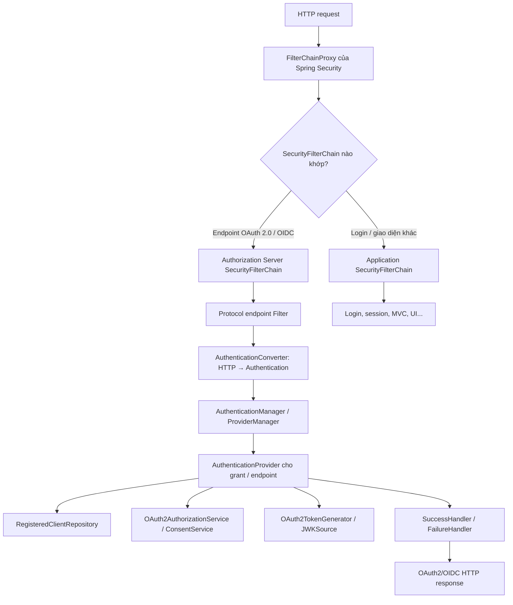
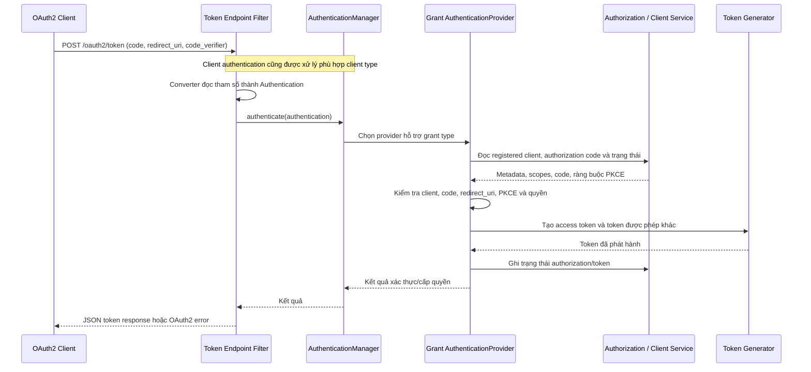

# OAuth2AuthorizationServerConfigurer và các điểm cấu hình giao thức

## 1. Bối cảnh: cấu hình Authorization Server là cấu hình một chuỗi xử lý HTTP

Một **OAuth 2.0/OpenID Connect (OIDC) Authorization Server** tiếp nhận những loại yêu cầu có ngữ nghĩa rất khác nhau: người dùng xác nhận quyền tại `/oauth2/authorize`, ứng dụng trao đổi authorization code tại `/oauth2/token`, API hỏi trạng thái token tại `/oauth2/introspect` hoặc ứng dụng khám phá metadata qua các endpoint `/.well-known/...`.

Trong Spring Boot, **Spring Security** quản lý các bộ lọc HTTP, đối tượng xác thực và quy tắc truy cập. **Spring Authorization Server** (hoặc hỗ trợ Authorization Server tích hợp trong các dòng Spring Security mới hơn) bổ sung bộ lọc và thành phần xử lý giao thức OAuth 2.0/OIDC. **`OAuth2AuthorizationServerConfigurer`** là điểm cấu hình tập trung, gắn những thành phần đó vào `HttpSecurity` và cho phép thay đổi hành vi của từng protocol endpoint.

Bài thuộc chương **Kiến trúc xử lý** của module `SPRING_SECURITY_OAUTH2_OIDC_AUTHORIZATION_SERVER`, phục vụ mục tiêu thiết kế, cấu hình, bảo mật, kiểm thử và vận hành máy chủ ủy quyền với Spring Security/Spring Authorization Server. Trọng tâm là **luồng request đi qua thành phần nào**, **các điểm mở rộng gắn ở đâu**, **điều gì cần cấu hình cùng nhau**, và **cách kiểm chứng chúng hoạt động đúng**.

### Kết quả cần đạt

Sau bài này, bạn có thể:

1. Phác họa đường đi từ `SecurityFilterChain` tới các filter, converter, provider, service, token generator và response handler.
2. Cấu hình `OAuth2AuthorizationServerConfigurer` đúng vị trí và phân biệt với `oauth2Login()` hay `oauth2ResourceServer()`.
3. Nhận diện các phương thức tùy biến endpoint, bean lõi và cấu hình issuer/đường dẫn.
4. Thiết kế các ca kiểm thử cho đăng nhập, cấp token, introspection, revocation, OIDC, lỗi cấu hình và lỗi tích hợp.

> **Phạm vi phiên bản:** Ví dụ chính dùng API của **Spring Authorization Server 1.x với Spring Security 6.x**, trong đó có `OAuth2AuthorizationServerConfigurer.authorizationServer()` và `HttpSecurity.with(...)`. **Spring Security 7.x** cung cấp cách gọi `HttpSecurity.oauth2AuthorizationServer(...)` và có khác biệt về một số endpoint được bật mặc định. Khi dùng code thực tế, kiểm tra đúng bộ phiên bản dependency và reference guide tương ứng; không sao chép import giữa hai dòng mà không đối chiếu.

## 2. Vị trí của Configurer trong kiến trúc xử lý

Sơ đồ sau tóm tắt đường đi của một yêu cầu OAuth 2.0. Mỗi endpoint dùng những filter/provider phù hợp, nên sơ đồ thể hiện **mẫu kiến trúc chung**, không khẳng định mọi request đều chạy qua tất cả bước.



Có ba lớp trách nhiệm cần phân biệt:

- **`SecurityFilterChain`** chọn nhóm filter cho request, kiểm soát xác thực và các quy tắc bảo mật HTTP. `@Order` và `RequestMatcher` quyết định chain nào nhận request trước.
- **`OAuth2AuthorizationServerConfigurer`** đăng ký cấu hình endpoint giao thức vào chain, bao gồm bộ lọc, bộ chuyển đổi request, cơ chế xác thực client/grant, handler thành công/thất bại và các điểm tùy chỉnh.
- **Repository, service, token generator, settings** cấp dữ liệu và chính sách để những provider xử lý chính xác: client đã đăng ký hay chưa, code còn hiệu lực không, scope nào được cấp, token được ký thế nào, issuer là gì.

**Configurer không tự quản lý người dùng, cơ sở dữ liệu hay bí mật dài hạn**. Nó kết nối những thành phần này với luồng giao thức. Việc xác thực người dùng có thể dùng `formLogin()`, cơ chế đăng nhập khác hoặc tích hợp IdP, còn quyền truy cập API tiếp tục thuộc **Resource Server**.

## 3. Cấu hình hai SecurityFilterChain trong Spring Authorization Server 1.x

Một cấu trúc dễ kiểm soát là chain ưu tiên cao dành cho endpoint OAuth 2.0/OIDC, và chain thứ hai phục vụ màn hình đăng nhập cùng các trang trong ứng dụng.

```java
@Configuration
@EnableWebSecurity
public class SecurityConfig {

    @Bean
    @Order(1)
    SecurityFilterChain authorizationServerSecurityFilterChain(HttpSecurity http)
            throws Exception {

        OAuth2AuthorizationServerConfigurer authorizationServerConfigurer =
                OAuth2AuthorizationServerConfigurer.authorizationServer();

        http
            // Chỉ chọn những endpoint thuộc Authorization Server.
            .securityMatcher(authorizationServerConfigurer.getEndpointsMatcher())
            .with(authorizationServerConfigurer, authorizationServer ->
                authorizationServer
                    .oidc(Customizer.withDefaults()) // Bật OpenID Connect.
            )
            .authorizeHttpRequests(authorize ->
                authorize.anyRequest().authenticated()
            )
            .exceptionHandling(exceptions -> exceptions
                .defaultAuthenticationEntryPointFor(
                    new LoginUrlAuthenticationEntryPoint("/login"),
                    new MediaTypeRequestMatcher(MediaType.TEXT_HTML)
                )
            );

        return http.build();
    }

    @Bean
    @Order(2)
    SecurityFilterChain applicationSecurityFilterChain(HttpSecurity http)
            throws Exception {

        http
            .authorizeHttpRequests(authorize ->
                authorize.anyRequest().authenticated()
            )
            .formLogin(Customizer.withDefaults());

        return http.build();
    }
}
```

Ví dụ minh họa **cấu hình các filter chain**, chưa phải ứng dụng chạy độc lập: cần thêm dependency, client đã đăng ký, cơ chế người dùng, khóa ký/JWK và các bean phù hợp. Các import của `HttpSecurity`, `SecurityFilterChain`, `Customizer`, `LoginUrlAuthenticationEntryPoint`, `MediaTypeRequestMatcher`, `Order` và configurer phải tương thích với phiên bản đang sử dụng.

Phân tích những dòng quan trọng:

1. **`@Order(1)`** đặt chain của Authorization Server trước chain ứng dụng. Spring Security chọn **chain khớp đầu tiên**; các chain không cộng dồn với nhau cho cùng request.
2. **`securityMatcher(authorizationServerConfigurer.getEndpointsMatcher())`** giới hạn chain này ở các protocol endpoint do configurer quản lý. Đây là phạm vi **của chain**, khác với `requestMatchers(...)` bên trong `authorizeHttpRequests` vốn dùng để quyết định quyền **sau khi đã chọn chain**.
3. **`with(authorizationServerConfigurer, ...)`** lắp cấu hình giao thức vào `HttpSecurity`. `oidc(Customizer.withDefaults())` bật hỗ trợ OIDC; cấu hình OAuth 2.0 cơ bản không mặc nhiên bật toàn bộ tính năng OIDC.
4. **`anyRequest().authenticated()`** xác định chính sách chung cho các request đi vào chain; một số protocol endpoint được các filter xử lý theo quy tắc giao thức riêng, ví dụ client authentication và grant validation.
5. **`defaultAuthenticationEntryPointFor(..., text/html)`** điều hướng người dùng chưa đăng nhập tới `/login` khi tương tác qua trình duyệt. Yêu cầu máy với máy như `POST /oauth2/token` phải tiếp tục nhận lỗi OAuth 2.0 đúng giao thức khi chứng thực sai; không biến mọi lỗi thành HTML redirect.
6. **Chain thứ hai** phục vụ `/login` vì endpoint trang đăng nhập **không thuộc** tập endpoint giao thức. Không có chain đăng nhập phù hợp, Authorization Code Flow có người dùng sẽ không thể hoàn thành đúng.

### 3.1. Vì sao không đặt mọi thứ vào một chain?

Tách chain giúp chỉ định đúng **đường dẫn, loại xác thực và xử lý lỗi**. Ví dụ, yêu cầu trình duyệt chưa có session tới `/oauth2/authorize` cần tương tác đăng nhập; yêu cầu `client_credentials` tới `/oauth2/token` phải được xác thực với quyền của client theo giao thức; còn trang `/login` cần form và CSRF protection.

Tách chain **không tự động** bảo đảm an toàn. Nếu matcher rộng quá mức, endpoint khác có thể bị áp sai quy tắc. Nếu matcher quá hẹp hoặc chain bị sai `@Order`, request giao thức có thể rơi vào chain ứng dụng và trả về 302/HTML hoặc 404 không mong đợi.

### 3.2. Cú pháp trong Spring Security 7.x

Khi dùng hỗ trợ Authorization Server tích hợp với Spring Security 7.x, tài liệu tham khảo có cú pháp DSL:

```java
@Bean
SecurityFilterChain authorizationServerSecurityFilterChain(HttpSecurity http)
        throws Exception {

    http.oauth2AuthorizationServer(authorizationServer ->
            authorizationServer.oidc(Customizer.withDefaults()));

    return http.build();
}
```

Đoạn này chỉ minh họa **khác biệt cách gọi DSL**. Khi tạo ứng dụng thực tế, vẫn phải cấu hình các quy tắc xác thực, xử lý đăng nhập, repository, issuer và khóa tương ứng. Không dùng đồng thời ví dụ DSL của Spring Security 7.x và các import/configurer không tương thích từ dòng 1.x.

## 4. Đi sâu vào pipeline: request được biến thành quyết định như thế nào?

Xét yêu cầu `POST /oauth2/token` với `grant_type=authorization_code`:



Những bước điển hình:

1. **Endpoint filter** nhận request và gọi **`AuthenticationConverter`** để phân tích dữ liệu HTTP thành `Authentication` phù hợp.
2. **`AuthenticationManager`** điều phối tới **`AuthenticationProvider`** hỗ trợ loại yêu cầu, ví dụ provider xử lý authorization code, client credentials hoặc refresh token.
3. Provider tra cứu **`RegisteredClientRepository`** và **`OAuth2AuthorizationService`** để xác minh cấu hình client, grant type, scope, code, thời hạn và các ràng buộc liên quan.
4. Provider yêu cầu **`OAuth2TokenGenerator`** tạo token hợp lệ, lưu trạng thái qua service và trả kết quả.
5. **Success handler** tạo phản hồi giao thức (thường JSON); **failure handler** biến lỗi thành phản hồi OAuth 2.0 thích hợp, chẳng hạn `invalid_request`, `invalid_client` hoặc `invalid_grant` tùy nguyên nhân.

**Client authentication** thường có cơ chế xử lý riêng trong chain trước/đồng thời với kiểm tra grant. Không phải mọi yêu cầu đều cần client secret: public client đăng ký với `ClientAuthenticationMethod.NONE` được quản lý theo chính sách của nó, và cần PKCE cho Authorization Code Flow. Không được mặc nhiên áp dụng `client_secret_basic` cho ứng dụng browser/mobile không giữ được bí mật.

### 4.1. Điểm nào nên mở rộng?

Nếu cần một grant type mới, thường phải thêm **converter** để đọc tham số và **provider** để kiểm tra grant cùng chính sách. Nếu chỉ muốn đưa thêm claim nghiệp vụ đã kiểm soát vào JWT, nên ưu tiên **token customizer** thay vì thay thế toàn bộ token endpoint. Nếu chỉ muốn giao diện consent riêng, hãy cấu hình **authorization endpoint consent page** và xây view phù hợp.

Nắm rõ điều này giúp tránh sửa trực tiếp filter hoặc viết controller `/oauth2/token` riêng rồi bỏ qua kiểm tra giao thức vốn đã được framework cung cấp.

## 5. Các nhóm điểm cấu hình của OAuth2AuthorizationServerConfigurer

Một số phương thức được nhóm theo **dữ liệu nền tảng** và **protocol endpoint**.

### 5.1. Nhóm thành phần nền tảng

| Phương thức cấu hình | Thành phần tương ứng | Ý nghĩa thực tế |
| --- | --- | --- |
| `registeredClientRepository(...)` | `RegisteredClientRepository` | Tra cứu client ID, authentication method, grant type, redirect URI, scope, cài đặt PKCE/consent |
| `authorizationService(...)` | `OAuth2AuthorizationService` | Quản lý authorization, authorization code, access/refresh token và trạng thái hiệu lực |
| `authorizationConsentService(...)` | `OAuth2AuthorizationConsentService` | Lưu các scope/authority người dùng đã chấp thuận cho một client |
| `authorizationServerSettings(...)` | `AuthorizationServerSettings` | Định nghĩa issuer và các URI của protocol endpoint |
| `tokenGenerator(...)` | `OAuth2TokenGenerator` | Tạo authorization code, access token, refresh token và ID token khi áp dụng |

Configurer có thể lấy các thành phần dưới dạng **Spring bean** thay vì bạn phải truyền trực tiếp từng đối tượng trong DSL. Khi muốn tùy chỉnh, việc cung cấp bean rõ ràng thường giúp dùng lại service trong kiểm thử và quản lý lifecycle. Nếu vừa cấu hình bean vừa truyền trực tiếp instance khác, cần xác minh instance nào thực tế được dùng để tránh trạng thái bị chia đôi.

### 5.2. Nhóm client authentication và OAuth 2.0 endpoints

| Phương thức | Luồng hoặc endpoint | Tình huống cần tùy chỉnh |
| --- | --- | --- |
| `clientAuthentication(...)` | Xác thực client tại các endpoint yêu cầu | Thêm phương thức xác thực, converter/provider, xử lý lỗi có kiểm soát |
| `authorizationEndpoint(...)` | `/oauth2/authorize` | Thay consent page, kiểm tra tham số đặc biệt, custom validator |
| `pushedAuthorizationRequestEndpoint(...)` | `/oauth2/par` | Pushed Authorization Requests (PAR), validate policy đầu vào |
| `deviceAuthorizationEndpoint(...)` | `/oauth2/device_authorization` | Cấp mã cho thiết bị hạn chế input |
| `deviceVerificationEndpoint(...)` | `/oauth2/device_verification` | Trang người dùng nhập user code/chấp thuận thiết bị |
| `tokenEndpoint(...)` | `/oauth2/token` | Converter/provider cho grant, phản hồi token và lỗi |
| `tokenIntrospectionEndpoint(...)` | `/oauth2/introspect` | Kiểm tra trạng thái token cho client được phép |
| `tokenRevocationEndpoint(...)` | `/oauth2/revoke` | Thu hồi token theo chính sách, xử lý kết quả/lỗi |
| `authorizationServerMetadataEndpoint(...)` | OAuth 2.0 metadata | Bổ sung metadata đúng chuẩn cho tính năng đã hỗ trợ |

Tùy phiên bản, một số endpoint (đặc biệt **Device Flow**, **PAR**, **Client Registration**) có trạng thái mặc định khác nhau. Ví dụ, tài liệu Spring Authorization Server 1.5.x liệt kê Device Authorization/Verification trong cấu hình mặc định; tài liệu Spring Security 7.x mô tả Device Flow là nhóm endpoint cần bật. **Hãy kiểm tra cả phiên bản lẫn metadata của instance đang chạy**, không suy ra tính năng chỉ từ việc DSL có phương thức tương ứng.

### 5.3. Nhóm OpenID Connect

`oidc(...)` kích hoạt `OidcConfigurer`, gồm các điểm con điển hình:

| Điểm cấu hình | Endpoint thường gặp | Mục đích |
| --- | --- | --- |
| `providerConfigurationEndpoint(...)` | `/.well-known/openid-configuration` | Trả metadata OIDC Provider |
| `userInfoEndpoint(...)` | `/userinfo` | Trả claims của người dùng theo access token, scope và chính sách |
| `logoutEndpoint(...)` | `/connect/logout` | Xử lý luồng logout OIDC hỗ trợ |
| `clientRegistrationEndpoint(...)` | `/connect/register` | Đăng ký client OIDC động khi được bật và cấp quyền |

**Dynamic OIDC Client Registration** thường **không bật mặc định**. Với Spring Security 7.x còn có cấu hình **OAuth 2.0 Client Registration** riêng; không được nhầm endpoint đăng ký client theo OAuth 2.0 với OIDC registration và không nên công khai chức năng này khi chưa có cơ chế cấp quyền/kiểm soát rõ ràng.

## 6. Tùy chỉnh một endpoint: từ nhu cầu tới DSL

Ví dụ ứng dụng cần **màn hình consent riêng** để giải thích scope `orders.read` và `orders.write`. Có thể dùng điểm mở rộng của authorization endpoint:

```java
OAuth2AuthorizationServerConfigurer authorizationServerConfigurer =
        OAuth2AuthorizationServerConfigurer.authorizationServer();

http
    .securityMatcher(authorizationServerConfigurer.getEndpointsMatcher())
    .with(authorizationServerConfigurer, authorizationServer ->
        authorizationServer
            .authorizationEndpoint(authorizationEndpoint ->
                authorizationEndpoint.consentPage("/oauth2/consent"))
            .oidc(Customizer.withDefaults())
    )
    .authorizeHttpRequests(authorize ->
        authorize.anyRequest().authenticated());
```

**`/oauth2/consent`** ở đây là đường dẫn giao diện do ứng dụng phải triển khai, không phải tự động có HTML. Trang cần hiển thị tên client và scope an toàn, lấy đúng dữ liệu của giao dịch, chống CSRF khi gửi biểu mẫu, và chuyển quyết định về Authorization Server theo đúng định dạng yêu cầu. Nó có thể thuộc chain ứng dụng thay vì endpoint matcher của Authorization Server.

Có ba cấp độ tùy biến, từ hẹp tới rộng:

| Cấp độ | Ví dụ | Rủi ro cần cân nhắc |
| --- | --- | --- |
| Thay tham số/cấu hình endpoint | Consent page, allowed grants, redirect URI, issuer | Sai URI hoặc scope dẫn tới lỗi liên thông |
| Thêm/điều chỉnh xử lý xác thực | Authentication converter/provider, validator, success/failure handler | Bỏ sót kiểm tra chuẩn, sai mã lỗi, lộ thông tin nhạy cảm |
| Thay thế luồng giao thức | Custom grant, custom token format, tích hợp hệ thống ngoài | Phải xác định chặt threat model, authorization state, persistence, thu hồi và khả năng tương thích |

**Nguyên tắc:** Mở rộng tại API của configurer và provider trước khi tạo filter/controller xử lý trùng endpoint. Nếu thay validator mặc định, phải giữ các kiểm tra nền tảng của giao thức; thay đổi cho `localhost` trong thử nghiệm không nên trở thành ngoại lệ mở rộng trong production.

## 7. Các bean lõi đứng sau Configurer

### 7.1. RegisteredClientRepository và client chính sách

**`RegisteredClient`** là metadata của mỗi client: ID, secret nếu là confidential client, phương thức xác thực, grant types, redirect URIs, scope, client settings và token settings.

Ví dụ một client phía backend được phép dùng Authorization Code và PKCE:

```java
RegisteredClient registeredClient = RegisteredClient.withId(
                UUID.randomUUID().toString())
        .clientId("orders-web")
        // Đưa vào đây client secret đã được PasswordEncoder mã hóa.
        .clientSecret(encodedClientSecret)
        .clientAuthenticationMethod(
                ClientAuthenticationMethod.CLIENT_SECRET_BASIC)
        .authorizationGrantType(AuthorizationGrantType.AUTHORIZATION_CODE)
        .authorizationGrantType(AuthorizationGrantType.REFRESH_TOKEN)
        .redirectUri("https://app.example.com/login/oauth2/code/orders-web")
        .scope(OidcScopes.OPENID)
        .scope("orders.read")
        .clientSettings(ClientSettings.builder()
                .requireProofKey(true)
                .requireAuthorizationConsent(true)
                .build())
        .build();

// Đăng ký registeredClient qua RegisteredClientRepository.
```

`encodedClientSecret` là giá trị **đã mã hóa** được truyền vào bean từ hệ thống quản lý bí mật; đoạn code không định nghĩa biến này để tránh đưa secret thực vào tài liệu. Với **public client**, cấu hình `ClientAuthenticationMethod.NONE` và yêu cầu PKCE; không giả vờ rằng client secret nhúng trong JavaScript/mobile có thể được bảo mật.

Trong triển khai thực tế:

- `InMemoryRegisteredClientRepository` phù hợp cho demo, thử nghiệm.
- `JdbcRegisteredClientRepository` hoặc một repository phù hợp với hệ thống lưu trữ giúp quản lý client bền vững, có sao lưu, migration và phân quyền quản trị.
- Cần có quy trình **đổi client secret**, giới hạn grant types và kiểm tra redirect URI theo đúng giá trị đăng ký.

### 7.2. OAuth2AuthorizationService và ConsentService

**`OAuth2AuthorizationService`** đọc/ghi `OAuth2Authorization`, bao gồm code, token, các thuộc tính phục vụ kiểm tra và trạng thái token đã hết hạn/thu hồi. **`OAuth2AuthorizationConsentService`** đọc/ghi quyền mà người dùng đã chấp thuận cho từng client khi luồng có consent.

Các triển khai in-memory giúp phát triển nhanh nhưng không phù hợp khi ứng dụng có **nhiều instance** hoặc cần giữ trạng thái qua restart: authorization code phát hành ở instance A có thể được mang tới token endpoint ở instance B; nếu không dùng chung kho dữ liệu, bước đổi code sẽ thất bại. Với hệ thống thật, cần chọn lưu trữ chia sẻ, nhất quán, có chính sách dọn dẹp và bảo vệ dữ liệu.

### 7.3. OAuth2TokenGenerator, JWKSource và JwtDecoder

**`OAuth2TokenGenerator`** tạo các loại token theo ngữ cảnh và cấu hình client. Với JWT access token (`SELF_CONTAINED`), hệ thống cần khả năng ký và quản lý khóa phù hợp; với opaque access token (`REFERENCE`), cơ chế lưu/tra cứu token và introspection đóng vai trò quan trọng.

- **`JWKSource<SecurityContext>`** cung cấp khóa cho việc ký và công bố phần **khóa công khai** ở JWKS. Endpoint `/oauth2/jwks` chỉ được cấu hình khi có nguồn JWK thích hợp.
- **`JwtDecoder`** dùng để xác minh JWT tại những luồng cần đọc token, trong đó có OIDC UserInfo/Client Registration theo cấu hình Spring Authorization Server 1.x.
- **`OAuth2TokenCustomizer<JwtEncodingContext>`** cho phép thêm claim có kiểm soát, ví dụ mã tenant hoặc quyền nghiệp vụ, tránh phải thay token generator nếu chỉ cần sửa claims.

Ví dụ bean decoder theo API Spring Authorization Server 1.x:

```java
@Bean
JwtDecoder jwtDecoder(JWKSource<SecurityContext> jwkSource) {
    return OAuth2AuthorizationServerConfiguration.jwtDecoder(jwkSource);
}
```

**Không dùng khóa ký sinh ngẫu nhiên mỗi lần khởi động trong production.** Restart như vậy có thể làm các JWT cũ không còn xác minh được. Lưu khóa riêng trong hệ thống quản lý khóa phù hợp, áp dụng `kid`, khóa công khai JWKS, rotation có giai đoạn chuyển tiếp và chính sách hủy khóa khi xảy ra sự cố.

### 7.4. Token Customizer: thêm claim đúng loại token

```java
@Bean
OAuth2TokenCustomizer<JwtEncodingContext> jwtTokenCustomizer() {
    return context -> {
        if (OAuth2TokenType.ACCESS_TOKEN.equals(context.getTokenType())) {
            context.getClaims().claim("service", "orders-api");
        }
    };
}
```

Đoạn này minh họa nơi tùy chỉnh; không chứng minh một API đã kiểm tra `aud` hay quyền nghiệp vụ. Trong hệ thống thật, chỉ thêm claim có ý nghĩa, lấy dữ liệu từ nguồn tin cậy, kiểm soát đối tượng nhận, hạn chế dữ liệu cá nhân và không nhầm access token với ID token. Nếu tự khai báo `OAuth2TokenGenerator` riêng, phải bảo đảm customizer được nối vào generator đó; không giả định bean tự động được sử dụng trong mọi kiểu cấu hình.

## 8. AuthorizationServerSettings: đường dẫn và issuer

Configurer xử lý giao thức dựa trên các địa chỉ và định danh trong **`AuthorizationServerSettings`**. Đây là nơi chỉnh **issuer** và URI của protocol endpoints khi thiết kế URL công khai.

```java
@Bean
AuthorizationServerSettings authorizationServerSettings() {
    return AuthorizationServerSettings.builder()
            .issuer("https://auth.example.com")
            .authorizationEndpoint("/oauth2/v1/authorize")
            .tokenEndpoint("/oauth2/v1/token")
            .tokenIntrospectionEndpoint("/oauth2/v1/introspect")
            .tokenRevocationEndpoint("/oauth2/v1/revoke")
            .jwkSetEndpoint("/oauth2/v1/jwks")
            .build();
}
```

Nếu dùng ví dụ này, **client và Resource Server phải được cấu hình theo các endpoint đã thay đổi** hoặc khám phá qua metadata. URI tùy chỉnh cần được kiểm tra đồng bộ với reverse proxy, load balancer, các client cũ và tài liệu tích hợp.

**Issuer** phải là định danh ổn định, nhất quán với claim `iss` trong token và metadata. Khi chạy sau proxy, đừng để ứng dụng tình cờ phát hành issuer dưới dạng `http://localhost:9000` hoặc tên máy nội bộ. Nếu không cấu hình issuer, một số cơ chế có thể suy ra từ request; trong môi trường nhiều proxy hoặc nhiều hostname, điều này dễ gây lỗi và thậm chí tạo ranh giới tin cậy không mong muốn. Ưu tiên cấu hình rõ canonical issuer và xử lý forwarded headers chỉ từ proxy đáng tin.

### 8.1. Metadata là hợp đồng với client

Các tài liệu discovery/metadata thông báo cho client các URL như authorization endpoint, token endpoint, JWKS URI và tập tính năng hỗ trợ. Không nên sửa metadata để **quảng cáo** một phương thức/endpoint thực tế chưa triển khai; client sẽ thất bại trong bước tích hợp.

Ví dụ kiểm tra metadata có thể dùng:

```bash
curl -i https://auth.example.com/.well-known/oauth-authorization-server
curl -i https://auth.example.com/.well-known/openid-configuration
curl -i https://auth.example.com/oauth2/v1/jwks
```

Đường dẫn metadata có thể chịu ảnh hưởng của cấu hình issuer, path hoặc phiên bản triển khai; ví dụ `curl` chỉ phù hợp khi OIDC/JWKS đã bật và issuer thực sự là `https://auth.example.com`. Đối chiếu URL trả trong metadata với đường dẫn của instance, không tự giả định chúng đúng sau khi sửa settings.

## 9. Bản đồ protocol endpoints và yêu cầu xác thực

| Endpoint thường gặp | Request chính | Thành phần/điều kiện cần chú ý |
| --- | --- | --- |
| `/oauth2/authorize` | Yêu cầu cấp quyền qua trình duyệt | Session người dùng, redirect URI, scope, PKCE, consent |
| `/oauth2/token` | Đổi code, refresh token, client credentials hoặc grant được hỗ trợ | Client authentication khi áp dụng, grant validator, authorization service, token generator |
| `/oauth2/introspect` | Kiểm tra trạng thái token | Xác thực bên được phép introspection; chính sách tiết lộ metadata |
| `/oauth2/revoke` | Thu hồi token | Client authentication/quyền tương ứng; trạng thái authorization |
| `/oauth2/jwks` | Lấy public keys | Cần JWKSource; **không bao giờ** tiết lộ private key |
| `/.well-known/oauth-authorization-server` | OAuth 2.0 metadata | Nội dung phải đúng issuer và endpoint được hỗ trợ |
| `/oauth2/par` | Pushed Authorization Request | Tính năng/phương pháp client hỗ trợ tùy cấu hình |
| `/oauth2/device_authorization` | Khởi tạo Device Authorization Grant | Client có grant type và endpoint phù hợp |
| `/oauth2/device_verification` | Người dùng nhập/duyệt device user code | Xác thực người dùng, thời hạn mã, chống thử mã hàng loạt |
| `/.well-known/openid-configuration` | OIDC provider metadata | Chỉ khi bật OIDC |
| `/userinfo` | Lấy claim người dùng | OIDC, bearer access token hợp lệ, scope và mapper |
| `/connect/logout` | OIDC logout | Xác minh request, client/logout URI theo chính sách |
| `/connect/register` | OIDC Dynamic Client Registration | Thường tắt mặc định, cần bật và bảo vệ riêng |

Danh sách là bản đồ để thiết kế, **không phải lời khẳng định tất cả endpoint đang mở** trong mọi phiên bản. Ngoài endpoint, cần xem grant type nào được đăng ký cho **từng** `RegisteredClient`: endpoint token có tồn tại không đồng nghĩa client được phép dùng `client_credentials`, `authorization_code`, refresh token hoặc device code.

## 10. Bật OIDC không đồng nghĩa đã có đầy đủ hệ thống định danh

Khi bật `.oidc(Customizer.withDefaults())`, Authorization Server có thể đóng vai **OpenID Provider** và hỗ trợ ID token, discovery, UserInfo, logout theo những khả năng đã được cấu hình. Tuy nhiên ứng dụng vẫn cần:

- **Xác thực người dùng** qua Spring Security và kho danh tính, hoặc tích hợp IdP khác.
- **Quy trình phiên đăng nhập và bảo mật trình duyệt**: cookie, session fixation, CSRF, MFA khi phù hợp.
- **Khóa ký** và `JwtDecoder` cho những luồng OIDC yêu cầu, nhất quán issuer.
- **Consent và chính sách claim**: không phát hành vượt quá scope, tránh đưa dữ liệu nhạy cảm vào ID token hoặc UserInfo.
- **Quản lý vòng đời tài khoản/phiên**: khóa tài khoản, đổi mật khẩu, logout và theo dõi hành vi đáng ngờ.

Ví dụ: bật OIDC và công bố `/userinfo` không làm API đơn hàng tự động bảo mật. API phải cấu hình Spring Security **Resource Server**, xác minh access token và áp quyền nghiệp vụ riêng. **ID token dành cho OIDC Client** không phải giấy phép gọi API.

## 11. Cấu hình nâng cao: thêm grant và thay đổi xử lý endpoint

### 11.1. Thêm grant type riêng

Giả sử công ty có một loại credential được xác minh tại hệ thống ngoài. Một custom grant cần tối thiểu:

1. Một `AuthenticationConverter` cho token endpoint để đọc `grant_type` và các tham số, trả về đối tượng `Authentication` đại diện yêu cầu.
2. Một `AuthenticationProvider` kiểm tra client, quyền dùng grant, credential đầu vào, scope và chính sách; sau đó gọi token generator/service.
3. Một giá trị grant type được đăng ký cho đúng `RegisteredClient`.
4. Kiểm thử đường thành công, credential lỗi, scope vượt quyền, mã dùng lại và quy tắc logging.

Thêm converter/provider qua `tokenEndpoint(...)` và kiểm tra tính tương thích với cơ chế mặc định. **Custom grant không phải lý do bỏ qua xác thực client hoặc tái sử dụng token grant từ người dùng khác**. Trong đa số trường hợp, ưu tiên grant chuẩn như Authorization Code + PKCE hoặc Client Credentials; chỉ mở rộng khi có yêu cầu giao thức được phân tích rõ.

### 11.2. PAR và Device Flow

**PAR (Pushed Authorization Requests)** cho phép client gửi nhiều tham số authorization request qua kết nối trực tiếp tới Authorization Server, sau đó dùng tham chiếu `request_uri` tại authorization endpoint. Điều này giảm phơi bày một số tham số qua trình duyệt nhưng vẫn cần validate client, scope, redirect URI và binding của giao dịch.

**Device Authorization Grant** phù hợp cho TV/thiết bị nhập liệu hạn chế: thiết bị hiển thị mã, người dùng dùng trình duyệt ở thiết bị khác để xác thực và chấp thuận. Máy chủ cần quản lý device code/user code, thời hạn, polling interval, rate limit và phản hồi chuẩn như pending/slow down. Khi cấu hình nhóm endpoint này, xác minh trạng thái bật/tắt mặc định theo phiên bản Spring thay vì chỉ kiểm tra sự hiện diện của DSL method.

## 12. Những ranh giới bảo mật nên giữ nguyên

**Configurer không thay thế threat model.** Một số quy tắc quan trọng với hệ thống vận hành:

1. **HTTPS và issuer chuẩn**: bắt buộc TLS cho endpoints công khai; chỉ tin forwarded headers từ proxy được kiểm soát.
2. **Redirect URI chặt chẽ**: chỉ cho phép redirect URI đã đăng ký theo quy tắc giao thức; tránh wildcard và open redirect.
3. **PKCE `S256`**: áp dụng cho Authorization Code, đặc biệt public client; không coi client secret của SPA/mobile là bí mật.
4. **Scope và grant type tối thiểu**: không biến một RegisteredClient thành client được phép dùng mọi grant và mọi scope.
5. **Giữ CSRF protection đúng ngữ cảnh**: không tắt CSRF cho toàn ứng dụng để “sửa” lỗi form login hoặc consent; xác định endpoint giao thức nào được framework cấu hình xử lý riêng.
6. **Không tiết lộ token/credential**: không log authorization code, client secret, code verifier, refresh token hoặc bearer token nguyên văn, kể cả trong exception handler tự viết.
7. **Chống lạm dụng**: rate limit/token abuse monitoring, kiểm soát thử user code, bảo vệ login, khóa tài khoản/MFA theo nhu cầu.
8. **Khóa ký và vòng đời token**: bảo vệ private key, quản lý `kid`/rotation, TTL, refresh token reuse/rotation và cơ chế thu hồi.
9. **Đúng vai trò Resource Server**: JWT có chữ ký hợp lệ chưa đủ; API phải kiểm tra issuer, audience khi yêu cầu, thời hạn, scope và quyền đối với dữ liệu cụ thể.
10. **Kiểm soát endpoint quản trị/đăng ký client**: đăng ký client động hoặc tùy chỉnh metadata có thể mở rộng phạm vi tấn công; phải quản trị quyền rõ ràng.

Một lỗi phổ biến là đặt `permitAll()` lên toàn bộ chain vì `/.well-known/openid-configuration` hoặc JWKS cần truy cập công khai. Thay đổi đó có thể mở rộng chính sách HTTP ngoài ý muốn. Hãy để protocol filter và các quy tắc cụ thể xử lý đúng từng loại request; thử cả endpoint công khai lẫn endpoint yêu cầu xác thực sau mọi thay đổi chain.

## 13. Ma trận kiểm thử cấu hình

| Thử nghiệm | Nơi kiểm tra | Kết quả cần đạt |
| --- | --- | --- |
| Truy cập authorization endpoint khi chưa có session | Authorization Server chain và login chain | Trình duyệt nhận đường dẫn đăng nhập hợp lệ; không bị lặp redirect |
| Gửi Authorization Code + PKCE đúng client/scope/redirect | Authorization endpoint + token endpoint | Code được đổi token một lần; token có issuer và scope phù hợp |
| Đổi code với `code_verifier` sai, code cũ hoặc redirect URI khác | Token endpoint/provider | Từ chối bằng lỗi OAuth 2.0 phù hợp; không phát hành token |
| Gửi `client_credentials` với secret sai hoặc client không được phép grant | Client authentication + token endpoint | Từ chối; không trả trang HTML thay cho OAuth error |
| Truy vấn OAuth metadata và OIDC discovery | Metadata endpoints | Issuer/endpoint URLs nhất quán với public URL và cấu hình thực tế |
| Truy vấn JWKS | JWK Set endpoint | Chỉ chứa public key phù hợp; không rò private key |
| Truy cập UserInfo không token, token hết hạn hoặc scope không hợp lệ | OIDC UserInfo | Từ chối theo chính sách, không trả claims trái phép |
| Introspection một token còn hiệu lực và một token đã bị thu hồi | Introspection + authorization service | Trạng thái phản ánh lưu trữ hiện tại; chỉ cho phép bên được cấp quyền introspection |
| Restart instance hoặc chuyển request giữa hai instance | AuthorizationService/ConsentService/JWK | Code/consent/token hoạt động theo chính sách; khóa ký ổn định và có khả năng xác minh |
| Đặt sai `@Order` hoặc loại bỏ endpoint matcher | FilterChainProxy | Test phát hiện request chạy nhầm chain (302 HTML, 404 hoặc 403 sai ngữ cảnh) |
| Thay đường dẫn ở AuthorizationServerSettings | Client, discovery, proxy và Resource Server | Các URL/issuer và metadata đồng bộ, không dùng đường dẫn cũ |
| Test ứng dụng trước và sau khi bật OIDC | OIDC configurer/JwtDecoder | Endpoint OIDC phản hồi đúng khi bật, yêu cầu bean cần thiết có mặt |

### 13.1. Gợi ý quan sát lỗi trong môi trường thử nghiệm

Khi gặp lỗi **404 tại `/oauth2/token`**, trước hết xác minh URL có khớp `AuthorizationServerSettings` và request có đi vào đúng chain hay không. **302 tới `/login` thay cho token JSON** thường gợi ý matcher/chain hoặc cách xử lý lỗi authentication chưa phù hợp. **`invalid_client`** tập trung vào cấu hình RegisteredClient và phương thức xác thực; **`invalid_grant`** thường liên quan code, redirect URI, PKCE, refresh token hoặc trạng thái authorization. Lỗi issuer không khớp tại Resource Server thường bắt nguồn từ public issuer, metadata hoặc proxy.

Không nên dựa vào mã HTTP đơn lẻ để kết luận; cần xem **loại endpoint, OAuth error code, kết quả chọn SecurityFilterChain và correlation ID**. Bật debug/trace có chọn lọc trong môi trường phát triển, che dữ liệu nhạy cảm và tắt mức log quá chi tiết trên production.

## 14. Tình huống kiến trúc: từ yêu cầu đến điểm cấu hình

Hệ thống gồm:

- **Orders Web** dùng Authorization Code + PKCE và OIDC để người dùng đăng nhập.
- **Reports Service** dùng Client Credentials để đọc API báo cáo theo quyền của chính dịch vụ.
- **Orders API** và **Reports API** hoạt động như Resource Server.
- **Authorization Server** công bố issuer ổn định và JWKS, lưu client và authorization trong kho bền vững.

Khi triển khai:

1. Đăng ký hai `RegisteredClient` với grant, redirect URI, scope và token settings **riêng**.
2. Đưa các protocol endpoint vào Authorization Server chain bằng `OAuth2AuthorizationServerConfigurer`, bật OIDC cho Orders Web.
3. Dùng login chain xác thực nhân viên và consent phù hợp; không yêu cầu luồng đăng nhập người dùng cho Reports Service.
4. Cấu hình `OAuth2AuthorizationService` và `OAuth2AuthorizationConsentService` để giữ trạng thái qua nhiều instance.
5. Cấu hình `JWKSource`, issuer, rotation; cho API xác minh access token đúng issuer/audience và policy nghiệp vụ.
6. Kiểm thử cả đường cấp token thành công lẫn các tình huống code bị dùng lại, sai PKCE, scope vượt quyền, introspection, revocation và sai issuer.

Điểm khác biệt quan trọng: **Authorization Server có trách nhiệm cấp token đúng giao thức/chính sách**, nhưng **Orders API** vẫn phải ngăn người dùng truy cập đơn hàng của tổ chức khác dù token chứa scope `orders.read`.

## 15. Ghi nhớ

**`OAuth2AuthorizationServerConfigurer` là cấu hình trung tâm nối Spring Security HTTP pipeline với các endpoint OAuth 2.0/OIDC.** Nó điều phối filter, converter/provider và điểm tùy chỉnh, còn các repository, service, generator, khóa ký và settings cung cấp dữ liệu và chính sách để thực hiện giao thức.

Khi cần thay đổi hệ thống, hãy xác định đúng lớp:

| Câu hỏi thiết kế | Cấu hình/đối tượng cần tìm |
| --- | --- |
| Request rơi vào chain nào? | `@Order`, `securityMatcher`, `SecurityFilterChain` |
| Client nào được phép dùng grant/scope? | `RegisteredClient`, `RegisteredClientRepository` |
| Authorization code và token được lưu ở đâu? | `OAuth2AuthorizationService` |
| Người dùng đã consent những scope nào? | `OAuth2AuthorizationConsentService`, authorization endpoint |
| Làm sao đổi path hoặc issuer? | `AuthorizationServerSettings`, metadata, proxy |
| Làm sao thêm claim JWT? | `OAuth2TokenCustomizer<JwtEncodingContext>` |
| Làm sao thay quy trình xử lý token request? | `tokenEndpoint(...)`, converter/provider |
| Làm sao bật OIDC? | `oidc(...)`, JwtDecoder/JWKSource, login và các thành phần OIDC liên quan |
| Tại sao API từ chối token? | Kiểm tra issuer/audience/scope/JWKS ở Resource Server, không chỉ ở configurer |

### Tài liệu tham khảo

- [Spring Authorization Server 1.x — Configuration Model](https://docs.spring.io/spring-authorization-server/reference/configuration-model.html)
- [Spring Authorization Server 1.x — Core Model / Components](https://docs.spring.io/spring-authorization-server/reference/core-model-components.html)
- [Spring Authorization Server 1.x — Protocol Endpoints](https://docs.spring.io/spring-authorization-server/reference/protocol-endpoints.html)
- [Spring Authorization Server 1.x — Getting Started](https://docs.spring.io/spring-authorization-server/reference/getting-started.html)
- [Spring Security 7.x — Authorization Server Configuration Model](https://docs.spring.io/spring-security/reference/servlet/oauth2/authorization-server/configuration-model.html)
- [RFC 6749 — OAuth 2.0 Authorization Framework](https://www.rfc-editor.org/rfc/rfc6749)
- [RFC 8414 — OAuth 2.0 Authorization Server Metadata](https://www.rfc-editor.org/rfc/rfc8414)
- [OpenID Connect Core 1.0](https://openid.net/specs/openid-connect-core-1_0.html)
