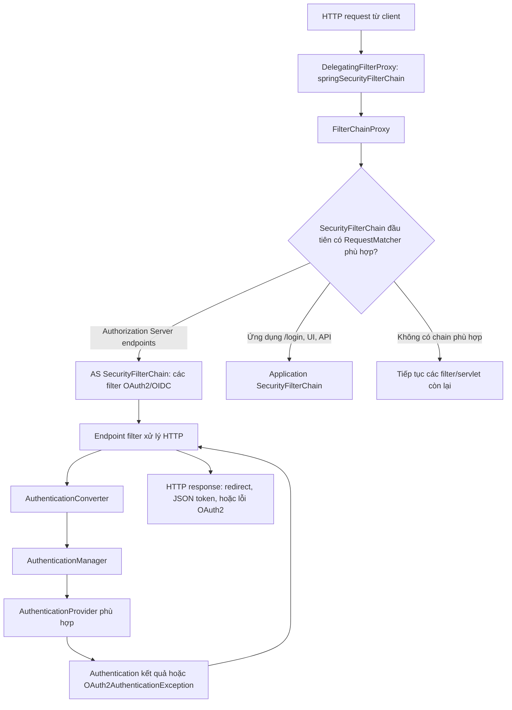
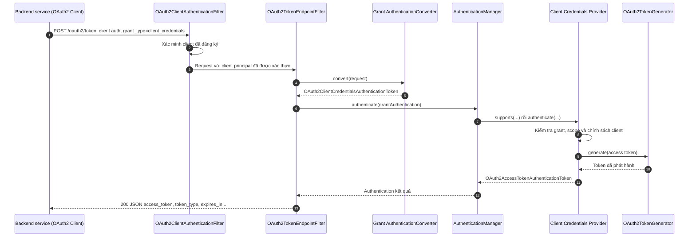
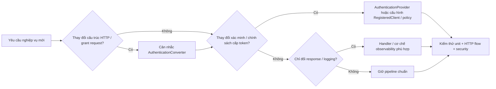

# Pipeline Filter, AuthenticationConverter và AuthenticationProvider

## 1. Bức tranh tổng quan

Trong chương **Kiến trúc xử lý** của module `SPRING_SECURITY_OAUTH2_OIDC_AUTHORIZATION_SERVER`, mục tiêu là hiểu cách một yêu cầu HTTP trở thành một quyết định xác thực/ủy quyền và cuối cùng là phản hồi OAuth 2.0 hoặc OpenID Connect (OIDC). Đây là kiến thức nền để **thiết kế, cấu hình, bảo mật, kiểm thử và vận hành Authorization Server bằng Spring Security và Spring Authorization Server trong Spring Boot**.

Ba khái niệm trọng tâm:

| Thành phần | Câu hỏi nó trả lời | Nhiệm vụ chính |
| --- | --- | --- |
| **Filter / Filter chain** | “Yêu cầu này đi qua cơ chế bảo mật nào?” | Chặn request HTTP tại đúng endpoint; tạo và gửi phản hồi hoặc chuyển xử lý |
| **AuthenticationConverter** | “Có thể hiểu request này thành yêu cầu xác thực loại nào?” | Đọc tham số/header theo giao thức, kiểm tra dạng đầu vào và tạo `Authentication` chưa được xác thực |
| **AuthenticationProvider** | “Yêu cầu xác thực đó có hợp lệ và được chấp nhận không?” | Kiểm tra client, grant, quyền, dữ liệu lưu trữ; phát hành kết quả `Authentication` khi thành công |

Một **AuthenticationManager** là bộ điều phối giữa Converter/Filter và các Provider. Trong cấu hình thông thường, `ProviderManager` duyệt những `AuthenticationProvider` hỗ trợ loại `Authentication` đang xử lý.

Điểm quan trọng: **AuthenticationConverter không tự cấp token**, **AuthenticationProvider không phải Servlet Filter**, và **Filter không nên chứa toàn bộ logic nghiệp vụ xác thực**. Các thành phần phối hợp để phân tách việc đọc giao thức, xác minh và phản hồi HTTP.

### Kết quả cần đạt

Sau bài này, bạn có thể:

1. Theo dõi request đi từ Servlet Filter đến Spring Security và Spring Authorization Server.
2. Phân biệt cơ chế chọn `SecurityFilterChain`, chọn `AuthenticationConverter` và chọn `AuthenticationProvider`.
3. Giải thích luồng `/oauth2/authorize` và `/oauth2/token`, kể cả bước xác thực **client** riêng.
4. Dùng các điểm mở rộng Token Endpoint để thêm Converter/Provider mà vẫn giữ logic chuẩn.
5. Xác định vị trí lỗi, viết kiểm thử có ý nghĩa và tránh làm yếu các kiểm tra bảo mật giao thức.

## 2. Hai tầng pipeline: Spring Security và Authorization Server

Khi một ứng dụng Spring Boot chạy trên Servlet stack nhận request, luồng xử lý khái quát như sau:



`DelegatingFilterProxy` chuyển từ Servlet filter sang bean Spring Security; `FilterChainProxy` chứa danh sách các `SecurityFilterChain` và chọn **chain đầu tiên khớp request**. Một request thông thường chỉ đi qua các filter trong chain đã chọn. Vì vậy:

- **`@Order` của `SecurityFilterChain`** quyết định độ ưu tiên giữa các chain; matcher hẹp của Authorization Server nên nằm trước matcher bao quát của ứng dụng.
- **Thứ tự các filter bên trong một chain** do Spring Security và configurer quyết định. Đây là vấn đề khác với thứ tự giữa các chain.
- **`AuthenticationConverter`** không chọn `SecurityFilterChain`. Converter chỉ chạy khi filter tương ứng đã nhận được request.
- **`AuthenticationProvider.supports(...)`** không quyết định URL nào được bảo vệ. Nó chỉ nhận biết lớp `Authentication` mà provider có thể xử lý.

Ví dụ: request `POST /oauth2/token` có thể đi vào chain Authorization Server, được bộ lọc xác thực OAuth2 client xử lý trước, rồi đến bộ lọc Token Endpoint xử lý grant. Request `GET /login` thường được chain ứng dụng xử lý để hiển thị hoặc tiến hành đăng nhập người dùng.

## 3. Các filter thường gặp của Spring Authorization Server

Spring Authorization Server cung cấp các filter cho từng nhóm endpoint. Danh sách dưới đây nêu các vai trò tiêu biểu; endpoint mặc định có thể thay đổi bằng `AuthorizationServerSettings`, và một số filter chỉ hiện diện khi tính năng tương ứng được cấu hình/bật.

| Filter | Endpoint điển hình | Công việc |
| --- | --- | --- |
| `OAuth2AuthorizationEndpointFilter` | `/oauth2/authorize` | Xử lý yêu cầu ủy quyền, kết quả xác thực người dùng, consent và authorization code |
| `OAuth2ClientAuthenticationFilter` | Các endpoint cần xác thực client, thường có `/oauth2/token` | Xác thực danh tính **OAuth2 client** qua secret, private key JWT, hoặc phương thức đã đăng ký |
| `OAuth2TokenEndpointFilter` | `POST /oauth2/token` | Chuyển yêu cầu grant thành `Authentication`, gọi manager và tạo phản hồi token/lỗi |
| `OAuth2TokenIntrospectionEndpointFilter` | `POST /oauth2/introspect` | Kiểm tra hiệu lực token theo giao thức introspection |
| `OAuth2TokenRevocationEndpointFilter` | `POST /oauth2/revoke` | Xử lý yêu cầu thu hồi token |
| Các OIDC endpoint filter | OIDC discovery, UserInfo, logout, v.v. | Bổ sung nghiệp vụ OIDC khi được bật và có cấu hình tương ứng |

Không nên hiểu bảng như một cam kết về **thứ tự chính xác của mọi filter** ở mọi phiên bản; thứ tự được ghép bởi `OAuth2AuthorizationServerConfigurer` và các cấu hình Spring Security. Điều cần hiểu ở mức kiến trúc là mỗi filter chịu trách nhiệm **một giao diện HTTP/giao thức** cụ thể.

### Phân biệt xác thực client với xác thực người dùng

Đây là chỗ rất dễ nhầm:

- **OAuth2 client authentication:** xác minh ứng dụng có `client_id` tương ứng và phương thức xác thực được phép. Ví dụ, confidential client dùng `client_secret_basic` tại Token Endpoint.
- **End-user authentication:** người dùng đăng nhập qua form, MFA, hoặc cơ chế xác thực khác trong yêu cầu ủy quyền. Việc này thường thuộc các filter đăng nhập Spring Security.
- **Authorization grant validation:** xác minh `authorization_code`, `refresh_token`, `client_credentials` hoặc loại grant được hỗ trợ, cùng các điều kiện liên quan.

Một request đổi code tại Token Endpoint có thể cần **cả xác thực client** (tùy loại client) **và xác minh authorization code/PKCE**. Không được coi client đã xác thực đồng nghĩa với người dùng đã ủy quyền hoặc grant hợp lệ.

## 4. AuthenticationConverter: từ HTTP request thành Authentication

Trong Spring Security Servlet, hợp đồng chính là:

```java
public interface AuthenticationConverter {
    Authentication convert(HttpServletRequest request);
}
```

Phương thức `convert` có ba khả năng quan trọng:

1. **Trả một `Authentication`:** converter nhận ra request và tạo đối tượng mô tả yêu cầu xác thực. Tại thời điểm này, đối tượng thường **chưa được xác thực**.
2. **Trả `null`:** converter không xử lý request này; bộ điều phối có thể thử converter tiếp theo.
3. **Ném `AuthenticationException`** (thường là `OAuth2AuthenticationException`): request thuộc loại mà converter xử lý nhưng có lỗi định dạng hoặc vi phạm điều kiện giao thức. Endpoint filter thường chuyển lỗi thành phản hồi OAuth2 phù hợp.

Ví dụ request:

```http
POST /oauth2/token HTTP/1.1
Host: auth.example.com
Authorization: Basic <client-credentials-base64>
Content-Type: application/x-www-form-urlencoded

grant_type=client_credentials&scope=reports.read
```

Converter của `client_credentials` đọc `grant_type` và các tham số liên quan, rồi tạo đối tượng kiểu `OAuth2ClientCredentialsAuthenticationToken`. Đối tượng này mô tả **yêu cầu xử lý grant**, chưa phải Bearer Access Token để trả về cho client.

### Một vài converter tiêu biểu tại Token Endpoint

| Converter | Loại request mà nó diễn giải |
| --- | --- |
| `OAuth2AuthorizationCodeAuthenticationConverter` | `grant_type=authorization_code` cùng `code`, `redirect_uri`, `code_verifier` khi áp dụng |
| `OAuth2RefreshTokenAuthenticationConverter` | `grant_type=refresh_token` cùng refresh token và scope tùy yêu cầu |
| `OAuth2ClientCredentialsAuthenticationConverter` | `grant_type=client_credentials` và scope được yêu cầu |
| Converter bổ sung theo phiên bản/tính năng | Device Authorization Grant, Token Exchange hoặc grant tùy chỉnh |

Các converter có thể được kết hợp bằng `DelegatingAuthenticationConverter`: nó thử từng converter theo thứ tự và dùng kết quả đầu tiên khác `null`. Danh sách thực tế do configurer xây dựng, có thể khác nhau tùy phiên bản và tính năng được bật.

**Không chuyển việc xác thực client secret, kiểm tra quyền truy cập database hoặc ký token sang converter.** Converter chỉ nên làm bước nhận diện giao thức, chuẩn hóa tham số và kiểm tra cú pháp/điều kiện đầu vào phù hợp.

### Những điều converter nên kiểm tra

- `grant_type` có phù hợp với converter được chọn không?
- Tham số bắt buộc có mặt, có đúng số lượng giá trị, có phải chuỗi không rỗng và có kích thước hợp lý không?
- Phương thức HTTP, content type và cấu trúc request có được endpoint hỗ trợ không? (Một phần do filter/endpoint kiểm tra.)
- Những trường không hợp lệ cần được chuyển thành `OAuth2Error`, ví dụ `invalid_request`, tránh ném lỗi runtime không kiểm soát.
- Không đọc client secret, code, refresh token hoặc assertion để ghi vào log, metric label hay exception message.

Đối với yêu cầu OAuth2 dùng form data, không mặc định rằng `request.getParameter(...)` chỉ có một giá trị: dữ liệu như `grant_type=x&grant_type=y` cần được xử lý theo chính sách kiểm tra cú pháp của giao thức.

## 5. AuthenticationManager và AuthenticationProvider

Sau khi Converter tạo được `Authentication`, endpoint filter gọi `AuthenticationManager.authenticate(authentication)`. Hợp đồng của provider:

```java
public interface AuthenticationProvider {
    Authentication authenticate(Authentication authentication)
            throws AuthenticationException;

    boolean supports(Class<?> authentication);
}
```

- `supports(...)` cho biết provider có thể xử lý **kiểu đối tượng** này không. Nó không bảo đảm request hợp lệ.
- `authenticate(...)` kiểm tra điều kiện thực tế và trả đối tượng `Authentication` khi thành công.
- Provider có thể trả `null` để một provider khác tiếp tục xử lý nếu cách cấu hình manager hỗ trợ chuỗi provider; hoặc ném `AuthenticationException` khi phải từ chối.
- Với `ProviderManager`, thứ tự provider có thể ảnh hưởng kết quả, đặc biệt khi nhiều provider cùng `supports` một kiểu và một provider trả kết quả sớm.

Những provider tiêu biểu:

| Provider | Kiểu Authentication request | Những điều kiểm tra chính |
| --- | --- | --- |
| `OAuth2AuthorizationCodeRequestAuthenticationProvider` | Yêu cầu ủy quyền ở Authorization Endpoint | Client, redirect URI, scope, response type, trạng thái xác thực/consent liên quan |
| `OAuth2AuthorizationCodeAuthenticationProvider` | Yêu cầu đổi authorization code | Code đã cấp, hạn sử dụng, client, redirect URI, PKCE, quyền đã được cấp |
| `OAuth2RefreshTokenAuthenticationProvider` | Yêu cầu refresh | Refresh token còn hợp lệ, client sở hữu, phạm vi được cấp, chính sách token |
| `OAuth2ClientCredentialsAuthenticationProvider` | Yêu cầu client credentials | Client đã xác thực, grant type và scope được phép, chính sách cấp token |
| Các provider của client authentication | Các kiểu `OAuth2ClientAuthenticationToken` | Secret/private key JWT hoặc phương thức client authentication tương ứng |

Một số provider **phát hành token thông qua `OAuth2TokenGenerator`** và lưu trạng thái qua `OAuth2AuthorizationService`. Thực tế, quyết định “được phép cấp token hay không” là kết quả tổng hợp từ `RegisteredClientRepository`, trạng thái `OAuth2Authorization`, chính sách scope/grant, và thông tin principal.

### Phân biệt ba dạng Authentication

```text
1) Yêu cầu xác thực client:
   OAuth2ClientAuthenticationToken  -> xác thực danh tính ứng dụng

2) Yêu cầu grant tại Token Endpoint:
   OAuth2AuthorizationCodeAuthenticationToken
   OAuth2RefreshTokenAuthenticationToken
   OAuth2ClientCredentialsAuthenticationToken
                                      -> xác minh quyền nhận token

3) Kết quả cấp token thành công:
   OAuth2AccessTokenAuthenticationToken
                                      -> dùng để dựng JSON response token
```

Tên kiểu của các request không có nghĩa là chúng đều đã có `isAuthenticated() == true`. Một `Authentication` cũng không nhất thiết đại diện cho **người dùng**: có trường hợp nó đại diện client hoặc một yêu cầu cấp token.

## 6. Đọc pipeline qua luồng Authorization Code

Giả sử ứng dụng web có `client_id=web-client`, đã đăng ký redirect URI, và người dùng muốn đăng nhập bằng OIDC với scope `openid profile`.

```mermaid
sequenceDiagram
    autonumber
    actor User as Người dùng
    participant Browser as Trình duyệt
    participant Client as Backend OIDC Client
    participant AS as Authorization Endpoint Filter
    participant AC as Converter / Provider (ủy quyền)
    participant Store as Authorization Service
    participant Token as Token Endpoint Filter
    participant AM as AuthenticationManager / Provider
    Browser->>AS: GET /oauth2/authorize?...response_type=code
    AS->>AC: Chuyển yêu cầu thành Authentication
    AC->>AC: Kiểm tra client, redirect, scope, PKCE
    AS-->>Browser: Chuyển đăng nhập nếu chưa có phiên
    User->>Browser: Đăng nhập / đồng ý nếu được yêu cầu
    Browser->>AS: Tiếp tục yêu cầu ủy quyền
    AS->>AC: Xác minh principal, consent
    AC->>Store: Lưu authorization/code
    AS-->>Browser: 302 redirect_uri?code=...&state=...
    Browser->>Client: GET /callback?code=...&state=...
    Client->>Token: POST /oauth2/token, code + client authentication
    Note over Token: Client authentication filter xử lý danh tính client trước đó khi cần
    Token->>AM: Authentication từ authorization_code converter
    AM->>Store: Tìm và kiểm tra code + trạng thái
    AM->>AM: Kiểm tra redirect, PKCE, grant; phát hành token
    AM->>Store: Lưu trạng thái token/authorization
    AM-->>Token: Authentication kết quả chứa token
    Token-->>Client: JSON token
    Client-->>Browser: Tạo session ứng dụng và phản hồi web
```

Sơ đồ tóm tắt hai endpoint khác nhau; trong thực tế **backend client** (confidential client) gửi yêu cầu Token Endpoint qua back channel và nhận JSON, không nhất thiết trình duyệt trực tiếp nhận token. Trình duyệt chỉ đi qua redirect và callback theo kiến trúc web thường gặp.

### Vì sao có hai giai đoạn khác nhau?

**Giai đoạn A – Authorization Endpoint:**

1. Filter bắt `/oauth2/authorize`.
2. Converter phân tích `response_type=code`, `client_id`, `redirect_uri`, `scope`, `state` và PKCE.
3. Provider kiểm tra client đã đăng ký, điều kiện ủy quyền và trạng thái người dùng; nếu cần, quy trình đăng nhập/consent sẽ diễn ra.
4. Khi thành công, Authorization Server tạo authorization code, lưu thông tin giao dịch và redirect người dùng về client.

**Giai đoạn B – Token Endpoint:**

1. Client gửi code về `POST /oauth2/token` (cùng `code_verifier` nếu dùng PKCE).
2. Xác thực client được thực hiện theo loại client/method đã đăng ký; **public client không được giả vờ có client secret đáng tin**.
3. `OAuth2TokenEndpointFilter` dùng Converter tạo `OAuth2AuthorizationCodeAuthenticationToken`.
4. Provider kiểm tra code chưa hết hạn/chưa dùng, gắn với client và redirect URI phù hợp, kiểm tra PKCE và chính sách cấp token.
5. Provider/token generator phát hành Access Token; nếu yêu cầu OIDC hợp lệ có thể kèm ID Token; Refresh Token chỉ được cấp nếu grant/chính sách cho phép.
6. Filter trả JSON thành công hoặc một lỗi OAuth2 tương ứng.

**`state`** được OIDC/OAuth2 client kiểm tra với giá trị đã lưu khi nhận redirect. **PKCE** được AS kiểm tra khi đổi code. **`nonce`** (nếu dùng OIDC) được liên kết với ID Token và client phải kiểm tra theo quy tắc OIDC. Ba biện pháp có các vai trò riêng.

## 7. Đọc pipeline qua luồng Client Credentials

Luồng `client_credentials` phù hợp cho dịch vụ máy chủ gọi API bằng danh tính ứng dụng, **không có người dùng cuối** tham gia giao dịch token.



Không nên giả định rằng client credentials luôn phải gửi `client_secret_basic`: AS có thể được cấu hình hỗ trợ phương thức khác. Tuy nhiên, vì đây là **confidential-client grant**, yêu cầu cần thỏa chính sách xác thực client tương ứng, và `client_credentials` không làm phát sinh ID Token cho một người dùng.

## 8. Cấu hình SecurityFilterChain trong Spring Boot

Mẫu sau minh họa Spring Security 6.x và Spring Authorization Server 1.x, ở các phiên bản có API `OAuth2AuthorizationServerConfigurer.authorizationServer()`. Cấu hình này trình bày **filter chain**; để chạy thành một Authorization Server có ích, dự án còn cần các bean như `RegisteredClientRepository`, `OAuth2AuthorizationService`, thành phần ký JWT/JWK và cấu hình người dùng phù hợp.

```java
import org.springframework.context.annotation.Bean;
import org.springframework.context.annotation.Configuration;
import org.springframework.core.annotation.Order;
import org.springframework.http.MediaType;
import org.springframework.security.config.Customizer;
import org.springframework.security.config.annotation.web.builders.HttpSecurity;
import org.springframework.security.oauth2.server.authorization.config.annotation.web.configurers.OAuth2AuthorizationServerConfigurer;
import org.springframework.security.web.SecurityFilterChain;
import org.springframework.security.web.authentication.LoginUrlAuthenticationEntryPoint;
import org.springframework.security.web.util.matcher.MediaTypeRequestMatcher;

@Configuration
public class AuthorizationServerSecurityConfig {

    @Bean
    @Order(1)
    SecurityFilterChain authorizationServerSecurityFilterChain(HttpSecurity http)
            throws Exception {
        OAuth2AuthorizationServerConfigurer configurer =
                OAuth2AuthorizationServerConfigurer.authorizationServer();

        http
            .securityMatcher(configurer.getEndpointsMatcher())
            .with(configurer, server -> server
                .oidc(Customizer.withDefaults())
            )
            .authorizeHttpRequests(authorize -> authorize
                .anyRequest().authenticated()
            )
            .exceptionHandling(exceptions -> exceptions
                .defaultAuthenticationEntryPointFor(
                    new LoginUrlAuthenticationEntryPoint("/login"),
                    new MediaTypeRequestMatcher(MediaType.TEXT_HTML)
                )
            );

        return http.build();
    }

    @Bean
    @Order(2)
    SecurityFilterChain applicationSecurityFilterChain(HttpSecurity http)
            throws Exception {
        http
            .authorizeHttpRequests(authorize -> authorize
                .anyRequest().authenticated()
            )
            .formLogin(Customizer.withDefaults());

        return http.build();
    }
}
```

**Ý nghĩa của cấu hình:**

- Chain `@Order(1)` chỉ khớp endpoint do configurer quản lý, để các filter Authorization Server xử lý đúng request.
- Chain `@Order(2)` xử lý request ứng dụng (gồm `/login`) và cung cấp cơ chế đăng nhập người dùng.
- `.oidc(Customizer.withDefaults())` bật các chức năng OIDC được hỗ trợ; việc này khác với chỉ thêm scope `openid` vào một client.
- `LoginUrlAuthenticationEntryPoint` chuyển request HTML cần đăng nhập đến trang đăng nhập. Request giao thức/token không nên bị biến thành trang HTML đăng nhập theo cách tùy tiện.
- Không tắt CSRF toàn cục chỉ vì Token Endpoint tiếp nhận POST. Cấu hình chuẩn của Authorization Server thiết lập các yêu cầu bảo mật endpoint theo giao thức; trang form/endpoint ứng dụng vẫn cần chính sách CSRF phù hợp.

**Chú ý phiên bản:** API cấu hình có thể thay đổi giữa các dòng Spring Security/Spring Authorization Server. Khi ghép vào dự án thật, kiểm tra tài liệu của đúng phiên bản đang được Spring Boot quản lý.

## 9. Mở rộng Token Endpoint bằng Converter và Provider

Spring Authorization Server cung cấp điểm mở rộng tại `OAuth2TokenEndpointConfigurer`. Hai nhóm phương thức đáng biết:

| Hook | Mục đích |
| --- | --- |
| `accessTokenRequestConverter(...)` | Thêm converter xử lý một dạng grant request |
| `accessTokenRequestConverters(...)` | Truy cập danh sách converter để thêm, thay hoặc điều chỉnh thứ tự |
| `authenticationProvider(...)` | Thêm provider xử lý authentication của grant |
| `authenticationProviders(...)` | Truy cập danh sách provider để thêm/thay/điều chỉnh thứ tự |
| `accessTokenResponseHandler(...)` | Tùy biến xử lý response khi cấp token thành công |
| `errorResponseHandler(...)` | Tùy biến xử lý response lỗi của Token Endpoint |

**Nguyên tắc:** một grant mới cần cặp Converter/Provider phù hợp. Nhưng nếu chỉ cần thêm kiểm tra cho grant đã có, thường không cần viết lại toàn bộ thuật toán cấp token; có thể đặt bước kiểm tra bổ sung trước provider mặc định. Ví dụ dưới đây minh họa chính điểm này.

### 9.1. Ví dụ: kiểm tra request ID và chính sách client khi cấp client credentials

Giả sử một hệ thống nội bộ yêu cầu client dùng `client_credentials` phải gửi header `X-Request-Id` để liên kết sự kiện vận hành, đồng thời chỉ cho phép một nhóm client sử dụng grant này. Đây là **chính sách riêng của ứng dụng để học về extension point**, không phải yêu cầu của chuẩn OAuth 2.0.

**Converter bổ sung** nhận diện đúng grant, kiểm tra header, sau đó giao việc phân tích tham số chuẩn cho converter có sẵn:

```java
import jakarta.servlet.http.HttpServletRequest;
import org.springframework.security.core.Authentication;
import org.springframework.security.oauth2.core.AuthorizationGrantType;
import org.springframework.security.oauth2.core.OAuth2Error;
import org.springframework.security.oauth2.core.OAuth2ErrorCodes;
import org.springframework.security.oauth2.core.OAuth2AuthenticationException;
import org.springframework.security.oauth2.core.endpoint.OAuth2ParameterNames;
import org.springframework.security.oauth2.server.authorization.web.authentication.OAuth2ClientCredentialsAuthenticationConverter;
import org.springframework.security.web.authentication.AuthenticationConverter;

public final class RequestIdCheckingConverter implements AuthenticationConverter {

    private final AuthenticationConverter delegate =
            new OAuth2ClientCredentialsAuthenticationConverter();

    @Override
    public Authentication convert(HttpServletRequest request) {
        String grantType = request.getParameter(OAuth2ParameterNames.GRANT_TYPE);

        if (!AuthorizationGrantType.CLIENT_CREDENTIALS.getValue().equals(grantType)) {
            return null; // Để các converter của grant khác xử lý
        }

        String requestId = request.getHeader("X-Request-Id");
        if (requestId == null || requestId.isBlank() || requestId.length() > 128) {
            throw new OAuth2AuthenticationException(new OAuth2Error(
                    OAuth2ErrorCodes.INVALID_REQUEST,
                    "Missing or invalid X-Request-Id",
                    null));
        }

        // Không tự tạo OAuth2ClientCredentialsAuthenticationToken bằng tay.
        // Converter mặc định vẫn kiểm tra tham số chuẩn của grant.
        return delegate.convert(request);
    }
}
```

**Provider bổ sung** kiểm tra danh sách client được phép. Nó chỉ đóng vai trò *policy pre-check*: trả `null` để `ProviderManager` tiếp tục đến provider `client_credentials` mặc định, nơi quyết định cấp token thực sự được thực hiện.

```java
import java.util.Set;
import org.springframework.security.authentication.AuthenticationProvider;
import org.springframework.security.core.Authentication;
import org.springframework.security.core.AuthenticationException;
import org.springframework.security.oauth2.core.OAuth2Error;
import org.springframework.security.oauth2.core.OAuth2ErrorCodes;
import org.springframework.security.oauth2.core.OAuth2AuthenticationException;
import org.springframework.security.oauth2.server.authorization.authentication.OAuth2ClientAuthenticationToken;
import org.springframework.security.oauth2.server.authorization.authentication.OAuth2ClientCredentialsAuthenticationToken;

public final class AllowedClientsProvider implements AuthenticationProvider {

    private final Set<String> allowedClientIds;

    public AllowedClientsProvider(Set<String> allowedClientIds) {
        this.allowedClientIds = Set.copyOf(allowedClientIds);
    }

    @Override
    public Authentication authenticate(Authentication authentication)
            throws AuthenticationException {
        OAuth2ClientCredentialsAuthenticationToken grant =
                (OAuth2ClientCredentialsAuthenticationToken) authentication;

        if (!(grant.getPrincipal() instanceof OAuth2ClientAuthenticationToken client)
                || !client.isAuthenticated()
                || client.getRegisteredClient() == null) {
            throw new OAuth2AuthenticationException(OAuth2ErrorCodes.INVALID_CLIENT);
        }

        if (!allowedClientIds.contains(client.getRegisteredClient().getClientId())) {
            throw new OAuth2AuthenticationException(new OAuth2Error(
                    OAuth2ErrorCodes.UNAUTHORIZED_CLIENT,
                    "Client is not permitted by policy",
                    null));
        }

        return null; // Cho provider mặc định xử lý và phát hành token
    }

    @Override
    public boolean supports(Class<?> authentication) {
        return OAuth2ClientCredentialsAuthenticationToken.class
                .isAssignableFrom(authentication);
    }
}
```

Để kết nối hai thành phần này, mở rộng đoạn `with(configurer, server -> ...)` ở mục 8 như sau:

```java
.with(configurer, server -> server
    .oidc(Customizer.withDefaults())
    .tokenEndpoint(tokenEndpoint -> tokenEndpoint
        .accessTokenRequestConverters(converters ->
            converters.add(0, new RequestIdCheckingConverter()))
        .authenticationProviders(providers ->
            providers.add(0, new AllowedClientsProvider(
                Set.of("reporting-service", "billing-service"))))
    )
)
```

Đoạn trên là **phần thay thế tương ứng của chuỗi cấu hình** trong method đã trình bày, không phải một statement Java đứng độc lập. Thêm import `java.util.Set` khi ghép mã.

Với request `client_credentials`, converter kiểm tra header và trả authentication; provider kiểm tra chính sách rồi nhường provider mặc định cấp token. Với grant khác, converter trả `null` và provider `supports` trả `false`, nên các handler mặc định tương ứng có thể tiếp tục hoạt động.

> Chú ý: chỉ đưa ví dụ kiểm tra `X-Request-Id` vào hệ thống khi đây thực sự là một giao ước được thống nhất với client. Không tin rằng một request ID từ client là bằng chứng danh tính. Danh sách client cho phép nên được quản lý bằng cấu hình/chính sách phù hợp, tránh gắn cứng vào mã production. Với các chính sách grant cơ bản, ưu tiên khai báo `RegisteredClient` đúng trước khi thêm provider riêng.

### 9.2. Khi thật sự triển khai custom grant

Nếu nghiệp vụ cần grant khác hoàn toàn, ví dụ một extension grant đã được thiết kế và thẩm định:

1. Định nghĩa **`AuthorizationGrantType`** và cấu trúc request, tham số bắt buộc, thông điệp lỗi.
2. Tạo kiểu **`OAuth2AuthorizationGrantAuthenticationToken`** (hoặc lớp con tương ứng) để mang dữ liệu sau parse.
3. Viết **`AuthenticationConverter`**: chỉ nhận grant đó, kiểm tra đầu vào, trả request authentication hoặc lỗi OAuth2.
4. Viết **`AuthenticationProvider`**: kiểm tra client đã được xác thực, grant đã đăng ký, các ràng buộc nghiệp vụ, quyền/scope; gọi `OAuth2TokenGenerator` đúng cách, lưu `OAuth2Authorization`, trả kết quả.
5. Đăng ký converter/provider thông qua Token Endpoint configurer và đăng ký grant cho `RegisteredClient`.
6. Kiểm thử toàn bộ đường thành công, dữ liệu giả mạo, cấp lại/replay, giới hạn quyền, thu hồi và tác động vận hành.

Không nên tạo một grant riêng chỉ để bỏ qua Authorization Code + PKCE hoặc thay thế cơ chế xác thực client an toàn. Custom grant làm tăng bề mặt tấn công và chi phí duy trì tính tương thích của giao thức.

## 10. Bộ lỗi OAuth2 được tạo ở đâu?

Một request có thể bị từ chối ở nhiều vị trí:

| Biểu hiện/luồng | Vị trí kiểm tra thường gặp | Ý nghĩa cần điều tra |
| --- | --- | --- |
| `invalid_client` | Client authentication filter/provider | Secret, assertion, phương thức xác thực hoặc client registration không hợp lệ |
| `invalid_request` | Converter / endpoint filter | Thiếu, trùng, sai định dạng hoặc sai cấu trúc tham số |
| `unsupported_grant_type` | Token Endpoint / cơ chế xử lý grant | Grant chưa được hỗ trợ hoặc không nhận diện |
| `unauthorized_client` | Grant AuthenticationProvider | Client không được cấp phép dùng grant này |
| `invalid_grant` | Authorization Code/Refresh Token Provider | Code/token hết hạn, đã sử dụng, bị thu hồi, sai client, sai PKCE hoặc điều kiện grant |
| `invalid_scope` | Grant/authorization Provider | Scope không hợp lệ hoặc vượt phạm vi được phép |
| `server_error` | Thành phần nội bộ khi xử lý | Hạ tầng, ký token, lưu trữ hoặc lỗi máy chủ cần được điều tra |

Bảng trên mô tả **điểm phát sinh điển hình**, không phải quy tắc ánh xạ cứng cho mọi request/phiên bản. Tại Authorization Endpoint, lỗi giao thức có thể đi qua **redirect** với `error` khi redirect URI hợp lệ; tại Token Endpoint, lỗi thường trả **JSON OAuth2** với HTTP status tương ứng. Không đồng nhất mọi lỗi với `401` hoặc `403`.

Ví dụ thiếu header trong chính sách ở mục 9:

```http
HTTP/1.1 400 Bad Request
Content-Type: application/json

{
  "error": "invalid_request",
  "error_description": "Missing or invalid X-Request-Id"
}
```

Đây là **phản hồi minh họa của converter tùy chỉnh**. Đừng đưa secret, raw authorization code, refresh token, JWT hoặc client assertion vào `error_description` hay log để “debug dễ hơn”.

## 11. Kiểm thử pipeline theo từng lớp

### 11.1. Kiểm thử converter riêng

Với `RequestIdCheckingConverter`, tập ca kiểm thử nên gồm:

| Đầu vào | Kỳ vọng |
| --- | --- |
| `grant_type=authorization_code` | `convert(...)` trả `null` |
| `grant_type=client_credentials`, thiếu header | `OAuth2AuthenticationException`, mã `invalid_request` |
| Có header rỗng hoặc dài quá 128 ký tự | Lỗi `invalid_request` |
| Có header hợp lệ và tham số grant hợp lệ | Trả `OAuth2ClientCredentialsAuthenticationToken` từ delegate |
| Có header hợp lệ nhưng request grant sai cấu trúc | Delegate từ chối bằng lỗi giao thức |

Có thể dùng `MockHttpServletRequest` của Spring Test; cần đặt method/content type/parameter đúng như request tới Token Endpoint. Unit test converter không chứng minh client đã được xác thực, vì việc đó thuộc các thành phần khác.

### 11.2. Kiểm thử provider chính sách

Tạo request `OAuth2ClientCredentialsAuthenticationToken` chứa principal client phù hợp và kiểm tra:

- Client chưa được xác thực hoặc không có `RegisteredClient` → từ chối `invalid_client`.
- Client đã được xác thực nhưng không nằm trong allowlist → từ chối `unauthorized_client`.
- Client được phép → trả `null` để manager tiếp tục provider mặc định.
- `supports` chỉ đúng với kiểu authentication cần thiết.

Sau đó cần **integration test** đảm bảo provider mặc định thật sự được gọi sau pre-check. Nếu chỉ unit test `return null`, chưa thể kết luận hệ thống đã cấp token thành công.

### 11.3. Kiểm thử luồng HTTP hoàn chỉnh

Với `MockMvc`, WebTestClient (nếu đúng web stack) hoặc công cụ HTTP/integration test, kiểm tra:

1. Request không có thông tin xác thực client tại Token Endpoint → bị từ chối theo giao thức.
2. Client hợp lệ + `client_credentials` + `X-Request-Id` hợp lệ → nhận Access Token khi đã đăng ký grant/scope.
3. Thiếu request ID → `invalid_request`; client ngoài allowlist → `unauthorized_client`.
4. `authorization_code` vẫn hoạt động bình thường: tạo code, đổi code đúng một lần, kiểm tra PKCE và redirect URI.
5. Refresh Token hết hạn/bị thu hồi hoặc code đã dùng lại → lỗi phù hợp; không lộ dữ liệu nhạy cảm.
6. `GET /login` được xử lý bởi chain ứng dụng, còn `POST /oauth2/token` đi qua chain Authorization Server.
7. Resource Server kiểm tra Access Token đúng audience/scope, thay vì tin ID Token làm Bearer Token.

Câu lệnh HTTP minh họa khi client có đăng ký `client_credentials` và chính sách ví dụ ở trên:

```bash
curl -i -X POST https://auth.example.com/oauth2/token \
  -u 'reporting-service:<client-secret>' \
  -H 'Content-Type: application/x-www-form-urlencoded' \
  -H 'X-Request-Id: demo-request-001' \
  --data-urlencode 'grant_type=client_credentials' \
  --data-urlencode 'scope=reports.read'
```

`<client-secret>` là placeholder; không đưa secret thật vào shell history trên máy dùng chung. Tùy mô hình xác thực đã đăng ký, ví dụ trên có thể phải thay phần `-u` bằng phương thức client authentication khác.

### 11.4. Quan sát và debug

Trong môi trường phát triển, có thể bật log DEBUG **có kiểm soát** cho Spring Security và Spring Authorization Server để quan sát chain, endpoint và loại lỗi:

```yaml
logging:
  level:
    org.springframework.security: DEBUG
    org.springframework.security.oauth2.server.authorization: DEBUG
```

Không để DEBUG lâu dài ở production khi có nguy cơ lộ dữ liệu; kiểm tra nội dung log thực tế trước khi xuất về hệ thống giám sát. Ghi **correlation ID**, tên endpoint, loại grant, mã lỗi và thời gian xử lý; tránh log token và thông tin bí mật. Không dựa vào log DEBUG để xác định bảo mật đúng nếu thiếu integration test.

## 12. Những lỗi kiến trúc thường gặp

### 12.1. Sai thứ tự hoặc matcher của SecurityFilterChain

Nếu chain ứng dụng với `anyRequest()` đặt ở `@Order(1)`, chain Authorization Server ở sau có thể **không bao giờ được chọn**. Hậu quả: Token Endpoint có thể bị form login chặn, trả HTML/redirect hoặc `404/403` không mong đợi.

**Cách xử lý:** đặt matcher cho AS endpoints ở chain ưu tiên cao; kiểm tra chain được chọn trong log/kiểm thử; giữ chain ứng dụng cho `/login` và route còn lại.

### 12.2. Converter tự xác thực thay vì chỉ chuyển đổi

Việc converter truy vấn kho token/credential và trực tiếp phát hành JWT khiến trách nhiệm bị trộn lẫn, khó kiểm thử và dễ bỏ sót bảo vệ chống replay. Chuyển xác minh/ra quyết định sang Provider và `OAuth2TokenGenerator` theo đúng quy trình.

### 12.3. Provider không đăng ký đúng hoặc có thứ tự sai

Nếu một provider cùng `supports` loại request với provider mặc định nhưng được đặt **sau** provider mặc định, bước kiểm tra bổ sung có thể không chạy do provider trước đã trả kết quả. Với provider pre-check trả `null`, cần bảo đảm nó chạy trước và có provider mặc định xử lý tiếp. Kiểm tra bằng integration test.

### 12.4. Tin dữ liệu từ client là quyền

`scope`, `client_id`, `redirect_uri`, `X-Tenant` và mọi tham số do client gửi chỉ là **đầu vào**. Không phát hành token với scope/tenant do client tự khai báo nếu chưa so với `RegisteredClient`, principal và chính sách hệ thống.

### 12.5. Vô hiệu hóa lớp bảo vệ để “cho endpoint hoạt động”

Tùy tiện `permitAll()`, `csrf.disable()` toàn cục hoặc bỏ xác thực client có thể làm flow chạy qua test đơn giản nhưng phá vỡ bảo vệ. Cần hiểu phương thức client authentication nào phù hợp với public/confidential client, kiểm tra PKCE và áp dụng CSRF theo từng endpoint/trang form.

### 12.6. Không phân biệt lỗi giao thức với lỗi HTTP nói chung

OAuth2 quy định mã lỗi như `invalid_client`, `invalid_grant`, `invalid_request`. Không nên để `NullPointerException` thành HTML stack trace hoặc tự ánh xạ mọi trường hợp về một `500` không có thông tin giao thức. Đồng thời, không làm rò rỉ dữ liệu nội bộ trong JSON lỗi.

## 13. Sơ đồ trách nhiệm khi thiết kế tính năng mới



Đặc biệt, **không nhất thiết phải viết custom provider** nếu yêu cầu chỉ là “client này được dùng grant nào?”, “token sống bao lâu?”, hoặc “scope nào đã đăng ký?”. Các chính sách đó có thể được giải quyết bằng `RegisteredClient`, `ClientSettings`, `TokenSettings`, hoặc cấu hình chuẩn có sẵn.

## 14. Tóm tắt và câu hỏi ôn tập

Luồng xử lý nên được ghi nhớ theo quan hệ:

```text
HTTP request
  -> SecurityFilterChain phù hợp
  -> OAuth2/OIDC endpoint Filter
  -> AuthenticationConverter
  -> AuthenticationManager
  -> AuthenticationProvider
  -> TokenGenerator / AuthorizationService (khi cần)
  -> Authentication thành công hoặc OAuth2 exception
  -> Endpoint Filter tạo HTTP response
```

**Tự kiểm tra kiến thức:**

1. `@Order` của `SecurityFilterChain` khác thứ tự converter/provider ở đâu?
2. Tại sao một Converter có thể trả `null` mà không coi đó là lỗi?
3. Khi nào `OAuth2ClientAuthenticationFilter` xử lý request trước `OAuth2TokenEndpointFilter`?
4. Tại sao xác thực client thành công chưa đủ để phát hành Access Token?
5. Nếu muốn bổ sung kiểm tra scope/allowlist, tại sao cần cân nhắc provider mặc định và thứ tự provider?
6. Với lỗi `invalid_grant` khi đổi code, bạn sẽ kiểm tra converter hay provider trước, và tại sao?
7. Vì sao không nên đưa khóa ký JWT hoặc quy tắc phát hành token vào `AuthenticationConverter`?
8. Phải kiểm thử gì để chứng minh một custom provider trả `null` vẫn cho phép provider mặc định xử lý thành công?

**Tài liệu chính thức để đối chiếu với phiên bản đang dùng:**

- [Spring Authorization Server — Protocol Endpoints](https://docs.spring.io/spring-authorization-server/reference/protocol-endpoints.html)
- [Spring Authorization Server — Configuration Model](https://docs.spring.io/spring-authorization-server/reference/configuration-model.html)
- [Spring Security — Architecture](https://docs.spring.io/spring-security/reference/servlet/architecture.html)
- [Spring Security — Authentication Architecture](https://docs.spring.io/spring-security/reference/servlet/authentication/architecture.html)
- [OAuth 2.0 Authorization Framework — RFC 6749](https://www.rfc-editor.org/rfc/rfc6749)
- [Proof Key for Code Exchange — RFC 7636](https://www.rfc-editor.org/rfc/rfc7636)
