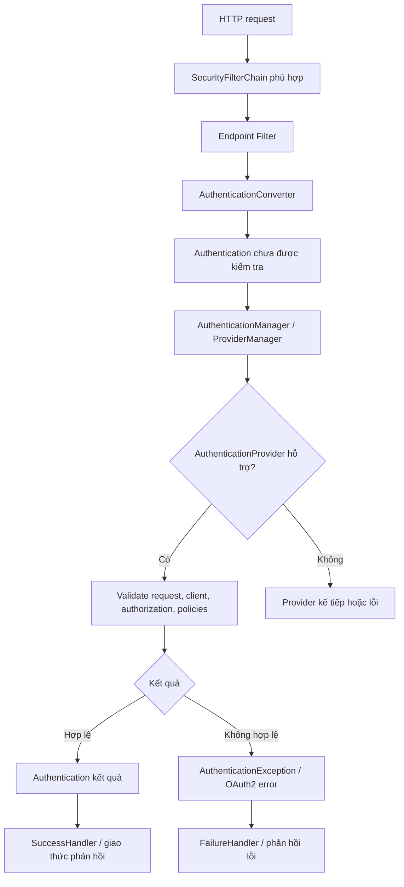
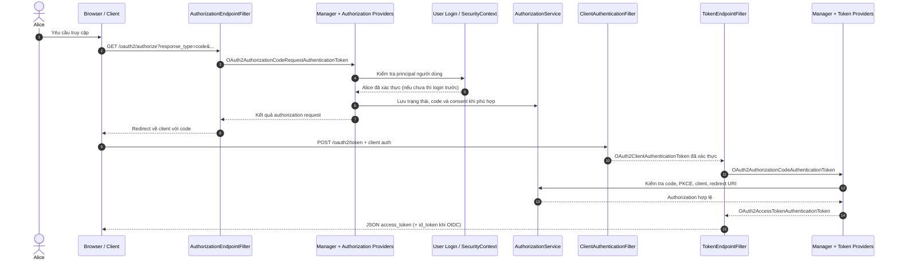

# AuthenticationManager và các loại AuthenticationToken trong Authorization Server

## 1. Bối cảnh: vì sao một Authorization Server cần nhiều bước xác thực?

Khi triển khai OAuth 2.0/OpenID Connect (OIDC) Authorization Server trong Spring Boot bằng **Spring Security** và **Spring Authorization Server (SAS)**, từ *authentication* xuất hiện ở nhiều nơi nhưng không phải lúc nào cũng có nghĩa “đăng nhập người dùng”.

Xét ba thao tác:

1. Người dùng nhập tên đăng nhập và mật khẩu vào trang `/login`.
2. Một OAuth 2.0 client gửi `client_id` và `client_secret` đến `/oauth2/token`.
3. Client đã được nhận diện gửi `grant_type=authorization_code` kèm authorization code để đổi access token.

Cả ba đều cần kiểm tra, nhưng **đối tượng**, **bằng chứng** và **quy tắc chấp nhận** khác nhau. Spring Security dùng hợp đồng `AuthenticationManager` và `AuthenticationProvider` để điều phối các bước kiểm tra đó. SAS xây dựng thêm những kiểu `Authentication` dành riêng cho từng yêu cầu giao thức OAuth 2.0/OIDC.

Mục tiêu của bài thuộc chương **Kiến trúc xử lý** là trả lời:

- `AuthenticationManager` đứng ở đâu trong chuỗi filter của Authorization Server?
- Vì sao cùng tên “AuthenticationToken” nhưng có token đại diện **yêu cầu đang kiểm tra**, token đại diện **kết quả đã được kiểm tra**, và token OAuth 2.0 **được phát hành**?
- Nhóm lớp nào xử lý user login, client authentication, authorization request, token request, consent và các endpoint bổ sung?
- Nên mở rộng validator/provider ở đâu để giữ nguyên các kiểm tra bảo mật của framework?

> **Phạm vi phiên bản:** Các tên lớp và ví dụ cấu hình chính minh họa dòng **Spring Authorization Server 1.5.x** trên Spring Security 6.x. Từ **Spring Security 7.x**, chức năng Authorization Server được tích hợp vào Spring Security và API cấu hình có thay đổi. Nguyên lý `Authentication` → `AuthenticationManager` → `AuthenticationProvider` vẫn là nền tảng; hãy đối chiếu Javadoc và Reference Guide đúng phiên bản dự án.

## 2. Hợp đồng Authentication trong Spring Security

### 2.1. `Authentication` và `AbstractAuthenticationToken`

`org.springframework.security.core.Authentication` là interface vừa biểu diễn **yêu cầu xác thực** vừa biểu diễn **kết quả xác thực**. Các phương thức thường gặp:

| Thành phần | Ý nghĩa | Điểm cần cẩn thận |
| --- | --- | --- |
| `getPrincipal()` | Danh tính hoặc đối tượng liên quan đến yêu cầu | Có thể là end user, OAuth client hoặc một `Authentication` lồng bên trong; không mặc định là username |
| `getCredentials()` | Bằng chứng cần kiểm tra | Có thể là mật khẩu, client secret, code hoặc dữ liệu liên quan; không ghi ra log |
| `getAuthorities()` | Các quyền do cơ chế xác thực gắn vào đối tượng | Không tương đương trực tiếp với OAuth scopes hay quyền trên tài nguyên |
| `getDetails()` | Thông tin bổ sung theo loại xác thực | Không coi mọi giá trị do request gửi tới là đáng tin cậy |
| `isAuthenticated()` | Trạng thái kết quả của bước xác thực | `true` phải đến từ cơ chế kiểm tra tin cậy, không được tự gán để bỏ qua xác thực |

`AbstractAuthenticationToken` là lớp cơ sở cho nhiều implementation. Trong thực tế, tên lớp kết thúc bằng `AuthenticationToken` thường mang nghĩa **đối tượng Java triển khai `Authentication`**, không phải chuỗi JWT hay access token có thể gửi qua mạng.

Ví dụ trong cơ chế đăng nhập bằng mật khẩu:

```java
// Chỉ minh họa hợp đồng Spring Security, không phải handler đăng nhập hoàn chỉnh.
Authentication request =
        UsernamePasswordAuthenticationToken.unauthenticated("alice", rawPassword);

Authentication verified = authenticationManager.authenticate(request);
// verified.getPrincipal() thường là UserDetails hoặc principal tùy hệ thống.
// verified.isAuthenticated() phản ánh kết quả do provider tạo ra.
```

Mật khẩu cần được kiểm tra bởi provider thích hợp (thường `DaoAuthenticationProvider` dùng `UserDetailsService` và `PasswordEncoder`). Trong ứng dụng thực tế, filter đăng nhập và Spring Security đã thực hiện việc tạo, gọi manager, xử lý lỗi và thiết lập `SecurityContext`; không nên tự tạo endpoint bỏ qua các bước này.

### 2.2. `AuthenticationManager`: điểm vào điều phối

Hợp đồng cốt lõi rất ngắn:

```java
public interface AuthenticationManager {
    Authentication authenticate(Authentication authentication)
            throws AuthenticationException;
}
```

Implementation thường gặp là `ProviderManager`. Nó xét các `AuthenticationProvider` có khả năng xử lý lớp `Authentication` được đưa vào:

```java
public interface AuthenticationProvider {
    Authentication authenticate(Authentication authentication)
            throws AuthenticationException;

    boolean supports(Class<?> authentication);
}
```

Mỗi provider quyết định có hỗ trợ kiểu yêu cầu đó hay không, kiểm tra điều kiện và trả về một `Authentication` đã xử lý hoặc ném `AuthenticationException`. Với `ProviderManager`, provider có thể trả về `null` khi không xử lý được kiểu yêu cầu để manager xét provider tiếp theo; không nên hiểu rằng manager luôn gọi tất cả provider. Thứ tự provider và cách xử lý các ngoại lệ ảnh hưởng đến kết quả, nên không được tùy tiện thay thế danh sách mặc định.



Luồng minh họa **mẫu xử lý giao thức**. Từng filter có thể có converter, manager và handler riêng. `FilterChainProxy` chọn `SecurityFilterChain` theo request matcher; `AuthenticationManager` không tự quyết định request URL sẽ đi vào filter nào.

### 2.3. Phân biệt ba khái niệm dễ nhầm

| Khái niệm | Kiểu dữ liệu/đại diện | Mục đích |
| --- | --- | --- |
| **Spring `AuthenticationToken`** | Object Java như `OAuth2ClientCredentialsAuthenticationToken` | Mang yêu cầu/kết quả cần provider kiểm tra trong quá trình xử lý |
| **OAuth 2.0 authorization code** | Chuỗi code ngắn hạn được Authorization Server phát hành | Bằng chứng để client đổi token ở token endpoint |
| **OAuth 2.0 access/refresh token hoặc OIDC ID token** | Token phát hành theo giao thức, có thể là JWT hoặc opaque | Gửi tới client/API theo đúng mục đích từng loại |

Ví dụ, `OAuth2AccessTokenAuthenticationToken` là **đối tượng kết quả trong bộ xử lý token endpoint**, chứa access token được phát hành và thông tin đáp ứng. Đối tượng Java này **không phải** bản thân chuỗi `access_token` trong JSON phản hồi; `OAuth2AccessToken` và các đối tượng token được mang bên trong kết quả đó.

## 3. Vị trí các AuthenticationManager trong Authorization Server

SAS cấu hình những nhóm filter và provider dành cho endpoint giao thức. **Không nên tưởng tượng có đúng một `AuthenticationManager` duy nhất xử lý từ đăng nhập người dùng đến tất cả grant**. Các endpoint được cấu hình với tập provider phù hợp, và quá trình đăng nhập người dùng còn có thể nằm trong security chain khác.

| Lớp xử lý | Filter thường gặp | Manager/provider tiêu biểu | Bằng chứng đang kiểm tra |
| --- | --- | --- | --- |
| Đăng nhập end user | `UsernamePasswordAuthenticationFilter` hoặc filter đăng nhập khác | Manager có `DaoAuthenticationProvider`/provider tương ứng | Username/password, passkey hoặc thông tin từ IdP |
| OAuth 2.0 client authentication | `OAuth2ClientAuthenticationFilter` | `ClientSecretAuthenticationProvider`, `JwtClientAssertionAuthenticationProvider`, `PublicClientAuthenticationProvider`… | Secret, client assertion, certificate hoặc thông tin public client |
| Authorization endpoint | `OAuth2AuthorizationEndpointFilter` | `OAuth2AuthorizationCodeRequestAuthenticationProvider`, `OAuth2AuthorizationConsentAuthenticationProvider` | Authorization request, trạng thái user và consent |
| Token endpoint | `OAuth2TokenEndpointFilter` | `OAuth2AuthorizationCodeAuthenticationProvider`, `OAuth2RefreshTokenAuthenticationProvider`, `OAuth2ClientCredentialsAuthenticationProvider`… | Code, refresh token, grant request |
| Introspection/revocation | `OAuth2TokenIntrospectionEndpointFilter`, `OAuth2TokenRevocationEndpointFilter` | Provider riêng của từng endpoint | Token cần kiểm tra trạng thái hoặc thu hồi |
| OIDC UserInfo/logout và các extension | Filter tương ứng khi được bật | Provider riêng của tính năng | Bearer credential, yêu cầu logout hoặc dữ liệu giao thức liên quan |

**Phiên bản và cấu hình quyết định tập provider thực tế**: các cơ chế như TLS client authentication, Device Authorization, Pushed Authorization Request, Token Exchange hoặc endpoint OIDC có thể cần bean/cấu hình riêng. Danh sách trên mô tả các nhóm trách nhiệm, không phải cam kết rằng mọi endpoint đều bật trong mọi dự án.

### 3.1. Phân biệt user authentication và client authentication

**Đăng nhập người dùng** nhằm trả lời: “End user đang thao tác trên trình duyệt này là ai?” Kết quả là một `Authentication` đại diện người dùng, thường được giữ trong `SecurityContext` của phiên đăng nhập.

**Xác thực OAuth client** nhằm trả lời: “Ứng dụng đang gọi token endpoint có thực sự là client đã đăng ký không?” Kết quả thường là `OAuth2ClientAuthenticationToken`, cho phép xử lý token endpoint biết `RegisteredClient` nào được xác thực.

Một confidential client dùng `client_secret_basic` có thể được xác thực thành công **mà không có người dùng đăng nhập**. Ngược lại, người dùng đã đăng nhập vào trang authorize **không khiến client tự được cấp access token**: authorization request vẫn phải thỏa điều kiện redirect URI, scope, PKCE, consent và grant.

### 3.2. `SecurityContext` không phải kho lưu token OAuth 2.0

`SecurityContextHolder` cung cấp `SecurityContext` của luồng xử lý hiện tại, thường chứa `Authentication` của chủ thể đang được framework xác thực. Ở trình duyệt đó có thể là end user; trong yêu cầu token endpoint sau bước xác thực client có thể là OAuth client.

Để lưu authorization code, trạng thái refresh/access token, các ràng buộc với client và consent, SAS dùng các abstraction như:

- `RegisteredClientRepository`: nguồn dữ liệu client và phương thức/luồng được cho phép;
- `OAuth2AuthorizationService`: trạng thái `OAuth2Authorization` và token liên quan;
- `OAuth2AuthorizationConsentService`: quyền người dùng đã chấp thuận;
- `OAuth2TokenGenerator`: tạo token dựa trên authorization context;
- `AuthorizationServerSettings`: issuer và URI endpoint.

Các thành phần này **phục vụ** provider; chúng không thay thế `AuthenticationManager`. Cũng không nên lưu access token dài hạn trực tiếp trong session rồi coi đó là cơ chế cấp token của OAuth 2.0.

## 4. Bản đồ các loại AuthenticationToken trong SAS

### 4.1. Nhóm đăng nhập và xác thực OAuth client

| Loại | Đối tượng được kiểm tra | Vai trò |
| --- | --- | --- |
| `UsernamePasswordAuthenticationToken` | End user đăng nhập bằng username/password | Loại phổ biến của Spring Security; không phải OAuth grant token |
| `OAuth2AuthenticationToken` | End user đã đăng nhập qua `oauth2Login()` ở một ứng dụng | Kết quả đăng nhập OAuth/OIDC Client; không đồng nghĩa token yêu cầu cấp bởi SAS |
| `OAuth2ClientAuthenticationToken` | OAuth client gọi endpoint cần client authentication | Mang `clientId`, phương thức xác thực và sau kiểm tra có thể gắn `RegisteredClient` |

`OAuth2ClientAuthenticationFilter` sử dụng `AuthenticationConverter` như `ClientSecretBasicAuthenticationConverter`, `ClientSecretPostAuthenticationConverter`, `JwtClientAssertionAuthenticationConverter` hoặc `PublicClientAuthenticationConverter` theo cấu hình. Các provider tương ứng đánh giá credential và quy tắc đã đăng ký. Ví dụ, public client có `ClientAuthenticationMethod.NONE` **không có nghĩa mọi request được tin cậy vô điều kiện**; các điều kiện của public client và PKCE/grant vẫn phải được kiểm tra.

### 4.2. Nhóm Authorization Endpoint: xin cấp quyền và consent

| AuthenticationToken | Điểm xuất hiện | Provider chính |
| --- | --- | --- |
| `OAuth2AuthorizationCodeRequestAuthenticationToken` | `GET /oauth2/authorize`: client xin code với `response_type=code`, redirect URI, scope, PKCE… | `OAuth2AuthorizationCodeRequestAuthenticationProvider` |
| `OAuth2AuthorizationConsentAuthenticationToken` | Gửi quyết định consent sau khi người dùng được xác thực | `OAuth2AuthorizationConsentAuthenticationProvider` |

Tên lớp `OAuth2AuthorizationCodeRequestAuthenticationToken` có chữ **Request** để phân biệt với yêu cầu **đổi code tại token endpoint**. Tại authorization endpoint, hệ thống xem xét user authentication, thông tin client, redirect URI, PKCE và consent; kết quả thành công có thể dẫn đến phát hành authorization code và chuyển hướng client.

Không nên đọc `getPrincipal()` của mọi `AuthenticationToken` rồi ép kiểu thành `UserDetails`; ở các endpoint khác principal có thể là `OAuth2ClientAuthenticationToken` hoặc một chủ thể khác.

### 4.3. Nhóm Token Endpoint: yêu cầu phát hành token

Các token sau là những kiểu **grant request**, thường kế thừa `OAuth2AuthorizationGrantAuthenticationToken`:

| AuthenticationToken | `grant_type` | Provider xử lý |
| --- | --- | --- |
| `OAuth2AuthorizationCodeAuthenticationToken` | `authorization_code` | `OAuth2AuthorizationCodeAuthenticationProvider` |
| `OAuth2RefreshTokenAuthenticationToken` | `refresh_token` | `OAuth2RefreshTokenAuthenticationProvider` |
| `OAuth2ClientCredentialsAuthenticationToken` | `client_credentials` | `OAuth2ClientCredentialsAuthenticationProvider` |
| `OAuth2DeviceCodeAuthenticationToken` | `urn:ietf:params:oauth:grant-type:device_code` | `OAuth2DeviceCodeAuthenticationProvider` |
| `OAuth2TokenExchangeAuthenticationToken` | `urn:ietf:params:oauth:grant-type:token-exchange` | `OAuth2TokenExchangeAuthenticationProvider` |

Nhóm `OAuth2TokenEndpointFilter` dùng các `AuthenticationConverter` tương ứng để chuyển tham số HTTP sang kiểu token đúng, trước khi gọi manager. Các grant/phần mở rộng cần được phiên bản và chính sách client cho phép. Không có `grant_type=password` mặc định trong SAS.

Khi cấp token thành công, provider thường trả `OAuth2AccessTokenAuthenticationToken`. `OAuth2AccessTokenResponseAuthenticationSuccessHandler` dùng kết quả đó tạo **OAuth 2.0 token response JSON**, thay vì coi object `AuthenticationToken` là payload HTTP.

### 4.4. Nhóm quản lý token và tính năng bổ sung

| AuthenticationToken | Nhiệm vụ | Cần phân biệt |
| --- | --- | --- |
| `OAuth2TokenIntrospectionAuthenticationToken` | Nhận yêu cầu kiểm tra trạng thái token | Không phải đối tượng Spring Security dùng để kiểm tra mọi Bearer JWT ở Resource Server |
| `OAuth2TokenRevocationAuthenticationToken` | Nhận yêu cầu thu hồi token | Không đồng nghĩa mọi JWT ở API lập tức mất hiệu lực |
| `OAuth2DeviceAuthorizationRequestAuthenticationToken` | Yêu cầu khởi tạo Device Authorization | Khác yêu cầu đổi device code lấy access token |
| `OAuth2DeviceVerificationAuthenticationToken` | Người dùng xác minh yêu cầu từ thiết bị | Cần giao diện và bước đăng nhập người dùng |
| `OAuth2DeviceAuthorizationConsentAuthenticationToken` | Consent trong luồng thiết bị | Cần chính sách và trạng thái ủy quyền |
| `OidcUserInfoAuthenticationToken` | Xử lý yêu cầu OIDC UserInfo khi bật OIDC | Liên quan xác minh bearer token và xuất claims phù hợp |
| `OidcLogoutAuthenticationToken` | Xử lý OIDC logout khi được bật | Không tự xóa mọi session và mọi token của client |

Tùy phiên bản còn có token cho Pushed Authorization Request hoặc Client Registration. Không cần học thuộc toàn bộ danh sách: hãy nhận diện **endpoint → converter → token type → provider → kết quả**. Đây là mối liên hệ quan trọng khi debug hoặc mở rộng.

### 4.5. Những lớp dễ bị gọi nhầm là token của Authorization Server

- `BearerTokenAuthenticationToken` là kiểu request khi **Resource Server** nhận bearer token qua HTTP, không phải yêu cầu `grant_type` gửi đến token endpoint.
- `JwtAuthenticationToken` thường là kết quả đã xác thực JWT ở Resource Server.
- `OAuth2AccessToken`, `OAuth2RefreshToken`, `OidcIdToken` là các **đối tượng biểu diễn token được cấp**, không phải tất cả đều triển khai `Authentication`.
- `OAuth2Authorization` là trạng thái ủy quyền do Authorization Server quản lý, **không phải** một instance `AuthenticationToken`.

## 5. Theo dấu Authorization Code + PKCE

Giả sử client `web-portal` muốn truy cập scope `orders.read` cho người dùng `alice`. Diễn tiến có hai đoạn khác nhau: **xin code tại authorization endpoint** và **đổi code tại token endpoint**.



Diễn giải từng bước:

1. **Chọn chain và converter.** `OAuth2AuthorizationEndpointFilter` tiếp nhận yêu cầu authorize. `OAuth2AuthorizationCodeRequestAuthenticationConverter` tạo `OAuth2AuthorizationCodeRequestAuthenticationToken`.
2. **Xác thực người dùng khi cần.** Nếu chưa có user authentication phù hợp, Spring Security điều hướng tới luồng đăng nhập. Sau khi đăng nhập thành công, yêu cầu authorize được xử lý tiếp theo cơ chế session/request cache phù hợp.
3. **Provider kiểm tra authorization request.** `OAuth2AuthorizationCodeRequestAuthenticationProvider` dùng `RegisteredClientRepository` và các thiết lập liên quan để kiểm tra request; nếu cần consent, hệ thống đưa người dùng qua bước chấp thuận trước khi hoàn tất.
4. **Cấp authorization code.** Trạng thái ủy quyền/code được quản lý bằng `OAuth2AuthorizationService`; code ngắn hạn được trả về client qua redirect an toàn.
5. **Xác thực OAuth client tại token endpoint.** `OAuth2ClientAuthenticationFilter` kiểm tra client secret, assertion hoặc cơ chế dành cho public client. Kết quả là `OAuth2ClientAuthenticationToken` đủ tin cậy cho bước cấp token.
6. **Kiểm tra grant `authorization_code`.** `OAuth2AuthorizationCodeAuthenticationConverter` tạo `OAuth2AuthorizationCodeAuthenticationToken`. Provider xác minh code chưa dùng/hết hạn, client, redirect URI, PKCE và trạng thái ủy quyền liên quan.
7. **Phát hành token.** Provider dùng các dịch vụ và `OAuth2TokenGenerator` để phát hành token theo cấu hình; thành công được đóng gói trong `OAuth2AccessTokenAuthenticationToken` để handler trả JSON.

**Điểm mấu chốt:** một code hợp lệ không tự chứng minh client hợp lệ; client đã xác thực cũng không thể đổi một code thuộc client khác; user đã đăng nhập không cho phép bỏ qua PKCE hoặc consent.

## 6. Theo dấu Client Credentials và Refresh Token

### 6.1. Client Credentials: không có end user

Ví dụ dịch vụ `billing-worker` gửi:

```http
POST /oauth2/token HTTP/1.1
Host: auth.example.com
Authorization: Basic <base64-encoded-client-credentials>
Content-Type: application/x-www-form-urlencoded

grant_type=client_credentials&scope=invoices.read
```

Chuỗi trong `Authorization` ở đây là **placeholder**, không phải credential thật.

Quá trình gồm hai lần kiểm tra logic khác nhau:

1. `OAuth2ClientAuthenticationFilter` chuyển client credential thành `OAuth2ClientAuthenticationToken`; provider so khớp thông tin `RegisteredClient`, cơ chế xác thực và bí mật/chữ ký.
2. `OAuth2TokenEndpointFilter` tạo `OAuth2ClientCredentialsAuthenticationToken`. `OAuth2ClientCredentialsAuthenticationProvider` kiểm tra grant type và scope được cấp, rồi phát hành access token phù hợp.

Token có thể đại diện **danh tính client**, không phải người dùng `alice`. Nếu API cần ownership của end user, `client_credentials` không thay thế Authorization Code hay một mô hình delegation có kiểm soát.

### 6.2. Refresh Token: làm mới quyền đã được cấp

Với `grant_type=refresh_token`, converter tạo `OAuth2RefreshTokenAuthenticationToken`. Provider phải kiểm tra token còn hiệu lực, gắn đúng client, chính sách đã đăng ký và các điều kiện ràng buộc trước khi phát hành access token mới; cách xử lý refresh token cũ phụ thuộc `TokenSettings` và chính sách server.

Đây **không phải thao tác yêu cầu user đăng nhập lại bằng mật khẩu ở mọi lần refresh**. Tuy nhiên, chính sách bảo mật có thể yêu cầu đăng nhập lại, thu hồi phiên hoặc từ chối refresh vì các thay đổi trạng thái tài khoản/quyền.

## 7. Ví dụ cấu hình: mở rộng validator đúng tầng

Giả sử nghiệp vụ chỉ cho client `reporting-service` yêu cầu scope `orders.export` trong grant `client_credentials`, ngay cả khi quá trình quản lý đăng ký client có thể bị cấu hình nhầm. Đây là **chính sách bổ sung** ở tầng grant request, nên có thể mở rộng validator của `OAuth2ClientCredentialsAuthenticationProvider`.

Ví dụ cho phong cách cấu hình của **Spring Authorization Server 1.5.x**; đã lược bỏ import và các bean bắt buộc như `RegisteredClientRepository`, `OAuth2AuthorizationService`, `JWKSource`/token generator, tài khoản đăng nhập và cấu hình login chain:

```java
@Bean
@Order(1)
SecurityFilterChain authorizationServerSecurityFilterChain(HttpSecurity http)
        throws Exception {

    OAuth2AuthorizationServerConfigurer as =
            OAuth2AuthorizationServerConfigurer.authorizationServer();

    http.securityMatcher(as.getEndpointsMatcher())
        .with(as, server -> server
            .tokenEndpoint(tokenEndpoint -> tokenEndpoint
                .authenticationProviders(providers -> providers.forEach(provider -> {
                    if (provider instanceof OAuth2ClientCredentialsAuthenticationProvider p) {
                        p.setAuthenticationValidator(
                            OAuth2ClientCredentialsAuthenticationValidator
                                .DEFAULT_SCOPE_VALIDATOR
                                .andThen(context -> {
                                    boolean exportRequested = context.getAuthentication()
                                            .getScopes().contains("orders.export");
                                    boolean approvedClient =
                                            "reporting-service".equals(
                                                context.getRegisteredClient().getClientId());

                                    if (exportRequested && !approvedClient) {
                                        throw new OAuth2AuthenticationException(
                                            new OAuth2Error(OAuth2ErrorCodes.INVALID_SCOPE));
                                    }
                                }));
                    }
                }))
            ))
        .authorizeHttpRequests(authorize -> authorize.anyRequest().authenticated());

    return http.build();
}
```

Giải thích:

- `authenticationProviders(...)` cung cấp danh sách provider đã được cấu hình cho **token endpoint**. Ví dụ tìm đúng `OAuth2ClientCredentialsAuthenticationProvider` thay vì thêm một provider bắt mọi `Authentication`.
- `DEFAULT_SCOPE_VALIDATOR.andThen(...)` **giữ lại kiểm tra scope mặc định** trước khi áp dụng chính sách bổ sung. Nếu thay validator mà quên gọi kiểm tra mặc định, client có thể xin scope ngoài danh sách đăng ký.
- Ngoại lệ `OAuth2AuthenticationException` mang lỗi `invalid_scope` được token endpoint chuyển thành phản hồi theo giao thức. Không chuyển ngoại lệ thành HTTP 200 hoặc tiết lộ credential.
- Ví dụ áp dụng riêng cho **Client Credentials Grant**; authorization endpoint, code grant, Resource Server và quyền trên từng bản ghi vẫn có kiểm tra độc lập.
- Trong hệ thống thật, danh tính client được duy trì bằng kho bền vững và chính sách phê duyệt; các client không hợp lệ nên bị từ chối ngay tại quản trị client bên cạnh lớp bảo vệ bổ sung này.

Nếu ứng dụng dùng **Spring Security 7.x**, cấu hình Authorization Server có entrypoint như `http.oauth2AuthorizationServer(...)` thay cho pattern 1.5.x trên; kiểm tra API đúng phiên bản trước khi sao chép ví dụ. Không trộn các phiên bản package/configurer trong một đoạn mã.

### 7.1. Khi thật sự cần custom grant/provider

Một grant mở rộng thường cần ba phần khớp nhau:

```text
HTTP parameters
    -> custom AuthenticationConverter
    -> custom OAuth2AuthorizationGrantAuthenticationToken
    -> custom AuthenticationProvider (supports đúng kiểu token)
    -> validate client + grant + proof + replay rules + permissions
    -> OAuth2AuthorizationService / OAuth2TokenGenerator
    -> OAuth2AccessTokenAuthenticationToken
    -> token response handler
```

Không chỉ tạo lớp có tên `MyAuthenticationToken` là SAS tự nhận biết grant mới. Converter và provider phải được đăng ký đúng token endpoint, thực thi đầy đủ ràng buộc bảo mật và xử lý lỗi giao thức. Chỉ triển khai custom grant khi không có lựa chọn chuẩn thích hợp; **không tái tạo Resource Owner Password Credentials grant** để lách quy trình đăng nhập an toàn.

## 8. Điều gì diễn ra khi xác thực thất bại?

| Bước | Ví dụ lỗi | Phản hồi/điểm kiểm tra |
| --- | --- | --- |
| User login | Sai mật khẩu, tài khoản khóa | `AuthenticationException` ở tầng login; handler trang đăng nhập xử lý |
| Client authentication | Sai client secret hoặc assertion | Thường trả `invalid_client`; không đi tiếp xử lý grant thành công |
| Authorization request | Redirect URI lạ hoặc scope không hợp lệ | Lỗi authorization request theo OAuth 2.0, không được redirect tới URI chưa được tin cậy |
| Authorization code grant | Code quá hạn, đã dùng, PKCE sai | Thường `invalid_grant`; không phát hành access token |
| Client Credentials | Scope không được phép | `invalid_scope` hoặc lỗi phù hợp theo kiểm tra đang áp dụng |
| Token introspection | Client không được phép introspect | Lỗi xác thực/quyền theo endpoint; không công bố trạng thái token trái phép |
| Resource Server | Bearer JWT sai chữ ký/issuer/audience | 401 ở API; 403 khi đã xác thực nhưng thiếu quyền theo chính sách |

`AuthenticationManager` không có trách nhiệm tự viết HTTP response. Filter và `AuthenticationFailureHandler` của endpoint quyết định định dạng và mã lỗi. Đặc biệt, authorization endpoint có những lỗi được chuyển hướng an toàn về client, trong khi token endpoint trả JSON; không được “chuẩn hóa” mọi lỗi thành cùng một trang HTML.

Để debug, nên theo dấu **endpoint + kiểu `AuthenticationToken` + converter/provider đã chọn + mã lỗi giao thức**. Đừng ghi trực tiếp `authentication.toString()`, `getCredentials()`, code, refresh token, access token hoặc client secret vào production log.

## 9. Sai lầm kiến trúc cần tránh

### 9.1. Cho rằng mọi `AuthenticationToken` là access token

Trong code Java, `OAuth2ClientCredentialsAuthenticationToken` biểu diễn yêu cầu ở token endpoint; client thực nhận `OAuth2AccessToken` được serialize thành `access_token`. Đặt tên biến `token` cho cả hai rất dễ dẫn tới kiểm tra sai kiểu hoặc nhầm nguồn dữ liệu.

### 9.2. Lấy `SecurityContextHolder.getContext().getAuthentication()` rồi luôn ép sang người dùng

Tại authorization endpoint, principal thường là end user đã đăng nhập; tại token endpoint, `SecurityContext` có thể chứa OAuth client. Cách xác định principal phải dựa trên **endpoint và flow**, không chỉ dựa trên một câu lệnh lấy security context.

### 9.3. Tự gọi `setAuthenticated(true)` để vượt qua provider

Điều này phá vỡ ranh giới tin cậy. Chỉ provider/bộ xử lý đã kiểm tra credential và quy tắc tương ứng mới được tạo kết quả xác thực thành công theo hợp đồng Spring Security.

### 9.4. Custom provider khai báo `supports(Authentication.class)` quá rộng

Một provider nhận quá nhiều kiểu có thể chặn các provider chuẩn, xử lý sai request hoặc tạo đường bypass kiểm tra. Hãy hỗ trợ **đúng loại `AuthenticationToken`** cho extension và đặt provider đúng endpoint.

### 9.5. Thay validator mà làm mất kiểm tra mặc định

Ví dụ tùy biến scope ở token endpoint phải tiếp tục kiểm tra scope đã đăng ký; tùy biến authorization request phải giữ kiểm tra redirect URI và những yêu cầu liên quan. Khi cần thay default, chứng minh bằng kiểm thử âm rằng cơ chế bảo vệ vẫn hoạt động.

### 9.6. Nhầm authenticated client với authorized end user

Một client được xác thực có thể không có người dùng. `client_credentials` không mang quyền truy cập dữ liệu cá nhân theo username; việc cấp scope và kiểm tra quyền trên tài nguyên phải tuân theo chính sách riêng.

### 9.7. Nhầm Spring `AuthenticationManager` với `AuthorizationManager`

`AuthenticationManager` xác minh `Authentication`. `AuthorizationManager`/các rule `authorizeHttpRequests` quyết định request hoặc thao tác **có được phép** không. Một principal đã `authenticated` chưa chắc được gọi một API hay endpoint quản trị nào đó.

### 9.8. Cho rằng đã dùng `OAuth2TokenGenerator` là xong quy trình

Token generator tạo token theo context và cấu hình; nó không thay cho kiểm tra client, code một lần, PKCE, scope, consent, chính sách người dùng hay persistence. Provider và các service cùng phối hợp để duy trì ranh giới giao thức.

## 10. Ma trận kiểm thử theo loại AuthenticationToken

| Trường hợp | Đầu vào | Kỳ vọng |
| --- | --- | --- |
| User login hợp lệ | `UsernamePasswordAuthenticationToken` với credential hợp lệ | Provider xác minh được người dùng, phiên đăng nhập có principal phù hợp |
| User login sai | Sai password/tài khoản khóa | Đăng nhập thất bại; không biến thành client authentication |
| Client Credentials hợp lệ | Client hợp lệ, `grant_type=client_credentials`, scope đã cấp | Xác thực client rồi provider cấp token cho client |
| Secret sai | Đúng `client_id`, secret không đúng | `invalid_client`; không phát hành token |
| Client thiếu grant | Client không đăng ký `client_credentials` | Bị từ chối dù secret đúng |
| Phạm vi không hợp lệ | `OAuth2ClientCredentialsAuthenticationToken` có scope không được cấp | Từ chối cấp scope vượt quyền |
| Authorization Code + PKCE | User login, consent hợp lệ, code và verifier đúng | Đổi code thành công một lần |
| Authorization Code bị replay | Code đã đổi thành công rồi dùng lại | Token endpoint từ chối `invalid_grant` |
| PKCE sai | `code_verifier` không khớp `code_challenge` | Từ chối token |
| Redirect URI bị thay | URI lúc đổi code khác yêu cầu hợp lệ | Từ chối khi quy tắc giao thức yêu cầu so khớp |
| Refresh Token hết hạn hoặc không thuộc client | `OAuth2RefreshTokenAuthenticationToken` với token không hợp lệ | Không phát hành access token mới |
| Revocation/introspection trái quyền | Client không hợp lệ hoặc không có quyền gọi endpoint | Không để lộ thông tin token, phản hồi lỗi phù hợp |
| UserInfo dùng credential không hợp lệ | Bearer token sai/hết hạn/sai quyền | Không trả claims OIDC |
| Resource Server nhận ID token thay access token | `Authorization: Bearer <id-token>` | API từ chối theo quy tắc token type/audience |

**Chiến lược kiểm thử:** vừa kiểm thử “đúng provider nhận đúng token” bằng integration test theo HTTP endpoint, vừa kiểm thử **từ chối an toàn** khi sai credential, grant, code, redirect URI, PKCE, scope và quyền trên dữ liệu. Khi quan sát phản hồi, phân biệt xác thực người dùng, xác thực client, lỗi grant và lỗi Resource Server thay vì gom mọi lỗi vào một nhãn “authentication failed”.

## 11. Câu hỏi thực hành

Một nhóm xây Authorization Server có hai client:

- `web-portal`: ứng dụng web đăng nhập người dùng bằng Authorization Code + PKCE, xin `openid` và `orders.read`.
- `billing-worker`: dịch vụ backend dùng Client Credentials, xin `invoices.read`.

Hãy trả lời:

1. Khi `web-portal` điều hướng đến `/oauth2/authorize`, class `AuthenticationToken` nào đại diện yêu cầu xin code? Điều gì xảy ra nếu người dùng chưa đăng nhập?
2. Ở `/oauth2/token`, vì sao còn phải xử lý cả `OAuth2ClientAuthenticationToken` và `OAuth2AuthorizationCodeAuthenticationToken`?
3. Khi `billing-worker` xin token, principal được xác thực đại diện client hay người dùng? Những quyền nào phải được kiểm tra?
4. Nếu muốn bổ sung quy tắc “chỉ client được duyệt mới nhận `invoices.export`”, nên đặt vào validator/provider nào? Vì sao cần giữ validator mặc định?
5. Sau khi SAS trả `OAuth2AccessTokenAuthenticationToken`, client thực sự nhận gì? API sẽ dùng lớp/token nào để xác thực bearer token?

**Gợi ý:**

1. Dùng `OAuth2AuthorizationCodeRequestAuthenticationToken` và provider authorization request; Spring Security thực hiện đăng nhập người dùng trước khi hoàn tất authorize nếu chưa có principal.
2. Một bước xác nhận client được phép gọi endpoint; bước còn lại kiểm tra authorization code, PKCE, grant và trạng thái ủy quyền.
3. Client Credentials thường đại diện **client**; kiểm tra grant và scope, còn Resource Server vẫn phải kiểm soát quyền API.
4. Mở rộng `OAuth2ClientCredentialsAuthenticationProvider` (hoặc chính sách quản trị client phù hợp), giữ kiểm tra scope mặc định và bổ sung ca kiểm thử âm.
5. Client nhận token response JSON; Resource Server thường dùng Bearer token filter cùng cơ chế xác thực JWT hoặc opaque token, chứ không nhận object `OAuth2AccessTokenAuthenticationToken`.

## 12. Tài liệu tham khảo và điểm ghi nhớ

Để đối chiếu lớp, provider và API cấu hình theo đúng phiên bản, xem:

- [Spring Authorization Server 1.5.x — Protocol Endpoints](https://docs.spring.io/spring-authorization-server/reference/protocol-endpoints.html): converter, `AuthenticationManager`, provider và handler mặc định của từng endpoint.
- [Spring Authorization Server 1.5.x — Configuration Model](https://docs.spring.io/spring-authorization-server/reference/configuration-model.html): client authentication, repositories, token generator và điểm mở rộng.
- [Spring Security 7.x — Authorization Server Protocol Endpoints](https://docs.spring.io/spring-security/reference/servlet/oauth2/authorization-server/protocol-endpoints.html): API và cấu hình của Authorization Server trong Spring Security 7.
- [Spring Security — Authentication Architecture](https://docs.spring.io/spring-security/reference/servlet/authentication/architecture.html): `Authentication`, `AuthenticationManager`, `ProviderManager` và `AuthenticationProvider`.
- [RFC 6749](https://www.rfc-editor.org/rfc/rfc6749), [RFC 7636](https://www.rfc-editor.org/rfc/rfc7636): các yêu cầu OAuth 2.0 và PKCE cần được provider bảo đảm.

Hãy nhớ chuỗi xử lý **HTTP request → AuthenticationConverter → AuthenticationToken → AuthenticationManager → AuthenticationProvider → kết quả → handler**. Trong Authorization Server, `AuthenticationToken` có thể nói về end user, client hoặc một grant cụ thể. Phân biệt đúng **ai được xác thực, điều gì được cấp quyền và token nào được phát hành** là điều kiện để cấu hình, mở rộng, kiểm thử và vận hành Authorization Server an toàn.
