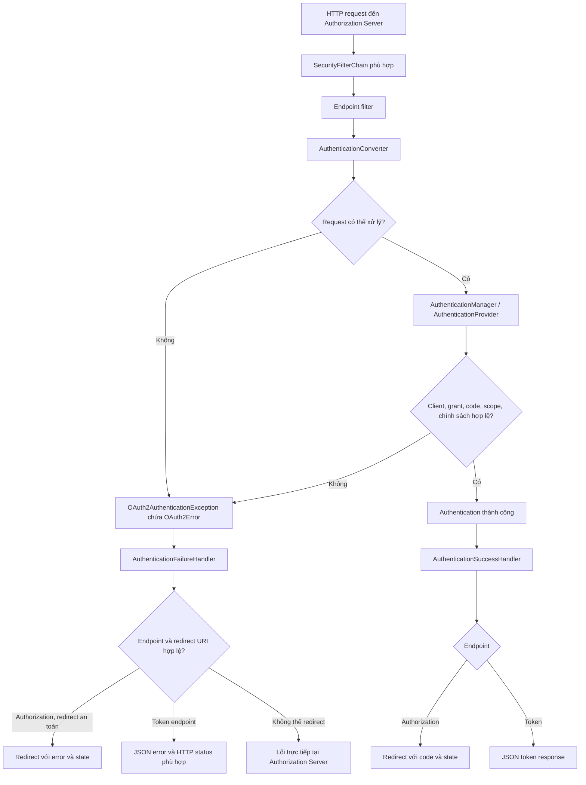

# Xử lý phản hồi thành công, thất bại và OAuth2Error

Trong một ứng dụng **Spring Boot** dùng **Spring Security** và **Spring Authorization Server** để triển khai OAuth 2.0/OpenID Connect (OIDC), xử lý request đúng mới là một nửa công việc. Nửa còn lại là **trả phản hồi đúng giao thức**: một authorization request thành công thường kết thúc bằng chuyển hướng trình duyệt mang authorization code, trong khi token request thành công trả JSON chứa token. Khi lỗi xảy ra, mã lỗi OAuth 2.0, cách truyền lỗi, HTTP status và nơi được phép chuyển hướng đều phụ thuộc endpoint.

Bài học thuộc chương **Kiến trúc xử lý** này hướng dẫn phân biệt nhánh thành công và thất bại, hiểu đối tượng `OAuth2Error`, lần theo quá trình từ filter đến authentication provider và response handler, tùy biến an toàn, kiểm thử và vận hành Authorization Server. Đây là kiến thức cần thiết để thiết kế hệ thống cấp quyền đáng tin cậy, tránh trả HTML vào token endpoint, redirect đến URL không hợp lệ hoặc lộ thông tin bí mật qua `error_description`.

## 1. Ba mức kết quả phải phân biệt

Một request được xử lý qua các lớp nhận diện giao thức, xác thực và biểu diễn HTTP. Không nên quy tất cả thất bại về một bộ HTTP error JSON chung.

| Mức | Câu hỏi | Ví dụ |
|---|---|---|
| **Nghiệp vụ/giao thức** | Grant/client/scope/code/PKCE có hợp lệ và được phép không? | Authorization code đã dùng lại → `invalid_grant` |
| **Mô hình lỗi** | Kết quả thất bại nào cần báo cho client? | `OAuth2Error(errorCode, description, uri)` |
| **Phản hồi của endpoint** | Lỗi/success được truyền qua redirect hay JSON, status và header nào? | Authorization error → redirect an toàn; token error → JSON, thường 400 |

Vì vậy **mã `error` không phải HTTP status**, và việc bắt được exception chưa bảo đảm đã tạo đúng response. Các endpoint có hợp đồng khác nhau:

| Endpoint | Thành công thường thấy | Thất bại thường thấy |
|---|---|---|
| `/oauth2/authorize` (Authorization Code) | `302` về redirect URI đã đăng ký với `code`, `state` nếu có | Redirect với `error` khi URI đủ tin cậy; nếu không, lỗi trực tiếp tại AS |
| `/oauth2/token` | `200` JSON có `access_token` và `token_type` | OAuth 2.0 JSON error, thường `400`; `invalid_client` có thể `401` |
| `/oauth2/introspect` | JSON trạng thái token theo RFC 7662 | Lỗi xác thực client hoặc request theo hợp đồng introspection |
| `/oauth2/revoke` | Phản hồi theo RFC 7009, không xác nhận token tồn tại | Lỗi client/request theo quy tắc revocation |
| Resource Server API | `2xx` dữ liệu được phép | `401`/`403` theo Bearer error và chính sách API |

**Không được chuyển máy móc mã lỗi của Resource Server** như `invalid_token`/`insufficient_scope` thành mã lỗi của token endpoint. Chúng thuộc các tầng giao thức khác nhau.

## 2. Đường đi từ HTTP request đến success/failure handler

Spring Authorization Server cung cấp các filter xử lý endpoint và các `AuthenticationProvider` để thực hiện grant. Có thể hình dung nhánh chính như sau:



Đây là **mô hình khái quát**, không phải trình tự bắt buộc của tất cả filter. Việc xác thực client tại token endpoint có thể được thực hiện **trước** token grant ở `OAuth2ClientAuthenticationFilter`; việc đăng nhập người dùng và consent tại authorization endpoint có thể trải qua nhiều request.

### 2.1. Vai trò từng thành phần của Spring

| Thành phần | Trách nhiệm | Điểm dễ nhầm |
|---|---|---|
| `OAuth2AuthorizationEndpointFilter` | Xử lý authorization request và kết quả ủy quyền | Không phải mọi request đến đây đều ngay lập tức cấp code; có bước login/consent |
| `OAuth2TokenEndpointFilter` | Chuyển đổi token request, gọi provider và ghi response | Thành công là token JSON; không redirect sang login |
| `OAuth2ClientAuthenticationFilter` | Xác thực confidential client hoặc phương thức client authentication khác | `invalid_client` có thể phát sinh trước `OAuth2TokenEndpointFilter` |
| `AuthenticationConverter` | Đọc và kiểm tra biểu mẫu/tham số thành đối tượng `Authentication` | Request sai cấu trúc có thể thất bại từ giai đoạn này |
| `AuthenticationProvider` | Xác thực grant/authorization code, scope, PKCE và chính sách | Có thể ném `OAuth2AuthenticationException` |
| `AuthenticationSuccessHandler` | Ghi success response đúng endpoint | Authorization success và token success có định dạng khác nhau |
| `AuthenticationFailureHandler` | Ghi error response đúng endpoint | Không phải lỗi nào cũng được phép redirect |

Một flow Authorization Code điển hình trải qua **hai lần phản hồi thành công riêng biệt**: authorization endpoint cấp code qua browser, rồi token endpoint đổi code thành token qua yêu cầu trực tiếp. Không gộp chúng thành một bước.

## 3. `OAuth2Error` và `OAuth2AuthenticationException`

### 3.1. `OAuth2Error` chứa gì?

Lớp `org.springframework.security.oauth2.core.OAuth2Error` biểu diễn lỗi ở mức giao thức. Các trường chính:

| Thuộc tính Java | Trường phản hồi OAuth | Ý nghĩa |
|---|---|---|
| `errorCode` | `error` | **Mã lỗi** để client phân nhánh xử lý; bắt buộc trong OAuth error response |
| `description` | `error_description` | Diễn giải ngắn, tùy chọn |
| `uri` | `error_uri` | URI tài liệu giải thích, tùy chọn |

`OAuth2Error` **không chứa HTTP status** và không tự ghi response. `OAuth2AuthenticationException` là ngoại lệ mang `OAuth2Error` để tầng xử lý tiếp theo có thể ghi phản hồi theo đúng endpoint.

Ví dụ trong nhánh kiểm tra của một custom grant/provider:

```java
import org.springframework.security.oauth2.core.OAuth2AuthenticationException;
import org.springframework.security.oauth2.core.OAuth2Error;
import org.springframework.security.oauth2.core.OAuth2ErrorCodes;

// Các biến allowedScopes và requestedScope thuộc ngữ cảnh của custom provider.
if (!allowedScopes.contains(requestedScope)) {
    OAuth2Error error = new OAuth2Error(
        OAuth2ErrorCodes.INVALID_SCOPE,
        "Requested scope is not permitted",
        null
    );
    throw new OAuth2AuthenticationException(error);
}
```

Đây là **đoạn mã minh họa nằm bên trong provider**, chưa phải class có thể chạy độc lập. Provider chỉ xác định lỗi; handler của endpoint mới quyết định response là redirect hay JSON. Nếu chỉ cần các grant mặc định, thường không cần viết custom provider hoặc tự ánh xạ các mã lỗi.

### 3.2. Mã lỗi phổ biến

| `error` | Endpoint/ngữ cảnh | Nguyên nhân điển hình |
|---|---|---|
| `invalid_request` | Authorization/token | Thiếu, lặp, sai định dạng tham số hoặc request không hợp lệ |
| `unauthorized_client` | Authorization/token | Client không được phép dùng flow/grant được yêu cầu |
| `access_denied` | Authorization | Người dùng hoặc AS từ chối cấp quyền, ví dụ từ chối consent |
| `unsupported_response_type` | Authorization | `response_type` không được hỗ trợ/cho phép |
| `invalid_scope` | Authorization/token | Scope không hợp lệ hoặc ngoài quyền được cấp |
| `server_error` | Authorization | AS gặp lỗi không thể hoàn tất request |
| `temporarily_unavailable` | Authorization | AS tạm thời không thể xử lý request |
| `invalid_client` | Token/client authentication | Client không hợp lệ hoặc xác thực client thất bại |
| `invalid_grant` | Token | Code/refresh token/grant không hợp lệ, hết hạn, đã dùng hoặc sai binding/PKCE |
| `unsupported_grant_type` | Token | `grant_type` không được hỗ trợ |

Những mã đầu thuộc các nhóm lỗi chuẩn của **RFC 6749**. Với OIDC, còn có các mã đặc thù như `login_required`, `interaction_required` hoặc `consent_required` cho những trường hợp OP không thể đáp ứng yêu cầu xác thực, chẳng hạn `prompt=none` không cho phép hiển thị giao diện tương tác.

### 3.3. Không gộp tất cả lỗi vào `invalid_request`

Hai request cùng dẫn tới HTTP 400 có thể cần phản hồi khác nhau:

- `grant_type` không được hỗ trợ → `unsupported_grant_type`.
- Client không có quyền dùng grant → `unauthorized_client`.
- Authorization code đã hết hạn/dùng lại → `invalid_grant`.
- Scope yêu cầu không hợp lệ → `invalid_scope`.
- Thiếu tham số bắt buộc → `invalid_request`.

Client sử dụng **mã lỗi**, không dựa vào văn bản `error_description`, để quyết định sửa request, khởi tạo authorization mới hay yêu cầu quản trị cấu hình.

## 4. Authorization endpoint: thành công và thất bại qua trình duyệt

### 4.1. Thành công của Authorization Code flow

Giả sử client `portal-web` đã đăng ký redirect URI `https://portal.example.com/login/oauth2/code/company`. Sau khi AS xác thực người dùng, xét consent nếu cần và phê duyệt request, authorization endpoint có thể trả:

```http
HTTP/1.1 302 Found
Location: https://portal.example.com/login/oauth2/code/company?code=AUTH_CODE&state=STATE_123
Cache-Control: no-store
```

Giá trị `AUTH_CODE` và `STATE_123` là placeholder. `state` được phản hồi khi có trong authorization request và client cần so khớp với phiên giao dịch ban đầu. Authorization code nhạy cảm, ngắn hạn, chỉ dùng một lần; **chưa phải access token**.

Nếu trình duyệt ban đầu bị chuyển sang trang `/login` hoặc form consent, đó là **bước trung gian**, không phải đã cấp authorization code. Handler cuối cùng chỉ tạo code/redirect sau khi yêu cầu thỏa các điều kiện.

### 4.2. Lỗi với redirect URI hợp lệ

Khi client và redirect URI đã được **xác minh hợp lệ**, việc người dùng từ chối consent có thể dẫn đến:

```http
HTTP/1.1 302 Found
Location: https://portal.example.com/login/oauth2/code/company?error=access_denied&state=STATE_123
```

Đây vẫn là một **HTTP redirect** nhưng mang kết quả thất bại của OAuth. Client cần kiểm tra `error` trước khi tìm `code`, đối chiếu `state` rồi thông báo hoặc xử lý theo UX của ứng dụng. Không được đổi token khi callback chỉ chứa `error`.

### 4.3. Lỗi khi không thể tin cậy redirect URI

Ví dụ kẻ tấn công gửi:

```http
GET /oauth2/authorize?response_type=code&client_id=portal-web&redirect_uri=https%3A%2F%2Fevil.example%2Fcallback&scope=openid HTTP/1.1
Host: identity.example.com
```

Nếu `evil.example` **không phải URI đã đăng ký hợp lệ** của `portal-web`, AS phải từ chối request **mà không redirect đến URI đó**. Tùy cấu hình, hệ thống có thể hiển thị trang lỗi hoặc trả lỗi trực tiếp tại chính AS. Không thể áp dụng quy tắc “mọi lỗi authorization đều redirect” vì điều đó tạo **open redirect** và có thể làm lộ kết quả ủy quyền.

### 4.4. Vì sao authorization error không mặc định là JSON?

Một OAuth2 Client web khởi tạo authorization request và đang chờ redirect trình duyệt tại redirect URI đã đăng ký. Nếu AS trả `400` cùng JSON `{"error":"access_denied"}` trong trường hợp được phép redirect, client có thể không bao giờ nhận thông điệp callback và luồng đăng nhập bị treo. Ngược lại, nếu request không có client/redirect URI đáng tin cậy, **không được redirect tùy ý chỉ để bảo toàn luồng UX**.

Lựa chọn redirect hoặc direct error phụ thuộc **khả năng tin cậy đối với URI và quy tắc của endpoint**, không phụ thuộc việc muốn hiển thị thông báo đẹp hay không.

## 5. Token endpoint: HTTP JSON response

### 5.1. Thành công khi đổi authorization code

Confidential client gửi request từ backend qua HTTPS:

```http
POST /oauth2/token HTTP/1.1
Host: identity.example.com
Content-Type: application/x-www-form-urlencoded
Authorization: Basic <REDACTED_CLIENT_AUTH>

grant_type=authorization_code&code=AUTH_CODE&redirect_uri=https%3A%2F%2Fportal.example.com%2Flogin%2Foauth2%2Fcode%2Fcompany&code_verifier=CODE_VERIFIER
```

Token response thành công minh họa cho OIDC Authorization Code flow:

```http
HTTP/1.1 200 OK
Content-Type: application/json;charset=UTF-8
Cache-Control: no-store
Pragma: no-cache

{
  "access_token": "REDACTED_ACCESS_TOKEN",
  "token_type": "Bearer",
  "expires_in": 300,
  "scope": "openid profile documents.read",
  "id_token": "REDACTED_ID_TOKEN"
}
```

Trong OAuth 2.0, `access_token` và `token_type` là các trường bắt buộc của token response thành công; `expires_in`, `scope` và `refresh_token` phụ thuộc grant và điều kiện cấp phát. Nếu request là OIDC Authorization Code hợp lệ, OP phải phát hành `id_token` theo OIDC. **Refresh token không phải lúc nào cũng được cấp.**

Đừng lẫn `200 JSON` của token endpoint với `302 redirect code` của authorization endpoint. Hai phản hồi xảy ra ở **hai giai đoạn độc lập**.

### 5.2. Thất bại khi đổi code

Code không hợp lệ, đã dùng hoặc sai PKCE thường dẫn đến `invalid_grant`:

```http
HTTP/1.1 400 Bad Request
Content-Type: application/json;charset=UTF-8
Cache-Control: no-store
Pragma: no-cache

{
  "error": "invalid_grant",
  "error_description": "Authorization grant is invalid"
}
```

`error_description` là tùy chọn; câu chữ không được coi là hợp đồng ổn định. Với client authentication thất bại qua HTTP Basic, token endpoint có thể dùng `401 Unauthorized` và `WWW-Authenticate` theo yêu cầu giao thức, cùng `error=invalid_client`. Không nên ép tất cả lỗi token endpoint thành HTTP 400 nếu trái cơ chế xác thực HTTP đang sử dụng.

### 5.3. Ma trận lỗi token endpoint

| Điều kiện | Mã lỗi mong đợi trong tình huống điển hình | Kiểm tra liên quan |
|---|---|---|
| Thiếu `grant_type` hoặc dữ liệu sai định dạng | `invalid_request` | Converter/validation |
| Grant type không hỗ trợ | `unsupported_grant_type` | Endpoint/grant registrations |
| Client không được dùng grant | `unauthorized_client` | Registered client và grant policy |
| Client secret/khóa xác thực sai | `invalid_client` | Client authentication filter/provider |
| Code hết hạn/đã dùng/sai client | `invalid_grant` | Authorization storage và client binding |
| `code_verifier` sai | `invalid_grant` | PKCE và code challenge |
| Refresh token không hợp lệ/đã thu hồi | `invalid_grant` | Refresh token storage/revocation |
| Scope yêu cầu không hợp lệ | `invalid_scope` | Allowed scope và token grant policy |

Nếu một request sai **nhiều điều kiện cùng lúc**, thứ tự xử lý có thể quyết định lỗi được thấy đầu tiên. Ví dụ client secret không đúng có thể bị từ chối trước khi AS đọc authorization code. Test phải dùng fixture đúng ở các lớp khác khi muốn kiểm tra một mã lỗi cụ thể.

## 6. Khác biệt với lỗi Spring Security thông thường

Trong hệ sinh thái Spring, không phải mọi ngoại lệ đều được xử lý bởi cùng một handler.

### 6.1. OAuth2AuthenticationException

Khi một `AuthenticationConverter` hoặc `AuthenticationProvider` phát hiện lỗi theo quy tắc OAuth 2.0, nó có thể ném `OAuth2AuthenticationException` chứa `OAuth2Error`. Endpoint filter/failure handler biến thông tin đó thành redirect hoặc JSON. Một custom grant/provider nên sử dụng mã OAuth đúng nguyên nhân thay vì ném `IllegalArgumentException` hoặc leak exception của cơ sở dữ liệu.

### 6.2. AuthenticationException, AccessDeniedException và ExceptionTranslationFilter

Spring Security còn có `AuthenticationException`, `AccessDeniedException`, `AuthenticationEntryPoint`, `AccessDeniedHandler` và `ExceptionTranslationFilter` cho kiểm soát truy cập ứng dụng. Các thành phần này quan trọng, nhưng **các endpoint OAuth2 có handler và hợp đồng response riêng**.

Ví dụ:

- User chưa đăng nhập ở authorization endpoint → hệ thống có thể chuyển tới login theo cơ chế web authentication; đây chưa phải kết quả token grant.
- Confidential client xác thực sai tại token endpoint → phản hồi `invalid_client`, **không** redirect đến trang login của người dùng.
- API Resource Server không nhận access token → `401` và thường `WWW-Authenticate: Bearer`; lỗi này không phải `invalid_grant`.
- User xác thực được nhưng thiếu quyền đọc một bản ghi API → thường `403`; khác với `access_denied` do từ chối consent.

### 6.3. ControllerAdvice không bao trùm security filter

`@RestControllerAdvice` của Spring MVC thường xử lý ngoại lệ sinh ra trong controller. OAuth2 endpoint của Spring Authorization Server lại được xử lý trong **Spring Security filter chain**, trước MVC controller. Vì vậy một global MVC exception handler không mặc nhiên nhận các `OAuth2AuthenticationException` đã được filter bắt và chuyển thành response. Muốn thay đổi phản hồi token/authorization, phải chọn **đúng hook của endpoint filter/configurer**.

## 7. Tùy biến phản hồi trong Spring Authorization Server

### 7.1. Vị trí cấu hình endpoint handlers

Ví dụ cấu trúc cấu hình dùng DSL của các phiên bản Spring Authorization Server hỗ trợ `HttpSecurity.with(...)`:

```java
@Bean
@Order(1)
SecurityFilterChain authorizationServerChain(HttpSecurity http) throws Exception {
    OAuth2AuthorizationServerConfigurer authorizationServer =
        OAuth2AuthorizationServerConfigurer.authorizationServer();

    http.securityMatcher(authorizationServer.getEndpointsMatcher())
        .with(authorizationServer, server -> server
            .oidc(Customizer.withDefaults())
            .authorizationEndpoint(endpoint -> {
                // endpoint.authorizationResponseHandler(...);
                // endpoint.errorResponseHandler(...);
            })
            .tokenEndpoint(endpoint -> {
                // endpoint.accessTokenResponseHandler(...);
                // endpoint.errorResponseHandler(...);
            }))
        .authorizeHttpRequests(auth -> auth
            .anyRequest().authenticated())
        .exceptionHandling(ex -> ex
            .defaultAuthenticationEntryPointFor(
                new LoginUrlAuthenticationEntryPoint("/login"),
                new MediaTypeRequestMatcher(MediaType.TEXT_HTML)
            ));

    return http.build();
}
```

Đây là **khung cấu hình minh họa vị trí mở rộng**, chưa phải ứng dụng chạy độc lập. Còn cần `RegisteredClientRepository`, cấu hình issuer, nguồn khóa ký/JWK, lưu authorization/consent và một `SecurityFilterChain` cho đăng nhập người dùng. DSL/bean API có thể khác tùy phiên bản, vì vậy đối chiếu reference của phiên bản được dùng.

Các điểm mở rộng thường gặp:

| Endpoint configurer | Handler thành công | Handler thất bại |
|---|---|---|
| Authorization endpoint | `authorizationResponseHandler(...)` | `errorResponseHandler(...)` |
| Token endpoint | `accessTokenResponseHandler(...)` | `errorResponseHandler(...)` |

Handler thuộc kiểu `AuthenticationSuccessHandler` / `AuthenticationFailureHandler` tương ứng. **Thay handler nghĩa là nhận trách nhiệm ghi response giao thức**: status, redirect URI, `state`, JSON shape, cache header và các quy tắc bảo mật. Nếu mục tiêu chỉ là quan sát/audit, ưu tiên cơ chế quan sát hoặc delegate lại handler chuẩn, tránh tự viết parser và JSON OAuth2 không cần thiết.

### 7.2. Lỗi trong custom AuthenticationProvider

Một custom provider nên báo lỗi theo nguyên nhân, đồng thời tránh tiết lộ trạng thái nội bộ. Ví dụ:

```java
// Pseudocode đặt bên trong custom provider sau khi load authorization.
if (authorizationNotFound || codeAlreadyUsed || codeExpired) {
    OAuth2Error error = new OAuth2Error(
        OAuth2ErrorCodes.INVALID_GRANT,
        "The authorization grant is invalid",
        null
    );
    throw new OAuth2AuthenticationException(error);
}
```

Các biến là placeholder của domain/logic custom provider. Với grant tích hợp, Spring Authorization Server đã cung cấp validation và handler; **không tự viết lại nếu chỉ muốn đổi error_description**. Giữ các kiểm tra code dùng một lần, thời hạn, client binding, redirect URI và PKCE theo hợp đồng.

### 7.3. Lỗi client authentication có thể xảy ra trước token endpoint

Nếu client secret sai, `OAuth2ClientAuthenticationFilter` có thể từ chối trước khi `OAuth2TokenEndpointFilter` chạy. Do đó thay `tokenEndpoint.errorResponseHandler(...)` không nhất thiết thay đổi tất cả phản hồi `invalid_client`. Cần lần theo **filter nào thực sự bắt exception** và chọn đúng điểm mở rộng; kiểm thử các tình huống với client authentication sai.

### 7.4. Không đổi toàn bộ lỗi thành JSON hoặc HTTP 500

Một handler dạng “bắt mọi `Exception` rồi `response.setStatus(500)` và ghi `{"message":"error"}`” có thể làm hỏng:

- Redirect response của authorization endpoint (mất `code`/`error`/`state`).
- Token error response mà client mong đợi có trường `error`.
- Các header quan trọng như `WWW-Authenticate`, `Cache-Control`.
- Phân biệt lỗi cấu hình client với lỗi hệ thống để vận hành an toàn.

Chỉ tùy biến khi có yêu cầu cụ thể và phải kiểm tra hồi quy toàn bộ hợp đồng endpoint sau thay đổi.

## 8. Bảo mật dữ liệu trong success và error response

### 8.1. Không phản chiếu secret qua error_description

Đây là phản hồi **không an toàn**:

```json
{
  "error": "invalid_client",
  "error_description": "Client portal-web failed secret check. Provided secret: abc123"
}
```

Phản hồi an toàn hơn:

```json
{
  "error": "invalid_client"
}
```

`error_description`, `error_uri` và cả nội dung trang lỗi đều là **bề mặt đầu ra bên ngoài**. Không đưa client secret, mật khẩu, refresh token, authorization code, SQL, stack trace, private key, host nội bộ hoặc dữ liệu cá nhân vào chúng. Chẩn đoán nên dựa trên mã tương quan (correlation ID) và log nội bộ đã che dữ liệu.

### 8.2. Không redirect về URI chưa được xác minh

AS phải kiểm tra `client_id`, registered redirect URI, grant và quy tắc so khớp **trước khi phản hồi authorization qua URI của client**. Trường hợp `redirect_uri` sai cần xử lý lỗi tại AS; không dùng chuỗi URL do request cung cấp để tạo `Location` dù đang gửi *failure response*. Redirect đến origin lạ có thể tạo open redirect hoặc rò rỉ code/error/state.

### 8.3. Header và lưu trữ

- Token response có thông tin nhạy cảm cần `Cache-Control: no-store` và `Pragma: no-cache` theo RFC 6749.
- Không ghi raw `Authorization` header, `code_verifier`, code, access token, refresh token và cookie phiên vào access log, tracing, exception hoặc telemetry.
- Khi response đi qua trình duyệt, xem xét `Referrer-Policy`, cookie `Secure`/`HttpOnly`/`SameSite`, CSRF protection và redirect callback về URL sạch.
- Token endpoint dùng HTTPS; dù request gửi trực tiếp, proxy/APM vẫn có thể ghi body/header nếu cấu hình logging sai.
- Mỗi Resource Server cần kiểm tra access token của mình: chữ ký hoặc introspection, issuer, thời hạn, audience và scope/quyền theo API. Không dùng ID Token thay access token.

### 8.4. Lỗi hệ thống không phải lúc nào cũng là invalid_grant

Lỗi database, không lấy được khóa ký hoặc lỗi hạ tầng không nên bị báo sai thành `invalid_grant` để “an toàn hơn”: mã này nói rằng **grant không hợp lệ**, khiến client xử lý sai và che khuất sự cố vận hành. Cần phản hồi thất bại an toàn theo hợp đồng endpoint, tránh lộ chi tiết nội bộ; lưu telemetry có correlation ID để điều tra. Với authorization endpoint, vẫn phải tuân thủ quy tắc chỉ redirect khi URI tin cậy.

## 9. Phía OAuth2 Client phải diễn giải response như thế nào?

Một client đúng chuẩn cần xử lý cả success và failure:

1. Với callback authorization, kiểm tra `state` gắn với phiên giao dịch và nếu nhận `error` thì dừng nhánh đổi code; chỉ gọi token endpoint khi có `code` hợp lệ.
2. Với `access_denied`, thể hiện thông báo từ chối quyền phù hợp; tránh vòng lặp xin consent vô hạn.
3. Với `invalid_grant`, không retry cùng một authorization code đã dùng/hết hạn; chỉ tạo luồng authorization mới nếu phù hợp.
4. Với `invalid_client`, kiểm tra cấu hình backend/registered client và bí mật client; không hiển thị secret cho người dùng.
5. Với lỗi tạm thời, dùng retry giới hạn theo ngữ cảnh; không lặp request có tác dụng một lần một cách mù quáng.
6. Với token thành công, kiểm tra ID Token khi là OIDC RP, lưu token an toàn và gọi API với access token đúng audience/quyền.

Client không nên suy ra thành công chỉ từ HTTP `302` hoặc `200`: callback `302` có thể chứa `error`, còn token `200` phải có các trường và giá trị đúng giao thức.

## 10. Kiểm thử hợp đồng thành công, thất bại

Unit test của một `AuthenticationProvider` chỉ xác minh quyết định cấp quyền; **integration test đi qua filter chain** mới xác minh được HTTP response cuối cùng.

### 10.1. Ma trận kiểm thử

| Tình huống | Điều cần assert |
|---|---|
| Authorization request hợp lệ | Redirect đến URI đã đăng ký, có `code`/`state`, không có access token trong URL |
| Người dùng chưa login | Bước login phù hợp; không nhầm là đã cấp code |
| Từ chối consent | Redirect tới URI hợp lệ có `error=access_denied` và `state` nếu request có |
| Redirect URI chưa đăng ký | Không bao giờ có `Location` trỏ đến URI không tin cậy |
| Token request hợp lệ | `200`, JSON `access_token`/`token_type`, headers chống cache |
| Authorization code đã dùng/hết hạn | Error JSON `invalid_grant`, không phát token mới |
| PKCE verifier sai | `invalid_grant`, không cấp token |
| Client secret sai | `invalid_client`, status/`WWW-Authenticate` theo phương thức xác thực |
| Grant type không hỗ trợ | `unsupported_grant_type` |
| Scope không được phép | `invalid_scope` hoặc lỗi đúng vị trí chính sách |
| Token endpoint thiếu tham số | `invalid_request` hoặc mã phù hợp, không trả HTML login |
| Sự cố hạ tầng | Không lộ secret, stack trace, SQL, thông tin private key |
| Resource Server nhận ID Token | Từ chối vì token không dành để truy cập API |

### 10.2. Ví dụ kiểm thử MockMvc cho invalid_grant

Giả sử môi trường test đã đăng ký confidential client `portal-web` với secret `test-client-secret` và cho phép Authorization Code grant:

```java
@SpringBootTest
@AutoConfigureMockMvc
class TokenEndpointErrorTests {
    @Autowired
    MockMvc mvc;

    @Test
    void unknownAuthorizationCodeReturnsInvalidGrant() throws Exception {
        mvc.perform(post("/oauth2/token")
                .with(httpBasic("portal-web", "test-client-secret"))
                .contentType(MediaType.APPLICATION_FORM_URLENCODED)
                .param("grant_type", "authorization_code")
                .param("code", "nonexistent-code")
                .param("redirect_uri",
                    "https://portal.example.com/login/oauth2/code/company")
                .param("code_verifier", "example-verifier-for-test-only"))
            .andExpect(status().isBadRequest())
            .andExpect(content().contentTypeCompatibleWith(MediaType.APPLICATION_JSON))
            .andExpect(jsonPath("$.error").value("invalid_grant"));
    }
}
```

Ví dụ yêu cầu imports và fixture Spring Test/MockMvc phù hợp; các thông số là **dữ liệu thử nghiệm**, không phải thông tin thật. Nếu client không được đăng ký hoặc secret sai, response có thể là `invalid_client` trước khi AS kiểm tra code. Test này minh họa code không tồn tại; **để test PKCE**, phải tạo code hợp lệ với `code_challenge` rồi đổi bằng `code_verifier` sai.

### 10.3. Hai nhánh redirect phải kiểm thử độc lập

**Nhánh URI hợp lệ:** khởi tạo authorization request với client/redirect URI đã đăng ký, tạo điều kiện lỗi như từ chối consent, rồi assert `Location` có host/URI hợp lệ, tham số `error` và `state` tương ứng. **Chỉ kiểm tra HTTP 302 là không đủ.**

**Nhánh URI không hợp lệ:** gửi request với redirect URI trỏ sang origin chưa đăng ký. Assert AS từ chối **mà không redirect đến origin đó**. HTTP status của lỗi trực tiếp có thể khác nhau theo cấu hình, nhưng quy tắc bảo mật redirect là bắt buộc.

### 10.4. Trường hợp cần test sau khi thay custom handler

Nếu gắn custom success/failure handler để thêm audit hoặc correlation ID, cần xác minh lại:

- Authorization success vẫn mang code/state; authorization failure vẫn phản hồi ở redirect URI an toàn.
- Token success vẫn JSON token; token failure vẫn JSON với `error` phù hợp.
- Client authentication failure vẫn đúng nhánh filter và mã `invalid_client`.
- Header chống cache, `WWW-Authenticate` khi cần và `Content-Type` không bị mất.
- Không lộ raw code, token, client secret, code verifier hoặc private key qua body/header/log.
- Grant không có browser như `client_credentials` vẫn thực hiện đúng theo quyền client.

## 11. Sai lầm kiến trúc thường gặp

| Cách làm sai | Vì sao nguy hiểm | Cách làm đúng |
|---|---|---|
| Một handler JSON cho tất cả request OAuth | Client web không nhận redirect/code/error/state | Tôn trọng hợp đồng từng endpoint |
| Trả `302 /login` ở token endpoint khi client secret sai | Machine client nhận HTML thay OAuth error | Trả `invalid_client` theo client authentication |
| Mọi lỗi đều là `invalid_request` | Client không phân biệt nguyên nhân | Chọn `OAuth2ErrorCodes` đúng nguyên nhân |
| Redirect mọi authorization error về input `redirect_uri` | Open redirect và nguy cơ rò rỉ | Xác minh redirect URI trước |
| Trả `{"message":"bad code"}` thay `{"error":"invalid_grant"}` | Client chuẩn không đọc được mã giao thức | Giữ trường `error` |
| In stack trace/secret vào `error_description` | Lộ dữ liệu bảo mật | Description ngắn, log nội bộ đã che |
| Trả access token trên authorization redirect | Token lộ qua browser, sai Authorization Code flow | Cấp code trước, token ở token endpoint |
| Viết custom provider bỏ kiểm tra code/PKCE | Replay hoặc đổi code trái phép | Giữ logic bảo mật chuẩn và kiểm thử |
| Chỉ assert status HTTP trong test | Không phát hiện sai body/Location/header | Test toàn bộ protocol response |

## 12. Quy trình chẩn đoán khi phản hồi bất thường

1. **Xác định endpoint và grant.** Đây là authorization, token, client authentication, introspection, OIDC hay API Resource Server?
2. **Tìm filter xử lý request.** Kiểm tra `SecurityFilterChain` matcher, filter endpoint, converter và provider.
3. **Xác định failure path.** Exception là `OAuth2AuthenticationException`, lỗi authentication/authorization của Spring hay lỗi hệ thống? Handler nào ghi response?
4. **Đọc `error`/status/`Location`.** Xác nhận body JSON hay redirect phù hợp; đừng dựa duy nhất vào `error_description`.
5. **Kiểm tra dữ liệu nguồn.** Registered client, redirect URI, grant/scope, consent, code lifetime, PKCE, issuer và token state.
6. **Đối chiếu test và chuẩn.** Có `state` khi cần, JSON field đúng, status và header đủ, không redirect sang URI sai?
7. **Phân tích log đã che dữ liệu.** Sử dụng correlation ID, tránh lưu token, secret, code và dữ liệu cá nhân.

Quy trình này phân biệt lỗi yêu cầu của client, lỗi chính sách cấp quyền, lỗi authentication và lỗi vận hành, từ đó tránh sửa nhầm một error handler khi nguyên nhân thực sự nằm trong client registration hoặc token storage.

## 13. Tổng kết

- **`OAuth2Error`** mô tả mã lỗi chuẩn; **`OAuth2AuthenticationException`** truyền lỗi lên tầng xử lý để endpoint handler tạo HTTP response.
- **Authorization endpoint** dùng redirect cho success/error khi URI đã xác minh; không redirect lỗi đến URI chưa đáng tin cậy.
- **Token endpoint** trả JSON token hoặc OAuth JSON error. `invalid_client`, `invalid_grant`, `invalid_scope` có ý nghĩa khác nhau và không phải chỉ là tên gọi của HTTP 400.
- Trong **Spring Authorization Server**, filter, converter, provider, success/failure handler có trách nhiệm khác nhau. Tùy biến tại đúng điểm mở rộng và giữ nguyên hợp đồng giao thức.
- Kiểm thử toàn bộ **mã lỗi, status, body, redirect, state, headers, bảo vệ credential** trước khi đưa Authorization Server vào vận hành.

Nắm chắc kiến trúc xử lý phản hồi giúp thiết kế, cấu hình, bảo mật, kiểm thử và vận hành Authorization Server OAuth 2.0/OIDC trên Spring Boot, đồng thời giúp OAuth2 Client và Resource Server diễn giải kết quả nhất quán.

## 14. Tài liệu chuẩn

- [RFC 6749 — OAuth 2.0 Authorization Framework](https://www.rfc-editor.org/rfc/rfc6749): §4.1.2 (authorization response), §4.1.2.1 (authorization error), §5.1 (token success), §5.2 (token error).
- [RFC 6750 — Bearer Token Usage](https://www.rfc-editor.org/rfc/rfc6750): lỗi Bearer ở Resource Server.
- [RFC 7636 — Proof Key for Code Exchange](https://www.rfc-editor.org/rfc/rfc7636): `code_challenge` và `code_verifier`.
- [RFC 9700 — Best Current Practice for OAuth 2.0 Security](https://www.rfc-editor.org/rfc/rfc9700): các yêu cầu bảo vệ OAuth2.
- [OpenID Connect Core 1.0](https://openid.net/specs/openid-connect-core-1_0.html): OIDC flow, ID Token và lỗi xác thực.
- [Spring Authorization Server Reference](https://docs.spring.io/spring-authorization-server/reference/): endpoint configurers và protocol customization.
- [Spring Security Reference](https://docs.spring.io/spring-security/reference/): authentication, exception handling và OAuth2.
