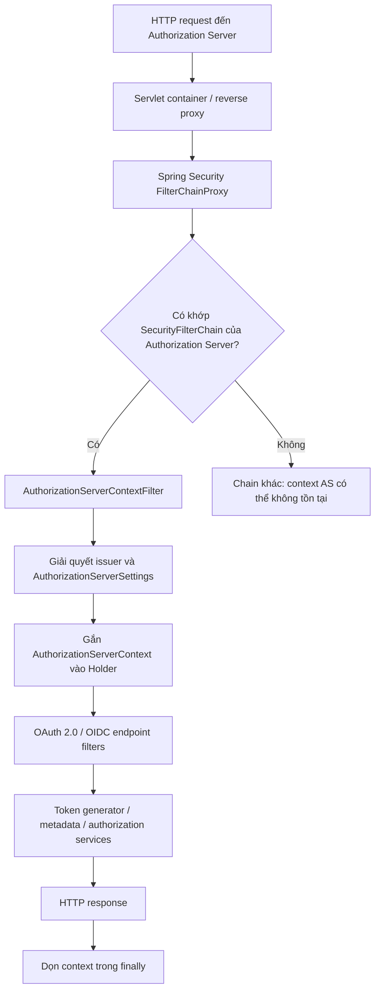
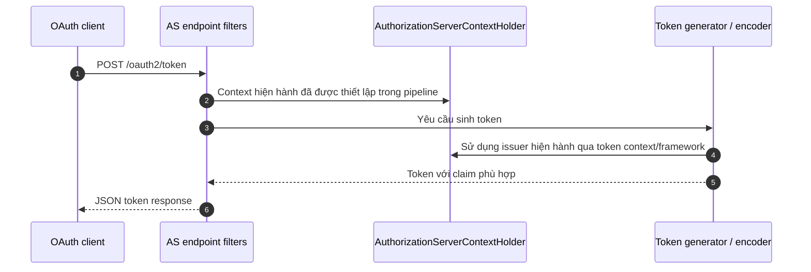
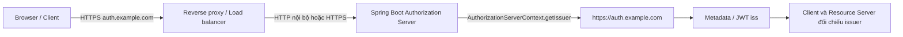

# Vai trò của AuthorizationServerContext và issuer hiện hành

## 1. Đặt vấn đề: Authorization Server đang xử lý yêu cầu cho issuer nào?

Trong chương **Kiến trúc xử lý** của module **SPRING_SECURITY_OAUTH2_OIDC_AUTHORIZATION_SERVER**, chúng ta tìm hiểu một chi tiết quan trọng khi thiết kế, cấu hình, bảo mật, kiểm thử và vận hành OAuth 2.0/OpenID Connect Authorization Server bằng Spring Security và Spring Authorization Server trên Spring Boot: **làm thế nào các thành phần xử lý biết danh tính của Authorization Server đang phục vụ request hiện tại?**

Khi một ứng dụng gọi `/oauth2/authorize`, `/oauth2/token` hoặc endpoint OpenID Connect, các bộ lọc, bộ sinh token và bộ sinh metadata cần cùng một cách xác định **issuer**. Đó là vai trò của `AuthorizationServerContext`.

Ví dụ, người dùng truy cập Authorization Server tại:

```text
https://auth.example.com
```

Issuer công khai được công bố có thể là:

```text
https://auth.example.com
```

Một ID Token được ký có thể mang claim:

```json
{
  "iss": "https://auth.example.com",
  "sub": "user-123",
  "aud": "demo-web",
  "iat": 1770000000,
  "exp": 1770000300
}
```

Các số thời gian và danh tính trong ví dụ chỉ có tính minh họa. Bên nhận token cần biết rằng `iss` này khớp với issuer đã tin cậy, bên cạnh việc kiểm tra chữ ký, `aud`, thời hạn và các yêu cầu khác của giao thức. **Issuer không chỉ là một URL để ghép đường dẫn**: đó là định danh bảo mật của Authorization Server, được dùng để ràng buộc metadata và token với đúng bên phát hành.

Sau bài này, người học có thể:

- Giải thích được `AuthorizationServerContext`, `AuthorizationServerContextHolder` và `AuthorizationServerSettings` khác nhau như thế nào.
- Theo dõi cách Spring Authorization Server thiết lập context theo vòng đời một HTTP request.
- Lấy và sử dụng issuer hiện hành đúng nơi, đồng thời tránh đọc context khi không có request phù hợp.
- Phân biệt issuer với URL endpoint, hostname nội bộ, `redirect_uri`, `audience` và Spring Security `SecurityContext`.
- Phân tích tác động của reverse proxy, TLS, nhiều hostname và kiến trúc đa tenant đến việc xác định issuer.
- Thiết kế các phép kiểm thử phát hiện issuer không nhất quán giữa metadata, token và cấu hình bên nhận.

## 2. Ba thành phần cần phân biệt

### 2.1. `AuthorizationServerSettings`: cấu hình có hiệu lực cho server

`AuthorizationServerSettings` chứa những thiết lập liên quan đến Authorization Server, ví dụ **issuer** và các đường dẫn endpoint. Một bean cấu hình đơn giản:

```java
import org.springframework.context.annotation.Bean;
import org.springframework.context.annotation.Configuration;
import org.springframework.security.oauth2.server.authorization.settings.AuthorizationServerSettings;

@Configuration
public class AuthorizationServerConfig {

    @Bean
    AuthorizationServerSettings authorizationServerSettings() {
        return AuthorizationServerSettings.builder()
                .issuer("https://auth.example.com")
                .build();
    }
}
```

Ở ví dụ này, `https://auth.example.com` là **issuer cố định**, được chỉ định rõ cho môi trường triển khai. Các endpoint như authorization, token, JWK Set, introspection hoặc revocation sử dụng giá trị mặc định của phiên bản thư viện trừ khi được tùy chỉnh thêm.

`AuthorizationServerSettings` **không phải đối tượng mô tả người dùng đang đăng nhập**, không phải repository chứa authorization code và cũng không phải request/response HTTP. Nó là **nguồn cấu hình** để các thành phần giao thức tạo ra những thông tin nhất quán.

### 2.2. `AuthorizationServerContext`: trạng thái của Authorization Server đối với request hiện tại

Trong Spring Authorization Server, `AuthorizationServerContext` biểu diễn **ngữ cảnh Authorization Server đang được sử dụng trong luồng xử lý hiện tại**. Những thông tin quan trọng có thể truy cập gồm:

```java
AuthorizationServerSettings settings = context.getAuthorizationServerSettings();
String issuer = context.getIssuer();
```

Hai dòng trên mang ý nghĩa khác nhau:

- `getAuthorizationServerSettings()` cung cấp các thiết lập Authorization Server mà context đang dùng.
- `getIssuer()` cung cấp **issuer đã được xác định cho ngữ cảnh hiện hành**. Đây là giá trị quan trọng nhất khi các thành phần cần biết bên phát hành token là ai.

Trong hệ thống một issuer có cấu hình tường minh, hai giá trị thường trông rất đơn giản: issuer hiện hành chính là issuer cấu hình. Trong các trường hợp issuer không cấu hình tường minh hoặc hệ thống nhiều issuer, việc xác định nó phụ thuộc vào **request và cấu hình của Authorization Server**. Vì vậy không nên mặc định suy ra issuer từ một hostname nội bộ hoặc tự nối URL thủ công.

### 2.3. `AuthorizationServerContextHolder`: điểm truy cập context của luồng hiện tại

`AuthorizationServerContextHolder` là cơ chế truy cập context đang được gắn với **luồng xử lý request hiện tại**. Trong cách hoạt động của Spring Authorization Server trên servlet stack, holder sử dụng ngữ cảnh theo thread và được các thành phần framework thiết lập, dọn dẹp theo vòng đời xử lý request.

```java
import org.springframework.security.oauth2.server.authorization.context.AuthorizationServerContext;
import org.springframework.security.oauth2.server.authorization.context.AuthorizationServerContextHolder;

AuthorizationServerContext context = AuthorizationServerContextHolder.getContext();

if (context != null) {
    String currentIssuer = context.getIssuer();
    // Sử dụng issuer trong phạm vi xử lý request thích hợp.
}
```

`getContext()` **có thể trả về `null`** nếu lệnh được gọi ngoài phạm vi mà Authorization Server thiết lập context, ví dụ từ một scheduled job, một thread khác hoặc một endpoint không thuộc chuỗi xử lý liên quan. Vì vậy không nên dùng `AuthorizationServerContextHolder.getContext().getIssuer()` ở mọi nơi mà không xét đến phạm vi thực thi.

| Đối tượng | Câu hỏi nó trả lời | Phạm vi điển hình |
| --- | --- | --- |
| `AuthorizationServerSettings` | Authorization Server được cấu hình với những thiết lập gì? | Bean cấu hình ứng dụng. |
| `AuthorizationServerContext` | Đối với request đang xử lý, issuer và settings hiệu lực là gì? | Một lần xử lý request của Authorization Server. |
| `AuthorizationServerContextHolder` | Thành phần đang chạy có thể lấy context hiện hành từ đâu? | Luồng thực thi request đang được framework quản lý. |
| `SecurityContextHolder` | Chủ thể bảo mật (`Authentication`) hiện tại là ai? | Ngữ cảnh Spring Security của luồng xử lý. |

**Phân biệt quan trọng:** `AuthorizationServerContext` cho biết **Authorization Server nào** đang phục vụ; còn `SecurityContext` cho biết **chủ thể nào** được xác thực. Một token endpoint đang xác thực confidential client và một authorization endpoint đang xử lý user session có thể cùng issuer nhưng có authentication context khác nhau.

## 3. Vòng đời của context trong kiến trúc xử lý

### 3.1. Từ HTTP request đến các endpoint giao thức

Spring Authorization Server tích hợp vào Spring Security servlet thông qua `SecurityFilterChain` cho các endpoint giao thức. Trong phần cấu hình Authorization Server có thành phần nội bộ chịu trách nhiệm tạo và gắn `AuthorizationServerContext` vào luồng xử lý, thường được nhắc đến dưới tên **`AuthorizationServerContextFilter`**.



Diễn giải từng bước:

1. Client gửi request đến URL công khai của Authorization Server. Request được container và các lớp proxy chuyển vào ứng dụng Spring Boot.
2. `FilterChainProxy` chọn `SecurityFilterChain` khớp với request. Chuỗi xử lý giao thức được Spring Authorization Server cấu hình thông qua `OAuth2AuthorizationServerConfigurer`.
3. Thành phần quản lý context xác định issuer hiệu lực dựa trên `AuthorizationServerSettings` và thông tin request khi cần.
4. `AuthorizationServerContext` được gắn vào `AuthorizationServerContextHolder`; các thành phần giao thức phía sau có thể đọc cùng một ngữ cảnh.
5. Endpoint thực thi logic như kiểm tra client, kiểm tra authorization code, xử lý consent hoặc sinh token/metadata.
6. Sau khi xử lý xong, framework dọn context khỏi holder để request khác không vô tình sử dụng ngữ cảnh còn sót lại.

Sơ đồ mô tả **vai trò logic**; thứ tự chính xác giữa các security filter phụ thuộc vào phiên bản và cấu hình framework. Không cần tự thêm `AuthorizationServerContextFilter` bằng tay vào một ứng dụng Spring Authorization Server được cấu hình chuẩn. Tự quản lý holder một cách tùy tiện dễ tạo lỗi giữ lại context giữa các request.

### 3.2. Vì sao context phải sống theo request?

Giả sử một server xử lý hai request gần như đồng thời:

```text
Request A: https://auth.example.com/oauth2/token
Request B: https://auth.example.com/oauth2/authorize
```

Từng request có thể có principal và grant khác nhau; các thành phần cần nhất quán về issuer **trong chính request đó**. Không nên lưu issuer hiện hành vào một biến `static` mutable hay singleton field rồi cho nhiều request ghi đè. Nếu hệ thống hỗ trợ nhiều issuer, cách làm đó còn có nguy cơ gây nhầm tenant.

Ngữ cảnh theo thread thuận tiện trong servlet request đồng bộ, nhưng không tự động được lan truyền an toàn qua các thread bất đồng bộ. Những nơi như `@Async`, executor, scheduled job hoặc message consumer nên nhận **issuer/tenant định danh tường minh** từ dữ liệu nghiệp vụ nếu thật sự cần, thay vì kỳ vọng holder luôn sẵn có.

### 3.3. Context khác authorization state và session

`AuthorizationServerContext` **không phải**:

- **HTTP session:** nơi quản lý thông tin đăng nhập hoặc dữ liệu theo phiên trình duyệt.
- **`OAuth2AuthorizationService`:** nơi lưu trạng thái authorization, code, access/refresh token và thông tin liên quan theo mô hình của Spring Authorization Server.
- **`RegisteredClientRepository`:** nơi chứa cấu hình client đã đăng ký.
- **`SecurityContext`:** nơi lưu `Authentication` được Spring Security xử lý.
- **`HttpServletRequest`:** toàn bộ dữ liệu của HTTP request như URL, header, cookie và remote address.

Context tập trung vào **thông tin Authorization Server hiệu lực**, để các thành phần giao thức nhận một định danh nhất quán mà không phải tự đọc cấu hình và URL request nhiều lần.

## 4. Issuer hiện hành là gì và được xác định như thế nào?

### 4.1. Ý nghĩa của issuer trong OAuth 2.0 và OpenID Connect

**Issuer** là định danh bằng URL của bên phát hành token và metadata. Với OpenID Connect, giá trị `iss` trong ID Token phải khớp chính xác với issuer mà client kỳ vọng dựa trên cấu hình/khám phá nhà cung cấp. Với OAuth 2.0, issuer cũng là trung tâm của metadata Authorization Server và các cơ chế xác định bên phát hành token có hỗ trợ.

Một issuer điển hình:

```text
https://auth.example.com
```

Issuer có thể chứa đường dẫn, ví dụ:

```text
https://auth.example.com/tenant-a
```

Tuy nhiên issuer cần là URL được thiết kế theo quy tắc giao thức, ổn định và nhất quán, không chứa query hoặc fragment. Trong triển khai internet thực tế, sử dụng **HTTPS** và tên miền công khai đáng tin cậy; `http://localhost` chỉ phù hợp cho bài thực hành cục bộ.

Đừng nhầm các loại URL:

| Khái niệm | Ví dụ | Vai trò |
| --- | --- | --- |
| Issuer | `https://auth.example.com` | Định danh Authorization Server/OP. |
| Authorization endpoint | `https://auth.example.com/oauth2/authorize` | Nơi client gửi yêu cầu xin quyền. |
| Token endpoint | `https://auth.example.com/oauth2/token` | Nơi client đổi code hoặc sử dụng grant hợp lệ để lấy token. |
| JWK Set endpoint | `https://auth.example.com/oauth2/jwks` | Công bố public JWK cho bên xác minh chữ ký. |
| Client redirect URI | `https://client.example.com/login/oauth2/code/demo-web` | Địa chỉ callback do client đăng ký, **không phải issuer**. |
| JWT `aud` | `https://api.example.com` hoặc định danh resource | Bên nhận dự kiến của token, **không phải issuer**. |
| Internal upstream | `http://auth-service:9000` | Địa chỉ proxy kết nối đến ứng dụng, **không nên trở thành issuer công khai**. |

### 4.2. Issuer được khai báo tường minh

Với môi trường vận hành ổn định, cách dễ hiểu nhất là khai báo issuer công khai trong `AuthorizationServerSettings`:

```java
@Bean
AuthorizationServerSettings authorizationServerSettings() {
    return AuthorizationServerSettings.builder()
            .issuer("https://login.example.com")
            .build();
}
```

Khi đó `AuthorizationServerContext.getIssuer()` trong một request thông thường sẽ trả về issuer đã được cấu hình. Điều này giúp hạn chế phụ thuộc vào hostname hoặc scheme mà ứng dụng quan sát được phía sau proxy.

Tuy nhiên **khai báo issuer không tự sửa toàn bộ hạ tầng**: trình duyệt vẫn phải truy cập đúng HTTPS, redirect phải hợp lệ, và metadata/endpoint mà client nhận được phải truy cập được từ mạng của client. Nếu `issuer` được cấu hình khác với URL thực tế mà hệ thống phục vụ, client sẽ tiếp tục gặp lỗi kết nối hoặc xác minh.

### 4.3. Khi không khai báo issuer tường minh

Nếu cấu hình không đặt issuer, Spring Authorization Server có thể xác định issuer dựa trên URL/request hiện hành theo cơ chế của phiên bản đang sử dụng. Điều này tiện cho các ví dụ cục bộ, nhưng cần hiểu một giới hạn thực tế:

```text
Client truy cập:        https://login.example.com
Proxy gửi vào backend:  http://auth-service:9000
Backend có thể thấy:    scheme=http, host=auth-service, port=9000
```

Nếu ứng dụng nhận diện sai địa chỉ công khai, metadata hoặc claim issuer có thể phản ánh tên nội bộ, scheme HTTP hoặc một host không mong đợi. Kết quả là bên nhận token thấy `iss` không khớp với issuer cấu hình, hoặc client được hướng tới những URL không truy cập được.

Không nên dùng `Host` header, `request.getRequestURL()` hoặc `X-Forwarded-Host` từ nguồn không đáng tin làm nguồn quyết định issuer. Khi triển khai phía sau reverse proxy, cần **issuer công khai được cấu hình ổn định**, đồng thời cấu hình và tin cậy forwarded header đúng ranh giới hạ tầng.

### 4.4. Đường dẫn context path và issuer chứa path

Issuer `https://auth.example.com/tenant-a` là định danh khác hoàn toàn với `https://auth.example.com` hoặc `https://auth.example.com/tenant-b`. So sánh `iss` phải đúng chuỗi theo quy tắc của giao thức liên quan; **không** tự bỏ path, thêm slash hoặc đổi hostname để ép các issuer khác nhau thành một.

Cũng đừng suy ra rằng mọi endpoint có thể được dựng bằng phép nối `issuer + "/oauth2/token"`. Đường dẫn endpoint có thể được cấu hình riêng, proxy có thể viết lại path, và ở hệ thống nhiều issuer, cấu trúc URL cần phù hợp với cơ chế routing chính thức. Hãy đọc thông tin endpoint từ metadata khi client hỗ trợ discovery và đối chiếu issuer đã tin cậy.

## 5. Ai sử dụng issuer trong quá trình xử lý?

### 5.1. Sinh metadata và discovery

Một Authorization Server/OIDC Provider công bố metadata để client biết các endpoint, khả năng hỗ trợ và danh tính bên phát hành.

Ví dụ phản hồi giản lược từ OpenID Provider Configuration:

```json
{
  "issuer": "https://auth.example.com",
  "authorization_endpoint": "https://auth.example.com/oauth2/authorize",
  "token_endpoint": "https://auth.example.com/oauth2/token",
  "jwks_uri": "https://auth.example.com/oauth2/jwks",
  "response_types_supported": ["code"],
  "subject_types_supported": ["public"],
  "id_token_signing_alg_values_supported": ["RS256"]
}
```

Đây là JSON mô phỏng, không bảo đảm trùng từng trường với cấu hình/version thực tế. Đối với OIDC, một endpoint discovery phổ biến là:

```text
GET https://auth.example.com/.well-known/openid-configuration
```

Trong Spring Authorization Server, các endpoint OpenID Connect phải được **bật bằng cấu hình OIDC** thích hợp; không phải chỉ có dependency là mọi endpoint đều được kích hoạt theo cùng cách. Với OAuth Authorization Server metadata, tiêu chuẩn RFC 8414 có endpoint `/.well-known/oauth-authorization-server` theo quy tắc vị trí URL tương ứng với issuer.

Các trường `issuer`, `authorization_endpoint`, `token_endpoint` và `jwks_uri` phải cùng mô tả một hệ thống có thể truy cập và được cấu hình đúng. `AuthorizationServerContext` giúp các thành phần sinh metadata sử dụng issuer hiệu lực, nhưng không tự chịu trách nhiệm kiểm tra mọi hostname hoặc certificate bên ngoài.

### 5.2. Phát hành token và claim `iss`

Trong quá trình phát hành JWT, token generator cần biết issuer hiệu lực để thiết lập claim theo loại token và cấu hình tương ứng. Với Spring Authorization Server, những ngữ cảnh như `JwtEncodingContext` có thể cung cấp `AuthorizationServerContext` cho logic tùy biến token.



Ở mức ứng dụng, token customizer có thể đọc context từ tham số được framework truyền vào:

```java
import org.springframework.context.annotation.Bean;
import org.springframework.security.oauth2.core.OAuth2TokenType;
import org.springframework.security.oauth2.server.authorization.context.AuthorizationServerContext;
import org.springframework.security.oauth2.server.authorization.token.JwtEncodingContext;
import org.springframework.security.oauth2.server.authorization.token.OAuth2TokenCustomizer;

@Bean
OAuth2TokenCustomizer<JwtEncodingContext> issuerAwareCustomizer() {
    return tokenContext -> {
        AuthorizationServerContext serverContext =
                tokenContext.getAuthorizationServerContext();

        if (OAuth2TokenType.ACCESS_TOKEN.equals(tokenContext.getTokenType())
                && serverContext != null) {
            String currentIssuer = serverContext.getIssuer();
            // Có thể dùng currentIssuer để quyết định claim nghiệp vụ
            // dựa trên issuer đã được cấu hình và kiểm soát.
            // Không tự ghi đè claim "iss" nếu framework đã quản lý nó.
        }
    };
}
```

Đoạn code minh họa **cách đọc dữ liệu**, chưa sửa nội dung JWT. Khi không có yêu cầu nghiệp vụ thực tế, không cần tạo customizer chỉ để lấy issuer. Đặc biệt, không tự gán `iss` thành một giá trị khác trong `JwtEncodingContext.getClaims()` để “khắc phục” lỗi issuer; cần sửa cấu hình hoặc routing tạo ra context sai.

**Phân biệt dạng token:** một Access Token có thể là JWT hoặc opaque token tùy cấu hình. Không được giả định mọi access token đều có payload JWT chứa `iss` để client đọc trực tiếp. Với JWT, bộ xác minh phải kiểm tra chữ ký và claims theo mục đích sử dụng. Với opaque token, Resource Server thường dùng introspection và chính sách xác thực thích hợp.

### 5.3. Resource Server và OAuth client tin cậy issuer như thế nào?

Ví dụ một Resource Server dùng Spring Security để kiểm tra JWT từ issuer cố định:

```yaml
spring:
  security:
    oauth2:
      resourceserver:
        jwt:
          issuer-uri: https://auth.example.com
```

Khi sử dụng cấu hình `issuer-uri` theo cách được Spring Security hỗ trợ, Resource Server có thể sử dụng metadata/JWK Set để thiết lập xác minh token và kiểm tra issuer. **Issuer phải khớp chính xác** với nguồn tin cậy mà Resource Server được cấu hình; không được chấp nhận mọi giá trị `iss` do token tự khai báo.

Tuy nhiên `issuer-uri` không tự giải quyết mọi điều kiện bảo mật: API vẫn phải kiểm tra `aud` thích hợp, token type nếu cần, scope/authority, thời hạn và các điều kiện truy cập. Mỗi Resource Server có thể có audience và chính sách riêng ngay cả khi chúng cùng tin một Authorization Server.

Với OIDC client, đối chiếu `iss` trên ID Token với issuer đã tin cậy là bước quan trọng, nhưng vẫn phải xác minh chữ ký, audience (`aud` thường gắn với client ID), thời hạn và `nonce` khi luồng yêu cầu. **Access Token và ID Token không thể hoán đổi vai trò**.

## 6. Lấy issuer hiện hành trong code: cách đúng và giới hạn

### 6.1. Đọc trực tiếp từ `AuthorizationServerContextHolder`

Nếu một thành phần **chắc chắn đang được gọi bên trong vòng xử lý request Authorization Server**, có thể kiểm tra issuer như sau:

```java
import org.springframework.security.oauth2.server.authorization.context.AuthorizationServerContext;
import org.springframework.security.oauth2.server.authorization.context.AuthorizationServerContextHolder;

public final class CurrentIssuerSupport {

    private CurrentIssuerSupport() {}

    public static String requireCurrentIssuer() {
        AuthorizationServerContext context = AuthorizationServerContextHolder.getContext();
        if (context == null || context.getIssuer() == null) {
            throw new IllegalStateException(
                    "No AuthorizationServerContext in the current request");
        }
        return context.getIssuer();
    }
}
```

Đây là một tiện ích minh họa phạm vi sử dụng, không phải lớp framework bắt buộc. Chỉ gọi khi caller biết chắc context phải tồn tại; nếu gọi từ một REST controller thông thường, scheduled task hoặc business service ngoài luồng, exception có thể là **hành vi đúng** vì không có issuer hiện hành để đọc.

Nếu một nghiệp vụ cần issuer ở thời điểm khác (ví dụ job gửi sự kiện hoặc ghi audit bất đồng bộ), hãy **truyền issuer dưới dạng tham số** khi tạo công việc:

```java
// Trong luồng xử lý Authorization Server, nơi context đang tồn tại:
String issuer = CurrentIssuerSupport.requireCurrentIssuer();
auditService.recordAuthorizationEvent(issuer, "authorization_granted");

// Hàm ở tầng nghiệp vụ nhận issuer tường minh:
void recordAuthorizationEvent(String issuer, String action) {
    // Lưu bản ghi audit theo issuer mà không cần đọc ThreadLocal ở thread khác.
}
```

Đoạn thứ hai là pseudocode để trình bày nguyên tắc truyền thông tin, không phải một chương trình Java độc lập có thể biên dịch ngay. Trong log/audit thực tế, tránh đưa authorization code, Access Token, refresh token, client secret hay dữ liệu nhạy cảm vào bản ghi.

### 6.2. Ưu tiên context được truyền bởi framework nếu đã có

Một số callback hoặc context chuyên dụng của Spring Authorization Server có thể cung cấp `AuthorizationServerContext` qua API của chúng. Khi nhận được context như vậy (chẳng hạn trong `JwtEncodingContext`), ưu tiên đọc từ đối tượng mà framework truyền vào thay vì phụ thuộc thêm vào holder.

Cách này giúp giảm độ phụ thuộc vào ngữ cảnh thread ngầm, làm rõ dữ liệu đầu vào khi viết component và dễ kiểm thử hơn. Dù vậy, không cần phải tự tạo hay tự gắn context cho mỗi callback nếu framework đã cung cấp sẵn.

### 6.3. Khi nào không nên sử dụng holder?

| Tình huống | Cách xử lý phù hợp |
| --- | --- |
| `@Scheduled` job xử lý token đã lưu | Đọc issuer từ bản ghi/dữ liệu cấu hình theo tenant; không kỳ vọng holder được thiết lập. |
| `@Async`, `CompletableFuture`, custom executor | Truyền issuer/tenant ID tường minh vào tác vụ. |
| Service được gọi cả từ OAuth endpoint và API quản trị | Không cho service phụ thuộc mù vào holder; truyền tham số theo contract của service. |
| Unit test lớp nghiệp vụ không có servlet request | Dùng issuer làm tham số test hoặc mock abstraction tương ứng, thay vì dựng ThreadLocal ngầm không cần thiết. |
| Cần cấu hình URL issuer cố định khi khởi động | Inject `AuthorizationServerSettings`; không đọc holder khi chưa có request. |

Nhớ rằng **thứ được yêu cầu trong nghiệp vụ không phải lúc nào cũng là “issuer hiện hành”**. Nếu tác vụ đang xử lý một authorization được phát hành hôm qua bởi issuer khác, hãy lấy issuer của authorization đó từ dữ liệu tin cậy đã lưu, không lấy issuer của một HTTP request hiện tại không liên quan.

## 7. Reverse proxy, HTTPS và các lỗi issuer thường gặp

### 7.1. Luồng đi qua load balancer



Khi proxy kết thúc kết nối TLS, backend có thể nhìn thấy `http://auth-service:9000` thay vì địa chỉ HTTPS công khai. Một số hệ thống dùng `Forwarded` hoặc `X-Forwarded-*` để truyền thông tin về scheme, host và port ban đầu. Spring Boot có các lựa chọn cấu hình xử lý forwarded headers, ví dụ:

```yaml
server:
  forward-headers-strategy: framework
```

Đây chỉ là minh họa khi ứng dụng **thực sự nằm sau proxy đáng tin cậy**. Tùy server/proxy và môi trường triển khai, chiến lược native của container hoặc cấu hình khác có thể phù hợp hơn. Proxy phải loại bỏ/ghi đè những forwarded header do client trực tiếp gửi vào trước khi chuyển request tới backend; nếu không, attacker có thể ảnh hưởng tới URL mà ứng dụng tính toán.

Với một Authorization Server chỉ phục vụ một issuer, việc khai báo `AuthorizationServerSettings.builder().issuer("https://auth.example.com")` giúp định danh này ổn định. Dù vậy vẫn phải xác minh đường dẫn endpoint thực tế, hostname public, chính sách HTTPS/cookie, redirect và metadata công bố ra ngoài.

### 7.2. Các lỗi phát sinh từ issuer không nhất quán

| Triệu chứng | Nguyên nhân có thể gặp | Hướng kiểm tra |
| --- | --- | --- |
| Resource Server báo issuer không hợp lệ | JWT `iss` khác `issuer-uri` đã tin cậy | Đối chiếu chính xác token claim, metadata và cấu hình server. |
| OIDC client báo issuer mismatch | Discovery công bố issuer khác ID Token hoặc khác issuer client mong đợi | Kiểm tra cấu hình issuer, discovery URL, hostname và reverse proxy. |
| Metadata chứa URL nội bộ hoặc HTTP | Server nhìn sai scheme/host khi xây URL | Cấu hình issuer public, forwarded header tin cậy, routing và HTTPS. |
| Các request cùng service sinh `iss` khác nhau | Issuer suy từ các hostname không ổn định hoặc routing nhiều host | Chốt issuer chính thức hoặc triển khai chiến lược nhiều issuer đúng cách. |
| Bên nhận không lấy được JWKS | `jwks_uri` trỏ sai host/path hoặc bị chặn mạng | Kiểm tra metadata, định tuyến public và quyền truy cập endpoint JWKS. |
| Sau đổi tên miền, token cũ bị từ chối | Issuer cũ khác issuer mới; chính sách xác minh không còn tin issuer cũ | Lập kế hoạch migration, vòng đời token và tin cậy issuer theo giai đoạn. |

**Không sửa lỗi bằng cách tắt kiểm tra issuer.** Một token được ký hợp lệ nhưng phát hành bởi issuer khác vẫn có thể không được phép truy cập hệ thống. Cho phép mọi issuer phá vỡ một ranh giới tin cậy quan trọng.

### 7.3. Issuer và rủi ro Host header injection

Một ứng dụng tự xây URL công khai từ `Host` header hoặc `X-Forwarded-Host` không được kiểm soát có thể tạo metadata, redirect hoặc token chứa issuer do client ảnh hưởng. Trường hợp Authorization Server **suy issuer theo request** cần đặc biệt cảnh giác vì cùng một ứng dụng có thể bị gọi qua nhiều host.

Biện pháp phòng vệ gồm:

- Xác định hostname/issuer được phép ở tầng hạ tầng và ứng dụng.
- Đặt một issuer HTTPS công khai tường minh khi triển khai một issuer.
- Chỉ tin forwarded headers do proxy đã xác thực nguồn và ghi đè giá trị đầu vào.
- Kiểm thử request với `Host` hoặc forwarded header bất thường để phát hiện issuer bị thay đổi ngoài ý muốn.
- Không ghép issuer với redirect URI do người dùng nhập và không tự sửa metadata dựa trên tham số request không đáng tin.

## 8. Nhiều issuer và kiến trúc nhiều tenant

### 8.1. Một ứng dụng, nhiều định danh phát hành

Một Authorization Server có thể phục vụ nhiều tổ chức hoặc tenant, mỗi bên được nhận diện bằng một issuer riêng:

```text
Tenant A: https://auth.example.com/tenant-a
Tenant B: https://auth.example.com/tenant-b
```

Hai URL này là **hai issuer khác nhau** dù cùng hostname và cùng tiến trình Spring Boot. Token của tenant A không tự động được tenant B hoặc Resource Server của tenant B chấp nhận. Giá trị `AuthorizationServerContext.getIssuer()` là yếu tố để các thành phần theo request biết phải sử dụng cấu hình và dữ liệu gắn với tenant nào.

Các phiên bản Spring Authorization Server có hỗ trợ **multiple issuers** cung cấp thiết lập tương ứng, ví dụ:

```java
@Bean
AuthorizationServerSettings authorizationServerSettings() {
    return AuthorizationServerSettings.builder()
            .multipleIssuersAllowed(true)
            .build();
}
```

API và phạm vi hỗ trợ tính năng này phụ thuộc vào phiên bản Spring Authorization Server; hãy đối chiếu tài liệu **multi-tenancy** cho chính phiên bản dự án đang dùng. Việc bật cờ không tự biến một ứng dụng thành hệ thống nhiều tenant an toàn.

### 8.2. Những thành phần phải phân vùng theo issuer

Ngoài context/issuer, kiến trúc nhiều tenant còn phải giải quyết:

| Thành phần | Câu hỏi khi phục vụ nhiều issuer |
| --- | --- |
| `RegisteredClientRepository` | `client_id` thuộc issuer nào, client nào có thể sử dụng endpoint của tenant nào? |
| `OAuth2AuthorizationService` | Authorization code và token của tenant này có thể bị đọc/đổi qua tenant khác không? |
| `OAuth2AuthorizationConsentService` | Consent của người dùng với client được phân vùng thế nào? |
| `JWKSource` và khóa ký | Mỗi issuer có tập khóa/signing policy nào, JWKS nào cần công bố? |
| Tài khoản, session và authentication | Người dùng/identity provider nào được phép đăng nhập từng tenant? |
| Metadata và endpoint routing | Request được nhận diện đúng issuer và trả metadata tương ứng thế nào? |
| Audit, cache, rate limit | Dữ liệu và giới hạn có được tách theo issuer/tenant không? |

Trong kiến trúc này, issuer vừa là **định danh giao thức**, vừa có thể là khóa để chọn cấu hình tenant; nhưng việc ánh xạ issuer sang tenant phải dựa trên danh sách/nguồn cấu hình đáng tin. Không đọc một chuỗi issuer tùy ý do client cung cấp rồi tự động chọn bí mật, khóa ký hoặc database khác.

### 8.3. Vì sao không thể chỉ tự thay claim `iss`?

Giả sử cả tenant A và B dùng chung registered clients và authorization store, trong khi customizer chỉ đổi JWT `iss` theo path. Điều này có thể tạo token nhìn như thuộc B nhưng được cấp từ một giao dịch của A. Nguy cơ không nằm ở riêng trường `iss`, mà ở **sự thiếu nhất quán của toàn bộ quá trình xác thực, ủy quyền, phát hành và xác minh**.

Đúng hơn, issuer cần được xác định ở bước giải quyết context/routing, được truyền nhất quán tới việc tìm client, authorization, consent, khóa ký và tạo metadata. Resource Server chỉ chấp nhận issuer được phép và kiểm tra token theo chính sách tương ứng.

## 9. Kiểm thử issuer hiện hành một cách có hệ thống

### 9.1. Bài thực hành với một issuer

Giả sử môi trường phát triển đặt issuer tại:

```text
http://localhost:9000
```

Đăng ký bean:

```java
@Bean
AuthorizationServerSettings authorizationServerSettings() {
    return AuthorizationServerSettings.builder()
            .issuer("http://localhost:9000")
            .build();
}
```

Sau khi bật OIDC và khởi động Authorization Server, kiểm tra discovery bằng PowerShell:

```powershell
curl.exe -i http://localhost:9000/.well-known/openid-configuration
```

Trong phản hồi JSON, tìm `issuer` và những endpoint như `authorization_endpoint`, `token_endpoint`, `jwks_uri`. Giá trị `issuer` mong đợi là **`http://localhost:9000`**. Đây là ví dụ chỉ dùng ở `localhost`; triển khai thực tế phải sử dụng HTTPS.

Sau đó thực hiện Authorization Code Flow với client đã đăng ký hợp lệ, yêu cầu scope `openid`, và nhận một **ID Token**. Giải mã phần payload JWT để **quan sát** claim `iss` (giải mã payload không phải xác minh chữ ký), rồi đối chiếu:

```text
issuer trong discovery == iss của ID Token == issuer mà OIDC client tin cậy
```

Đồng thời xác minh token bằng thư viện OIDC/JWT phù hợp thay vì chỉ decode Base64URL. Bên nhận phải kiểm tra chữ ký, `aud`, thời hạn và `nonce` khi luồng yêu cầu.

### 9.2. Ma trận kiểm thử tối thiểu

| Trường hợp | Thao tác | Kỳ vọng |
| --- | --- | --- |
| Issuer tường minh | Cấu hình issuer HTTPS cố định rồi gọi discovery | Metadata công bố đúng issuer cấu hình. |
| Token hợp lệ | Phát hành ID Token qua OIDC flow | `iss` khớp issuer đáng tin và chữ ký/claims hợp lệ. |
| Sai issuer ở Resource Server | Cấu hình `issuer-uri` khác issuer đã phát token | Resource Server từ chối JWT có issuer không khớp. |
| Qua reverse proxy | Gọi URL public, quan sát metadata và URL endpoint | Không lộ hostname nội bộ, scheme/host nhất quán. |
| Host header lạ | Gửi request thử với host không được phép ở môi trường kiểm thử | Issuer không bị đổi ngoài ý muốn; request được tầng phù hợp xử lý hoặc từ chối. |
| Ngoài request giao thức | Đọc holder từ scheduled job hay thread khác | Không giả định context tồn tại; nghiệp vụ dùng issuer truyền tường minh. |
| Hai issuer/tenant, nếu được hỗ trợ | Gửi request riêng theo tenant và kiểm tra metadata/token | Không nhầm issuer, client, authorization, key và policy giữa tenant. |

**Không nhất thiết phải viết integration test cho mọi dòng ví dụ ngay ở bài này**; mục đích là nắm rõ điều kiện đúng/sai. Khi xây dựng sản phẩm thực, các tình huống này nên trở thành các kịch bản kiểm thử bảo mật tự động phù hợp.

### 9.3. Một tình huống phân tích lỗi cụ thể

Hệ thống được đặt sau reverse proxy:

```text
Public URL:             https://login.example.com
Backend URL:            http://authorization-server:9000
Discovery issuer:       http://authorization-server:9000
ID Token iss:           http://authorization-server:9000
OIDC client expected:   https://login.example.com
```

Client từ chối ID Token do issuer mismatch. Dù chữ ký JWT hợp lệ, bên nhận **đúng khi từ chối**, vì token tự nhận được phát hành bởi một định danh khác với issuer được tin cậy.

Hướng xử lý:

1. Quyết định issuer công khai được hỗ trợ: `https://login.example.com`.
2. Cấu hình `AuthorizationServerSettings.issuer` theo issuer đó và kiểm tra đường đi qua proxy.
3. Đảm bảo TLS, hostname, forwarded header và định tuyến endpoint cho URL công khai đều đúng.
4. Khởi động lại theo quy trình triển khai và kiểm tra discovery/JWKS/ID Token mới.
5. Xác minh ứng dụng OIDC client đang tin đúng issuer và không nới lỏng quy tắc xác minh để qua lỗi.

Nếu đã phát hành token dưới issuer cũ, cần có kế hoạch chuyển đổi và hết hạn token; thay đổi issuer là thay đổi **danh tính của bên phát hành**, có thể làm các token cũ bị từ chối.

## 10. Những hiểu nhầm cần tránh

1. **“`AuthorizationServerContext` là thông tin người dùng.”** Sai. Nó chứa thông tin Authorization Server hiệu lực; thông tin user/client authentication nằm ở các cơ chế khác.
2. **“Có thể gọi `AuthorizationServerContextHolder` bất cứ lúc nào.”** Sai. Holder gắn với vòng đời xử lý phù hợp, có thể không tồn tại ở background thread hoặc endpoint ngoài chain.
3. **“Issuer chính là hostname server nội bộ.”** Sai. Issuer là định danh công khai đã được thiết kế và tin cậy; proxy và container có thể sử dụng hostname khác.
4. **“Chỉ cần JWT có chữ ký hợp lệ, `iss` nào cũng được.”** Sai. Issuer là một điều kiện xác minh độc lập và rất quan trọng.
5. **“Issuer giống redirect URI hoặc audience.”** Sai. Chúng có nhiệm vụ và phía sở hữu khác nhau.
6. **“Thay `iss` trong customizer là đủ để làm multi-tenancy.”** Sai. Phân vùng client, authorization, consent, keys và policy mới làm rõ ranh giới tenant.
7. **“Cấu hình `issuer` ở backend là đủ bảo đảm HTTPS.”** Sai. TLS và chứng chỉ phải thực sự hoạt động ở ranh giới mạng, các URL công khai phải được định tuyến đúng.
8. **“OAuth Access Token luôn là JWT.”** Sai. Access Token có thể là opaque; không thể suy tính hợp lệ bằng cách decode payload không tồn tại.

## 11. Bài tập tự kiểm tra

### Bài tập 1: Giải thích vòng đời context

Vẽ sơ đồ từ `FilterChainProxy` tới endpoint `/oauth2/token`, chỉ ra thời điểm context được thiết lập, nơi token generator đọc issuer và thời điểm context được dọn. Giải thích vì sao một singleton service không nên lưu `currentIssuer` vào trường mutable dùng chung giữa request.

### Bài tập 2: Phân biệt issuer và URL khác

Cho các giá trị:

```text
issuer            = https://auth.example.com
token endpoint    = https://auth.example.com/oauth2/token
redirect_uri      = https://app.example.com/callback
resource audience = https://api.example.com
internal upstream = http://auth-service:9000
```

Giải thích trường nào dùng để kiểm tra `iss` và vì sao không được lấy `redirect_uri` hoặc `internal upstream` làm issuer.

### Bài tập 3: Reverse proxy

Một API báo `Invalid issuer`, discovery trả HTTP URL nội bộ. Hãy đề xuất thứ tự kiểm tra và sửa cấu hình mà không tắt xác minh issuer. Nêu thêm cách kiểm thử để một `Host` header giả mạo không thể thay đổi issuer public.

### Bài tập 4: Tenant A và tenant B

Hai tenant cùng dùng một cụm Spring Boot. Hãy lập bảng liệt kê những dữ liệu nào phải tách theo issuer, và mô tả hậu quả nếu `RegisteredClientRepository` vô tình trả client của tenant A khi xử lý request tenant B.

### Checklist nắm vững

- [ ] Phân biệt được `AuthorizationServerSettings`, `AuthorizationServerContext`, `AuthorizationServerContextHolder` và `SecurityContextHolder`.
- [ ] Mô tả được cách context được thiết lập, sử dụng và dọn trong luồng request Authorization Server.
- [ ] Giải thích được `context.getIssuer()` là issuer hiệu lực, không nhất thiết là hostname backend.
- [ ] Biết sử dụng issuer được cấu hình tường minh khi triển khai một issuer cố định qua HTTPS.
- [ ] Biết nơi không nên đọc holder trực tiếp (background thread, scheduled task, service dùng ngoài request).
- [ ] Giải thích được cách discovery, ID Token và cấu hình bên nhận phải thống nhất về issuer.
- [ ] Nhận diện được rủi ro proxy/forwarded headers và rủi ro trộn issuer trong môi trường nhiều tenant.
- [ ] Có thể thiết kế ít nhất một kiểm thử tích cực và một kiểm thử từ chối cho issuer.

## 12. Tài liệu tham khảo và hướng học tiếp

- [Spring Authorization Server Reference](https://docs.spring.io/spring-authorization-server/reference/) — mô hình cấu hình Authorization Server, token generation, endpoint và OIDC.
- [Spring Authorization Server API: AuthorizationServerContext](https://docs.spring.io/spring-authorization-server/docs/current/api/org/springframework/security/oauth2/server/authorization/context/AuthorizationServerContext.html) — giao diện truy cập issuer và settings trong ngữ cảnh hiện hành.
- [Spring Authorization Server API: AuthorizationServerContextHolder](https://docs.spring.io/spring-authorization-server/docs/current/api/org/springframework/security/oauth2/server/authorization/context/AuthorizationServerContextHolder.html) — điểm truy cập context trong luồng xử lý.
- [Spring Security Reference](https://docs.spring.io/spring-security/reference/) — kiến trúc servlet filters, `SecurityContext` và JWT Resource Server.
- [Spring Boot Reference](https://docs.spring.io/spring-boot/reference/) — cấu hình ứng dụng và cơ chế xử lý forwarded headers.
- [RFC 8414 — OAuth 2.0 Authorization Server Metadata](https://www.rfc-editor.org/rfc/rfc8414) — ý nghĩa issuer và discovery metadata.
- [RFC 9207 — OAuth 2.0 Authorization Server Issuer Identification](https://www.rfc-editor.org/rfc/rfc9207) — sử dụng issuer để xác định Authorization Server trong authorization response khi áp dụng.
- [OpenID Connect Core 1.0](https://openid.net/specs/openid-connect-core-1_0.html) — `iss` và điều kiện xác minh ID Token.
- [OpenID Connect Discovery 1.0](https://openid.net/specs/openid-connect-discovery-1_0.html) — issuer và OP configuration metadata.

**Kết quả cốt lõi:** `AuthorizationServerContext` giúp các thành phần của Spring Authorization Server thống nhất về issuer và settings hiệu lực trong một request. Cấu hình issuer ổn định, ranh giới proxy đáng tin cậy và kiểm tra issuer ở bên nhận là các điều kiện thiết yếu để Authorization Server cấp token đúng danh tính và vận hành an toàn.
