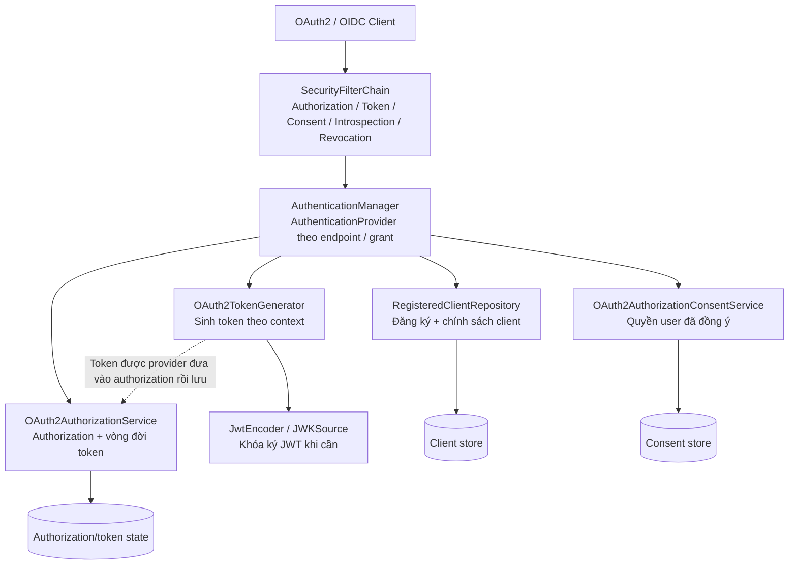
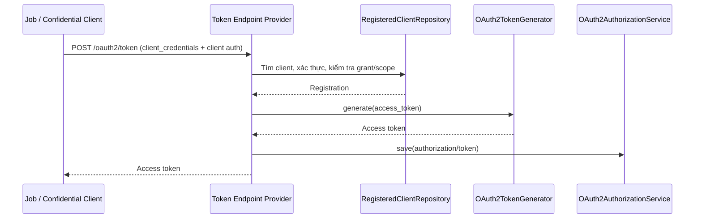
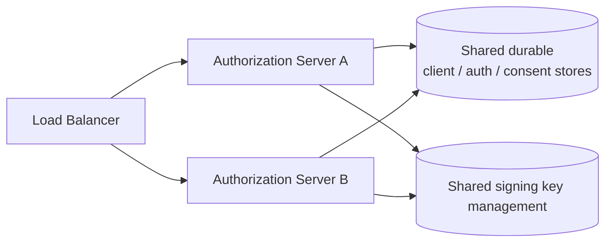

# Quan hệ giữa repository, authorization service, consent service và token generator

## 1. Bức tranh tổng thể

Trong module **Spring Security OAuth2/OIDC Authorization Server**, mục tiêu là thiết kế, cấu hình, bảo mật, kiểm thử và vận hành một **OAuth 2.0/OpenID Connect Authorization Server** bằng **Spring Security và Spring Authorization Server** trong ứng dụng **Spring Boot**. Khi tìm hiểu **kiến trúc xử lý**, cần phân biệt bốn thành phần thường xuất hiện cạnh nhau:

1. **`RegisteredClientRepository`**: cho biết *ứng dụng nào* được phép tham gia giao thức và ứng dụng đó được đăng ký những gì.
2. **`OAuth2AuthorizationService`**: ghi nhận *một lần cấp quyền/cấp token cụ thể* và vòng đời của authorization code, access token, refresh token cùng metadata liên quan.
3. **`OAuth2AuthorizationConsentService`**: ghi nhớ *người dùng đã đồng ý cấp những quyền gì* cho một client, khi luồng cần consent.
4. **`OAuth2TokenGenerator<?>`**: *tạo giá trị token* (JWT, opaque access token, refresh token…) theo ngữ cảnh do các authentication provider xây dựng.

Bốn thành phần này **hợp tác nhưng không thay thế nhau**. Repository không phải kho token; consent không phải authorization đang hoạt động; generator không phải cơ sở dữ liệu; authorization service không quyết định thuật toán ký JWT.

### Mục tiêu sau bài học

- Vẽ được đường đi của dữ liệu giữa protocol endpoints, authentication providers và bốn thành phần trên.
- Phân biệt định danh `clientId` với ID nội bộ của `RegisteredClient`, consent đã lưu với scope hiện tại, token được tạo với token được lưu.
- Giải thích cách Authorization Code + PKCE, Refresh Token và Client Credentials sử dụng các thành phần khác nhau.
- Cấu hình lưu trữ JDBC và token generator khi chạy nhiều instance, đồng thời nhận diện vấn đề bảo mật, vòng đời token và khả năng thu hồi.
- Kiểm chứng luồng xử lý khi gặp `invalid_client`, `invalid_grant`, mất consent, lỗi ký JWT hoặc token không được tra cứu.

## 2. Vị trí của các thành phần trong kiến trúc Spring Authorization Server

Spring Security đưa HTTP request qua `SecurityFilterChain`, các endpoint filter chuyển request thành `Authentication` phù hợp rồi chuyển cho `AuthenticationManager` và **authentication provider** xử lý grant/endpoint. Provider mới phối hợp các repository/service/generator; request không trực tiếp gọi repository theo ý client.



Sơ đồ thể hiện **quan hệ logic**, không phải sơ đồ gọi hàm chính xác của mọi grant hoặc mọi phiên bản thư viện. Provider có thể kiểm tra scope/consent trước khi tạo code; Token Endpoint có thể tra cứu authorization đã lưu trước khi gọi generator; không phải request nào cũng cần cả bốn thành phần.

### Bảng trách nhiệm

| Thành phần | Đối tượng/chìa khóa chính | API thường dùng | Có sinh token? | Có lưu dữ liệu? |
| --- | --- | --- | --- | --- |
| `RegisteredClientRepository` | `RegisteredClient`; tìm bằng ID nội bộ hoặc `clientId` | `save`, `findById`, `findByClientId` | Không | Có, thông tin đăng ký client |
| `OAuth2AuthorizationService` | `OAuth2Authorization`; ID authorization hoặc token + token type | `save`, `remove`, `findById`, `findByToken` | Không | Có, trạng thái cấp quyền và token |
| `OAuth2AuthorizationConsentService` | `OAuth2AuthorizationConsent`; `registeredClientId` + `principalName` | `save`, `remove`, `findById` | Không | Có, consent của người dùng |
| `OAuth2TokenGenerator<?>` | `OAuth2TokenContext` | `generate` | **Có** | **Không** |

**Quy tắc dễ nhớ:** repository trả lời **“client nào, chính sách nào?”**; authorization service trả lời **“quyền/token này đang ở trạng thái nào?”**; consent service trả lời **“người dùng này đã đồng ý quyền nào cho client?”**; token generator trả lời **“tạo loại token nào, với nội dung gì?”**.

## 3. `RegisteredClientRepository`: nguồn sự thật về client

### 3.1. Mô hình `RegisteredClient`

`RegisteredClient` là mô hình Spring Authorization Server dùng để biểu diễn một client đã đăng ký. Các thuộc tính thường gặp:

- `id`: **định danh nội bộ ổn định** của bản ghi, được authorization và consent tham chiếu.
- `clientId`: định danh client gửi trong OAuth request; **không phải bí mật**.
- `clientSecret` và `clientAuthenticationMethods`: cách xác thực client (nếu là confidential client); secret phải được bảo vệ/băm phù hợp.
- `authorizationGrantTypes`: client được dùng `authorization_code`, `refresh_token`, `client_credentials`… hay không.
- `redirectUris`: địa chỉ callback được đăng ký cho luồng redirect.
- `scopes`: tập scope tối đa client được phép yêu cầu.
- `clientSettings`: ví dụ `requireProofKey` (PKCE), `requireAuthorizationConsent`.
- `tokenSettings`: ví dụ thời hạn access token/refresh token và định dạng access token.

Ví dụ đăng ký một web client phía server bằng Java:

```java
RegisteredClient portal = RegisteredClient.withId("client-internal-portal")
        .clientId("portal-web")
        .clientSecret("{bcrypt}<bcrypt-hash-created-securely>")
        .clientAuthenticationMethod(ClientAuthenticationMethod.CLIENT_SECRET_BASIC)
        .authorizationGrantType(AuthorizationGrantType.AUTHORIZATION_CODE)
        .authorizationGrantType(AuthorizationGrantType.REFRESH_TOKEN)
        .redirectUri("https://portal.example.com/login/oauth2/code/portal-web")
        .scope(OidcScopes.OPENID)
        .scope(OidcScopes.PROFILE)
        .scope("orders.read")
        .clientSettings(ClientSettings.builder()
                .requireProofKey(true)
                .requireAuthorizationConsent(true)
                .build())
        .tokenSettings(TokenSettings.builder()
                .accessTokenTimeToLive(Duration.ofMinutes(10))
                .build())
        .build();
```

Đây là đoạn minh họa cấu trúc API; cần import các class tương ứng, sinh bcrypt hash thật và lưu registration qua repository. Không chép placeholder secret làm credential production.

Repository thường có một trong hai implementation:

| Implementation | Đặc điểm | Khi nào dùng |
| --- | --- | --- |
| `InMemoryRegisteredClientRepository` | Lưu trong bộ nhớ process; không tự đồng bộ giữa các instance và không tự bền vững qua restart. | Demo, unit/integration test, cấu hình tối giản. |
| `JdbcRegisteredClientRepository` | Sử dụng database JDBC và schema client tương ứng. | Hệ thống cần dữ liệu đăng ký bền vững, quản trị/rotation và nhiều instance. |

Có thể tự triển khai `RegisteredClientRepository` để lấy client từ nguồn khác, nhưng phải bảo đảm lookup nhất quán, tính đúng đắn của secret/grants và tính ổn định của `id`.

### 3.2. Phân biệt `id` và `clientId`

Giả sử client gửi `client_id=portal-web`:

1. Hệ thống tìm registration qua `findByClientId("portal-web")`.
2. Registration có `id="client-internal-portal"`.
3. Bản ghi `OAuth2Authorization` và `OAuth2AuthorizationConsent` tham chiếu **ID nội bộ** này.

Nếu mỗi lần restart lại tạo `RegisteredClient.withId(UUID.randomUUID().toString())` cho cùng `clientId` trong khi dữ liệu authorization/consent được lưu bền vững, quan hệ có thể không còn đúng. Vì vậy, **không sinh ID nội bộ mới cho một client đã tồn tại** khi chạy migration, seed hoặc triển khai mới.

### 3.3. Những việc repository không làm

Repository không xác thực mật khẩu người dùng, không quyết định người dùng có cấp consent ở lần tương tác hiện tại hay không, không tự sinh JWT và không quản lý việc authorization code đã được dùng. Nó chỉ cấp metadata/chính sách client để những provider và service khác thực thi giao thức.

## 4. `OAuth2AuthorizationService`: vòng đời một lần cấp quyền

### 4.1. `OAuth2Authorization` chứa gì?

Một `OAuth2Authorization` biểu diễn trạng thái của **một authorization/grant cụ thể** và thường chứa:

| Dữ liệu | Ý nghĩa |
| --- | --- |
| `id` | ID của authorization, khác ID của client. |
| `registeredClientId` | Liên kết với `RegisteredClient.id`. |
| `principalName` | Chủ thể được gắn với authorization (user hoặc client tùy grant). |
| `authorizationGrantType` | Grant đã tạo ra authorization. |
| `authorizedScopes` | Scope thực tế được cấp cho authorization này. |
| Token và metadata | Authorization code, access token, refresh token, ID token (khi có), thời gian phát hành/hết hạn, token claims/metadata, trạng thái invalidated… |
| Attributes | Thông tin liên quan đến grant/luồng, được provider thêm khi cần. |

Các token trong `OAuth2Authorization` được bọc trong đối tượng gắn **metadata**, ví dụ trạng thái đã bị vô hiệu hóa. Điều này cần thiết để đảm bảo authorization code dùng một lần và kiểm tra trạng thái tại token/introspection/revocation endpoints.

Các thao tác:

```java
OAuth2Authorization authorization =
        authorizationService.findByToken(codeValue, new OAuth2TokenType("code"));

// Sau khi provider đã kiểm tra grant/PKCE, tạo token và cập nhật authorization:
authorizationService.save(updatedAuthorization);

// Theo chính sách thu hồi/xóa authorization:
authorizationService.remove(updatedAuthorization);
```

Ví dụ này chỉ minh họa API tra cứu và persistence, **không phải luồng tự triển khai Token Endpoint**. Trong ứng dụng, các authentication provider của Spring Authorization Server đảm nhiệm kiểm tra client, code, PKCE và trạng thái token. Không nên thay `findByToken` bằng tra cứu token plaintext tùy tiện nếu bạn chưa hiểu ràng buộc bảo mật.

Các implementation thường gặp:

- `InMemoryOAuth2AuthorizationService`: phù hợp test/demo, mất state khi process kết thúc.
- `JdbcOAuth2AuthorizationService`: ghi authorization vào database, cần schema phù hợp và cấu hình `JdbcTemplate`.
- Custom service: dùng storage khác hoặc thay cấu trúc lưu, nhưng phải giữ đúng quy tắc tra cứu token và trạng thái của OAuth2.

### 4.2. Vì sao JWT vẫn cần authorization service?

Access token dạng **self-contained JWT** có thể được Resource Server xác minh chữ ký, `iss`, `aud`, `exp` và các claim khác mà **không cần gọi lại Authorization Server trên mỗi request**. Nhưng Authorization Server vẫn có lý do ghi authorization/token state để:

- theo dõi authorization code, refresh token và vòng đời grant;
- xử lý token revocation/introspection và tra cứu trạng thái theo thiết kế server;
- liên hệ token với client, scope và principal của lần cấp phát;
- hỗ trợ chính sách kiểm toán và lifecycle nếu ứng dụng triển khai.

**Giới hạn quan trọng:** đánh dấu JWT access token bị thu hồi trong database của Authorization Server **không tự động làm mọi Resource Server từ chối JWT đó ngay lập tức** nếu Resource Server chỉ xác minh JWT offline. Muốn hiệu lực thu hồi gần thời gian thực, phải thiết kế riêng như access token ngắn hạn, tham vấn trạng thái, denylist/caching có kiểm soát hoặc chuyển sang opaque token + introspection khi phù hợp.

### 4.3. Authorization service và transaction

Trong luồng cấp token, token generator tạo token trước, còn provider lưu authorization đã cập nhật sau khi kiểm tra đầy đủ. Cần xử lý nhất quán để tránh token đã trả về nhưng state không tồn tại, hoặc code bị dùng lại do race condition. Hỗ trợ JDBC không tự động bảo đảm **toàn bộ** bước từ nhận request đến lưu trạng thái có một transaction phân tán. Khi mở rộng nhiều instance, phải kiểm tra concurrency, uniqueness, hiệu lực dùng một lần và các vấn đề transaction của implementation đang dùng.

## 5. `OAuth2AuthorizationConsentService`: quyền người dùng đã đồng ý

### 5.1. Consent khác đăng nhập và khác token

**Authentication** chứng minh danh tính người dùng; **authorization/consent** giải quyết client có được phép nhận những quyền nhất định hay không. Một người đã đăng nhập thành công vẫn có thể chưa đồng ý cho một client truy cập profile hoặc dữ liệu đơn hàng.

`OAuth2AuthorizationConsent` lưu theo cặp:

```text
(registeredClientId, principalName)  ->  authorities/scopes đã consent

Ví dụ:
("client-internal-portal", "alice") -> [SCOPE_profile, SCOPE_orders.read]
```

Provider có thể đọc consent đã lưu, so sánh với các scope yêu cầu, chuyển user tới consent page khi cần và cập nhật consent sau khi người dùng chấp thuận. Quyết định hiển thị lại consent còn phụ thuộc `ClientSettings.requireAuthorizationConsent`, loại scope, logic áp dụng và request cụ thể.

**Consent đã được lưu không có nghĩa client luôn được nhận bất kỳ scope nào.** Provider vẫn phải kiểm tra đăng ký client, scope đã yêu cầu và các quy tắc khác. Consent cũng không phải access token: khi consent còn tồn tại, token cũ có thể đã hết hạn/bị thu hồi, và ngược lại.

### 5.2. API và lưu trữ

```java
OAuth2AuthorizationConsent consent =
        consentService.findById("client-internal-portal", "alice");

// Khi user chấp thuận và provider xây dựng consent mới:
consentService.save(updatedConsent);

// Nếu cần rút lại quyền đã ghi nhớ:
consentService.remove(updatedConsent);
```

Implementations:

- `InMemoryOAuth2AuthorizationConsentService`: thuận tiện cho ví dụ và test.
- `JdbcOAuth2AuthorizationConsentService`: lưu consent bền vững trong database.
- Custom service: tùy biến chính sách hoặc nguồn lưu, miễn giữ nguyên ý nghĩa định danh/authorities.

Nếu dự án có nút “Rút lại đồng ý”, chỉ xóa bản ghi consent **không tự bảo đảm tất cả access/refresh token trước đó bị vô hiệu hóa**. Đây là hai hành động quản trị vòng đời khác nhau: xóa/rút consent và thu hồi các authorization/token tương ứng. Thiết kế quy trình riêng theo chính sách dữ liệu của hệ thống.

### 5.3. Khi nào không đi qua consent service?

`client_credentials` thường không gắn với một người dùng tương tác, nên **không có consent UI của resource owner**. Authorization Server vẫn dùng registration và generator, có thể ghi authorization/token state, nhưng không cần dựa vào consent của một end user. Tương tự, không phải lần refresh token nào cũng yêu cầu người dùng xác nhận lại consent.

## 6. `OAuth2TokenGenerator`: sinh token nhưng không lưu state

### 6.1. Ý nghĩa của `OAuth2TokenContext`

Authentication provider chuẩn bị ngữ cảnh khi muốn phát hành token. `OAuth2TokenContext` có thể chứa:

- `registeredClient`: chính sách client, bao gồm `TokenSettings`.
- `principal`: Authentication liên quan đến grant.
- `authorizationServerContext`: dữ liệu issuer và bối cảnh Authorization Server.
- `authorizationGrantType`, `authorizationGrant`: loại grant và request đã xác thực.
- `authorizedScopes` và `authorization` hiện tại (nếu có).
- `tokenType`: token dự kiến cần tạo, ví dụ access token, refresh token hoặc OIDC ID token.

Generator nhận ngữ cảnh này và trả về token tương ứng; nó **không tự kiểm tra lại toàn bộ request HTTP, không xác thực client thay provider, không lưu token vào repository và không quyết định user consent**.

### 6.2. Các generator phổ biến

| Generator | Loại token điển hình | Phụ thuộc |
| --- | --- | --- |
| `OAuth2AuthorizationCodeGenerator` | Authorization code cho luồng `authorization_code`. | Context của authorization request; code ngẫu nhiên và thời hạn hiệu lực theo chính sách. |
| `JwtGenerator` | Self-contained JWT access token và OIDC ID token khi ngữ cảnh phù hợp. | `JwtEncoder`; với ký bất đối xứng thường dựa vào `JWKSource<SecurityContext>`. |
| `OAuth2AccessTokenGenerator` | Opaque/reference access token theo `TokenSettings.accessTokenFormat`. | Context và token metadata; không ký JWT. |
| `OAuth2RefreshTokenGenerator` | Refresh token cho grant/chính sách cho phép. | Context, grant type và client settings. |
| `DelegatingOAuth2TokenGenerator` | Điều phối các generator con; dùng kết quả phù hợp. | Cần cấu hình đủ generator cho mọi loại token mong muốn. |

Thông thường `DelegatingOAuth2TokenGenerator` gọi lần lượt các generator được đăng ký, trả token mà generator phù hợp tạo ra (hoặc `null` nếu không thành phần nào hỗ trợ loại token/context). Do đó **thứ tự và tập generator** cần được xem xét khi tùy biến.

Với access token:

- `OAuth2TokenFormat.SELF_CONTAINED` (JWT): Resource Server có thể xác minh chữ ký/claims độc lập.
- `OAuth2TokenFormat.REFERENCE` (opaque): Resource Server thường gọi **Token Introspection Endpoint** của Authorization Server để biết token còn hoạt động và có quyền nào, hoặc dùng cơ chế kiểm tra tương đương theo kiến trúc.

Định dạng token phụ thuộc `RegisteredClient.tokenSettings` và cấu hình generator; tự đổi `tokenSettings` mà thiếu generator tương ứng có thể làm phát token thất bại.

### 6.3. Token customizer không phải token store

Spring Authorization Server hỗ trợ tùy biến claims của JWT bằng `OAuth2TokenCustomizer<JwtEncodingContext>` và của opaque token bằng `OAuth2TokenCustomizer<OAuth2TokenClaimsContext>`. Customizer thêm hoặc sửa nội dung token **trong lúc tạo**, không ghi state thay `OAuth2AuthorizationService` và không thay quyền được đăng ký/consent.

Ví dụ chỉ thêm một claim kỹ thuật vào **JWT access token**:

```java
@Bean
OAuth2TokenCustomizer<JwtEncodingContext> jwtClaimsCustomizer() {
    return context -> {
        if (OAuth2TokenType.ACCESS_TOKEN.equals(context.getTokenType())) {
            context.getClaims().claim("token_issuer_app", "spring-authorization-server");
        }
    };
}
```

Khi tự khai báo `OAuth2TokenGenerator`, cần **gắn customizer vào generator tương ứng**; đừng mặc nhiên cho rằng cơ chế cấu hình mặc định vẫn tự động thêm customizer vào bean bạn tạo. Không đưa dữ liệu nhạy cảm, dữ liệu cá nhân không cần thiết hoặc bí mật nội bộ vào JWT chỉ vì JWT có thể ký; payload JWT thường giải mã đọc được.

## 7. Trình tự hợp tác trong Authorization Code + PKCE

Đây là luồng giúp thấy rõ nhất vai trò của từng thành phần. Giả sử:

- `portal-web` đã đăng ký trong `RegisteredClientRepository` với `authorization_code`, `refresh_token`, PKCE và các scope phù hợp.
- User `alice` dùng browser để đăng nhập.
- Client yêu cầu `openid profile orders.read`; tùy chính sách, hệ thống yêu cầu consent.

```mermaid
sequenceDiagram
    autonumber
    participant C as Browser / OAuth2 Client
    participant P as Authorization Server Providers
    participant R as RegisteredClientRepository
    participant S as OAuth2AuthorizationConsentService
    participant A as OAuth2AuthorizationService
    participant G as OAuth2TokenGenerator
    C->>P: GET /oauth2/authorize (client_id, scope, PKCE...)
    P->>R: findByClientId(client_id)
    R-->>P: RegisteredClient + policy
    P->>P: Xác thực user; kiểm tra request và PKCE challenge
    P->>S: Kiểm tra consent đã ghi (khi cần)
    S-->>P: Quyền đã đồng ý / chưa có
    opt Cần consent mới
        P-->>C: Giao diện consent
        C->>P: User chấp thuận scope được yêu cầu
        P->>S: save(consent)
    end
    P->>G: generate(authorization_code)
    G-->>P: Authorization code
    P->>A: save(authorization + code)
    P-->>C: Redirect về client với code
    C->>P: POST /oauth2/token (code, verifier, client auth...)
    P->>R: Tra cứu/kiểm tra client
    P->>A: findByToken(code)
    A-->>P: Authorization đã lưu
    P->>P: Kiểm tra code, client, PKCE, redirect URI
    P->>G: generate(access/id/refresh tokens khi áp dụng)
    G-->>P: Token objects
    P->>A: save(authorization cập nhật, code invalidated)
    P-->>C: Token response
```

Lưu ý sơ đồ chỉ biểu diễn **quan hệ chức năng** giữa các thành phần. Tùy loại grant, OIDC scope, consent và phiên bản, thời điểm tạo/lưu trạng thái tạm thời có thể khác; authorization code cũng được phát sinh bằng generator tương ứng của framework. Điều cần nhớ là **provider điều phối**, **generator tạo**, **service lưu**, còn **repository/consent quyết định điều kiện**.

### 7.1. Điểm kiểm soát an ninh trong mỗi bước

| Bước | Thành phần trọng tâm | Quy tắc cần bảo vệ |
| --- | --- | --- |
| Nhận authorization request | Repository + provider | `client_id` tồn tại, redirect URI được đăng ký, scope/grant hợp lệ. |
| Người dùng xác thực/consent | Authentication + consent service | User đúng danh tính; scope consent không vượt quyền client; kiểm soát CSRF với giao diện consent. |
| Cấp authorization code | Token generator + authorization service | Code ngẫu nhiên, thời hạn ngắn; gắn đúng client, redirect và PKCE challenge. |
| Đổi code lấy token | Authorization service + provider | Code còn hiệu lực/chưa sử dụng; client authentication, PKCE verifier và redirect đúng; chống dùng lại. |
| Phát token | Token generator | Đúng token type/format, issuer, signature, thời hạn, scopes và claims. |
| Lưu kết quả | Authorization service | State token nhất quán, code invalidated, refresh token policy hợp lệ. |

Ví dụ: nếu `client_id` không tồn tại, sửa `OAuth2TokenGenerator` sẽ **không** giúp yêu cầu thành công; vấn đề nằm ở registration. Nếu đổi code báo `invalid_grant` vì code đã dùng, sửa consent service cũng **không** giải quyết nguồn gốc lỗi.

## 8. So sánh các grant khác nhau

### 8.1. Client Credentials

Luồng machine-to-machine không có end user:



Trong flow này, consent service không có người dùng để tương tác. `principalName` trong authorization có thể đại diện cho client thay vì một tài khoản người dùng. Không diễn giải token này như token đại diện danh tính một người.

### 8.2. Refresh Token

Khi client yêu cầu access token mới bằng refresh token:

1. Provider xác thực client theo phương thức áp dụng và kiểm tra client có được dùng `refresh_token` grant hay không qua registration.
2. `OAuth2AuthorizationService.findByToken(refreshToken, OAuth2TokenType.REFRESH_TOKEN)` tra cứu authorization và kiểm tra token đã hết hạn/vô hiệu hóa hay chưa.
3. Provider áp dụng chính sách scope, chủ thể và token settings.
4. Generator tạo access token mới; có thể tạo refresh token mới tùy chính sách rotation/reuse.
5. Authorization service lưu state mới, đánh dấu token cũ khi chính sách yêu cầu, rồi mới hoàn tất response.

Consent của người dùng thường **không được hỏi lại** trong mỗi refresh request. Điều này không đồng nghĩa refresh token được phép vượt quá scope đã ủy quyền ban đầu.

### 8.3. OIDC ID Token

Khi luồng OIDC có `openid` và điều kiện tương ứng, `JwtGenerator` có thể tạo **ID token** nhằm truyền thông tin kết quả xác thực cho client. ID token không thay access token gọi API. Authorization service có thể giữ metadata/token liên quan, nhưng Resource Server phải xác thực **access token dành cho API** của mình, không tiếp nhận tùy tiện ID token.

### 8.4. Bảng tổng hợp

| Grant / luồng | Repository | Authorization service | Consent service | Generator |
| --- | --- | --- | --- | --- |
| Authorization Code + PKCE | Kiểm tra client/grant/redirect/PKCE policy | Lưu code rồi token và trạng thái đã dùng | Đọc/ghi khi cần user consent | Tạo code, access token, refresh/ID token khi áp dụng |
| Client Credentials | Xác thực confidential client, scopes/grant | Lưu authorization và access token state | Thường không dùng | Tạo access token |
| Refresh Token | Kiểm tra client và chính sách grant | Tra cứu token cũ, cập nhật authorization và rotation | Thường không hỏi lại | Tạo access token và refresh token mới nếu áp dụng |
| Token Introspection | Xác thực client gọi introspection theo cấu hình | Tra cứu token và trạng thái | Không phải nơi tra cứu token | Thông thường không sinh token mới |
| Token Revocation | Xác thực client gọi revocation theo cấu hình | Cập nhật/thu hồi trạng thái token | Không đồng nghĩa xóa consent | Không sinh token mới |

## 9. Cấu hình JDBC: ba kho dữ liệu phải tương thích

Trong một Authorization Server production, rất thường gặp cấu hình ba service bền vững bằng JDBC. Ví dụ theo API **Spring Authorization Server 1.5.x**:

```java
import org.springframework.context.annotation.Bean;
import org.springframework.context.annotation.Configuration;
import org.springframework.jdbc.core.JdbcTemplate;
import org.springframework.security.oauth2.server.authorization.JdbcOAuth2AuthorizationConsentService;
import org.springframework.security.oauth2.server.authorization.JdbcOAuth2AuthorizationService;
import org.springframework.security.oauth2.server.authorization.OAuth2AuthorizationConsentService;
import org.springframework.security.oauth2.server.authorization.OAuth2AuthorizationService;
import org.springframework.security.oauth2.server.authorization.client.JdbcRegisteredClientRepository;
import org.springframework.security.oauth2.server.authorization.client.RegisteredClientRepository;

@Configuration(proxyBeanMethods = false)
public class AuthorizationDataConfiguration {

    @Bean
    RegisteredClientRepository registeredClientRepository(JdbcTemplate jdbcTemplate) {
        return new JdbcRegisteredClientRepository(jdbcTemplate);
    }

    @Bean
    OAuth2AuthorizationService authorizationService(
            JdbcTemplate jdbcTemplate,
            RegisteredClientRepository registeredClientRepository) {
        return new JdbcOAuth2AuthorizationService(
                jdbcTemplate, registeredClientRepository);
    }

    @Bean
    OAuth2AuthorizationConsentService authorizationConsentService(
            JdbcTemplate jdbcTemplate,
            RegisteredClientRepository registeredClientRepository) {
        return new JdbcOAuth2AuthorizationConsentService(
                jdbcTemplate, registeredClientRepository);
    }
}
```

### Tại sao cả authorization và consent service đều nhận repository?

Chúng phải hiểu **client được tham chiếu bởi ID nội bộ nào** và xử lý ánh xạ sang mô hình client khi đọc/ghi dữ liệu. Ba service có thể dùng chung database hoặc tách storage, nhưng nếu tách, phải bảo đảm tham chiếu, consistency, tính sẵn có và vòng đời dữ liệu.

**Điều kiện trước khi chạy:** cấu hình `DataSource`, `JdbcTemplate`, JDBC driver, các bảng/schema của phiên bản Spring Authorization Server đang dùng và bản ghi client ban đầu. Các constructor ở trên **không tự tạo schema, seed client, thêm indexes hoặc mã hóa dữ liệu nhạy cảm cho bạn**. Khi triển khai thật, sử dụng migration có kiểm soát (Flyway/Liquibase hoặc quy trình tương đương).

### Những điểm cần kiểm tra ở database

- **Định danh ổn định:** bản ghi client không bị thay `id` giữa các lần chạy; authorization/consent tham chiếu đúng client.
- **Dữ liệu token nhạy cảm:** authorization service có thể lưu token value/claims/attributes; hạn chế quyền DB, mã hóa dữ liệu lưu trữ, backup và logging.
- **Chính sách TTL và dọn dẹp:** dữ liệu authorization hết hạn có thể tích lũy nếu không có job dọn dẹp phù hợp; làm sạch an toàn theo trạng thái và chính sách audit.
- **Tính đồng thời:** kiểm tra đổi authorization code một lần, refresh token rotation, retry và nhiều instance. Không xem thao tác `findByToken` đơn lẻ là khóa phân tán.
- **Tối ưu truy vấn:** tra cứu token cần đủ nhanh, schema và index phù hợp; đo tải thực tế nếu sử dụng introspection liên tục.
- **Tính tương thích phiên bản:** migration schema, kiểu dữ liệu và serialization của metadata có thể thay đổi khi nâng framework.

## 10. Tự khai báo token generator: cần đủ các loại token

Nếu ứng dụng muốn chủ động điều phối JWT, opaque access token hoặc refresh token, có thể cung cấp bean `OAuth2TokenGenerator<?>`. Ví dụ minh họa:

```java
import com.nimbusds.jose.proc.SecurityContext;
import com.nimbusds.jose.jwk.source.JWKSource;
import org.springframework.context.annotation.Bean;
import org.springframework.context.annotation.Configuration;
import org.springframework.security.oauth2.jwt.NimbusJwtEncoder;
import org.springframework.security.oauth2.server.authorization.token.DelegatingOAuth2TokenGenerator;
import org.springframework.security.oauth2.server.authorization.token.JwtGenerator;
import org.springframework.security.oauth2.server.authorization.token.OAuth2AccessTokenGenerator;
import org.springframework.security.oauth2.server.authorization.token.OAuth2AuthorizationCodeGenerator;
import org.springframework.security.oauth2.server.authorization.token.OAuth2RefreshTokenGenerator;
import org.springframework.security.oauth2.server.authorization.token.OAuth2TokenGenerator;

@Configuration(proxyBeanMethods = false)
public class TokenGeneratorConfiguration {

    @Bean
    OAuth2TokenGenerator<?> tokenGenerator(JWKSource<SecurityContext> jwkSource) {
        OAuth2AuthorizationCodeGenerator codeGenerator =
                new OAuth2AuthorizationCodeGenerator();
        JwtGenerator jwtGenerator =
                new JwtGenerator(new NimbusJwtEncoder(jwkSource));
        OAuth2AccessTokenGenerator opaqueGenerator =
                new OAuth2AccessTokenGenerator();
        OAuth2RefreshTokenGenerator refreshGenerator =
                new OAuth2RefreshTokenGenerator();

        return new DelegatingOAuth2TokenGenerator(
                codeGenerator, jwtGenerator, opaqueGenerator, refreshGenerator);
    }
}
```

Ví dụ giả định ứng dụng đã có **`JWKSource<SecurityContext>` phù hợp** với khóa ký đang quản lý. Để chạy production, private key phải nằm ở kho khóa an toàn; giữ được khóa qua restart và hỗ trợ rotation có chủ đích. Các endpoint discovery/JWKS, issuer, `JwtDecoder` (khi cần) và Resource Server phải nhất quán với khóa và thuật toán đã chọn.

**Rủi ro khi ghi đè mặc định:** nếu chỉ trả `new JwtGenerator(...)`, các luồng đòi authorization code, opaque access token hoặc refresh token có thể không còn generator thích hợp (tùy cách provider sử dụng generator). Nếu tự tạo `JwtGenerator` rồi định nghĩa `OAuth2TokenCustomizer<JwtEncodingContext>`, phải nối customizer vào generator tường minh, ví dụ:

```java
JwtGenerator jwtGenerator = new JwtGenerator(new NimbusJwtEncoder(jwkSource));
jwtGenerator.setJwtCustomizer(jwtClaimsCustomizer);
```

Một bean generator riêng cũng không tự tạo `JWKSource` hoặc thay `OAuth2AuthorizationService`: token được sinh vẫn cần provider gắn vào authorization và lưu khi thích hợp.

## 11. Vận hành và thiết kế bảo mật theo trách nhiệm

### 11.1. Cơ chế mất dữ liệu khi restart

Giả sử khởi động Authorization Server với:

```text
RegisteredClientRepository       = JDBC
OAuth2AuthorizationService        = InMemory
OAuth2AuthorizationConsentService = InMemory
OAuth2TokenGenerator              = JWT + Refresh
```

Sau khi restart, client metadata trong JDBC vẫn tồn tại, nhưng authorization code, refresh token và consent đã lưu in-memory **biến mất**. Client có thể vẫn xác thực được tại Token Endpoint, nhưng refresh token cũ không tìm thấy; người dùng có thể phải consent lại. Điều này **không phải lỗi JWT generator**, mà là do ranh giới lưu trữ.

### 11.2. Vận hành nhiều instance



Nếu cả hai instance cùng dùng một nguồn dữ liệu bền vững và hệ thống quản lý khóa nhất quán, request `/authorize` đến A và `/token` đến B có thể tra cứu cùng authorization state **với điều kiện** các phần khác như HTTP session/login và dữ liệu tạm thời của flow được chia sẻ hoặc định tuyến phù hợp. JDBC cho ba service không thay thế việc thiết kế **session management**.

Nếu mỗi instance tự sinh khóa ký JWT mới, token cấp ở A có thể không xác minh được bằng JWKS/decoder từ B. Nếu authorization service riêng lẻ in-memory, authorization code tạo ở A có thể không tìm thấy ở B. Vì vậy lưu trữ state và quản lý khóa là **hai yêu cầu độc lập** của hệ thống phân tán.

### 11.3. Scope, consent và claims

Có ba mức cần phân biệt:

1. **Scope đăng ký:** tập quyền client *có thể yêu cầu*, đọc từ `RegisteredClient.scopes`.
2. **Scope consent:** tập quyền người dùng đã chấp thuận (khi consent áp dụng), đọc từ `OAuth2AuthorizationConsentService`.
3. **Authorized scopes của grant hiện tại:** tập quyền **thực sự được cấp** và được lưu trong `OAuth2Authorization`; token generator tạo claims theo ngữ cảnh này và chính sách áp dụng.

Không được giả định giao của ba tập trên luôn bằng nhau trong mọi flow: `client_credentials` không có user consent, các scope có thể được xử lý đặc biệt và ứng dụng có thể có chính sách bổ sung. Điều bất biến cần kiểm thử là **token không cấp vượt phạm vi được phép theo chính sách server**.

### 11.4. Khi thu hồi quyền

Nếu người dùng rút consent, ứng dụng cần quyết định có thu hồi authorization/refresh token đang hoạt động hay không. Nếu quản trị viên vô hiệu hóa client, phải xem xét tất cả token/authorization còn hoạt động của client đó. Nếu access token là JWT tự xác minh ở Resource Server, thu hồi trong authorization store có thể chưa chặn JWT trước khi hết hạn. Tổ chức cần chính sách token lifetime, rotation, introspection và revocation rõ ràng.

## 12. Chẩn đoán lỗi theo đúng thành phần

| Hiện tượng | Thành phần cần kiểm tra trước | Hướng điều tra |
| --- | --- | --- |
| `invalid_client` ở Token Endpoint | Client authentication + `RegisteredClientRepository` | `client_id`, secret/key, method, registration tồn tại, secret encoding. |
| `unauthorized_client` / grant không được phép | `RegisteredClientRepository` | `authorizationGrantTypes`, client policy, redirect/flow. |
| `invalid_scope` | Registration + authorization provider | Scopes được đăng ký, scopes thực sự yêu cầu và chính sách cấp quyền. |
| User bị yêu cầu consent lại sau restart | `OAuth2AuthorizationConsentService` | In-memory hay JDBC, principalName, registeredClientId ổn định, consent đã lưu. |
| Authorization code đổi token thất bại | `OAuth2AuthorizationService` + provider | Code hết hạn/đã dùng, không tìm thấy sau restart, sai PKCE/redirect/client. |
| Refresh token đang dùng bỗng bị `invalid_grant` | Authorization service + TokenSettings | Token bị hết hạn/thu hồi/rotation, storage không chia sẻ, replay. |
| Không tạo được JWT / lỗi ký | Token generator, `JwtEncoder`, `JWKSource` | Khóa ký, thuật toán, `kid`, token format, customizer. |
| Access token opaque nhưng Resource Server không kiểm tra được | Generator + introspection + authorization service | Token format, xác thực introspection client, tra cứu/expiry và storage. |
| JWT vẫn truy cập API sau khi đã revoke | Thiết kế Resource Server | JWT offline không kiểm tra trạng thái revocation; xem token TTL/introspection/denylist. |
| ID token thiếu claims kỳ vọng | OIDC + `JwtGenerator`/customizer | OIDC enablement, scope `openid`, `JwtEncodingContext` và provider behavior. |

**Cách debug hiệu quả:** bắt đầu từ HTTP endpoint/grant đang thất bại, xem log bảo mật đã được che dữ liệu nhạy cảm, xác minh client registration, kiểm tra các service có mặt trong Spring `ApplicationContext`, sau đó mới xem token generator. Không log nguyên token, authorization code, client secret, private key hoặc PKCE verifier ở production.

## 13. Checklist kiểm thử tích hợp

Với cùng một bộ client và user mẫu, nên xác minh:

1. **Client lookup:** `findByClientId` trả đúng client; không tự đổi `RegisteredClient.id` sau restart hoặc migration.
2. **Consent:** lần đầu cần consent thì lưu đúng authorized scopes; lần sau có thể dùng lại theo chính sách; xóa consent khiến quyết định consent được đánh giá lại.
3. **Authorization Code + PKCE:** code được lưu và tra cứu được; đổi code đúng verifier thành công; code đã dùng, sai verifier và hết hạn bị từ chối.
4. **Token issuance:** access token có đúng issuer, audience, scope, expiry và loại token; JWT ký bằng khóa công khai có thể xác minh; opaque token introspect được theo quyền.
5. **Refresh token:** làm mới đúng chính sách, token cũ hết hiệu lực khi rotation; grant/scope bất hợp lệ bị chặn.
6. **Restart/multi-instance:** code/refresh/consent có khả năng tồn tại và dùng qua instance theo thiết kế; JWKs nhất quán; session login được xử lý phù hợp.
7. **Revocation:** revoke đúng token cập nhật state; hiểu giới hạn hiệu lực của JWT offline, kiểm tra đường đi introspection khi cần.
8. **Kho dữ liệu:** schema migration hoạt động, truy vấn được index phù hợp, backup/log không làm lộ token, cleanup đúng thời hạn.

Khi viết test, chú ý phân biệt **unit test của service** với **integration test HTTP flow**. Mock `OAuth2TokenGenerator` có thể xác minh provider gọi generator, nhưng không chứng minh signature JWT hợp lệ. Ngược lại, kiểm tra JWT signature không chứng minh authorization code chỉ dùng một lần hoặc consent đã được ghi.

## 14. Tóm tắt bằng một ví dụ

Hãy hình dung một ứng dụng quản lý đặt chỗ: `booking-web` được phép yêu cầu `booking.read` và `booking.write`.

- **Repository** lưu client `booking-web` cùng redirect URI, PKCE, grant và danh sách scope.
- **Consent service** lưu rằng người dùng `alice` đã chấp thuận `booking.read` cho client đó, nhưng chưa chấp thuận `booking.write`.
- Khi `alice` bắt đầu một Authorization Code flow mới yêu cầu thêm `booking.write`, provider sẽ đánh giá lại consent trước khi hoàn tất yêu cầu; **consent lưu trước không tự mở rộng quyền**.
- Sau khi grant hợp lệ, **generator** tạo authorization code và token cần thiết; **authorization service** ghi code/token, principal, client ID nội bộ, scopes thực cấp và trạng thái lifecycle.
- Khi client làm mới token, authorization service tra cứu refresh token trước rồi generator sinh token mới. Khi admin thu hồi quyền, cần phối hợp chính sách consent và thu hồi authorization/token.

Vì thế, đừng gộp bốn trách nhiệm vào một “token database” trừ khi bạn có thiết kế trừu tượng riêng chứng minh được mọi ranh giới. Trong Spring Authorization Server, các interface tách biệt giúp kiểm thử, thay storage và thay cách sinh token **có kiểm soát**, miễn là các luồng giao thức vẫn nhất quán.

## 15. Tài liệu tham khảo

- [Spring Authorization Server — Core Model / Components](https://docs.spring.io/spring-authorization-server/reference/core-model-components.html): mô hình `RegisteredClient`, `OAuth2Authorization`, `OAuth2AuthorizationConsent` và các interfaces/service.
- [Spring Authorization Server — Configuration Model](https://docs.spring.io/spring-authorization-server/reference/configuration-model.html): cấu hình các service, generator và endpoint configurers.
- [Spring Authorization Server — Protocol Endpoints](https://docs.spring.io/spring-authorization-server/reference/protocol-endpoints.html): authentication providers và trách nhiệm xử lý endpoint/grant.
- [Spring Authorization Server — Implement core services with JPA](https://docs.spring.io/spring-authorization-server/reference/guides/how-to-jpa.html): các lưu ý khi lưu model Authorization Server trong database.
- [Spring Authorization Server — Customize claims and authorities](https://docs.spring.io/spring-authorization-server/reference/guides/how-to-custom-claims-authorities.html): tùy biến claims access token.
- [Spring Security — OAuth2 Resource Server JWT](https://docs.spring.io/spring-security/reference/servlet/oauth2/resource-server/jwt.html): kiểm tra JWT tại Resource Server.
- [RFC 6749 — OAuth 2.0](https://www.rfc-editor.org/rfc/rfc6749): grant, authorization và client.
- [RFC 7636 — PKCE](https://www.rfc-editor.org/rfc/rfc7636): ràng buộc authorization code với code verifier.
- [RFC 7009 — Token Revocation](https://www.rfc-editor.org/rfc/rfc7009) và [RFC 7662 — Token Introspection](https://www.rfc-editor.org/rfc/rfc7662): vòng đời và kiểm tra trạng thái token.

**Kết luận kiến trúc:** provider điều phối giao thức; `RegisteredClientRepository` quản lý danh tính/chính sách client, `OAuth2AuthorizationConsentService` giữ consent, `OAuth2AuthorizationService` giữ trạng thái authorization/token, còn `OAuth2TokenGenerator` sinh token theo context. Khi bốn thành phần được cấu hình thống nhất về ID client, scope, token format, lưu trữ và khóa ký, Authorization Server mới có thể xử lý OAuth2/OIDC đúng và vận hành ổn định.
