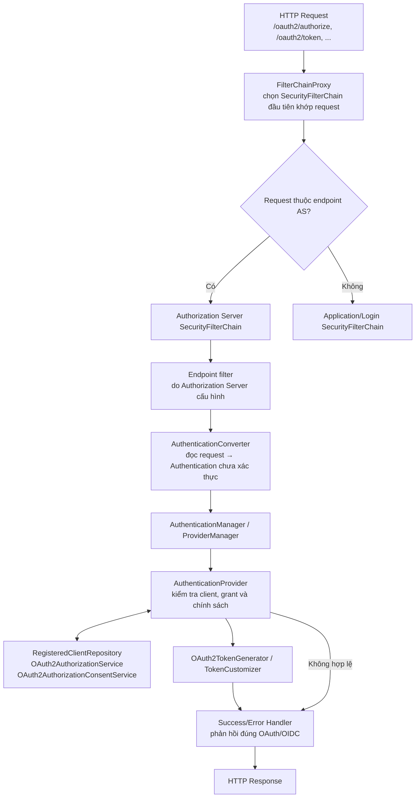

# Điểm mở rộng chuẩn và giới hạn của việc can thiệp filter nội bộ

## 1. Vấn đề kiến trúc: cần tùy biến nhưng không được phá vỡ giao thức

Khi xây dựng **OAuth 2.0/OpenID Connect (OIDC) Authorization Server** bằng **Spring Security** và **Spring Authorization Server** trong ứng dụng Spring Boot, các yêu cầu nghiệp vụ thường vượt quá cấu hình mẫu:

- Thêm claim như `tenant_id` vào JWT access token.
- Chỉ cho một số client xin scope nhạy cảm.
- Tích hợp xác thực người dùng với cơ sở dữ liệu doanh nghiệp.
- Thêm cơ chế xác thực client hoặc extension grant.
- Tùy biến trang đăng nhập, trang consent và phản hồi lỗi.
- Lưu authorization, token, consent vào cơ sở dữ liệu dùng chung.
- Gắn correlation ID để theo dõi request mà không ghi token ra log.

Cách dễ nghĩ tới là tìm filter đang xử lý `/oauth2/authorize` hoặc `/oauth2/token` rồi thay thế, can thiệp thứ tự hoặc sửa trực tiếp logic của nó. Tuy nhiên, một OAuth/OIDC endpoint không chỉ xử lý HTTP: nó còn phải kiểm tra client, grant, redirect URI, scope, PKCE, trạng thái code, quyền consent, token, metadata và phản hồi lỗi theo chuẩn.

**Nguyên tắc trung tâm:** Bắt đầu với **điểm mở rộng công khai do Spring Authorization Server/Spring Security cung cấp**. Chỉ thêm filter ở tầng HTTP khi yêu cầu thực sự liên quan đến xử lý HTTP xuyên suốt và không có hook phù hợp ở lớp protocol, authentication hoặc service.

Bài học này giúp bạn:

1. Vẽ được đường đi của request qua Spring Security và Authorization Server.
2. Xác định API mở rộng phù hợp cho từng nhu cầu.
3. Phân biệt extension **trên giao thức** với can thiệp **bên trong filter**.
4. Nhận biết tác hại của thay filter, bỏ qua provider hoặc tự phát hành token.
5. Kiểm thử và vận hành cấu hình đã tùy biến trong môi trường Spring Boot nhiều instance.

> Các tên API minh họa dựa trên mô hình Spring Security/Spring Authorization Server hiện đại. Chữ ký phương thức và khả năng sẵn có cần được đối chiếu với phiên bản dependency cụ thể của dự án; bài này tập trung vào kiến trúc và ranh giới mở rộng.

## 2. Bản đồ xử lý một request Authorization Server

Trong ứng dụng Spring Boot sử dụng Spring Security servlet, request đi vào chuỗi filter bảo mật thích hợp. Với Spring Authorization Server, `OAuth2AuthorizationServerConfigurer` cấu hình các thành phần phục vụ endpoint chuẩn và những hook tùy biến công khai.



Sơ đồ là mô hình khái quát cho những endpoint cần xử lý xác thực/cấp token. Các endpoint discovery, JWK Set, OIDC hoặc chức năng quản trị có thể có đường xử lý khác; không phải mọi endpoint đều tạo token hay đi qua đúng một `AuthenticationProvider`.

Các lớp có trách nhiệm khác nhau:

| Lớp | Trách nhiệm | Hướng tùy biến nên ưu tiên |
|---|---|---|
| **SecurityFilterChain / RequestMatcher** | Chọn những request được áp dụng chính sách bảo mật | `securityMatcher`, thứ tự filter chain, `authorizeHttpRequests` |
| **Endpoint configurer** | Đăng ký/điều chỉnh endpoint OAuth/OIDC | `OAuth2AuthorizationServerConfigurer` và các endpoint DSL |
| **AuthenticationConverter** | Chuyển dữ liệu HTTP thành yêu cầu `Authentication` | Converter mở rộng được endpoint hỗ trợ |
| **AuthenticationProvider** | Kiểm tra yêu cầu và thi hành quy tắc cấp quyền | Provider tùy biến hoặc cấu hình provider có sẵn qua hook |
| **Repository / Service** | Lưu và truy vấn client, authorization, consent | Các interface service và repository công khai |
| **TokenGenerator / TokenCustomizer** | Tạo token và bổ sung claims | `OAuth2TokenGenerator`, `OAuth2TokenCustomizer` |
| **Success/Error Handler** | Phát hành HTTP response tương thích giao thức | Hook response/error handler của endpoint |
| **Spring Security login** | Xác thực người dùng cuối và duy trì session | `AuthenticationProvider`, `UserDetailsService`, login page, session management |
| **Resource Server** | Xác minh access token và phân quyền API | `oauth2ResourceServer`, `JwtDecoder`, opaque introspector, authorization policy |

**Điều quan trọng:** Filter của Authorization Server là điểm thực thi giao thức, nhưng chính nó không nhất thiết là điểm mở rộng phù hợp cho nghiệp vụ. Khi muốn thay đổi *cách xác minh grant*, việc thay `AuthenticationProvider` hoặc thêm provider qua DSL thường có phạm vi tác động rõ ràng hơn nhiều so với thay cả endpoint filter.

## 3. Phân biệt ba loại tùy biến

### 3.1. Tùy biến cấu hình: lựa chọn mặc định đầu tiên

Nhiều yêu cầu có thể được giải quyết bằng cấu hình có sẵn:

- `RegisteredClient`: client authentication method, allowed grant types, redirect URI, scopes.
- `ClientSettings`: yêu cầu PKCE, yêu cầu consent và các chính sách phía client.
- `TokenSettings`: thời hạn authorization code/access token/refresh token, token format, refresh token reuse.
- `AuthorizationServerSettings`: issuer và địa chỉ các endpoint theo khả năng của phiên bản.
- `OAuth2AuthorizationService`, `OAuth2AuthorizationConsentService`: lưu trạng thái authorization và consent.

Tùy biến cấu hình cho phép dùng lại các kiểm tra và luồng chuẩn. Ví dụ, muốn client bắt buộc dùng PKCE, hãy bật `requireProofKey(true)` trong `ClientSettings` thay vì thêm filter tự đọc `code_challenge`.

### 3.2. Tùy biến chính sách và xử lý: dùng extension API

Nếu yêu cầu có logic riêng nhưng nằm ở một giai đoạn xác định, dùng hook ở giai đoạn đó:

- Tạo claim → `OAuth2TokenCustomizer`.
- Kiểm tra extension grant → `AuthenticationConverter` + `AuthenticationProvider` tại Token Endpoint.
- Kiểm tra cơ chế client authentication mới → hook của client authentication và provider chuyên biệt.
- Ánh xạ thông tin OIDC UserInfo → cơ chế mapper/provider được OIDC endpoint hỗ trợ.
- Thay cách lưu authorization/consent → triển khai các service interface.
- Tạo audit/tracing → instrumentation, event, handler hoặc hook phù hợp; chỉ dùng filter khi cần thu thập đặc điểm HTTP.

Cần kiểm tra cả **đường thành công và đường lỗi**. Một converter mới mà provider không nhận diện được token tạo ra sẽ không hoàn thành grant; một provider phát token nhưng không lưu authorization sẽ phá revocation, introspection hoặc refresh.

### 3.3. Tùy biến hạ tầng HTTP: filter là lựa chọn có điều kiện

Một servlet filter có thể phù hợp để đặt correlation ID, áp dụng header bảo mật hoặc ràng buộc request ở tầng HTTP. Nhưng nó không phải nơi mặc định để:

- Tự xử lý authorization code exchange.
- Bỏ qua PKCE hoặc xác thực client.
- Tự tạo OAuth access token.
- Tự xử lý consent.
- Viết lại lỗi giao thức thành HTTP 200.
- Can thiệp vào token store từ dữ liệu request chưa xác thực.

**Tiêu chí chọn filter:** Logic cần chạy ở tầng HTTP, có thể mô tả độc lập với trạng thái giao thức, không làm thay đổi quyết định của endpoint và có cách định vị thứ tự rõ ràng trong chain.

## 4. Cấu hình SecurityFilterChain đúng phạm vi

Một ứng dụng có Authorization Server đồng thời cung cấp trang login thường cần **ít nhất hai security filter chain**: chain cho endpoint AS và chain cho chức năng web/login. Cách viết phổ biến với API configurer hiện đại:

```java
@Configuration
@EnableWebSecurity
class AuthorizationServerSecurityConfiguration {

    @Bean
    @Order(1)
    SecurityFilterChain authorizationServerSecurityFilterChain(
            HttpSecurity http) throws Exception {

        OAuth2AuthorizationServerConfigurer authorizationServer =
                OAuth2AuthorizationServerConfigurer.authorizationServer();

        http
            .securityMatcher(authorizationServer.getEndpointsMatcher())
            .with(authorizationServer, as ->
                    as.oidc(Customizer.withDefaults()))
            .exceptionHandling(exceptions -> exceptions
                .defaultAuthenticationEntryPointFor(
                    new LoginUrlAuthenticationEntryPoint("/login"),
                    new MediaTypeRequestMatcher(MediaType.TEXT_HTML)));

        return http.build();
    }

    @Bean
    @Order(2)
    SecurityFilterChain applicationSecurityFilterChain(
            HttpSecurity http) throws Exception {

        http
            .authorizeHttpRequests(auth -> auth
                .anyRequest().authenticated())
            .formLogin(Customizer.withDefaults());

        return http.build();
    }
}
```

Đây là cấu trúc **để minh họa cách chia chain**, chưa đủ để chạy độc lập. Ứng dụng cần bean/cấu hình thích hợp cho client repository, authorization service, consent service, JWK/khóa ký, issuer, xác thực người dùng và cơ chế OIDC cần thiết. Các yêu cầu khác như bảo vệ UserInfo Endpoint bằng access token cần kiểm tra và cấu hình theo phiên bản/khả năng của framework.

Ở runtime, `FilterChainProxy` thường chọn **SecurityFilterChain đầu tiên có matcher phù hợp**. Vì vậy:

1. **`@Order` quyết định ưu tiên giữa các chain.** Nếu chain bắt tất cả request đứng trước chain AS, endpoint OAuth/OIDC có thể không được xử lý như dự kiến.
2. **`securityMatcher` xác định phạm vi của một chain**, không phải luật phân quyền bên trong. `authorizeHttpRequests` là bước quyết định yêu cầu nào phải được xác thực hoặc cho phép trong phạm vi đã khớp.
3. **Endpoint OIDC có thể cần được thêm vào matcher của AS** thông qua configurer trước khi build chain; tránh hard-code danh sách đường dẫn thủ công rồi bỏ sót discovery, UserInfo hoặc endpoints tùy chỉnh.
4. **Trang `/login` thường thuộc chain ứng dụng**, vì vậy cần đảm bảo request chưa đăng nhập ở AS có thể chuyển tới luồng login thực tế.
5. **Không tắt CSRF hoặc mọi request authentication một cách toàn cục** chỉ để “cho `/oauth2/token` chạy được”. Cơ chế CSRF và authorization của endpoint cần theo configurer chính thức và từng loại client/request.

### 4.1. `securityMatcher` khác `requestMatchers`

So sánh:

```java
http.securityMatcher("/oauth2/**");       // Chọn chain có áp dụng hay không
http.authorizeHttpRequests(auth ->
    auth.requestMatchers("/public/**").permitAll()
        .anyRequest().authenticated());   // Quyết định quyền trong chain
```

Đây là hai lệnh rời để minh họa ý nghĩa, **không nên sao chép làm cấu hình đầy đủ**. Chỉ dùng mẫu `/oauth2/**` có thể bỏ sót endpoint `/.well-known/openid-configuration` hoặc endpoint OIDC khác. `authorizationServer.getEndpointsMatcher()` là lựa chọn an toàn hơn khi các endpoint do configurer quản lý.

## 5. Điểm mở rộng được hỗ trợ tại các endpoint OAuth 2.0

Spring Authorization Server cung cấp các nhánh cấu hình endpoint (DSL) để gắn converter, provider và handler ở phạm vi cụ thể. Tên hook cụ thể có thể khác giữa các phiên bản, nhưng các nhóm dưới đây là cách tổ chức lâu dài.

| Endpoint / luồng | Hook tiêu biểu | Dùng khi nào? | Không nên dùng để |
|---|---|---|---|
| **Authorization Endpoint** | `authorizationEndpoint(...)`: authorization request converter, authentication provider, consent page, response/error handler | Điều chỉnh xử lý yêu cầu cấp code, consent hoặc response | Đổi tùy tiện nghĩa `response_type` hay bỏ qua redirect/CSRF/state |
| **Token Endpoint** | `tokenEndpoint(...)`: access token request converter, authentication provider, response/error handler | Bổ sung grant hợp lệ, kiểm tra chính sách cấp token | Trả token thủ công rồi bỏ qua authorization store |
| **Client Authentication** | `clientAuthentication(...)`: authentication converter/provider, success/error handler | Thêm hoặc tích hợp phương thức xác thực client | Tin vào `client_id` do request tự khai mà không xác minh credential |
| **Token Revocation** | `tokenRevocationEndpoint(...)`: provider/handlers theo API có sẵn | Điều chỉnh cơ chế thu hồi/ghi audit | Coi xóa browser session là thu hồi OAuth token |
| **Token Introspection** | `tokenIntrospectionEndpoint(...)`: provider/handlers theo API có sẵn | Phục vụ kiểm tra trạng thái token | Đánh dấu `active=true` mà không kiểm tra token và quyền client |
| **OIDC** | `oidc(...)` và các endpoint configurer liên quan | Bật discovery, UserInfo và các chức năng OIDC được hỗ trợ | Tự phát ID token không kiểm tra issuer, audience, nonce, signature |

Cấu hình DSL của Spring Authorization Server thường có các phương thức thêm một converter/provider hoặc tùy biến danh sách converter/provider hiện hữu. **Không nên xóa toàn bộ provider mặc định** rồi cài một provider chung cho mọi grant: các provider mặc định đang thực hiện nhiều quy tắc bảo mật đã chuẩn hóa.

### 5.1. Tùy biến ở Token Endpoint

Ví dụ chỉ cho thấy **nơi gắn** một extension grant đã được hiện thực đầy đủ. Hai lớp giả định `CustomGrantAuthenticationConverter` và `CustomGrantAuthenticationProvider` phải được xây dựng riêng:

```java
OAuth2AuthorizationServerConfigurer authorizationServer =
        OAuth2AuthorizationServerConfigurer.authorizationServer();

http
    .securityMatcher(authorizationServer.getEndpointsMatcher())
    .with(authorizationServer, as -> as
        .tokenEndpoint(tokenEndpoint -> tokenEndpoint
            .accessTokenRequestConverter(
                new CustomGrantAuthenticationConverter())
            .authenticationProvider(
                customGrantAuthenticationProvider)));
```

Provider ở đây phải được cung cấp qua dependency injection hoặc được khởi tạo với các service cần thiết. Ví dụ trên là **đoạn tích hợp hook**, không phải một extension grant có thể chạy độc lập.

Với một grant mới, cần làm đủ các công việc:

1. Chọn `grant_type` định danh rõ ràng, tránh va chạm grant chuẩn hoặc dùng URI không phù hợp.
2. Converter đọc và kiểm tra cú pháp tham số, tạo `Authentication` chưa được xác thực.
3. Provider chỉ nhận đúng loại authentication hỗ trợ trong `supports(...)`.
4. Provider kiểm tra client đã được xác thực, grant được đăng ký cho client và toàn bộ điều kiện riêng của grant.
5. Provider lựa chọn scope được phép, chuẩn bị `OAuth2TokenContext` và yêu cầu `OAuth2TokenGenerator` tạo token.
6. Provider lưu `OAuth2Authorization` và trạng thái token phù hợp qua `OAuth2AuthorizationService`.
7. Kết quả trả về phải qua thành phần tạo HTTP response đúng chuẩn; lỗi dùng kiểu `OAuth2Error`/`OAuth2AuthenticationException` thích hợp.

Không nên thiết kế custom grant chỉ vì luồng chuẩn chưa được hiểu rõ. Authorization Code + PKCE và Client Credentials thường đã đáp ứng nhiều nhu cầu; extension grant làm tăng bề mặt tấn công và chi phí bảo trì.

### 5.2. Converter, Provider và Handler khác nhau ra sao?

Giả sử Token Endpoint nhận một tham số tự định nghĩa:

```text
POST /oauth2/token
grant_type=urn:example:grant-type:custom
assertion=...
```

Trách nhiệm lý tưởng:

- **Converter:** Kiểm tra cấu trúc request (tham số cần thiết, thiếu/trùng tham số theo quy tắc), tạo `CustomGrantAuthenticationToken`. Converter **không quyết định** assertion có hợp lệ về mặt nghiệp vụ, không ký JWT, không tự ghi database.
- **Provider:** Xác minh assertion, xác thực client phù hợp, kiểm tra grant/scope/policy, dùng token generator và lưu authorization. Provider trả về một `Authentication` đã xác thực khi thành công.
- **Handler:** Chuyển kết quả thành phản hồi HTTP chuẩn, bảo đảm header/cache behavior và OAuth error semantics; không là nơi quyết định client nào được cấp quyền.

Tách nhiệm vụ như vậy giúp test độc lập: malformed request → converter/endpoint; credential không hợp lệ → provider; JSON/status sai → handler. Việc đặt tất cả vào một filter khiến lỗi khó truy nguyên, khó kiểm thử và dễ bỏ sót chuẩn.

## 6. Tùy biến token: ưu tiên `OAuth2TokenCustomizer`

Yêu cầu thêm claim vào JWT access token **không cần viết lại Token Endpoint filter** hoặc tự xây JWT bằng thư viện khác. Spring Authorization Server hỗ trợ `OAuth2TokenCustomizer<JwtEncodingContext>`.

Ví dụ thêm claim phân loại ứng dụng (giá trị chỉ mang tính minh họa):

```java
@Bean
OAuth2TokenCustomizer<JwtEncodingContext> jwtTokenCustomizer() {
    return context -> {
        if (OAuth2TokenType.ACCESS_TOKEN.equals(
                context.getTokenType())) {

            String clientId =
                    context.getRegisteredClient().getClientId();

            context.getClaims().claim(
                    "application_id", clientId);
        }
    };
}
```

**Phạm vi của ví dụ:** Chỉ thay đổi claim của **JWT access token** được tạo qua cơ chế token generator tương ứng. Nó không tự áp dụng cho opaque access token và không mặc nhiên thay đổi ID token. Khi muốn bổ sung claim vào ID token, cần áp dụng nhánh token type ID token với các ràng buộc riêng của OIDC. Với token dạng opaque, có hook riêng dựa trên `OAuth2TokenClaimsContext`.

Một số nguyên tắc bảo mật:

- Claim đưa vào access token phải xuất phát từ dữ liệu **đáng tin cậy**, không sao chép trực tiếp `tenant_id` do client tự khai.
- Không đưa bí mật, password, refresh token, dữ liệu cá nhân không cần thiết vào JWT; payload JWT có thể được bên cầm token đọc nếu không có cơ chế mã hóa riêng.
- Không thay `iss`, `aud`, `sub`, `exp` tùy tiện để đáp ứng nhu cầu nghiệp vụ; chúng liên quan xác minh token.
- Resource Server phải **chủ động kiểm tra** claim mới nếu nó là điều kiện phân quyền; chỉ có claim trong token không tạo ra kiểm soát truy cập.
- Một `OAuth2TokenCustomizer` phù hợp với kiểu token generator hiện tại cần được đăng ký nhất quán; khi tự cấu hình `OAuth2TokenGenerator`, kiểm tra rằng customizer vẫn được gắn đúng.

### 6.1. Khi nào nên dùng `OAuth2TokenGenerator` tùy biến?

`OAuth2TokenCustomizer` đủ cho việc thêm/bớt claim ở các token type được hỗ trợ. `OAuth2TokenGenerator` tùy biến chỉ phù hợp khi thay đổi **cách tạo token** mà các generator chuẩn không đáp ứng, chẳng hạn kết hợp cơ chế token nội bộ có yêu cầu định dạng đặc biệt.

Khi thay generator, bạn phải giữ những hợp đồng quan trọng: token type, grant type, audience, thời hạn, khả năng ký/xác minh, lưu trạng thái phục vụ revocation/introspection và sự tương thích với Resource Server. Với nhu cầu đơn giản “thêm claim”, thay generator làm tăng rủi ro không cần thiết.

## 7. Chính sách client và lưu trữ: điểm mở rộng ở tầng dịch vụ

Một nhóm yêu cầu thường bị giải quyết sai bằng filter là **“chỉ cho client X một số scope”, “mỗi client có TTL khác nhau”, “consent lưu trong database”, “tắt token khi người dùng ngắt kết nối”**. Đây chủ yếu là yêu cầu cấu hình, policy và persistence.

### 7.1. Đăng ký client

```java
RegisteredClient client = RegisteredClient
    .withId(UUID.randomUUID().toString())
    .clientId("orders-bff")
    .clientSecret(passwordEncoder.encode(secretFromSecureStore))
    .clientAuthenticationMethod(
        ClientAuthenticationMethod.CLIENT_SECRET_BASIC)
    .authorizationGrantType(
        AuthorizationGrantType.AUTHORIZATION_CODE)
    .authorizationGrantType(
        AuthorizationGrantType.REFRESH_TOKEN)
    .redirectUri("https://app.example.com/login/oauth2/code/orders-bff")
    .scope(OidcScopes.OPENID)
    .scope("orders.read")
    .clientSettings(ClientSettings.builder()
        .requireProofKey(true)
        .requireAuthorizationConsent(true)
        .build())
    .tokenSettings(TokenSettings.builder()
        .accessTokenTimeToLive(Duration.ofMinutes(10))
        .refreshTokenTimeToLive(Duration.ofDays(7))
        .build())
    .build();
```

Đây là ví dụ **confidential backend client**: bí mật lấy từ kho lưu an toàn, không đưa vào trình duyệt. Cấu hình đảm bảo client chỉ được xin các grant/scope đã đăng ký và áp dụng PKCE/consent/TTL. Provider vẫn phải kiểm tra các điều kiện ở thời điểm xử lý yêu cầu.

### 7.2. Service interface thay vì sửa filter để lưu token

Các abstraction công khai gồm:

| Giao diện | Dữ liệu quản lý | Tình huống mở rộng |
|---|---|---|
| `RegisteredClientRepository` | Client được đăng ký | Đọc từ cơ sở dữ liệu, cấu hình quản trị client |
| `OAuth2AuthorizationService` | Authorization, code, token và metadata liên quan | JDBC hoặc kho bền vững; truy vấn/thu hồi theo chính sách |
| `OAuth2AuthorizationConsentService` | Consent của principal cho registered client | Lưu/chỉnh sửa/rút consent |
| `OAuth2TokenGenerator` | Cách tạo token | Đổi hành vi phát hành token khi customizer không đủ |
| `JWKSource<SecurityContext>`, khóa ký và decoder | Thông tin khóa và xác minh chữ ký | Lưu khóa an toàn, xoay khóa, cung cấp JWKS theo thiết kế |

Spring Authorization Server có các triển khai `InMemory...` phù hợp demo và các triển khai JDBC cho nhiều storage quan trọng. Ứng dụng nhiều instance cần chia sẻ authorization/consent state và quản lý khóa nhất quán. Tự can thiệp vào field của `OAuth2TokenEndpointFilter` để truy vấn token DB là sai tầng trừ khi một phiên bản cụ thể công bố API mở rộng được hỗ trợ.

### 7.3. Tình huống “chỉ cho scope nhạy cảm theo tenant”

Có ba cấp kiểm soát khác nhau:

1. **Registration:** Client có được đăng ký scope đó không?
2. **Authorization policy:** Người dùng/tenant có được phép cấp scope đó trong yêu cầu này không?
3. **Resource Server:** Access token hiện tại có đủ quyền truy cập **đối tượng dữ liệu cụ thể** không?

Bạn có thể cài policy trong `AuthenticationProvider`/cơ chế authorization được công bố hoặc một service được provider gọi; phía API vẫn phải kiểm tra quyền nghiệp vụ. Filter chỉ xem chuỗi `scope` trong URL không thể thay thế các kiểm tra này, vì request client có thể khác nhau và scope thực tế cấp phải do logic tin cậy quyết định.

## 8. Tùy biến đăng nhập người dùng và consent đúng lớp

Authorization Server đồng thời xử lý **authentication của người dùng** và **authorization của client**. Hai quá trình không nằm hoàn toàn trong cùng một filter:

- **Đăng nhập người dùng:** Tùy biến qua Spring Security, ví dụ `AuthenticationProvider`, `UserDetailsService`, phương thức MFA, `formLogin` và session policy.
- **Consent OAuth:** Tùy biến qua `authorizationEndpoint(...)`, `consentPage(...)`, policy và `OAuth2AuthorizationConsentService`.
- **Client authentication:** Tùy biến qua `clientAuthentication(...)` và provider/converter phù hợp cho client secret, private key JWT, mTLS hoặc phương thức được hỗ trợ.

**Đừng nhầm principal của người dùng với client authentication.** Token Endpoint có thể xác thực client độc lập với HTTP session người dùng. Client Credentials không có người dùng cuối. Một filter tự lấy `SecurityContextHolder.getContext().getAuthentication()` rồi coi đó là “người dùng được ủy quyền” có thể gây sai lệch ngữ nghĩa khi request chạy ở nhiều endpoint hoặc sử dụng một grant khác.

### 8.1. Custom login page

Spring Security có thể cấu hình trang login trong chain ứng dụng:

```java
http
    .authorizeHttpRequests(auth -> auth
        .requestMatchers("/login", "/assets/**").permitAll()
        .anyRequest().authenticated())
    .formLogin(form -> form
        .loginPage("/login")
        .permitAll());
```

Đoạn này chỉ minh họa cấu hình login; ứng dụng phải thật sự phục vụ `GET /login` và xử lý credential an toàn, đồng thời bảo đảm luồng CSRF/session nhất quán. Không nên thay filter của Authorization Endpoint chỉ để hiển thị giao diện đăng nhập.

### 8.2. Custom consent page

Với client yêu cầu consent, Authorization Server có thể chuyển tới trang consent do ứng dụng cung cấp. Trang đó phải hiển thị đúng client, scope yêu cầu và quyền đã có; form phản hồi cần chống giả mạo và không để client quyết định danh sách quyền đã được cấp.

Tùy biến UI/consent cần dựa trên hook của Authorization Endpoint và service consent. **Không thực hiện consent bằng cách tự tạo authorization code trong controller**: bạn sẽ bỏ qua các kiểm tra của protocol pipeline.

## 9. Tùy biến OIDC: không tự phát ID token ở filter

OIDC xây trên OAuth 2.0 để xác thực người dùng cho client/Relying Party. Khi bật `oidc(...)` trong Authorization Server, framework cung cấp các chức năng như OIDC Provider Configuration, UserInfo và các endpoint được hỗ trợ ở phiên bản tương ứng.

Tùy biến OIDC thường thuộc các nhóm:

| Nhu cầu | Điểm mở rộng phù hợp |
|---|---|
| Bật OIDC và discovery | `oidc(Customizer.withDefaults())` và `AuthorizationServerSettings` |
| Điều chỉnh claim của ID token | `OAuth2TokenCustomizer<JwtEncodingContext>` với nhánh ID token và dữ liệu tin cậy |
| Trả thêm claim từ UserInfo | Mapper/service được OIDC UserInfo Endpoint hỗ trợ |
| Tùy biến xác thực lại | Chính sách login/`max_age`/`prompt` theo khả năng phiên bản |
| Bổ sung logout OIDC | Cơ chế logout OIDC được hỗ trợ và session policy ở OP/RP |

Không được tạo ID token bằng cách lấy JWT access token rồi đổi tên. ID token cần quy tắc riêng về `iss`, `sub`, `aud`, `exp`, `iat`, `nonce` khi áp dụng, thuật toán ký, kiểm tra của RP và các claim OIDC. UserInfo cũng cần access token đủ quyền và bảo vệ dữ liệu cá nhân theo scope/consent.

Nếu muốn thay cách xác minh ID token ở **client**, hãy cấu hình **Spring Security OAuth2 Client/OIDC RP**. Đó không phải nhiệm vụ của filter tại **Authorization Server**.

## 10. Phân biệt public extension với chi tiết nội bộ

Không phải mọi class công khai về mặt ngôn ngữ Java đều là **hợp đồng mở rộng ổn định**. Một class filter có thể `public` để framework tự khởi tạo, nhưng việc can thiệp cấu trúc, lấy instance nội bộ hoặc dựa vào field/state của nó chưa chắc là API được hỗ trợ.

| Cách tùy biến | Mức ổn định kỳ vọng | Lý do |
|---|---|---|
| Cấu hình bằng `RegisteredClient`, `ClientSettings`, `TokenSettings` | Cao theo API được tài liệu hóa | Hợp đồng cấu hình được thiết kế cho người dùng |
| Triển khai `OAuth2AuthorizationService`/`ConsentService` | Cao theo interface công khai | Tách persistence khỏi xử lý giao thức |
| `OAuth2TokenCustomizer` và các endpoint DSL có tài liệu | Cao hơn thao tác nội bộ | Hook có vị trí và ngữ nghĩa rõ |
| Provider/converter mở rộng qua hook được công bố | Phù hợp nếu triển khai đủ hợp đồng | Tách parse, xác minh và phát hành |
| Custom `OncePerRequestFilter` có phạm vi giới hạn | Có điều kiện | Phụ thuộc thứ tự chain và xử lý exception, phù hợp HTTP cross-cutting |
| Tự khởi tạo hoặc thay filter OAuth/OIDC mặc định | Rủi ro cao | Có thể thiếu kiểm tra protocol hoặc khác hành vi giữa các phiên bản |
| Reflection vào private field, override internal method, sửa `FilterChainProxy` trực tiếp | Rủi ro rất cao | Không có hợp đồng ổn định, dễ lỗi sau nâng cấp |
| Chặn request rồi tự trả `access_token`/`id_token` | Rủi ro nghiêm trọng | Bỏ qua lifecycle, validation, storage và response semantics |

Một quy tắc thực dụng: **hãy tự hỏi thay đổi mong muốn thuộc lớp nào**. Nếu câu trả lời là “quyền client”, “claim”, “grant”, “consent”, “lưu trạng thái” thì gần như luôn có lớp thích hợp hơn filter.

## 11. Khi nào cần custom filter và phải giới hạn đến đâu?

Giả sử đội vận hành cần correlation ID trên mọi request HTTP của Authorization Server để nối log truy vết xuyên các service. Một filter **đọc/tạo request ID và đặt vào MDC/tracing context** có thể hợp lý vì nó không quyết định ai được cấp token.

Ví dụ cách gắn vào đúng chain (giả định `correlationIdFilter` là filter đã triển khai an toàn và **không được đăng ký lại tự động ở servlet container**):

```java
http
    .securityMatcher(authorizationServer.getEndpointsMatcher())
    .addFilterBefore(
        correlationIdFilter,
        SecurityContextHolderFilter.class)
    .with(authorizationServer,
        as -> as.oidc(Customizer.withDefaults()));
```

Ví dụ này chỉ minh họa **vị trí gắn một cross-cutting filter** trong `SecurityFilterChain`. Không có nghĩa correlation ID bắt buộc cần filter: hệ thống cũng có thể dùng OpenTelemetry, Micrometer Tracing, gateway/proxy và các cơ chế instrumentation sẵn có.

### 11.1. Điều kiện an toàn khi thêm filter

- **Phạm vi chính xác:** Filter áp dụng cho endpoint/chain cần thiết; không vô tình chạy cho mọi endpoint của ứng dụng.
- **Thứ tự rõ ràng:** Chỉ neo vào filter hoặc vị trí được Spring Security hỗ trợ và kiểm tra trên phiên bản đang dùng. Tránh phụ thuộc thứ tự của những internal filter không có hợp đồng ổn định.
- **Không sinh thêm bản đăng ký:** Khi bean Filter được Boot tự đăng ký ở servlet container và đồng thời chèn vào Spring Security chain, có thể xảy ra thực thi ngoài phạm vi dự kiến hoặc hai lần. Phải kiểm soát cơ chế đăng ký.
- **Không phá response:** Không đọc hết body, ghi response sớm, nuốt exception hoặc thay OAuth error status/headers trừ khi đó chính là yêu cầu giao thức được triển khai ở hook phù hợp.
- **Không log credential:** Không ghi `Authorization` header, code, access/refresh token, client secret, cookie session hoặc toàn bộ request body vào log.
- **Không thay thế validation:** Cấu trúc request và quyết định authorization thuộc converter/provider và policy service.
- **Dọn ThreadLocal/MDC:** Dù filter xử lý thành công hay throw exception, phải cleanup trong `finally` để tránh rò dữ liệu giữa request trên pooled threads.
- **Test mọi nhánh:** Success, OAuth error, unauthenticated redirect, login, preflight nếu có, refresh, revocation và OIDC.

### 11.2. Vì sao can thiệp trực tiếp endpoint filter dễ gây lỗi?

Các filter OAuth/OIDC thường phối hợp với nhiều thành phần có cấu hình mặc định: request matcher, authentication converter, authentication manager, response handler, error handler, context, redirect và persistence. Nếu tự thay bằng filter mới, bạn có thể:

1. Bỏ qua kiểm tra **redirect URI exact match**, client type, PKCE hoặc single-use authorization code.
2. Phát token với sai issuer, audience, scope hoặc thời hạn.
3. Không ghi token vào authorization store, khiến revocation/introspection/refresh không hoạt động đúng.
4. Trả HTTP 200 cho request không hợp lệ hoặc làm lộ lỗi nội bộ.
5. Làm sai cơ chế `state`, `nonce`, consent hoặc bước chuyển hướng login.
6. Bỏ qua logic client authentication tại Token Endpoint, ví dụ bỏ qua `private_key_jwt` hay `client_secret_basic`.
7. Phá hỗ trợ OIDC metadata, discovery hoặc UserInfo.
8. Khó nâng cấp framework vì dựa vào implementation detail đã thay đổi.

Nếu yêu cầu thực sự cần thay đổi một quy tắc mà framework chưa hỗ trợ bằng public API, cần xác nhận hợp đồng mở rộng, xem cơ chế extension grant/cấu hình chính thức, kiểm thử tương thích và cân nhắc đóng góp upstream. Sửa nội bộ là quyết định kiến trúc có chi phí bảo trì lớn, không phải bước tùy biến mặc định.

## 12. Chọn đúng hook cho yêu cầu thực tế

| Yêu cầu | Điểm mở rộng nên chọn | Vì sao không dùng filter nội bộ |
|---|---|---|
| Client phải dùng PKCE | `ClientSettings.requireProofKey(true)` | Framework đã có validation đúng grant |
| Client cần consent | `ClientSettings.requireAuthorizationConsent(true)` + consent service/UI | Consent có trạng thái bền vững và chính sách riêng |
| JWT access token có `tenant_id` | `OAuth2TokenCustomizer<JwtEncodingContext>` | Claim nằm ở bước tạo token |
| Access token cần ngắn hơn cho client rủi ro | `TokenSettings` theo registered client | TTL thuộc chính sách phát hành |
| Thêm grant được cho phép | Converter + provider tại Token Endpoint | Cần xác minh grant và dùng token generator/service |
| Thêm cơ chế client credential | Client authentication converter/provider | Client authentication có semantics khác login user |
| Xác thực người dùng bằng MFA | Spring Security authentication flow/provider | MFA thuộc tầng xác thực người dùng |
| Dữ liệu authorization phải lưu JDBC | `OAuth2AuthorizationService` phù hợp | Lưu state không phải trách nhiệm filter |
| Consent phải lưu JDBC | `OAuth2AuthorizationConsentService` phù hợp | Tránh lẫn consent với token |
| Nâng cấp thuật toán/kho khóa ký | JWK source, key management, token/JWT encoder phù hợp | Không được tự ký JWT trong HTTP filter |
| Thay nội dung UserInfo | OIDC UserInfo mapping được hỗ trợ | Cần đảm bảo scope, subject, xác thực access token |
| Ghi sự kiện thành công/thất bại | Event/handler/instrumentation phù hợp | Tránh lộ token và phá response |
| Correlation ID cho mọi HTTP request | Tracing/MDC filter có phạm vi đúng | Đây là tác vụ HTTP; custom filter có thể phù hợp |
| Rate limit Token Endpoint | API gateway/proxy hoặc thành phần rate-limiting có đánh giá rủi ro | Bảo vệ lạm dụng nên áp dụng trước logic cấp token, kiểm soát toàn cụm và phản hồi lỗi đúng |
| Đăng xuất OIDC | Cơ chế logout/session được hỗ trợ | Logout không đồng nghĩa tự hủy tất cả token |

### 12.1. Ví dụ quyết định: “chặn client từ tenant không hợp lệ”

Yêu cầu: Chỉ client đã được đăng ký và có tenant còn hoạt động mới được đổi authorization code.

**Thiết kế phù hợp:**

- Cấu hình `RegisteredClientRepository` phản ánh client đã được phép.
- Tại điểm xác thực client/authorization phù hợp, gọi service chính sách tenant bằng dữ liệu server tin cậy.
- Giữ nguyên kiểm tra client credential, redirect URI, PKCE, code lifecycle và scope của framework.
- Ghi sự kiện từ chối bằng audit event không chứa credential.

**Thiết kế dễ sai:** Filter đọc `tenant` từ header do client tự truyền rồi cho qua hoặc tự trả JWT. Header không có ràng buộc tin cậy với principal/client và đường phát token bị tách khỏi protocol pipeline.

### 12.2. Ví dụ quyết định: “muốn phản hồi lỗi đẹp hơn”

Token Endpoint có phản hồi lỗi theo OAuth, ví dụ `invalid_client`, `invalid_grant`, `invalid_request`. Việc đổi sang một JSON tùy ý như `{"success":false,"message":"..." }` có thể phá client chuẩn và làm rò thông tin.

Nếu cần cải thiện trải nghiệm, nên:

- Dùng handler được endpoint công bố để điều chỉnh những phần **được phép tùy biến**.
- Giữ status code, header và OAuth error semantics phù hợp.
- Trả thông báo dễ hiểu ở UI của **client** dựa trên mã lỗi giao thức.
- Không trả thông tin nội bộ như “client secret sai 1 ký tự”, SQL query hay trace để tránh tiết lộ chi tiết bảo mật.

## 13. Kiểm thử điểm mở rộng và ranh giới filter

Tùy biến code có thể build thành công nhưng sai giao thức. Vì vậy cần test cả **hành vi mong muốn** lẫn **những invariant không được phá**.

### 13.1. Lớp kiểm thử

| Lớp | Cần chứng minh |
|---|---|
| **Unit test converter** | Request hợp lệ tạo đúng `Authentication`; tham số thiếu/trùng/sai bị từ chối |
| **Unit test provider** | Xác thực client, grant, policy, scope, token generator và lỗi đúng |
| **Unit test token customizer** | Chỉ thêm claim vào token type mong muốn; không rò data |
| **Integration test SecurityFilterChain** | Request vào đúng chain/endpoint; login, exception handling, CSRF hoạt động |
| **Protocol test** | Authorization Code + PKCE, OIDC, refresh, revocation, introspection tuân thủ quy tắc |
| **Resource Server test** | Chỉ chấp nhận access token đúng issuer/audience/scope; chặn ID token |
| **Multi-instance test** | Client, consent, authorization state và khóa được chia sẻ nhất quán |
| **Regression test khi nâng cấp** | Những hook, handler và endpoint matcher còn đúng theo version mới |

### 13.2. Ma trận kiểm thử tối thiểu

| Trường hợp | Kết quả mong đợi |
|---|---|
| `/oauth2/authorize` với client và redirect URI hợp lệ | Đi đúng chain AS, áp dụng xác thực người dùng/consent theo chính sách |
| Redirect URI không đăng ký | Bị từ chối, không cấp code |
| Authorization Code + PKCE verifier đúng | Đổi code thành token thành công |
| PKCE sai, code hết hạn hoặc code đã dùng | Bị từ chối với lỗi OAuth phù hợp |
| Token Endpoint thiếu/nhầm client credential | Không cấp token |
| Grant không được đăng ký cho client | Bị từ chối |
| Token customizer đang bật | Claim mới chỉ có trong đúng loại token được cấu hình |
| Sử dụng JWT ID token gọi API | Resource Server từ chối |
| Scope không được cho phép | Không được âm thầm cấp scope vượt chính sách |
| Consent bị từ chối | Không phát hành quyền bị từ chối |
| Refresh token bị thu hồi | Không thể dùng để cấp token mới |
| OIDC Discovery, UserInfo nếu được bật | Đúng matcher, yêu cầu bảo mật và nội dung chuẩn |
| Custom filter phát sinh exception | Không lộ token, không làm sai response và cleanup MDC |
| Nâng cấp Spring Security/SAS | Các test trên vẫn giữ nguyên hành vi |

### 13.3. Cách quan sát để xác minh chain

Khi xảy ra `404`, `401`, `403` hoặc redirect loop, cần tách ba câu hỏi:

1. **Request đã khớp đúng SecurityFilterChain chưa?** Kiểm tra matcher, thứ tự chain và cấu hình endpoint.
2. **Nếu đúng chain, yêu cầu dừng ở đâu?** Authentication entry point, converter, provider, validation, handler hay downstream service?
3. **Dừng như thế có đúng giao thức không?** Phân biệt lỗi OAuth tại Token Endpoint với lỗi HTTP authorization ở Resource Server hoặc yêu cầu login tương tác.

Có thể dùng debug/trace logging của Spring Security trong môi trường phát triển với mức che dữ liệu phù hợp, kết hợp metrics/tracing để xem đường đi của request. Không bật chế độ log làm lộ credential ở production; nhiều yêu cầu token chứa dữ liệu nhạy cảm ngay trong header/body.

## 14. Khả năng nâng cấp và vận hành

Spring Authorization Server thay đổi theo phiên bản: các lớp configurer, endpoint hook, default providers, Spring Security filter order và tích hợp Spring Boot có thể được điều chỉnh. Giữ sự ổn định bằng cách:

1. **Cố định phiên bản dependency có kiểm soát.** Kiểm tra tài liệu tham khảo khớp phiên bản; không trộn ví dụ từ thế hệ API cũ và mới.
2. **Dồn tùy biến vào public API.** Tách provider, converter, policy service và token customizer thành thành phần có test riêng.
3. **Giữ mã tối thiểu quanh SecurityFilterChain.** Đừng copy toàn bộ cấu hình nội bộ của framework chỉ để đổi một claim hoặc page.
4. **Quản lý dữ liệu state và khóa tách khỏi filter.** Đảm bảo migration DB, key rotation, issuer, consent, session và token validity tương thích khi chạy nhiều node.
5. **Dùng hợp đồng OAuth/OIDC làm tiêu chí regression.** Đặc biệt kiểm tra PKCE, redirect matching, client authentication, issuer/audience và lỗi RFC.
6. **Thiết kế đo lường từ đầu.** Thống kê tỷ lệ `invalid_client`/`invalid_grant`, độ trễ Token Endpoint, tỷ lệ consent bị từ chối, lỗi introspection và bất thường refresh mà không lưu token thô vào logs.
7. **Ưu tiên phát hiện thay đổi trước rollout.** Test staging với nhiều client, nhiều grant, nhiều phiên, các endpoint OIDC tùy chọn và rollback plan.

### 14.1. Một dấu hiệu cần xem xét lại thiết kế

Nếu một thay đổi nhỏ như thêm claim đòi hỏi bạn phải:

- Tự tạo hoặc sao chép cả `OAuth2TokenEndpointFilter`,
- Thay `AuthenticationManager` bằng logic chỉ hỗ trợ một grant,
- Dùng reflection để lấy private field trong configurer,
- Tạo authorization code/ID token tại controller,
- Ghi đè toàn bộ response mà không giữ cấu trúc OAuth error,

thì nên dừng lại và tìm API mở rộng khác. Điều đó thường cho thấy **đang can thiệp sai tầng**, chứ không phải thiếu quyền truy cập vào internal code.

## 15. Checklist khi review tùy biến Authorization Server

Trước khi chấp nhận một thay đổi, reviewer cần trả lời được:

- **Đúng nhu cầu:** Đây là điều chỉnh configuration, policy, persistence, token, UI hay hạ tầng HTTP?
- **Đúng lớp:** Dùng configurer/service/provider/converter/customizer sẵn có chưa?
- **Đúng phạm vi:** Hook ảnh hưởng endpoint, grant, client, token type nào?
- **Giữ invariant:** Có còn kiểm tra client auth, redirect URI, PKCE, scope, consent, code replay và token lifecycle?
- **Đúng RFC:** Lỗi/token/metadata có còn tương thích với OAuth 2.0 và OIDC?
- **Đúng session:** Có phân biệt client authentication với login user, consent với authorization không?
- **Không rò credential:** Có log header/body/token, redirect sai hoặc ghi nhầm bí mật vào claim không?
- **Multi-instance:** Service, khóa và tracing có nhất quán khi chạy nhiều node không?
- **Nâng cấp:** Dựa trên API được tài liệu hóa và test regression ra sao?
- **Giới hạn filter:** Nếu thêm filter, có test thứ tự chain, double registration, exception path và cleanup chưa?

### Tổng kết kiến thức

Spring Security và Spring Authorization Server cố ý tách **HTTP filter**, **authentication pipeline**, **chính sách authorization**, **token generation** và **persistence**. Điểm mở rộng chuẩn là nơi bạn thay đổi đúng trách nhiệm mà vẫn giữ các kiểm tra giao thức có sẵn:

- `RegisteredClient`, `ClientSettings`, `TokenSettings` cho chính sách và khả năng của client.
- `AuthenticationConverter` / `AuthenticationProvider` qua endpoint DSL cho việc xử lý grant và xác thực đặc thù.
- `OAuth2TokenCustomizer` / `OAuth2TokenGenerator` cho phát hành token.
- `OAuth2AuthorizationService` / `OAuth2AuthorizationConsentService` cho trạng thái authorization và consent.
- Spring Security authentication/login cho đăng nhập người dùng.
- Custom servlet filter, khi cần, cho công việc HTTP cross-cutting có phạm vi và thứ tự rõ ràng.

**Không coi filter nội bộ là extension point mặc định.** Hạn chế can thiệp trực tiếp giúp Authorization Server giữ đúng OAuth/OIDC, tránh mở lỗ hổng khi tùy biến, dễ kiểm thử và ổn định hơn qua các lần nâng cấp Spring.

## Tài liệu tham khảo

- [Spring Authorization Server — Reference](https://docs.spring.io/spring-authorization-server/reference/)
- [Spring Authorization Server — Protocol Endpoints](https://docs.spring.io/spring-authorization-server/reference/protocol-endpoints.html)
- [Spring Authorization Server — Core Model / Components](https://docs.spring.io/spring-authorization-server/reference/core-model-components.html)
- [Spring Authorization Server — How-to Guides](https://docs.spring.io/spring-authorization-server/reference/guides/how-to.html)
- [Spring Security — Servlet Architecture](https://docs.spring.io/spring-security/reference/servlet/architecture.html)
- [Spring Security — Multiple SecurityFilterChain](https://docs.spring.io/spring-security/reference/servlet/configuration/java.html#_multiple_httpsecurity_instances)
- [RFC 6749 — The OAuth 2.0 Authorization Framework](https://www.rfc-editor.org/rfc/rfc6749)
- [RFC 7636 — Proof Key for Code Exchange (PKCE)](https://www.rfc-editor.org/rfc/rfc7636)
- [RFC 9700 — Best Current Practice for OAuth 2.0 Security](https://www.rfc-editor.org/rfc/rfc9700)
- [OpenID Connect Core 1.0](https://openid.net/specs/openid-connect-core-1_0.html)
