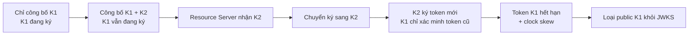

# Kiểm thử xoay khóa, JWKS cache và token ký bằng khóa đã loại bỏ

Authorization Server ký access token JWT bằng private key. Resource Server lấy public key tương ứng từ JSON Web Key Set (JWKS) để xác minh chữ ký. Khi hệ thống xoay khóa, hai phía không nhất thiết cập nhật cùng một thời điểm: Authorization Server có thể đã bắt đầu ký bằng khóa mới trong khi Resource Server vẫn đang giữ JWKS cũ trong cache. Tình huống này là bình thường nếu quy trình xoay khóa được thiết kế đúng. Ngược lại, loại bỏ public key quá sớm có thể làm token còn hạn bị từ chối ở một số Resource Server, trong khi Resource Server khác vẫn chấp nhận token vì cache của chúng còn giữ khóa cũ.

Kiểm thử bảo mật cần chứng minh được toàn bộ vòng đời của khóa: công bố khóa mới, chuyển khóa ký, tiếp tục xác minh token cũ trong thời gian hợp lệ, loại bỏ khóa cũ sau thời điểm an toàn và xử lý trường hợp khóa bị lộ cần thu hồi khẩn cấp. Bài học này tập trung vào Spring Authorization Server, JWKS endpoint và Spring Security Resource Server dùng JWT.

Sau bài học này, bạn có thể:

- Phân biệt khóa ký đang hoạt động, khóa chỉ dùng để xác minh và khóa đã bị loại bỏ.
- Thiết kế trình tự xoay khóa để Resource Server nhận được public key mới trước khi token mới được phát hành.
- Kiểm thử token cũ với JWKS cache còn mới, cache đã cũ và cache vừa được làm mới.
- Xác minh hành vi khi token được ký bằng khóa không còn trong JWKS.
- Phát hiện lỗi do `kid` trùng, cấu hình nhiều instance không đồng nhất hoặc cache giữ dữ liệu cũ.
- Kiểm thử thu hồi khẩn cấp khi private key bị nghi ngờ hoặc xác nhận đã bị xâm phạm.

## 1. Các thành phần cần kiểm thử

Một JWT được ký bằng khóa bất đối xứng thường có header chứa thuật toán và `kid` (Key ID). `kid` giúp Resource Server chọn đúng public key trong JWKS. JWKS là tập hợp các JWK; mỗi JWK mô tả một khóa và những thuộc tính cần thiết để sử dụng khóa đó.

| Thành phần | Vai trò | Điều cần kiểm thử |
|---|---|---|
| Private signing key | Ký JWT tại Authorization Server | Chỉ khóa đang được chọn mới được dùng để ký token mới |
| Public verification key | Xác minh chữ ký JWT tại Resource Server | Public key cần được công bố trong khoảng thời gian token tương ứng còn hợp lệ |
| `kid` | Định danh khóa trong JWT header và JWKS | Có giá trị duy nhất, ổn định và khớp với khóa đã ký |
| JWKS endpoint | Công bố các public key có thể dùng để xác minh | Trả đúng tập khóa, không làm lộ private key material |
| JWKS cache | Giảm số lần Resource Server tải JWKS | Có TTL, refresh và hành vi khi lỗi phù hợp với chính sách |
| JWT decoder | Kiểm tra chữ ký và các claim | Từ chối chữ ký sai, token hết hạn, issuer hoặc audience không hợp lệ |

Trong Spring Authorization Server, `JWKSource<SecurityContext>` là một thành phần quan trọng cung cấp khóa cho quá trình mã hóa JWT và endpoint JWKS. Cấu hình cụ thể có thể dùng một JWK source động hoặc một kho khóa được quản lý bên ngoài. Dù chọn cách nào, cần phân biệt rõ hai tập hợp:

- Tập khóa được phép ký: chứa private key của khóa đang hoạt động và chỉ những khóa được phép tiếp tục ký.
- Tập public key được công bố: chứa public key hiện tại và các public key cũ vẫn cần thiết để xác minh token chưa hết hạn.

Hai tập hợp này không nhất thiết giống nhau. Khi ngừng ký bằng khóa cũ, hệ thống có thể loại private key cũ khỏi thành phần ký nhưng vẫn giữ public key cũ trong JWKS thêm một khoảng thời gian.

## 2. Trình tự xoay khóa an toàn

Giả sử hệ thống đang ký bằng khóa `K1` và chuẩn bị chuyển sang `K2`. Trình tự phổ biến là công bố public key mới trước, sau đó mới chuyển hoạt động ký. Sau khi không còn token mới được ký bằng `K1`, giữ public key của `K1` đến khi mọi token được ký bằng khóa đó đã hết hạn và qua khoảng sai lệch đồng hồ được cho phép.



### 2.1. Công bố trước khi sử dụng

Đầu tiên, tạo `K2` trong hệ thống quản lý khóa. Đưa public key của `K2` vào JWKS cùng với public key `K1`, nhưng tiếp tục ký token bằng `K1`. Chờ Resource Server và các cache trung gian có cơ hội nhận được JWKS mới. Sau đó mới chuyển Authorization Server sang ký bằng `K2`.

Nếu phát hành token dùng `K2` trước khi public key của nó được công bố, Resource Server đang giữ JWKS cũ có thể không tìm thấy `kid` mới và từ chối token. Một số decoder có thể tải lại JWKS khi gặp `kid` chưa biết, nhưng không nên dựa hoàn toàn vào hành vi đó để thay thế trình tự triển khai có kiểm soát.

Có thể biểu diễn khoảng chờ tối thiểu trước khi chuyển signer như sau:

\[
T_{sign(K2)} \geq T_{publish(K2)} + C_{max} + P
\]

Trong đó `C_max` là thời gian tối đa một cache có thể giữ JWKS cũ và `P` là biên phân phối/cập nhật cấu hình. Giá trị cụ thể phải dựa trên cache của decoder, CDN hoặc reverse proxy đang dùng. Hãy xác nhận bằng cách tải JWKS qua đúng đường đi của Resource Server trước khi chuyển signer.

### 2.2. Giữ public key cũ đủ lâu

Gọi:

- `T_switch`: thời điểm hệ thống ngừng ký token mới bằng `K1`.
- `L_max`: thời hạn sống tối đa của token được ký bằng `K1`.
- `S`: clock skew tối đa mà Resource Server cho phép.

Thời điểm sớm nhất để cân nhắc loại public key `K1` khỏi JWKS là:

\[
T_{remove} \geq T_{switch} + L_{max} + S
\]

Ví dụ, token có thời hạn tối đa 15 phút và Resource Server cho phép clock skew 60 giây. Nếu dừng ký bằng `K1` lúc 10:00, giữ public key cũ ít nhất đến sau 10:16. Trong thực tế, hãy cộng thêm biên vận hành nếu hệ thống có nhiều issuer, nhiều loại token hoặc lịch triển khai không đồng bộ.

JWKS cache vẫn cần được tính đến. Trước khi ký bằng `K2`, cần bảo đảm public key mới đã được phân phối đến các Resource Server hoặc có cơ chế refresh đáng tin cậy. Khi loại `K1`, các Resource Server có thể còn giữ bản JWKS cũ một thời gian; tuy nhiên token ký bằng `K1` đã hết hạn vẫn phải bị từ chối do kiểm tra `exp`, kể cả khi public key cũ còn trong cache.

Chỉ giữ public key cũ trong JWKS không có nghĩa hệ thống tiếp tục ký bằng private key cũ. Có thể ngừng cấp quyền sử dụng private key cũ cho tiến trình ký ngay sau khi chuyển sang `K2`, trong khi public key tương ứng vẫn được công bố để xác minh token cũ.

### 2.3. Quy tắc cho `kid`

Mỗi lần tạo khóa mới, dùng một `kid` mới và duy nhất trong phạm vi JWKS. Không tái sử dụng `kid` của khóa đã loại bỏ. Nếu một Resource Server giữ cache cũ và nhận token có cùng `kid` nhưng chữ ký được tạo bằng khóa mới, nó có thể chọn nhầm public key cũ và từ chối token. Việc tái sử dụng `kid` cũng làm chẩn đoán sự cố khó hơn.

Hãy kiểm tra các thuộc tính JWK phù hợp với thuật toán ký, ví dụ `kty`, `use`, `key_ops` và `alg` nếu các thuộc tính đó được công bố. Authorization Server cần chọn đúng private key cho thuật toán đã cấu hình. Resource Server phải xác minh chữ ký bằng thuật toán được cho phép; không suy luận thuật toán từ dữ liệu không đáng tin cậy trong token rồi chấp nhận mọi thuật toán.

## 3. Kiểm thử JWKS endpoint của Authorization Server

Kiểm thử endpoint JWKS trực tiếp giúp phát hiện lỗi trước khi kiểm thử Resource Server. Dùng endpoint thực tế được cấu hình trong `AuthorizationServerSettings`; đường dẫn mặc định thường là `/oauth2/jwks`, nhưng ứng dụng có thể thay đổi đường dẫn này.

Các kiểm tra nên có:

1. Endpoint phản hồi thành công và nội dung là một JWKS hợp lệ.
2. Mỗi khóa có `kid` duy nhất.
3. JWKS chứa public key cần dùng để xác minh token hiện hành và token cũ còn hạn.
4. JWKS không để lộ private key parameter như `d`, `p`, `q`, `dp`, `dq` hoặc `qi` của RSA key.
5. Khi thêm khóa mới, JWKS trả về cả khóa mới và khóa cũ trong giai đoạn chuyển tiếp.
6. Khi kết thúc thời gian lưu khóa cũ, JWKS không còn trả public key đó.
7. Tất cả instance sau load balancer trả về cùng tập `kid` trong cùng một giai đoạn triển khai.
8. Header cache HTTP, nếu được cấu hình, phản ánh TTL và chính sách cập nhật mà hệ thống dự kiến.

Ví dụ kiểm tra cấu trúc JWKS bằng Nimbus JOSE + JWT:

```java
String jwksJson = mockMvc.perform(get(jwkSetEndpoint))
        .andExpect(status().isOk())
        .andReturn()
        .getResponse()
        .getContentAsString();

JWKSet jwkSet = JWKSet.parse(jwksJson);

Set<String> keyIds = jwkSet.getKeys().stream()
        .map(JWK::getKeyID)
        .collect(Collectors.toSet());

assertThat(keyIds).hasSize(jwkSet.getKeys().size());

for (JWK jwk : jwkSet.getKeys()) {
    assertThat(jwk.getKeyID()).isNotBlank();
    assertThat(jwk.isPrivate()).isFalse();
}
```

Đoạn mã minh họa giả định bài kiểm thử đã cấu hình `MockMvc`, `jwkSetEndpoint` và các thư viện Nimbus JOSE + JWT. Nếu endpoint trả JSON qua HTTP client hoặc WebTestClient, có thể giữ nguyên các assertion trên sau khi lấy phần response body.

Không chỉ kiểm tra số lượng khóa. Hãy so sánh chính xác tập `kid` mong đợi, thuật toán, loại khóa và các thuộc tính công khai cần thiết. Một JWKS có hai khóa nhưng chứa nhầm khóa hoặc thiếu `kid` đang hoạt động vẫn là lỗi.

## 4. Tạo token kiểm thử bằng khóa cụ thể

Để kiểm thử token cũ, cần tạo JWT có chữ ký thật bằng private key tương ứng. Không dùng `jwt()` trong Spring Security Test cho mục đích này: request post-processor đó tạo một đối tượng `Jwt` đã được xác thực trong ngữ cảnh test và bỏ qua quá trình tải JWKS, chọn khóa và xác minh chữ ký của decoder.

Có thể dùng Nimbus để tạo khóa RSA và ký JWT kiểm thử. Ví dụ dưới đây tạo token với `kid` cụ thể:

```java
static RSAKey generateRsaKey(String kid) throws JOSEException {
    return new RSAKeyGenerator(2048)
            .keyID(kid)
            .generate();
}

static String signToken(
        RSAKey signingKey,
        Instant issuedAt,
        Instant expiresAt
) throws JOSEException {
    JWTClaimsSet claims = new JWTClaimsSet.Builder()
            .issuer("https://auth.example.test")
            .subject("alice")
            .audience("orders-api")
            .issueTime(Date.from(issuedAt))
            .expirationTime(Date.from(expiresAt))
            .build();

    JWSHeader header = new JWSHeader.Builder(JWSAlgorithm.RS256)
            .keyID(signingKey.getKeyID())
            .type(JOSEObjectType.JWT)
            .build();

    SignedJWT signedJWT = new SignedJWT(header, claims);
    signedJWT.sign(new RSASSASigner(signingKey.toPrivateKey()));
    return signedJWT.serialize();
}
```

Trong test, tạo hai cặp khóa với `kid` khác nhau:

```java
RSAKey oldKey = generateRsaKey("rsa-2026-01");
RSAKey newKey = generateRsaKey("rsa-2026-02");

String oldToken = signToken(
        oldKey,
        Instant.now(),
        Instant.now().plusSeconds(900)
);

String newToken = signToken(
        newKey,
        Instant.now(),
        Instant.now().plusSeconds(900)
);
```

Khi kiểm thử có kiểm soát thời gian, nên dùng một `Clock` cố định cho phần tạo claim và validator để tránh test phụ thuộc vào tốc độ máy chạy. Ví dụ trên chỉ minh họa cách ký; trong test thực tế hãy truyền cùng một mốc `issuedAt` và tính `expiresAt` từ mốc đó.

## 5. Kiểm thử Resource Server với JWKS thay đổi

Resource Server thường cấu hình `JwtDecoder` bằng JWKS URI. Trong Spring Security, có thể tạo decoder bằng `NimbusJwtDecoder.withJwkSetUri(...)` và gắn validator để kiểm tra issuer, audience cùng các quy tắc claim của ứng dụng.

```java
NimbusJwtDecoder jwtDecoder = NimbusJwtDecoder
        .withJwkSetUri(jwkSetUri)
        .build();

jwtDecoder.setJwtValidator(
        JwtValidators.createDefaultWithIssuer("https://auth.example.test")
);
```

Trong ứng dụng thực tế, bổ sung kiểm tra `aud` phù hợp với API. Chữ ký hợp lệ và issuer đúng chưa đủ để chứng minh token được phát hành cho đúng Resource Server.

### 5.1. Dùng JWKS server có thể thay đổi trong test

Tạo một HTTP stub cho JWKS endpoint. Stub đọc một `AtomicReference<JWKSet>` hoặc một fixture có thể thay đổi để test chủ động công bố các tập khóa khác nhau. Có thể dùng MockWebServer, WireMock hoặc HTTP server test đang có trong dự án.

Thiết lập ban đầu:

```java
AtomicReference<JWKSet> publishedJwks = new AtomicReference<>(
        new JWKSet(oldKey.toPublicJWK())
);
```

HTTP stub trả `publishedJwks.get().toString()` cho request JWKS. Sau khi Resource Server tải JWKS lần đầu, test có thể thay đổi tập khóa được công bố:

```java
publishedJwks.set(new JWKSet(List.of(
        oldKey.toPublicJWK(),
        newKey.toPublicJWK()
)));
```

Ở từng giai đoạn, kiểm tra cả decoder đã được tạo trước đó và decoder mới được tạo sau khi JWKS thay đổi. Decoder mới giúp kiểm tra trạng thái mà một Resource Server chưa có cache sẽ nhận được. Decoder cũ giúp kiểm tra hành vi khi cache đã được làm nóng.

### 5.2. Ma trận kết quả cần xác minh

| Giai đoạn JWKS | Token ký bằng K1 | Token ký bằng K2 | Mục đích |
|---|---|---|---|
| Chỉ có K1 | Chấp nhận nếu token còn hạn | Từ chối vì chưa có public key K2 | Xác nhận trạng thái ban đầu |
| Có K1 và K2, K1 vẫn ký | Chấp nhận | Có thể xác minh chữ ký K2 nếu token test được tạo | Kiểm tra phân phối khóa mới |
| Có K1 và K2, K2 đang ký | Chấp nhận | Chấp nhận | Kiểm tra giai đoạn chuyển tiếp |
| Chỉ còn K2 sau khi K1 hết hạn | Token K1 thực tế đã hết hạn và bị từ chối; token kiểm thử còn hạn bị từ chối sau khi decoder làm mới JWKS | Chấp nhận nếu claim hợp lệ | Kiểm tra loại bỏ khóa cũ |
| Chỉ còn K2 nhưng decoder vẫn cache JWKS cũ | Có thể tiếp tục xác minh chữ ký K1 cho đến khi cache cập nhật; token vẫn phải qua kiểm tra `exp` | Chấp nhận nếu claim hợp lệ | Kiểm tra tác động của cache |

Không viết assertion rằng mọi decoder đều phải từ chối token K1 ngay tại thời điểm JWKS endpoint loại khóa K1. Decoder có thể còn bản JWKS cũ trong cache. Hành vi chính xác phụ thuộc cache và cơ chế refresh được cấu hình. Bài test phải kiểm soát TTL hoặc chủ động làm mới cache để xác nhận từng trạng thái.

### 5.3. Kiểm tra token của khóa đã loại bỏ

Sau khi JWKS chỉ còn `K2`, tạo một decoder mới để mô phỏng Resource Server vừa khởi động hoặc vừa làm mới cache. Decoder này không có public key `K1`, vì vậy token còn hạn nhưng ký bằng `K1` phải bị từ chối do không tìm thấy khóa phù hợp. Token ký bằng `K2` cần được chấp nhận nếu chữ ký và các claim hợp lệ.

Ví dụ assertion ở mức `JwtDecoder`:

```java
assertThatThrownBy(() -> freshDecoder.decode(oldToken))
        .isInstanceOf(JwtException.class);

assertThat(freshDecoder.decode(newToken).getSubject())
        .isEqualTo("alice");
```

Tên exception cụ thể có thể khác nhau tùy phiên bản Spring Security và nguyên nhân lỗi từ Nimbus. Ở mức hợp đồng bảo mật, điều cần xác nhận là decoder không tạo ra một `Jwt` đã xác thực cho token không tìm được khóa hoặc có chữ ký không hợp lệ.

Tiếp theo, gửi chính token đó qua filter chain của Resource Server:

```java
mockMvc.perform(get("/api/orders")
        .header(HttpHeaders.AUTHORIZATION, "Bearer " + oldToken))
    .andExpect(status().isUnauthorized());
```

Đường dẫn `/api/orders` là endpoint được bảo vệ trong ứng dụng mẫu. Bài test tích hợp phải dùng `JwtDecoder` thật trỏ đến JWKS stub, không thay decoder bằng mock trả về kết quả thành công. Nếu chỉ dùng `jwt()` của Spring Security Test, bài test không xác minh được việc từ chối token ký bằng khóa đã loại bỏ.

## 6. Kiểm thử cache: warm, cold và refresh

Một bài test JWKS cache tốt phải tách ít nhất ba trạng thái:

- **Cold cache:** Resource Server chưa tải JWKS. Nó phải lấy tập khóa mới nhất từ endpoint.
- **Warm cache:** Resource Server đã tải JWKS trước đó. Nó có thể tiếp tục dùng tập khóa đã cache cho đến khi TTL hoặc chính sách refresh yêu cầu cập nhật.
- **Refreshed cache:** Resource Server đã tải lại JWKS sau khi endpoint thay đổi. Nó phải sử dụng tập khóa mới.

Với mỗi trạng thái, kiểm tra số lần gọi JWKS endpoint, các `kid` decoder có thể chọn và kết quả xác minh token. Không chỉ assert response HTTP của endpoint; điều quan trọng là decoder thực sự quan sát được thay đổi.

### 6.1. Kiểm tra TTL và thời điểm cập nhật

Đặt TTL cache ngắn, xác định được trong test. Làm nóng cache bằng token K1, thay JWKS từ K1 sang K1 + K2 hoặc chỉ K2, rồi kiểm tra trước và sau khi TTL hết hạn. Nếu thư viện hoặc cấu hình cache hỗ trợ clock có thể điều khiển, dùng clock giả để test không phải chờ thời gian thực.

Phân biệt cache nội bộ của `JwtDecoder`/Nimbus với cache HTTP ở CDN hoặc reverse proxy. Header `Cache-Control` trên JWKS response có thể điều khiển cache HTTP trung gian, nhưng không nên mặc định rằng nó cũng quyết định TTL của cache nội bộ trong mọi phiên bản Nimbus. Đo và cấu hình từng lớp theo cơ chế thực tế của hệ thống.

Một test hữu ích nên chứng minh:

1. Decoder cold tải JWKS và xác minh được token có `kid` đang được công bố.
2. Khi JWKS endpoint đổi, decoder warm vẫn có thể dùng cache cũ trong khoảng thời gian đã cấu hình.
3. Sau khi cache được làm mới, decoder thấy đúng tập `kid` mới.
4. Token ký bằng khóa đã loại bỏ bị từ chối sau lần refresh đó.
5. Nếu JWKS endpoint tạm thời không truy cập được, hành vi dùng cache cũ hoặc từ chối request tuân theo chính sách vận hành đã chọn.

Không giả định mọi phiên bản Nimbus hoặc mọi cấu hình Spring Security có cùng TTL mặc định. Hãy cấu hình cache rõ ràng theo API của phiên bản đang dùng và kiểm tra hành vi trên đúng phiên bản dependency của ứng dụng. Nếu có CDN hoặc reverse proxy phía trước JWKS endpoint, phải kiểm thử cả cache ở lớp đó.

### 6.2. Kiểm tra lỗi khi refresh

Mô phỏng các tình huống:

- JWKS endpoint trả `5xx`.
- Kết nối đến JWKS endpoint timeout.
- Response không phải JSON hợp lệ hoặc không parse được thành JWK Set.
- JWKS trả về danh sách rỗng ngoài dự kiến.
- Token chứa `kid` chưa từng được công bố.
- Cache vẫn giữ public key cũ trong khi endpoint đã loại khóa đó.

Xác định rõ chính sách của hệ thống khi refresh thất bại. Một decoder có thể tiếp tục dùng khóa đã cache trong một khoảng thời gian; điều này tăng khả năng sẵn sàng nhưng cũng kéo dài thời gian một khóa bị loại bỏ còn có thể được dùng để xác minh. Với sự cố lộ khóa, đây là rủi ro cần được xử lý bằng quy trình thu hồi khẩn cấp, không thể chỉ dựa vào TTL thông thường.

## 7. Kiểm thử thu hồi khẩn cấp khi khóa bị xâm phạm

Xoay khóa định kỳ và thu hồi khóa bị xâm phạm là hai tình huống khác nhau. Khi xoay khóa bình thường, giữ public key cũ đến khi token cũ hết hạn để tránh gián đoạn. Khi private key bị lộ, mục tiêu có thể là ngăn token giả mạo được chấp nhận càng sớm càng tốt. Quy trình khẩn cấp có thể phải loại public key khỏi JWKS ngay, vô hiệu hóa việc sử dụng private key, làm mới cache và áp dụng biện pháp thu hồi token bổ sung.

Một JWT tự xác minh có thể được Resource Server chấp nhận mà không gọi Authorization Server. Vì vậy, xóa khóa khỏi JWKS không tự động xóa bản public key đã cache tại mọi Resource Server. Nếu một decoder còn giữ khóa bị xâm phạm, nó có thể tiếp tục xác minh token được ký bằng private key đó cho đến khi cache cập nhật hoặc bị vô hiệu hóa.

Kịch bản diễn tập nên bao gồm:

1. Tạo token hợp lệ bằng `K1` và làm nóng JWKS cache tại nhiều Resource Server.
2. Mô phỏng phát hiện private key `K1` bị xâm phạm.
3. Ngừng sử dụng `K1` để ký token mới và loại public key `K1` khỏi JWKS.
4. Kích hoạt cơ chế purge/invalidate cache hoặc refresh decoder ở các Resource Server.
5. Gửi token cũ ký bằng `K1` đến từng Resource Server và ghi nhận thời gian từ lúc bắt đầu sự cố đến khi tất cả nơi xử lý từ chối token.
6. Xác minh token ký bằng `K2` vẫn được chấp nhận.
7. Kiểm tra các node không truy cập được JWKS trong lúc xử lý sự cố và xác nhận chính sách failover của chúng.

Nếu yêu cầu thu hồi tức thời, cân nhắc thêm cơ chế có trạng thái như introspection, denylist hoặc thời hạn access token ngắn. Với token opaque, Resource Server thường gọi introspection để xác minh trạng thái; với JWT tự xác minh, việc thu hồi tức thời cần một kênh cập nhật trạng thái bổ sung hoặc một chiến lược khác được thiết kế rõ ràng.

Đo thời gian lan truyền thu hồi thay vì chỉ kiểm tra một request sau khi thay đổi JWKS. Một hệ thống nhiều instance có thể có một số node đã refresh và một số node vẫn giữ cache cũ. Kết quả diễn tập cần thể hiện được node nào còn chấp nhận token và trong bao lâu.

## 8. Kiểm thử nhiều instance và triển khai cuốn chiếu

Trong môi trường production, các instance Authorization Server có thể được cập nhật lần lượt. Nếu mỗi instance dùng file khóa hoặc cấu hình riêng, có thể xảy ra tình huống instance A ký bằng `K2` trong khi instance B chưa công bố public key `K2`. Resource Server nhận token từ A nhưng tải JWKS từ B có thể không xác minh được chữ ký.

Kiểm thử theo các trạng thái triển khai:

| Trạng thái cụm | Điều kiện cần xác minh |
|---|---|
| Tất cả instance ở phiên bản cũ | JWKS và khóa ký cũ nhất quán |
| Một số instance đã nhận public K2 | Mọi JWKS endpoint sau load balancer đều công bố K2 trước khi có token K2 |
| Một số instance đã chuyển ký K2 | Tất cả Resource Server có thể tải public K2 |
| Tất cả instance ký K2 | Không instance nào tiếp tục phát hành token với K1 ngoài kế hoạch |
| K1 được loại khỏi JWKS | Mọi token K1 còn hạn đã hết thời gian hợp lệ hoặc quy trình thu hồi khẩn cấp đã được kích hoạt |

Gửi nhiều request đến JWKS endpoint qua load balancer và thu thập tập `kid` từ từng response. Nếu có thể định tuyến đến từng instance trong môi trường kiểm thử, kiểm tra trực tiếp từng node. Kiểm tra token phát hành từ từng instance bằng decoder dùng cùng JWKS URI như Resource Server production.

Ngoài ra, kiểm thử trường hợp pod khởi động lại hoặc autoscale trong lúc xoay khóa. Instance mới phải tải được đúng bộ khóa và không tự sinh một khóa riêng không được các instance khác công bố. Nếu khóa được lấy từ KMS hoặc secret store, kiểm tra cả quyền truy cập, timeout và lỗi khi dịch vụ quản lý khóa tạm thời không khả dụng.

## 9. Các lỗi bảo mật và lỗi cấu hình cần chủ động tìm

| Lỗi | Hậu quả | Assertion hoặc tình huống phát hiện |
|---|---|---|
| Ký bằng K2 trước khi công bố public K2 | Resource Server chưa cập nhật JWKS từ chối token mới | Token K2 bị từ chối bởi decoder có cache cũ |
| Xóa public K1 trước khi token K1 hết hạn | Người dùng có token còn hạn bị lỗi xác thực không đồng nhất | Token K1 thất bại trên cold decoder trong khi token vẫn còn hạn |
| Tái sử dụng `kid` | Decoder có thể chọn nhầm khóa từ cache | Hai khóa khác nhau có cùng `kid` phải làm test thất bại |
| Một instance công bố JWKS khác instance còn lại | Kết quả xác minh phụ thuộc node phục vụ JWKS | So sánh tập `kid` từ mọi node |
| JWKS công bố private key material | Lộ khả năng ký token | Kiểm tra không có private parameters |
| Decoder chấp nhận thuật toán ngoài allowlist | Rủi ro giả mạo hoặc hạ cấp thuật toán | Token dùng thuật toán không được phép phải bị từ chối |
| Không kiểm tra `iss` hoặc `aud` | Token hợp lệ cho issuer/API khác có thể được chấp nhận | Token sai issuer hoặc audience phải bị từ chối |
| Cache không refresh sau khi khóa bị xâm phạm | Token giả mạo có thể tiếp tục được chấp nhận | Đo thời gian từ purge đến khi mọi node từ chối |
| Chỉ kiểm thử bằng `jwt()` | Bỏ qua chữ ký và JWKS thực tế | Bài test tích hợp phải gửi Bearer JWT đã ký thật |

Ngoài các lỗi trong bảng, cần kiểm tra `exp`, `nbf`, `iat` và clock skew. Token hết hạn phải bị từ chối kể cả khi chữ ký hợp lệ và public key vẫn nằm trong JWKS. Token có `nbf` ở tương lai phải bị từ chối theo chính sách thời gian. Nếu ứng dụng sử dụng claim tùy chỉnh để phân quyền, kiểm tra chúng ở lớp authorization phù hợp sau khi chữ ký và claim chuẩn đã được xác minh.

## 10. Bộ test đề xuất

Một bộ kiểm thử xoay khóa đủ tin cậy nên có các nhóm sau:

| Nhóm | Dữ liệu đầu vào | Kết quả mong đợi |
|---|---|---|
| JWKS contract | JWKS endpoint của Authorization Server | JSON hợp lệ, `kid` duy nhất, không có private key material |
| Publish-before-use | JWKS có K1 + K2, signer vẫn dùng K1 | Decoder cold và warm đều có thể xác minh token K2 khi K2 đã được công bố |
| Signer switch | Token phát hành trước và sau thời điểm chuyển | Token mới có `kid` K2; token cũ vẫn xác minh được khi còn hạn |
| Old-key retention | Token K1 còn hạn và JWKS vẫn chứa public K1 | Token K1 được chấp nhận nếu mọi claim hợp lệ |
| Old-key removal | JWKS chỉ còn K2, decoder đã refresh | Token K1 bị từ chối; token K2 được chấp nhận |
| Cache expiration | Cache chứa JWKS cũ, endpoint đã cập nhật | Decoder đổi sang tập khóa mới sau TTL/refresh theo cấu hình |
| Expired old token | Token K1 đã hết hạn, public K1 vẫn có trong JWKS | Token bị từ chối do `exp` |
| Unknown key | Token có `kid` không có trong JWKS | Decoder từ chối token |
| Invalid signature | Token bị sửa payload hoặc ký bằng private key khác | Decoder từ chối token |
| Wrong issuer/audience | Token có chữ ký đúng nhưng claim không phù hợp | Decoder từ chối token |
| Emergency revoke | Cache đã giữ K1 trước sự cố | Mọi Resource Server từ chối token K1 trong thời gian mục tiêu đã cam kết |
| Cluster consistency | Nhiều Authorization Server instance | Mọi instance trả tập khóa nhất quán và phát hành token có `kid` hợp lệ |

Nên chạy nhóm kiểm thử này trong pipeline trước khi phát hành thay đổi về key source, JWKS endpoint, decoder, cache hoặc cấu hình token. Một số kịch bản như diễn tập KMS lỗi và thu hồi khẩn cấp có thể chạy trong môi trường staging theo lịch vận hành.

## 11. Checklist trước khi phát hành thay đổi khóa

- [ ] Khóa mới có `kid` duy nhất và thuật toán ký đúng chính sách.
- [ ] Public key mới đã xuất hiện trên JWKS của tất cả instance trước khi signer chuyển sang khóa mới.
- [ ] Token mới mang `kid` mới và được xác minh thành công bằng decoder production-like.
- [ ] Token cũ còn hạn vẫn được xác minh trong giai đoạn giữ khóa cũ.
- [ ] Private key cũ không còn được chọn để ký token mới sau thời điểm chuyển.
- [ ] Public key cũ chỉ bị loại khỏi JWKS sau thời hạn token cũ cộng clock skew.
- [ ] Cache cold, warm và refreshed đều có test riêng.
- [ ] Token ký bằng khóa đã loại bỏ bị từ chối sau khi cache được làm mới.
- [ ] Token hết hạn bị từ chối ngay cả khi public key vẫn được công bố.
- [ ] JWKS không làm lộ private key material.
- [ ] Issuer, audience, expiration, not-before và thuật toán được kiểm tra.
- [ ] Có quy trình purge cache và diễn tập thu hồi khẩn cấp khi khóa bị xâm phạm.
- [ ] Các instance trong cụm công bố cùng tập khóa và dùng cùng chính sách ký.

## Kết luận

Xoay khóa an toàn đòi hỏi đồng bộ thời điểm công bố public key, chuyển signer, thời hạn token và cache của Resource Server. Kiểm thử phải dùng JWT có chữ ký thật và decoder tải JWKS thật để quan sát hành vi của cache cold, warm và refreshed. Khi khóa cũ được loại bỏ, token ký bằng khóa đó chỉ nên bị từ chối sau khi cache đã nhận trạng thái mới; trong quy trình xoay khóa bình thường, thời điểm này phải đến sau khi token cũ hết hạn và qua clock skew. Với khóa bị xâm phạm, cần quy trình thu hồi khẩn cấp và đo thời gian lan truyền đến tất cả Resource Server.
