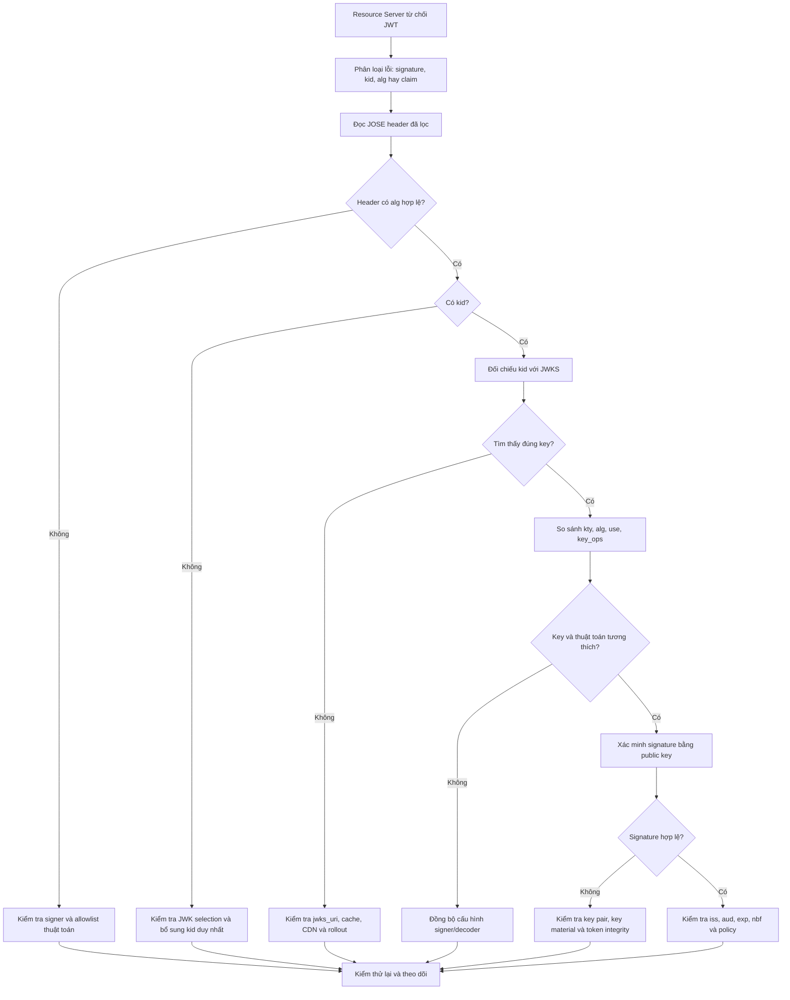
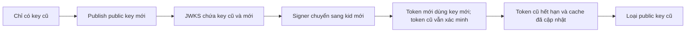

# Lỗi chữ ký JWT, thiếu kid, sai thuật toán hoặc JWKS không đồng bộ

Khi một Resource Server từ chối JWT do Authorization Server phát hành, nguyên nhân có thể nằm ở chữ ký, cách chọn khóa, thuật toán JWS hoặc dữ liệu khóa công khai được phân phối qua JWKS. Các lỗi này thường xuất hiện sau khi xoay khóa, triển khai nhiều instance, thay đổi cấu hình ký hoặc cập nhật cache ở phía Resource Server.

Trong hệ thống dùng Spring Authorization Server, cần theo dõi cả nơi phát hành token và nơi xác minh token. Authorization Server ký JWT bằng khóa riêng; Resource Server lấy khóa công khai từ JSON Web Key Set (JWKS) để xác minh. Hai phía phải thống nhất về thuật toán, `kid`, bộ khóa đang hoạt động và issuer. Bài học này trình bày cách phân biệt lỗi, thu thập bằng chứng an toàn, kiểm tra cấu hình Spring Security và khôi phục dịch vụ mà không làm suy yếu chính sách xác minh.

## 1. Phân biệt các nhóm lỗi

JWT dạng compact JWS thường có ba phần được ngăn cách bằng dấu chấm:

```text
BASE64URL(header).BASE64URL(payload).BASE64URL(signature)
```

Header thường chứa `alg` và có thể chứa `kid`. Payload chứa claim như `iss`, `sub`, `aud`, `iat` và `exp`. Phần signature được tạo từ header, payload và khóa ký theo thuật toán đã chọn.

Các lỗi sau có liên quan nhưng không giống nhau:

| Triệu chứng | Ý nghĩa | Nơi cần kiểm tra đầu tiên |
|---|---|---|
| `kid` không có trong JWKS hoặc không tìm được khóa phù hợp | Bộ xác minh không chọn được public key để thử | Header JWT, JWKS đang được Resource Server sử dụng |
| `kid` bị thiếu | Token không chỉ ra khóa cụ thể; có thể gây mơ hồ khi có nhiều khóa | Cấu hình JWK và header do bên ký phát hành |
| `alg` không được hỗ trợ hoặc không được cho phép | Thuật toán trong header không nằm trong allowlist hoặc không phù hợp với key | Chính sách thuật toán ở signer và decoder |
| `Invalid signature` | Có khóa được chọn nhưng chữ ký không xác minh được, hoặc dữ liệu ký không khớp | Cặp khóa, key material, thuật toán, token bị thay đổi |
| JWKS cũ hoặc không đồng bộ | Resource Server chưa nhận được public key mới hoặc vẫn dùng key set cũ | JWKS endpoint, CDN/proxy, cache decoder và rollout |
| `issuer`, `audience`, `exp` hoặc `nbf` không hợp lệ | Chữ ký có thể đúng nhưng claim validation thất bại | Claim trong token và validator của Resource Server |

Không gộp tất cả các trường hợp thành lỗi “JWT sai chữ ký”. Ví dụ, token có chữ ký hợp lệ nhưng sai `aud` phải bị từ chối vì token không dành cho API đó; đây là lỗi claim validation, không phải lỗi mật mã. Phân loại đúng giúp tìm ra lớp gây lỗi và tránh thay đổi cấu hình ký khi vấn đề thực tế nằm ở issuer hoặc audience.

## 2. Hiểu vai trò của alg, kid và JWKS

### 2.1. `alg` xác định thuật toán chữ ký

`alg` trong JOSE header cho biết thuật toán JWS được dùng để ký. Một số giá trị thường gặp:

| Thuật toán | Loại khóa | Mô tả |
|---|---|---|
| `RS256` | RSA | RSASSA-PKCS1-v1_5 với SHA-256 |
| `PS256` | RSA | RSASSA-PSS với SHA-256 |
| `ES256` | EC P-256 | ECDSA với SHA-256 |
| `EdDSA` | OKP/Edwards | Chữ ký EdDSA, tùy thư viện và phiên bản hỗ trợ |

Không thể dùng public key RSA để xác minh chữ ký ECDSA, hoặc coi `RS256` và `PS256` là cùng một thuật toán chỉ vì cả hai dùng RSA. Loại khóa, thuật toán, tham số JWK và allowlist của decoder phải tương thích.

### 2.2. `kid` giúp chọn đúng khóa

`kid` (Key ID) là định danh của khóa trong bộ JWK. Khi Authorization Server có nhiều khóa, signer thường đưa `kid` của khóa đang dùng vào JWT header. Resource Server dùng giá trị đó để tìm JWK phù hợp trong JWKS.

`kid` không phải bí mật và cũng không chứng minh khóa là đáng tin cậy. Nó chỉ là gợi ý chọn khóa trong một nguồn JWKS đã được cấu hình tin cậy. Không lấy URL tùy ý từ header như `jku` hoặc `x5u` để tải khóa, vì điều đó có thể tạo lỗ hổng SSRF hoặc khiến hệ thống xác minh bằng nguồn khóa do người gửi token kiểm soát.

Theo chuẩn JOSE, `kid` có thể không xuất hiện nếu bên xác minh có thể chọn khóa theo cách khác. Tuy nhiên, khi có nhiều khóa cùng tồn tại trong giai đoạn rotation, thiếu `kid` thường khiến việc chọn khóa mơ hồ hoặc phụ thuộc vào hành vi của thư viện. Với hệ thống phát hành JWT có xoay vòng khóa, hãy gắn `kid` duy nhất vào từng khóa và đưa `kid` tương ứng vào header của mọi token.

### 2.3. JWKS công bố khóa công khai

JWKS là một JSON object chứa mảng `keys`. Một JWK RSA công khai thường có `kty`, `kid`, `use`, `alg`, `n` và `e`; một JWK EC thường có `kty`, `kid`, `crv`, `x` và `y`. `use` thường là `sig` với khóa dùng để xác minh chữ ký; nếu có `key_ops`, thao tác `verify` phải phù hợp với vai trò public key.

JWKS công khai không được chứa private key material như `d`, `p`, `q`, `dp`, `dq` hoặc `qi` của RSA. Private key chỉ được giữ trong kho khóa an toàn hoặc dịch vụ ký. Một JWK có cùng `kid` nhưng nội dung khóa đã đổi sẽ làm cache và hệ thống xác minh khó dự đoán; không tái sử dụng `kid` cho key material khác.

## 3. Thu thập bằng chứng trước khi thay đổi cấu hình

Khi lỗi xuất hiện, hãy ghi lại thời điểm bắt đầu, phiên bản ứng dụng, môi trường, tenant/client liên quan và phạm vi ảnh hưởng. Xác định lỗi xảy ra với mọi token hay chỉ token được ký sau một lần triển khai/rotation.

Thu thập các thông tin sau:

1. `issuer` dự kiến và `jwks_uri` được công bố trong discovery metadata.
2. JOSE header của một token lỗi: `alg`, `kid`, `typ` và các header khác có liên quan.
3. Danh sách metadata public của các JWK tại endpoint: `kid`, `kty`, `use`, `alg`, `key_ops` và các tham số public tương ứng.
4. Thời điểm token được phát hành, thời điểm đổi khóa và thời gian cache JWKS.
5. Log đã lọc của Authorization Server, Resource Server, proxy/CDN và hệ thống quản lý khóa.
6. Trạng thái các replica: phiên bản đang chạy, key set đang hoạt động và `kid` dùng để ký.

Không ghi nguyên access token, refresh token hoặc ID token vào log để điều tra. Nếu cần so sánh hai token, chỉ lưu header đã lọc, thời điểm, `kid`, issuer và fingerprint an toàn theo quy trình nội bộ. Không gửi token production lên website giải mã JWT công khai. Decode header/payload chỉ giúp đọc dữ liệu; nó không xác minh chữ ký và không chứng minh token hợp lệ.

Có thể đọc discovery metadata và JWKS bằng các lệnh sau, thay URL bằng endpoint đã được xác minh của môi trường:

```bash
curl --fail --silent --show-error \
  https://auth.example.com/.well-known/openid-configuration

curl --fail --silent --show-error \
  https://auth.example.com/oauth2/jwks \
  | jq '.keys[] | {kid, kty, use, alg, key_ops}'
```

Đường dẫn JWKS phải lấy từ trường `jwks_uri` trong discovery metadata hoặc cấu hình tin cậy đã được quản trị. Ví dụ `/oauth2/jwks` là đường dẫn thường gặp trong Spring Authorization Server, nhưng có thể khác nếu ứng dụng tùy chỉnh endpoint.

Nếu cần đọc JOSE header, hãy dùng công cụ nội bộ đã được phê duyệt và chỉ xử lý token trong môi trường an toàn. Việc giải mã Base64URL không phải bước xác minh. Chữ ký chỉ được coi là hợp lệ sau khi thư viện mật mã xác minh bằng public key tin cậy và các claim bắt buộc cũng vượt qua validator.

## 4. Quy trình chẩn đoán tổng thể



Thực hiện theo thứ tự để khoanh vùng lỗi. Đừng xoay khóa hoặc nới lỏng thuật toán trước khi xác định Resource Server đang dùng JWKS nào và token lỗi được ký bằng khóa nào.

## 5. Xử lý lỗi thiếu kid hoặc không tìm thấy kid

### 5.1. Phân biệt thiếu kid với kid không khớp

Hai trường hợp này có nguyên nhân khác nhau:

- **Header không có `kid`:** signer không đưa key ID vào JWT hoặc cấu hình JWK không có key ID. Khi có nhiều khóa, decoder có thể không chọn được khóa duy nhất.
- **Header có `kid` nhưng JWKS không có giá trị đó:** public key chưa được công bố, Resource Server đang dùng JWKS cũ, token đến từ instance dùng key khác, hoặc signer và JWKS endpoint không dùng cùng key set.

Hãy so sánh chính xác chuỗi `kid`, kể cả chữ hoa/chữ thường và ký tự đặc biệt. `kid` trong header phải trùng với `kid` của JWK tương ứng. Không suy luận khóa từ vị trí phần tử trong mảng `keys`; thứ tự JWK không có ý nghĩa định danh.

### 5.2. Gắn key ID ổn định khi tạo JWK

Với Nimbus JOSE + JWT, một JWK được tạo từ RSA key pair có thể được gắn key ID và thuật toán như sau:

```java
RSAKey signingJwk = new RSAKey.Builder(publicKey)
        .privateKey(privateKey)
        .keyID("auth-signing-2026-02")
        .keyUse(KeyUse.SIGNATURE)
        .algorithm(JWSAlgorithm.RS256)
        .build();
```

Đoạn mã minh họa việc mô tả một khóa ký đã có. `publicKey` và `privateKey` phải là một cặp hợp lệ; trong production, private key nên được lấy từ KMS/HSM hoặc kho khóa được kiểm soát. Không tạo key pair mới mỗi lần ứng dụng khởi động rồi chỉ giữ trong bộ nhớ.

Phần public có thể được biểu diễn bằng `signingJwk.toPublicJWK()` khi cần công bố hoặc kiểm tra riêng. Endpoint JWKS phải chỉ xuất bản thông tin public. Không tự trả toàn bộ JWK có private parameters trong API quản trị hoặc log.

### 5.3. Xác nhận header do signer phát hành

Sau khi cấu hình key ID, phát hành một token kiểm thử mới và kiểm tra JOSE header có chứa đúng `kid` và `alg` dự kiến. Token cũ không tự thay đổi header khi cấu hình signer được cập nhật. Nếu token được ký trước rotation, nó vẫn cần public key cũ cho đến khi token hết hạn hoặc bị thu hồi theo cơ chế phù hợp.

Nếu Authorization Server chạy nhiều replica, kiểm tra token từ từng replica. Tất cả instance phải dùng cùng key ring hoặc dịch vụ ký dùng chung, và phải công bố cùng tập public key. Nếu một replica phát hành `kid` không có trong JWKS công khai, cần sửa cấu hình phân phối khóa và loại bỏ trạng thái key riêng lẻ không được quản lý.

## 6. Xử lý lỗi thuật toán không khớp

### 6.1. Đối chiếu ba nơi

Khi `alg` không khớp, so sánh ba lớp:

1. **Signer:** thuật toán mà Authorization Server thực sự dùng để ký JWT.
2. **JWK:** `kty`, `alg` (nếu có), `use`, `key_ops` và đường cong/độ dài khóa tương ứng.
3. **Decoder:** tập thuật toán mà Resource Server cho phép.

Ví dụ `RS256` cần khóa RSA; `ES256` cần EC P-256. Nếu JWK khai báo `alg: RS256` nhưng token header lại là `PS256`, một số thư viện sẽ loại JWK ngay ở bước chọn khóa. Nếu decoder chỉ cho phép `RS256`, token `PS256` cũng phải bị từ chối dù key pair có thể thuộc RSA.

### 6.2. Chỉ cho phép thuật toán đã chọn

Với Spring Security Resource Server, có thể cấu hình `NimbusJwtDecoder` dùng JWKS URI đã biết và chỉ chấp nhận `RS256`:

```java
@Bean
JwtDecoder jwtDecoder(
        @Value("${app.security.issuer}") String issuer,
        @Value("${app.security.jwk-set-uri}") String jwkSetUri) {

    NimbusJwtDecoder decoder = NimbusJwtDecoder
            .withJwkSetUri(jwkSetUri)
            .jwsAlgorithm(SignatureAlgorithm.RS256)
            .build();

    decoder.setJwtValidator(JwtValidators.createDefaultWithIssuer(issuer));
    return decoder;
}
```

Các import liên quan gồm `NimbusJwtDecoder`, `JwtDecoder`, `JwtValidators` và `SignatureAlgorithm` trong Spring Security OAuth2/Jose. Ví dụ này giả định Resource Server chỉ chấp nhận `RS256`. Nếu hệ thống dùng thuật toán khác, hãy cấu hình đúng allowlist đã được phê duyệt; không bật tất cả thuật toán để “cho token chạy được”.

Nếu dùng Spring Boot properties, có thể cấu hình issuer hoặc JWKS URI bên ngoài artifact. Ví dụ:

```yaml
spring:
  security:
    oauth2:
      resourceserver:
        jwt:
          issuer-uri: https://auth.example.com
```

Khi dùng `issuer-uri`, Spring Security có thể lấy metadata và JWKS URI từ discovery. Nếu dùng `jwk-set-uri` trực tiếp, vẫn phải xác minh issuer bằng validator phù hợp; chỉ cấu hình JWKS URI không tự chứng minh claim `iss` của token đúng với Authorization Server dự kiến.

### 6.3. Không hạ cấp chính sách để né lỗi

Không chấp nhận `alg: none`, không bỏ qua kiểm tra chữ ký, không chuyển từ thuật toán bất đối xứng sang thuật toán đối xứng chỉ để tương thích tạm thời và không tin thuật toán do token tự khai báo mà không có allowlist. Thuật toán phải được quyết định bởi cấu hình tin cậy của ứng dụng.

Nếu cần chuyển từ `RS256` sang `PS256` hoặc `ES256`, triển khai theo kế hoạch tương thích: xác nhận thư viện và client hỗ trợ, công bố public key mới, cấu hình decoder chấp nhận tập thuật toán được phê duyệt trong giai đoạn chuyển tiếp, rồi chuyển signer. Khi không còn token cũ, loại bỏ thuật toán cũ khỏi allowlist. Mỗi bước cần có thời gian và tiêu chí rollback rõ ràng.

## 7. Khi kid đúng nhưng chữ ký vẫn không hợp lệ

Nếu Resource Server tìm được JWK có `kid` tương ứng và thuật toán phù hợp nhưng vẫn báo invalid signature, kiểm tra các khả năng sau:

- **Public/private key không cùng cặp:** signer dùng private key A nhưng JWKS công bố public key B.
- **Key bị thay thế dưới cùng `kid`:** key ID cũ được tái sử dụng cho key material mới; decoder hoặc CDN vẫn cache public key cũ.
- **Sai loại hoặc tham số khóa:** JWK khai báo `kty`, `crv`, `n`, `e` hoặc tham số public không tương ứng với khóa ký.
- **Sai mục đích sử dụng:** JWK có `use` hoặc `key_ops` không phù hợp cho xác minh chữ ký.
- **Token bị thay đổi:** header hoặc payload bị sửa, token bị cắt, nối thêm ký tự, URL decode sai hoặc có whitespace không hợp lệ.
- **Signer dùng thuật toán khác:** token header và cấu hình signer không thống nhất, hoặc một instance phát hành theo cấu hình cũ.
- **Decoder lấy nhầm nguồn khóa:** `jwks_uri` trỏ đến môi trường khác, tenant khác hoặc endpoint cũ.

Với RSA, có thể so sánh fingerprint public key hoặc các tham số `n` và `e` từ JWK với public key mà đội vận hành mong đợi. Với EC, so sánh `crv`, `x` và `y`. Không so sánh private material bằng log hay đưa private key vào công cụ trực tuyến.

Kiểm tra token có được giữ nguyên trong suốt quá trình truyền hay không. Một reverse proxy hoặc middleware không được phép decode/re-encode, sửa header hay thay payload JWT. Nếu ứng dụng lưu token trong database hoặc truyền qua cookie/header, xác minh không có thao tác cắt chuỗi, escape hoặc biến đổi encoding.

## 8. JWKS không đồng bộ hoặc bị cache cũ

### 8.1. Xác minh đúng nguồn JWKS

Bắt đầu từ issuer của token. Lấy discovery metadata của đúng issuer và xác nhận trường `jwks_uri`. Sau đó gọi URI này từ:

- Máy hoặc container chạy Resource Server.
- Mạng nội bộ nơi decoder thực hiện request.
- Các vùng mạng hoặc cluster khác nhau nếu có nhiều môi trường.

So sánh response, HTTP status, TLS certificate, DNS resolution và nội dung `keys`. Một trình duyệt truy cập được JWKS không chứng minh pod Resource Server cũng truy cập được. Kiểm tra proxy outbound, firewall, DNS, trust store và quyền truy cập mạng từ đúng runtime.

### 8.2. Kiểm tra cache ở mọi lớp

JWKS có thể được cache tại nhiều nơi:

- Resource Server hoặc thư viện JOSE dùng remote JWK set cache.
- HTTP client hoặc reverse proxy.
- CDN hoặc API gateway trước JWKS endpoint.
- DNS resolver hoặc service discovery.
- Replica Authorization Server đọc dữ liệu khóa từ nguồn khác nhau.

Khi một `kid` mới chưa xuất hiện, hãy xác minh response thực tế mà decoder nhận được và thời điểm response được cache. Kiểm tra `Cache-Control`, `ETag`, `Last-Modified` nếu endpoint hoặc proxy sử dụng. Cache TTL quá dài có thể làm chậm rotation; TTL quá ngắn tạo nhiều request đến Authorization Server. Chọn giá trị theo tải, yêu cầu sẵn sàng và thời gian propagation.

Không mặc định restart Resource Server là giải pháp đúng. Restart có thể làm mới cache trong một số cấu hình nhưng không sửa JWKS endpoint sai, CDN stale hoặc replica Authorization Server chưa đồng bộ. Chỉ làm mới cache theo cơ chế được thư viện và nền tảng hỗ trợ sau khi xác định nguyên nhân.

### 8.3. Đồng bộ key ring giữa các instance

Một tình huống thường gặp là replica A đã nạp khóa mới nhưng replica B vẫn dùng khóa cũ. Load balancer có thể gửi token đến A hoặc B; discovery/JWKS request cũng có thể được trả lời bởi một replica khác. Kết quả là token do A ký có `kid` mới nhưng response JWKS từ B chưa có public key tương ứng.

Để tránh tình trạng này:

- Dùng một kho khóa hoặc nguồn cấu hình có kiểm soát cho toàn bộ replica.
- Đảm bảo tất cả instance đọc cùng key set và cùng `kid` đang hoạt động.
- Chỉ chuyển signer sau khi public key mới đã được công bố đồng nhất.
- Kiểm tra JWKS qua load balancer nhiều lần và từ từng instance trong giai đoạn triển khai.
- Theo dõi phiên bản key ring hoặc fingerprint public key đã nạp trên từng replica.

Không dựa vào sticky session để che giấu sự không đồng bộ. Token có thể được xác minh bởi API khác, service khác hoặc sau khi replica restart; toàn hệ thống phải có cùng khả năng xác minh.

## 9. Xoay vòng khóa không gây gián đoạn

Rotation phải có giai đoạn chồng lấp giữa khóa cũ và khóa mới. Trình tự tham khảo:

1. Tạo key pair mới trong KMS/HSM hoặc kho khóa được bảo vệ; cấp `kid` mới và duy nhất.
2. Phân phối public key mới đến JWKS endpoint của mọi instance.
3. Xác minh các Resource Server và cache có thể nhìn thấy public key mới. Chờ khoảng propagation phù hợp với cache và hạ tầng.
4. Chuyển Authorization Server sang ký token mới bằng private key mới; xác nhận JWT header có `kid` mới.
5. Tiếp tục công bố public key cũ trong JWKS để xác minh các token đã phát hành bằng khóa cũ.
6. Chỉ gỡ public key cũ sau khi token cuối cùng được ký bằng khóa cũ đã hết hạn, cộng thêm clock skew, thời gian cache và khoảng an toàn vận hành.



Trong thời gian chồng lấp, JWKS có thể chứa cả khóa cũ và khóa mới. Việc signer bắt đầu dùng khóa mới không có nghĩa có thể xóa khóa cũ ngay lập tức. Thời điểm gỡ khóa phải tính theo token có thời hạn dài nhất được ký bằng khóa cũ, thời gian clock skew mà validator chấp nhận, cache của Resource Server và độ trễ propagation.

Nếu phát hiện private key cũ bị lộ, quy trình khẩn cấp có thể cần thu hồi token, ngừng tin khóa cũ hoặc giảm thời gian chồng lấp. Đây là xử lý sự cố bảo mật và có thể làm token cũ thất bại; cần phối hợp với các Resource Server, client và chủ sở hữu API theo runbook đã phê duyệt. Không giữ khóa bị xâm phạm chỉ để duy trì tương thích.

## 10. Cấu hình Spring Authorization Server và Resource Server

### 10.1. Nguồn khóa ký của Authorization Server

Spring Authorization Server sử dụng `JWKSource<SecurityContext>` để cung cấp khóa cho các thành phần mã hóa JWT và endpoint JWKS. Trong môi trường thực tế, nguồn này cần đọc từ key store bền vững hoặc tích hợp KMS/HSM. Không sinh khóa ngẫu nhiên trong mỗi lần khởi động nếu token cần được xác minh qua nhiều instance hoặc qua các lần restart.

Một cấu hình minh họa ở mức kiến trúc:

```java
@Bean
JWKSource<SecurityContext> jwkSource(KeyRingProvider keyRingProvider) {
    return (selector, context) -> {
        JWKSet publicAndSigningKeys = keyRingProvider.currentJwkSet();
        return selector.select(publicAndSigningKeys);
    };
}
```

`KeyRingProvider` là abstraction của ứng dụng, không phải class có sẵn của Spring Authorization Server. Nó phải cung cấp key set đã được xác thực, có `kid` ổn định, public key cho JWKS và quyền sử dụng private key cho signer. Nếu dùng HSM/KMS mà private key không thể export, cần tích hợp một signer tương thích với `JwtEncoder` thay vì giả định có thể tải private key vào JVM.

Khi thay đổi key ring, cập nhật nguồn dữ liệu dùng chung và xác minh endpoint JWKS đã công bố đúng public key. Nếu một phiên bản ứng dụng giữ cache key set nội bộ, cần có cơ chế reload và quan sát trạng thái reload trên từng instance.

### 10.2. Resource Server dùng issuer hoặc JWKS URI tin cậy

Resource Server cần biết issuer hoặc JWKS URI từ cấu hình tin cậy. Với issuer URI, Spring Security có thể khám phá metadata và cấu hình xác minh theo issuer. Với JWKS URI cấu hình trực tiếp, phải đặt validator cho issuer như ví dụ ở phần thuật toán.

Ngoài chữ ký và issuer, ứng dụng thường cần xác minh `aud` để bảo đảm token được phát hành cho đúng API. Validator cần kiểm tra các claim nghiệp vụ bổ sung như tenant, scope hoặc token type nếu kiến trúc yêu cầu. Chỉ xác minh chữ ký thành công chưa đủ để cấp quyền truy cập.

Nếu hệ thống dùng nhiều issuer hoặc nhiều tenant, ánh xạ issuer đến decoder phải dựa trên danh sách issuer được quản trị. Không tạo decoder bằng cách nối chuỗi issuer tùy ý từ request và không tải JWKS từ URL không tin cậy do token cung cấp.

## 11. Phân biệt lỗi chữ ký với lỗi claim và lỗi thời gian

Sau khi signature được xác minh, Resource Server vẫn phải kiểm tra claim. Các trường hợp thường bị nhầm lẫn:

| Lỗi | Kiểm tra | Cách xử lý |
|---|---|---|
| `iss` không đúng | Claim issuer có khớp issuer được cấu hình không | Đồng bộ issuer và discovery; không bỏ issuer validation |
| `aud` không chứa API hiện tại | Token có được phát hành cho resource server này không | Kiểm tra audience khi phát hành và cấu hình validator |
| `exp` đã qua | Token đã hết hạn chưa | Cấp token mới; kiểm tra clock và TTL |
| `nbf` nằm trong tương lai | Token chưa có hiệu lực hoặc clock lệch | Đồng bộ thời gian và xem lại thời điểm phát hành |
| `iat` bất thường | Thời gian hệ thống hoặc dữ liệu token không đúng | Kiểm tra NTP và clock của signer |
| Sai scope/authority | Chữ ký và claim hợp lệ nhưng quyền không đủ | Kiểm tra scope mapping và authorization rule |

Đồng bộ thời gian bằng NTP hoặc dịch vụ thời gian của nền tảng trên Authorization Server, Resource Server và các node liên quan. Clock skew có thể làm token bị coi là hết hạn hoặc chưa có hiệu lực; nó không phải lý do để tắt xác minh chữ ký.

## 12. Ma trận triệu chứng và cách khắc phục

| Triệu chứng quan sát | Nguyên nhân thường gặp | Hướng xử lý |
|---|---|---|
| Token mới lỗi `no matching key` ngay sau rotation | Public key mới chưa được công bố hoặc cache JWKS cũ | Công bố key trước khi chuyển signer; kiểm tra cache và replica |
| Token có header thiếu `kid` | JWK không có key ID hoặc signer không đưa key ID vào header | Gắn `kid` ổn định, phát hành token mới và kiểm tra header |
| Chỉ một số request lỗi chữ ký | Một số replica ký bằng key khác hoặc trả JWKS khác | So sánh key ring/fingerprint trên từng instance và đồng bộ rollout |
| Tất cả token cũ lỗi sau restart | Ứng dụng sinh key mới khi khởi động | Dùng khóa bền vững; công bố public key cũ nếu vẫn cần xác minh token cũ |
| `kid` tồn tại nhưng invalid signature | Public key không cùng cặp, key bị thay dưới cùng `kid`, token bị sửa | So sánh public key, fingerprint và đường truyền token |
| Decoder báo thuật toán không được hỗ trợ | `alg` ngoài allowlist hoặc thư viện không hỗ trợ | Đồng bộ thuật toán đã phê duyệt ở signer và decoder |
| JWKS endpoint trả key mới nhưng pod vẫn báo thiếu key | Decoder cache hoặc proxy cache cũ | Xác minh response từ runtime, cache policy và refresh được hỗ trợ |
| JWKS endpoint lúc có lúc không có `kid` | Replica Authorization Server không cùng key set | Dùng nguồn khóa dùng chung và rollout đồng nhất |
| Signature hợp lệ nhưng token bị từ chối | Issuer, audience, thời gian hoặc policy sai | Kiểm tra claim validators và đồng hồ hệ thống |
| Chỉ một tenant gặp lỗi | Tenant resolver trỏ nhầm issuer/JWKS hoặc dùng key ring riêng chưa đồng bộ | Kiểm tra mapping tenant, issuer và key source của tenant đó |

## 13. Log, metric và cảnh báo cần có

Log của Resource Server nên ghi đủ thông tin để phân loại lỗi nhưng không làm lộ token. Các trường hữu ích gồm:

- Timestamp UTC, service name, phiên bản build và instance ID.
- Issuer đã cấu hình hoặc mã định danh issuer đã được quản trị.
- `kid`, `alg` và loại lỗi đã chuẩn hóa.
- JWKS URI đã cấu hình hoặc ID nguồn khóa; không ghi URL chứa credential.
- HTTP status và độ trễ khi tải JWKS, trạng thái cache nếu thư viện cung cấp.
- Request/correlation ID, client hoặc tenant ID đã được xác thực khi có thể xác định an toàn.
- Kết quả xác minh signature tách biệt với kết quả claim validation.

Không log compact JWT, payload đầy đủ, chữ ký, private key hoặc header `Authorization`. Tránh đưa thông tin do người gửi token kiểm soát trực tiếp vào log mà không giới hạn độ dài và lọc ký tự.

Các metric nên theo dõi:

- Số lần JWT bị từ chối theo nhóm `unknown_kid`, `invalid_signature`, `unsupported_alg`, `invalid_issuer`, `invalid_audience`, `expired` và `not_yet_valid`.
- Tỷ lệ request JWKS thành công/thất bại, độ trễ tải và số lần refresh cache.
- Số lượng `kid` đang được công bố và `kid` đang được signer sử dụng.
- Độ trễ out-of-sync giữa các replica nếu hệ thống có cơ chế báo phiên bản key ring.
- Tỷ lệ 401/403 của API sau mỗi lần rotation hoặc triển khai.

Đặt cảnh báo khi xuất hiện `kid` lạ, thuật toán không nằm trong allowlist, JWKS không truy cập được, số lỗi signature tăng đột biến hoặc các replica có fingerprint key set khác nhau. Không cảnh báo theo từng request riêng lẻ nếu lưu lượng lớn; gom theo service, issuer và khoảng thời gian để tránh alert storm.

## 14. Quy trình xử lý sự cố production

Khi lỗi làm gián đoạn API, thực hiện theo thứ tự sau:

1. **Đánh giá phạm vi:** xác định issuer, tenant, client, API, replica và nhóm token bị ảnh hưởng. So sánh token trước/sau thời điểm deploy hoặc rotation.
2. **Bảo toàn bằng chứng:** lưu header đã lọc, `kid`, `alg`, JWKS response, phiên bản ứng dụng, thời gian và log liên quan. Không lưu token hoặc secret nguyên vẹn.
3. **Xác minh nguồn tin cậy:** kiểm tra discovery metadata, issuer, `jwks_uri`, TLS và response JWKS từ môi trường Resource Server.
4. **Đối chiếu key:** xác nhận `kid`, `kty`, `alg`, `use`, `key_ops` và public key thực tế khớp với signer.
5. **Kiểm tra rollout/cache:** xác định tất cả Authorization Server replica đã công bố cùng key set chưa và Resource Server đang dùng cache nào.
6. **Khôi phục theo nguyên nhân:** đồng bộ key ring, công bố public key còn thiếu, sửa endpoint hoặc cấu hình thuật toán đã phê duyệt. Nếu private key bị lộ, kích hoạt quy trình rotation khẩn cấp và thu hồi phù hợp.
7. **Kiểm thử luồng:** xác minh token mới, token cũ còn trong thời hạn, discovery, JWKS, issuer, audience và các API quan trọng.
8. **Theo dõi và ghi nhận:** theo dõi tỷ lệ lỗi sau khôi phục, lưu timeline, nguyên nhân gốc, tác động và hành động phòng ngừa.

Không tắt signature validation hoặc chấp nhận mọi thuật toán để giảm số lỗi 401. Một biện pháp tạm thời như rollback signer chỉ an toàn nếu private key cũ chưa bị xâm phạm, public key cũ vẫn đáng tin cậy và token đã phát hành trong giai đoạn chuyển đổi được xử lý có chủ đích.

## 15. Kiểm thử để tránh tái diễn

Thiết lập kiểm thử tự động cho các trường hợp sau:

| Kịch bản | Kết quả mong đợi |
|---|---|
| Token được ký bằng key hiện hành và `kid` có trong JWKS | Signature hợp lệ và claim validation thành công |
| Token có `kid` không tồn tại | Bị từ chối; log phân loại `unknown_kid` |
| Token không có `kid` khi có nhiều key | Bị xử lý theo chính sách rõ ràng; không chọn khóa tùy tiện |
| Token dùng `alg` ngoài allowlist | Bị từ chối |
| Token dùng key không tương ứng với `alg` | Bị từ chối |
| Payload hoặc header bị sửa sau khi ký | Signature verification thất bại |
| Public key mới được công bố trước khi signer chuyển khóa | Token cũ và mới đều xác minh được trong giai đoạn overlap |
| Token được ký bằng khóa cũ trong thời gian overlap | Vẫn xác minh được khi public key cũ còn trong JWKS |
| Public key cũ bị gỡ sau thời gian an toàn | Token mới vẫn hợp lệ; token cũ hết hạn hoặc bị xử lý theo policy |
| Một replica chưa đồng bộ key ring | Health/metric hoặc deployment gate phát hiện trước khi nhận traffic |
| JWKS endpoint tạm thời không truy cập được | Hành vi cache/failure được xác định; có cảnh báo và phục hồi |
| Issuer hoặc audience sai | Bị từ chối dù chữ ký hợp lệ |
| Clock lệch | Kiểm thử `exp`, `nbf`, `iat` phản ánh đúng chính sách clock skew |

Nên có integration test với Authorization Server và Resource Server chạy bằng cấu hình gần production. Kiểm thử rotation qua nhiều instance và qua cache thực tế; unit test cho một `JwtDecoder` đơn lẻ không phát hiện được lỗi CDN, DNS hoặc rollout.

## 16. Những sai lầm cần tránh

- Tạo khóa ký mới mỗi lần khởi động và kỳ vọng token cũ tiếp tục xác minh.
- Dùng cùng một `kid` cho hai key pair khác nhau.
- Xóa public key cũ ngay sau khi signer chuyển sang key mới.
- Chỉ kiểm tra JWKS trên máy phát triển mà không kiểm tra từ runtime Resource Server.
- Cho rằng token có thể decode được thì chữ ký hợp lệ.
- Tin `kid` như bằng chứng xác thực hoặc tải khóa từ URL tùy ý trong JWT header.
- Nới lỏng allowlist, bỏ kiểm tra chữ ký hoặc chấp nhận `alg: none` để khắc phục tạm thời.
- Chỉ restart pod mà không tìm hiểu cache, endpoint hoặc key ring không đồng bộ.
- Coi lỗi `iss`, `aud`, `exp` và `nbf` là lỗi chữ ký.
- Ghi token hoặc private key vào log để điều tra.

## Kết luận

Chẩn đoán JWT cần tách rõ bước chọn khóa, kiểm tra thuật toán, xác minh chữ ký và xác thực claim. Khi `kid` ổn định, signer và decoder thống nhất thuật toán, JWKS được công bố nhất quán và quy trình rotation có thời gian chồng lấp, Spring Authorization Server có thể phát hành token cho nhiều Resource Server mà không gây gián đoạn xác minh. Mỗi sự cố nên được xử lý dựa trên header đã lọc, public key tin cậy, trạng thái cache và bằng chứng từ từng replica; không làm suy yếu xác minh JWT để che lấp lỗi cấu hình.
