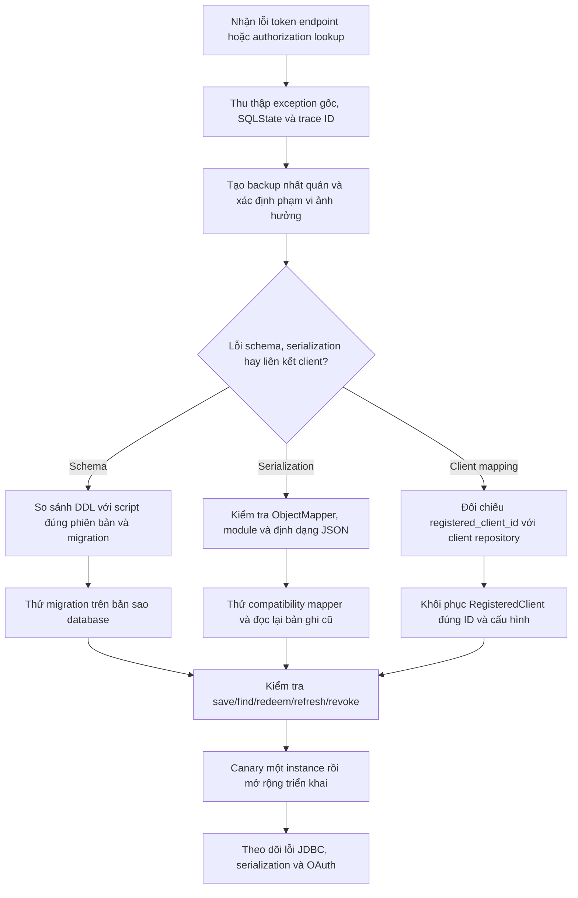

# Lỗi JDBC schema, serialization và khôi phục authorization

Khi Spring Authorization Server chuyển từ lưu trữ trong bộ nhớ sang JDBC, lỗi thường xuất hiện ở ba điểm: cấu trúc database không khớp với phiên bản thư viện, dữ liệu authorization không thể được Jackson đọc lại, hoặc bản ghi authorization không còn liên kết được với RegisteredClient đã đăng ký. Các lỗi này có thể khiến token endpoint, refresh token, consent hoặc token revocation trả lỗi dù cấu hình OAuth 2.0 nhìn bề ngoài vẫn đúng.

Bài học này hướng dẫn chẩn đoán và khôi phục các lỗi đó trong một Authorization Server vận hành lâu dài hoặc chạy nhiều instance. Trọng tâm là giữ dữ liệu authorization nhất quán với schema và mã ứng dụng, bảo toàn định danh client qua các lần triển khai, và khôi phục quyền truy cập mà không làm lộ bearer token.

## 1. Xác định lớp gây lỗi trước khi sửa

`OAuth2AuthorizationService` lưu authorization cùng authorization code, access token, refresh token, ID token và metadata liên quan. `RegisteredClientRepository` lưu cấu hình client mà authorization tham chiếu. Nếu ứng dụng lưu consent riêng, `OAuth2AuthorizationConsentService` cũng cần một kho lưu trữ bền vững.

Với JDBC, các implementation thường gặp là:

| Thành phần | Implementation JDBC | Dữ liệu cần tồn tại |
|---|---|---|
| Registered client | `JdbcRegisteredClientRepository` | Bản ghi client, grant type, redirect URI, scope, phương thức xác thực và token settings |
| Authorization | `JdbcOAuth2AuthorizationService` | Bản ghi authorization và các token/metadata của grant |
| Authorization consent | `JdbcOAuth2AuthorizationConsentService` | Scope và quyền mà người dùng đã chấp thuận cho client |

Trước khi thay đổi dữ liệu, xác định request lỗi ở giai đoạn nào: đọc client, đọc authorization, ghi authorization, serialize thuộc tính, hay xác minh token ở Resource Server. Cần giữ lại exception gốc, SQLState, vendor error code, tên thao tác và trace ID. Không đưa giá trị token hoặc toàn bộ request token endpoint vào log để chẩn đoán.

| Dấu hiệu | Nguyên nhân thường gặp | Kiểm tra đầu tiên |
|---|---|---|
| `BadSqlGrammarException`, lỗi table/column không tồn tại | Chưa chạy migration, sai schema, tên cột không khớp script của phiên bản thư viện | Schema thực tế và migration đang được áp dụng |
| `DataIntegrityViolationException`, lỗi data too long hoặc cannot be null | Kiểu dữ liệu, độ dài, nullability hoặc constraint không phù hợp dữ liệu được lưu | DDL của cột được nêu trong exception |
| `CannotGetJdbcConnectionException`, `DataAccessResourceFailureException` | Database không truy cập được, pool hết connection, sai credentials hoặc network | DataSource, pool metrics, quyền database và kết nối từ đúng instance |
| `JsonMappingException`, `InvalidTypeIdException`, `InvalidDefinitionException` | Jackson không thể serialize hoặc deserialize một attribute, principal hay kiểu Authentication | ObjectMapper của `OAuth2AuthorizationRowMapper` và kiểu dữ liệu trong `attributes` |
| Không tìm được RegisteredClient khi đọc authorization | Bản ghi client bị thiếu hoặc `registered_client_id` không còn khớp ID nội bộ | Liên kết giữa `oauth2_authorization.registered_client_id` và `oauth2_registered_client.id` |
| Một instance đọc được dữ liệu, instance khác báo lỗi | Các instance dùng schema, migration, ObjectMapper hoặc phiên bản dependency khác nhau | So sánh cấu hình runtime giữa các instance |

Không quy mọi lỗi ở `/oauth2/token` thành `invalid_grant`. Một lỗi JDBC hoặc serialization là lỗi hạ tầng/dữ liệu; cần chẩn đoán từ exception gốc trước khi kết luận credential của người dùng không hợp lệ.

## 2. Kiểm tra JDBC schema

### 2.1. Dùng đúng schema của phiên bản thư viện

Spring Authorization Server cung cấp SQL schema mẫu cho các JDBC repository/service. Hãy lấy script đi kèm đúng phiên bản dependency mà ứng dụng đang chạy, sau đó điều chỉnh có kiểm soát cho database vendor và quy ước schema của hệ thống. Không lấy DDL từ một phiên bản khác hoặc chép nguyên script H2 sang PostgreSQL, MySQL hay SQL Server.

Các bảng tiêu chuẩn thường có tên:

- `oauth2_registered_client` cho `JdbcRegisteredClientRepository`;
- `oauth2_authorization` cho `JdbcOAuth2AuthorizationService`;
- `oauth2_authorization_consent` cho `JdbcOAuth2AuthorizationConsentService`.

Tên bảng, cột, kiểu LOB và độ dài cần khớp với câu SQL mà implementation đang dùng. Nếu tổ chức đã đổi tên bảng hoặc cột, cần một implementation/repository tương ứng có câu SQL tùy chỉnh; đổi DDL đơn phương sẽ khiến câu truy vấn mặc định tiếp tục thất bại.

Trong môi trường production, quản lý DDL bằng Flyway hoặc Liquibase. Mỗi thay đổi schema cần có migration được review, chạy thử trên database cùng loại với production và có phương án rollback/restore. Tránh bật khởi tạo schema tự động mỗi lần ứng dụng khởi động vì có thể gây sai thứ tự migration, lỗi quyền DDL hoặc khác biệt giữa các instance.

### 2.2. Xác minh đúng database, schema và quyền truy cập

Một ứng dụng có nhiều `DataSource` hoặc nhiều profile có thể vô tình ghi RegisteredClient vào database A nhưng đọc authorization từ database B. Tương tự, user database có thể kết nối thành công nhưng thiếu quyền `SELECT`, `INSERT`, `UPDATE` hoặc đang tìm bảng trong schema mặc định khác.

Kiểm tra các điểm sau:

1. `JdbcRegisteredClientRepository`, `JdbcOAuth2AuthorizationService` và consent service dùng đúng DataSource dự kiến.
2. Các instance trong cùng cụm trỏ tới cùng database/schema có thẩm quyền và cùng migration version.
3. User database có quyền đọc/ghi các bảng cần thiết; tài khoản migration có quyền DDL riêng nếu chính sách yêu cầu.
4. Schema qualification, `search_path`, database/catalog và cách viết hoa tên identifier nhất quán.
5. Pool connection không trả về connection đã hết hạn hoặc kết nối nhầm database do cấu hình secret/profile cũ.

Có thể dùng `information_schema` để xem cấu trúc thực tế. Cú pháp dưới đây được nhiều hệ quản trị hỗ trợ; điều chỉnh bộ lọc schema theo database đang sử dụng:

```sql
SELECT table_schema,
       table_name,
       column_name,
       data_type,
       character_maximum_length,
       is_nullable
  FROM information_schema.columns
 WHERE table_name IN (
       'oauth2_registered_client',
       'oauth2_authorization',
       'oauth2_authorization_consent'
 )
 ORDER BY table_schema, table_name, ordinal_position;
```

So sánh kết quả với schema script đúng phiên bản dependency. Đặc biệt kiểm tra các cột lưu authorization code, access token, refresh token, ID token, metadata, attributes và các trường scope. Những cột lưu JSON hoặc giá trị token có thể cần kiểu văn bản/LOB đủ lớn. Nếu một cột bị rút ngắn so với dữ liệu thực tế, thao tác lưu có thể lỗi hoặc bị cắt dữ liệu tùy database và cấu hình.

### 2.3. Phân loại lỗi theo SQLState

SQLState giúp khoanh vùng nhanh, nhưng vendor code và thông điệp của database vẫn là nguồn quyết định. Một số nhóm mã thường gặp:

| SQLState (thường gặp) | Ý nghĩa | Hướng xử lý |
|---|---|---|
| `42P01` (PostgreSQL), `42S02` (một số hệ quản trị) | Không tìm thấy bảng/relation | Kiểm tra migration, schema mặc định và tên bảng |
| `42703` (PostgreSQL) | Không tìm thấy cột | Đối chiếu DDL với SQL của dependency đang chạy |
| `22001` | Giá trị chuỗi quá dài | Kiểm tra độ dài cột, dữ liệu và migration mở rộng |
| `23502` | Vi phạm NOT NULL | Xác định cột bắt buộc bị thiếu và nguyên nhân mapper tạo giá trị null |
| `23505` | Vi phạm unique constraint | Kiểm tra dữ liệu seed trùng, retry ghi và constraint thực tế |
| Nhóm `08xxx` | Lỗi kết nối | Kiểm tra database, network, timeout và connection pool |
| Nhóm `28xxx` | Lỗi xác thực database | Kiểm tra username, password, secret rotation và quyền login |
| `42501` (PostgreSQL) | Không đủ quyền | Cấp đúng quyền cho user runtime hoặc migration |

Mã có thể khác theo vendor và driver. Hãy lấy `SQLException.getSQLState()` cùng vendor error code từ exception chain, không chỉ đọc exception wrapper của Spring.

### 2.4. Kiểm tra định danh RegisteredClient

`registered_client_id` trong `oauth2_authorization` tham chiếu đến **ID nội bộ** của `RegisteredClient`, không phải `client_id` mà ứng dụng OAuth gửi trong request. Khi seed client, nếu mỗi lần khởi động lại tạo một UUID mới rồi lưu thành một client khác, authorization cũ có thể vẫn trỏ tới ID không còn tồn tại.

Ví dụ truy vấn kiểm tra liên kết, chỉ lấy trường định danh không nhạy cảm:

```sql
SELECT a.id AS authorization_id,
       a.registered_client_id,
       c.id AS stored_client_id,
       c.client_id
  FROM oauth2_authorization a
  LEFT JOIN oauth2_registered_client c
    ON c.id = a.registered_client_id
 WHERE a.id = :authorization_id;
```

Nếu `stored_client_id` là `NULL`, xác minh client đã bị xóa hay bị seed lại với ID mới. Khôi phục bản ghi client đúng ID nội bộ và cấu hình tương ứng nếu có thể. Đừng tạo một RegisteredClient mới chỉ có cùng `client_id` rồi giả định các authorization cũ sẽ tự liên kết lại.

Trong dữ liệu seed, sử dụng ID ổn định và lưu cấu hình vào repository bền vững. Ví dụ:

```java
RegisteredClient webClient = RegisteredClient.withId("web-client-registration-v1")
        .clientId("web-client")
        // Bổ sung client authentication, grant, redirect URI, scope và token settings.
        .build();
```

Đoạn mã chỉ minh họa ID ổn định; cấu hình thực tế cần đầy đủ và phải giữ tương thích với các authorization đang tồn tại. Không ghi client secret thô vào log hoặc file migration.

## 3. Chẩn đoán lỗi serialization của authorization

### 3.1. Vì sao schema đúng vẫn có thể đọc authorization thất bại?

`JdbcOAuth2AuthorizationService` ánh xạ dữ liệu JDBC thành `OAuth2Authorization`. Các attribute và metadata được chuyển đổi qua Jackson. Bản ghi có thể đã được ghi thành công nhưng lần đọc sau thất bại nếu ObjectMapper không biết cách dựng lại một kiểu Authentication, principal hoặc attribute tùy chỉnh.

Các tình huống phổ biến:

- Ứng dụng đưa một lớp principal/Authentication tự định nghĩa vào authorization nhưng chưa đăng ký mixin hoặc module Jackson tương ứng.
- Ứng dụng thay ObjectMapper dùng cho JDBC row mapper và bỏ mất các module của Spring Security hoặc Spring Authorization Server.
- Một bản phát hành mới đổi package, cấu trúc class hoặc tên thuộc tính trong khi database vẫn chứa JSON theo định dạng cũ.
- Một số instance triển khai mapper hoặc classpath khác nhau trong quá trình rolling deployment.
- Dữ liệu attributes chứa đối tượng runtime không phù hợp để lưu lâu dài, ví dụ servlet request, object phụ thuộc thread, lambda hoặc entity không có quy tắc serialization ổn định.

Các exception như `InvalidDefinitionException`, `InvalidTypeIdException`, `UnrecognizedPropertyException` hoặc `MismatchedInputException` thường chỉ ra lỗi ánh xạ JSON. Hãy lấy tên kiểu và thuộc tính gây lỗi từ stack trace; không cần in toàn bộ JSON authorization vì nó có thể chứa token và dữ liệu nhận dạng người dùng.

### 3.2. Đăng ký Jackson module cho JDBC row mapper

Khi tùy chỉnh `JdbcOAuth2AuthorizationService`, cần cấu hình `OAuth2AuthorizationRowMapper` với các module của Spring Security và Spring Authorization Server. Mẫu dưới đây thể hiện cách đăng ký module; kiểm tra chữ ký API theo phiên bản dependency đang dùng:

```java
import com.fasterxml.jackson.databind.Module;
import com.fasterxml.jackson.databind.ObjectMapper;
import java.util.List;

import org.springframework.context.annotation.Bean;
import org.springframework.jdbc.core.JdbcOperations;
import org.springframework.security.jackson2.SecurityJackson2Modules;
import org.springframework.security.oauth2.server.authorization.JdbcOAuth2AuthorizationService;
import org.springframework.security.oauth2.server.authorization.OAuth2AuthorizationService;
import org.springframework.security.oauth2.server.authorization.client.RegisteredClientRepository;
import org.springframework.security.oauth2.server.authorization.jackson2.OAuth2AuthorizationServerJackson2Module;

@Bean
OAuth2AuthorizationService authorizationService(
        JdbcOperations jdbcOperations,
        RegisteredClientRepository registeredClientRepository) {

    JdbcOAuth2AuthorizationService service =
            new JdbcOAuth2AuthorizationService(jdbcOperations, registeredClientRepository);

    JdbcOAuth2AuthorizationService.OAuth2AuthorizationRowMapper rowMapper =
            new JdbcOAuth2AuthorizationService.OAuth2AuthorizationRowMapper(
                    registeredClientRepository);

    ClassLoader classLoader = JdbcOAuth2AuthorizationService.class.getClassLoader();
    List<Module> securityModules = SecurityJackson2Modules.getModules(classLoader);

    ObjectMapper objectMapper = new ObjectMapper();
    objectMapper.registerModules(securityModules);
    objectMapper.registerModule(new OAuth2AuthorizationServerJackson2Module());

    rowMapper.setObjectMapper(objectMapper);
    service.setAuthorizationRowMapper(rowMapper);
    return service;
}
```

Nếu ứng dụng có principal hoặc attribute tùy chỉnh, đăng ký mixin/module tường minh cho từng kiểu cần lưu. Kiểu dữ liệu đó phải có biểu diễn JSON ổn định và có thể được đọc lại sau khi ứng dụng restart hoặc nâng cấp. Kiểm thử serialize rồi deserialize cùng một authorization trong một test độc lập trước khi triển khai.

Không bật polymorphic default typing rộng cho dữ liệu lấy từ database để chữa lỗi thiếu type. Dữ liệu lưu trữ có thể bị sửa hoặc bị xâm nhập; cho phép Jackson dựng tùy ý class theo type ID có thể mở rộng bề mặt tấn công deserialization. Dùng module và mixin có phạm vi rõ ràng, chỉ cho phép các kiểu ứng dụng thực sự cần.

### 3.3. Giữ định dạng dữ liệu tương thích khi nâng cấp

JSON trong database tồn tại lâu hơn một tiến trình ứng dụng. Một thay đổi class Java có thể làm dữ liệu của phiên bản trước không còn đọc được. Trước khi phát hành thay đổi principal, Authentication hoặc attribute:

1. Xác định những kiểu thực tế đang được lưu trong authorization hiện tại.
2. Bổ sung deserializer/mixin tương thích với định dạng cũ.
3. Kiểm thử đọc bản ghi được tạo bởi phiên bản trước và ghi lại bằng phiên bản mới.
4. Nếu cần chuyển đổi dữ liệu, thực hiện bằng migration có backup, có thể chạy lại an toàn và giới hạn phạm vi bản ghi.
5. Chỉ bỏ hỗ trợ định dạng cũ sau khi xác nhận không còn authorization nào cần đọc định dạng đó.

Trong rolling deployment, mọi instance cùng phục vụ một database phải hiểu được định dạng mà các instance khác đang ghi. Triển khai mapper mới theo hướng đọc được dữ liệu cũ trước; sau đó mới bắt đầu ghi định dạng mới. Nếu hai phiên bản không tương thích, cần điều phối thứ tự triển khai hoặc dừng ghi trong cửa sổ migration.

## 4. Khôi phục authorization an toàn

### 4.1. Bảo toàn dữ liệu trước khi can thiệp

Khi phát hiện lỗi schema hoặc serialization, tránh xóa bảng, xóa toàn bộ authorization hoặc chạy update hàng loạt khi chưa hiểu tác động. Trước hết tạo snapshot/backup nhất quán của các bảng RegisteredClient, authorization và consent; với database hỗ trợ, dùng backup/PITR theo quy trình vận hành. Ghi nhận phiên bản ứng dụng, dependency, migration version, thời điểm lỗi và phạm vi client/người dùng bị ảnh hưởng.

Nếu lỗi bắt đầu ngay sau migration, đối chiếu schema thực tế với phiên bản trước và migration vừa chạy. Nếu lỗi bắt đầu sau khi triển khai code, so sánh ObjectMapper, classpath và các kiểu attribute mới. Không chạy migration sửa dữ liệu trên production trước khi thử với bản backup hoặc bản sao staging.

### 4.2. Khôi phục bản ghi client bị thiếu

Authorization cần RegisteredClient tương ứng để tiếp tục xử lý token và áp dụng chính sách client. Nếu bản ghi client bị xóa hoặc ID nội bộ bị thay đổi:

- Khôi phục bản ghi từ backup hoặc nguồn cấu hình chuẩn với đúng `id` đã được authorization tham chiếu.
- Kiểm tra `client_id`, grant type, redirect URI, authentication method, scope và token settings có còn phù hợp với authorization hiện tại.
- Kiểm tra secret đã mã hóa theo PasswordEncoder đang dùng; không đưa secret cũ ở dạng rõ vào SQL/log.
- Nếu không thể khôi phục đúng cấu hình hoặc credential, đánh giá việc thu hồi grant và yêu cầu người dùng thực hiện lại authorization.

Không sửa `registered_client_id` của nhiều authorization sang một ID mới chỉ để làm biến mất lỗi lookup. Thao tác đó có thể gắn grant cũ với một chính sách client khác và tạo ra quyền truy cập ngoài dự kiến.

### 4.3. Khôi phục dữ liệu serialization không tương thích

Nếu một kiểu attribute cũ không còn class tương ứng, có hai hướng xử lý. Ưu tiên khôi phục khả năng đọc bằng compatibility mixin/deserializer có kiểm soát. Nếu cấu trúc dữ liệu cần thay đổi, tạo migration chuyển đổi có phạm vi cụ thể và lưu lại bản gốc để đối chiếu.

Với một authorization đã hỏng không thể chuyển đổi an toàn, đánh giá tác động theo loại token:

- Authorization code hoặc refresh token không thể khôi phục có thể khiến client phải bắt đầu lại authorization flow.
- Opaque access token thường phụ thuộc trạng thái introspection; khi authorization không còn hợp lệ, Resource Server có thể nhận `active=false` sau khi trạng thái thu hồi được lưu và truyền tới nơi kiểm tra.
- JWT đã phát hành có thể vẫn được Resource Server chấp nhận đến `exp` nếu Resource Server chỉ xác minh chữ ký và claim cục bộ. Xóa bản ghi JDBC không tự làm JWT đã phát hành mất hiệu lực. Nếu cần ngăn sử dụng ngay, phải có denylist/introspection hoặc cơ chế kiểm tra trạng thái thu hồi mà Resource Server thực sự thực thi.

Không tự tạo lại authorization code hay refresh token bằng cách sửa chuỗi trong database. Token là credential bearer; chỉ Authorization Server nên phát hành token mới qua luồng được xác thực. Nếu dữ liệu không thể phục hồi đáng tin cậy, thu hồi grant bị ảnh hưởng và yêu cầu xác thực/consent lại là phương án có thể kiểm soát hơn.

### 4.4. Trình tự khôi phục đề xuất



Trước khi mở lại toàn bộ traffic, xác minh các thao tác đọc/ghi authorization, redeem code, refresh token, consent và revoke. Kiểm tra Resource Server có nhìn thấy trạng thái thu hồi theo đúng cơ chế đã thiết kế. Nếu backup được phục hồi về thời điểm cũ, đánh giá các token được phát hành sau thời điểm backup và xử lý chúng theo chính sách bảo mật.

## 5. Các lỗi thường gặp và cách xử lý

| Tình huống | Chẩn đoán | Cách khắc phục |
|---|---|---|
| `oauth2_authorization` không tồn tại | Migration authorization chưa chạy hoặc chạy nhầm schema | Áp dụng DDL đúng phiên bản vào schema được cấu hình; xác minh bằng `information_schema` |
| Có bảng nhưng thiếu cột token metadata | DDL đến từ phiên bản cũ hoặc migration bị dừng giữa chừng | So sánh toàn bộ cột với script của dependency; viết migration bổ sung có kiểm thử |
| Lưu authorization bị lỗi vượt độ dài | Cột text/LOB hoặc varchar quá ngắn | Xác định trường gây lỗi và mở rộng kiểu dữ liệu theo vendor; không cắt token/metadata |
| Đọc authorization lỗi `InvalidTypeIdException` | JSON có type ID mà mapper hiện tại không nhận biết | Khôi phục module/mixin tương thích và kiểm thử đọc dữ liệu cũ |
| Đọc authorization lỗi `InvalidDefinitionException` | Principal/attribute tùy chỉnh thiếu serializer/deserializer | Tạo mixin/module cho kiểu cụ thể hoặc lưu DTO ổn định thay cho object runtime |
| Sau restart, authorization không tìm được RegisteredClient | ID nội bộ của client bị thay đổi hoặc bản ghi bị xóa | Khôi phục bản ghi với đúng ID và cấu hình đã tham chiếu |
| Chỉ một node gặp lỗi | Node dùng dependency, mapper, profile hoặc schema khác | So sánh artifact version, DataSource, migration version và bean cấu hình giữa các node |
| Sau restore, JWT cũ vẫn gọi được API | Resource Server xác minh JWT cục bộ, không tra trạng thái revoke | Dùng denylist/introspection hoặc chờ token hết hạn theo chính sách; đánh giá thời hạn access token |

## 6. Kiểm thử trước và sau khi khôi phục

Kiểm thử trên cùng loại database và driver với production. H2 có thể hữu ích cho kiểm thử nhanh, nhưng không thay thế kiểm thử migration, kiểu LOB, JSON, constraint và transaction trên PostgreSQL, MySQL hoặc SQL Server đang sử dụng.

Các ca kiểm thử nên có:

| Ca kiểm thử | Kết quả cần xác nhận |
|---|---|
| Khởi tạo database trống bằng migration hiện tại | Các bảng, cột, constraint và index cần thiết tồn tại |
| Nâng cấp từ schema của phiên bản trước | Migration hoàn tất, dữ liệu cũ còn đọc được |
| Lưu rồi đọc lại `OAuth2Authorization` | Principal, attributes, metadata và token state được khôi phục đúng |
| Đọc authorization được tạo bởi phiên bản ứng dụng trước | Mapper tương thích dữ liệu cũ |
| Seed/restart RegisteredClient | ID nội bộ ổn định; authorization cũ vẫn tìm được client |
| Redeem authorization code, refresh và revoke | Thao tác JDBC hoàn tất và trạng thái sau cùng đúng |
| Đọc consent đã lưu | Consent và scope không bị mất sau restart |
| Hai instance dùng chung database | Cả hai đọc cùng schema và cùng định dạng dữ liệu |
| Restore backup trên môi trường thử nghiệm | Ứng dụng khởi động, đọc authorization và xử lý token theo trạng thái đã phục hồi |
| Resource Server nhận token đã revoke | Hành vi đúng với introspection, denylist hoặc giới hạn `exp` đã cấu hình |

Trong test serialization, tạo một `OAuth2Authorization` đại diện có các attribute mà ứng dụng thực sự dùng, lưu qua JDBC rồi đọc lại bằng row mapper. Một test chỉ gọi `ObjectMapper.writeValueAsString()` không đủ chứng minh JDBC row mapper và schema có thể đọc dữ liệu đó.

## 7. Quan sát vận hành và bảo vệ dữ liệu

Theo dõi các chỉ số sau để phát hiện lỗi trước khi ảnh hưởng diện rộng:

- Tỷ lệ lỗi JDBC theo SQLState, vendor code và thao tác `save`, `findByToken`, `remove`;
- số lỗi Jackson theo exception class và loại attribute;
- số lần không tìm thấy RegisteredClient theo client registration ID nội bộ;
- connection pool active/idle, pending acquire, timeout, query latency và deadlock;
- số lượng authorization/consent được lưu, đọc, thu hồi và lỗi trong từng phiên bản ứng dụng.

Log nên chứa correlation ID, instance ID, phiên bản ứng dụng, loại grant, client ID và authorization ID khi phù hợp. Không ghi authorization code, access token, refresh token, client secret, ID token hoặc toàn bộ JSON `attributes`. Nếu cần đối chiếu token, dùng fingerprint HMAC được bảo vệ và không thể đảo ngược bằng cách tra cứu thông thường.

Database authorization chứa dữ liệu có thể cho phép tiếp tục sử dụng grant và có thể chứa giá trị token. Hạn chế quyền đọc bảng cho tài khoản runtime, mã hóa backup, kiểm soát truy cập DBA và audit thao tác dữ liệu. Không sao chép dump production sang môi trường phát triển nếu chưa có quy trình bảo vệ hoặc loại bỏ dữ liệu nhạy cảm.

## 8. Checklist trước khi đóng sự cố

- [ ] Đã xác định exception gốc, SQLState/vendor code và thao tác JDBC gây lỗi.
- [ ] Schema được đối chiếu với script đúng phiên bản Spring Authorization Server và database vendor.
- [ ] Migration được quản lý có version, đã thử trên bản sao database và có phương án restore.
- [ ] `RegisteredClientRepository`, `OAuth2AuthorizationService` và consent service dùng đúng DataSource/schema.
- [ ] ID nội bộ của RegisteredClient ổn định và mọi authorization tham chiếu tới bản ghi client tồn tại.
- [ ] Jackson row mapper đăng ký module Spring Security và Spring Authorization Server cần thiết.
- [ ] Principal/Authentication/attribute tùy chỉnh có serializer/deserializer tương thích và được kiểm thử round-trip.
- [ ] Rolling deployment không tạo ra hai định dạng dữ liệu mà các instance không thể đọc chéo.
- [ ] Bản ghi bị lỗi được khôi phục hoặc thu hồi theo phạm vi đã đánh giá; không xóa dữ liệu hàng loạt để che lỗi.
- [ ] Đã kiểm thử redeem, refresh, consent, revoke và Resource Server sau khôi phục.
- [ ] Log/metric không làm lộ bearer token, client secret hoặc JSON authorization nhạy cảm.

Khi schema, mapper và định danh client được quản lý như một phần của cùng vòng đời phát hành, authorization có thể tồn tại qua restart, nâng cấp và khôi phục database mà không phụ thuộc trạng thái riêng của một instance. Mỗi sự cố cần được xử lý từ lớp gây lỗi, sau đó xác minh lại toàn bộ đường đi lưu trữ và thực thi token trước khi đưa cụm trở lại phục vụ.
