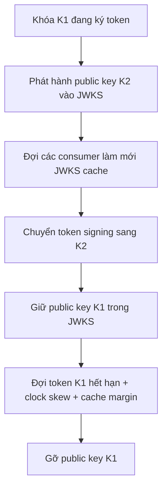

# Bảo toàn issuer, subject, khóa và hợp đồng claims khi nâng cấp

Nâng cấp Spring Authorization Server có thể thay đổi cách ứng dụng tạo metadata, ánh xạ người dùng thành `sub`, ký JWT, công bố JWK Set hoặc thêm claims tùy chỉnh. Một thay đổi nhỏ ở các phần này có thể làm OIDC client từ chối ID token, Resource Server từ chối access token, người dùng bị nhận diện thành tài khoản khác hoặc token đang còn hạn không còn xác minh được.

Vì vậy, issuer, subject identifier, signing key và claims phải được xem là hợp đồng tương thích với các hệ thống bên ngoài. Bài này trình bày cách ghi nhận hợp đồng trước nâng cấp, giữ ổn định định danh, xoay khóa có thời gian chuyển tiếp, thay đổi claims theo cách tương thích và kiểm thử token được phát hành trước/sau khi nâng cấp.

## 1. Xác định những gì phải được bảo toàn

Một Authorization Server có thể thay đổi implementation bên trong qua nhiều phiên bản, nhưng các client và Resource Server phụ thuộc vào các giá trị giao thức bên ngoài. Trước khi nâng cấp, lập danh sách các hợp đồng sau:

| Hợp đồng | Thành phần phụ thuộc | Rủi ro khi thay đổi ngoài kế hoạch |
|---|---|---|
| Issuer (`iss`) | OIDC client, Resource Server, metadata cache, token validator | Client báo issuer mismatch; token cũ và mới thuộc hai trust domain khác nhau |
| Subject (`sub`) | Ứng dụng client, hệ thống phân quyền, audit và liên kết tài khoản | Một người dùng bị coi là người khác hoặc mất liên kết dữ liệu |
| Signing key và `kid` | Resource Server, OIDC client, JWKS cache, hệ thống xác minh token | Token mới không xác minh được hoặc token cũ mất khóa công khai |
| Signing algorithm | Thư viện JWT, gateway, HSM/KMS và Resource Server | Consumer không hỗ trợ thuật toán mới hoặc từ chối token |
| Audience (`aud`) | Resource Server và API gateway | Token bị từ chối hoặc được chấp nhận ở sai API |
| Claims chuẩn | Client và Resource Server | Sai kiểu dữ liệu, ý nghĩa hoặc thời hạn của claim |
| Custom claims | Ứng dụng tích hợp, policy engine và downstream service | Consumer lỗi khi claim bị đổi tên, bỏ đi hoặc đổi kiểu |
| Metadata và endpoint URL | OIDC discovery, OAuth client registration, JWKS cache | Client gọi sai endpoint hoặc nhận issuer không nhất quán |

Không chỉ ghi lại cấu hình trong source code. Cần lưu các mẫu metadata, header/payload token đã loại bỏ dữ liệu nhạy cảm, JWK Set công khai, claim contract, client registration và kết quả kiểm thử từ phiên bản đang chạy. Đây là bộ dữ liệu đối chiếu khi triển khai phiên bản mới.

## 2. Giữ issuer ổn định

Issuer là định danh của Authorization Server. Ví dụ:

```text
https://identity.example.com
```

Giá trị này phải khớp chính xác giữa `AuthorizationServerSettings`, OIDC discovery metadata và claim `iss` của token. Không tự thay issuer khi đổi tên service nội bộ, đổi namespace Kubernetes, đổi cổng container hoặc chuyển TLS termination sang một proxy khác.

Khai báo issuer công khai tường minh:

```java
@Bean
AuthorizationServerSettings authorizationServerSettings() {
    return AuthorizationServerSettings.builder()
            .issuer("https://identity.example.com")
            .build();
}
```

Nếu issuer lấy từ cấu hình triển khai, hãy bảo đảm mọi instance trong cùng môi trường nhận cùng một giá trị:

```yaml
app:
  security:
    issuer: https://identity.example.com
```

Sau nâng cấp, gọi OIDC discovery qua hostname công khai và so sánh `issuer` với baseline. Kiểm tra thêm `authorization_endpoint`, `token_endpoint`, `jwks_uri` và các endpoint OIDC được công bố. Khi ứng dụng chạy sau reverse proxy, xác minh forwarded headers và scheme/host/path prefix để URL không chuyển thành hostname nội bộ hoặc HTTP.

### Nếu bắt buộc phải đổi issuer

Đổi issuer là thay đổi định danh nhà cung cấp, không phải một thao tác đổi domain đơn giản. Token đã phát hành mang issuer cũ vẫn giữ giá trị đó; thay metadata mới không sửa được claim `iss` trong token cũ. OIDC client và Resource Server thường so sánh issuer chính xác, nên không nên thêm ngoại lệ chấp nhận cả hai giá trị một cách vô thời hạn.

Nếu cần chuyển sang issuer mới:

1. Công bố kế hoạch migration và xác định thời gian hai trust domain cùng tồn tại.
2. Đăng ký issuer mới trong client và Resource Server theo cấu hình rõ ràng; không tự động tin issuer lấy từ token.
3. Giữ endpoint/metadata cũ hoạt động đủ lâu để xử lý token, authorization code và refresh token còn hiệu lực theo chính sách.
4. Quyết định rõ token cũ được chấp nhận đến hết hạn, được exchange/migrate hay bị thu hồi tại một thời điểm.
5. Phát hành token mới với issuer mới chỉ sau khi consumer đã tin issuer đó.
6. Theo dõi tỷ lệ request dùng issuer cũ và chỉ ngừng hỗ trợ khi không còn luồng hợp lệ cần nó.

Một issuer mới có thể được triển khai như một Authorization Server mới với cấu hình, metadata và khóa riêng. Nếu một ứng dụng phục vụ song song nhiều issuer, phải có định tuyến và trust configuration tách biệt; không chọn issuer bằng cách phản chiếu Host header hoặc request parameter.

## 3. Bảo toàn subject identifier

`sub` là định danh subject trong phạm vi issuer. Client thường dùng nó làm khóa liên kết tài khoản, dữ liệu người dùng, quyền truy cập hoặc audit. Vì vậy, `sub` phải ổn định qua các lần đăng nhập và nâng cấp, ngay cả khi username, email, tên hiển thị hoặc cấu trúc bảng người dùng thay đổi.

Không dùng các thuộc tính có thể đổi làm subject identifier:

- Email có thể đổi, được xác minh lại hoặc được cấp lại cho người khác.
- Username có thể đổi theo chính sách tổ chức.
- Tên hiển thị không bảo đảm duy nhất.
- Số điện thoại có thể được tái sử dụng.
- ID database có thể thay đổi khi hợp nhất hệ thống hoặc chuyển dữ liệu.

Ưu tiên một định danh nội bộ bất biến hoặc một subject mapping được quản lý riêng. Ví dụ, ứng dụng có thể duy trì bảng ánh xạ:

| issuer | internal principal ID | subject identifier |
|---|---|---|
| `https://identity.example.com` | `user-10042` | `00u7f2c9a1` |
| `https://identity.example.com` | `user-10043` | `00u8a3d5b4` |

Giá trị minh họa không chứa thông tin người dùng. Mapping phải duy nhất trong phạm vi issuer và không được tái sử dụng cho một người khác sau khi tài khoản bị xóa.

### Subject công khai và pairwise

OIDC hỗ trợ subject identifier dạng public hoặc pairwise. Với public subject, cùng một người dùng có thể nhận cùng `sub` ở các client thuộc issuer đó. Với pairwise subject, người dùng có `sub` khác nhau theo sector/client group để hạn chế khả năng liên kết hoạt động giữa các ứng dụng.

Nếu hệ thống dùng pairwise subject, phải bảo toàn mapping giữa người dùng nội bộ và sector identifier. Thay đổi domain, redirect URI hoặc cách tính sector có thể làm `sub` thay đổi dù người dùng không đổi. Trước khi thay thuật toán hoặc sector mapping, hãy kiểm tra toàn bộ client bị ảnh hưởng và có kế hoạch liên kết dữ liệu. Không chuyển từ pairwise sang public hoặc ngược lại trong một lần nâng cấp mà không đánh giá tác động quyền riêng tư và tương thích.

### Kiểm tra subject mapping khi nâng cấp

- Cùng một principal đăng nhập trước và sau nâng cấp phải nhận cùng `sub` theo chính sách hiện tại.
- Hai principal khác nhau không được nhận cùng `sub` trong phạm vi issuer.
- Đổi email/username không làm `sub` thay đổi.
- Tài khoản được merge phải có quy tắc giữ hoặc ánh xạ subject cũ rõ ràng.
- Tài khoản bị xóa không khiến subject cũ được gán cho một người mới.
- Với pairwise subject, cùng sector giữ nguyên mapping; sector khác nhau có kết quả khác theo thiết kế.

Nếu phải thay subject format, hãy duy trì bảng alias/mapping từ subject cũ sang định danh nội bộ trong giai đoạn chuyển tiếp. Chỉ các ứng dụng có quyền mới được truy cập mapping này; không phát hành một claim phụ tiết lộ `sub` cũ cho mọi client.

## 4. Bảo toàn signing key và khả năng xác minh token

Resource Server xác minh JWT bằng khóa công khai trong JWK Set. Token header thường chứa `kid` để consumer chọn đúng khóa. Nếu nâng cấp làm ứng dụng tạo cặp khóa mới mỗi lần khởi động hoặc thay `kid` không có kế hoạch, token đã phát hành có thể không còn xác minh được.

Các nguyên tắc cần giữ:

- Khóa riêng được lưu trong KMS, HSM hoặc secret store có kiểm soát; không tạo lại ngẫu nhiên mỗi lần ứng dụng khởi động.
- `kid` ổn định cho một khóa và không tái sử dụng cho một khóa khác.
- JWKS công khai chỉ chứa khóa công khai cần xác minh; không bao giờ xuất bản private key.
- Thuật toán ký được allowlist rõ ràng ở Authorization Server và Resource Server.
- Mọi instance có cùng tập khóa công khai và cùng quy tắc chọn khóa ký.
- Khóa cũ được giữ trong JWKS đủ lâu để xác minh token còn hạn và các cache JWKS cập nhật.

Ví dụ cấu hình một nguồn JWK bền vững về mặt ý tưởng:

```java
@Bean
JWKSource<SecurityContext> jwkSource(KeyStore keyStore) {
    RSAKey activeSigningKey = keyStore.loadActiveRsaSigningKey();
    RSAKey previousPublicKey = keyStore.loadPreviousRsaSigningKey().toPublicJWK();
    JWKSet publishedKeys = new JWKSet(
            List.of(activeSigningKey, previousPublicKey));

    return (selector, context) -> selector.select(publishedKeys);
}
```

`KeyStore` trong ví dụ là abstraction của ứng dụng để đọc khóa đã được quản lý; `loadPreviousRsaSigningKey()` trả về khóa cũ để chuyển thành public-only JWK. Không thay bằng code tự sinh RSA key trong bean ở mỗi lần khởi động. JWK Set được dùng chung cho việc chọn khóa ký và công bố JWKS; token encoder phải chọn khóa có private material đang active, còn JWKS endpoint chỉ được xuất bản public projection. Trong giai đoạn chuyển tiếp, danh sách chứa private JWK của khóa active cùng public-only JWK của khóa cũ. Khi chuyển sang khóa mới, đổi active key và giữ public JWK cũ cho đến hết thời gian overlap. Xác minh hành vi chọn khóa và public projection theo phiên bản thư viện đang dùng.

## 5. Xoay khóa có thời gian chuyển tiếp

Không nên vừa triển khai phiên bản mới vừa lập tức xóa khóa cũ. Một quy trình xoay khóa an toàn có các giai đoạn:



Trình tự chi tiết:

1. Tạo khóa mới trong KMS/HSM hoặc kho khóa đã phê duyệt; gán `kid` mới duy nhất.
2. Công bố public key mới trong JWKS nhưng tiếp tục ký bằng khóa cũ.
3. Đợi Resource Server và client có cache JWKS tải được khóa mới. Kiểm tra cache header, refresh interval và khả năng refresh khi gặp `kid` chưa biết.
4. Chuyển tất cả instance sang ký bằng khóa mới; xác minh token mới có `kid` mới và chữ ký hợp lệ.
5. Giữ public key cũ trong JWKS cho đến khi token được ký bằng khóa cũ đã hết hạn, cộng clock skew và khoảng đệm cache/triển khai.
6. Chỉ gỡ public key cũ sau khi xác nhận không còn token hợp lệ cần nó.

Nếu cần đổi thuật toán, chẳng hạn RSA sang EC, phải kiểm tra consumer hỗ trợ thuật toán mới trước khi phát hành. Trong thời gian chuyển tiếp, có thể công bố đồng thời hai khóa và cho phép các thuật toán được phê duyệt; không cho phép thuật toán không an toàn hoặc lấy `alg` từ token làm chỉ thị tin cậy. Thay đổi thuật toán và thay đổi `kid` là hai thay đổi khác nhau, cần test riêng.

### Các lỗi xoay khóa thường gặp

| Triệu chứng | Nguyên nhân | Cách xử lý |
|---|---|---|
| Token mới báo `kid` không tìm thấy | JWKS chưa công bố khóa mới hoặc cache chưa refresh | Công bố public key trước khi chuyển ký; kiểm tra JWKS cache và routing |
| Token cũ không xác minh được | Gỡ public key cũ quá sớm | Khôi phục public key nếu an toàn và còn cần; kéo dài overlap theo TTL token |
| Một số node ký được, node khác không | Key set hoặc active key khác nhau giữa instance | Dùng nguồn khóa chung và cấu hình đồng nhất; kiểm tra rollout |
| JWKS có cùng `kid` cho hai khóa | Tái sử dụng `kid` | Cấp `kid` mới duy nhất và kiểm tra consumer cache |
| Resource Server từ chối thuật toán | Consumer allowlist chưa được cập nhật | Cập nhật policy thuật toán trước khi phát hành token bằng thuật toán mới |
| Private key xuất hiện trong JWKS | JWK Set được dựng từ khóa riêng mà không loại private parameters khi publish | Chỉ serialize public projection; rà soát log, cache và phạm vi ảnh hưởng |

## 6. Bảo toàn hợp đồng claims

Claims là API contract giữa Authorization Server và consumer. Một thay đổi từ `roles: ["OPS"]` sang `roles: "OPS"`, đổi `tenant_id` từ chuỗi sang số hoặc thay ý nghĩa của `scope` có thể làm ứng dụng downstream lỗi dù chữ ký JWT vẫn hợp lệ.

Lập bảng hợp đồng cho từng loại token:

| Claim | Token áp dụng | Hợp đồng cần ghi rõ |
|---|---|---|
| `iss` | ID token và access token JWT | Issuer chính xác và ổn định |
| `sub` | ID token và access token khi có subject | Nguồn mapping, phạm vi duy nhất, public/pairwise và quy tắc vòng đời |
| `aud` | ID token/access token | Consumer được phép nhận token và kiểu dữ liệu |
| `exp`, `iat`, `nbf` | JWT | Đơn vị thời gian, clock skew và thời hạn tối đa |
| `scope`/`scp` | Access token | Cách biểu diễn và ý nghĩa từng scope |
| `client_id`/`azp` | Theo loại token và profile | Ý nghĩa client được xác thực hoặc authorized party |
| `nonce`, `auth_time`, `acr`, `amr` | ID token khi có yêu cầu OIDC tương ứng | Điều kiện phát hành và cách consumer xác minh |
| Custom claim | Theo client/resource | Kiểu dữ liệu, nguồn tin cậy, tính bắt buộc và phiên bản |

Không trộn hợp đồng ID token với access token. ID token được phát hành cho OIDC client và dùng để xác nhận kết quả authentication; access token được phát hành để gọi Resource Server. `aud` và tập claim của hai loại token có thể khác nhau. Resource Server không nên chấp nhận ID token chỉ vì nó là JWT do cùng issuer ký.

### Quy tắc thay đổi claims tương thích

- Thêm claim tùy chọn thường tương thích hơn đổi hoặc xóa claim hiện có, nhưng vẫn phải kiểm tra consumer có parser nghiêm ngặt hay không.
- Không đổi kiểu dữ liệu của claim dưới cùng tên.
- Không đổi ý nghĩa của claim mà không đổi hợp đồng và consumer.
- Không đổi scope thành role hoặc ngược lại chỉ bằng cách đổi tên claim.
- Không bỏ claim đang được consumer dùng làm khóa định danh hoặc điều kiện phân quyền.
- Không đưa dữ liệu nhạy cảm vào JWT chỉ vì payload đã ký.
- Nếu cần phiên bản hóa, dùng claim/version rõ ràng hoặc profile token mới; duy trì khả năng đọc token cũ trong thời gian chuyển tiếp.

Ví dụ customizer cần giới hạn claims theo loại token:

```java
@Bean
OAuth2TokenCustomizer<JwtEncodingContext> jwtTokenCustomizer(
        SubjectIdResolver subjectIdResolver,
        EntitlementService entitlementService) {

    return context -> {
        if (OAuth2TokenType.ACCESS_TOKEN.equals(context.getTokenType())) {
            context.getClaims().claim("token_use", "access_token");
            context.getClaims().claim("claims_version", 1);
            context.getClaims().claim("entitlements",
                    entitlementService.forPrincipal(context.getPrincipal()));
        }

        if (OidcParameterNames.ID_TOKEN.equals(context.getTokenType().getValue())) {
            context.getClaims().subject(subjectIdResolver.resolve(
                    context.getPrincipal(), context.getRegisteredClient()));
        }
    };
}
```

Đây là ví dụ về ý tưởng phân tách token contract; API context và hằng số token type cần được xác nhận theo phiên bản Spring Authorization Server đang dùng. `SubjectIdResolver` phải trả mapping ổn định. `EntitlementService` phải đọc dữ liệu từ nguồn tin cậy và chỉ thêm quyền mà client/resource được phép nhận. Không dùng `claims_version` để hợp thức hóa việc đổi nghĩa một claim cũ mà không có migration cho consumer.

## 7. Giữ tương thích với token đã phát hành

Sau khi nâng cấp, token được phát hành trước đó có thể vẫn còn hiệu lực. Cần xác định consumer sẽ xử lý token cũ ra sao:

| Thành phần token cũ | Điều cần giữ trong giai đoạn chuyển tiếp |
|---|---|
| Issuer cũ | Validator tiếp tục tin đúng issuer cho đến khi token hết hạn hoặc có migration rõ ràng |
| Subject cũ | Mapping cũ vẫn tra được; không ánh xạ nhầm sang người dùng khác |
| `kid` cũ | Public key cũ còn trong JWKS và endpoint vẫn phục vụ khóa |
| Claims cũ | Resource Server còn đọc được kiểu/ý nghĩa cũ cho đến khi hết token hoặc hết giai đoạn tương thích |
| Reference token cũ | Authorization store và introspection vẫn đọc được token đã lưu |
| Refresh token cũ | Token store, client binding, rotation state và expiry vẫn được xử lý theo policy |

Nếu thay schema lưu `OAuth2Authorization`, `RegisteredClient` hoặc consent, migration database phải bảo toàn các bản ghi cần thiết cho token còn hiệu lực. Với dữ liệu serialize, kiểm tra khả năng đọc dữ liệu được ghi bởi phiên bản cũ; không giả định class serialization hoặc JSON representation luôn tương thích qua mọi lần nâng cấp.

Áp dụng chiến lược expand-contract:

1. **Expand:** thêm cột/claim/field mới theo cách phiên bản cũ có thể bỏ qua hoặc vẫn đọc được.
2. **Dual-read:** phiên bản mới đọc được cả định dạng cũ và mới trong thời gian chuyển tiếp.
3. **Dual-write (nếu cần):** ghi dữ liệu theo định dạng mới đồng thời giữ mapping/field cũ đủ lâu cho consumer cũ.
4. **Migrate:** chuyển dữ liệu hiện hữu bằng job có kiểm tra số lượng, tính duy nhất và khả năng rollback.
5. **Observe:** theo dõi tỷ lệ sử dụng định dạng cũ và lỗi parse/validation.
6. **Contract:** chỉ xóa field, khóa hoặc code path cũ khi token và consumer cũ đã hết nhu cầu.

Không chạy migration phá hủy trước khi backup và xác minh khả năng phục hồi. Nếu không thể đọc refresh token cũ sau nâng cấp, người dùng có thể bị buộc đăng nhập lại; quyết định này cần được đánh giá về trải nghiệm và bảo mật thay vì để xảy ra ngoài dự kiến.

## 8. Quy trình nâng cấp theo giai đoạn

Một quy trình thực tế nên tách thay đổi code, dữ liệu, issuer, subject và khóa thành các bước quan sát được:

### Giai đoạn A — Ghi nhận baseline

- Lấy OIDC discovery metadata và OAuth authorization server metadata.
- Lưu public JWKS, danh sách `kid`, thuật toán và trạng thái khóa active.
- Tạo token kiểm thử đại diện cho authorization code, client credentials và refresh token; lưu bản fixture đã loại bỏ secret.
- Ghi nhận `iss`, `sub`, `aud`, `exp`, `scope`, `client_id`, custom claims và kiểu dữ liệu.
- Ghi nhận subject mapping cho các principal kiểm thử, bao gồm pairwise mapping nếu có.
- Kiểm tra token JWT và reference token đang được phát hành theo từng client.

### Giai đoạn B — Kiểm thử phiên bản mới trong staging

- Dùng cùng issuer và dữ liệu subject mapping như production.
- Dùng bản sao database đã ẩn danh và khóa kiểm thử; không sao chép private production key vào môi trường staging.
- Xác minh phiên bản mới đọc được authorization, client, consent và token store cũ.
- Dùng Resource Server/client phiên bản hiện tại xác minh token do phiên bản mới phát hành.
- Dùng phiên bản mới xác minh token được phát hành bởi phiên bản hiện tại.
- Kiểm tra discovery, JWKS, redirect, issuer và subject qua URL công khai của staging.

### Giai đoạn C — Triển khai tương thích

- Nếu rolling deployment, bảo đảm mọi instance đọc được cùng dữ liệu và public key set.
- Công bố public key mới trước khi chuyển signing key.
- Giữ claim format cũ hoặc phát hành thêm claim mới theo hướng additive.
- Giữ các endpoint và metadata ổn định.
- Theo dõi token validation failure, issuer mismatch, unknown `kid`, subject lookup failure và lỗi deserialize authorization.

### Giai đoạn D — Hoàn tất migration

- Chuyển signing key sau khi consumer đã tải public key mới.
- Ngừng phát hành claim cũ sau khi consumer đã chuyển đổi và token cũ hết hạn.
- Gỡ public key cũ khi không còn token hợp lệ cần xác minh bằng khóa đó.
- Xóa mapping/field cũ chỉ sau khi xác nhận không còn phụ thuộc.
- Cập nhật tài liệu contract, dashboard và runbook.

## 9. Kiểm thử tương thích token trước và sau nâng cấp

Test quan trọng nhất là kiểm tra theo hai chiều. Chỉ kiểm tra token mới không chứng minh token cũ còn hợp lệ; chỉ kiểm tra token cũ không chứng minh consumer hiện tại hiểu claims mới.

| Token | Validator/consumer | Kết quả mong đợi |
|---|---|---|
| Phát hành trước nâng cấp | Resource Server mới | Xác minh thành công nếu token còn hạn và contract được giữ |
| Phát hành sau nâng cấp | Resource Server hiện tại | Xác minh thành công trong giai đoạn rolling nếu cần tương thích ngược |
| Phát hành trước nâng cấp | OIDC client mới | Issuer, signature, audience, nonce và subject hợp lệ |
| Phát hành sau nâng cấp | OIDC client hiện tại | Claims giữ nguyên semantics và kiểu dữ liệu |
| Token ký bằng khóa cũ | JWKS mới | Public key cũ vẫn được công bố và xác minh được |
| Token ký bằng khóa mới | Mọi Resource Server | Consumer đã tải public key mới và chấp nhận thuật toán |
| Reference token cũ | Introspection mới | Trạng thái active/revoked được đọc đúng từ persistence |
| Refresh token cũ | Token endpoint mới | Rotation, expiry, client binding và reuse policy hoạt động đúng |

Ví dụ test xác minh token cũ bằng decoder của phiên bản mới:

```java
@Test
void newResourceServerAcceptsUnexpiredTokenFromPreviousRelease() {
    Jwt jwt = newReleaseJwtDecoder.decode(previousReleaseTokenFixture);

    assertThat(jwt.getIssuer())
            .isEqualTo(URI.create("https://identity.example.com"));
    assertThat(jwt.getSubject()).isEqualTo("user-10042");
    assertThat(jwt.getAudience()).contains("orders-api");
    assertThat(jwt.getClaimAsString("token_use")).isEqualTo("access_token");
}
```

Fixture phải được ký bằng khóa kiểm thử đại diện cho phiên bản trước và còn hạn tại thời điểm test. Không dùng một token đã hết hạn để kết luận decoder mới không tương thích.

Ví dụ test subject ổn định qua hai phiên bản:

```java
@Test
void subjectIdentifierDoesNotChangeAfterUpgrade() {
    String oldSubject = previousReleaseSubjectFixture.forPrincipal("user-10042");
    String newSubject = upgradedSubjectIdResolver.resolve("user-10042");

    assertThat(newSubject).isEqualTo(oldSubject);
}
```

Test này nên bổ sung các trường hợp đổi email, username, profile và migration database để chứng minh `sub` không phụ thuộc thuộc tính mutable.

## 10. Kiểm tra JWKS và signing key sau nâng cấp

Sau khi triển khai, lấy JWKS từ endpoint công khai:

```bash
curl -sS https://identity.example.com/oauth2/jwks
```

Đối chiếu:

- `kid` mới có trong JWKS trước khi token mới được ký bằng khóa đó.
- `kid` cũ vẫn còn trong giai đoạn overlap.
- Không có `d`, `p`, `q`, `dp`, `dq`, `qi` hoặc private key material khác trong response công khai.
- `kty`, `use`, `key_ops`, `alg` và kích thước/curve phù hợp với policy.
- Các instance trả về cùng tập public key trong cùng một thời điểm triển khai.
- Token mới có header `kid` đúng và Resource Server xác minh được chữ ký.

Kiểm tra cache JWKS của Resource Server. Một số consumer chỉ refresh khi gặp `kid` chưa biết; consumer khác refresh theo TTL. Nếu cache quá lâu, token mới có thể tạm thời bị từ chối. Không khắc phục bằng cách tắt xác minh chữ ký hoặc chấp nhận mọi khóa; sửa trình tự công bố khóa và refresh cache.

## 11. Quan sát sau nâng cấp và dấu hiệu cần rollback

Theo dõi riêng các chỉ số tương thích:

| Chỉ số/sự kiện | Dấu hiệu cần điều tra |
|---|---|
| JWT validation failure | Tăng đột biến sau khi deploy hoặc sau key rotation |
| Unknown `kid` | Resource Server không tìm thấy public key tương ứng |
| Issuer mismatch | Metadata, token hoặc validator không cùng issuer |
| Subject mapping failure | Principal không có mapping hoặc `sub` thay đổi bất ngờ |
| Claim parse/type error | Consumer nhận claim sai kiểu hoặc thiếu claim bắt buộc |
| JWKS endpoint | 5xx, cache inconsistency hoặc public key thiếu |
| Introspection inactive/error | Token store không đọc được authorization cũ hoặc dependency lỗi |
| Refresh token failure | Token cũ không được đọc, client binding hoặc rotation state sai |
| Authorization persistence error | Bản ghi cũ deserialize/migrate thất bại |

Nếu token mới không xác minh được trên nhiều Resource Server, dừng chuyển signing key hoặc rollback phiên bản phát hành token mới theo runbook. Nếu subject mapping thay đổi, dừng migration dữ liệu và khôi phục mapping từ backup trước khi consumer ghi nhận danh tính sai. Không rollback database bằng cách xóa các bản ghi phát sinh sau deploy nếu chúng đã được client sử dụng; cần kế hoạch reconcile.

Rollback code không nhất thiết rollback được issuer, subject mapping hoặc key rotation. Những thay đổi này có thể đã được consumer cache hoặc dùng để tạo dữ liệu mới. Vì vậy, migration định danh và khóa phải có kế hoạch forward-fix/compatibility riêng, không chỉ dựa vào việc quay lại container image cũ.

## 12. Checklist trước khi phát hành

- [ ] Issuer công khai không đổi ngoài kế hoạch và khớp metadata cùng claim `iss`.
- [ ] Mọi instance dùng cùng issuer, endpoint configuration và trust policy.
- [ ] `sub` được tạo từ mapping ổn định; email/username không được dùng làm khóa định danh.
- [ ] Public/pairwise subject policy được giữ nguyên; mapping pairwise không bị tính lại ngoài kế hoạch.
- [ ] Token cũ còn hạn vẫn xác minh được bằng public key cũ và claim contract cũ.
- [ ] Khóa mới được công bố trước khi dùng ký; `kid` duy nhất; private key không xuất hiện trong JWKS.
- [ ] Consumer hỗ trợ thuật toán ký mới trước khi token dùng thuật toán đó được phát hành.
- [ ] Claims chuẩn và custom claims giữ nguyên kiểu dữ liệu/semantics; thay đổi có version và migration rõ ràng.
- [ ] ID token và access token được kiểm thử theo contract riêng.
- [ ] Reference token, refresh token và authorization persistence cũ vẫn đọc được.
- [ ] Có test hai chiều giữa token phiên bản cũ/mới và Resource Server/OIDC client.
- [ ] Có dashboard cho issuer mismatch, unknown `kid`, claim validation failure và subject mapping failure.
- [ ] Có kế hoạch overlap, rollback/forward-fix và thời điểm gỡ khóa/claim cũ.

Một lần nâng cấp an toàn giữ được định danh mà consumer đã tin cậy, đồng thời cho phép thay đổi implementation bên trong theo từng bước. Hãy bảo toàn issuer và subject trước, công bố khóa theo quy trình overlap, duy trì claims contract có phiên bản và chứng minh bằng test rằng token trước/sau nâng cấp vẫn được đúng consumer xác minh. Khi các hợp đồng này được kiểm soát, việc nâng cấp Spring Authorization Server sẽ ít gây gián đoạn SSO và các API phụ thuộc token hơn.
