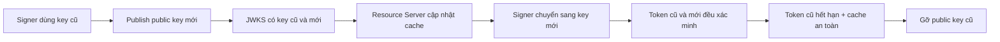

# Duy trì token đang hoạt động trong giai đoạn chuyển tiếp

Nâng cấp Authorization Server không chỉ là thay phiên bản ứng dụng. Trong thời gian chuyển tiếp, hệ thống có thể đồng thời tồn tại nhiều phiên bản Spring Authorization Server, nhiều bộ khóa ký, nhiều phiên bản schema database và nhiều Resource Server đang giữ cache khác nhau. Nếu không chuẩn bị tương thích, access token còn hạn có thể bị từ chối, refresh token có thể không đổi được hoặc client đang hoạt động có thể phải đăng nhập lại ngoài kế hoạch.

Mục tiêu của bài học là lập kế hoạch nâng cấp sao cho token đã phát hành tiếp tục được xác minh và sử dụng theo chính sách cho đến khi hết hạn hoặc được thu hồi có chủ đích. Các thành phần cần phối hợp gồm issuer, thuật toán và khóa ký, JWKS, định dạng token, `OAuth2AuthorizationService`, `RegisteredClientRepository`, refresh token, client authentication và Resource Server.

Không phải mọi loại token đều được duy trì theo cùng cách. JWT access token thường được xác minh cục bộ bằng public key và claim; opaque token cần introspection hoặc một cơ chế tra cứu trạng thái; refresh token cần được xử lý bởi Authorization Server và kho authorization. Phải phân loại token trước khi chọn chiến lược chuyển tiếp.

## 1. Xác định phạm vi token cần duy trì

Trước khi thay đổi hệ thống, lập inventory cho từng issuer, tenant, client và Resource Server. Tối thiểu cần biết:

- Token format: JWT hay opaque/reference token.
- Issuer (`iss`), audience (`aud`), loại token và các claim/authority quan trọng.
- Thuật toán ký (`alg`), `kid`, public key hiện được công bố và thời hạn tối đa của token.
- Thời hạn access token, refresh token, authorization code và clock skew mà Resource Server chấp nhận.
- Cơ chế thu hồi: JWT stateless, introspection, denylist, token version hoặc trạng thái lưu trong database.
- Nơi lưu authorization, refresh token, client và consent; phiên bản schema và cách serialize dữ liệu.
- Các phương thức xác thực client, credential rotation, mTLS/DPoP binding nếu có.
- Resource Server nào đang tin issuer/JWKS nào, cache JWKS bao lâu và hỗ trợ định dạng token nào.

Một bảng inventory ví dụ:

| Thành phần | Phiên bản hiện tại | Cần duy trì trong chuyển tiếp |
|---|---|---|
| Issuer | `https://auth.example.com` | Giữ nguyên nếu có thể |
| JWT access token | RS256, `kid=as-key-01`, TTL 10 phút | Public key cũ còn trong JWKS đến hết vòng đời token |
| JWT access token mới | RS256, `kid=as-key-02` | Resource Server nhận biết key mới trước khi signer dùng |
| Refresh token | Opaque, lưu trong authorization store | Phiên bản mới phải đọc được authorization cũ |
| Client | Client ID và grant hiện hành | Giữ ID, grant, scope và chính sách cần thiết |
| Resource Server | Cache JWKS tối đa 15 phút | Đọc được cả key cũ và key mới |

Các giá trị trong bảng chỉ là ví dụ. Hãy lấy TTL thực tế từ `TokenSettings`, cấu hình client và policy runtime. Nếu nhiều client có thời hạn khác nhau, tính theo giá trị lớn nhất của các client còn được phép phát hành token.

## 2. Phân biệt access token, refresh token và authorization state

### 2.1. JWT access token đã phát hành

JWT đã được ký là một snapshot bất biến của header và claim tại thời điểm phát hành. Nâng cấp cấu hình `TokenSettings` hoặc giảm TTL không thay đổi `exp`, scope hay claim trong JWT cũ. Nếu chữ ký hợp lệ, issuer/audience đúng, token chưa hết hạn và không bị thu hồi theo cơ chế mà Resource Server kiểm tra, token vẫn có thể được chấp nhận.

Với JWT được ký bằng khóa cũ, Resource Server phải tiếp tục có public key tương ứng trong JWKS hoặc trust store. Nếu gỡ public key cũ quá sớm, token chưa hết hạn sẽ bị từ chối với lỗi không tìm thấy `kid` hoặc không xác minh được chữ ký.

### 2.2. Opaque access token

Opaque token không chứa claim JWT để Resource Server tự xác minh. Resource Server thường gọi introspection endpoint hoặc dùng một cơ chế tra cứu trạng thái được tin cậy. Trong giai đoạn chuyển tiếp, introspection phải còn tìm được token cũ và trả về trạng thái, scope, audience hoặc metadata cần thiết.

Nếu chuyển từ opaque sang JWT, Resource Server phải được triển khai để hỗ trợ định dạng mới trước khi Authorization Server bắt đầu phát hành token mới. Nếu chuyển từ JWT sang opaque, Resource Server cần introspection client và quyền truy cập endpoint trước khi token opaque được cấp. Không thay đổi token format tại một thời điểm duy nhất rồi kỳ vọng mọi API tự hiểu cả hai.

### 2.3. Refresh token và authorization state

Refresh token thường có thời hạn dài hơn access token. Với triển khai JDBC của Spring Authorization Server, `OAuth2AuthorizationService` lưu authorization và thông tin token liên quan; các lần refresh cần đọc được trạng thái đã được tạo bởi phiên bản trước.

Giữ lại dữ liệu authorization, client ID, token metadata và trạng thái thu hồi cho đến khi refresh token hết hạn hoặc được thu hồi. Việc public key cũ không còn cần cho JWT access token không có nghĩa có thể xóa authorization record chứa refresh token đang còn hiệu lực.

Nếu refresh token là JWT tự chứa, cần giữ public key dùng để xác minh nó đến khi token hết hạn hoặc bị thu hồi theo cơ chế phù hợp. Nếu refresh token là opaque và được lưu trong database, khả năng đọc record, kiểm tra trạng thái và áp dụng rotation policy là yếu tố quyết định.

## 3. Giữ issuer ổn định trong quá trình nâng cấp

Issuer là định danh của Authorization Server và thường được kiểm tra bởi Resource Server. Khi có thể, giữ nguyên issuer công khai trong suốt nâng cấp:

```java
@Bean
AuthorizationServerSettings authorizationServerSettings(
        @Value("${app.security.issuer}") String issuer) {
    return AuthorizationServerSettings.builder()
            .issuer(issuer)
            .build();
}
```

Ví dụ cấu hình:

```yaml
app:
  security:
    issuer: ${AUTH_SERVER_ISSUER:https://auth.example.com}
```

Không để từng replica tự tạo issuer từ hostname, pod name hoặc địa chỉ nội bộ. Discovery metadata, claim `iss`, token endpoint và `jwks_uri` phải nhất quán.

Nếu bắt buộc đổi issuer, coi đây là một migration giao thức riêng. Resource Server phải tin cậy issuer cũ và mới trong một giai đoạn có giới hạn, dùng validator/decoder tương ứng cho từng issuer và tiếp tục chấp nhận token cũ đến khi hết hạn hoặc bị thu hồi. Không tắt issuer validation hoặc chấp nhận issuer bất kỳ để duy trì tương thích.

Khi dùng nhiều issuer, không chỉ thêm cả hai URI vào một chuỗi cấu hình rồi bỏ qua nguồn phát hành. Ánh xạ token đến decoder dựa trên issuer đã được xác minh và danh sách issuer được quản trị. Không tải JWKS từ URL do token hoặc request không tin cậy cung cấp.

## 4. Duy trì public key cũ khi xoay khóa ký

Đây là yêu cầu quan trọng nhất với JWT access token. Quy trình an toàn dùng giai đoạn overlap, trong đó JWKS công bố cả public key cũ và mới.

### 4.1. Trình tự chuyển khóa

1. Tạo key pair mới trong KMS/HSM hoặc kho khóa an toàn; gán `kid` mới, duy nhất.
2. Cập nhật key ring để JWKS công bố public key mới cùng public key cũ.
3. Xác minh mọi Authorization Server replica trả cùng bộ JWKS; kiểm tra từ mạng của Resource Server.
4. Chờ thời gian propagation và cache JWKS theo cấu hình thực tế.
5. Chuyển signer sang private key mới; token mới phải có `kid` mới.
6. Giữ public key cũ trong JWKS để xác minh token đã phát hành trước đó.
7. Chỉ gỡ public key cũ sau khi token cuối cùng được ký bằng khóa đó đã hết hạn, cộng clock skew, cache và khoảng an toàn vận hành.



Không tái sử dụng `kid` cho key material khác. Nếu đổi key material nhưng giữ nguyên `kid`, một Resource Server có thể cache public key cũ trong khi instance khác trả public key mới, dẫn đến lỗi chữ ký khó tái hiện.

### 4.2. Tính thời điểm gỡ public key cũ

Một cách tính bảo thủ:

```text
remove_old_public_key_after =
    last_issued_at_with_old_key
    + maximum_lifetime_of_tokens_signed_by_old_key
    + accepted_clock_skew
    + maximum_jwks_cache_age
    + propagation_safety_margin
```

Nếu nhiều loại JWT được ký bằng cùng khóa, lấy thời hạn lớn nhất trong các loại còn hiệu lực, gồm access token, ID token hoặc JWT refresh token nếu hệ thống có dùng. Cache và propagation margin phải dựa trên cấu hình thực tế của Resource Server, CDN và proxy.

Nếu có cơ chế thu hồi kiểm tra online, vẫn nên giữ public key cho đến khi token đã hết hạn hoặc bị thu hồi theo kế hoạch. Một số thành phần có thể xác minh chữ ký trước khi gọi trạng thái thu hồi; loại bỏ key quá sớm vẫn gây lỗi kỹ thuật và làm khó điều tra.

### 4.3. Cấu hình JWKSource trong Spring Authorization Server

Spring Authorization Server dùng `JWKSource<SecurityContext>` để cung cấp khóa cho signer và JWKS endpoint. Một ví dụ kiến trúc:

```java
@Bean
JWKSource<SecurityContext> jwkSource(KeyRingProvider keyRingProvider) {
    return (selector, context) ->
            selector.select(keyRingProvider.currentJwkSet());
}
```

`KeyRingProvider` là abstraction của ứng dụng. Trong giai đoạn overlap, `currentJwkSet()` phải chứa public key cũ và mới, còn signer phải chọn đúng private key đang hoạt động. Không giả định selector sẽ tự chọn khóa ký mới theo ý muốn nếu key set có nhiều private key phù hợp; hãy cấu hình rõ signing key selection hoặc `JwtEncoder` theo phiên bản đang dùng.

Nếu private key nằm trong KMS/HSM và không export được, tích hợp signer phù hợp thay vì tải private key vào JVM. JWKS chỉ được công bố public material; không đưa private parameters vào response.

## 5. Duy trì Resource Server trong giai đoạn chuyển tiếp

Resource Server phải được cập nhật trước khi Authorization Server phát hành token bằng cấu hình mới. Với JWT, cần đảm bảo decoder tin cậy issuer, có thể tải JWKS mới và cho phép thuật toán đã được phê duyệt.

Ví dụ Resource Server dùng issuer URI:

```yaml
spring:
  security:
    oauth2:
      resourceserver:
        jwt:
          issuer-uri: https://auth.example.com
```

Nếu Resource Server cấu hình JWKS URI trực tiếp, vẫn phải kiểm tra issuer bằng validator. Không chỉ kiểm tra chữ ký. Cần giữ allowlist thuật toán rõ ràng; nếu chuyển thuật toán trong giai đoạn overlap, chỉ cho phép tập thuật toán đã được phê duyệt và được thư viện hỗ trợ.

### 5.1. Kiểm tra cache JWKS

JWKS có thể được cache trong decoder, HTTP client, reverse proxy hoặc CDN. Một endpoint trả key mới trên máy phát triển không chứng minh mọi pod production đã nhận key đó.

Kiểm tra:

- `jwks_uri` trong discovery metadata của issuer đang dùng.
- Response JWKS từ từng mạng/cluster chạy Resource Server.
- `Cache-Control`, `ETag`, `Last-Modified` nếu hạ tầng sử dụng.
- Thời gian refresh cache của thư viện và hành vi khi gặp `kid` chưa biết.
- Mức đồng bộ key ring giữa các Authorization Server replica.

Không restart toàn bộ Resource Server như bước đầu tiên nếu chưa biết nguyên nhân. Restart có thể làm mới cache nhưng không sửa được endpoint sai hoặc replica chưa đồng bộ. Dùng cơ chế refresh cache được hỗ trợ và quan sát lỗi `unknown_kid`, `invalid_signature` sau khi cập nhật.

### 5.2. Duy trì nhiều thuật toán hoặc token format

Nếu thay `RS256` bằng `PS256` hoặc `ES256`, Resource Server cần hỗ trợ thuật toán mới trước khi signer chuyển sang dùng. Chỉ cho phép đồng thời thuật toán cũ và mới trong thời gian cần thiết. Khi token cũ hết hạn, bỏ thuật toán cũ khỏi allowlist.

Nếu chuyển JWT sang opaque token hoặc ngược lại, Resource Server phải có đường xử lý cho cả hai loại trong giai đoạn chuyển tiếp. Hai loại token không thể được xử lý bằng cùng một `JwtDecoder` đơn giản. Có thể triển khai theo từng API/resource, dùng authentication manager resolver hoặc một lớp định tuyến xác định loại token theo cấu hình tin cậy. Không đoán loại token bằng dữ liệu chưa xác minh rồi bỏ qua kiểm tra chữ ký/introspection.

Với opaque token, cấu hình introspection client, endpoint và quyền truy cập trước khi Authorization Server phát hành opaque token. Introspection phải đọc được token cũ trong suốt giai đoạn còn hiệu lực. Theo dõi độ trễ, lỗi mạng và trạng thái `active` để phát hiện sự cố.

## 6. Giữ refresh token và authorization store tương thích

Refresh token là phần thường gây gián đoạn sau nâng cấp vì nó phụ thuộc vào dữ liệu lưu trữ và cấu hình client. Một Resource Server có thể vẫn xác minh access token cũ trong khi client không thể refresh vì phiên bản mới không đọc được authorization record.

### 6.1. Dùng persistence bền vững và dùng chung

Trong Spring Authorization Server, các abstraction quan trọng gồm:

- `RegisteredClientRepository`: tìm cấu hình client dùng để xác thực và xử lý grant.
- `OAuth2AuthorizationService`: lưu authorization và các token liên quan.
- `OAuth2AuthorizationConsentService`: lưu consent người dùng đã cấp.

Nếu đang dùng JDBC, `JdbcOAuth2AuthorizationService` và các repository JDBC cần cùng database hoặc một cơ chế đồng bộ có độ nhất quán phù hợp. Các replica cũ và mới phải nhìn thấy trạng thái authorization, refresh token và client tương thích trong suốt rollout.

Không dùng repository in-memory cho production nếu cần giữ token qua restart hoặc nhiều replica. Nếu trước đây đã dùng in-memory, việc chuyển sang JDBC không thể tự khôi phục các refresh token đã mất; cần có kế hoạch re-authentication hoặc thời gian chuyển đổi phù hợp.

### 6.2. Migration schema theo expand-and-contract

Không thay schema theo kiểu phá vỡ tương thích trong cùng lần deploy với code mới. Dùng trình tự:

1. **Expand:** thêm bảng/cột/index mới theo cách phiên bản ứng dụng cũ vẫn chạy được.
2. **Deploy compatible code:** phát hành phiên bản có thể đọc schema cũ và mới hoặc chỉ ghi cấu trúc tương thích.
3. **Backfill:** chuyển đổi dữ liệu theo batch có thể tiếp tục sau lỗi; kiểm tra số lượng và tính toàn vẹn.
4. **Switch:** chuyển luồng đọc/ghi sang cấu trúc mới sau khi dữ liệu đã sẵn sàng.
5. **Observe:** giữ schema cũ trong khoảng rollback và theo dõi lỗi refresh/introspection.
6. **Contract:** chỉ xóa cột/bảng cũ ở một release sau khi không còn phiên bản cũ hoặc rollback cần chúng.

Spring Authorization Server JDBC dùng schema cụ thể theo phiên bản. Hãy so sánh migration với schema và tài liệu của đúng phiên bản dependency; không tự đổi tên cột, kiểu dữ liệu hoặc cách serialize token metadata khi vẫn còn phiên bản ứng dụng cũ cần đọc. Nếu `OAuth2AuthorizationService` tùy chỉnh lưu object đã serialize, thay đổi class hoặc serializer cần có khả năng đọc dữ liệu phiên bản trước.

### 6.3. Giữ Registered Client tương thích

Refresh request được xử lý dựa trên client đã đăng ký. Giữ `client_id`, grant type, scope, client authentication method và các thiết lập cần thiết cho đến khi refresh token cũ hết hạn hoặc được thu hồi. Nếu đổi client authentication method hoặc secret trong cùng đợt, client có thể không xác thực được khi refresh.

Credential rotation cần có một giai đoạn tương thích riêng. Nếu hệ thống chỉ lưu một client secret tại một thời điểm, không giả định có thể chấp nhận đồng thời secret cũ và mới nếu chưa triển khai cơ chế đó. Có thể dùng phương thức xác thực khóa công khai, credential version hoặc một quy trình đổi credential có kiểm soát; mọi phương án cần giữ nguyên định danh client và tránh làm lộ secret.

### 6.4. Refresh token rotation và replay

Nếu refresh token rotation được bật, mỗi lần refresh có thể phát hành refresh token mới và vô hiệu token cũ. Khi nâng cấp, giữ nguyên semantics này hoặc triển khai chuyển đổi rõ ràng. Không vô tình biến refresh token dùng một lần thành token tái sử dụng, hoặc ngược lại, chỉ vì cấu hình mặc định thay đổi giữa các phiên bản.

Kiểm thử hai request refresh đồng thời với cùng một refresh token. Hệ thống cần có hành vi nhất quán và chống replay theo policy. Khi phát hiện reuse, xử lý theo chính sách bảo mật của ứng dụng; không xóa toàn bộ authorization của client hoặc tenant nếu chưa xác định đúng phạm vi.

## 7. Duy trì opaque token và introspection

Với opaque access token, Resource Server gọi introspection endpoint để xác định token còn active hay không. Trong giai đoạn nâng cấp:

- Giữ endpoint introspection và credential của Resource Server hoạt động.
- Phiên bản Authorization Server mới phải đọc được token record cũ và trạng thái thu hồi.
- Nếu chạy song song hai Authorization Server, đảm bảo cả hai dùng chung trạng thái hoặc định tuyến introspection đến nơi có dữ liệu gốc.
- Giữ mapping scope, audience, subject và tenant nhất quán.
- Kiểm thử token đã bị thu hồi, hết hạn và token active từ trước nâng cấp.

Nếu chuyển endpoint introspection hoặc thay client authentication cho Resource Server, cập nhật Resource Server trước và giữ endpoint cũ trong thời gian overlap. Không trả `active=true` chỉ vì token record không tìm thấy; token không rõ trạng thái phải bị từ chối.

## 8. Triển khai song song và rolling upgrade

Một chiến lược thường dùng là triển khai phiên bản mới theo từng bước trong khi phiên bản cũ vẫn phục vụ request. Hai phiên bản phải tương thích về issuer, database, client registration và key ring.

```mermaid
sequenceDiagram
    participant RS as Resource Servers
    participant Old as Authorization Server v1
    participant New as Authorization Server v2
    participant DB as Shared authorization database
    participant JWKS as Shared JWKS/key ring
    RS->>JWKS: Tải public key cũ và mới
    Old->>JWKS: Giữ key cũ; công bố key mới
    New->>JWKS: Đọc cùng key ring
    Old->>DB: Tiếp tục xử lý authorization cũ
    New->>DB: Đọc được authorization và refresh token cũ
    Old-->>RS: Token có thể được ký bằng key cũ
    New-->>RS: Token mới có thể được ký bằng key mới
    RS->>JWKS: Xác minh cả hai kid trong overlap
```

### 8.1. Thứ tự triển khai khuyến nghị

1. **Chuẩn bị Resource Server:** cập nhật trust/JWKS, validator và hỗ trợ token format mới nếu có.
2. **Mở rộng database:** chạy migration tương thích ngược và kiểm tra backup/restore.
3. **Đồng bộ key ring:** công bố public key mới trên mọi JWKS endpoint trước khi signer dùng.
4. **Triển khai Authorization Server mới:** canary một phần traffic; xác minh đọc client, authorization, consent và refresh token cũ.
5. **Chuyển traffic:** tăng dần tỷ lệ request đến phiên bản mới khi metric ổn định.
6. **Chuyển signer:** chỉ sau khi Resource Server đã nhận public key mới.
7. **Theo dõi token cũ:** quan sát `kid`, issuer, refresh success, introspection và lỗi 401/invalid_client.
8. **Kết thúc overlap:** sau khi hết thời hạn token và điều kiện rollback, loại bỏ cấu hình cũ theo từng lớp.

Nếu old và new instance cùng phát hành token trong rollout, cả hai bộ public key phải có trong JWKS chung. Resource Server cần xác minh được token từ mọi replica. Không để load balancer trả JWKS khác nhau tùy instance.

### 8.2. Canary và tiêu chí mở rộng

Chỉ tăng traffic khi các chỉ số sau ổn định:

- Tỷ lệ cấp token thành công và lỗi `invalid_client`.
- Tỷ lệ refresh token thành công và số lần refresh token reuse bị phát hiện.
- Tỷ lệ Resource Server trả 401 do `unknown_kid`, `invalid_signature`, issuer hoặc audience.
- Độ trễ và lỗi introspection nếu dùng opaque token.
- Lỗi đọc/ghi `OAuth2AuthorizationService`, `RegisteredClientRepository` và consent store.
- Tỷ lệ readiness, kết nối database và lag của replication nếu có.

Đặt ngưỡng dừng rollout trước khi triển khai. Ví dụ, nếu tỷ lệ refresh thất bại tăng đột biến hoặc xuất hiện `kid` chưa được công bố, dừng tăng traffic và xử lý nguyên nhân trước.

## 9. Rollback mà không làm mất khả năng xác minh token

Rollback ứng dụng không đồng nghĩa rollback toàn bộ trạng thái khóa và dữ liệu. Trước khi nâng cấp, lập ma trận tương thích:

| Thành phần | Phiên bản cũ cần đọc được sau rollback? | Điều kiện |
|---|---|---|
| Schema database | Có | Migration expand giữ tương thích với code cũ |
| Authorization record | Có | Serializer/schema cũ vẫn đọc được record hiện tại |
| Registered Client | Có | Giữ client ID, grant và auth method cần thiết |
| Key ring/JWKS | Có | Phiên bản cũ vẫn công bố public key của token mới nếu rollback sau khi đã chuyển signer |
| Resource Server | Có | Vẫn tin issuer và public key cần thiết |
| Token format | Có | Phiên bản cũ hỗ trợ format đã phát hành hoặc traffic được định tuyến phù hợp |

Nếu phiên bản mới đã phát hành token bằng key mới, rollback về phiên bản cũ vẫn phải giữ public key mới trong JWKS để Resource Server xác minh token đó. Phiên bản cũ có thể cần được cấu hình đọc key ring mới dù không dùng private key mới để ký.

Không rollback migration phá hủy khi có dữ liệu mới đã được ghi. Dùng forward fix hoặc restore có kiểm soát. Nếu rollback làm mất khả năng đọc refresh token mới, client có thể cần re-authentication; phải xác định trước và truyền thông theo kế hoạch vận hành.

## 10. Thay đổi token policy mà không gây gián đoạn

Một số thay đổi policy không hồi tố lên token đã phát hành:

- Giảm access token TTL không làm giảm `exp` của JWT cũ.
- Loại scope khỏi client không tự xóa scope trong token cũ.
- Thay đổi audience policy không sửa claim `aud` đã ký.
- Đổi refresh token reuse/rotation không tự biến đổi token đã phát hành hoặc trạng thái authorization cũ.

Nếu cần vô hiệu hóa token cũ sớm, cần cơ chế rõ ràng: thu hồi authorization, introspection trạng thái, denylist theo `jti`, token version, hoặc buộc xác thực lại. Với JWT stateless, Resource Server không thể biết token đã bị thu hồi nếu không có một điểm kiểm tra trạng thái bổ sung. Cân nhắc độ trễ thu hồi, tải hệ thống và khả năng sẵn sàng khi chọn cơ chế.

Thay đổi chính sách nên được triển khai theo phạm vi nhỏ trước, đo tác động rồi mở rộng. Ghi lại policy version và thời điểm hiệu lực để điều tra token được phát hành theo policy nào.

## 11. Token ràng buộc với mTLS hoặc DPoP

Nếu access token được ràng buộc với chứng thư mTLS (`cnf.x5t#S256`) hoặc DPoP key (`cnf.jkt`), duy trì token còn đòi hỏi duy trì bằng chứng sở hữu khóa tương ứng.

- **mTLS:** Resource Server cần tiếp tục tin chứng thư cũ trong thời hạn token certificate-bound còn hiệu lực. Khi đổi certificate, token mới phải được phát hành và ràng buộc với thumbprint mới. Token cũ không tự chuyển sang certificate mới.
- **DPoP:** client phải tiếp tục dùng private key tương ứng với `cnf.jkt` của token cũ. Khi đổi DPoP key, client cần lấy token mới; proof từ key mới không hợp lệ với token cũ.
- **Client assertion:** nếu client dùng `private_key_jwt` để refresh token, Authorization Server phải tiếp tục chấp nhận public key client hiện hành và có giai đoạn overlap khi xoay client key.

Không xóa trust hoặc public key cũ chỉ vì Authorization Server đã được nâng cấp. Tính thời hạn dựa trên token còn hiệu lực, credential expiration, policy thu hồi và cache của Resource Server.

## 12. Runbook kiểm tra trước, trong và sau nâng cấp

| Giai đoạn | Việc cần xác minh | Kết quả mong đợi |
|---|---|---|
| Trước nâng cấp | Inventory issuer, token format, TTL, `kid`, client và Resource Server | Có danh sách phụ thuộc và thời hạn tối đa |
| Trước nâng cấp | Backup database và kiểm thử restore | Có khả năng khôi phục authorization state |
| Trước nâng cấp | Kiểm tra compatibility schema/serializer | Phiên bản cũ và mới đọc được dữ liệu cần thiết |
| Trước nâng cấp | Publish public key mới | JWKS có cả key cũ và mới |
| Trong rollout | Resource Server nhận key mới | Token ký mới không gây `unknown_kid` |
| Trong rollout | Phiên bản mới đọc refresh token cũ | Refresh thành công theo policy |
| Trong rollout | Old/new Authorization Server cùng dùng issuer và trạng thái nhất quán | Không phát sinh client/authorization split-brain |
| Trong rollout | Theo dõi 401, invalid signature, invalid_client và refresh failures | Không có tăng bất thường |
| Sau rollout | Token cũ còn hạn vẫn được xác minh | Không buộc đăng nhập lại ngoài kế hoạch |
| Sau rollout | Token mới được xác minh và policy mới có hiệu lực | Claim và scope đúng phiên bản |
| Sau overlap | Không còn token hợp lệ phụ thuộc key cũ | Có thể gỡ public key cũ an toàn |
| Sau overlap | Refresh token cũ hết hạn/thu hồi và record được xử lý theo retention | Có thể dọn dữ liệu theo quy trình |

## 13. Kiểm thử hồi quy cần có

Tạo một bộ token kiểm thử trước khi nâng cấp và giữ metadata cần thiết để xác minh sau nâng cấp. Không lưu token production trong repository hoặc test fixture. Dùng token được phát hành trong môi trường staging với thời hạn và claim tương tự production.

Các ca kiểm thử:

1. JWT access token ký bằng key cũ vẫn được Resource Server xác minh sau khi deploy phiên bản mới.
2. JWT access token ký bằng key mới được xác minh bởi tất cả Resource Server đã cập nhật.
3. Token sai issuer, audience, chữ ký hoặc đã hết hạn vẫn bị từ chối.
4. Opaque token cũ vẫn introspect được và trạng thái revoked vẫn trả inactive.
5. Refresh token cũ đổi được token mới sau khi Authorization Server nâng cấp.
6. Refresh token đã dùng hoặc bị thu hồi không thể được dùng lại trái policy.
7. Authorization record và consent cũ được đọc đúng sau schema migration.
8. Client cũ vẫn xác thực được trong thời gian credential overlap đã định.
9. Token mTLS/DPoP-bound vẫn yêu cầu đúng certificate/key proof.
10. Rollback ứng dụng không làm Resource Server mất public key của token đã phát hành trong rollout.
11. JWKS cache và nhiều replica không tạo kết quả khác nhau theo instance.
12. Thay đổi TTL/scope mới không bị hiểu nhầm là đã sửa token cũ.

Nên kiểm thử bằng integration environment có database, cache, proxy và số replica gần production. Unit test cho một `JwtDecoder` không thể chứng minh rollout, cache hoặc refresh token persistence hoạt động đúng.

## 14. Sự cố thường gặp và cách xử lý

| Triệu chứng | Nguyên nhân thường gặp | Hướng xử lý |
|---|---|---|
| Token cũ lỗi `unknown_kid` sau deploy | Public key cũ đã bị gỡ hoặc JWKS mới không chứa key cũ | Khôi phục public key cũ và kiểm tra cache/replica |
| Token mới lỗi `unknown_kid` | Signer chuyển key trước khi public key mới lan truyền | Publish key trước, chờ propagation rồi chuyển signer |
| Chỉ một số API trả 401 | Resource Server khác cache, allowlist thuật toán hoặc issuer | So sánh decoder config và JWKS response từng service |
| Refresh token cũ trả invalid_grant | Authorization record mất, schema/serializer không tương thích hoặc token bị revoke | Kiểm tra `OAuth2AuthorizationService`, migration và trạng thái token |
| Refresh thất bại do invalid_client | Client ID/auth method/secret thay đổi không tương thích | Khôi phục credential overlap hoặc quy trình chuyển client |
| Introspection trả inactive cho token cũ | Phiên bản mới không đọc token record hoặc tra nhầm store | Đồng bộ authorization store và kiểm tra routing introspection |
| Token mới có issuer khác | Cấu hình issuer khác nhau giữa replica/profile | Đồng nhất issuer; nếu migration issuer bắt buộc, tin cậy hai issuer có giới hạn |
| Rollback làm token mới lỗi chữ ký | Phiên bản cũ không công bố public key mới | Giữ key ring chung và xác minh JWKS trước/sau rollback |
| Token mTLS/DPoP cũ không dùng được | Certificate hoặc DPoP key cũ đã bị loại | Duy trì binding cũ đến hết hạn hoặc phát hành token mới theo kế hoạch |
| Token cũ vẫn có quyền sau khi giảm scope | JWT cũ giữ claim scope đã ký | Dùng revoke/introspection/denylist nếu cần thu hồi sớm |

## 15. Nguyên tắc vận hành

- Giữ issuer ổn định nếu không có yêu cầu migration bắt buộc.
- Công bố public key mới trước khi ký token bằng private key mới.
- Duy trì public key cũ đến hết vòng đời token và cache liên quan.
- Giữ authorization store, Registered Client và consent tương thích trong rollout.
- Dùng migration database expand-and-contract và giữ khả năng rollback.
- Triển khai Resource Server trước khi thay token format hoặc thuật toán.
- Theo dõi riêng access token, refresh token, introspection và lỗi xác minh.
- Không tắt signature/issuer/audience validation để né lỗi tương thích.
- Chỉ thu hồi hoặc buộc re-authentication khi có quyết định rõ ràng về phạm vi và tác động.

## Kết luận

Duy trì token trong giai đoạn nâng cấp cần phối hợp cả mật mã, dữ liệu và thứ tự triển khai. Với JWT, giữ public key cũ trong JWKS đến khi token hết hạn và Resource Server đã cập nhật cache; với opaque token, giữ introspection và trạng thái authorization tương thích; với refresh token, bảo đảm phiên bản mới đọc được authorization record, client và consent cũ. Khi issuer ổn định, schema được mở rộng tương thích, Resource Server sẵn sàng trước và rollback vẫn giữ được key ring cần thiết, hệ thống có thể chuyển phiên bản mà không làm gián đoạn token còn hiệu lực ngoài kế hoạch.
