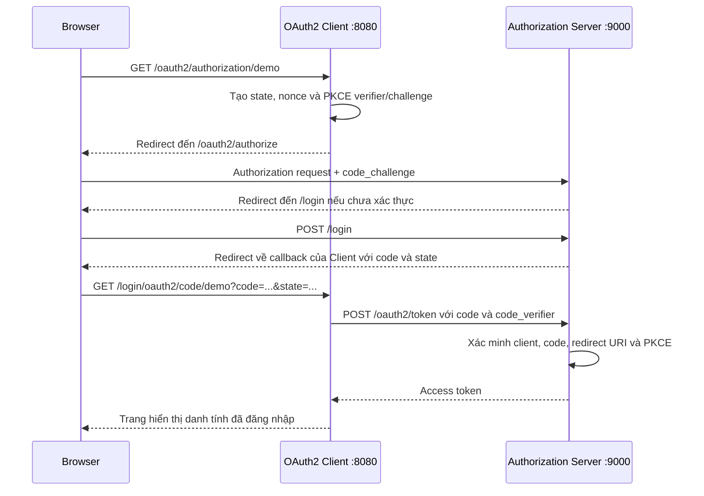

# Xây dựng Authorization Server tối thiểu với một OAuth2 Client

Trong bài thực hành này, bạn xây dựng một Spring Authorization Server phát hành authorization code và access token cho đúng một OAuth2 Client. Client là một ứng dụng Spring Boot riêng, dùng Spring Security OAuth2 Client để chuyển người dùng đến Authorization Server, nhận callback và đổi code lấy token. Authorization Server xác thực người dùng, kiểm tra client và redirect URI, xác minh PKCE rồi phát hành token có chữ ký.

Mô hình gồm hai ứng dụng để thể hiện rõ ranh giới giữa nơi cấp token và nơi sử dụng token:

| Ứng dụng | Địa chỉ local | Trách nhiệm |
|---|---|---|
| Authorization Server | `http://localhost:9000` | Đăng nhập, xác thực OAuth2 Client, cấp authorization code và JWT access token |
| OAuth2 Client | `http://localhost:8080` | Khởi tạo authorization request, xử lý callback và lưu token được cấp |

Client sử dụng Authorization Code grant cùng PKCE S256. Bài lab dùng một user local, một client registration, bộ nhớ in-memory và RSA key tạm để tập trung vào luồng hoạt động. Các phần cuối chỉ ra những thành phần cần thay khi chuyển sang production.

## 1. Luồng tổng thể



`state` liên kết callback với authorization request do client khởi tạo. `code_verifier` là bí mật ngắn hạn do client giữ; Authorization Server chỉ nhận `code_challenge` ở bước authorize và kiểm tra verifier ở bước đổi code. Client không cần đọc hoặc tự xử lý token trong trình duyệt nếu token được lưu ở backend của ứng dụng Spring Boot.

## 2. Chuẩn bị hai ứng dụng

Tạo hai project Spring Boot độc lập, có thể dùng cùng phiên bản Spring Boot 3 và Spring Security 6 tương thích với phiên bản Spring Authorization Server được chọn. Để dependency management quản lý phiên bản Spring Framework và Spring Security; nếu BOM không quản lý Spring Authorization Server, khai báo phiên bản tương thích theo tài liệu release của dự án.

**Authorization Server** cần các dependency sau trong `build.gradle`:

```gradle
dependencies {
    implementation("org.springframework.boot:spring-boot-starter-web")
    implementation("org.springframework.boot:spring-boot-starter-security")
    implementation("org.springframework.security:spring-security-oauth2-authorization-server")

    testImplementation("org.springframework.boot:spring-boot-starter-test")
    testImplementation("org.springframework.security:spring-security-test")
}
```

**OAuth2 Client** cần:

```gradle
dependencies {
    implementation("org.springframework.boot:spring-boot-starter-web")
    implementation("org.springframework.boot:spring-boot-starter-security")
    implementation("org.springframework.boot:spring-boot-starter-oauth2-client")

    testImplementation("org.springframework.boot:spring-boot-starter-test")
    testImplementation("org.springframework.security:spring-security-test")
}
```

Giữ hai project ở hai thư mục riêng để có thể khởi động và dừng từng ứng dụng độc lập. Không thêm dependency Resource Server vào lab này vì client chỉ cần đăng nhập và nhận token; việc bảo vệ API bằng access token là nội dung của bài thực hành khác.

## 3. Cấu hình Authorization Server

Trong project Authorization Server, tạo `application.yml`:

```yaml
server:
  port: 9000

app:
  security:
    issuer: http://localhost:9000
  demo:
    client-secret: ${DEMO_CLIENT_SECRET}
    user-password: ${DEMO_USER_PASSWORD}
```

Trước khi chạy, đặt hai biến môi trường `DEMO_CLIENT_SECRET` và `DEMO_USER_PASSWORD` bằng giá trị dành riêng cho local lab. Không commit secret hoặc mật khẩu vào repository. Issuer phải trùng chính xác địa chỉ mà client dùng để khám phá metadata; khi deploy, thay bằng HTTPS public URL ổn định.

### 3.1. Tạo user local và PasswordEncoder

Tạo một user để đăng nhập vào Authorization Server. Dùng BCrypt để lưu password đã mã hóa trong `UserDetailsService`:

```java
import org.springframework.beans.factory.annotation.Value;
import org.springframework.context.annotation.Bean;
import org.springframework.context.annotation.Configuration;
import org.springframework.security.core.userdetails.User;
import org.springframework.security.core.userdetails.UserDetailsService;
import org.springframework.security.crypto.bcrypt.BCryptPasswordEncoder;
import org.springframework.security.crypto.password.PasswordEncoder;
import org.springframework.security.provisioning.InMemoryUserDetailsManager;

@Configuration
public class UserConfiguration {

    @Bean
    PasswordEncoder passwordEncoder() {
        return new BCryptPasswordEncoder();
    }

    @Bean
    UserDetailsService userDetailsService(
            PasswordEncoder passwordEncoder,
            @Value("${app.demo.user-password}") String userPassword) {

        return new InMemoryUserDetailsManager(
                User.withUsername("alice")
                        .password(passwordEncoder.encode(userPassword))
                        .roles("USER")
                        .build());
    }
}
```

Tài khoản `alice` chỉ phục vụ lab. Production cần tích hợp kho danh tính thật, chính sách mật khẩu/MFA và cơ chế quản lý vòng đời tài khoản. Không dùng `InMemoryUserDetailsManager` làm kho người dùng cho cụm production.

### 3.2. Tạo RSA key pair và JWK Source

Authorization Server ký JWT access token bằng private key và công bố public key qua JWK Set endpoint. Dùng RSA key pair tạm trong lab:

```java
import java.security.KeyPair;
import java.security.KeyPairGenerator;
import java.security.NoSuchAlgorithmException;

import org.springframework.context.annotation.Bean;
import org.springframework.context.annotation.Configuration;

@Configuration
public class SigningKeyConfiguration {

    @Bean
    KeyPair rsaKeyPair() throws NoSuchAlgorithmException {
        KeyPairGenerator generator = KeyPairGenerator.getInstance("RSA");
        generator.initialize(2048);
        return generator.generateKeyPair();
    }
}
```

Tạo `JWKSource` từ cặp khóa:

```java
import java.security.KeyPair;
import java.security.interfaces.RSAPrivateKey;
import java.security.interfaces.RSAPublicKey;
import java.util.UUID;

import com.nimbusds.jose.jwk.JWKSet;
import com.nimbusds.jose.jwk.RSAKey;
import com.nimbusds.jose.jwk.source.JWKSource;
import com.nimbusds.jose.proc.SecurityContext;
import org.springframework.context.annotation.Bean;
import org.springframework.context.annotation.Configuration;

@Configuration
public class JwkConfiguration {

    @Bean
    JWKSource<SecurityContext> jwkSource(KeyPair rsaKeyPair) {
        RSAKey rsaKey = new RSAKey.Builder((RSAPublicKey) rsaKeyPair.getPublic())
                .privateKey((RSAPrivateKey) rsaKeyPair.getPrivate())
                .keyID(UUID.randomUUID().toString())
                .build();

        JWKSet jwkSet = new JWKSet(rsaKey);
        return (selector, context) -> selector.select(jwkSet);
    }
}
```

Mỗi lần khởi động, ví dụ trên tạo khóa và `kid` mới. Token cũ sẽ không xác minh được sau khi ứng dụng restart. Đây là lựa chọn có chủ ý cho lab ngắn hạn; production phải nạp khóa ổn định từ KMS/HSM hoặc secret manager, giữ `kid` nhất quán và có quy trình xoay vòng. Private key không được đưa vào repository hoặc chia sẻ cho OAuth2 Client.

### 3.3. Đăng ký một OAuth2 Client

Client registration xác định client ID, phương thức xác thực, grant type, redirect URI và scope được phép yêu cầu. Ta đăng ký một confidential client có Authorization Code grant, xác thực bằng HTTP Basic và bắt buộc PKCE:

```java
import java.time.Duration;
import java.util.UUID;

import org.springframework.beans.factory.annotation.Value;
import org.springframework.context.annotation.Bean;
import org.springframework.context.annotation.Configuration;
import org.springframework.security.crypto.password.PasswordEncoder;
import org.springframework.security.oauth2.core.AuthorizationGrantType;
import org.springframework.security.oauth2.core.oidc.OidcScopes;
import org.springframework.security.oauth2.server.authorization.client.ClientAuthenticationMethod;
import org.springframework.security.oauth2.server.authorization.client.InMemoryRegisteredClientRepository;
import org.springframework.security.oauth2.server.authorization.client.RegisteredClient;
import org.springframework.security.oauth2.server.authorization.client.RegisteredClientRepository;
import org.springframework.security.oauth2.server.authorization.settings.ClientSettings;
import org.springframework.security.oauth2.server.authorization.settings.TokenSettings;

@Configuration
public class ClientRegistrationConfiguration {

    @Bean
    RegisteredClientRepository registeredClientRepository(
            PasswordEncoder passwordEncoder,
            @Value("${app.demo.client-secret}") String clientSecret) {

        RegisteredClient client = RegisteredClient.withId(UUID.randomUUID().toString())
                .clientId("demo-client")
                .clientSecret(passwordEncoder.encode(clientSecret))
                .clientAuthenticationMethod(ClientAuthenticationMethod.CLIENT_SECRET_BASIC)
                .authorizationGrantType(AuthorizationGrantType.AUTHORIZATION_CODE)
                .redirectUri("http://localhost:8080/login/oauth2/code/demo")
                .scope(OidcScopes.OPENID)
                .scope(OidcScopes.PROFILE)
                .scope("message.read")
                .clientSettings(ClientSettings.builder()
                        .requireProofKey(true)
                        .requireAuthorizationConsent(false)
                        .build())
                .tokenSettings(TokenSettings.builder()
                        .accessTokenTimeToLive(Duration.ofMinutes(5))
                        .build())
                .build();

        return new InMemoryRegisteredClientRepository(client);
    }
}
```

`redirectUri` phải khớp chính xác callback mà client khai báo. `CLIENT_SECRET_BASIC` yêu cầu client xác thực tại token endpoint bằng HTTP Basic. `requireProofKey(true)` buộc client chứng minh đang giữ PKCE verifier khi đổi code. `requireAuthorizationConsent(false)` giúp lab tập trung vào luồng tối thiểu; khi bật consent, cần xây dựng consent page và xử lý quyết định người dùng.

`InMemoryRegisteredClientRepository` chỉ giữ client trong bộ nhớ. Nếu restart, registration được tạo lại với ID nội bộ mới. Production nên dùng `JdbcRegisteredClientRepository` hoặc kho lưu trữ bền vững, quản lý schema bằng migration và bảo vệ thao tác tạo/cập nhật client.

### 3.4. Khai báo Authorization và Consent services

Spring Authorization Server cần nơi lưu authorization state và consent. Với một instance lab, dùng implementation in-memory:

```java
import org.springframework.context.annotation.Bean;
import org.springframework.context.annotation.Configuration;
import org.springframework.security.oauth2.server.authorization.InMemoryOAuth2AuthorizationConsentService;
import org.springframework.security.oauth2.server.authorization.InMemoryOAuth2AuthorizationService;
import org.springframework.security.oauth2.server.authorization.OAuth2AuthorizationConsentService;
import org.springframework.security.oauth2.server.authorization.OAuth2AuthorizationService;

@Configuration
public class AuthorizationStoreConfiguration {

    @Bean
    OAuth2AuthorizationService authorizationService() {
        return new InMemoryOAuth2AuthorizationService();
    }

    @Bean
    OAuth2AuthorizationConsentService authorizationConsentService() {
        return new InMemoryOAuth2AuthorizationConsentService();
    }
}
```

Authorization service lưu authorization code, access token và metadata của luồng cấp quyền. Consent service lưu những scope mà người dùng đã chấp thuận nếu ứng dụng bật consent. Cả hai implementation in-memory đều mất dữ liệu khi process dừng và không dùng chung giữa nhiều instance.

### 3.5. Cấu hình issuer và JWT decoder

Issuer là định danh ổn định của Authorization Server. Đặt issuer rõ ràng trong `AuthorizationServerSettings`:

```java
import org.springframework.beans.factory.annotation.Value;
import org.springframework.context.annotation.Bean;
import org.springframework.context.annotation.Configuration;
import org.springframework.security.oauth2.server.authorization.settings.AuthorizationServerSettings;

@Configuration
public class AuthorizationServerSettingsConfiguration {

    @Bean
    AuthorizationServerSettings authorizationServerSettings(
            @Value("${app.security.issuer}") String issuer) {
        return AuthorizationServerSettings.builder()
                .issuer(issuer)
                .build();
    }
}
```

Khi bật OpenID Connect, cung cấp `JwtDecoder` để các endpoint OIDC cần xác minh JWT hoạt động:

```java
import com.nimbusds.jose.proc.SecurityContext;
import com.nimbusds.jose.jwk.source.JWKSource;
import org.springframework.context.annotation.Bean;
import org.springframework.context.annotation.Configuration;
import org.springframework.context.annotation.Primary;
import org.springframework.security.oauth2.jwt.JwtDecoder;
import org.springframework.security.oauth2.server.authorization.config.annotation.web.configuration.OAuth2AuthorizationServerConfiguration;

@Configuration
public class OidcConfiguration {

    @Bean
    @Primary
    JwtDecoder jwtDecoder(JWKSource<SecurityContext> jwkSource) {
        return OAuth2AuthorizationServerConfiguration.jwtDecoder(jwkSource);
    }
}
```

### 3.6. Cấu hình SecurityFilterChain

Authorization Server có một filter chain riêng, được ưu tiên trước chain đăng nhập ứng dụng. Bật OIDC để client khám phá metadata và nhận ID Token khi yêu cầu scope `openid`:

```java
import org.springframework.context.annotation.Bean;
import org.springframework.context.annotation.Configuration;
import org.springframework.core.annotation.Order;
import org.springframework.security.config.Customizer;
import org.springframework.security.config.annotation.web.builders.HttpSecurity;
import org.springframework.security.oauth2.server.authorization.config.annotation.web.configurers.OAuth2AuthorizationServerConfigurer;
import org.springframework.security.web.SecurityFilterChain;

@Configuration
public class SecurityConfiguration {

    @Bean
    @Order(1)
    SecurityFilterChain authorizationServerSecurityFilterChain(HttpSecurity http)
            throws Exception {

        OAuth2AuthorizationServerConfigurer authorizationServerConfigurer =
                OAuth2AuthorizationServerConfigurer.authorizationServer();

        http.securityMatcher(authorizationServerConfigurer.getEndpointsMatcher())
                .with(authorizationServerConfigurer, authorizationServer ->
                        authorizationServer.oidc(Customizer.withDefaults()))
                .authorizeHttpRequests(authorize -> authorize.anyRequest().authenticated());

        return http.build();
    }

    @Bean
    @Order(2)
    SecurityFilterChain applicationSecurityFilterChain(HttpSecurity http)
            throws Exception {

        http.authorizeHttpRequests(authorize -> authorize
                        .requestMatchers("/assets/**", "/error").permitAll()
                        .anyRequest().authenticated())
                .formLogin(Customizer.withDefaults());

        return http.build();
    }
}
```

Authorization Server chain xử lý các endpoint OAuth2/OIDC. Chain thứ hai xử lý trang login và các request ứng dụng còn lại. Giữ CSRF protection mặc định cho form login. Không tắt CSRF toàn cục chỉ để làm cho token endpoint hoạt động; token endpoint sử dụng POST theo giao thức và được xử lý trong filter chain riêng.

## 4. Cấu hình OAuth2 Client

Trong project client, cấu hình `application.yml`:

```yaml
server:
  port: 8080

spring:
  security:
    oauth2:
      client:
        registration:
          demo:
            provider: local-auth
            client-id: demo-client
            client-secret: ${DEMO_CLIENT_SECRET}
            client-authentication-method: client_secret_basic
            authorization-grant-type: authorization_code
            redirect-uri: "{baseUrl}/login/oauth2/code/{registrationId}"
            scope:
              - openid
              - profile
              - message.read
            client-name: Demo Authorization Server
        provider:
          local-auth:
            issuer-uri: http://localhost:9000
```

Đặt `DEMO_CLIENT_SECRET` giống giá trị đã cấu hình ở Authorization Server. Với địa chỉ local, `{baseUrl}` sẽ tạo callback `http://localhost:8080/login/oauth2/code/demo`, khớp registration phía server. Nếu dùng `127.0.0.1` ở một phía và `localhost` ở phía còn lại, URI sẽ khác và Authorization Server phải từ chối request.

`issuer-uri` cho phép Spring Security Client lấy provider metadata từ Authorization Server. Nhờ OIDC discovery, client xác định authorization endpoint, token endpoint, JWKS URI và các endpoint OIDC mà không cần hard-code từng URL.

### 4.1. Bắt buộc PKCE ở phía client

Client cần gửi `code_challenge` S256 trong authorization request. Cấu hình resolver để Spring Security thêm PKCE parameters:

```java
import org.springframework.context.annotation.Bean;
import org.springframework.context.annotation.Configuration;
import org.springframework.security.oauth2.client.registration.ClientRegistrationRepository;
import org.springframework.security.oauth2.client.web.DefaultOAuth2AuthorizationRequestResolver;
import org.springframework.security.oauth2.client.web.OAuth2AuthorizationRequestCustomizers;
import org.springframework.security.oauth2.client.web.OAuth2AuthorizationRequestResolver;

@Configuration
public class OAuth2ClientSecurityConfiguration {

    @Bean
    OAuth2AuthorizationRequestResolver authorizationRequestResolver(
            ClientRegistrationRepository registrations) {

        DefaultOAuth2AuthorizationRequestResolver resolver =
                new DefaultOAuth2AuthorizationRequestResolver(
                        registrations, "/oauth2/authorization");
        resolver.setAuthorizationRequestCustomizer(
                OAuth2AuthorizationRequestCustomizers.withPkce());
        return resolver;
    }
}
```

Gắn resolver vào OAuth2 Login filter chain:

```java
import org.springframework.context.annotation.Bean;
import org.springframework.context.annotation.Configuration;
import org.springframework.security.config.Customizer;
import org.springframework.security.config.annotation.web.builders.HttpSecurity;
import org.springframework.security.oauth2.client.web.OAuth2AuthorizationRequestResolver;
import org.springframework.security.web.SecurityFilterChain;

@Configuration
public class ClientSecurityConfiguration {

    @Bean
    SecurityFilterChain clientSecurityFilterChain(
            HttpSecurity http,
            OAuth2AuthorizationRequestResolver authorizationRequestResolver)
            throws Exception {

        http.authorizeHttpRequests(authorize -> authorize
                        .requestMatchers("/error").permitAll()
                        .anyRequest().authenticated())
                .oauth2Login(oauth2 -> oauth2
                        .authorizationEndpoint(endpoint -> endpoint
                                .authorizationRequestResolver(authorizationRequestResolver)));

        return http.build();
    }
}
```

Resolver tạo verifier ngẫu nhiên và lưu thông tin cần thiết trong authorization request repository của client; code challenge được gửi đến Authorization Server. Khi callback đến, client lấy verifier tương ứng để đổi code. Không tự ghi verifier vào log hoặc lưu vào cookie không được bảo vệ.

### 4.2. Tạo trang hiển thị người dùng đã đăng nhập

Vì client yêu cầu scope `openid`, Spring Security cung cấp `OidcUser` sau khi xác minh ID Token và xử lý UserInfo theo cấu hình:

```java
import org.springframework.security.core.annotation.AuthenticationPrincipal;
import org.springframework.security.oauth2.core.oidc.user.OidcUser;
import org.springframework.security.oauth2.client.annotation.RegisteredOAuth2AuthorizedClient;
import org.springframework.security.oauth2.client.OAuth2AuthorizedClient;
import org.springframework.web.bind.annotation.GetMapping;
import org.springframework.web.bind.annotation.RestController;

@RestController
public class HomeController {

    @GetMapping("/")
    public String home(@AuthenticationPrincipal OidcUser user) {
        return "Đăng nhập thành công. Subject: " + user.getSubject();
    }

    @GetMapping("/token-info")
    public String tokenInfo(
            @RegisteredOAuth2AuthorizedClient("demo") OAuth2AuthorizedClient client) {

        return "Access token expires at: " + client.getAccessToken().getExpiresAt()
                + "; scopes: " + client.getAccessToken().getScopes();
    }
}
```

Endpoint `/token-info` chỉ hiển thị thời hạn và scope, không trả access token ra trình duyệt. Trong ứng dụng thực tế, tránh hiển thị token ở UI hoặc đưa token vào log. Client backend có thể dùng `OAuth2AuthorizedClient` để gọi resource server bằng một HTTP client được cấu hình phù hợp.

## 5. Khởi động và thực hiện authorization flow

Mở hai terminal tại hai project. Đảm bảo các biến môi trường đã được đặt trong cả hai tiến trình.

1. Khởi động Authorization Server trên cổng `9000`.
2. Khởi động OAuth2 Client trên cổng `8080`.
3. Mở trình duyệt tại `http://localhost:8080/oauth2/authorization/demo`.
4. Client tạo authorization request, PKCE challenge và chuyển trình duyệt đến Authorization Server.
5. Đăng nhập bằng user `alice` và mật khẩu `DEMO_USER_PASSWORD`.
6. Authorization Server kiểm tra client, redirect URI, scope và PKCE challenge, sau đó trả authorization code về callback client.
7. Client tự động gửi code cùng verifier đến token endpoint và lưu token trong `OAuth2AuthorizedClient`.
8. Trình duyệt được chuyển về trang `/`, hiển thị subject của người dùng.
9. Mở `/token-info` để xem thời hạn access token và các scope đã được cấp.

Không cần tự copy authorization code hoặc access token giữa hai ứng dụng. Spring Security OAuth2 Client xử lý callback, đổi code và lưu authorized client trong backend.

## 6. Kiểm tra metadata và endpoint

Trước khi kiểm thử browser, kiểm tra Authorization Server đã công bố OIDC discovery metadata:

```bash
curl --fail --silent --show-error \
  http://localhost:9000/.well-known/openid-configuration
```

Kiểm tra các trường `issuer`, `authorization_endpoint`, `token_endpoint`, `jwks_uri`, `userinfo_endpoint` và `end_session_endpoint` nếu endpoint logout được công bố. Các URL phải dùng host và scheme mà client có thể truy cập. Với lab, issuer là `http://localhost:9000`; production phải dùng HTTPS và public issuer ổn định.

Kiểm tra JWK Set endpoint:

```bash
curl --fail --silent --show-error \
  http://localhost:9000/oauth2/jwks
```

Response chứa public key cùng `kid` để client hoặc resource server xác minh chữ ký JWT. JWK Set không được công bố private key. Không đưa private key vào response hoặc log.

## 7. Kiểm thử lỗi thường gặp

| Tình huống | Kết quả mong đợi | Nơi kiểm tra |
|---|---|---|
| User nhập sai mật khẩu | Login thất bại, không phát hành code | Form login và authentication provider |
| Client ID không tồn tại | Authorization request bị từ chối | `RegisteredClientRepository` |
| Redirect URI không khớp | Request bị từ chối; không redirect code đến URI lạ | Client registration và authorization endpoint |
| Client secret sai | Token endpoint trả `invalid_client` | Client authentication provider |
| Thiếu hoặc sai PKCE verifier | Token endpoint từ chối đổi code, thường với `invalid_grant` | PKCE validation ở token endpoint |
| Authorization code đã dùng | Request đổi code lần hai bị từ chối với `invalid_grant` | Authorization state và code consumption |
| Scope không đăng ký | Authorization request bị từ chối với `invalid_scope` | `RegisteredClient.getScopes()` |
| Issuer không khớp client metadata | Client không khám phá hoặc xác minh được provider | `AuthorizationServerSettings` và `issuer-uri` |

Mỗi lần kiểm thử verifier sai hoặc replay phải tạo authorization request mới để nhận code mới. Authorization code chỉ được dùng một lần. Khi kiểm thử redirect URI, xác nhận server không chuyển hướng đến URI tùy ý do request gửi lên.

### 7.1. Kiểm tra PKCE độc lập

Authorization Server đã đặt `requireProofKey(true)`. Để chứng minh chính sách này hoạt động:

- Kiểm tra authorization request có `code_challenge` và `code_challenge_method=S256`.
- Dùng đúng verifier do client tạo: token exchange thành công.
- Dùng verifier khác: token exchange thất bại.
- Bỏ verifier ở token request: token exchange thất bại.

Không ghi verifier vào log hoặc test report. Chỉ dùng giá trị thử nghiệm ngắn hạn và xóa dữ liệu authorization sau khi hoàn thành test.

### 7.2. Kiểm tra client authentication

Client registration dùng `CLIENT_SECRET_BASIC`, vì vậy client phải gửi client ID và secret qua HTTP Basic khi gọi token endpoint. Thay secret bằng giá trị sai trong môi trường test phải dẫn đến `invalid_client`. Không chuyển sang `client_secret_post` chỉ để tránh lỗi cấu hình; phương thức gửi secret phải khớp `clientAuthenticationMethod` đã đăng ký.

## 8. Bật consent khi ứng dụng cần người dùng chấp thuận

Lab đặt `requireAuthorizationConsent(false)` để giữ luồng ngắn. Khi ứng dụng cần người dùng xem và chấp thuận scope, đổi thành:

```java
.clientSettings(ClientSettings.builder()
        .requireProofKey(true)
        .requireAuthorizationConsent(true)
        .build())
```

Khi bật consent, Authorization Server cần consent page do ứng dụng cung cấp, hiển thị tên client và các scope đang yêu cầu. Form phải gửi quyết định chấp thuận/từ chối về endpoint xử lý consent theo contract của Spring Authorization Server. Chỉ lưu consent sau quyết định hợp lệ; request bị từ chối không được phát hành authorization code.

Consent cần được lưu theo cả client và principal. Không dùng consent của một người dùng cho người dùng khác hoặc consent của client này cho client khác. Trong production, lưu consent bền vững và cung cấp cách xem/thu hồi quyền đã chấp thuận.

## 9. Cấu hình logout và phiên đăng nhập

Logout khỏi OAuth2 Client và logout khỏi Authorization Server là hai thao tác khác nhau. Client có thể xóa session local nhưng phiên đăng nhập tại Authorization Server vẫn còn; lần authorize tiếp theo có thể không yêu cầu người dùng nhập lại mật khẩu. Nếu triển khai OIDC RP-Initiated Logout, cần cấu hình endpoint logout, đăng ký post-logout redirect URI và dùng `OidcClientInitiatedLogoutSuccessHandler` ở client.

Không nhầm logout local với thu hồi access token. JWT access token đã phát hành thường còn hiệu lực đến `exp` trừ khi resource server có cơ chế kiểm tra thu hồi hoặc denylist. Khi cần chấm dứt quyền truy cập ngay, phải có chiến lược revocation/introspection phù hợp.

## 10. Lỗi triển khai và cách xử lý

| Triệu chứng | Nguyên nhân thường gặp | Cách khắc phục |
|---|---|---|
| Client không tìm thấy provider configuration | Issuer URI sai hoặc discovery endpoint không truy cập được | Kiểm tra `/.well-known/openid-configuration` và issuer chính xác |
| `redirect_uri` mismatch | Host, port, path hoặc scheme không trùng | Đồng bộ callback URI ở client và `RegisteredClient` |
| `invalid_client` tại token endpoint | Secret sai, encoding sai hoặc auth method không khớp | Kiểm tra biến môi trường và `CLIENT_SECRET_BASIC` |
| `invalid_grant` khi đổi code | Code hết hạn, đã dùng, redirect URI sai hoặc verifier không khớp | Tạo authorization flow mới và kiểm tra từng ràng buộc |
| Không có `code_challenge` | Client chưa cấu hình PKCE resolver | Gắn `OAuth2AuthorizationRequestCustomizers.withPkce()` |
| JWK Set trả 404 | Security chain chưa bật endpoint hoặc đường dẫn bị thay đổi | Kiểm tra Authorization Server config và discovery metadata |
| Token cũ không xác minh sau restart | Lab tạo key pair mới mỗi lần chạy | Dùng khóa bền vững và công bố public key cũ trong thời gian chuyển tiếp |
| Login lặp lại liên tục | Cookie/session không được giữ hoặc callback không cùng host | Kiểm tra session cookie, redirect URI và host browser dùng |
| Consent không hiển thị | `requireAuthorizationConsent` đang false hoặc consent đã tồn tại | Kiểm tra client settings và consent store |

## 11. Chuyển từ lab sang production

Lab dùng in-memory store và khóa sinh lúc khởi động để giảm số bước chuẩn bị. Trước khi đưa Authorization Server vào production, cần thay các thành phần này:

1. **Client registration:** dùng repository bền vững, quy trình phê duyệt client, quản lý secret và rotation.
2. **Authorization state và consent:** dùng database dùng chung, transaction phù hợp và backup/restore.
3. **Signing keys:** lưu private key trong KMS/HSM hoặc secret manager; chia sẻ key set nhất quán giữa các instance và có quy trình xoay vòng.
4. **Issuer và HTTPS:** công bố public issuer ổn định, cấu hình reverse proxy và chỉ tin forwarded headers từ proxy đáng tin cậy.
5. **User authentication:** tích hợp identity provider hoặc user store phù hợp, MFA và chính sách bảo vệ tài khoản.
6. **PKCE và redirect URI:** bắt buộc PKCE cho public client, kiểm tra redirect URI chính xác và không dùng wildcard tùy tiện.
7. **Consent:** hiển thị scope rõ ràng, lưu quyết định theo user/client và hỗ trợ thu hồi.
8. **Session:** đặt cookie `Secure`, `HttpOnly`, `SameSite` phù hợp; chia sẻ session nếu chạy nhiều instance.
9. **Quan sát và audit:** ghi nhận login, consent, client authentication và token issuance mà không ghi secret, code hoặc token.
10. **Kiểm thử:** kiểm thử code replay, PKCE, secret expiry, issuer, JWKS, failover và hành vi khi xoay vòng khóa.

Không coi việc bật HTTPS là đủ để hoàn thành bảo mật. Authorization Server còn phải bảo vệ private key, client secret, authorization state, session và dữ liệu consent; mỗi thành phần có vòng đời và quyền truy cập riêng.

## 12. Kết quả cần bàn giao sau lab

- [ ] Authorization Server chạy tại `http://localhost:9000`.
- [ ] OIDC discovery metadata và JWK Set endpoint trả về dữ liệu hợp lệ.
- [ ] Một `RegisteredClient` duy nhất có Authorization Code grant và redirect URI chính xác.
- [ ] Client authentication dùng HTTP Basic với secret đã mã hóa trong registration.
- [ ] PKCE S256 được yêu cầu và client gửi challenge/verifier đúng.
- [ ] User `alice` đăng nhập thành công qua form login của Authorization Server.
- [ ] OAuth2 Client chạy tại `http://localhost:8080` và xử lý callback tự động.
- [ ] Client nhận access token và hiển thị được subject, scope, thời hạn mà không lộ token.
- [ ] Client secret sai, redirect URI sai, verifier sai và code replay đều bị từ chối.
- [ ] Các thành phần in-memory và khóa tạm được nhận diện rõ là chỉ dành cho lab.

Sau khi hoàn thành, bạn có một Authorization Server tối thiểu có thể đăng nhập người dùng và cấp token cho một OAuth2 Client thật. Luồng Authorization Code + PKCE được thực hiện xuyên suốt từ browser đến token endpoint, tạo nền tảng để mở rộng sang consent, refresh token, nhiều client và Resource Server.
