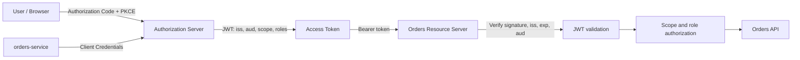

# Cấp JWT với roles, audience và chính sách scope cho API

Trong bài thực hành này, bạn cấu hình Spring Authorization Server phát hành JWT access token cho một API đơn hàng. Token chứa `scope` để biểu diễn quyền OAuth2, `roles` để biểu diễn vai trò của người dùng và `aud` để xác định API nào được phép nhận token. Resource Server xác minh chữ ký, issuer, thời hạn và audience trước khi ánh xạ scope/role thành authorities của Spring Security.

Kết quả cần đạt là ba lớp kiểm soát phối hợp với nhau: token phải được phát hành cho đúng client và scope; token phải được dành cho đúng API; người gọi phải có role phù hợp khi thực hiện thao tác nhạy cảm. Bài học thuộc module `SPRING_SECURITY_OAUTH2_OIDC_AUTHORIZATION_SERVER`, tập trung vào thiết kế và vận hành OAuth 2.0/OpenID Connect Authorization Server bằng Spring Authorization Server, từ quản lý client/consent đến cấp token, PKCE, bảo vệ endpoint và kiểm thử luồng bảo mật.

## 1. Kịch bản và kiến trúc lab

Ta xây dựng một Authorization Server và một Resource Server trong cùng ứng dụng Spring Boot để giữ lab gọn. Trong triển khai thực tế, hai vai trò thường nằm ở hai service riêng.

| Thành phần | Trách nhiệm |
|---|---|
| Authorization Server | Đăng ký client, xác thực người dùng/client, xử lý consent và phát hành JWT access token |
| `orders-web` | Public client dùng Authorization Code + PKCE, có thể yêu cầu `orders.read` và `orders.write` |
| `orders-service` | Confidential client dùng Client Credentials, chỉ được yêu cầu `orders.read` |
| Resource Server `/api/**` | Xác minh chữ ký, issuer, audience và thời hạn; chuyển `scope`/`roles` thành authorities |
| Orders API | Cho phép đọc theo scope, ghi theo scope kết hợp role, và giới hạn endpoint quản trị theo role |



Trong lab, audience được cố định là `orders-api` để minh họa một resource server. Khi hệ thống có nhiều API, audience phải được chọn theo resource mà client được phép truy cập, dựa trên cấu hình hoặc resource indicator đã được xác minh. Không phát hành cùng một audience cho mọi client chỉ vì việc cấu hình đơn giản hơn.

## 2. Chuẩn bị dự án

Ví dụ sử dụng Spring Boot 3, Spring Security 6 và Spring Authorization Server tương thích với BOM của Spring Boot. Quản lý phiên bản bằng dependency management của dự án, không trộn các phiên bản Spring Security hoặc Authorization Server không tương thích.

Với Gradle:

```gradle
dependencies {
    implementation("org.springframework.boot:spring-boot-starter-web")
    implementation("org.springframework.boot:spring-boot-starter-security")
    implementation("org.springframework.security:spring-security-oauth2-authorization-server")
    implementation("org.springframework.boot:spring-boot-starter-oauth2-resource-server")

    testImplementation("org.springframework.boot:spring-boot-starter-test")
    testImplementation("org.springframework.security:spring-security-test")
}
```

Dependency `spring-security-oauth2-authorization-server` phải cùng dòng tương thích với Spring Security của dự án. Nếu BOM đang dùng chưa quản lý phiên bản artifact này, khai báo phiên bản Spring Authorization Server tương thích một cách tường minh. Các phương thức `@Bean` trong những phần sau cần nằm trong một hoặc nhiều class có `@Configuration`; có thể gom các bean liên quan vào cùng class để giảm số file.

Cấu hình môi trường local trong `application.yml`:

```yaml
server:
  port: 9000

app:
  security:
    issuer: http://localhost:9000

demo:
  clients:
    orders-service:
      secret: ${ORDERS_SERVICE_CLIENT_SECRET}
  users:
    alice-password: ${DEMO_ALICE_PASSWORD}
    bob-password: ${DEMO_BOB_PASSWORD}
```

Thiết lập các biến môi trường `ORDERS_SERVICE_CLIENT_SECRET`, `DEMO_ALICE_PASSWORD` và `DEMO_BOB_PASSWORD` trước khi chạy. Dùng credential dành riêng cho lab. Trong production, issuer phải là HTTPS public URL ổn định; client secret và mật khẩu phải đến từ secret manager hoặc hệ thống quản lý cấu hình bảo mật.

## 3. Tạo khóa ký JWT cho môi trường lab

Authorization Server ký JWT bằng private key và công bố public key qua JWK Set endpoint. Ví dụ sau tạo RSA key pair khi ứng dụng khởi động:

```java
import java.security.KeyPair;
import java.security.KeyPairGenerator;
import java.security.NoSuchAlgorithmException;

import org.springframework.context.annotation.Bean;
import org.springframework.context.annotation.Configuration;

@Configuration
class LabKeyConfiguration {

    @Bean
    KeyPair rsaKeyPair() throws NoSuchAlgorithmException {
        KeyPairGenerator generator = KeyPairGenerator.getInstance("RSA");
        generator.initialize(2048);
        return generator.generateKeyPair();
    }
}
```

Tạo JWK source từ key pair:

```java
import java.security.KeyPair;
import java.security.interfaces.RSAPrivateKey;
import java.security.interfaces.RSAPublicKey;
import java.util.UUID;

import com.nimbusds.jose.jwk.JWKSet;
import com.nimbusds.jose.jwk.RSAKey;
import com.nimbusds.jose.jwk.source.JWKSource;
import com.nimbusds.jose.proc.SecurityContext;
import org.springframework.context.annotation.Bean;

@Bean
JWKSource<SecurityContext> jwkSource(KeyPair rsaKeyPair) {
    RSAKey rsaKey = new RSAKey.Builder((RSAPublicKey) rsaKeyPair.getPublic())
            .privateKey((RSAPrivateKey) rsaKeyPair.getPrivate())
            .keyID(UUID.randomUUID().toString())
            .build();

    JWKSet jwkSet = new JWKSet(rsaKey);
    return (selector, context) -> selector.select(jwkSet);
}
```

Đây là khóa tạm cho lab. Mỗi lần khởi động, khóa và `kid` thay đổi; token cũ sẽ không còn xác minh được bằng khóa mới. Production cần lưu khóa bền vững trong KMS/HSM hoặc secret manager, có quy trình xoay vòng và cung cấp cùng key set cho tất cả instance. Không lưu private key trong source control.

## 4. Đăng ký client và chính sách scope

Tạo hai client với quyền khác nhau. Public client dùng PKCE; service client dùng Client Credentials và chỉ được cấp quyền đọc.

```java
import java.time.Duration;
import java.util.UUID;

import org.springframework.beans.factory.annotation.Value;
import org.springframework.context.annotation.Bean;
import org.springframework.security.crypto.password.PasswordEncoder;
import org.springframework.security.oauth2.core.AuthorizationGrantType;
import org.springframework.security.oauth2.server.authorization.client.ClientAuthenticationMethod;
import org.springframework.security.oauth2.server.authorization.client.InMemoryRegisteredClientRepository;
import org.springframework.security.oauth2.server.authorization.client.RegisteredClient;
import org.springframework.security.oauth2.server.authorization.client.RegisteredClientRepository;
import org.springframework.security.oauth2.server.authorization.settings.ClientSettings;
import org.springframework.security.oauth2.server.authorization.settings.TokenSettings;

@Bean
RegisteredClientRepository registeredClientRepository(
        PasswordEncoder passwordEncoder,
        @Value("${demo.clients.orders-service.secret}") String serviceSecret) {

    RegisteredClient webClient = RegisteredClient.withId(UUID.randomUUID().toString())
            .clientId("orders-web")
            .clientAuthenticationMethod(ClientAuthenticationMethod.NONE)
            .authorizationGrantType(AuthorizationGrantType.AUTHORIZATION_CODE)
            .authorizationGrantType(AuthorizationGrantType.REFRESH_TOKEN)
            .redirectUri("http://127.0.0.1:8080/login/oauth2/code/orders")
            .scope("openid")
            .scope("profile")
            .scope("orders.read")
            .scope("orders.write")
            .clientSettings(ClientSettings.builder()
                    .requireProofKey(true)
                    .build())
            .tokenSettings(TokenSettings.builder()
                    .accessTokenTimeToLive(Duration.ofMinutes(5))
                    .refreshTokenTimeToLive(Duration.ofHours(8))
                    .reuseRefreshTokens(false)
                    .build())
            .build();

    RegisteredClient serviceClient = RegisteredClient.withId(UUID.randomUUID().toString())
            .clientId("orders-service")
            .clientSecret(passwordEncoder.encode(serviceSecret))
            .clientAuthenticationMethod(ClientAuthenticationMethod.CLIENT_SECRET_BASIC)
            .authorizationGrantType(AuthorizationGrantType.CLIENT_CREDENTIALS)
            .scope("orders.read")
            .build();

    return new InMemoryRegisteredClientRepository(webClient, serviceClient);
}
```

Redirect URI phải trùng chính xác callback của client lab. Public client không có secret vì trình duyệt không thể giữ secret an toàn; PKCE ràng buộc code với client giữ `code_verifier`. Service client là confidential client nên xác thực bằng secret qua HTTP Basic. Không cấp `orders.write` cho service client trong ví dụ này.

`InMemoryRegisteredClientRepository` phù hợp cho lab đơn instance. Production nên dùng repository bền vững như `JdbcRegisteredClientRepository` hoặc kho dữ liệu phù hợp, có migration, backup và cơ chế đồng bộ/cache rõ ràng.

## 5. Cấu hình người dùng và mật khẩu

Tạo hai user để kiểm tra role khác nhau. Alice có quyền quản lý đơn hàng; Bob chỉ có quyền đọc:

```java
import org.springframework.beans.factory.annotation.Value;
import org.springframework.context.annotation.Bean;
import org.springframework.security.core.userdetails.User;
import org.springframework.security.core.userdetails.UserDetailsService;
import org.springframework.security.provisioning.InMemoryUserDetailsManager;
import org.springframework.security.crypto.bcrypt.BCryptPasswordEncoder;
import org.springframework.security.crypto.password.PasswordEncoder;

@Bean
PasswordEncoder passwordEncoder() {
    return new BCryptPasswordEncoder();
}

@Bean
UserDetailsService userDetailsService(
        PasswordEncoder passwordEncoder,
        @Value("${demo.users.alice-password}") String alicePassword,
        @Value("${demo.users.bob-password}") String bobPassword) {

    return new InMemoryUserDetailsManager(
            User.withUsername("alice")
                    .password(passwordEncoder.encode(alicePassword))
                    .roles("ORDER_MANAGER", "ORDER_READER")
                    .build(),
            User.withUsername("bob")
                    .password(passwordEncoder.encode(bobPassword))
                    .roles("ORDER_READER")
                    .build());
}
```

`roles(...)` tự thêm tiền tố `ROLE_` vào authorities. Vì vậy Alice có `ROLE_ORDER_MANAGER` và `ROLE_ORDER_READER`; Bob chỉ có `ROLE_ORDER_READER`. User store in-memory chỉ dùng để minh họa. Hệ thống thật phải lấy role từ nguồn danh tính tin cậy và có quy trình cập nhật/thu hồi quyền.

## 6. Cấu hình issuer và Authorization Server

Issuer phải ổn định và giống nhau trên mọi instance. Cấu hình `AuthorizationServerSettings` bằng property môi trường:

```java
import org.springframework.beans.factory.annotation.Value;
import org.springframework.context.annotation.Bean;
import org.springframework.security.oauth2.server.authorization.settings.AuthorizationServerSettings;

@Bean
AuthorizationServerSettings authorizationServerSettings(
        @Value("${app.security.issuer}") String issuer) {
    return AuthorizationServerSettings.builder()
            .issuer(issuer)
            .build();
}
```

Đăng ký decoder mà Spring Authorization Server cần cho các endpoint OIDC sử dụng JWT:

```java
import com.nimbusds.jose.proc.SecurityContext;
import org.springframework.context.annotation.Bean;
import org.springframework.context.annotation.Primary;
import org.springframework.security.oauth2.jwt.JwtDecoder;
import org.springframework.security.oauth2.server.authorization.config.annotation.web.configuration.OAuth2AuthorizationServerConfiguration;
import com.nimbusds.jose.jwk.source.JWKSource;

@Bean
@Primary
JwtDecoder jwtDecoder(JWKSource<SecurityContext> jwkSource) {
    return OAuth2AuthorizationServerConfiguration.jwtDecoder(jwkSource);
}
```

JWK Set endpoint được Spring Authorization Server cung cấp theo metadata; với cấu hình mặc định thường là `/oauth2/jwks`. Discovery metadata công bố issuer và các endpoint. Khi triển khai sau reverse proxy, kiểm tra scheme/host public và forwarded headers để metadata không trỏ đến hostname nội bộ.

## 7. Thêm audience và roles vào JWT access token

Spring Authorization Server tự phát hành các claim chuẩn như issuer, subject, thời điểm phát hành, thời hạn và scope. Ta dùng `OAuth2TokenCustomizer<JwtEncodingContext>` để thêm audience và role claim vào access token.

Trong lab, tất cả access token được phát hành cho Orders API có audience `orders-api`. Chỉ thêm role của người dùng vào token; client credentials không đại diện cho người dùng nên không được gán role người dùng từ principal của client.

```java
import java.security.Principal;
import java.util.Set;
import java.util.TreeSet;
import java.util.stream.Collectors;

import org.springframework.context.annotation.Bean;
import org.springframework.security.core.Authentication;
import org.springframework.security.core.GrantedAuthority;
import org.springframework.security.oauth2.core.AuthorizationGrantType;
import org.springframework.security.oauth2.server.authorization.OAuth2Authorization;
import org.springframework.security.oauth2.server.authorization.authentication.OAuth2ClientAuthenticationToken;
import org.springframework.security.oauth2.server.authorization.OAuth2TokenType;
import org.springframework.security.oauth2.server.authorization.token.JwtEncodingContext;
import org.springframework.security.oauth2.server.authorization.token.OAuth2TokenCustomizer;

@Bean
OAuth2TokenCustomizer<JwtEncodingContext> jwtTokenCustomizer() {
    return context -> {
        if (!OAuth2TokenType.ACCESS_TOKEN.equals(context.getTokenType())) {
            return;
        }

        context.getClaims().audience(Set.of("orders-api"));

        if (AuthorizationGrantType.CLIENT_CREDENTIALS.equals(context.getAuthorizationGrantType())) {
            return;
        }

        Authentication userAuthentication = null;
        OAuth2Authorization authorization = context.getAuthorization();
        if (authorization != null) {
            userAuthentication = authorization.getAttribute(Principal.class.getName());
        }

        if (userAuthentication == null
                && !(context.getPrincipal() instanceof OAuth2ClientAuthenticationToken)) {
            userAuthentication = context.getPrincipal();
        }

        if (userAuthentication != null) {
            Set<String> roles = userAuthentication.getAuthorities().stream()
                    .map(GrantedAuthority::getAuthority)
                    .filter(authority -> authority.startsWith("ROLE_"))
                    .map(authority -> authority.substring("ROLE_".length()))
                    .filter(Set.of("ADMIN", "ORDER_MANAGER", "ORDER_READER")::contains)
                    .collect(Collectors.toCollection(TreeSet::new));

            if (!roles.isEmpty()) {
                context.getClaims().claim("roles", roles);
            }
        }
    };
}
```

Đoạn customizer chỉ áp dụng cho JWT access token. `scope` do Spring Authorization Server quản lý theo grant và registration; không tự thay scope bằng role. `roles` được lọc theo allowlist để tránh đưa mọi authority nội bộ vào token. Với authorization code và refresh token, authorization state có thể lưu principal người dùng; customizer đọc principal đã lưu để giữ role khi phát hành access token mới. Client credentials được loại trừ rõ ràng nên không nhận role người dùng.

Trong hệ thống nhiều API, không gắn `orders-api` cho mọi access token. Hãy chọn audience từ resource đã được client yêu cầu và server cho phép, rồi xác minh client được phép truy cập resource đó. Không tin audience tùy ý do client tự gửi.

## 8. Cấu hình Resource Server xác minh issuer và audience

Chữ ký hợp lệ chỉ chứng minh token được ký bởi khóa tin cậy. Resource Server còn phải kiểm tra issuer, thời hạn và audience. Tạo decoder riêng cho Orders API, dùng public key tương ứng và validator bắt buộc audience `orders-api`:

```java
import java.security.KeyPair;
import java.security.interfaces.RSAPublicKey;

import org.springframework.beans.factory.annotation.Value;
import org.springframework.context.annotation.Bean;
import org.springframework.context.annotation.Qualifier;
import org.springframework.security.oauth2.core.OAuth2Error;
import org.springframework.security.oauth2.core.OAuth2TokenValidator;
import org.springframework.security.oauth2.core.OAuth2TokenValidatorResult;
import org.springframework.security.oauth2.jwt.DelegatingOAuth2TokenValidator;
import org.springframework.security.oauth2.jwt.Jwt;
import org.springframework.security.oauth2.jwt.JwtDecoder;
import org.springframework.security.oauth2.jwt.JwtValidators;
import org.springframework.security.oauth2.jwt.NimbusJwtDecoder;

@Bean
@Qualifier("apiJwtDecoder")
JwtDecoder apiJwtDecoder(
        KeyPair rsaKeyPair,
        @Value("${app.security.issuer}") String issuer) {

    NimbusJwtDecoder decoder = NimbusJwtDecoder
            .withPublicKey((RSAPublicKey) rsaKeyPair.getPublic())
            .build();

    OAuth2TokenValidator<Jwt> audienceValidator = jwt ->
            jwt.getAudience().contains("orders-api")
                    ? OAuth2TokenValidatorResult.success()
                    : OAuth2TokenValidatorResult.failure(new OAuth2Error(
                            "invalid_token",
                            "Required audience orders-api is missing",
                            null));

    decoder.setJwtValidator(new DelegatingOAuth2TokenValidator<>(
            JwtValidators.createDefaultWithIssuer(issuer),
            audienceValidator));

    return decoder;
}
```

`JwtValidators.createDefaultWithIssuer` kiểm tra issuer và timestamp mặc định; validator bổ sung kiểm tra audience. Tách decoder này khỏi bean `jwtDecoder` của Authorization Server để không áp audience riêng của Orders API lên mọi mục đích OIDC khác, chẳng hạn ID Token hoặc UserInfo.

Lab dùng cùng key pair trong một tiến trình để đơn giản hóa. Nếu Resource Server là service riêng, nó nên lấy JWK Set URI từ issuer metadata và cache public key theo `kid`, đồng thời cài validator issuer/audience tương ứng. Không chia sẻ private key cho Resource Server; resource server chỉ cần public key.

## 9. Ánh xạ scope và roles thành authorities

`JwtGrantedAuthoritiesConverter` mặc định ánh xạ scope trong JWT thành authority có tiền tố `SCOPE_`. Ta bổ sung mapper cho claim `roles` để tạo authority `ROLE_...`:

```java
import java.util.ArrayList;
import java.util.Collection;
import java.util.List;
import java.util.Set;

import org.springframework.context.annotation.Bean;
import org.springframework.core.convert.converter.Converter;
import org.springframework.security.core.GrantedAuthority;
import org.springframework.security.core.authority.SimpleGrantedAuthority;
import org.springframework.security.oauth2.jwt.Jwt;
import org.springframework.security.oauth2.server.resource.authentication.JwtAuthenticationConverter;
import org.springframework.security.oauth2.server.resource.authentication.JwtGrantedAuthoritiesConverter;

@Bean
JwtAuthenticationConverter jwtAuthenticationConverter() {
    JwtGrantedAuthoritiesConverter scopeConverter = new JwtGrantedAuthoritiesConverter();

    Converter<Jwt, Collection<GrantedAuthority>> authoritiesConverter = jwt -> {
        Collection<GrantedAuthority> authorities = new ArrayList<>();
        Collection<GrantedAuthority> scopeAuthorities = scopeConverter.convert(jwt);
        if (scopeAuthorities != null) {
            authorities.addAll(scopeAuthorities);
        }

        List<String> roles = jwt.getClaimAsStringList("roles");
        if (roles != null) {
            roles.stream()
                    .filter(Set.of("ADMIN", "ORDER_MANAGER", "ORDER_READER")::contains)
                    .map(role -> new SimpleGrantedAuthority("ROLE_" + role))
                    .forEach(authorities::add);
        }
        return authorities;
    };

    JwtAuthenticationConverter converter = new JwtAuthenticationConverter();
    converter.setJwtGrantedAuthoritiesConverter(authoritiesConverter);
    return converter;
}
```

Việc lọc role ở Resource Server là lớp phòng vệ bổ sung; nguồn cấp role chính vẫn phải là dữ liệu danh tính đáng tin cậy tại Authorization Server. Không ánh xạ một claim tùy ý thành role quản trị nếu claim đó không được phát hành và bảo vệ theo chính sách.

## 10. Bảo vệ endpoint của Orders API

Tạo SecurityFilterChain riêng cho API. API nhận bearer token và chạy stateless; các request không có token hợp lệ bị từ chối ở bước xác thực.

```java
import org.springframework.beans.factory.annotation.Qualifier;
import org.springframework.context.annotation.Bean;
import org.springframework.core.annotation.Order;
import org.springframework.http.HttpMethod;
import org.springframework.security.config.Customizer;
import org.springframework.security.config.annotation.web.builders.HttpSecurity;
import org.springframework.security.config.http.SessionCreationPolicy;
import org.springframework.security.oauth2.jwt.JwtDecoder;
import org.springframework.security.oauth2.server.resource.authentication.JwtAuthenticationConverter;
import org.springframework.security.web.SecurityFilterChain;

@Bean
@Order(2)
SecurityFilterChain ordersApiSecurityFilterChain(
        HttpSecurity http,
        @Qualifier("apiJwtDecoder") JwtDecoder apiJwtDecoder,
        JwtAuthenticationConverter jwtAuthenticationConverter) throws Exception {

    http.securityMatcher("/api/**")
            .csrf(csrf -> csrf.disable())
            .sessionManagement(session ->
                    session.sessionCreationPolicy(SessionCreationPolicy.STATELESS))
            .authorizeHttpRequests(authorize -> authorize
                    .requestMatchers(HttpMethod.GET, "/api/orders/**").hasAuthority("SCOPE_orders.read")
                    .requestMatchers(HttpMethod.POST, "/api/orders/**").hasAuthority("SCOPE_orders.write")
                    .requestMatchers("/api/admin/**").hasRole("ADMIN")
                    .anyRequest().authenticated())
            .oauth2ResourceServer(resourceServer -> resourceServer
                    .jwt(jwt -> jwt
                            .decoder(apiJwtDecoder)
                            .jwtAuthenticationConverter(jwtAuthenticationConverter)));

    return http.build();
}
```

Tắt CSRF ở chain này vì API được bảo vệ bằng bearer token và không dựa trên cookie phiên trình duyệt. Không tắt CSRF toàn cục cho Authorization Server hoặc form login. Endpoint POST còn cần role `ORDER_MANAGER`; ta kiểm tra điều kiện kết hợp ở method security.

Khai báo `@EnableMethodSecurity` để kích hoạt `@PreAuthorize`, sau đó tạo controller:

```java
import org.springframework.context.annotation.Configuration;
import org.springframework.security.config.annotation.method.configuration.EnableMethodSecurity;

@Configuration
@EnableMethodSecurity
class MethodSecurityConfiguration {
}
```

Tạo controller:

```java
import java.util.List;

import org.springframework.security.access.prepost.PreAuthorize;
import org.springframework.web.bind.annotation.GetMapping;
import org.springframework.web.bind.annotation.PostMapping;
import org.springframework.web.bind.annotation.RequestMapping;
import org.springframework.web.bind.annotation.RestController;

@RestController
@RequestMapping("/api")
public class OrdersController {

    @GetMapping("/orders")
    @PreAuthorize("hasAuthority('SCOPE_orders.read')")
    public List<String> listOrders() {
        return List.of("order-1001", "order-1002");
    }

    @PostMapping("/orders")
    @PreAuthorize("hasAuthority('SCOPE_orders.write') and hasRole('ORDER_MANAGER')")
    public String createOrder() {
        return "created";
    }

    @GetMapping("/admin/summary")
    @PreAuthorize("hasRole('ADMIN')")
    public String adminSummary() {
        return "restricted summary";
    }
}
```

Scope và role là hai điều kiện độc lập. Có `orders.write` nhưng thiếu `ROLE_ORDER_MANAGER` vẫn không được tạo đơn. Có role `ORDER_MANAGER` nhưng thiếu `SCOPE_orders.write` cũng không được tạo đơn. Không đưa quyền quản trị vào scope chỉ để thay thế role; scope mô tả quyền client được cấp, còn role mô tả vai trò của principal theo mô hình ứng dụng.

## 11. Hoàn thiện các SecurityFilterChain

Trong cùng ứng dụng, cần chain cho Authorization Server và chain mặc định để xử lý login. API chain ở phần trước có `@Order(2)`; Authorization Server phải được ưu tiên trước và default chain đứng cuối:

```java
import org.springframework.context.annotation.Bean;
import org.springframework.core.annotation.Order;
import org.springframework.security.config.Customizer;
import org.springframework.security.config.annotation.web.builders.HttpSecurity;
import org.springframework.security.oauth2.server.authorization.config.annotation.web.configurers.OAuth2AuthorizationServerConfigurer;
import org.springframework.security.web.SecurityFilterChain;

@Bean
@Order(1)
SecurityFilterChain authorizationServerSecurityFilterChain(HttpSecurity http) throws Exception {
    OAuth2AuthorizationServerConfigurer authorizationServerConfigurer =
            OAuth2AuthorizationServerConfigurer.authorizationServer();

    http.securityMatcher(authorizationServerConfigurer.getEndpointsMatcher())
            .with(authorizationServerConfigurer, authorizationServer ->
                    authorizationServer.oidc(Customizer.withDefaults()))
            .authorizeHttpRequests(authorize -> authorize.anyRequest().authenticated());

    return http.build();
}

@Bean
@Order(3)
SecurityFilterChain applicationSecurityFilterChain(HttpSecurity http) throws Exception {
    http.authorizeHttpRequests(authorize -> authorize
                    .requestMatchers("/error", "/assets/**").permitAll()
                    .anyRequest().authenticated())
            .formLogin(Customizer.withDefaults());
    return http.build();
}
```

Authorization Server chain xử lý endpoint của SAS, API chain xử lý `/api/**`, còn default chain phục vụ form login và các trang ứng dụng. Nếu ứng dụng đã có consent page tùy chỉnh, thêm route và controller/view tương ứng. Không để default chain bắt request `/oauth2/**` trước Authorization Server chain.

## 12. Chạy lab: cấp token bằng Client Credentials

Khởi động ứng dụng với các biến môi trường đã thiết lập. Gọi token endpoint bằng confidential client:

```bash
curl --user "orders-service:${ORDERS_SERVICE_CLIENT_SECRET}" \
  --header "Content-Type: application/x-www-form-urlencoded" \
  --data-urlencode "grant_type=client_credentials" \
  --data-urlencode "scope=orders.read" \
  http://localhost:9000/oauth2/token
```

Response thành công có `access_token`, `token_type`, `expires_in` và `scope`. Không yêu cầu refresh token cho client credentials. Giữ access token trong biến môi trường của terminal lab hoặc secret store tạm thời; không commit token vào file.

Gọi API đọc đơn hàng:

```bash
curl --header "Authorization: Bearer ${ACCESS_TOKEN}" \
  http://localhost:9000/api/orders
```

Request cần thành công vì token có audience `orders-api` và scope `orders.read`. Thử gọi endpoint tạo đơn:

```bash
curl --request POST \
  --header "Authorization: Bearer ${ACCESS_TOKEN}" \
  http://localhost:9000/api/orders
```

Request phải bị từ chối vì client credentials chỉ được cấp `orders.read`, không có `orders.write` và không đại diện user có role `ORDER_MANAGER`.

## 13. Chạy lab: Authorization Code với PKCE và role người dùng

`orders-web` là public client. Tạo `code_verifier` ngẫu nhiên ở client, tính challenge S256 và mở authorization request với:

```java
import java.security.MessageDigest;
import java.security.SecureRandom;
import java.util.Base64;

SecureRandom random = new SecureRandom();
byte[] verifierBytes = new byte[32];
random.nextBytes(verifierBytes);
String codeVerifier = Base64.getUrlEncoder().withoutPadding()
        .encodeToString(verifierBytes);

byte[] challengeBytes = MessageDigest.getInstance("SHA-256")
        .digest(codeVerifier.getBytes(java.nio.charset.StandardCharsets.US_ASCII));
String codeChallenge = Base64.getUrlEncoder().withoutPadding()
        .encodeToString(challengeBytes);
```

Giữ `codeVerifier` ở phía client đến khi đổi code. Không ghi verifier vào log hoặc đưa nó vào authorization URL.

```text
response_type=code
client_id=orders-web
redirect_uri=http://127.0.0.1:8080/login/oauth2/code/orders
scope=openid profile orders.read orders.write
state=<random-state>
nonce=<random-nonce>
code_challenge=<base64url-sha256-of-verifier>
code_challenge_method=S256
```

Đăng nhập bằng Alice và nhận callback có `code` cùng `state`. Cấu hình lab không bắt buộc consent để tập trung vào scope và role; nếu ứng dụng bật consent, hãy bổ sung consent page và xác nhận các scope được chấp thuận trước khi tiếp tục. Client phải so sánh `state` với giá trị đã lưu trước khi xử lý callback. Sau đó đổi code tại token endpoint:

```bash
curl --request POST \
  --header "Content-Type: application/x-www-form-urlencoded" \
  --data-urlencode "grant_type=authorization_code" \
  --data-urlencode "client_id=orders-web" \
  --data-urlencode "code=${AUTHORIZATION_CODE}" \
  --data-urlencode "redirect_uri=http://127.0.0.1:8080/login/oauth2/code/orders" \
  --data-urlencode "code_verifier=${CODE_VERIFIER}" \
  http://localhost:9000/oauth2/token
```

Token nhận được phải có issuer `http://localhost:9000`, audience `orders-api`, scope đã được cấp và role lấy từ user Alice. Khi gọi `POST /api/orders`, request được phép vì Alice có cả `orders.write` và `ROLE_ORDER_MANAGER`.

Lặp lại luồng bằng Bob. Bob có `ROLE_ORDER_READER`, nên có thể gọi `GET /api/orders` khi có scope đọc. Nếu Bob có scope `orders.write` nhưng không có role `ORDER_MANAGER`, `POST /api/orders` vẫn phải nhận `403 Forbidden`. Để kiểm tra độc lập điều kiện role, có thể dùng một fixture test phát hành token có scope write nhưng không có role manager.

Authorization Code là credential dùng một lần. Mỗi lần kiểm tra verifier sai, redirect URI sai hoặc client sai phải tạo authorization code mới; không tái sử dụng code đã đổi.

## 14. Đọc và xác minh JWT

Một JWT access token có ba phần Base64URL: header, payload và signature. Các claim quan trọng trong lab:

| Claim | Ví dụ | Mục đích |
|---|---|---|
| `iss` | `http://localhost:9000` | Issuer phát hành token |
| `sub` | `alice` hoặc định danh client | Principal mà token đại diện |
| `aud` | `orders-api` | API được phép nhận token |
| `iat`, `exp` | Thời điểm phát hành/hết hạn | Giới hạn thời gian sử dụng |
| `scope` | `orders.read orders.write` | Quyền OAuth2 đã được cấp |
| `roles` | `ORDER_MANAGER`, `ORDER_READER` | Vai trò người dùng được phép đưa vào token |
| `jti` | Định danh token | Hỗ trợ nhận diện token trong một số quy trình audit/revocation |

Có thể giải mã payload để xem cấu trúc trong môi trường lab, nhưng giải mã không xác minh chữ ký. Resource Server phải xác minh chữ ký và các claim bảo mật bằng `JwtDecoder`. Không dán token production vào website decoder công khai hoặc log. Nếu cần kiểm tra token, dùng công cụ nội bộ và token thử nghiệm có thời hạn ngắn.

JWT access token và OIDC ID Token có mục đích khác nhau. API chỉ nhận access token với audience `orders-api`; không dùng ID Token thay cho access token. ID Token được client dùng để xác minh kết quả xác thực người dùng và audience của nó thường là client ID.

## 15. Kiểm thử quyền scope, role và audience

Tạo ma trận kiểm thử để xác nhận từng điều kiện độc lập:

| Token | Audience | Scope | Role | API | Kết quả |
|---|---|---|---|---|---|
| `orders-service` | `orders-api` | `orders.read` | Không có role user | `GET /api/orders` | 200 |
| `orders-service` | `orders-api` | `orders.read` | Không có role user | `POST /api/orders` | 403 |
| Alice | `orders-api` | `orders.read orders.write` | `ORDER_MANAGER` | `GET /api/orders` | 200 |
| Alice | `orders-api` | `orders.read orders.write` | `ORDER_MANAGER` | `POST /api/orders` | 200 |
| Bob | `orders-api` | `orders.read` | `ORDER_READER` | `GET /api/orders` | 200 |
| Bob | `orders-api` | `orders.read orders.write` | `ORDER_READER` | `POST /api/orders` | 403 |
| Token của API khác | `inventory-api` | `orders.read` | `ORDER_MANAGER` | `GET /api/orders` | 401 |
| Token hết hạn hoặc chữ ký sai | `orders-api` | Bất kỳ | Bất kỳ | `GET /api/orders` | 401 |

`401 Unauthorized` cho biết token không hợp lệ hoặc thiếu; `403 Forbidden` cho biết token đã xác thực nhưng principal không đủ quyền. Phân biệt hai kết quả giúp biết lỗi nằm ở token validation hay authorization policy.

### 15.1. Kiểm tra role mapping bằng unit test

Có thể kiểm tra converter độc lập bằng một JWT fixture:

```java
import java.time.Instant;
import java.util.List;

import static org.junit.jupiter.api.Assertions.assertTrue;

import org.springframework.beans.factory.annotation.Autowired;
import org.springframework.boot.test.context.SpringBootTest;
import org.junit.jupiter.api.Test;
import org.springframework.security.core.Authentication;
import org.springframework.security.oauth2.jwt.Jwt;
import org.springframework.security.oauth2.server.resource.authentication.JwtAuthenticationConverter;

@SpringBootTest
class JwtAuthorityMappingTest {

    @Autowired
    JwtAuthenticationConverter jwtAuthenticationConverter;

    @Test
    void mapsScopeAndRoleClaimsToAuthorities() {
        Jwt jwt = Jwt.withTokenValue("test-token")
                .header("alg", "RS256")
                .issuer("http://localhost:9000")
                .audience(List.of("orders-api"))
                .issuedAt(Instant.now())
                .expiresAt(Instant.now().plusSeconds(300))
                .claim("scope", "orders.read orders.write")
                .claim("roles", List.of("ORDER_MANAGER"))
                .build();

        Authentication authentication = jwtAuthenticationConverter.convert(jwt);

        assertTrue(authentication.getAuthorities().stream()
                .anyMatch(authority -> authority.getAuthority().equals("SCOPE_orders.read")));
        assertTrue(authentication.getAuthorities().stream()
                .anyMatch(authority -> authority.getAuthority().equals("ROLE_ORDER_MANAGER")));
    }
}
```

Đây là unit test cho mapping; nó không kiểm tra chữ ký, issuer hoặc audience validator. Các kiểm tra đó cần test riêng bằng decoder thật và JWT có chữ ký test.

### 15.2. Kiểm tra audience validator

Tạo JWT có chữ ký hợp lệ bằng test key nhưng audience là `inventory-api`, sau đó gửi đến `/api/orders`. Resource Server phải trả `401`. Không dùng token sai chữ ký cho test audience, vì decoder sẽ từ chối trước khi kiểm tra audience và test không chứng minh validator audience hoạt động.

### 15.3. Kiểm tra scope và role độc lập

- Token có `orders.read` nhưng thiếu `orders.write`: GET thành công, POST bị từ chối.
- Token có `orders.write` nhưng thiếu `ORDER_MANAGER`: POST bị từ chối bởi method security.
- Token có role `ORDER_MANAGER` nhưng không có scope `orders.write`: POST vẫn bị từ chối.
- Token có scope và role đúng nhưng sai audience: token bị từ chối trước khi vào controller.

Không kiểm thử riêng bằng cách chỉ gọi converter rồi kết luận API được bảo vệ. Cần có test HTTP đi qua Resource Server filter chain và method security.

## 16. Các lỗi thường gặp

| Triệu chứng | Nguyên nhân | Hướng xử lý |
|---|---|---|
| API trả 401 dù JWT vừa được cấp | Issuer hoặc chữ ký không khớp, decoder dùng sai key | So sánh `iss`, `kid`, public key và issuer cấu hình |
| API trả 401 vì audience | Token không có `orders-api` hoặc decoder chưa dùng validator đúng | Kiểm tra customizer và audience validator |
| API trả 403 dù token hợp lệ | Scope hoặc role không đủ | Kiểm tra claim và authority sau mapping |
| Có `roles` trong JWT nhưng `hasRole` không khớp | Converter không thêm tiền tố `ROLE_` hoặc claim sai kiểu | Ánh xạ role thành `ROLE_<name>` và kiểm tra danh sách claim |
| Client credentials token chứa role người dùng | Customizer lấy authority của client làm role user | Chỉ lấy role từ principal người dùng được lưu trong authorization state |
| Token có scope ngoài registration | Cấu hình client hoặc customizer đang mở rộng scope sai | Kiểm tra `RegisteredClient`, grant và policy cấp scope |
| Token cũ không xác minh được sau restart | Lab tạo key pair mới khi khởi động | Dùng khóa bền vững và giữ public key cũ trong giai đoạn rotation |
| Node A cấp token nhưng node B từ chối chữ ký | Mỗi node có key pair riêng | Dùng cùng key set hoặc KMS/HSM dùng chung |
| ID Token bị gửi đến API | Client nhầm ID Token với access token | API chỉ nhận access token và kiểm tra audience resource |
| Resource Server chấp nhận token API khác | Không kiểm tra `aud` | Bắt buộc audience phù hợp trong JWT validator |

## 17. Nâng cấp lab cho production

Sau khi lab chạy đúng, cần thay các thành phần in-memory và khóa tạm bằng cấu hình vận hành:

1. Dùng database bền vững cho registered clients, authorizations và consent; quản lý schema bằng migration.
2. Lưu private key trong KMS/HSM hoặc secret manager; định danh key bằng `kid` ổn định và triển khai quy trình rotation.
3. Giữ public issuer cố định qua reverse proxy; chỉ tin forwarded headers từ proxy được kiểm soát.
4. Chọn audience theo resource đã được xác thực và chính sách client; không dùng một audience chung cho mọi API.
5. Cấp scope tối thiểu theo client và grant; định nghĩa rõ scope nào cần user consent.
6. Lấy role từ identity source tin cậy, giới hạn role claim theo audience và nhu cầu nghiệp vụ.
7. Resource Server xác minh issuer, audience, chữ ký, `exp`/`nbf` và thuật toán cho phép.
8. Theo dõi lỗi token, tỷ lệ 401/403, độ trễ JWKS và tình trạng xoay vòng khóa; không ghi token hoặc secret vào log.
9. Kiểm thử nhiều instance, cache JWKS, thu hồi token và hành vi khi khóa cũ được thay thế.

JWT thường tự chứa claims nên thay đổi role ở identity store không tự động cập nhật token đã phát hành. Giảm access token TTL, thu hồi authorization/refresh token và có chiến lược xử lý quyền thay đổi là các quyết định cần cân nhắc. Với yêu cầu thu hồi tức thời, đánh giá opaque token/introspection hoặc cơ chế denylist/epoch có kiểm soát thay vì giả định JWT tự biến mất khi role thay đổi.

## 18. Kết quả cần bàn giao sau lab

- [ ] Authorization Server khởi động với issuer ổn định và JWK Set endpoint hoạt động.
- [ ] `orders-web` dùng Authorization Code + PKCE và chỉ yêu cầu các scope đã đăng ký.
- [ ] `orders-service` chỉ được cấp `orders.read` qua Client Credentials.
- [ ] JWT access token có `iss`, `aud`, `exp`, `scope` và role claim đúng theo principal.
- [ ] Resource Server xác minh chữ ký, issuer, thời hạn và audience `orders-api`.
- [ ] `GET /api/orders` yêu cầu `SCOPE_orders.read`.
- [ ] `POST /api/orders` yêu cầu cả `SCOPE_orders.write` và `ROLE_ORDER_MANAGER`.
- [ ] Token thiếu scope/role trả 403; token sai issuer/audience/chữ ký hoặc hết hạn trả 401.
- [ ] Client credentials token không nhận role người dùng.
- [ ] Không có password, client secret, authorization code hoặc token trong source control/log.

Khi hoàn thành, bạn có một Authorization Server phát hành JWT có audience và role rõ ràng, cùng một Resource Server xác minh token và thực thi quyền theo scope kết hợp role. Đây là nền tảng để mở rộng sang nhiều API, nhiều loại client và chính sách authorization chi tiết hơn.
