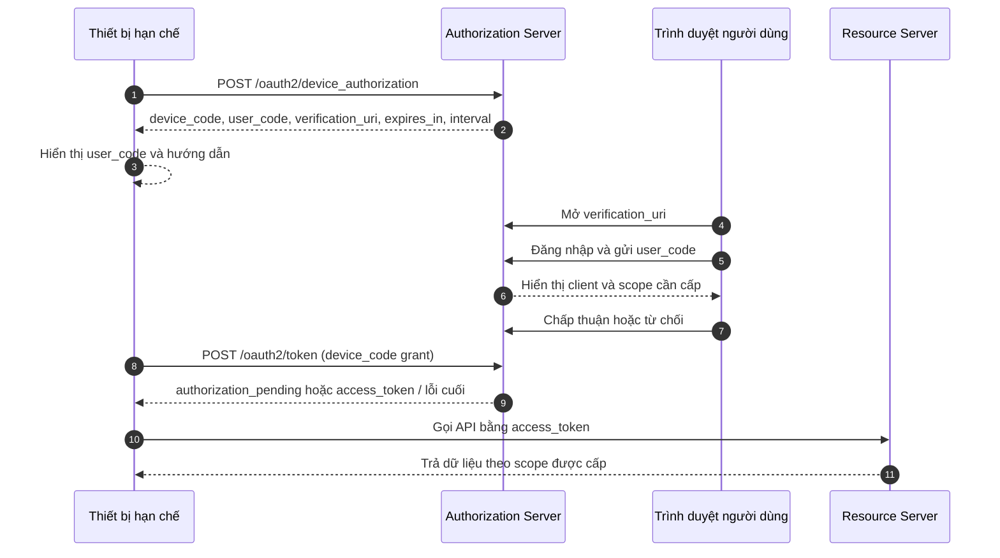
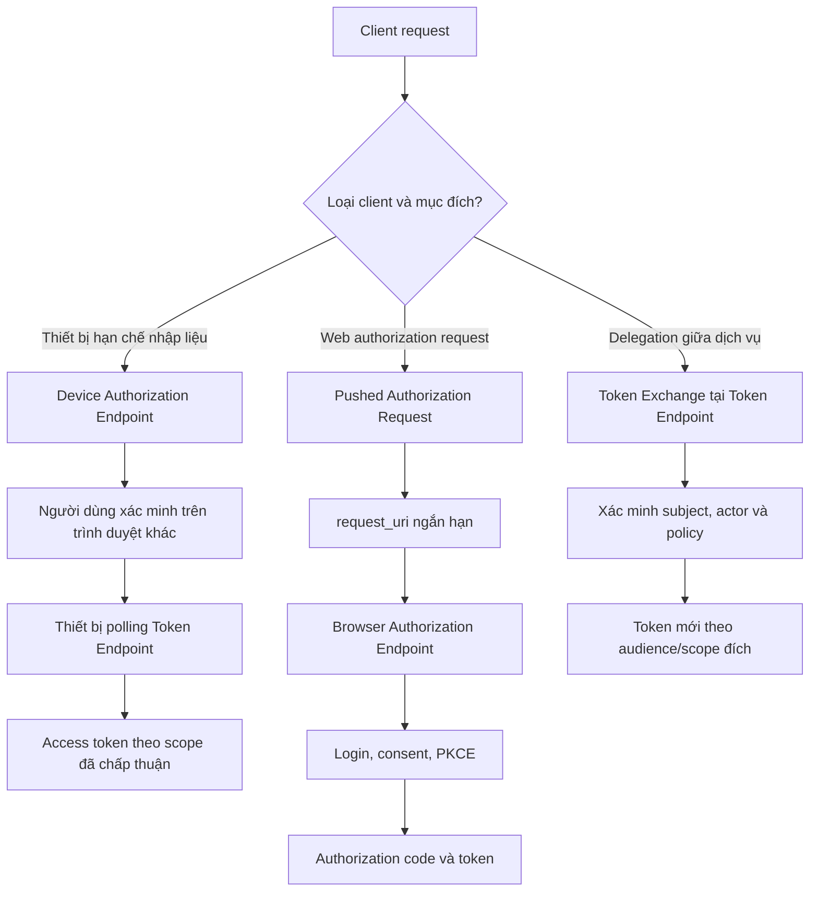

# Triển khai Device Flow, PAR và Token Exchange theo nhu cầu

Một Authorization Server thường phục vụ nhiều loại client. TV, máy in hoặc thiết bị IoT có thể không có bàn phím để nhập thông tin đăng nhập; ứng dụng web cần gửi yêu cầu ủy quyền phức tạp mà không để lộ toàn bộ tham số trên front channel; backend có thể cần đổi một access token nhận được thành token có audience hoặc quyền hạn hẹp hơn để gọi dịch vụ khác. OAuth 2.0 có các cơ chế riêng cho từng tình huống: Device Authorization Grant, Pushed Authorization Requests (PAR) và Token Exchange.

Ba cơ chế này giải quyết ba bài toán khác nhau. Device Flow đưa việc xác thực người dùng sang một thiết bị có trình duyệt phù hợp. PAR chuyển các tham số authorization request qua back channel trước khi trình duyệt được chuyển hướng. Token Exchange cho phép một client được ủy quyền đổi token đầu vào thành token đại diện cho một ngữ cảnh truy cập khác. Không nên bật cả ba chỉ vì Authorization Server có hỗ trợ; hãy chọn theo loại client, ranh giới tin cậy và yêu cầu nghiệp vụ.

## 1. Chọn đúng luồng cho từng tình huống

| Nhu cầu | Luồng phù hợp | Kết quả chính | Điều cần kiểm soát |
|---|---|---|---|
| Thiết bị không có trình duyệt hoặc bàn phím thuận tiện | Device Authorization Grant (Device Flow) | Thiết bị nhận `device_code`; người dùng xác minh `user_code` trên thiết bị khác | Thời hạn code, polling interval, xác minh người dùng, chống brute force và consent |
| Ứng dụng web cần gửi authorization request qua kênh bảo mật trước redirect | Pushed Authorization Requests (PAR) | Server trả `request_uri` dùng trong authorization request trên trình duyệt | Xác thực client, ràng buộc `request_uri` với client, thời hạn ngắn và PKCE |
| Backend cần token mới cho một dịch vụ hoặc audience khác | OAuth 2.0 Token Exchange | Server phát hành token theo subject, actor, audience và scope được phép | Xác minh token đầu vào, quyền delegation, audience, scope và chống confused deputy |

Device Flow không phải cách bỏ qua đăng nhập; nó chuyển thao tác đăng nhập sang trình duyệt trên thiết bị thứ hai. PAR không thay thế authorization code flow, `state`, PKCE hoặc redirect URI validation; nó bảo vệ việc truyền authorization request. Token Exchange không phải refresh token: refresh token gia hạn quyền đã cấp cho client, còn token exchange tạo token mới theo chính sách trao đổi và ủy quyền.

## 2. Chuẩn bị môi trường thực hành

Lab giả định đã có Spring Authorization Server chạy qua HTTPS, có `RegisteredClientRepository`, `OAuth2AuthorizationService`, `OAuth2AuthorizationConsentService` và một `JWKSource` được cấu hình ổn định. Dùng database dùng chung nếu chạy nhiều instance. Trong môi trường local, có thể dùng HTTPS development certificate; không thử các luồng dựa trên redirect hoặc cookie với cấu hình production bị hạ xuống HTTP.

Trước khi bật tính năng, ghi lại phiên bản Spring Authorization Server và Spring Security đang dùng. Device Authorization Grant và PAR có API cấu hình riêng trong các phiên bản hỗ trợ. Token Exchange có thể cần phiên bản cung cấp hỗ trợ tương ứng hoặc phần mở rộng do ứng dụng triển khai. Không giả định chỉ thêm một `AuthorizationGrantType` là server đã có đầy đủ bộ xử lý grant.

Các endpoint mặc định thường gặp trong cấu hình Spring Authorization Server là:

| Endpoint | Mục đích |
|---|---|
| `/oauth2/device_authorization` | Thiết bị yêu cầu mã xác minh và thông tin hướng dẫn người dùng |
| `/activate` hoặc URI verification đã cấu hình | Người dùng nhập hoặc xác nhận user code |
| `/oauth2/par` | Client đẩy authorization request lên server |
| `/oauth2/authorize` | Trình duyệt tiếp tục authorization request; với PAR, dùng `request_uri` |
| `/oauth2/token` | Polling device grant, đổi authorization code hoặc thực hiện token exchange |

Endpoint thực tế phụ thuộc `AuthorizationServerSettings` và cấu hình endpoint của ứng dụng. Hãy đọc metadata hoặc cấu hình công khai của chính server để xác nhận đường dẫn, không hardcode endpoint mặc định vào mọi client.

## 3. Lab A — Device Authorization Grant cho thiết bị hạn chế nhập liệu

### 3.1. Mô hình hoạt động

Thiết bị bắt đầu bằng cách gọi device authorization endpoint. Server tạo `device_code` bí mật cho thiết bị và `user_code` ngắn hơn để người dùng nhập trên một thiết bị có trình duyệt. Người dùng mở verification URI, đăng nhập vào Authorization Server, nhập code, xem client và scope, rồi chấp thuận hoặc từ chối. Thiết bị tiếp tục polling token endpoint theo khoảng thời gian server chỉ định cho đến khi authorization hoàn tất hoặc hết hạn.



`device_code` là bí mật gắn với giao dịch và chỉ thiết bị giữ. `user_code` là mã ngắn để con người nhập; không dùng nó thay cho token hoặc làm credential truy cập API. Người dùng phải xác minh đúng tài khoản và hiểu thiết bị/client nào đang xin quyền.

### 3.2. Đăng ký device client

Device client thường là public client vì thiết bị không thể giữ client secret an toàn. Đăng ký grant `DEVICE_CODE` và chỉ cấp scope thật sự cần. Nếu thiết bị có khả năng bảo vệ secret bằng phần cứng và mô hình vận hành cho phép, có thể dùng client authentication phù hợp, nhưng không nhúng một secret dùng chung vào firmware phát hành đại trà.

Ví dụ đăng ký một client public:

```java
RegisteredClient deviceClient = RegisteredClient
        .withId(UUID.randomUUID().toString())
        .clientId("living-room-display")
        .clientAuthenticationMethod(ClientAuthenticationMethod.NONE)
        .authorizationGrantType(AuthorizationGrantType.DEVICE_CODE)
        .authorizationGrantType(AuthorizationGrantType.REFRESH_TOKEN)
        .scope("display.read")
        .tokenSettings(TokenSettings.builder()
                .accessTokenTimeToLive(Duration.ofMinutes(5))
                .refreshTokenTimeToLive(Duration.ofDays(14))
                .reuseRefreshTokens(false)
                .build())
        .build();

registeredClientRepository.save(deviceClient);
```

Đoạn đăng ký minh họa các thuộc tính quan trọng; xác nhận `AuthorizationGrantType.DEVICE_CODE` và khả năng phát hành refresh token theo phiên bản thư viện đang dùng. Chỉ bật refresh token nếu thiết bị cần duy trì đăng nhập dài hạn và có cách lưu, xoay vòng, thu hồi refresh token an toàn. Với thiết bị dễ bị mất hoặc chia sẻ, ưu tiên access token ngắn hạn và quy trình cấp quyền lại rõ ràng.

### 3.3. Bật endpoint Device Authorization và Verification

Trong phiên bản Spring Authorization Server có hỗ trợ Device Authorization Grant, cấu hình endpoint trong filter chain của Authorization Server. Ví dụ cấu trúc cấu hình:

```java
@Bean
@Order(1)
SecurityFilterChain authorizationServerSecurityFilterChain(HttpSecurity http)
        throws Exception {
    OAuth2AuthorizationServerConfigurer authorizationServerConfigurer =
            OAuth2AuthorizationServerConfigurer.authorizationServer();

    http
        .securityMatcher(authorizationServerConfigurer.getEndpointsMatcher())
        .with(authorizationServerConfigurer, authorizationServer ->
                authorizationServer
                    .deviceAuthorizationEndpoint(Customizer.withDefaults())
                    .deviceVerificationEndpoint(Customizer.withDefaults())
                    .tokenEndpoint(Customizer.withDefaults()));

    return http.build();
}
```

API builder và cách bật endpoint có thể thay đổi theo phiên bản. Nếu phiên bản đang dùng tự bật endpoint khi có grant support, giữ cấu hình tối thiểu theo tài liệu tương ứng. Trang verification cần dùng cùng cơ chế đăng nhập, CSRF protection và consent policy của Authorization Server; không tạo một trang nhập code độc lập bỏ qua xác thực người dùng.

### 3.4. Yêu cầu mã thiết bị

Thiết bị gửi POST đến device authorization endpoint với `client_id` và scope được yêu cầu. Ví dụ:

```bash
curl -X POST https://identity.example.com/oauth2/device_authorization \
  -H 'Content-Type: application/x-www-form-urlencoded' \
  --data-urlencode 'client_id=living-room-display' \
  --data-urlencode 'scope=display.read'
```

Response thành công thường có cấu trúc tương tự:

```json
{
  "device_code": "<opaque-device-code>",
  "user_code": "WDJB-MJHT",
  "verification_uri": "https://identity.example.com/activate",
  "verification_uri_complete": "https://identity.example.com/activate?user_code=WDJB-MJHT",
  "expires_in": 600,
  "interval": 5
}
```

Đây là dữ liệu minh họa, không phải code hoặc user code dùng thật. Hiển thị verification URI và user code rõ ràng trên thiết bị. Nếu dùng `verification_uri_complete`, người dùng vẫn phải xác minh và chấp thuận; URL hoàn chỉnh chỉ giúp điền sẵn code, không được tự động cấp quyền.

Thiết bị phải lưu `device_code` trong bộ nhớ an toàn cần thiết cho phiên giao dịch, hiển thị thời hạn còn lại và dừng giao dịch khi hết hạn. Không ghi device code vào log hoặc telemetry. Nếu người dùng hủy trên thiết bị, client nên dừng polling ngay.

### 3.5. Xác minh user code và polling token endpoint

Người dùng mở verification URI, đăng nhập và nhập `user_code`. Server cần hiển thị tối thiểu tên client, mục đích, scope và hành động chấp thuận/từ chối. Trước khi cấp quyền, server phải ràng buộc user code với đúng giao dịch device authorization còn hiệu lực. Hạn chế số lần nhập sai, làm chậm hoặc khóa tạm thời theo chính sách, và không tiết lộ code có tồn tại hay không qua thông báo quá chi tiết.

Sau đó thiết bị polling token endpoint bằng `device_code`:

```bash
curl -X POST https://identity.example.com/oauth2/token \
  -H 'Content-Type: application/x-www-form-urlencoded' \
  --data-urlencode 'grant_type=urn:ietf:params:oauth:grant-type:device_code' \
  --data-urlencode 'device_code=<opaque-device-code>' \
  --data-urlencode 'client_id=living-room-display'
```

Client phải tuân theo `interval` trong response device authorization. Khi server trả `authorization_pending`, tiếp tục đợi rồi polling lại. Khi nhận `slow_down`, tăng khoảng thời gian giữa các lần polling theo quy tắc của Device Authorization Grant (thông thường tăng ít nhất 5 giây) và giữ khoảng mới cho các lần tiếp theo. Không dùng vòng lặp polling liên tục hoặc retry đồng thời từ nhiều thread.

Các kết quả cần xử lý:

| OAuth error / kết quả | Ý nghĩa | Hành vi của thiết bị |
|---|---|---|
| `authorization_pending` | Người dùng chưa hoàn tất xác minh | Chờ đủ interval rồi polling lại |
| `slow_down` | Thiết bị polling quá nhanh | Tăng interval và tiếp tục theo giới hạn mới |
| `access_denied` | Người dùng từ chối | Dừng giao dịch và thông báo có thể yêu cầu thử lại |
| `expired_token` | Device code đã hết hạn | Dừng polling; bắt đầu giao dịch device authorization mới khi người dùng yêu cầu |
| Token response thành công | Người dùng đã chấp thuận và server cấp token | Lưu token an toàn, dùng đúng scope/audience được cấp |

Không retry mù với `invalid_client`, `invalid_grant` hoặc lỗi cấu hình khác. Những lỗi này cần được ghi nhận ở mức không chứa bí mật và xử lý theo loại lỗi. Khi thiết bị nhận access token, nó chỉ gọi resource server với quyền đã được cấp; không suy rộng scope từ yêu cầu ban đầu.

### 3.6. Kiểm thử Device Flow

Thực hiện các ca sau trên hai client độc lập và một resource server thử nghiệm:

1. Client hợp lệ yêu cầu device code với scope cho phép; response có đủ `device_code`, `user_code`, verification URI, expiry và interval.
2. Client không đăng ký hoặc yêu cầu scope ngoài chính sách bị từ chối.
3. Người dùng đăng nhập và nhập user code hợp lệ; trang hiển thị đúng client và scope.
4. Người dùng từ chối; polling trả `access_denied` và không phát hành token.
5. Thiết bị polling trước khi người dùng xác minh nhận `authorization_pending`.
6. Polling nhanh hơn interval nhận `slow_down`; client tăng interval và không tiếp tục gửi request dồn dập.
7. User code sai, nhập quá số lần hoặc code hết hạn không thể hoàn tất authorization.
8. Dùng lại device code sau khi token đã được cấp không tạo ra lần cấp token thứ hai trái phép.
9. Token được cấp chỉ chứa scope đã chấp thuận; resource server từ chối thao tác vượt scope.
10. Hủy giao dịch hoặc thu hồi quyền khiến thiết bị không thể tiếp tục dùng credential đã bị vô hiệu hóa theo chính sách.

## 4. Lab B — Pushed Authorization Requests (PAR)

### 4.1. Khi nào dùng PAR?

Trong authorization code flow thông thường, client điều hướng trình duyệt đến `/oauth2/authorize` cùng các tham số như `client_id`, `redirect_uri`, `scope`, `state` và PKCE challenge. Với PAR, client gửi các tham số authorization request qua một POST back-channel đến PAR endpoint trước. Server xác thực client, kiểm tra request và trả về một `request_uri` ngắn hạn. Sau đó client chỉ điều hướng trình duyệt đến authorization endpoint với `client_id` và `request_uri`.

PAR giúp giảm dữ liệu nhạy cảm hoặc dài trên front channel, tránh việc các tham số authorization bị sửa khi đi qua trình duyệt và tạo điểm kiểm tra request sớm. PAR không biến một redirect URI chưa đăng ký thành hợp lệ và không thay thế PKCE. Client vẫn phải tạo `state`, giữ verifier bí mật và kiểm tra callback.

### 4.2. Đăng ký confidential client cho PAR

Ví dụ client web dùng authorization code, PKCE và client authentication:

```java
RegisteredClient webClient = RegisteredClient
        .withId(UUID.randomUUID().toString())
        .clientId("web-portal")
        .clientSecret(passwordEncoder.encode(secretFromVault))
        .clientAuthenticationMethod(ClientAuthenticationMethod.CLIENT_SECRET_BASIC)
        .authorizationGrantType(AuthorizationGrantType.AUTHORIZATION_CODE)
        .authorizationGrantType(AuthorizationGrantType.REFRESH_TOKEN)
        .redirectUri("https://app.example.com/login/oauth2/code/identity")
        .scope("openid")
        .scope("profile")
        .clientSettings(ClientSettings.builder()
                .requireProofKey(true)
                .requireAuthorizationConsent(true)
                .build())
        .build();

registeredClientRepository.save(webClient);
```

Secret trong ví dụ chỉ biểu thị vị trí cấu hình. Production phải lấy secret từ secret manager, dùng encoder phù hợp với định dạng lưu trữ và không ghi secret vào source control. Public client không có secret vẫn có thể cần PAR tùy profile và chính sách; phải dùng phương thức xác thực phù hợp với loại client và yêu cầu triển khai.

### 4.3. Bật PAR endpoint

Trong phiên bản Spring Authorization Server hỗ trợ PAR, bật pushed authorization request endpoint trên configurer:

```java
http.with(authorizationServerConfigurer, authorizationServer ->
        authorizationServer
            .pushedAuthorizationRequestEndpoint(Customizer.withDefaults())
            .authorizationEndpoint(Customizer.withDefaults()));
```

PAR endpoint mặc định thường là `/oauth2/par`; xác nhận bằng `AuthorizationServerSettings` hoặc metadata của server. Endpoint phải yêu cầu client authentication theo phương thức đã đăng ký và kiểm tra các tham số như response type, redirect URI, scope, PKCE challenge và client ID. Giới hạn kích thước request, tốc độ gửi và thời hạn `request_uri`.

### 4.4. Đẩy authorization request

Client tạo ngẫu nhiên `state`, `code_verifier`, tính `code_challenge` theo S256 và gửi các tham số qua back channel. Ví dụ minh họa:

```bash
curl -X POST https://identity.example.com/oauth2/par \
  -u 'web-portal:<client-secret>' \
  -H 'Content-Type: application/x-www-form-urlencoded' \
  --data-urlencode 'response_type=code' \
  --data-urlencode 'client_id=web-portal' \
  --data-urlencode 'redirect_uri=https://app.example.com/login/oauth2/code/identity' \
  --data-urlencode 'scope=openid profile' \
  --data-urlencode 'state=<random-state>' \
  --data-urlencode 'code_challenge=<base64url-sha256-challenge>' \
  --data-urlencode 'code_challenge_method=S256'
```

Server trả về response tương tự:

```json
{
  "request_uri": "urn:ietf:params:oauth:request_uri:<opaque-value>",
  "expires_in": 90
}
```

Client giữ `request_uri` cho lần điều hướng hiện tại. Không ghi request URI hoặc toàn bộ authorization request vào URL log, analytics hoặc referrer. `request_uri` có thời hạn ngắn và gắn với client đã gửi request; coi nó là một handle nhạy cảm trong thời gian hiệu lực.

### 4.5. Điều hướng trình duyệt và đổi code

Sau khi nhận `request_uri`, client điều hướng trình duyệt đến authorization endpoint, ví dụ:

```text
https://identity.example.com/oauth2/authorize
  ?client_id=web-portal
  &request_uri=urn%3Aietf%3Aparams%3Aoauth%3Arequest_uri%3A<opaque-value>
```

Các tham số authorization đã được đẩy qua PAR. Authorization Server tải request đã lưu, xác nhận nó thuộc client tương ứng và còn hạn, rồi tiếp tục đăng nhập/consent như authorization code flow bình thường. Sau callback, client xác minh `state`, gửi authorization code cùng `code_verifier` đến token endpoint và kiểm tra token response.

Không gửi lại `redirect_uri`, scope hoặc PKCE challenge với giá trị khác trên front channel để ghi đè dữ liệu trong PAR request. Nếu server yêu cầu tham số trùng lặp theo profile, giá trị phải khớp với request đã lưu. Một `request_uri` hết hạn hoặc đã bị tiêu thụ theo chính sách không được chấp nhận lại.

### 4.6. Kiểm thử PAR

| Ca kiểm thử | Kết quả mong đợi |
|---|---|
| Confidential client hợp lệ đẩy request hợp lệ | Trả `request_uri` và `expires_in` |
| Thiếu hoặc sai client authentication | Bị từ chối theo OAuth client authentication |
| Redirect URI chưa đăng ký | Request bị từ chối tại PAR endpoint |
| PKCE thiếu hoặc dùng method yếu khi policy yêu cầu S256 | Request bị từ chối |
| Scope không được client đăng ký | Request bị từ chối hoặc thu hẹp theo chính sách đã công bố |
| Dùng `request_uri` với client khác | Bị từ chối |
| `request_uri` hết hạn | Không thể tiếp tục authorization |
| Thay tham số front-channel để ghi đè request đã push | Server từ chối hoặc bỏ qua tham số không được phép; không đổi dữ liệu đã lưu |
| Request hợp lệ qua login, consent và callback | Authorization code được cấp; token chỉ được cấp khi verifier đúng |

Kiểm tra thêm request URI không thể đoán, không chứa dữ liệu người dùng dễ đọc và không thể sử dụng để bỏ qua xác thực người dùng hoặc consent. PAR chỉ chuyển authorization request sang back channel; quyết định cấp quyền vẫn theo chính sách của Authorization Server.

## 5. Lab C — OAuth 2.0 Token Exchange

### 5.1. Bài toán delegation

Giả sử một ứng dụng gateway nhận access token dành cho API `orders`, sau đó cần gọi API `shipping`. Chuyển tiếp nguyên token ban đầu có thể cấp quyền rộng hơn cần thiết cho dịch vụ shipping. Token Exchange cho phép gateway yêu cầu Authorization Server phát hành token mới với audience và scope giới hạn cho dịch vụ đích, dựa trên subject token và quyền delegation được phép.

RFC 8693 định nghĩa grant type:

```text
urn:ietf:params:oauth:grant-type:token-exchange
```

Các tham số phổ biến gồm `subject_token`, `subject_token_type`, `actor_token`, `actor_token_type`, `requested_token_type`, `audience`, `resource` và `scope`. Subject token đại diện cho chủ thể được ủy quyền; actor token (nếu dùng) đại diện cho tác nhân thực hiện trao đổi thay mặt chủ thể. Server phải xác minh cả quan hệ delegation lẫn quyền của client gọi exchange.

Token Exchange chỉ phù hợp khi có mô hình tin cậy rõ giữa client, Authorization Server và resource server. Nếu backend chỉ cần dùng refresh token để gia hạn access token của chính client, hãy dùng refresh token grant. Không dùng token exchange để biến một token bất kỳ thành token có quyền cao hơn.

### 5.2. Xác định chính sách trước khi triển khai

Trước khi cấu hình grant, lập ma trận cho phép trao đổi. Ví dụ:

| Thành phần | Chính sách minh họa |
|---|---|
| Client được phép exchange | `orders-gateway` đã xác thực bằng client authentication mạnh |
| Subject token | Access token hợp lệ do issuer tin cậy phát hành, dành cho API `orders` |
| Actor | Gateway có quyền đại diện cho subject trong luồng xử lý đơn hàng |
| Audience đích | Chỉ `shipping-api` |
| Scope được yêu cầu | `shipment.create` hoặc tập con được policy cho phép |
| Scope bị cấm | `admin`, `payment.refund` và mọi scope không nằm trong allowlist delegation |
| Thời hạn token mới | Ngắn, không vượt quá giới hạn của subject token hoặc chính sách delegation |

Không lấy `audience`, `resource` hoặc `scope` do client yêu cầu làm quyết định cuối cùng. Server phải giao với chính sách phía server và quyền của subject. Một client được phép exchange cho `shipping-api` không mặc nhiên được exchange cho `admin-api`.

### 5.3. Kiểm tra hỗ trợ của phiên bản Spring Authorization Server

Token Exchange là grant type mở rộng. Trước tiên kiểm tra phiên bản thư viện đang dùng có provider/converter native cho RFC 8693 hay không. Nếu có, dùng implementation chính thức và cấu hình client/policy theo API của phiên bản đó. Nếu chưa có, cần triển khai custom grant tại token endpoint; chỉ đăng ký grant type trong `RegisteredClient` sẽ không tự tạo logic xác minh token và phát hành token mới.

Đăng ký grant type ở client chỉ là một phần cấu hình:

```java
AuthorizationGrantType TOKEN_EXCHANGE = new AuthorizationGrantType(
        "urn:ietf:params:oauth:grant-type:token-exchange");

RegisteredClient gatewayClient = RegisteredClient
        .withId(UUID.randomUUID().toString())
        .clientId("orders-gateway")
        .clientSecret(passwordEncoder.encode(secretFromVault))
        .clientAuthenticationMethod(ClientAuthenticationMethod.CLIENT_SECRET_BASIC)
        .authorizationGrantType(TOKEN_EXCHANGE)
        .scope("token.exchange")
        .build();

registeredClientRepository.save(gatewayClient);
```

`token.exchange` ở đây là scope nội bộ dùng để biểu diễn quyền gọi chức năng exchange theo thiết kế ứng dụng; nó không thay thế các kiểm tra audience, subject, actor hoặc scope đích. Tùy phiên bản và implementation, cách biểu diễn quyền exchange có thể là client policy riêng thay vì scope.

### 5.4. Thiết kế custom grant provider

Khi phải tự triển khai, giữ converter mỏng và đặt quyết định bảo mật trong authentication provider/service. Converter chỉ đọc form parameter, xác thực định dạng cơ bản và tạo một authentication request chưa được xác thực. Provider cần thực hiện các bước sau theo thứ tự:

1. Lấy `RegisteredClient` từ principal client đã được Spring Security xác thực; xác nhận client được phép dùng token exchange.
2. Kiểm tra `subject_token_type` được hỗ trợ và xác minh chữ ký, issuer, audience, thời hạn, `nbf`, trạng thái thu hồi hoặc introspection theo loại token.
3. Nếu có `actor_token`, xác minh token đó và quan hệ delegation giữa actor với subject. Không tin các claim actor chỉ vì chúng được gửi trong request.
4. Tính audience/resource đích từ policy phía server; từ chối audience do client yêu cầu nếu không nằm trong allowlist của client và subject.
5. Tính scope giao giữa scope được subject sở hữu, scope client được phép delegate và scope dịch vụ đích hỗ trợ. Không cấp scope rộng hơn chỉ vì client yêu cầu.
6. Tạo token mới với `sub` đúng chủ thể, `aud` đúng resource đích, thời hạn phù hợp và claim actor/delegation theo profile đã chọn.
7. Lưu authorization/token theo persistence của Authorization Server, gắn token với client và grant context, rồi trả token response theo RFC 8693.
8. Ghi audit event không chứa token thô; lưu thông tin client, subject ID nội bộ, audience, scope, kết quả và correlation ID.

Trong Spring Authorization Server, phần mở rộng thường được tích hợp qua `AuthenticationConverter` và `AuthenticationProvider` của token endpoint. Provider dùng `RegisteredClientRepository`, `OAuth2AuthorizationService` và `OAuth2TokenGenerator` phù hợp. Cấu hình token endpoint theo API của phiên bản đang chạy, ví dụ cấu trúc:

```java
http.with(authorizationServerConfigurer, authorizationServer ->
        authorizationServer.tokenEndpoint(tokenEndpoint -> tokenEndpoint
                .accessTokenRequestConverter(tokenExchangeConverter)
                .authenticationProvider(tokenExchangeAuthenticationProvider)));
```

Đây là điểm tích hợp minh họa; tên overload và cách đăng ký nhiều converter/provider có thể khác theo phiên bản. Không thay thế các converter/provider grant chuẩn hiện có. Hãy thêm converter của token exchange vào danh sách và giữ nguyên xử lý authorization code, refresh token, client credentials và device code.

Không viết provider theo cách chỉ decode JWT rồi tin claim. Decode không xác minh chữ ký. Với opaque token, dùng introspection qua issuer tin cậy hoặc cơ chế xác minh được issuer công bố. Nếu token đầu vào do một issuer khác phát hành, phải có trust configuration riêng cho issuer đó; không dùng JWK Set của Authorization Server hiện tại để xác minh token từ mọi nguồn.

### 5.5. Gửi yêu cầu Token Exchange

Ví dụ gateway đã xác thực gửi yêu cầu đổi subject token:

```bash
curl -X POST https://identity.example.com/oauth2/token \
  -u 'orders-gateway:<client-secret>' \
  -H 'Content-Type: application/x-www-form-urlencoded' \
  --data-urlencode 'grant_type=urn:ietf:params:oauth:grant-type:token-exchange' \
  --data-urlencode 'subject_token=<subject-access-token>' \
  --data-urlencode 'subject_token_type=urn:ietf:params:oauth:token-type:access_token' \
  --data-urlencode 'requested_token_type=urn:ietf:params:oauth:token-type:access_token' \
  --data-urlencode 'audience=shipping-api' \
  --data-urlencode 'scope=shipment.create'
```

Response thành công theo cấu trúc RFC 8693 có thể tương tự:

```json
{
  "access_token": "<new-access-token>",
  "issued_token_type": "urn:ietf:params:oauth:token-type:access_token",
  "token_type": "Bearer",
  "expires_in": 300,
  "scope": "shipment.create"
}
```

Giá trị trong ví dụ là placeholder. Gateway gửi token mới đến `shipping-api`; resource server phải kiểm tra issuer, chữ ký, `aud` và scope. Nếu token mới có audience khác, resource server cũ không nên chấp nhận nó chỉ vì chữ ký hợp lệ.

### 5.6. Kiểm thử Token Exchange

Các test cần tập trung vào ranh giới delegation:

- Client không có quyền exchange bị từ chối dù subject token hợp lệ.
- Client hợp lệ nhưng subject token sai chữ ký, sai issuer, hết hạn, chưa có hiệu lực hoặc sai audience bị từ chối.
- Subject token đã bị revoke hoặc opaque token không introspect được không được exchange.
- Audience không nằm trong allowlist bị từ chối; không có fallback sang audience mặc định rộng hơn.
- Scope yêu cầu vượt quyền subject hoặc quyền delegation bị từ chối hoặc thu hẹp theo policy đã định nghĩa.
- Actor token sai issuer, hết hạn hoặc không có quan hệ delegation hợp lệ bị từ chối.
- Token mới có `sub`, `aud`, scope và thời hạn đúng; không sao chép claim đặc quyền không cần thiết từ subject token.
- Token mới bị resource server ngoài audience từ chối.
- Audit log không chứa subject token, actor token hoặc token mới.

Test âm tính cần xác minh không có token mới được lưu trong authorization persistence sau khi provider từ chối. Test thành công cần xác minh token mới được lưu và có thể được resource server đích xác minh bằng khóa/issuer phù hợp.

## 6. Ghép ba luồng vào một Authorization Server

Một triển khai có thể bật Device Authorization, PAR và Token Exchange trong cùng token service, nhưng phải giữ chính sách riêng cho từng grant. Cấu hình endpoint thường được đặt trong filter chain Authorization Server; client registration quyết định grant nào client được phép gọi; authentication provider quyết định request có hợp lệ theo ngữ cảnh hay không.



Khi cấu hình nhiều grant trên một client, chỉ đăng ký grant thực sự cần. Không cấp Device Code, Authorization Code, Client Credentials và Token Exchange cho cùng một client theo thói quen. Mỗi grant mở thêm một bề mặt tấn công và yêu cầu kiểm thử riêng.

## 7. Quan sát và vận hành

Đối với Device Flow, theo dõi số giao dịch đang chờ, tỷ lệ người dùng chấp thuận/từ chối, số lần `slow_down`, số giao dịch hết hạn và lỗi polling. Không đưa `device_code` hoặc `user_code` vào log. Rate limit cả endpoint tạo device code lẫn trang verification; giới hạn số code đang chờ trên mỗi client và địa chỉ nguồn theo chính sách.

Đối với PAR, theo dõi tỷ lệ request bị từ chối, thời gian xử lý, số `request_uri` hết hạn và kích thước request. Lưu request URI trong kho có TTL; khi chạy nhiều instance, mọi node phải đọc được cùng dữ liệu PAR trong thời hạn hiệu lực. Xóa dữ liệu hết hạn và không để request URI tồn tại lâu hơn cần thiết.

Đối với Token Exchange, theo dõi số lần exchange theo client, issuer đầu vào, audience đích, scope được cấp, tỷ lệ từ chối và độ trễ introspection. Tránh ghi token thô hoặc claim nhạy cảm vào log. Audit phải đủ để điều tra ai (subject) được client nào (actor) đại diện, đổi sang resource nào và được cấp scope gì.

Đồng bộ thời gian giữa các node để kiểm tra `iat`, `nbf`, `exp` nhất quán. Dùng TLS giữa client, Authorization Server và resource server; bảo vệ secret bằng secret manager; xoay khóa ký có kế hoạch. Nếu chạy nhiều instance, lưu authorization, device authorization và PAR request trong persistence dùng chung theo implementation được hỗ trợ.

## 8. Ma trận kiểm thử tích hợp

| Nhóm | Kiểm thử chính | Điều kiện đạt |
|---|---|---|
| Device Flow | Khởi tạo, chờ, chấp thuận, từ chối, polling chậm, hết hạn | Trạng thái đúng; interval được tuân thủ; không cấp token khi chưa chấp thuận |
| Device Flow | User code sai hoặc brute force | Giới hạn thử; không tiết lộ thông tin giao dịch; không thể chiếm phiên khác |
| Device Flow | Chuyển request giữa nhiều node | Verification và polling thấy cùng giao dịch; token chỉ được cấp một lần |
| PAR | Client authentication và request hợp lệ | Có request URI ngắn hạn, gắn đúng client |
| PAR | Redirect URI, scope, PKCE sai | Request bị từ chối trước khi browser authorization tiếp tục |
| PAR | Request URI hết hạn hoặc dùng với client khác | Bị từ chối |
| PAR | Multi-node | Node nhận browser redirect đọc được request đã push |
| Token Exchange | Subject/actor token không hợp lệ | Bị từ chối và không tạo authorization mới |
| Token Exchange | Audience/scope ngoài policy | Bị từ chối hoặc thu hẹp chính xác theo policy |
| Token Exchange | Token mới gọi resource server đúng/sai audience | Chỉ resource server đúng audience chấp nhận |
| Token Exchange | Audit và log | Có đủ thông tin truy vết, không có token hoặc secret thô |

Nên kiểm thử cả trường hợp Redis/database hoặc kho token/introspection tạm thời không khả dụng. Với thao tác cấp quyền, không được âm thầm chuyển sang dữ liệu cục bộ khác nhau giữa các instance. Xác minh failover không làm một `device_code` được đổi nhiều lần hoặc một `request_uri` hết hạn được chấp nhận trở lại.

## 9. Tiêu chí hoàn thành lab

- [ ] Có quyết định kiến trúc nêu rõ client nào cần Device Flow, PAR hoặc Token Exchange và vì sao.
- [ ] Device client được đăng ký đúng grant, scope tối thiểu, thời hạn token và chính sách refresh token.
- [ ] Người dùng có thể xác minh user code qua trang đăng nhập/consent được bảo vệ; thiết bị polling đúng interval.
- [ ] PAR client gửi request qua back channel, nhận `request_uri` ngắn hạn và hoàn tất authorization code + PKCE.
- [ ] Token Exchange chỉ hoạt động với client được cho phép; subject/actor, audience và scope được kiểm tra theo policy phía server.
- [ ] Có test thành công và thất bại cho từng luồng, bao gồm hết hạn, từ chối, sai client và sai scope.
- [ ] Persistence dùng chung và xử lý một lần đúng khi chạy nhiều instance.
- [ ] Log, metric và audit không làm lộ device code, request URI, client secret hoặc access token.

Kết quả của lab là một Authorization Server có thể phục vụ đúng loại client bằng đúng grant: thiết bị xác minh qua trình duyệt phụ, ứng dụng web đẩy authorization request trước khi redirect, và backend đổi token trong phạm vi delegation đã được phê duyệt. Chất lượng triển khai được quyết định bởi policy kiểm tra client, subject, audience, scope, thời hạn và trạng thái giao dịch ở mỗi luồng.
