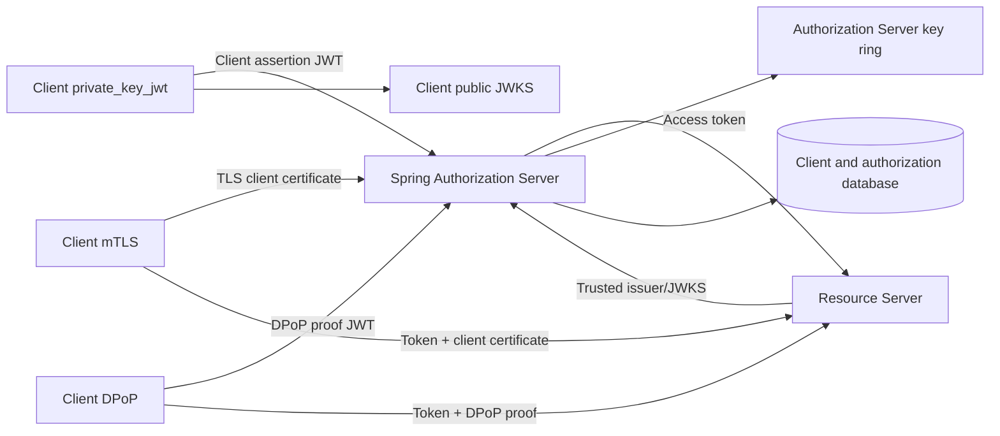

# Thực hành private_key_jwt, mTLS, DPoP và xoay khóa

Lab này xây dựng một Authorization Server có thể xác thực client bằng `private_key_jwt` hoặc mutual TLS (mTLS), phát hành access token được ràng buộc với chứng thư khi dùng mTLS, và bổ sung cơ chế proof-of-possession DPoP cho token endpoint và Resource Server. Phần cuối thực hiện xoay khóa cho từng cơ chế và kiểm tra khả năng xác minh token trong giai đoạn chuyển tiếp.

Các cơ chế trong bài giải quyết những vấn đề khác nhau. `private_key_jwt` dùng chữ ký JWT để xác thực client tại token endpoint. mTLS xác thực client bằng chứng thư TLS và có thể ràng buộc access token với chứng thư đó. DPoP dùng một proof JWT ở tầng HTTP để ràng buộc token với khóa của client. Xoay khóa là quy trình vận hành cần thiết cho cả ba cơ chế, nhưng mỗi loại khóa có mục đích và vòng đời riêng.

Spring Authorization Server cung cấp hỗ trợ cho client authentication bằng `private_key_jwt` và các phương thức TLS client authentication trong các phiên bản tương ứng. DPoP phụ thuộc phiên bản Spring Authorization Server/Spring Security và phần tích hợp cụ thể của dự án. Hãy kiểm tra tài liệu của đúng phiên bản dependency đã pin trước khi triển khai. Nếu phiên bản đang dùng chưa cung cấp đầy đủ DPoP, lab yêu cầu xây dựng adapter xác minh DPoP ở lớp ứng dụng; không giả định chỉ bật `JwtDecoder` là đã có DPoP.

## 1. Mục tiêu và kiến trúc lab

Sau khi hoàn thành, bạn có thể:

- Đăng ký một confidential client sử dụng `private_key_jwt`, công bố public JWK và gửi client assertion đến token endpoint.
- Đăng ký một client dùng `tls_client_auth`, xác minh chứng thư ở TLS layer và phát hành certificate-bound access token.
- Mô tả và kiểm thử DPoP proof tại token endpoint và Resource Server, gồm `htu`, `htm`, `iat`, `jti`, `ath`, nonce và key thumbprint.
- Xoay khóa ký của Authorization Server, khóa client assertion, chứng thư mTLS và khóa DPoP theo trình tự có thời gian chồng lấp phù hợp.
- Chứng minh request hợp lệ được chấp nhận và request sai proof, sai chứng thư hoặc sai khóa bị từ chối.

Kiến trúc logic:



Các client trong sơ đồ là ba client lab độc lập để dễ quan sát từng cơ chế. Một client thực tế có thể dùng nhiều biện pháp bảo vệ ở các lớp khác nhau, nhưng không nên đăng ký nhiều phương thức xác thực cho cùng client nếu chưa xác định rõ cách server chọn phương thức và chính sách dự phòng.

## 2. Chuẩn bị môi trường

Chuẩn bị một ứng dụng Spring Boot chứa Spring Authorization Server, một Resource Server bảo vệ API `/api/orders`, một client thử nghiệm và một endpoint JWKS công khai. Dùng Maven hoặc Gradle theo dự án hiện có. Chọn phiên bản Java, Spring Boot, Spring Security và Spring Authorization Server tương thích; khóa phiên bản dependency để kết quả lab có thể lặp lại.

Các thành phần cần có:

| Thành phần | Vai trò |
|---|---|
| Authorization Server | Đăng ký client, xác thực client, phát hành token và công bố JWKS |
| Resource Server | Xác minh access token và ràng buộc proof-of-possession |
| Client private_key_jwt | Ký client assertion bằng private key |
| Client mTLS | Trình chứng thư client khi kết nối TLS |
| Client DPoP | Ký proof JWT cho từng HTTP request |
| Database | Lưu Registered Client, authorization và consent nếu cần |
| Key store/KMS/HSM | Lưu private key của Authorization Server và client theo quyền riêng |

Đặt issuer lab là `https://auth.lab.example`. Trong môi trường local, có thể ánh xạ tên miền lab vào loopback và dùng chứng thư TLS phát hành cho đúng hostname. Không dùng HTTP thuần để kiểm thử mTLS hoặc DPoP qua môi trường mà TLS là một phần của yêu cầu bảo mật.

Tạo các secret và key trong thư mục riêng không được commit vào Git. Ví dụ tên file trong lab:

```text
lab-secrets/
  as-signing-private.pem
  as-signing-public.pem
  client-private-key-jwt-private.pem
  client-private-key-jwt-public.pem
  mtls-lab-ca.key
  mtls-lab-ca.crt
  mtls-client.key
  mtls-client.crt
  mtls-client.p12
```

Thêm thư mục này vào `.gitignore` và giới hạn quyền đọc. Không đưa private key vào image, source code, log hoặc kho artifact. Với production, thay file PEM minh họa bằng KMS/HSM hoặc secret manager có kiểm soát truy cập.

## 3. Chuẩn bị key pair và public JWK cho private_key_jwt

`private_key_jwt` dùng private key của client để ký một JWT assertion. Authorization Server lấy public key từ JWKS URL đã đăng ký để xác minh assertion. Private key nằm ở client; public key được công bố để server có thể xác minh.

### 3.1. Tạo key pair thử nghiệm

Có thể tạo RSA key pair bằng OpenSSL:

```bash
openssl genpkey -algorithm RSA \
  -pkeyopt rsa_keygen_bits:3072 \
  -out client-private-key-jwt-private.pem

openssl pkey \
  -in client-private-key-jwt-private.pem \
  -pubout \
  -out client-private-key-jwt-public.pem
```

Đặt `kid` ổn định, ví dụ `client-assertion-2026-01`, cho JWK tương ứng. Public JWKS có dạng khái niệm:

```json
{
  "keys": [
    {
      "kty": "RSA",
      "kid": "client-assertion-2026-01",
      "use": "sig",
      "alg": "RS256",
      "n": "<RSA modulus base64url>",
      "e": "AQAB"
    }
  ]
}
```

`n` phải là modulus thật của public key; ví dụ trên cố ý dùng placeholder. Không đưa `d`, `p`, `q`, `dp`, `dq` hoặc `qi` vào JWKS. Endpoint JWKS phải trả JSON public key qua HTTPS và có cache policy phù hợp với quy trình rotation.

### 3.2. Đăng ký client trong Spring Authorization Server

Ví dụ tạo một client dùng `client_credentials` và `private_key_jwt`:

```java
RegisteredClient privateKeyJwtClient = RegisteredClient.withId(
                UUID.randomUUID().toString())
        .clientId("orders-private-key-client")
        .clientName("Orders private key client")
        .clientAuthenticationMethod(ClientAuthenticationMethod.PRIVATE_KEY_JWT)
        .authorizationGrantType(AuthorizationGrantType.CLIENT_CREDENTIALS)
        .scope("orders.read")
        .clientSettings(ClientSettings.builder()
                .jwkSetUrl("https://client.lab.example/.well-known/jwks.json")
                .tokenEndpointAuthenticationSigningAlgorithm(SignatureAlgorithm.RS256)
                .build())
        .tokenSettings(TokenSettings.builder()
                .accessTokenTimeToLive(Duration.ofMinutes(5))
                .build())
        .build();
```

Các class chính thuộc Spring Authorization Server/Spring Security OAuth2. Tùy phiên bản, package hoặc API builder có thể thay đổi; hãy đối chiếu dependency đang dùng. Lưu client bằng `RegisteredClientRepository` đã cấu hình. Không lưu private key của client vào Registered Client; server chỉ cần public JWK hoặc JWKS URL tin cậy.

### 3.3. Tạo client assertion

Client tạo JWT assertion và gửi đến token endpoint với các tham số:

```text
grant_type=client_credentials
scope=orders.read
client_id=orders-private-key-client
client_assertion_type=urn:ietf:params:oauth:client-assertion-type:jwt-bearer
client_assertion=<signed-client-assertion-jwt>
```

Assertion cần có các claim và header sau:

| Thành phần | Giá trị cần dùng |
|---|---|
| JOSE `alg` | Thuật toán được đăng ký và cho phép, ví dụ `RS256` |
| JOSE `kid` | Khớp với một public JWK trong JWKS của client |
| `iss` | Client ID |
| `sub` | Client ID |
| `aud` | Token endpoint URI chính xác mà assertion được gửi đến |
| `iat` | Thời điểm tạo assertion |
| `exp` | Thời điểm hết hạn ngắn, thường chỉ vài phút |
| `jti` | ID duy nhất cho assertion, dùng để hỗ trợ phát hiện replay |

Ví dụ cấu trúc payload:

```json
{
  "iss": "orders-private-key-client",
  "sub": "orders-private-key-client",
  "aud": "https://auth.lab.example/oauth2/token",
  "iat": 1794864000,
  "exp": 1794864300,
  "jti": "assertion-unique-id-001"
}
```

Các timestamp trên chỉ minh họa định dạng NumericDate. Client phải tạo thời gian thực tại thời điểm gửi. `aud` cần khớp với token endpoint mà Authorization Server mong đợi; không tùy tiện dùng issuer thay cho token endpoint. `jti` cần duy nhất và có thể được lưu trong replay cache trong thời hạn assertion để từ chối assertion đã dùng lại. Kiểm tra hành vi replay protection của phiên bản Authorization Server đang chạy; nếu chưa có, bổ sung cơ chế lưu `jti` có tính nguyên tử.

### 3.4. Kiểm thử private_key_jwt

Gửi request đến token endpoint bằng client assertion đã ký. Kết quả mong đợi là access token có scope `orders.read`. Thực hiện lần lượt các trường hợp:

1. Assertion ký bằng private key tương ứng public JWKS: được chấp nhận.
2. Assertion ký bằng key không nằm trong JWKS: bị từ chối.
3. `aud` trỏ đến endpoint khác: bị từ chối.
4. `iss` hoặc `sub` không bằng client ID: bị từ chối.
5. Assertion hết hạn hoặc có thời gian phát hành không hợp lệ: bị từ chối.
6. Gửi lại assertion có cùng `jti`: bị từ chối nếu replay protection được bật.
7. `alg` không nằm trong allowlist: bị từ chối.

Không ghi assertion JWT vào log. Assertion cũng là credential có chữ ký và có thể bị phát lại trong khoảng hiệu lực nếu không được chống replay.

## 4. Thiết lập mTLS client authentication

mTLS xác thực client trong quá trình bắt tay TLS. Client trình chứng thư; Authorization Server xác minh chuỗi chứng thư đến CA tin cậy và ánh xạ danh tính chứng thư với client đã đăng ký.

### 4.1. Tạo CA và client certificate cho lab

Các lệnh sau tạo một CA lab, sau đó ký chứng thư cho client:

```bash
openssl genrsa -out mtls-lab-ca.key 3072

openssl req -x509 -new -key mtls-lab-ca.key \
  -sha256 -days 365 \
  -subj "/CN=Authorization Server Lab CA" \
  -out mtls-lab-ca.crt

openssl genrsa -out mtls-client.key 3072

openssl req -new -key mtls-client.key \
  -subj "/CN=orders-mtls-client/OU=lab" \
  -out mtls-client.csr

openssl x509 -req -in mtls-client.csr \
  -CA mtls-lab-ca.crt -CAkey mtls-lab-ca.key -CAcreateserial \
  -out mtls-client.crt -days 90 -sha256

openssl pkcs12 -export \
  -inkey mtls-client.key -in mtls-client.crt \
  -certfile mtls-lab-ca.crt -out mtls-client.p12
```

Trong môi trường thật, CA phải được quản lý riêng, chứng thư cần SAN/subject theo chính sách định danh, thời hạn phù hợp và quy trình thu hồi. Không dùng CA lab để ký chứng thư production. Bảo vệ `mtls-lab-ca.key`; người dùng client chỉ cần chứng thư và private key của client.

### 4.2. Cấu hình TLS ở Authorization Server

Nếu Spring Boot trực tiếp kết thúc TLS, cấu hình server certificate và trust store chứa CA được phép cấp client certificate. Ví dụ phần cấu hình liên quan đến client authentication:

```yaml
server:
  ssl:
    client-auth: need
    trust-store: file:/run/secrets/client-ca-truststore.p12
    trust-store-type: PKCS12
    trust-store-password: ${CLIENT_CA_TRUSTSTORE_PASSWORD}
```

Ứng dụng cũng cần server keystore/certificate và cấu hình HTTPS đầy đủ. `client-auth: need` yêu cầu client gửi chứng thư trong TLS handshake; `want` chỉ yêu cầu tùy chọn và thường không phù hợp nếu endpoint này bắt buộc mTLS. Chọn chế độ theo kiến trúc và phiên bản Spring Boot.

Lưu ý phạm vi listener: `client-auth: need` áp dụng ở cấp TLS connector và có thể yêu cầu chứng thư trên mọi request đi qua connector đó, kể cả discovery hoặc trang đăng nhập người dùng. Nếu ứng dụng đồng thời phục vụ browser login và API/token endpoint, hãy cân nhắc một listener/hostname mTLS riêng hoặc cấu hình ingress chuyên biệt. Nếu dùng `want` để cho phép các endpoint công khai, lớp xác thực client vẫn phải từ chối request đến token endpoint khi client được đăng ký bằng `tls_client_auth` nhưng không có chứng thư hợp lệ. Không để chế độ tùy chọn biến mTLS thành một phương thức có thể bỏ qua.

Nếu TLS kết thúc tại ingress hoặc load balancer, proxy phải xác thực client certificate và truyền thông tin đã xác minh theo cơ chế tin cậy được thiết kế rõ. Chặn truy cập trực tiếp từ bên ngoài vào backend, xóa mọi header chứng thư do client tự gửi và chỉ chấp nhận metadata từ proxy đã xác thực. Không tin một header như `X-Client-Cert` nếu người gọi có thể tự đặt nó.

### 4.3. Đăng ký client TLS trong Spring Authorization Server

Với client dùng CA-signed certificate và TLS client authentication, cấu hình Registered Client theo subject DN hoặc SAN đã được kiểm soát:

```java
RegisteredClient mtlsClient = RegisteredClient.withId(
                UUID.randomUUID().toString())
        .clientId("orders-mtls-client")
        .clientName("Orders mTLS client")
        .clientAuthenticationMethod(ClientAuthenticationMethod.TLS_CLIENT_AUTH)
        .authorizationGrantType(AuthorizationGrantType.CLIENT_CREDENTIALS)
        .scope("orders.read")
        .clientSettings(ClientSettings.builder()
                .x509CertificateSubjectDN("CN=orders-mtls-client,OU=lab")
                .build())
        .tokenSettings(TokenSettings.builder()
                .accessTokenTimeToLive(Duration.ofMinutes(5))
                .x509CertificateBoundAccessTokens(true)
                .build())
        .build();
```

Tên builder `x509CertificateSubjectDN` và tùy chọn certificate-bound token cần được kiểm tra theo phiên bản Spring Authorization Server đang dùng. Có thể dùng SAN thay cho DN nếu chính sách định danh của hệ thống quy định. Không chỉ dựa vào chuỗi DN do request cung cấp; chứng thư phải được TLS stack xác minh về chuỗi tin cậy, thời hạn, mục đích và trạng thái thu hồi theo chính sách.

`x509CertificateBoundAccessTokens(true)` yêu cầu access token được ràng buộc với thumbprint của client certificate. Với JWT, thông tin ràng buộc thường xuất hiện trong claim `cnf` với thuộc tính `x5t#S256`. Resource Server phải kiểm tra chứng thư của request và so sánh thumbprint với claim này. Nếu chỉ bật mTLS client authentication ở token endpoint mà không bật certificate-bound token và kiểm tra ở Resource Server, access token có thể vẫn là bearer token có thể bị dùng lại bởi bên khác.

### 4.4. Gửi request bằng mTLS

Với `curl`, truyền certificate và private key của client:

```bash
curl --cert mtls-client.crt \
  --key mtls-client.key \
  --cacert server-ca.crt \
  --request POST \
  --data 'grant_type=client_credentials&client_id=orders-mtls-client&scope=orders.read' \
  https://auth.lab.example/oauth2/token
```

`server-ca.crt` là CA mà client dùng để xác minh chứng thư TLS của Authorization Server; nó có thể khác `mtls-lab-ca.crt`, là CA dùng để ký client certificate. Kết quả mong đợi là token endpoint xác thực được client certificate và cấp access token. Request không có certificate, certificate hết hạn, certificate không được CA tin cậy hoặc subject/SAN không khớp client đã đăng ký phải bị từ chối.

Sau khi nhận token, gọi Resource Server bằng đúng certificate đã ràng buộc. Thử lại bằng một certificate khác: Resource Server phải từ chối token vì thumbprint không khớp. Thử chỉ gửi access token mà không có certificate: request cũng phải bị từ chối với token certificate-bound.

## 5. Thực hành DPoP proof-of-possession

DPoP (Demonstrating Proof of Possession) ràng buộc access token với một public key do client sở hữu. Client ký một DPoP proof JWT cho từng request HTTP. Kẻ đánh cắp riêng access token sẽ không thể sử dụng token nếu không có private key tương ứng.

### 5.1. Tạo DPoP key pair

Client tạo một key pair riêng cho DPoP. Có thể dùng EC P-256 hoặc thuật toán bất đối xứng được server cho phép. Private key phải ở client; public JWK nằm trong header proof. Không tái sử dụng private key ký client assertion hoặc khóa ký của Authorization Server cho DPoP.

### 5.2. Cấu trúc DPoP proof

Một proof JWT có JOSE header dạng:

```json
{
  "typ": "dpop+jwt",
  "alg": "ES256",
  "jwk": {
    "kty": "EC",
    "crv": "P-256",
    "x": "<public x coordinate>",
    "y": "<public y coordinate>"
  }
}
```

Payload proof cho request đến Resource Server cần các claim:

```json
{
  "jti": "proof-unique-id-123",
  "htm": "GET",
  "htu": "https://api.lab.example/api/orders",
  "iat": 1794864000,
  "ath": "<base64url-sha256-of-access-token>"
}
```

`htm` là HTTP method thực tế; `htu` là URI đích theo quy tắc chuẩn DPoP, không bao gồm query và fragment. `iat` phải nằm trong cửa sổ thời gian chấp nhận. `jti` phải duy nhất để phát hiện proof replay. `ath` là SHA-256 của access token được mã hóa Base64URL không padding; nó liên kết proof với token cụ thể. Server có thể yêu cầu nonce để giảm nguy cơ replay hoặc kiểm soát thời điểm proof được tạo.

Proof phải ký bằng private key tương ứng với public JWK trong header. Server kiểm tra thuật toán nằm trong allowlist, JWK chỉ chứa public material và key thumbprint khớp với `cnf.jkt` trong access token. Không chấp nhận proof có `alg: none`, thuật toán đối xứng hoặc public JWK chứa private parameters.

### 5.3. Luồng DPoP tại token endpoint

Client gửi một DPoP proof trong HTTP header `DPoP` khi gọi token endpoint. Authorization Server xác minh proof, lấy JWK thumbprint và ràng buộc access token mới với khóa đó. Response cho token DPoP sử dụng `token_type` là `DPoP` và access token mang thông tin xác nhận khóa, thường là `cnf.jkt`.

DPoP là cơ chế ràng buộc token với khóa, không tự thay thế client authentication. Confidential client vẫn phải xác thực bằng phương thức đã đăng ký, chẳng hạn `private_key_jwt` hoặc mTLS; với public client, server áp dụng quy tắc nhận diện client tương ứng. Có thể kết hợp DPoP với một phương thức xác thực client khác nếu cấu hình và phiên bản server hỗ trợ.

Ví dụ dạng request rút gọn:

```http
POST /oauth2/token HTTP/1.1
Host: auth.lab.example
Content-Type: application/x-www-form-urlencoded
DPoP: <signed-dpop-proof-jwt>

grant_type=client_credentials&client_id=orders-dpop-client&scope=orders.read
```

Với authorization code flow, proof được gửi tại token endpoint khi đổi code; server cần áp dụng ràng buộc DPoP theo đúng luồng và kiểm tra tính nhất quán với proof key được dùng. Với client credentials, proof tại token endpoint là cơ sở để ràng buộc token cấp ra.

### 5.4. Luồng DPoP tại Resource Server

Client gửi access token bằng scheme `DPoP` và một proof mới cho request:

```http
GET /api/orders HTTP/1.1
Host: api.lab.example
Authorization: DPoP <access-token>
DPoP: <new-signed-dpop-proof-jwt>
```

Resource Server phải xác minh cả access token lẫn proof. Chỉ xác minh JWT access token như bearer token là chưa đủ. Cần kiểm tra:

1. Access token có chữ ký hợp lệ, issuer, audience, thời hạn và scope đúng.
2. Token có `cnf.jkt` và token type phù hợp với DPoP.
3. Proof có `typ=dpop+jwt`, chữ ký hợp lệ và `alg` bất đối xứng được cho phép.
4. Public JWK trong proof có thumbprint trùng `cnf.jkt`.
5. `htm` khớp method thực tế và `htu` khớp URI đích theo chuẩn.
6. `iat` nằm trong cửa sổ thời gian, `jti` chưa từng được dùng và nonce hợp lệ nếu server yêu cầu.
7. `ath` khớp hash của access token được gửi trong request.

Nếu Resource Server đứng sau reverse proxy, `htu` phải được so sánh với URI bên ngoài theo quy tắc DPoP. Chỉ sử dụng forwarded host/proto từ proxy được tin cậy; proxy phải xóa header do client tự gửi trước khi thêm metadata của chính nó. Nếu không, attacker có thể lợi dụng khác biệt giữa URI nội bộ và URI công khai để làm sai lệch bước kiểm tra đích.

### 5.5. Tích hợp DPoP vào Spring

Hãy kiểm tra phiên bản Spring Authorization Server và Spring Security có cung cấp hỗ trợ DPoP tương ứng cho authorization server và resource server hay chưa. Nếu chưa có hỗ trợ đầy đủ, triển khai một lớp tích hợp riêng có trách nhiệm:

- Ở Authorization Server: nhận header `DPoP` tại token endpoint, xác minh proof, tạo binding `cnf.jkt`, trả `token_type=DPoP` và xử lý nonce/replay.
- Ở Resource Server: nhận scheme `DPoP`, xác minh access token, sau đó xác minh proof theo token binding trước khi tạo Authentication được cấp quyền.
- Dùng một replay cache có TTL và thao tác insert-if-absent nguyên tử theo thumbprint/`jti`; chia sẻ cache giữa các replica.
- Giữ allowlist thuật toán, cửa sổ thời gian và quy tắc URI ở cấu hình tin cậy.

Không đặt một filter kiểm tra DPoP sau khi request đã được authorization xử lý. Proof phải được xác minh trước khi request được cấp quyền truy cập. Cũng không chỉ kiểm tra chữ ký proof mà bỏ qua `htm`, `htu`, `ath`, `jti` hoặc `cnf.jkt`.

Nếu phiên bản thư viện chưa hỗ trợ DPoP, hãy mô tả phần adapter là extension của ứng dụng và kiểm thử theo RFC 9449. Không trình bày một `JwtDecoder` thông thường như triển khai DPoP hoàn chỉnh; `JwtDecoder` chỉ xác minh JWT access token theo cấu hình, không tự thực hiện toàn bộ proof-of-possession protocol.

## 6. So sánh ba cơ chế

| Đặc điểm | private_key_jwt | mTLS | DPoP |
|---|---|---|---|
| Bằng chứng client | JWT assertion ký bằng private key | X.509 client certificate trong TLS handshake | DPoP proof JWT cho HTTP request |
| Vị trí xác minh | Thường tại token endpoint | TLS endpoint và có thể cả Resource Server | Token endpoint và Resource Server |
| Ràng buộc access token | Không tự ràng buộc token với key client | Có thể dùng certificate-bound token | Token gắn với JWK thumbprint `cnf.jkt` |
| Chứng thư TLS bắt buộc | Không | Có | Không bắt buộc ngoài HTTPS server |
| Chống replay | Assertion ngắn hạn và `jti` replay cache | TLS session/certificate; token binding khi bật | `jti`, `iat`, nonce và `ath` |
| Khóa cần xoay | Client assertion signing key | Client certificate và CA/trust | DPoP key của client |

Các cơ chế có thể phối hợp. Ví dụ, client xác thực tại token endpoint bằng `private_key_jwt` rồi nhận DPoP-bound token; hoặc dùng mTLS để xác thực client và certificate-bind token. Quyết định phải phản ánh mô hình đe dọa, khả năng quản lý khóa/chứng thư và hỗ trợ của các API phía sau.

## 7. Xoay vòng khóa ký của Authorization Server

Khóa ký của Authorization Server dùng để ký access token JWT hoặc ID token. Đây là khóa khác với private key của client assertion, chứng thư mTLS và DPoP key.

### 7.1. Chuẩn bị key ring có hai khóa

Tạo khóa mới và gán `kid` mới. Trong giai đoạn chuyển tiếp, JWKS công bố public key cũ và mới. Signer tiếp tục dùng khóa cũ cho đến khi tất cả Resource Server đã nhìn thấy public key mới.

Một `JWKSource` minh họa có thể lấy key set từ provider do ứng dụng quản lý:

```java
@Bean
JWKSource<SecurityContext> jwkSource(KeyRingProvider keyRingProvider) {
    return (selector, context) ->
            selector.select(keyRingProvider.currentJwkSet());
}
```

`KeyRingProvider` là abstraction của ứng dụng. Trong triển khai thật, nó cần phân biệt khóa được phép ký với tập public key được công bố. Endpoint JWKS chỉ trả public JWK; không trả private key. Nếu dùng KMS/HSM, tích hợp signer theo API của nhà cung cấp và không giả định private key có thể export.

### 7.2. Trình tự chuyển khóa

1. Tạo key pair mới và `kid` duy nhất trong kho khóa.
2. Cập nhật key ring trên tất cả Authorization Server instance để JWKS có cả key cũ và mới.
3. Xác minh `jwks_uri` trả cùng một bộ public key từ mọi instance và từ mạng Resource Server.
4. Chờ thời gian propagation/cache theo cấu hình thực tế.
5. Chuyển signer sang private key mới; phát hành token kiểm thử và xác nhận header `kid` mới.
6. Giữ public key cũ trong JWKS cho đến khi mọi token cũ hết hạn, cộng clock skew và thời gian cache.
7. Gỡ public key cũ và xác minh toàn bộ token mới vẫn hoạt động.

Không chỉ đổi `kid` trong header mà giữ key material cũ hoặc thay key material dưới `kid` cũ. `kid` phải định danh ổn định cho một khóa cụ thể.

## 8. Xoay client assertion key cho private_key_jwt

Khóa này thuộc client, không phải Authorization Server. Client ký assertion bằng private key; Authorization Server lấy public key từ JWKS URL của client.

Quy trình rotation:

1. Client tạo key pair mới và `kid` mới.
2. Client công bố cả public key cũ và mới tại JWKS URL.
3. Xác minh Authorization Server có thể tải JWK mới và tìm được `kid` mới.
4. Client chuyển sang ký assertion bằng private key mới.
5. Theo dõi xác thực client; giữ public key cũ đủ lâu cho assertion đang còn hiệu lực và cache JWKS.
6. Gỡ public key cũ sau khoảng an toàn.

Assertion thường có thời hạn ngắn, vì vậy khoảng chồng lấp có thể ngắn hơn vòng đời token truy cập. Tuy nhiên, vẫn phải tính cache và clock skew. Nếu client key cũ bị lộ, thu hồi public key cũ ngay theo quy trình ứng phó, chấp nhận các assertion còn hiệu lực bằng khóa đó bị từ chối.

## 9. Xoay chứng thư mTLS

Chứng thư client cần được cấp mới trước khi hết hạn. Khi dùng CA cũ và CA mới, có thể có giai đoạn trust store tin cậy cả hai CA. Khi dùng cùng CA nhưng chứng thư mới, cập nhật binding client theo subject DN hoặc SAN và kiểm tra cert mới trước khi loại cert cũ.

Quy trình tham khảo:

1. Cấp chứng thư mới, xác minh SAN/subject, EKU, thời hạn và chain.
2. Thêm CA hoặc certificate mới vào trust store nếu cần.
3. Cập nhật cấu hình client để gửi chứng thư mới.
4. Cập nhật binding trong Registered Client nếu subject/SAN thay đổi.
5. Kiểm thử token endpoint với chứng thư mới và Resource Server với token certificate-bound mới.
6. Ngừng chấp nhận chứng thư cũ sau khi các token ràng buộc với chứng thư cũ hết hạn hoặc đã được thu hồi theo chính sách.
7. Gỡ CA cũ khỏi trust store khi không còn client hợp lệ nào phụ thuộc.

Access token đã ràng buộc với thumbprint của chứng thư cũ không tự chuyển sang chứng thư mới. Client cần lấy token mới bằng chứng thư mới. Nếu chứng thư cũ bị lộ, có thể phải thu hồi token liên quan và loại bỏ trust sớm hơn kế hoạch.

## 10. Xoay DPoP key

DPoP key là khóa của client và được nhận diện qua JWK thumbprint. Token đã phát hành mang `cnf.jkt` của key cũ. Nếu client đổi key, proof được ký bằng key mới sẽ không khớp với token cũ.

Vì vậy, rotation DPoP thường gồm:

1. Tạo DPoP key pair mới và bảo vệ private key.
2. Dùng key mới trong yêu cầu lấy access token mới.
3. Xác nhận token mới có `cnf.jkt` khớp thumbprint key mới.
4. Chuyển request API sang token mới và proof ký bằng key mới.
5. Ngừng dùng token cũ sau khi hết hạn hoặc thu hồi theo chính sách.
6. Xóa key cũ khỏi thiết bị/kho khóa khi không còn token cần sử dụng.

Không thể chỉ thay private key cục bộ rồi tiếp tục dùng token cũ. Nếu cần chuyển tiếp không gián đoạn, giữ cả hai key pair ở client trong khoảng ngắn, nhưng mỗi token phải luôn đi kèm proof từ đúng key đã ràng buộc.

## 11. Kiểm thử tổng hợp

Thực hiện các bài kiểm tra sau và lưu kết quả không chứa secret:

| Nhóm | Ca kiểm thử | Kết quả mong đợi |
|---|---|---|
| private_key_jwt | Assertion hợp lệ, `kid` có trong JWKS | Client được xác thực |
| private_key_jwt | Sai chữ ký, sai `aud`, sai `sub`, assertion hết hạn | Token endpoint từ chối |
| private_key_jwt | Replay cùng `jti` | Assertion thứ hai bị từ chối khi replay protection bật |
| private_key_jwt | Rotation client key | Assertion bằng key mới thành công trong giai đoạn overlap |
| mTLS | Chứng thư được CA tin cậy và đúng client | Client được xác thực |
| mTLS | Không có cert, cert không tin cậy, cert sai subject/SAN | TLS hoặc client authentication bị từ chối |
| mTLS | Token certificate-bound dùng cùng cert | Resource Server chấp nhận |
| mTLS | Token dùng với cert khác hoặc không có cert | Resource Server từ chối |
| DPoP | Proof hợp lệ, đúng `htm`, `htu`, `ath`, `cnf.jkt` | Request được xác thực |
| DPoP | Sai method/URI, proof hết hạn hoặc sai thumbprint | Request bị từ chối |
| DPoP | Replay cùng `jti` hoặc nonce sai | Request bị từ chối |
| DPoP | Token cũ dùng với key mới | Request bị từ chối |
| AS key rotation | Token cũ và mới trong giai đoạn overlap | Cả hai xác minh được |
| AS key rotation | Token mới sau khi gỡ public key cũ | Token mới vẫn xác minh được |
| Multi-instance | Mọi replica công bố cùng key ring | Không có lỗi chọn key ngẫu nhiên theo replica |

Nên tự động hóa các ca âm tính bằng integration test. Không chỉ kiểm tra HTTP status; xác nhận server từ chối vì đúng lý do, log không chứa token và metric được gắn nhãn đúng.

## 12. Chẩn đoán lỗi thường gặp

| Triệu chứng | Nguyên nhân có thể | Hướng xử lý |
|---|---|---|
| `invalid_client` với private_key_jwt | Sai `kid`, public JWKS không truy cập được, sai chữ ký, `iss`/`sub`/`aud` không đúng | Kiểm tra assertion header/claims và JWKS client |
| Assertion hợp lệ nhưng bị replay từ chối | `jti` đã được dùng hoặc client tái sử dụng assertion | Tạo assertion mới cho mỗi lần gọi, đồng bộ replay cache |
| mTLS handshake thất bại | Trust store thiếu CA, cert hết hạn hoặc TLS không yêu cầu client cert đúng cách | Kiểm tra chain, EKU, trust store và cấu hình ingress |
| mTLS client bị `invalid_client` | Cert hợp lệ nhưng subject/SAN không khớp Registered Client | Đồng bộ binding client và certificate identity |
| Resource Server từ chối token mTLS | Thiếu cert hoặc thumbprint không khớp `cnf.x5t#S256` | Gửi đúng cert; kiểm tra certificate-bound validation |
| DPoP proof bị từ chối do URI | `htu` không khớp URI đích mà server nhìn thấy sau proxy | Chuẩn hóa URI theo RFC và cấu hình proxy tin cậy |
| DPoP proof bị từ chối do replay | `jti` đã dùng hoặc replay cache không đồng bộ | Dùng jti mới; chia sẻ replay cache giữa các replica |
| DPoP token bị dùng như bearer | Client gửi `Bearer` hoặc Resource Server không kiểm tra proof | Yêu cầu scheme `DPoP` và xác minh proof trước authorization |
| Token lỗi sau rotation | Public key chưa được publish, cache stale hoặc token dùng key cũ đã bị gỡ | Khôi phục overlap; kiểm tra `kid` và JWKS ở mọi instance |
| Một replica xác minh được, replica khác thất bại | Key ring hoặc trust store không đồng bộ | Kiểm tra fingerprint, phiên bản secret và rollout |

## 13. Tiêu chí hoàn thành lab

Lab được coi là hoàn thành khi bạn chứng minh được tất cả các điểm sau:

- Client `private_key_jwt` lấy được token bằng assertion hợp lệ; assertion sai chữ ký, sai audience, hết hạn hoặc bị replay bị từ chối.
- Client mTLS được xác thực bằng chứng thư; access token certificate-bound chỉ dùng được khi request mang đúng chứng thư.
- Client DPoP nhận token ràng buộc với JWK thumbprint; Resource Server kiểm tra proof cho từng request và từ chối proof replay hoặc proof sai method/URI/token.
- Authorization Server xoay khóa ký mà token cũ còn hợp lệ trong thời gian overlap và token mới được xác minh bằng public key mới.
- Client assertion key, mTLS certificate và DPoP key được xoay theo vòng đời riêng; không dùng lẫn key giữa các mục đích.
- Log và metric đủ để điều tra nhưng không chứa private key, client secret, assertion hoặc access token nguyên vẹn.
- Các ca kiểm thử được chạy qua nhiều instance hoặc mô phỏng cache/replica để phát hiện lỗi đồng bộ.

## Kết luận

`private_key_jwt`, mTLS và DPoP tạo ra ba kiểu bằng chứng khác nhau: chữ ký assertion để xác thực client, chứng thư TLS để xác thực kết nối và proof JWT để ràng buộc từng request với khóa của client. Khi kết hợp chúng với certificate-bound hoặc DPoP-bound access token, Resource Server cần kiểm tra cả token lẫn bằng chứng sở hữu khóa. Xoay khóa an toàn đòi hỏi công bố public key hoặc trust mới trước, chuyển signer/client sau, duy trì giai đoạn chồng lấp phù hợp và chỉ gỡ khóa cũ khi không còn token hoặc assertion hợp lệ phụ thuộc vào nó.
